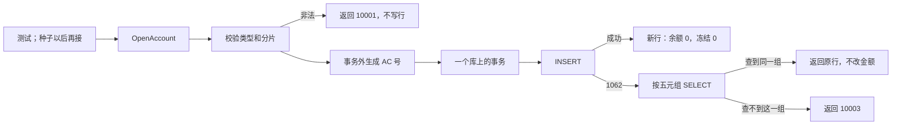

# ACC-01 开户

| 项 | 内容 |
|---|---|
| 功能点 | ACC-01（P0，第 1 周） |
| 所属链路 | 基础设施 |
| 代码提交 | `1b2a54b` `[ACC-01] add account open` |
| 分支 | `feat/ACC-01-open-account` |
| 日期 | 2026-10-15 |
| 状态 | DONE |

完整 hash：`1b2a54bf2242aedc03632822aed6c9755f86ee75`。作者时间 `2026-10-15 05:40:03 +0800`。这次代码提交 6 个文件，1104 行新增，10 行删除。本报告在该提交之后写，不包含在这 6 个文件里。

## 一句话结论

开户是 account 进程里的一个方法，不监听 RPC。账户类型决定余额方向和能不能透支；调用方不能自己指定这两项。同一个所有者、同一种账户、同一个子账户再开一次，返回已有那一行，不把余额或冻结改回 0。50 个 goroutine 同时给 `M100002` 开结算账户，库里只有 1 行，50 次返回同一个账户号。非法组合返回 `10001`，不写行。

## 1. 背景

### 1.1 系统简介

pay-system 是一个用 Go 编写的小型支付后端，模拟商户收款、退款、商户间转账三条资金链路，重点在数据一致性和性能。系统由 5 个部分组成：gateway（对外 HTTP 入口，负责签名校验和限流）、payment（支付单、退款单、转账单的状态管理和流程推进）、account（账户余额与记账，数据按商户分到 2 个数据库分片）、channel-mock（模拟微信、支付宝这类外部支付渠道）、recon（对账，核对系统内外数据是否一致）。服务之间用 Kitex RPC 同步调用，或通过 Kafka 消息异步通知；数据存在 MySQL 8.4，Redis 用于防重放。所有金额用整数“分”表示，所有记账只追加不修改。当前已完成：工程骨架到 IDL、账户分片路由，以及开户。账户查询和通用记账还没做。

Kitex 是本项目的 Go RPC 框架。IDL 是接口定义文件，用来写下 RPC 的方法和字段。RPC 是进程之间的同步调用。Kafka 是消息队列。Redis 防重放是把已经见过的请求记在 Redis 里，避免同一请求被再处理一次。工程骨架是仓库目录、构建方式和命令入口。分片是账户数据所在的那一个库，这里只有 0 和 1。

### 1.2 本功能点在系统中的位置

本功能点只在 account 进程内部提供 `OpenAccount`。这个方法给以后的种子和测试调用；当前的种子程序仍然自己 `INSERT`，不调用它。这次没有启动 Kitex，也没有进程在监听端口。它只写 `account` 表，不写记账分录，不改已有余额。



测试可以调用 `OpenAccount`；当前种子还不调用。类型或分片不合法就返回 `10001`，两个库都不插入。合法时先在事务外生成账户号，再只在一个分片库上开事务并插入。唯一索引冲突时按五元组 `SELECT`：查到同一组就返回原行；查不到这一组，说明账户号撞上了另一组所有者，返回 `10003`。账户查询（ACC-02）和通用记账（ACC-03）还不存在，图里没有它们。

### 1.3 为什么需要它

商户 `M100002` 的结算账户只能出现在分片 0。商户号是 `M` 加 6 位数字，分片是数字部分对 2 取模：`100002 % 2 = 0`。如果有人把它开进分片 1，以后入账会找不到账，或者同一商户在两个库各有一份余额。这次把 `M100002` 开在分片 1，返回 `10001`，分片 1 没有这一行。

再开一次也不能把钱清掉。假设这行已经有余额 100 分（1.00 元）、冻结 40 分（0.40 元）。可用金额是 100 − 40 = 60 分（0.60 元）。重复开户如果执行“余额改回 0”，这 1.00 元就丢了。10000 分才是 100.00 元；这里的 100 是 100 分，不是 100 元。

## 2. 术语

| 术语 | 含义 |
|---|---|
| 分 | 金额最小单位。100 分 = 1.00 元，40 分 = 0.40 元，60 分 = 0.60 元，10000 分 = 100.00 元。金额是整数，不用小数。 |
| 分片 | 账户数据所在的库，只有 0 和 1。`M100002` 属于分片 0。 |
| 账户号 | 一行账户的对外编号。前缀 `AC`，后面 19 位数字，总长 21。 |
| 商户号 | `M` 加恰好 6 位数字，例如 `M100002`。 |
| 子账户号 `sub_no` | 同一类账户拆成多行时的序号。商户结算账户必须是 0。平台账户是 `0` 到 `subCount-1`。 |
| `subCount` | 平台子账户个数。调用方传进来，开户代码不读环境变量。测试里用 8。 |
| 余额方向 | `CREDIT` 或 `DEBIT`。由账户类型决定。商户结算、手续费收入、在途是 `CREDIT`；渠道应收是 `DEBIT`。 |
| 透支 | `allow_overdraft`。0 表示可用余额不能为负；1 表示允许。商户结算账户是 0，平台账户是 1。调用方不能指定。 |
| 冻结 | `frozen_amount`，已经占用、还不能当可用余额花的金额。可用金额 = 余额 − 冻结。 |
| 可用金额 | `available_amount`。不单独存列，返回时用余额减冻结算出来。 |
| 幂等 | 同一组输入做一次和做多次，结果一样，而且不会把已有金额改掉。 |
| 幂等键 | 用来识别“是不是同一账户”的字段组合：所有者类型、所有者编号、账户类型、币种、子账户号。 |
| `1062` | MySQL 报告“唯一索引冲突”的错误号。这里表示这行已经存在，或者账户号碰巧和别人的号一样。 |
| `10001` | 业务码“参数不合法”。对外英文是 `invalid parameter`。 |
| `10003` | 业务码“内部错误”。对外英文是 `internal error`，正文不带 SQL。 |
| `10004` | 业务码“服务暂时不可用”。发号遇到过大的时钟回拨时用它。对外英文是 `service unavailable`。 |
| RPC | 进程之间的同步调用。本功能点不发出也不监听 RPC。 |
| Kitex | 本项目的 Go RPC 框架。这次不启动它。 |
| 事务 | 一组 SQL 要么全部提交，要么全部撤销。 |
| `*sqlx.Tx` | 某一个库上的一个事务对象。回调的参数列表里只有这一个。 |
| `WithTx` | 已有的事务函数。调用方传入一个库，回调里只有那个库的 `*sqlx.Tx`。 |
| 唯一索引 | 数据库不允许这几列的组合重复。并发插入时，只有一个能成功。 |
| 种子 | 初始化程序。它仍然自己执行 `INSERT` 写账户行，不调用 `OpenAccount`。 |
| goroutine | Go 里的一个并发执行单元。验收用 50 个同时开同一个账户。 |
| schema | MySQL 里的一个库名。集成测试建两个临时库，名字像 `tk_` 加 16 位十六进制，结束时只删这两个。 |
| 分录 | 记账追加的一行。本功能点不写分录。 |
| ACTIVE | 新账户的状态。表示可以以后记账。这次不实现冻结状态或关闭。 |

## 3. 技术讲解

### 3.1 要解决的问题

1. 四种账户的所有者、方向和透支必须成套出现，调用方不能混搭。
   - `MERCHANT_SETTLE` 配 `MERCHANT`：方向 `CREDIT`，透支 0。`sub_no` 必须是 0。分片必须等于 `shard.Of(商户号)`。
   - `CHANNEL_RECEIVABLE` 配 `PLATFORM`：方向 `DEBIT`，透支 1。`owner_id` 非空且不超过 32 个字符。分片只能是 0 或 1。`sub_no` 在 `[0, subCount)`。
   - `FEE_INCOME` 和 `TRANSIT` 配 `PLATFORM`：方向 `CREDIT`，透支 1。`owner_id` 必须正好是 `PLATFORM`。分片和子账户范围同上。
   - 其他组合，包括 `MERCHANT` 加 `FEE_INCOME`，返回 `10001`，不写任何行。
2. 新行：币种 `CNY`，余额 0，冻结 0，状态 `ACTIVE`，`version` 0。创建时间用数据库默认值，代码里不调用 `time.Now`。
3. 重复开户返回已有行。不能把余额或冻结改回 0。
4. 两个请求同时开同一账户，只能留下 1 行，并且两次都看到同一个账户号。
5. 账户号极小概率和另一行冲突时，不能把别人的账户当成开户成功。返回 `10003`，对外文本不包含 SQL。
6. 事务里不能做 RPC、HTTP 或发消息。发号可能要等几毫秒，所以放在事务外面。

### 3.2 方案

先校验，再发号，最后在一个分片库里插入。校验失败直接返回 `10001`。`Service` 构造时注入两个分片的连接池、发号器和 `subCount`，开户代码不读环境变量。

这段代码先生成账户号，再进入只有一个 `*sqlx.Tx` 的事务。发号若要等到下一毫秒，或追平一次很小的时钟回拨，不会占着数据库事务。

```go
// service/account/biz/open.go
accountNo, err := s.ids.NewNo(ctx, accountNoPrefix)
if err != nil {
    return Account{}, mapIDError(err)
}
db, err := s.pools.ShardDB(spec.Shard)
// ...
err = dbx.WithTx(ctx, db, func(tx *sqlx.Tx) error {
    loaded, loadErr := applyOpen(ctx, sqlAccountTx{tx: tx}, spec, accountNo)
    // ...
})
```

`accountNoPrefix` 是 `AC`。`idgen.NewNo` 把前缀和 19 位数字拼成总长 21 的编号。时钟回拨超过 5 毫秒时，已有的发号器返回错误，这里映射成 `10004`，此时还没有 `INSERT`。

插入使用参数化 SQL，不把用户输入拼进语句。新行的余额、冻结和 `version` 写 0，状态写 `ACTIVE`。列清单里没有 `created_at`，用表上的默认当前时间。

```sql
INSERT INTO account (
  account_no, owner_type, owner_id, account_type, currency, sub_no,
  balance_direction, balance, frozen_amount, allow_overdraft, status, version
) VALUES (?, ?, ?, ?, ?, ?, ?, ?, ?, ?, ?, ?)
```

幂等靠表上的唯一索引 `uk_owner_account_type_sub (owner_type, owner_id, account_type, currency, sub_no)`。币种固定是 `CNY`，所以调用方不用再传币种。每个分片库各有一份这个索引。另一个唯一索引是账户号。

`INSERT` 遇到 `1062` 时，不把这个错误返回给调用方，也不解析驱动错误文本来猜是哪一个索引。同一事务里按那五个字段 `SELECT`：

- 查到的行就是这一组所有者：返回它。余额和冻结用查到的值。可用金额用整数减法算，不把这两列改回 0。
- 查不到：说明撞上的是别人的账户号。返回 `10003`。`Error()` 只有 `internal error`。驱动文本如果还在，只挂在可展开的 cause 里，不进对外文本。

返回的 `shard` 来自调用参数。`account` 表没有分片这一列，分片就是“这行写在哪个库”。

成功提交之后才打日志。日志带整数 `shard`、账户号、所有者、账户类型和 `sub_no`。不打余额，不打连接串，不打口令。

### 3.3 为什么这样做

| 方案 | 做法 | 优点 | 缺点 | 结论 |
|---|---|---|---|---|
| 采用：先插入，`1062` 再按五元组读 | 唯一索引挡住并发；读到的是已提交的金额 | 不会把余额改回 0；不解析 SQL 文本 | 账户号冲突要靠“读不到行”来识别 | 采用 |
| 备选：先查再插 | 没有行才插入 | 读起来直观 | 两个请求可能都先看到没有行，仍然要靠唯一索引收场，白查一次 | 不采用 |
| 备选：冲突时把余额更新成 0 | `ON DUPLICATE KEY UPDATE balance = 0` | 语句短 | 重复开户会清掉已经存在的 100 分和 40 分 | 不采用 |
| 备选：解析 `1062` 的错误文本 | 看文本里是哪个索引名 | 能直接知道冲突原因 | 文本会变，而且不能出现在对外 `Error()` 里 | 不采用 |
| 备选：在事务里发号 | 插入前在同一个事务里调用发号器 | 账户号和插入看起来更近 | 发号可能等几毫秒，事务和锁被空占 | 不采用 |

### 3.4 正确性

| 场景 | 系统行为 | 最终状态 | 证明 |
|---|---|---|---|
| 同一请求重复到达 | 第二次 `INSERT` 得到 `1062`，按五元组读回第一次那一行，不执行更新 | 仍是 1 行。若余额已被改成 100 分、冻结 40 分，返回值和库里都还是这两个数，可用金额 60 分 | `TestOpenAccountKeepsBalance` |
| 50 个请求并发开同一个商户结算账户 | 每个请求在事务外各拿一个账户号。只有一个 `INSERT` 成功，其余 `1062` 后读到获胜的那一行，于是 50 次都返回获胜行的账户号，而不是自己刚生成、被丢掉的那个号 | 分片 0 里 1 行，分片 1 里 0 行。余额 0，冻结 0，状态 `ACTIVE`。账户号前缀 `AC`、总长 21 | `TestOpenAccountConcurrentSameNo`，带 `-race` |
| 发号之后、提交之前进程崩溃 | 事务没提交，插入被撤销。当时生成的账户号不会留下半行 | 库里没有这行。下次再开会用新的账户号再插一次；如果别的请求已经提交，就走 `1062` 读回那一行 | 没有做崩溃注入。依据是单库单事务：失败或未提交都会撤销插入 |
| 没有下游 RPC 可超时 | 事务里不做 RPC、HTTP、发消息。发号在事务外。回拨超过 5 毫秒时返回 `10004`，还没插入 | 没有半成品行 | `TestOpenAccountClockRollback`。这次没有单独测量数据库超时 |

`M100002` 配 `FEE_INCOME`，以及把 `M100002` 的结算账户开在分片 1，都在写库之前返回 `10001`。集成测试比较两个库的行数，确认没有新行。

### 3.5 性能

不涉及。这次没有性能开关，也没有压测。50 个 goroutine 是正确性验收，不是吞吐量测试。上面集成测试的 11.111 秒是整个包的一次运行，不能当成这 50 个请求的耗时。

## 4. 已完成内容

### 4.1 改动清单

| 文件 | 新增 / 修改 | 作用 |
|---|---|---|
| `service/account/biz/open.go` | 新增 | `OpenAccount`：校验、事务外发号、插入或读回已有行 |
| `service/account/biz/open_test.go` | 新增 | 不连数据库的校验、幂等、账户号冲突和发号失败测试 |
| `service/account/biz/open_integration_test.go` | 新增 | 用两个临时库做并发、非法参数、余额冻结保留和账户号冲突 |
| `docs/02-requirements.md` | 修改 | ACC-01 标为 DONE，勾上两条验收；写明重复开户不重置金额；写明种子仍直接插行 |
| `docs/04-dev-plan.md` | 修改 | 只勾 ACC-01。账户查询和通用记账仍未勾 |
| `docs/interview-notes.md` | 修改 | 记下不解析 `1062` 文本、发号在事务外、幂等读取不加锁 |

### 4.2 对外变化

| 类别 | 变化 |
|---|---|
| 接口 | 无。没有新的 RPC 方法，也没有改已有字段。`OpenAccount` 只是进程内方法 |
| 表结构 | 无。没有新表、新列或新迁移。用的是已有的 `account` 表和 `uk_owner_account_type_sub` |
| 配置项 | 无。`subCount` 由调用方传入 |
| 错误码 | 无新码。非法参数用已有的 `10001`，账户号撞上另一组所有者用已有的 `10003`，发号回拨过大用已有的 `10004` |
| 单号前缀 | 无。账户号前缀 `AC` 本来就已经登记 |
| 指标 / 故障点 | 无 |

### 4.3 验收对照

两条验收是：50 次并发只产生 1 个账户且账户号相同；`MERCHANT` 加 `FEE_INCOME` 返回 `10001`，把 `M100002` 开在分片 1 也返回 `10001`。

| 类别 | 条目 | 测试函数 | 类型 | 结果 |
|---|---|---|---|---|
| 验收 | 同一组合并发开户 50 次，只产生 1 个账户，50 次都返回同一个 `account_no` | `TestOpenAccountConcurrentSameNo` | 集成，`-race` | 通过。包含在下面 11.111 秒那次包测试里，没有单独耗时 |
| 验收 | `MERCHANT` + `FEE_INCOME` 返回 `10001`；把 `M100002` 开在分片 1 返回 `10001` | `TestOpenAccountRejectsComboAndWrongShard` | 集成 | 通过。两个库的总行数都不变，分片 1 没有 `M100002` |
| 审查建议 | 先把余额改成 100 分、冻结改成 40 分，再开户 | `TestOpenAccountKeepsBalance` | 集成 | 通过。返回值和库里仍是余额 100 分、冻结 40 分，可用金额 60 分，行数仍是 1。这条断言已经在 `1b2a54b` 里 |
| 规则 | 其余非法组合在进入数据库前返回 `10001`，对外文本是 `invalid parameter` | `TestOpenAccountRejectsInvalid`、`TestAccountSpec` | 单元 | 通过。包含在不带 integration 标签的 1.439 秒、73.7% 那次里 |
| 规则 | 平台三类账户的方向和透支；子账户越界或错误的 `owner_id` 返回 `10001` 且不增加行 | `TestOpenAccountPlatformTypes` | 集成 | 通过 |
| 规则 | 账户号属于另一组所有者时返回 `10003`，对外文本是 `internal error`，不含 SQL | `TestOpenAccountNumberConflict`、`TestApplyOpenAccountNoConflict`、`TestApplyOpenHidesDriverError` | 集成和单元 | 通过 |

审查没有必须修改的缺陷。两条建议都已经做进这次提交：冻结 40 分的断言，以及文档写明种子不调用 `OpenAccount`。

### 4.4 验证记录

环境：`go version go1.27.2 darwin/arm64`。以下都是 2026-10-15 由 lead 实测的输出。没有列出的耗时不写进本报告。

| 命令 | 结果 |
|---|---|
| `gofmt -l .` | 无输出，退出码 0 |
| `make lint` | `0 issues.` |
| `make test` | 通过。根包 `ok github.com/yym108/pay-system 2.346s`。这次 `service/account/biz` 是 cached，所以这行耗时不能当成开户测试又跑了一遍 |
| `go test -race -count=1 -cover ./service/account/biz/` | `ok github.com/yym108/pay-system/service/account/biz 1.439s coverage: 73.7% of statements`。没有 integration 标签，这是单元覆盖率。集成测试里的插入和查询语句不在这 73.7% 里 |
| `go test -race -count=1 -tags integration -timeout 10m ./service/account/biz/` | `ok github.com/yym108/pay-system/service/account/biz 11.111s`。这条是冻结金额断言改成 40 分之后跑的。输出没有覆盖率。带这个标签时，单元测试和集成测试一起编译 |
| `make test-integration` | 未运行。lead 没有重跑全库集成测试。因此不能把其他包的集成测试写成通过 |
| `make cover` | 未运行。全库覆盖率没有数字。73.7% 只属于 `service/account/biz` 的单元测试 |

### 4.5 同步的文档

- 需求里 ACC-01 改为 DONE，两条验收勾上。变更记录写明：幂等命中时返回已有行，不把余额和冻结改回 0；账户号与另一组所有者冲突时用已有的 `10003`。不改变资金规则、接口、表结构和错误码的含义。
- 同一份需求里，种子那一节改为：种子仍然直接插入账户行，不调用 `OpenAccount`。`BASE-03` 是已经完成的迁移和种子功能点，这次没有把它改回未完成。种子代码本身没有改。
- 开发计划只勾了 ACC-01。
- 面试笔记记下三处取舍：不解析 `1062` 的文本、发号放在事务外、幂等读取不加行锁。

接口文档、表结构文档、约定版本、迁移、编排文件和 `.env.example` 没有改。

## 5. 未完成与风险

- 全库 `make test-integration` 未运行。本包的集成测试已经单独跑过，其他包这次没有重跑。
- 全库 `make cover` 未运行。73.7% 不是含集成测试的覆盖率，也不是整个仓库的覆盖率。
- 账户查询（ACC-02）、通用记账（ACC-03）和 account 的 RPC 进程（ACC-11）都还没做。这次没有监听端口。
- 种子仍然直接 `INSERT`，不调用 `OpenAccount`。两条写账户的路径还同时存在，直到以后有人把种子改成调用这个方法。这次按范围没有改种子。
- 没有崩溃注入测试。未提交的插入会随事务撤销，这是从“一个库、一个事务”推出来的，不是把进程杀掉之后看到的结果。
- 调用方如果在 SQL 里手写另一个库的名字，只靠回调参数里的一个 `*sqlx.Tx` 挡不住。开户自己的语句没有写库名，用的是当前这个事务的库。

## 6. 如何复现

前置：本机 Go 为 `go version go1.27.2 darwin/arm64`。集成测试会准备 MySQL 并建立两个临时 schema。不要把连接串或口令写进日志、错误或报告。

```bash
gofmt -l .
make lint
make test
go test -race -count=1 -cover ./service/account/biz/
go test -race -count=1 -tags integration -timeout 10m ./service/account/biz/
```

`gofmt -l .` 预期无输出且退出码 0。`make lint` 预期出现 `0 issues.`。`make test` 预期通过；本次根包是 `ok github.com/yym108/pay-system 2.346s`，`service/account/biz` 为 cached。不带 integration 标签的覆盖率命令预期是 `ok github.com/yym108/pay-system/service/account/biz 1.439s coverage: 73.7% of statements`。带 integration 标签的命令预期是 `ok github.com/yym108/pay-system/service/account/biz 11.111s`，并且这次已经包含冻结 40 分的断言。

`make test-integration` 和 `make cover` 这次没有跑。复现上述结论时，不要把没有测过的全库结果写成通过。

## 7. 讲解要点

1. 问：重复开户为什么不会把钱清掉？答：第二次插入撞上唯一索引 `1062` 之后只做 `SELECT`。测试先把余额改成 100 分（1.00 元）、冻结改成 40 分（0.40 元），再次开户后返回值和库里仍是这两个数，可用金额是 60 分（0.60 元），行数仍是 1。
2. 问：50 个并发请求为什么账户号相同？答：每个请求都会先生成自己的 `AC` 号，但唯一索引只让一个 `INSERT` 成功。失败者读到获胜的那一行，于是 50 次都返回那一个总长 21 的账户号。库里只有 1 行。
3. 问：为什么发号不放进事务？答：发号可能要等下一毫秒，或追平一次很小的时钟回拨。放进事务会占着锁却还不写数据。发号失败时还没有插入，不会留下半成品行。

## 延伸阅读

- `docs/02-requirements.md` 里 ACC-01 的规则、验收，以及文末 2026-10-15 关于“不重置余额和冻结”的记录；同一文件里种子仍直接插行的那一句
- `docs/04-dev-plan.md` 第 1 周里 ACC-01 的勾选位置
- `docs/interview-notes.md` 的 ACC-01 一节
- `service/account/biz/open.go`
- `docs/reports/ACC-13-shard.md`：分片号怎么从商户号算出来。`M100002` 属于分片 0 是那次做的

## 修订记录

| 日期 | 提交 | 修订内容 |
|---|---|---|
| 2026-10-15 | `1b2a54b` | 初稿。对应代码提交 `[ACC-01] add account open`，报告本身不在该提交内 |
