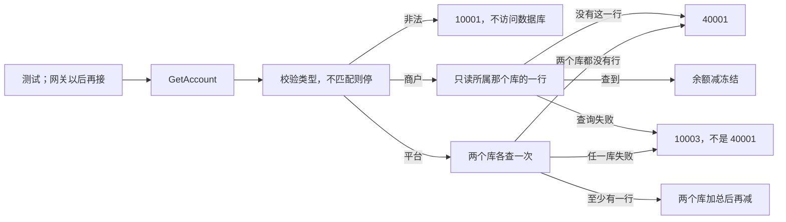

# ACC-02 账户查询

| 项 | 内容 |
|---|---|
| 功能点 | ACC-02（P0，第 1 周） |
| 所属链路 | 基础设施 |
| 代码提交 | `b72e591` `[ACC-02] add account query` |
| 分支 | `feat/ACC-02-get-account` |
| 日期 | 2026-10-15 |
| 状态 | DONE |

完整 hash：`b72e5913c0d23ca360f60b10597b58aa129b95a0`。作者时间 `2026-10-15 06:13:32 +0800`。这次代码提交 7 个文件，998 行新增，10 行删除。本报告在该提交之后写，不包含在这 7 个文件里。

## 一句话结论

账户查询是 account 进程里的只读方法 `GetAccount`，不监听 RPC，也不为了查询去开户。商户只读自己所在那一个库里 `sub_no` 为 0 的一行：余额 1000 分（10.00 元）、冻结 300 分（3.00 元）时，可用金额是 700 分（7.00 元），查询不会改这两列。平台渠道应收把两个库里的子账户加总，这次四行合计余额 4510 分（45.10 元）、冻结 150 分（1.50 元）、可用 4360 分（43.60 元），`sub_count` 为 4，账户号为空。没有行返回 `40001`；数据库失败返回 `10003`，不会被写成“账户不存在”。

## 1. 背景

### 1.1 系统简介

pay-system 是一个用 Go 编写的小型支付后端，模拟商户收款、退款、商户间转账三条资金链路，重点在数据一致性和性能。系统由 5 个部分组成：gateway（对外 HTTP 入口，负责签名校验和限流）、payment（支付单、退款单、转账单的状态管理和流程推进）、account（账户余额与记账，数据按商户分到 2 个数据库分片）、channel-mock（模拟微信、支付宝这类外部支付渠道）、recon（对账，核对系统内外数据是否一致）。服务之间用 Kitex RPC 同步调用，或通过 Kafka 消息异步通知；数据存在 MySQL 8.4，Redis 用于防重放。所有金额用整数“分”表示，所有记账只追加不修改。当前已完成：工程骨架到 IDL、账户分片路由、开户，以及账户查询。通用记账还没做。

Kitex 是本项目的 Go RPC 框架。IDL 是接口定义文件，用来写下 RPC 的方法和字段。RPC 是进程之间的同步调用。Kafka 是消息队列。Redis 防重放是把已经见过的请求记在 Redis 里，避免同一请求被再处理一次。分片是账户数据所在的那一个库，这里只有 0 和 1。通用记账是以后把借方和贷方写进账本的功能，这次还没有。

### 1.2 本功能点在系统中的位置

本功能点只在 account 进程内部提供 `GetAccount`。测试现在就能调用它。当前的种子程序不调用查询，也不调用开户；种子仍然自己插入账户行。这次没有启动 Kitex，没有进程在监听端口。网关以后会用它查商户余额，那是更后面的 RPC 进程要做的事，这次没有做。



查询本身不调用开户，所以“没有行”不会变成插入一行。商户路径只打开 `shard.Of` 算出来的那一个库。平台路径对两个库各发一次查询，每次用自己的连接，没有一个包住两个库的事务。图里的 `10001`、`40001`、`10003` 都是已有业务码，这次没有新码。

### 1.3 为什么需要它

商户要看到的是还能花的钱，不是账面余额。`M100002` 的结算账户在分片 0 的库里：余额 1000 分（10.00 元），其中 300 分（3.00 元）已经被占住。如果查询只返回余额，调用方会以为还能花 10.00 元。正确的可用金额是 1000 − 300 = 700 分（7.00 元）。冻结功能还没做，测试用 SQL 把这两列写成 1000 和 300，再调用查询。查询之后再读库，这两列仍然是 1000 和 300，没有被查询改掉。

平台的渠道应收不是一行。同一种账户在两个库里各有若干子账户。只读其中一个库，会把另一个库的余额漏掉。这次四行是 1000、2500、400、610 分，合计必须是 4510 分（45.10 元），不能停在前两行的 3500 分（35.00 元）。

## 2. 术语

| 术语 | 含义 |
|---|---|
| 分 | 金额最小单位。100 分 = 1.00 元。本报告里的 300 分是 3.00 元，1000 分是 10.00 元，700 分是 7.00 元。金额是整数，不用小数运算。 |
| 分片 | 账户数据所在的库，只有 0 和 1。商户号是 `M` 加 6 位数字，分片是数字部分对 2 取模。`M100002` 的 `100002 % 2 = 0`，所以只读分片 0 那个库。`M100001` 的 `100001 % 2 = 1`，只读另一个库。 |
| `shard.Of` | 上面这个取模函数。非法商户号会报错，查询把它变成 `10001`，不去碰数据库。 |
| 子账户号 `sub_no` | 同一类账户拆成多行时的序号。商户结算账户只有 `sub_no = 0` 这一行。平台账户可以有多行。 |
| `sub_count` | 这次结果里参与计算的行数。商户查询是 1。平台汇总是两个库里实际读到的行数，不是配置里的子账户个数。开户的返回值里这个字段仍是 0。 |
| 余额 | `balance`，账户上的账面金额，单位分。查询不修改它。 |
| 冻结 | `frozen_amount`，已经占住、还不能当可用金额花掉的部分。冻结功能本身还没做。 |
| 可用金额 | `available_amount`。不单独存成一列。返回前用整数做一次“余额 − 冻结”。 |
| 渠道应收 | 账户类型 `CHANNEL_RECEIVABLE`。所有者类型是 `PLATFORM`，所有者编号是渠道名，例如 `mockpay`。表示渠道已代收、还没结算给平台的钱。 |
| 手续费收入 | 账户类型 `FEE_INCOME`。所有者编号必须是 `PLATFORM`。它和渠道应收不是同一类账户，不能加进渠道应收的合计。 |
| 在途 | 账户类型 `TRANSIT`。跨库转账还没在两边都记完时，暂时记在这里。这次只把它当作又一种可查询的平台账户。 |
| 商户结算 | 账户类型 `MERCHANT_SETTLE`。只有商户能查这一种。 |
| 行锁 | 数据库为了防止别人同时改同一行而占住的锁。`SELECT ... FOR UPDATE` 会加这种锁。本次查询不用它。 |
| `40001` | 业务码“账户不存在”。对外英文是 `account not found`。只有该读的地方没有行才用它。 |
| `10001` | 业务码“参数不合法”。对外英文是 `invalid parameter`。类型和所有者不匹配时用它，并且不访问数据库。 |
| `10003` | 业务码“内部错误”。对外英文是 `internal error`，`Error()` 里不带 SQL。查询失败用它，不能改写成 `40001`。 |
| RPC | 进程之间的同步调用。本功能点不发出也不监听 RPC。 |
| Kitex | 本项目的 Go RPC 框架。这次不启动它。 |
| 事务 | 一组 SQL 要么全部提交，要么全部撤销。本次查询不开启跨两个库的事务。 |
| 种子 | 初始化程序。它自己插入账户行，不调用 `GetAccount`，也不调用开户方法。 |
| schema | MySQL 里的一个库名。集成测试建两个临时库，结束时只删这两个。 |
| 记账 `Post` | 以后按业务单写入账本并改余额的方法。还没做。验收里的余额是测试用 SQL 写进去的。 |

## 3. 技术讲解

### 3.1 要解决的问题

1. 查询只读。不能调用开户，不能改余额，不能改冻结，也不能加行锁。
2. 商户只读 `shard.Of(商户号)` 那个库里、`sub_no = 0` 的一行。另一个库不读。可用金额 = 这一行的余额 − 冻结，单位是分。`sub_count` 为 1。
3. 平台读取两个库里该所有者、该账户类型的全部子账户。两次查询各用各的连接，不放进一个跨库事务。余额分别相加，冻结分别相加，可用金额用这两个合计再减一次。`account_no` 为空字符串。`sub_count` 是参与加总的行数。
4. 平台汇总在返回值里把 `Shard` 和 `SubNo` 写成 0。这个 0 的意思是“没有单一分片、也没有单一子账户号”，不是“这笔汇总位于分片 0”。
5. 账户类型只能是商户结算、渠道应收、手续费收入、在途之一，并且要和所有者匹配。商户只能查商户结算。渠道应收的所有者编号非空且不超过 32 个字符。手续费和在途的所有者编号必须是 `PLATFORM`。不匹配返回 `10001`，不访问数据库。
6. 该读的地方没有行，返回 `40001`，文本是 `account not found`。两个库都没有平台行，同样是 `40001`。查询失败返回 `10003`，不能写成 `40001`。
7. 不按当前配置的子账户个数把高号子账户丢掉。配置以后如果调小，那些行不再被新业务选中，但已经存在的余额仍然要计入合计。

### 3.2 方案

先校验类型和所有者。这一步不拿数据库连接。通过之后才查询。

商户：用 `shard.Of` 得到唯一的库，SQL 带上 `sub_no = 0`，最多一行。没有行就 `40001`。有一行就用 `money.Sub` 做余额减冻结，`SubCount` 写成 1，`Shard` 写成刚才算出的那个分片号。这里的分片号是真实位置。`M100002` 的结果因此是分片 0 那个库；`M100001` 的结果是分片 1 那个库。不要把这个真实分片号和下面平台汇总里的 0 当成同一件事。

平台：循环分片号 0 和 1，每次向对应的库发一次不带 `sub_no` 条件的查询，读出该所有者的全部子账户。两个库都空才 `40001`。只有一个库有行也要汇总，不能因为另一边是空的就报不存在。加总用 `money.Add`，减一次用 `money.Sub`。这两个函数在结果超出 64 位有符号整数时返回错误，不绕回成负数或另一个数；这种错误变成 `10003`。

每次查询单独限时 3 秒，和已有的 MySQL 读写超时一致。限时是代码里的上限，不是这次量出来的查询耗时。语句是参数化的，用户输入不拼进 SQL。语句里没有 `FOR UPDATE`，也没有 `UPDATE`。

这段代码在做平台的两次读取：循环两次，每次只把一个库交给 `listAccounts`，失败立刻返回，不把已读到的一半当成成功结果。

```go
// service/account/biz/get.go
// 两次查询各走各的连接。不放进跨库事务，也不按当前子账户个数截断。
var all []Account
for shardNo := 0; shardNo <= 1; shardNo++ {
    rows, err := q.listAccounts(ctx, shardNo, ownerType, ownerID, accountType, nil)
    if err != nil {
        return Account{}, internalErr(err)
    }
    all = append(all, rows...)
}
return sumPlatform(all, ownerType, ownerID, accountType)
```

商户那条 SQL 只比平台多一个 `sub_no = ?`，并且问号的值固定是 0。平台 SQL 不限制子账户号，所以两个库里已有的行都会进来。

```sql
SELECT account_no, owner_type, owner_id, account_type, sub_no, currency,
       balance_direction, balance, frozen_amount, status
FROM account
WHERE owner_type = ? AND owner_id = ? AND account_type = ? AND currency = ?
```

汇总算完后，返回值把账户号留空，行数写成 `len(rows)`。下面两行旁边的注释是给读代码的人看的：字段里的 0 是占位，不是在说“请去分片 0 找这一行”。

```go
// service/account/biz/get.go
avail, err := money.Sub(balance, frozen)
// ...
SubCount: len(rows),
// Shard 和 SubNo 置 0 表示省略，不是分片 0、子账户 0。
Shard:    0,
SubNo:    0,
```

币种固定按 `CNY` 过滤。同一类账户如果各行的余额方向或状态不一致，返回 `10003`，不硬凑一个状态。正常开出来的行状态都是 `ACTIVE`。渠道应收的方向是 `DEBIT`，手续费和在途是 `CREDIT`。方向由账户类型决定，查询不能改它。

### 3.3 为什么这样做

| 方案 | 做法 | 优点 | 缺点 | 结论 |
|---|---|---|---|---|
| 采用：两个库各一次普通 `SELECT`，加总后再减 | 不加锁；没有跨库事务；可用金额只减一次 | 不和以后的记账抢行锁；一个库失败不会被当成“没有账户” | 两次读取之间另一个库的余额可能已经变了，没有跨库同一时刻的快照 | 采用。这个方法给管理和测试用，不在支付、退款、转账的记账步骤里调用 |
| 备选：`SELECT ... FOR UPDATE` | 读的时候锁住行 | 读到之后别人改不了 | 查询并不修改余额，锁会挡住以后的记账 | 不采用 |
| 备选：一个事务同时打开两个库 | 希望两次读取处于同一个事务 | 看起来像一次一致性读 | 一个事务只能碰一个账户库。跨库事务这套系统不提供 | 不采用 |
| 备选：查不到就调用开户 | 没有行就插入余额 0 的新行 | 调用方总能拿到账户 | 查询变成了写。没开过户的商户会被查询偷偷开户 | 不采用 |
| 备选：数据库报错也返回 `40001` | 所有失败都说“不存在” | 调用方只处理一种错误 | 库坏了会被当成余额不存在，甚至可能被误导去开户 | 不采用 |
| 备选：先把每行减出可用金额再相加 | 1000−0、2500−100、400−50、610−0 再相加也是 4360 | 这次这四个数碰巧一样 | 规则要求先加总再减。溢出时两种顺序也不该各算各的 | 不采用 |

### 3.4 正确性

| 场景 | 系统行为 | 最终状态 | 证明 |
|---|---|---|---|
| 同一查询再做一次 | 仍然是 `SELECT`。不更新余额和冻结 | 库里还是余额 1000 分、冻结 300 分。返回值可用金额 700 分 | `TestGetAccountMerchantAvailableAfterFreeze`。查询后再次读这两列，确认没被改掉 |
| 两个查询同时到达 | 两边都只读，不加行锁，也不写共享的余额 | 没有“谁后写谁覆盖”的更新。本次没有单独做并发查询压测；包测试带了竞态检测 | 带 `-race` 的单元测试和集成测试通过。没有一个名为并发查询的测试 |
| 两次平台读取之间进程崩溃 | 查询没有 `INSERT` 或 `UPDATE`。崩溃只是调用方没有拿到返回值 | 两个库的余额和冻结保持查询前的值。没有半行，也没有要补偿的查询任务 | 没有做崩溃注入。依据是语句只有 `SELECT` |
| 查询超时或数据库失败 | 单次查询上限 3 秒。失败变成 `10003`，对外文本是 `internal error`。上下文取消或超时按原错误返回，不改成 `40001` | 不插入行，也不把“库不可用”说成“账户不存在” | `TestGetAccountDBErrorIsInternal`、`TestGetAccountContextOnQuery`。没有对真实 MySQL 做超时注入 |

商户验收的具体数：先用已有的开户方法给 `M100002` 开结算账户，这一行在分片 0 的库里，`sub_no` 为 0。再用 SQL 把余额写成 1000、冻结写成 300。`GetAccount` 返回余额 1000 分、冻结 300 分、可用 700 分、`sub_count` 为 1。分片 1 的库里没有这个商户行。冻结功能没有实现。

平台验收的具体数：用开户在两个库里打开四行 `CHANNEL_RECEIVABLE` / `mockpay`，再用 SQL 写入金额。

| 行所在的库 | `sub_no` | 余额 | 冻结 |
|---|---|---|---|
| 分片 0 的库 | 0 | 1000 分（10.00 元） | 0 |
| 分片 0 的库 | 1 | 2500 分（25.00 元） | 100 分（1.00 元） |
| 分片 1 的库 | 2 | 400 分（4.00 元） | 50 分（0.50 元） |
| 分片 1 的库 | 7 | 610 分（6.10 元） | 0 |

合计余额 4510 分（45.10 元），合计冻结 150 分（1.50 元），可用 4360 分（43.60 元）。返回的 `sub_count` 是 4，`account_no` 是空字符串。这四行分别住在两个库里；返回结构里的 `Shard = 0` 和 `SubNo = 0` 只表示“汇总没有单一位置”，不能理解成“这 4510 分在分片 0”。

同一套测试在分片 0 的库里还有一个手续费账户，余额被 SQL 写成 99999 分（999.99 元）。查渠道应收时这 99999 不加进去。再单独查手续费，才返回 99999，并且 `sub_count` 是 1。余额能被写成这些数，是因为记账 `Post` 还没做；测试不改变“记账只能追加”的规则，它只是在准备查询的输入。

没有账户时，查 `M100002` 的结算账户和查 `mockpay` 的渠道应收都返回 `40001`。两个库的行数都不变。非法商户号或商户去查手续费，返回 `10001`，同样不插入行。`TestGetAccountNotFoundWritesNothing` 覆盖这些情况。

### 3.5 性能

不涉及。这次没有性能开关，也没有压测。下面集成测试的 11.822 秒是整个 `service/account/biz` 包的一次运行，包含开户测试和查询测试，不能当成一次 `GetAccount` 的耗时。3 秒是单次查询的代码上限，不是测量值。

## 4. 已完成内容

### 4.1 改动清单

| 文件 | 新增 / 修改 | 作用 |
|---|---|---|
| `service/account/biz/get.go` | 新增 | `GetAccount`：校验、商户单行、平台两次读取后加总 |
| `service/account/biz/get_test.go` | 新增 | 不连数据库的非法参数、`10003` 与 `40001` 区分、加总顺序 |
| `service/account/biz/get_integration_test.go` | 新增 | 两个临时库上的商户可用金额和平台汇总 |
| `service/account/biz/open.go` | 修改 | `Account` 增加 `SubCount`。开户返回值里它仍是 0，开户的原有行为不变 |
| `docs/02-requirements.md` | 修改 | ACC-02 标为 DONE，勾上两条验收；写明汇总验收用 SQL 写余额 |
| `docs/04-dev-plan.md` | 修改 | 只勾 ACC-02。通用记账仍未勾 |
| `docs/interview-notes.md` | 修改 | 记下两次只读、不加锁，以及返回值里的 0 不是分片 0 |

### 4.2 对外变化

| 类别 | 变化 |
|---|---|
| 接口 | 无。没有新的 RPC 方法，也没有改 IDL。`GetAccount` 这次只是进程内方法 |
| 表结构 | 无。没有新表、新列或新迁移。读的是已有的 `account` 表 |
| 配置项 | 无。查询不读环境变量，也不按子账户配置个数截断 |
| 错误码 | 无新码。参数非法用已有的 `10001`，没有行用已有的 `40001`，查询失败用已有的 `10003` |
| 单号前缀 | 无。查询不生成账户号 |
| 指标 / 故障点 | 无 |

### 4.3 验收对照

两条验收是：冻结 300 后查询，可用金额减少 300、余额不变；平台渠道应收的汇总余额等于各子账户余额之和。

| 类别 | 条目 | 测试函数 | 类型 | 结果 |
|---|---|---|---|---|
| 验收 | 冻结 300 后查询，可用金额减少 300，余额不变 | `TestGetAccountMerchantAvailableAfterFreeze` | 集成，`-race` | 通过。余额 1000 分，冻结 300 分，可用 700 分。查询后再读库，这两列仍是 1000 和 300。包含在下面 11.822 秒那次包测试里，没有单独耗时 |
| 验收 | 平台渠道应收的汇总等于各子账户余额之和 | `TestGetAccountPlatformChannelSum` | 集成，`-race` | 通过。四行合计余额 4510 分、冻结 150 分、可用 4360 分，`sub_count` 为 4，账户号为空。同库手续费 99999 分没有算进去 |
| 规则 | 不存在返回 `40001`，文本 `account not found`，两个库都没有新行 | `TestGetAccountNotFoundWritesNothing` | 集成 | 通过 |
| 规则 | 类型与所有者不匹配返回 `10001`，不访问数据库 | `TestGetAccountRejectsInvalid` | 单元 | 通过。包含在不带 integration 标签的 1.443 秒、75.8% 那次里 |
| 规则 | 数据库失败是 `10003`，不是 `40001` | `TestGetAccountDBErrorIsInternal` | 单元 | 通过。对外文本是 `internal error` |
| 规则 | `M100001` 只读分片 1 那个库 | `TestGetAccountMerchantOtherShard` | 集成 | 通过。返回的分片号是 1，这是真实位置。分片 0 的库里没有这一行 |

审查没有必须修改的缺陷，也没有未处理的建议。

### 4.4 验证记录

环境：`go version go1.27.2 darwin/arm64`。以下都是 2026-10-15 由 lead 实测的输出。没有列出的耗时不写进本报告。

| 命令 | 结果 |
|---|---|
| `gofmt -l .` | 无输出，退出码 0 |
| `make lint` | `0 issues.` |
| `make test` | 通过。根包 `ok github.com/yym108/pay-system 2.358s`。这次 `service/account/biz` 是 cached，所以这行耗时不能当成查询测试又跑了一遍 |
| `go test -race -count=1 -cover ./service/account/biz/` | `ok github.com/yym108/pay-system/service/account/biz 1.443s coverage: 75.8% of statements`。没有 integration 标签，这是单元覆盖率。真实 SQL 的读取不在这 75.8% 里 |
| `go test -race -count=1 -tags integration -timeout 10m ./service/account/biz/` | `ok github.com/yym108/pay-system/service/account/biz 11.822s`。输出没有覆盖率。带这个标签时，单元测试和集成测试一起编译 |
| `make test-integration` | 未运行。lead 没有重跑全库集成测试。因此不能把其他包的集成测试写成通过 |
| `make cover` | 未运行。全库覆盖率没有数字。75.8% 只属于 `service/account/biz` 的单元测试 |

### 4.5 同步的文档

- 需求里 ACC-02 改为 DONE，两条验收勾上。变更记录只加了一条：平台渠道应收汇总的验收不调用记账。入账本身是 ACC-03，本测试用 SQL 写入余额，不改变资金规则。
- 开发计划只勾了 ACC-02。通用记账那一行仍然未勾。
- 面试笔记记下：两次独立只读、不加行锁、`40001` 和 `10003` 要分开、汇总字段里的 0 不是分片 0。

接口文档、表结构文档和约定版本没有改。

## 5. 未完成与风险

- 全库 `make test-integration` 未运行。本包的集成测试已经单独跑过，其他包这次没有重跑。
- 全库 `make cover` 未运行。75.8% 不是含集成测试的覆盖率，也不是整个仓库的覆盖率。
- 通用记账（ACC-03）、冻结（ACC-04）和 account 的 RPC 进程（ACC-11）都还没做。这次没有监听端口。网关还不能通过 RPC 来查余额。
- 当前种子不调用 `GetAccount`。种子仍然自己插入账户行。
- 平台两次读取没有跨库快照。第一次读完、第二次还没读的时候，另一个库里的余额可能已经变了。这个方法不放在交易记账的步骤里。
- 返回值里的 `Shard` 和 `SubNo` 是普通整数。平台汇总写成 0 表示省略。以后做 RPC 时，IDL 里这两个字段是可空指针；映射时要留空，不能写成指向 0 的指针，否则调用方会以为汇总在分片 0。这次没有做那一层映射。
- 没有崩溃注入，也没有把真实 MySQL 故意拖过 3 秒。未写入是从“只有 `SELECT`”推出来的。

## 6. 如何复现

前置：本机 Go 为 `go version go1.27.2 darwin/arm64`。集成测试会准备 MySQL 并建立两个临时 schema。不要把连接串或口令写进日志、错误或报告。

```bash
gofmt -l .
make lint
make test
go test -race -count=1 -cover ./service/account/biz/
go test -race -count=1 -tags integration -timeout 10m ./service/account/biz/
```

`gofmt -l .` 预期无输出且退出码 0。`make lint` 预期出现 `0 issues.`。`make test` 预期通过；本次根包是 `ok github.com/yym108/pay-system 2.358s`，`service/account/biz` 为 cached。不带 integration 标签的覆盖率命令预期是 `ok github.com/yym108/pay-system/service/account/biz 1.443s coverage: 75.8% of statements`。带 integration 标签的命令预期是 `ok github.com/yym108/pay-system/service/account/biz 11.822s`。

`make test-integration` 和 `make cover` 这次没有跑。复现上述结论时，不要把没有测过的全库结果写成通过。

## 7. 讲解要点

1. 问：余额 1000 分、冻结 300 分，查询为什么返回可用 700 分，而且余额不变？答：可用金额是这一行的余额减冻结，整数分，不读单独的可用列，也不改表。查询后再读库，仍是 1000 和 300。冻结功能还没做，300 分是测试用 SQL 写进去的。
2. 问：平台汇总的 `Shard` 为什么是 0？它是不是在分片 0？答：不是。四行分别在两个库里，合计 4510 分。返回值里的 0 表示“没有单一分片”，因为一次结果装不下两个库的位置。商户查询不同：`M100001` 返回的分片号 1 才是它真实所在的库。
3. 问：库坏了为什么不能返回 `40001`？答：`40001` 的文本是 `account not found`，只表示该读的地方没有行。查询失败是 `10003`，对外只有 `internal error`。否则调用方会把故障当成“还没开户”。

## 延伸阅读

- `docs/02-requirements.md` 里 ACC-02 的规则和验收，以及文末 2026-10-15 关于“用 SQL 写入余额、不改变资金规则”的记录
- `docs/04-dev-plan.md` 第 1 周里 ACC-02 的勾选位置。下一行 ACC-03 仍未勾
- `docs/interview-notes.md` 的 ACC-02 一节
- `service/account/biz/get.go`
- `docs/reports/ACC-01-open-account.md`：账户行是怎么开出来的。查询不调用那个方法
- `docs/reports/ACC-13-shard.md`：`M100002` 为什么属于分片 0 那个库，`M100001` 为什么属于另一个库

## 修订记录

| 日期 | 提交 | 修订内容 |
|---|---|---|
| 2026-10-15 | `b72e591` | 初稿。对应代码提交 `[ACC-02] add account query`，报告本身不在该提交内 |
