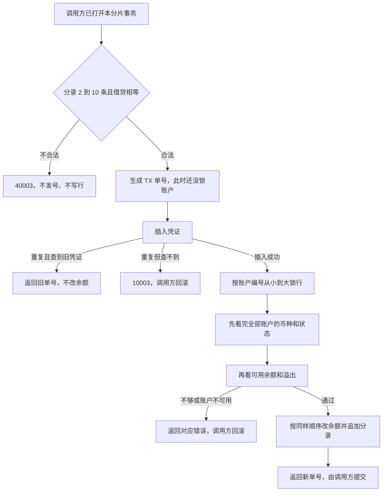

# ACC-03 通用记账

| 项 | 内容 |
|---|---|
| 功能点 | ACC-03（P0，第 1 周） |
| 所属链路 | 基础设施 |
| 代码提交 | `31fff62` `[ACC-03] add ledger posting` |
| 分支 | `feat/ACC-03-ledger-post` |
| 日期 | 2026-10-15 |
| 状态 | DONE |

完整 hash：`31fff62e4d0c0ee9277486aeae8877f49ac1fb83`。作者时间 `2026-10-15 07:18:25 +0800`。这次代码提交 9 个文件，1956 行新增，42 行删除。本报告在该提交之后写，不包含在这 9 个文件里。

## 一句话结论

通用记账是 account 进程里的方法 `Post`。调用方已经打开本分片的数据库事务，`Post` 在这一个事务里写入一张凭证和若干分录，并按账户主键升序修改余额。它自己不提交、不回滚。商户 `M100002` 在分片 0 上被写成余额 500 分（5.00 元）后，1000 个 goroutine 各借记 1 分（0.01 元），结果是 500 次成功、500 次余额不足；最终商户余额 0，手续费账户 500 分（5.00 元），冻结仍是 0。

## 1. 背景

### 1.1 系统简介

pay-system 是一个用 Go 编写的小型支付后端，模拟商户收款、退款、商户间转账三条资金链路，重点在数据一致性和性能。系统由 5 个部分组成：gateway（对外 HTTP 入口，负责签名校验和限流）、payment（支付单、退款单、转账单的状态管理和流程推进）、account（账户余额与记账，数据按商户分到 2 个数据库分片）、channel-mock（模拟微信、支付宝这类外部支付渠道）、recon（对账，核对系统内外数据是否一致）。服务之间用 Kitex RPC 同步调用，或通过 Kafka 消息异步通知；数据存在 MySQL 8.4，Redis 用于防重放。所有金额用整数“分”表示，所有记账只追加不修改。当前已完成：工程骨架到 IDL、账户分片路由、开户、账户查询，以及通用记账。冻结、转账和 RPC 进程还没做。

Kitex 是本项目的 Go RPC 框架。RPC 是进程之间的同步调用。Kafka 是消息队列。Redis 防重放是把已经见过的请求记在 Redis 里，避免同一请求被再处理一次。分片是账户数据所在的那一个库，这里只有 0 和 1。IDL 是接口定义文件。本次记账不进入 IDL，也没有进程在监听端口。

### 1.2 本功能点在系统中的位置

`Post` 只在 account 进程内部被调用。测试现在就能把一个已经打开的事务传进去。支付入账、退款确认、转账以后会调用它，那些调用方还没做。种子程序仍然自己 `INSERT` 账户行，不调用 `Post`，因此种子库里没有凭证，余额仍是 0。



图里的调用方负责这个事务的开始和结束。`Post` 返回错误时，调用方撤销整笔事务，凭证、分录和余额变化都不会留下。重复插入如果能读到第一次的凭证，调用方不撤销，直接提交第一次的结果。

### 1.3 为什么需要它

商户 `M100002` 的结算账户在分片 0。假设账面还有 500 分（5.00 元），同时来了 1000 笔各 1 分（0.01 元）的扣款。如果每笔都先单独读余额、读到“够”再去减，这些读会都看到 500 分，1000 笔都会减下去，余额会变成负数。正确结果是恰好 500 笔成功，另外 500 笔被告知余额不足，最终余额是 0。

同一笔业务如果被提交两次，也不能记两遍。第一次借记 10 分（0.10 元）已经成功之后，第二次即使金额改成 77 分（0.77 元），也必须回到第一次那张凭证，余额只变动一次。

## 2. 术语

| 术语 | 含义 |
|---|---|
| 分 | 金额最小单位。100 分 = 1.00 元。500 分是 5.00 元，10 分是 0.10 元，1 分是 0.01 元。金额是整数，不用小数运算。 |
| 分片 | 账户数据所在的库，只有 0 和 1。商户号是 `M` 加数字，分片是数字部分对 2 取模。`M100002` 的 `100002 % 2 = 0`，账户在分片 0。一张凭证的全部分录只落在调用方打开的那一个库。 |
| 凭证 | 表 `ledger_txn` 里的一行，是一次记账的头。上面有业务类型、业务单号、借方合计、分录条数和备注。 |
| 分录 | 表 `ledger_entry` 里的一行，表示某一个账户借或贷了多少分，以及记完后的余额。分录只追加，不修改、不删除。 |
| 复式记账 | 同一张凭证里，借方金额合计必须等于贷方金额合计。最少 2 条分录，最多 10 条。 |
| `DEBIT` / `CREDIT` | 这一条分录的方向，借或贷。它不等于“余额增加”。余额增还是减，还要看账户自己的余额方向。 |
| 余额方向 | 账户列 `balance_direction`。`CREDIT` 账户：贷记增加、借记减少。`DEBIT` 账户：借记增加、贷记减少。商户结算和手续费收入是 `CREDIT`。渠道应收是 `DEBIT`。 |
| 余额 | 列 `balance`，账面金额，单位分。 |
| 冻结 | 列 `frozen_amount`，已经占住、不能再当可用金额花掉的部分。本次记账不修改这一列。确认扣款时同时减冻结是以后的功能。 |
| 可用金额 | `balance - frozen_amount`。不单独存成一列。只有余额要减少、并且账户不允许透支时才拿它做比较。 |
| 透支 | 列 `allow_overdraft`。为 0 时，减少余额前必须可用金额足够。为 1 时，减少余额可以让账面变成负数，不再做这次比较。手续费收入账户允许透支。 |
| `ACTIVE` | 账户可以记账的状态。不是这个状态（例如 `FROZEN` 或 `CLOSED`）就不能改余额。 |
| 行锁 | `SELECT ... FOR UPDATE` 占住的锁。别的事务要改同一行就必须等这次事务结束。多行按 `account_id` 从小到大锁，避免两笔交叉记账互相等待。 |
| CAS | 比较后再更新。余额更新写成 `WHERE id = ? AND status = 'ACTIVE'`，需要时再加可用金额条件，同时 `version = version + 1`。条件不满足时影响行数是 0，不能当成已经扣成功。 |
| 幂等 | 同一业务做两次，结果和只做一次相同。凭证的唯一索引是业务类型加业务单号。 |
| `1062` | MySQL 报告“唯一索引冲突”的错误号。它只让这一条 `INSERT` 失败，不会把整个 InnoDB 事务作废。 |
| InnoDB | MySQL 使用的事务引擎。未提交的修改可以整笔撤销。 |
| `txn_no` | 凭证号。前缀 `TX`，由进程内发号器 `NewNo(ctx, "TX")` 生成，不访问别的服务。 |
| `duplicated` | 返回值里的布尔字段。为 true 时，`txn_no` 属于已经存在的那张凭证，这次没有插分录，也没有改余额。 |
| `balance_after` | 分录上记下的“这次更新之后的余额”。写它的时候，本事务仍然持有这行的锁。 |
| `40003` | 业务码。对外英文固定为 `unbalanced entries`。校验失败、币种不是 `CNY`、本连接上看不到账户、以及冲正类型都用它。 |
| `40005` | 业务码。对外英文固定为 `account inactive`。账户不是 `ACTIVE`。 |
| `40002` | 业务码。对外英文固定为 `insufficient balance`。可用余额不够。 |
| `40001` | 业务码。对外英文固定为 `account not found`。账户查询在该读的库里没有行时用它。本次记账不用它。 |
| `10003` | 业务码。对外英文固定为 `internal error`。`Error()` 里不带 SQL。数据库失败，以及重复键之后又读不到凭证，都用它。 |
| `10004` | 业务码。对外英文固定为 `service unavailable`。发号时时钟回拨过大用它。 |
| 码点 | 这里按 Go 的一个 Unicode 字符计，不是按字节。64 个汉字就是 64 个码点。 |
| goroutine | Go 里的一个并发执行单元。1000 个 goroutine 就是 1000 个同时发起的调用。 |
| `dbx.WithTx` | 已有的事务助手。它自己 `BEGIN`，回调返回错误就回滚，成功就提交。单次总时长默认 3 秒，含等行锁的时间，隔离级别是 `READ COMMITTED`。`Post` 不调用它。 |
| `READ COMMITTED` | 事务隔离级别：读到的是其他事务已经提交的数据。1000 并发那次测试自己用这个级别开事务。 |
| 种子 | 初始化程序。它直接插入账户行，不调用 `Post`，也不写凭证。 |
| schema | MySQL 里的一个库名。集成测试使用临时库，结束时只删临时库。 |

## 3. 技术讲解

### 3.1 要解决的问题

一次记账要同时满足这些约束：

1. 借方合计等于贷方合计，金额都是正的整数分。不平的凭证不能进库，否则账本两边对不上。
2. 同一账户在一张凭证里只出现一次。同一业务单号只产生一张凭证，重复提交不能把钱再动一次。
3. 同一账户上的并发扣款不能超扣。可用金额是余额减冻结，冻结数字本身这次不能被改掉。
4. 一张凭证只写调用方已经打开的那一个库。本连接上看不到的账户不能被当成“账户不存在”去开户。
5. 失败时不能留下半张凭证。`Post` 把错误交回去，由调用方撤销整个事务。
6. 冲正不从这里写入。方法没有“冲哪一张”的参数，而表要求冲正凭证必须带那个字段。冲正以后单独做。

### 3.2 方案

调用方先打开本分片事务，再调用 `Post`。`Post` 先做纯校验。校验不过就返回 `40003`，不发号，也不 `INSERT`。校验通过后、锁账户之前，用 `NewNo(ctx, "TX")` 生成凭证号。发号可能要等下一毫秒，放在锁后面会占着账户行却还不写数据。

然后插入 `ledger_txn`。凭证金额是借方合计，币种是 `CNY`。如果唯一索引返回 `1062`，用 `dbx.IsDuplicate` 认错误号，不解析错误文本。同一事务按 `(biz_type, biz_no)` 再查：查到就返回已有 `txn_no`，`duplicated = true`，不锁账户、不插分录、不改余额；这次参数即使和第一次不同，也返回第一次的结果。查不到就返回 `10003`，调用方回滚。普通字符串里出现“1062”这几个字不算重复键。

插入成功后，分录按 `account_id` 从小到大 `SELECT ... FOR UPDATE`。本连接没有这一行，包括这个编号只存在于另一个分片，返回 `40003`，不是 `40001`。这条连接分不清“没有这个编号”和“账户在另一个库”。账户查询仍然用 `40001`。

行都锁住之后分两遍看，更新放在两遍都通过之后。第一遍看完全部账户：币种不是 `CNY` 返回 `40003`，状态不是 `ACTIVE` 返回 `40005`。这样较小编号的余额不足不会挡住较大编号已经停用的账户。第二遍才计算增减、检查加法会不会溢出、以及可用余额。溢出不把会回绕的数交给 SQL。

余额方向决定加减：`CREDIT` 账户贷记加、借记减；`DEBIT` 账户借记加、贷记减。只有这一笔是在减少余额，并且 `allow_overdraft = 0` 时，才要求 `balance - frozen_amount` 大于等于减少额，不够则 `40002`。更新语句是：

```sql
UPDATE account
SET balance = balance + ?, version = version + 1
WHERE id = ? AND status = 'ACTIVE'
```

减少且不允许透支时，再加 `AND balance - frozen_amount >= ?`。影响 0 行就重新读这行：不是 `ACTIVE` 返回 `40005`，可用余额不够返回 `40002`，行没了返回 `40003`。然后把错误交给调用方回滚。影响 1 行后，仍持有行锁时 `SELECT balance`，这个值写入分录的 `balance_after`。最后批量 `INSERT ledger_entry`。成功时 `Post` 返回新 `txn_no` 和 `duplicated = false`，由调用方 `COMMIT`。

`biz_type` 只接受 `PAY`、`REFUND`、`TRANSFER`、`TRANSFER_OUT`、`TRANSFER_IN`。`REVERSAL` 和其他值一样返回 `40003`，对外英文仍是 `unbalanced entries`。没有新增错误码，也没有改表。`biz_no` 不能空，最长 64 个码点；`memo` 可以为空，最长 255 个码点。

下面这段代码在做的是：校验通过才发号，发号在锁行之前，并且方法本身不开事务。

```go
// Post 在调用方已经打开的分片事务里记一笔复式账。
// 不调用 BEGIN、COMMIT、ROLLBACK，也不调用 dbx.WithTx。
func (s *Service) Post(ctx context.Context, tx *sqlx.Tx, bizType, bizNo, memo string, entries []Entry) (PostResult, error) {
    debit, err := validatePost(bizType, bizNo, memo, entries)
    if err != nil {
        return PostResult{}, err
    }
    txnNo, err := s.ids.NewNo(ctx, "TX")
    if err != nil {
        return PostResult{}, mapIDError(err)
    }
    return applyPost(ctx, sqlPostTx{tx: tx}, postRequest{TxnNo: txnNo, Debit: debit /* 其余字段略 */})
}
```

`1062` 之后的分支在 `readDuplicate`：查到旧凭证就原样返回，查不到则包成 `10003`。

```go
if !found {
    return PostResult{}, errno.Wrap(errno.ErrInternal, dup)
}
return PostResult{TxnNo: txnNo, Duplicated: true}, nil
```

### 3.3 为什么这样做

| 方案 | 做法 | 优点 | 缺点 | 结论 |
|---|---|---|---|---|
| 采用：调用方的一个事务里先插凭证，再按编号升序锁行和改余额 | 幂等靠唯一索引；失败由调用方整笔撤销；`1062` 不回滚，就地读旧凭证 | 不会留下半张凭证；交叉记账按同一顺序加锁；重复请求不改第二次的金额 | 调用方必须自己提交或回滚；本连接上看不到的账户只能当成这张凭证不合法 | 采用 |
| 备选：`Post` 自己 `BEGIN` 并调用 `dbx.WithTx` | 方法内部包住提交和回滚 | 调用方少写一次事务 | 冻结单、转账分支以后要和记账同事务提交，内部再开事务就拆开了。`WithTx` 还把单次限制在 3 秒，1000 个等同一行锁的调用会被取消 | 不采用 |
| 备选：先读余额再减 | 应用里判断“够不够”，再发一条不带条件的更新 | 代码看起来直接 | 两个并发读会都看到旧余额，都能减成功，余额变负 | 不采用 |
| 备选：本连接缺行返回 `40001` | 和账户查询用同一个“不存在” | 错误码种类少 | 两个分片的账户编号都会从 1 开始，本连接分不清“没有”和“在另一个库”。调用方可能据此去开户 | 不采用 |
| 备选：在 `Post` 里做冲正 | 增加 `reversal_of` 参数并写入 `REVERSAL` | 少一个以后的功能点 | 表要求冲正必须带原凭证。本次不加参数、不改表 | 不采用 |

### 3.4 正确性

| 场景 | 系统行为 | 最终状态 | 证明 |
|---|---|---|---|
| 借贷不平、金额为 0、只有 1 条分录 | 返回 `40003`，英文 `unbalanced entries`。不发号，不插入 | 凭证数、分录数、余额都和调用前相同 | `TestPostRejectsUnbalancedZeroAndSingle`，以及不连库的 `TestPostRejectsBeforeID` |
| 同一 `(biz_type, biz_no)` 并发 100 次 | 100 次都走 `dbx.WithTx`。只有 1 次插入成功，其余 99 次 `1062` 后读到同一张凭证，`duplicated = true`。之后再用 77 分（0.77 元）和另一段备注重放，仍返回第一次的单号 | 期初 1000 分（10.00 元）。成功的那次借记 10 分（0.10 元）。商户余额 990 分（9.90 元），手续费账户 10 分（0.10 元），冻结都是 0，版本都是 1。凭证 1 张，分录 2 条。库里的金额仍是 10 分，备注仍是空 | `TestPostConcurrentSameBizNo` |
| 1000 个 goroutine 各用不同业务单号借记 1 分 | 不用 `dbx.WithTx`。每个 goroutine 自己 `BeginTxx(READ COMMITTED)`，父 ctx 120 秒，这个库最多 8 条连接。`Post` 返回 nil 才 `Commit`，否则 `Rollback`。`Post` 自己不提交 | 商户期初 500 分（5.00 元），冻结 0。恰好 500 次成功、500 次 `40002`。商户余额 0，手续费账户 500 分（5.00 元），两边冻结仍是 0。凭证 500 张，分录 1000 条。分片 1 的凭证和分录数量不变 | `TestPostConcurrentDebit500` |
| 上面这 500 张凭证的 `balance_after` | 没有期初分录。回放从 SQL 写入的 500 分开始，按 `ledger_entry.id` 顺序，用余额方向重算每一条 | 每条 `balance_after` 等于重算值，账户账面也等于重算结果 | 同一个 `TestPostConcurrentDebit500` 末尾的回放 |
| 余额 10 分再借记 20 分 | 返回 `40002`，英文 `insufficient balance`。调用方回滚 | 商户仍是 10 分（0.10 元），冻结 0，版本 0。手续费账户仍是 0。凭证和分录条数不变 | `TestPostInsufficientLeavesNothing` |
| 分录里放一个只存在于另一分片的账户 | 在分片 0 的事务里锁不到那一行，返回 `40003`，并且不是 `40001` | 分片 0 商户仍是 40 分（0.40 元），版本 0。两个库的凭证和分录条数都不变 | `TestPostRejectsOtherShardAccount` |
| 三笔记账后的回放 | SQL 先写入商户 1000 分（10.00 元）、冻结 100 分（1.00 元），手续费 50 分（0.50 元），渠道应收 7 分（0.07 元）。然后记 100 分、20 分、10 分三张凭证 | 商户 1084 分（10.84 元）、冻结仍 100 分、版本 3；手续费 66 分（0.66 元）、版本 3；渠道应收 107 分（1.07 元）、版本 1。凭证 3 张，分录 7 条。`balance_after` 与从这三个期初数回放的结果一致 | `TestPostBalanceAfterMatchesReplay` |
| 冻结占住一部分，以及允许透支 | 余额 100 分、冻结 40 分时，可用 60 分（0.60 元）。借记 70 分（0.70 元）返回 `40002`。借记 50 分（0.50 元）成功。手续费账户允许透支，再从它借记 80 分（0.80 元） | 商户先变成余额 50 分、冻结仍 40 分，再加上 80 分贷记后是 130 分（1.30 元），冻结仍 40 分。手续费账户余额是 −30 分（−0.30 元） | `TestPostOverdraftFrozenAndInactive` |
| 账户已被改成 `FROZEN` | 再贷记 1 分返回 `40005`，英文 `account inactive` | 余额仍是 130 分，冻结仍是 40 分，状态仍是 `FROZEN`。这次没有新增凭证或分录 | 同一个 `TestPostOverdraftFrozenAndInactive` |
| 较小账户余额不足，较大账户不是 `ACTIVE` | 两行都锁住后，先看完全部状态。账户 1 可用余额不够，账户 2 是 `CLOSED` | 返回 `40005`。余额更新函数没有被调用，也没有分录 | `TestApplyPostInactiveBeforeInsufficient` |
| `1062` 之后按业务单号查不到行 | 不回滚调用方事务这件事只在查到旧凭证时成立。查不到则返回 `10003`，不改余额 | 单元测试里更新次数是 0。集成测试没有单独造“凭证号冲突但业务单不存在”的行；这条由不连库测试证明 | `TestApplyPostDuplicateMissIsInternal` |
| 发号前时钟回拨 10 毫秒 | 返回 `10004`，英文 `service unavailable`。还没有插入 | 不连库。发号失败就返回，不会用到事务里的 SQL | `TestPostIDErrors` |
| 调用方事务在 `Post` 返回错误后回滚 | `Post` 不执行 `ROLLBACK`。`WithTx` 看到错误就撤销；1000 并发那次由测试自己 `Rollback` | 余额不足和缺账户的用例里，凭证、分录、余额都回到调用前 | `TestPostInsufficientLeavesNothing`、`TestPostRejectsOtherShardAccount` |
| 进程在提交前崩溃 | 没有做崩溃注入。未提交的插入和余额变化由这一个库的事务撤销。已经 `COMMIT` 的凭证和余额留在库里 | 推出来的，不是杀掉进程后看到的 | 无单独测试 |
| 事务里调用别的服务超时 | `Post` 里面没有 RPC、HTTP 或发消息。上下文如果在进入时就已经取消，校验通过后把这个取消原样返回，不发号 | 不连库测试里发号器没有被调用 | `TestPostNilAndCanceled` |

审查没有必须修改的缺陷。两条建议都已经做进 `31fff62`：锁完所有行后先检查全部账户的币种和状态，再判断余额不足；流程图里 `1062` 之后如果按 `(biz_type, biz_no)` 查不到，出口是 `10003`，由调用方回滚。

### 3.5 性能

不涉及性能开关，也没有测量单次记账的耗时。目标里的 P99 不超过 20 毫秒这次没有测，不能写成已经达到。

`go test -race -count=1 -tags integration -timeout 15m ./service/account/biz/` 的 `15.300s`，以及 `make test-integration` 里这个包的 `15.858s`、根包的 `39.926s`，都是整次测试命令的时间。它们不是一次 `Post` 的耗时，两个 15 秒也不能加在一起。1000 个 goroutine 用来核对 500 次成功和 500 次 `40002`，不是吞吐量测试。

## 4. 已完成内容

### 4.1 改动清单

| 文件 | 新增 / 修改 | 作用 |
|---|---|---|
| `service/account/biz/post.go` | 新增 | `Post`：校验、发号、插入凭证、按编号升序锁行和改余额、追加分录 |
| `service/account/biz/post_test.go` | 新增 | 不连库的校验、重复键、余额方向、状态优先于余额不足、溢出和错误文本测试 |
| `service/account/biz/post_integration_test.go` | 新增 | 两个临时库上的六条验收，以及冻结、透支、停用 |
| `service/account/biz/open.go` | 修改 | 包注释写明开户、查询、记账三者都不监听 RPC |
| `service/account/biz/get_test.go` | 修改 | 假扫描器能读 `uint64` 指针，供锁行扫描的单元测试使用 |
| `docs/02-requirements.md` | 修改 | ACC-03 标为 DONE，六条验收勾上，并写明事务边界和三个口径 |
| `docs/04-dev-plan.md` | 修改 | 只勾 ACC-03 |
| `docs/06-flows.md` | 修改 | 通用记账那张控制流图补上缺账户、发号时机，以及 `1062` 查不到时的 `10003` |
| `docs/interview-notes.md` | 修改 | 记下不自己提交、不解析 `1062` 文本、1000 并发不用 `WithTx` |

### 4.2 对外变化

| 类别 | 变化 |
|---|---|
| 接口 | 无。没有新的 RPC 方法，IDL 里没有 `Post`。它只是进程内方法，参数是调用方的 `*sqlx.Tx`、业务类型、业务单号、备注和分录 |
| 表结构 | 无。没有新迁移。用的是已有的 `ledger_txn`、`ledger_entry` 和 `account` |
| 配置项 | 无 |
| 错误码 | 无新码。`40003` 的英文仍是 `unbalanced entries`。`40005`、`40002`、`10003`、`10004` 都是原有的码 |
| 单号前缀 | 无。凭证号前缀 `TX` 本来就已经登记，这次只是开始使用 |
| 指标 / 故障点 | 无 |

### 4.3 验收对照

| 验收条目 | 测试函数 | 类型 | 结果 |
|---|---|---|---|
| 借贷不平、金额为 0、分录只有 1 条，均返回 `40003` | `TestPostRejectsUnbalancedZeroAndSingle` | 集成，`-race` | 通过。包含在 `15.300s` 那次包测试里，没有单独耗时 |
| 同一业务单号并发 100 次，只生成 1 张凭证，余额只变动 1 次，其余 99 次 `duplicated = true` | `TestPostConcurrentSameBizNo` | 集成，走 `dbx.WithTx` | 通过。期初 1000 分，成功借记 10 分，商户剩 990 分 |
| 1000 个 goroutine 对余额 500 分的商户各扣 1 分，恰好 500 次成功、500 次 `40002`，最终余额 0，分录数是成功次数的 2 倍 | `TestPostConcurrentDebit500` | 集成，自己 `BeginTxx` | 通过。商户 0，手续费账户 500 分，冻结 0，凭证 500，分录 1000 |
| 分录中混入另一分片的账户返回 `40003` | `TestPostRejectsOtherShardAccount` | 集成 | 通过。两个库都不新增凭证，商户仍是 40 分 |
| 余额不足时，凭证、分录、余额均无变化 | `TestPostInsufficientLeavesNothing` | 集成 | 通过。10 分借记 20 分，余额仍是 10 分 |
| 每条分录的 `balance_after` 与按顺序回放的结果一致 | `TestPostBalanceAfterMatchesReplay`，1000 并发那次也做了回放 | 集成 | 通过。回放起点是 SQL 写入的期初余额，没有期初分录 |

### 4.4 验证记录

环境：`go version go1.27.2 darwin/arm64`。以下都是 2026-10-15 的实测输出。没有列出的耗时不写进本报告。

| 命令 | 结果 |
|---|---|
| `gofmt -l`（改过的 Go 文件） | 无输出 |
| `make lint` | `0 issues.` |
| `go test -race -count=1 ./...`（不带 integration 标签） | 根包 `ok github.com/yym108/pay-system 2.682s`。同一次里 `service/account/biz` 是 `ok github.com/yym108/pay-system/service/account/biz 1.421s`。这不是覆盖率 |
| `go test -race -count=1 -cover ./service/account/biz/`（不带 integration 标签） | `ok github.com/yym108/pay-system/service/account/biz 1.461s coverage: 76.2% of statements`。76.2% 只属于这个包的单元测试 |
| `go test -race -count=1 -tags integration -timeout 15m ./service/account/biz/` | `ok github.com/yym108/pay-system/service/account/biz 15.300s`。输出没有覆盖率。这是建议改完后的那一次 |
| `make cover` | 未运行。没有全库覆盖率。不能把 76.2% 写成整个仓库或含集成测试的覆盖率 |
| `ENV_FILE=deploy/.env.example make up` | 成功。本机没有 `deploy/.env`，所以按 Makefile 的说明改用示例文件。拉起 mysql、redis、kafka、prometheus、jaeger，以及 kafka-init |
| `ENV_FILE=deploy/.env.example make migrate` | 成功。5 个库各执行了一次 `1/u init`。这次没有新迁移 |
| 迁移后核对 `pay_account_0` 和 `pay_account_1` | 两边的表都是 `account`、`account_freeze`、`ledger_entry`、`ledger_txn`、`schema_migrations`、`transfer_branch`。列定义校验和都是 `9c56b7c0f7ddc4e57407edf4c260edbd`，索引校验和都是 `105dbf29ddb0aa2458b0a4b82371cbce`，CHECK 校验和都是 `4e5d838476736381eae5ce73f82f6ab1` |
| `make test-integration` | 退出码 0。根包 `ok github.com/yym108/pay-system 39.926s`。`service/account/biz` 是 `ok github.com/yym108/pay-system/service/account/biz 15.858s`。其余包是 cached。39.926 秒不是一次记账的耗时。15.858 秒和上面的 15.300 秒是两次不同命令 |

### 4.5 同步的文档

- 需求里 ACC-03 改为 DONE，六条验收勾上。写明：`Post` 不执行 `BEGIN`、`COMMIT`、`ROLLBACK`，也不调用 `dbx.WithTx`；`1062` 不回滚调用方事务，同一事务读到旧凭证就返回它，读不到则 `10003`；本连接看不到的账户是 `40003`，账户查询仍是 `40001`；`REVERSAL` 返回 `40003`，因为没有冲正参数，表又要求冲正必须带原凭证。1000 个 goroutine 不用 `WithTx`，因为 3 秒上限含等锁时间。不改资金规则，不新增错误码，不改表。
- 开发计划只勾了 ACC-03。冻结及后面的功能点仍未勾。
- 流程图里通用记账那张图改为：缺账户返回 `40003`；凭证号在行锁之前生成；`REVERSAL` 在校验阶段拒绝；`1062` 之后查到旧凭证就返回，查不到则 `10003` 并由调用方回滚。文档版本记为 v2.2。不改资金流向。
- 面试笔记记下：不在 `Post` 里提交或回滚；用错误号识别 `1062`；缺行不用 `40001`；锁和发号的顺序；1000 并发自己开事务的原因。

接口文档、表结构文档、约定、迁移、编排文件和示例环境文件没有改。种子代码没有改。

## 5. 未完成与风险

- 全库 `make cover` 未运行。76.2% 不含集成测试里的 SQL，也不是整个仓库的覆盖率。
- 没有进程崩溃注入。未提交的修改会随调用方事务撤销，这是从一个库、一个事务推出来的，不是杀掉进程之后看到的结果。
- 单次记账的 P99 没有测量。
- 冻结、以及确认扣款时同时减少 `frozen_amount`，是以后的功能。这次任何成功或失败的记账都不改冻结列。
- 冲正还没做。`REVERSAL` 现在会被拒绝。
- 支付入账、转账和消息消费还没调用 `Post`。没有启动 RPC，没有进程监听端口。
- 种子仍然自己 `INSERT` 账户行，不调用 `Post`。演示账户的余额是 0，没有凭证。测试里的非零余额是测试用 SQL 写进去的。

## 6. 如何复现

前置：本机 Go 为 `go version go1.27.2 darwin/arm64`。本机可以没有 `deploy/.env`。集成测试会准备 MySQL 并使用临时 schema。不要把连接串或口令写进日志、错误或报告。

```bash
gofmt -l service/account/biz/post.go service/account/biz/post_test.go service/account/biz/post_integration_test.go service/account/biz/open.go service/account/biz/get_test.go
make lint
go test -race -count=1 ./...
go test -race -count=1 -cover ./service/account/biz/
go test -race -count=1 -tags integration -timeout 15m ./service/account/biz/
ENV_FILE=deploy/.env.example make up
ENV_FILE=deploy/.env.example make migrate
make test-integration
```

`gofmt -l` 预期无输出。`make lint` 预期 `0 issues.`。不带 integration 标签的全库测试预期根包 `ok github.com/yym108/pay-system 2.682s`，其中 `service/account/biz` 为 `1.421s`。覆盖率命令预期 `ok github.com/yym108/pay-system/service/account/biz 1.461s coverage: 76.2% of statements`。带 integration 标签的包测试预期 `ok github.com/yym108/pay-system/service/account/biz 15.300s`，没有覆盖率。`make up` 预期拉起 mysql、redis、kafka、prometheus、jaeger，以及 kafka-init。`make migrate` 预期 5 个库各出现一次 `1/u init`。`make test-integration` 预期退出码 0，根包 `39.926s`，`service/account/biz` 为 `15.858s`，其余包可以是 cached。

`make cover` 这次没有跑。复现时不要把全库覆盖率写成已经测过。

## 7. 讲解要点

1. 问：1000 笔各 1 分的并发扣款，为什么不会把 500 分扣成负数？答：每笔都在持有行锁之后，用带可用余额条件的更新去减。余额 500 分（5.00 元）、冻结 0 时，只有 500 笔成功。其余 500 笔返回 `40002` 并回滚。最终商户余额 0，手续费账户 500 分（5.00 元），冻结仍是 0，凭证 500 张，分录 1000 条。
2. 问：同一业务单号来两次，为什么第二次改了金额也不会入账？答：第二次插入撞上唯一索引 `1062`。这个错误不结束事务。同一事务读出第一次的 `txn_no`，`duplicated = true`，不再改余额。100 次并发只有 1 张凭证；随后用 77 分重放，库里的金额仍是第一次的 10 分（0.10 元）。
3. 问：为什么 1000 并发不用 `dbx.WithTx`？答：`WithTx` 把单次事务限制在 3 秒，等行锁的时间也算进去，驱动读超时同样是 3 秒。1000 个等待者会被取消，成功和余额不足就数不成 500 对 500。那次测试把该库最大连接数设为 8，自己用 `READ COMMITTED` 开事务，父 ctx 120 秒。`Post` 仍然不提交。同一业务单号的 100 次并发走的才是 `WithTx`。

## 延伸阅读

- `docs/02-requirements.md` 里 ACC-03 的规则、六条验收，以及 2026-10-15 关于事务边界、`1062`、另一分片账户和 `REVERSAL` 的记录
- `docs/04-dev-plan.md` 第 1 周里 ACC-03 的勾选位置
- `docs/06-flows.md` 的通用记账控制流图
- `docs/interview-notes.md` 的 ACC-03 一节
- `service/account/biz/post.go`
- `docs/reports/ACC-01-open-account.md`：账户行是怎么来的，种子为什么仍然自己插入
- `docs/reports/ACC-13-shard.md`：为什么 `M100002` 在分片 0

## 修订记录

| 日期 | 提交 | 修订内容 |
|---|---|---|
| 2026-10-15 | `31fff62` | 初稿。对应代码提交 `[ACC-03] add ledger posting`，报告本身不在该提交内 |
