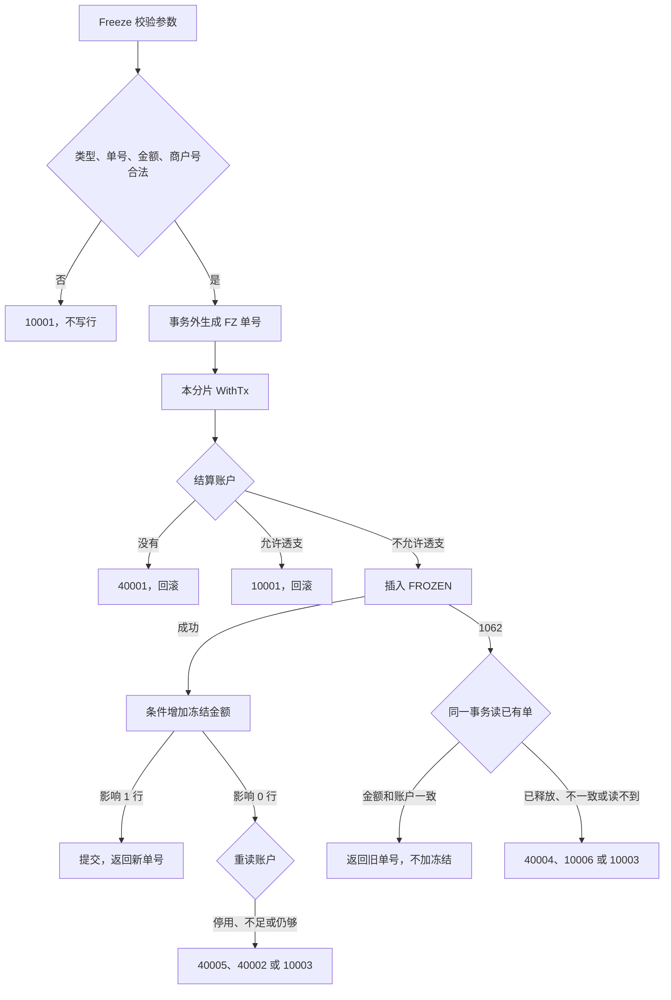

# ACC-04 冻结

| 项 | 内容 |
|---|---|
| 功能点 | ACC-04（P0，第 2 周） |
| 所属链路 | 基础设施 |
| 代码提交 | `747a27a` `[ACC-04] add account freeze` |
| 分支 | `feat/ACC-04-freeze` |
| 日期 | 2026-10-19 |
| 状态 | DONE |

完整 hash：`747a27a6eb77364510bec3b71fc02838e15dd003`。这次代码提交 10 个文件，1659 行新增，38 行删除。本报告在该提交之后写，不包含在这 10 个文件里。

## 一句话结论

冻结是 account 进程里的方法 `Freeze`。它自己用 `dbx.WithTx` 提交本分片事务：先插入一张状态为 `FROZEN` 的冻结单，再在账户仍为 `ACTIVE` 且可用余额够的条件下，把 `frozen_amount` 加上本次金额，并把账户 `version` 加 1。它不改 `balance`。商户 `M100002` 可用余额 1000 分（10.00 元）时，100 个 goroutine 用不同业务单号各冻结 20 分（0.20 元），恰好 50 次成功、50 次余额不足；最终账面余额仍是 1000 分，冻结金额是 1000 分，可用余额是 0。这次 50 次成功和 50 次 `40002` 只属于这一次设置：该库最大连接数是 8，父上下文是 120 秒，依据是 `TestFreezeConcurrentDistinctBizNo`。`dbx.WithTx` 的 3 秒从这次调用一开始就计时，里面包含从连接池拿到连接，以及事务里等同一账户行的时间。100 个调用同时开始时，如果连接池允许很多事务一起拿到连接，这些事务会同时排队等同一行锁。排在后面的还没执行到条件更新，3 秒就到了，调用被取消，返回的是 `context.DeadlineExceeded`，不是 `40002`。这次把最大连接数设为 8，是为了让同时拿着连接、待在事务里等这一行的调用少一些。8 和 120 秒都是这次测试的设置，不是 `Freeze` 的产品限制。没有把连接数放大再跑一遍，所以这里不给出另一组笔数。

## 1. 背景

### 1.1 系统简介

pay-system 是一个用 Go 编写的小型支付后端，模拟商户收款、退款、商户间转账三条资金链路，重点在数据一致性和性能。系统由 5 个部分组成：gateway（对外 HTTP 入口，负责签名校验和限流）、payment（支付单、退款单、转账单的状态管理和流程推进）、account（账户余额与记账，数据按商户分到 2 个数据库分片）、channel-mock（模拟微信、支付宝这类外部支付渠道）、recon（对账，核对系统内外数据是否一致）。服务之间用 Kitex RPC 同步调用，或通过 Kafka 消息异步通知；数据存在 MySQL 8.4，Redis 用于防重放。所有金额用整数“分”表示，所有记账只追加不修改。「所有记账只追加不修改」指分录（`ledger_entry`）只插入、不改旧行。账户行上的 `balance`、`frozen_amount`、`version` 是当前值，用条件更新改这一行。冻结这次不写分录，也不改 `balance`。当前已完成：工程骨架到 IDL、账户分片路由、开户、账户查询、通用记账，以及本功能点的冻结。解冻、确认扣款、转账和 account 的 RPC 进程还没做。

Kitex 是本项目的 Go RPC 框架。RPC 是进程之间的同步调用。Kafka 是消息队列。简介里的 Redis 防重放是以后 gateway 用来挡住重复的对外 HTTP：把已经见过的请求记在 Redis 里。`Freeze` 不用 Redis。重复冻结只靠 `account_freeze` 的唯一索引 `uk_biz`（`biz_type, biz_no`）。分片是账户数据所在的那一个库，这里只有 0 和 1。IDL 是接口定义文件。本次冻结不改 IDL，也没有进程在监听端口。

### 1.2 本功能点在系统中的位置

`Freeze` 只在 account 进程内部被调用。现在会调用它的只有测试。跨分片转账还没做。计划是付款方先调用 `Freeze` 把钱占住，这一步叫尝试，转账成不成功还没定。退款受理以后也会调用它，那些调用方还没做。通用记账 `Post` 仍然由调用方自己开事务，并且不改冻结金额。解冻和确认扣款会改冻结单状态，它们是后面的功能，这次不实现。



图里的事务由 `Freeze` 自己开始和结束。「不允许透支」只看 `allow_overdraft` 是不是 0，插入前不检查账户是不是 `ACTIVE`。停用账户仍会插入，条件更新影响 0 行后整笔回滚，冻结单不会留下。错误分支回滚，不会把冻结金额加上去。幂等命中时没有新行，事务提交的是“什么都没再改”的结果。

### 1.3 为什么需要它

商户 `M100002` 的结算账户在分片 0。假设账面余额 1000 分（10.00 元），冻结金额 0，可用余额就是 1000 分。同时来了 100 笔各 20 分（0.20 元）的冻结，业务单号各不相同。如果每笔都先单独读“可用余额够不够”再去加冻结，这些读会都看到 1000 分，100 笔都会加上去，冻结金额会变成 2000 分（20.00 元），可用余额变成 −1000 分。正确结果是恰好 50 笔成功，另外 50 笔被告知余额不足，账面余额仍是 1000 分，冻结金额是 1000 分，可用余额是 0。

同一笔业务如果被提交两次，也不能冻两次。第一次冻 40 分（0.40 元）已经成功之后，第二次必须回到第一次的冻结单号，冻结金额只增加一次。

退款打到渠道之前、转账决定成败之前，调用会离开数据库去等外部结果。事务里不能做这次外部调用。如果这段等待开始前没有先增加 `frozen_amount`，等待期间另一笔 `Post` 仍看到原来的可用余额。它的条件 `balance - frozen_amount >= 本次减少额` 会通过，`balance` 被减掉。等退款或转账回来再记账，钱已经不在了。先冻结是为了让等待期间的可用余额先变小。这不是说两条都带条件的更新会在同一次执行里一起成功。做成以后，`Freeze` 增加 `frozen_amount` 和 `Post` 减少 `balance` 都看这个可用余额，所以不能把同一笔可用余额花成负数。100 笔冻结若改成先单独读再无条件加冻结，才会都看到 1000 分并加成 2000 分；那是另一条被否决的做法，写在 §3.3。现在会调用 `Freeze` 的只有测试。

## 2. 术语

| 术语 | 含义 |
|---|---|
| 分 | 金额最小单位。100 分 = 1.00 元。1000 分是 10.00 元，20 分是 0.20 元，40 分是 0.40 元。金额是 `int64`，不用小数运算。 |
| 分片 | 账户数据所在的库，只有 0 和 1。商户号必须是 `M` 加恰好 6 位数字，分片是数字部分对 2 取模。`M100002` 的 `100002 % 2 = 0`，在分片 0。`M100001` 在分片 1。一次冻结只访问这一个库。 |
| 结算账户 | 表 `account` 里 `owner_type = MERCHANT`、`account_type = MERCHANT_SETTLE`、`currency = CNY`、`sub_no = 0` 的那一行。`sub_no` 是子账户序号。商户结算账户的检查约束要求它恒为 0。平台账户才有多个子号。冻结只查 `sub_no = 0` 的商户结算账户。 |
| 余额 | 列 `balance`，账面金额，单位分。本次冻结不修改它。 |
| 冻结金额 | 列 `frozen_amount`，已经占住、不能再当可用金额花掉的部分，单位分。成功冻结时加上本次金额。 |
| 可用余额 | `balance - frozen_amount`。不单独存成一列。冻结要求它大于等于本次金额。 |
| 透支 | 列 `allow_overdraft`。为 0 时不允许可用余额变成负数。结算账户的检查约束把它固定为 0。不为 0 时，冻结直接拒绝。 |
| `ACTIVE` | 账户可以冻结的状态。不是这个状态（例如 `CLOSED` 或账户状态 `FROZEN`）就不能增加冻结金额。 |
| 冻结单 | 表 `account_freeze` 里的一行。上面有冻结单号、业务类型、业务单号、账户、金额和状态。`txn_no` 是这张单上可空的凭证号，确认扣款时才填。这次插入不写它，所以是 NULL。 |
| `FROZEN` | 冻结单状态：钱已经占住，还没确认扣掉，也还没放开。 |
| `CONFIRMED` | 冻结单状态：已经确认扣款。这次不实现确认，但再次冻结时如果库里已经是这个状态，要能认出来。 |
| `RELEASED` | 冻结单状态：已经解冻，或者是一张占位用的墓碑。这次不实现解冻。库里如果已经是这个状态，再次冻结要拒绝。 |
| 墓碑 | 直接插成 `RELEASED` 的冻结单，用来占住业务单号，让后到的冻结不能再成功。写入墓碑是以后的解冻功能。这次的测试用 SQL 先插入一行来模拟它。 |
| 空回滚 | 冻结还没发生时先收到解冻。做法是插入一张 `RELEASED` 占位单，不改 `frozen_amount`，占住 `uk_biz`，让后到的冻结返回 `40004`。这次不实现这个插入。测试用 SQL 直接插入 `RELEASED` 行。 |
| 防悬挂 | 解冻先到、冻结后到时，不能让后到的冻结把钱再占上。已释放的单号一律拒绝。 |
| 幂等 | 同一业务做两次，结果和只做一次相同。冻结单有两条唯一索引：`uk_biz (biz_type, biz_no)` 和 `uk_freeze_no (freeze_no)`。重复冻结走 `uk_biz`。 |
| 凭证 | `ledger_txn` 的一行，一笔业务一张。冻结这次不写凭证。 |
| 分录 | `ledger_entry` 的一行，记某个账户加或减了多少。只插入，不改旧行。冻结这次不写分录。 |
| 借记 | 这里就是通用记账 `Post` 减少该账户的 `balance`。 |
| 手续费账户 | 平台账户，户主 `PLATFORM`，类型 `FEE_INCOME`，`sub_no = 0`。它不是商户结算账户。 |
| `1062` | MySQL 报告“唯一索引冲突”的错误号。它只让这一条 `INSERT` 失败，不会把整个 InnoDB 事务作废。按业务单号再查不到行，说明撞上的是另一条唯一索引，例如 `freeze_no` 重复而业务单不同。 |
| InnoDB | MySQL 使用的事务引擎。未提交的修改可以整笔撤销。 |
| CAS | 比较后再更新。冻结更新写成“状态是 `ACTIVE` 且可用余额够”，同时 `version = version + 1`。条件不满足时影响行数是 0，不能当成已经冻成功。 |
| `version` | 账户上的整数。余额或冻结金额每次改成功都加 1，用来看出这一行被改过几次。冻结单插入时自己的 `version` 写 0，这次不再改它。 |
| `freeze_no` | 冻结单号。前缀 `FZ`，由进程内发号器 `NewNo(ctx, "FZ")` 生成，长度 21，不访问别的服务。 |
| `biz_type` / `biz_no` | 业务类型和业务单号。类型只能是 `REFUND`（退款）或 `TRANSFER`（转账）。同一类型加同一单号只能有一张冻结单。 |
| `Duplicated` | 返回值里的布尔字段。为 true 时，`FreezeNo` 属于已经存在的冻结单，这次没有增加 `frozen_amount`。它只在进程内，不是 RPC 响应字段。 |
| `10001` | 业务码。对外英文固定为 `invalid parameter`。参数不合法，以及结算账户允许透支，都用它。 |
| `10003` | 业务码。对外英文固定为 `internal error`。`Error()` 里不带 SQL。接收者、上下文、发号器或分片库是 nil，以及数据库失败、重复键之后读不到行、更新没写上但重读仍然够冻结，都用它。上下文已经取消或到期时不用这个码。 |
| `10004` | 业务码。对外英文固定为 `service unavailable`。发号时时钟回拨过大用它。 |
| `10006` | 业务码。对外英文固定为 `idempotent conflict`。已有冻结单仍是 `FROZEN` 或 `CONFIRMED`，但金额或账户和这次请求不同。 |
| `40001` | 业务码。对外英文固定为 `account not found`。该商户在所属分片上没有结算账户。 |
| `40002` | 业务码。对外英文固定为 `insufficient balance`。可用余额不够。 |
| `40004` | 业务码。对外英文固定为 `freeze status conflict`。已有冻结单是 `RELEASED`。 |
| `40005` | 业务码。对外英文固定为 `account inactive`。账户不是 `ACTIVE`。它优先于余额不足。 |
| 码点 | 这里按 Go 的一个 Unicode 字符计，不是按字节。64 个汉字就是 64 个码点。 |
| goroutine | Go 里的一个并发执行单元。100 个 goroutine 就是 100 个同时发起的调用。 |
| `dbx.WithTx` | 已有的事务助手。它自己 `BEGIN`，回调返回错误就回滚，成功就提交。3 秒是这一次调用的总时长，含最多 4 次尝试和重试前的等待，不是每一次尝试各 3 秒。它从调用方的上下文派生，谁先到期用谁。到点后取消并回滚。只有死锁 `1213` 和锁等待超时 `1205` 会重试整段回调。4 次都是这两种错误时，最后一次的数据库错误不是业务码，`internalErr` 把它包成 `10003`。隔离级别是 `READ COMMITTED`。`Freeze` 调用它。`Post` 不调用它。`Freeze` 对 `context.DeadlineExceeded` 和 `context.Canceled` 原样返回，不改成 `10003`。 |
| `READ COMMITTED` | 事务隔离级别：读到的是其他事务已经提交的数据。 |
| `dbx.IsDuplicate` | 只认 MySQL 错误号 `1062`。错误文本里出现“1062”这几个字不算重复键。 |
| 行锁 | InnoDB 为了改一行或占住唯一索引而持有的锁。别的事务要动同一行就必须等这次事务结束。 |
| schema | MySQL 里的一个库名。集成测试使用临时库，结束时只删临时库。 |
| RPC handler | 把网络请求转成进程内方法的那一层。IDL 里已经有 `Freeze` 这个方法名，但这次不写 handler，也不启动监听。 |
| `internalErr` | 事务结束后的包装。已经是业务码（`*errno.Error`，含 `10001`、`40001`、`40002`、`40004`、`40005`、`10006`）就原样返回。`context.Canceled` 和 `context.DeadlineExceeded` 也原样返回。其余数据库错误才包成 `10003`。余额不足仍是 `40002`，不会变成内部错误。 |
| 不连库 | 单元测试不打开 MySQL，用同一个包里的假事务代替。 |

## 3. 技术讲解

### 3.1 要解决的问题

一次冻结要同时满足这些约束：

1. 只占该商户所属分片上的结算账户。商户号对不上分片规则、业务类型不是退款或转账、业务单号为空或超过 64 个码点、金额不是正整数，都不能写行。
2. 可用余额不能变成负数。判断必须放在更新语句的条件里，不能先读再改。账面余额保持不变。
3. 同一业务单号只增加一次冻结金额。重复请求回到已有冻结单。金额或账户对不上时，旧行保持原样。
4. 已经释放的单号不能再冻成功，即使这次金额和库里的金额不一样。否则后到的冻结会把已经放开的钱重新占上。
5. 账户不存在、账户已停用、余额不够，都不能留下冻结单。停用和余额不够要能区分，停用优先。
6. 失败时不能留下半张单。插入和增加冻结金额在同一个事务里，要么一起提交，要么一起撤销。
7. 事务里面不调用别的服务。发号放在事务外面，避免占着行去等时钟。

### 3.2 方案

`Freeze` 的签名是 `Freeze(ctx, bizType, bizNo, merchantID, amount) (FreezeResult, error)`。`FreezeResult` 有三个字段：`FreezeNo`、`Status`、`Duplicated`。

方法接收者 `*Service` 是 nil 时返回 `10003`。这不是外部调用方。然后做纯校验，不访问数据库。`biz_type` 只能是 `REFUND` 或 `TRANSFER`。`biz_no` 按码点计，不能是 0，也不能超过 64。`amount` 必须大于 0。商户号必须能算出分片，否则 `10001`。这些校验失败都不发号、不写行。参数不合法时，即使上下文已经取消，也先返回 `10001`。

参数合法之后才看上下文。上下文是 nil，返回 `10003`。发号前上下文已经取消或已经超过截止时间，原样返回 `context.Canceled` 或 `context.DeadlineExceeded`。这两个是 Go 的上下文错误，不是术语表里的业务码，也不发号，不改写成 `10003`。发号器是 nil，或者按分片拿数据库失败，也是 `10003`，同样不发号。

然后在事务外调用 `NewNo(ctx, "FZ")`。时钟回拨超过 5 毫秒时，发号器返回 `ErrClockRollback`，这里映射成已有的 `10004`，原因仍可被 `errors.Is` 认出来。发号的其他失败映射成 `10003`。单号生成之后才进入事务。`dbx.WithTx` 如果因为死锁或锁等待把回调重试，沿用这同一个单号。这 3 秒是这一次调用的总时长，含最多 4 次尝试，不是每一次尝试各 3 秒。回滚过的插入不会留下行，所以重试时这个单号仍然可以用。

事务里先按商户查出结算账户。没有这一行，返回 `40001`。`allow_overdraft` 不是 0，返回 `10001`，并且不插入冻结单。真实库的检查约束 `ck_account_type_rule` 迫使结算账户的这一列就是 0，集成测试插不进透支的结算账户。这条分支只用同一个包里的假事务覆盖，不为了测试去改约束或写非法行。

查到结算账户且 `allow_overdraft` 为 0 就插入，这时还不看是不是 `ACTIVE`。停用账户仍会插入 `FROZEN`；随后条件更新影响 0 行，重读得到 `40005`，事务回滚，这次插入也撤销。插入的状态是 `FROZEN`，冻结单自己的 `version` 写 0。`txn_no` 是冻结单上可空的凭证号，确认扣款时才填；这次插入不写它，所以是 NULL。如果唯一索引返回 `1062`，用 `dbx.IsDuplicate` 认错误号，不解析错误文本。同一事务按 `(biz_type, biz_no)` 再查：

- 查到的状态是 `RELEASED`：返回 `40004`。不再比较金额，也不比较账户。
- 状态是 `FROZEN` 或 `CONFIRMED`，并且金额、`account_id` 都和这次一致：返回已有 `freeze_no` 和已有状态，`Duplicated = true`，不再增加 `frozen_amount`。
- 状态是这两个之一，但金额或账户不同：返回 `10006`。旧行不改。
- 按业务单号读不到行：返回 `10003`，并把原来的 `1062` 留在原因里。幂等走 `uk_biz`。读不到，说明撞上的是另一条唯一索引 `uk_freeze_no`（`freeze_no` 重复而业务单不同）。这条只在不连库测试里构造，真实库没有单独造这种行。
- 出现这三种以外的状态：返回 `10003`。表的检查约束只允许上面三种状态，真实库插不出第四种。

插入成功后执行：

```sql
UPDATE account
SET frozen_amount = frozen_amount + ?, version = version + 1
WHERE id = ? AND status = 'ACTIVE' AND balance - frozen_amount >= ?
```

这条语句不给 `balance` 赋值。影响 1 行，事务提交，返回新 `freeze_no`、状态 `FROZEN`、`Duplicated = false`。影响 0 行，就在同一事务里按主键重读账户，并且不再发第二次更新：

- 行没了：`10003`。可用余额用 `money.Sub(balance, frozen_amount)`。差超出 `int64` 时返回溢出错误和 0，不回绕。分类时把这个溢出包成 `10003`。正常的非负余额走不到这里。
- 状态不是 `ACTIVE`：`40005`。哪怕这时可用余额也不够，仍然是 `40005`，因为调用方看到余额不足会以为还能重试。
- 状态仍是 `ACTIVE`，但可用余额小于本次金额：`40002`。
- 状态仍是 `ACTIVE`，可用余额也仍然够：`10003`。条件更新没写上，却又看不出业务原因。不在事务里空转重试，否则会占着行锁反复抢。

`40005` 和 `40002` 都让事务回滚，库里没有这次的冻结单，冻结金额也不变。`3819` 是 MySQL 检查约束被违反的错误号。`ck_account_available` 要求 `allow_overdraft = 1`，或者 `balance - frozen_amount >= 0`。若增加冻结时仍然报 `3819`，它不是业务码，`internalErr` 包成 `10003`，不改写成 `40002`。对外的 `Error()` 只有稳定英文，不带 SQL，也不带地址和口令。

下面这段代码在做的是：分片库已经取到之后才发号，发号在 `BEGIN` 之前，事务由 `WithTx` 提交或回滚。校验、接收者或发号器为空、以及上下文取消的判断在这段之前。

```go
// 发号可能要等下一毫秒。放在事务外，避免占着账户行，也不把发号算进事务。
freezeNo, err := s.ids.NewNo(ctx, freezeNoPrefix)
if err != nil {
    return FreezeResult{}, mapIDError(err)
}
req := freezeRequest{
    FreezeNo: freezeNo, BizType: bizType, BizNo: bizNo, MerchantID: merchantID, Amount: amount,
}
var out FreezeResult
err = dbx.WithTx(ctx, db, func(tx *sqlx.Tx) error {
    var applyErr error
    out, applyErr = applyFreeze(ctx, sqlFreezeTx{tx: tx}, req)
    return applyErr
})
if err != nil {
    return FreezeResult{}, internalErr(err)
}
return out, nil
```

`return internalErr(err)` 旁边的包装规则是：已经是业务码（`*errno.Error`，含 `10001`、`40001`、`40002`、`40004`、`40005`、`10006`）就原样返回；`context.Canceled` 和 `context.DeadlineExceeded` 也原样返回；其余数据库错误才包成 `10003`。余额不足是 `40002`，不会在这里变成内部错误。

`1062` 之后先看状态。已释放不比较金额。只有仍是 `FROZEN` 或 `CONFIRMED` 时，才区分“一致则返回旧单”和“不一致则 `10006`”。别的状态是 `10003`。

```go
if row.Status == statusReleased {
    return FreezeResult{}, errno.ErrFreezeStatusConflict
}
if row.Status == statusFrozen || row.Status == statusConfirmed {
    if row.Amount == req.Amount && row.AccountID == accountID {
        return FreezeResult{FreezeNo: row.FreezeNo, Status: row.Status, Duplicated: true}, nil
    }
    return FreezeResult{}, errno.ErrIdempotentConflict
}
return FreezeResult{}, errno.ErrInternal
```

锁的顺序是先插入冻结单，占住 `uk_biz`，再更新账户行。两笔不同业务单号的冻结，各自先锁自己的冻结单，再排队抢同一账户行，不会互相死锁。`Post` 只锁账户、不碰冻结单，和 `Freeze` 不会组成“你先锁 A 我先锁 B”的环。`1213` 和 `1205` 仍交给 `WithTx` 重试整段回调。

### 3.3 为什么这样做

| 方案 | 做法 | 优点 | 缺点 | 结论 |
|---|---|---|---|---|
| 采用：`Freeze` 自己 `dbx.WithTx`，先插冻结单，再按条件加冻结金额 | 幂等靠 `uk_biz`；`1062` 不回滚，就地读旧单；失败整笔撤销 | 不会留下只有冻结单、金额却没加上的行；重复请求不二次占用 | 3 秒从这次调用一开始就计时，含从连接池拿到连接和等同一账户行。连接池若让很多事务同时拿着连接排队等这一行，后面的调用会在条件更新之前被取消，返回 `context.DeadlineExceeded`，不是 `40002`。这次测试把最大连接数设为 8，是为了让同时等这一行的事务少一些。8 和父上下文 120 秒都是测试设置，不是产品限制。没有把连接数放大再跑，不给出另一组笔数 | 采用 |
| 备选：像 `Post` 一样由调用方开事务，`Freeze` 不提交 | 和记账的事务边界一致 | 以后可以把冻结和别的写入放进同一个调用方事务 | 这次要求冻结自己把插入和增加冻结金额一起提交或一起撤销。调用方现在也还没有。不采用它并不是去改 `Post`。`Post` 仍由调用方提交，这条边界不动 | 不采用 |
| 备选：先读可用余额，再发一条不带条件的更新 | 应用里判断“够不够” | 代码看起来直接 | 两个并发读会都看到旧的可用余额，都能加成功，可用余额变负 | 不采用 |
| 备选：已释放但金额不同就返回 `10006` | 所有不一致都当成参数冲突 | 错误种类更少 | 墓碑的金额和后到的请求经常不同。返回参数冲突会让调用方以为可以换个金额再冻，防悬挂就失效了 | 不采用 |
| 备选：更新 0 行且重读仍然够时，在事务里再更新一次 | 把偶发的 0 行补上 | 少一个 `10003` | 原因不明时反复抢同一行锁，事务更容易拖过 3 秒 | 不采用 |
| 备选：为了测透支，改检查约束或插入非法结算账户 | 集成测试能走进 `allow_overdraft != 0` | 这条分支也走真实 SQL | 结算账户不允许透支是资金约束。为测试放开它，会让非法行进库 | 不采用 |

### 3.4 正确性

| 场景 | 系统行为 | 最终状态 | 证明 |
|---|---|---|---|
| 商户号、业务类型、业务单号或金额不合法 | 返回 `10001`，英文 `invalid parameter`。不发号，不写行。已取消的上下文如果参数也不合法，仍然是 `10001` | 两个分片的冻结单数量都不变 | `TestFreezeRejectsBeforeID`、`TestFreezeRejectsInvalidWritesNothing` |
| 可用余额 1000 分，100 个 goroutine 用不同 `biz_no` 各冻 20 分 | `Freeze` 自己 `WithTx`。该库最多 8 条连接，父上下文 120 秒。这是测试设的连接数，不是 `Freeze` 自己的限制。条件更新保证可用余额够才加冻结 | 恰好 50 次成功、50 次 `40002`。余额仍是 1000 分（10.00 元），冻结金额 1000 分，状态仍是 `ACTIVE`，账户 `version` 是 50。50 张 `FROZEN` 单，金额合计 1000 分，单号前缀都是 `FZ` 且互不相同。不写凭证和分录。分片 1 的冻结单数量不变。不允许透支的账户没有负的可用余额 | `TestFreezeConcurrentDistinctBizNo` |
| 同一 `biz_no` 先成功，再重放，然后 16 个 goroutine 再重放 | 第一次 `Duplicated = false`。之后每次都是 `1062`，读到同一张单，`Duplicated = true`，状态 `FROZEN` | 期初余额 500 分（5.00 元）。冻结金额只到 40 分（0.40 元），账户 `version` 是 1。冻结单 1 行，`txn_no` 为空，冻结单 `version` 是 0。16 次并发里没有新的首次成功 | `TestFreezeRepeatAndConcurrentSameBizNo` |
| 16 个 goroutine 同时冻同一个新 `biz_no` | 它们用屏障一起出发：每个调用先停在同一个起点，全部就绪后同时进入，此时还没有赢家。赢的那次插入并提交之后，其余才收到 `1062`。`READ COMMITTED` 下，唯一索引冲突表示对方已经提交（或这行本来就在），所以同一事务的 SELECT 读得到。不是在对方还没提交时就读到已提交的单 | 恰好 1 次 `Duplicated = false`，15 次 `Duplicated = true`，16 次的 `freeze_no` 相同，状态都是 `FROZEN`。余额仍是 1000 分，冻结金额只加 20 分（0.20 元），账户 `version` 是 1。冻结单 1 行 | `TestFreezeConcurrentFirstInsert` |
| 50 笔冻结和 50 笔记账同时抢 1000 分 | 冻结各 20 分（0.20 元），单号不同。记账是 `Post`：凭证是 `ledger_txn` 的一行，一笔业务一张；分录是 `ledger_entry` 的一行，记某个账户加或减了多少。这里的借记就是 `Post` 减少该账户的 `balance`，每笔 20 分。调用方自己用 `READ COMMITTED` 开事务，`Post` 仍不提交。减少不允许透支的余额时，`balance - frozen_amount >= 本次减少额` 才更新。所以冻结和记账不能各自成功到把可用余额打成负数。余额核对功能还没做，结束时用 SQL 数成功次数、余额和冻结金额，不调用 `CheckBalance` | 成功的冻结次数加成功的记账次数等于 50。这是这次 1000 分、每笔 20 分的结果。余额 = 1000 − 20 × 记账成功次数，冻结金额 = 20 × 冻结成功次数，可用余额是 0。不允许透支的行没有负的可用余额。分片 1 不新增冻结单、凭证或分录 | `TestFreezeMixedWithPost` |
| 分片上没有这个商户的结算账户 | `M100003` 用退款、`M100004` 用转账，都返回 `40001` | 两个分片都不新增冻结单 | `TestFreezeAccountNotFound`，不连库的 `TestApplyFreezeAccountMissing` |
| 账户不是 `ACTIVE` | 余额只剩 10 分（0.10 元）却被改成 `CLOSED`，再冻 100 分。返回 `40005`，不是 `40002`。再把状态改成账户的 `FROZEN`、余额 80 分（0.80 元），冻 1 分仍是 `40005` | 两种情况都不留冻结单。第一种余额 10 分、冻结 0、版本 0。第二种余额 80 分、冻结 0、版本 0 | `TestFreezeInactiveLeavesNothing`。停用优先于余额不足的单元测试是 `TestApplyFreezeZeroUpdate` |
| 可用余额不够 | 余额 100 分（1.00 元）、已冻结 90 分（0.90 元），再冻 20 分，返回 `40002`。随后可用的 10 分可以冻成功。再冻 1 分又是 `40002` | 失败不留新单。成功后余额仍是 100 分，冻结金额 100 分，版本 1。第二次失败后仍然只有 1 张冻结单 | `TestFreezeInsufficientLeavesNothing` |
| 库里已经是 `CONFIRMED`，金额和账户都一致 | 这行没有走 `Freeze`，是测试用 SQL 直接插入的。`Freeze` 返回已有单号，状态 `CONFIRMED`，`Duplicated = true`，不增加冻结 | 余额 200 分（2.00 元）、版本 0。账户冻结金额 15 分（0.15 元）是开头设的，冻结单金额 30 分（0.30 元）是 SQL 插入的，两者不必相等。调用之后这两个数都不变。冻结单仍是那 1 行 | `TestFreezeConfirmedReplay` |
| 库里已经是 `RELEASED` | 两行都是 SQL 直接插入，没有走 `Freeze`。先请求与库里相同的 25 分（0.25 元），再在另一张单上请求 80 分（0.80 元）。两次都返回 `40004`，不比较金额 | 余额 200 分，版本 0。账户冻结金额 40 分（0.40 元）是开头设的；两张单各 25 分也是 SQL 插入的，不必等于账户上的冻结金额。`Freeze` 拒绝后这两个数都不变。两行旧数据的单号、账户、金额、状态都不变 | `TestFreezeReleasedConflict`。假实现里金额和账户都不同的 `RELEASED` 也是 `40004`，不是 `10006`：`TestApplyFreezeReleased` |
| 已有 `FROZEN` 但金额不同，或已有 `CONFIRMED` 但账户不是该商户的结算账户 | 10 分（0.10 元）的单是 SQL 插入的，再用 11 分（0.11 元）来冻，返回 `10006`。手续费账户是平台账户，户主 `PLATFORM`，类型 `FEE_INCOME`，`sub_no = 0`，不是商户结算账户。测试把另一张 `CONFIRMED` 冻结单的 `account_id` 指到它，再用相同的 10 分对商户 `M100002` 的结算账户发起冻结，账户不一致，也返回 `10006` | 旧行的单号、账户、金额、状态都不变。商户余额 300 分（3.00 元）。账户冻结金额 5 分（0.05 元）是开头设的，版本 0。冻结单仍是 SQL 插入的那 2 行。拒绝后这些数都不变 | `TestFreezeIdempotentConflict` |
| 结算账户允许透支 | 插入之前就返回 `10001`，不调用插入。账户即使同时是 `CLOSED`，也是 `10001`，不是 `40005` | 假实现里插入次数是 0。真实 MySQL 上没有这条集成测试 | `TestApplyFreezeOverdraft` |
| `1062` 之后按业务单号读不到行 | 返回 `10003`。普通文本里的“1062”不算重复键，不会走进这个分支。幂等走 `uk_biz`。读不到，说明撞上的是 `uk_freeze_no`，例如 `freeze_no` 重复而业务单不同 | 不增加冻结。这条只在不连库测试里构造。真实库没有单独造这种行 | `TestApplyFreezeDuplicateMiss` |
| 更新影响 0 行，重读仍是 `ACTIVE` 且可用余额够 | 返回 `10003`。更新只尝试一次 | 不连库。没有第二次更新 | `TestApplyFreezeZeroUpdate` |
| 发号和连库失败分三步，都不写库 | 第一步：发号成功后去连 `127.0.0.1:1`。这个端口没有 MySQL，`BEGIN` 失败，返回 `10003`，`Error()` 不含地址和口令。第二步：时钟相对上一次回拨 10 毫秒，超过 5 毫秒门槛，返回 `10004`，原因仍是 `ErrClockRollback`。第三步：时间是 2025-12-31，早于发号器纪元 2026-01-01 00:00:00 +08:00，返回 `10003`，原因是 `ErrTimeRange`，不是回拨 | `Error()` 也不含 `idgen` 和 `SELECT` | `TestFreezeIDErrors` |
| 进程在提交前崩溃 | 没有做崩溃注入。未提交的插入和冻结金额由这一个库的事务撤销。已经提交的单停在 `FROZEN`，要等以后的解冻或确认扣款 | 推出来的，不是杀掉进程后看到的 | 无单独测试 |
| 事务里调用别的服务超时 | `Freeze` 里面没有 RPC、HTTP 或发消息。发号前上下文已取消或已过截止时间，原样返回 `context.Canceled` 或 `context.DeadlineExceeded`，不是业务码，也不发号 | 不连库测试里发号器没有被调用 | `TestFreezeNilAndCanceled` |
| 同一 `biz_no` 换一个 `biz_type` | 这是另一张冻结单。`TRANSFER` 写到商户所在分片。64 个汉字的业务单号可以写入 | `M100001` 在分片 1。余额 50 分（0.50 元）不变，冻结金额 30 分（0.30 元），版本 2。两张单的单号不同。分片 0 的冻结单数量不变 | `TestFreezeTransferShardAndBizKey` |

审查没有必须修改的缺陷。提交前已经放进 `747a27a` 的建议有四条：周计划把 ACC-04 单独勾上，解冻和确认扣款仍未勾；接口文档只做文字对齐；`RELEASED` 的集成测试补了金额不同的那条 SQL；新增 16 个 goroutine 同时抢一个新业务单号。那一轮没有再改 `freeze.go`。

### 3.5 性能

不涉及性能开关，也没有测量单次冻结的耗时。不能把测试命令的耗时写成一次 `Freeze` 的延迟。

`go test -race -count=1 -tags integration -timeout 15m ./service/account/biz/` 的 `17.016s`，是只跑账户 biz 这一个包的集成测试。全仓集成测试里，同一个包是 `33.267s`，旁边还有别的包在跑。两个都是 2026-10-19 的实测，不是同一次计时，也不能相加。100 个 goroutine 用来核对称 50 次成功和 50 次 `40002`，不是吞吐量测试。

## 4. 已完成内容

### 4.1 改动清单

| 文件 | 新增 / 修改 | 作用 |
|---|---|---|
| `service/account/biz/freeze.go` | 新增 | `Freeze`：校验、事务外发号、自己提交事务、插入冻结单、按条件增加冻结金额 |
| `service/account/biz/freeze_test.go` | 新增 | 不连库的校验、接收者或发号器为空、取消、发号、透支、重复键、0 行分类和错误文本 |
| `service/account/biz/freeze_integration_test.go` | 新增 | 临时库上的三条验收，以及停用、余额不足、已确认、已释放、参数冲突和分片 |
| `service/account/biz/open.go` | 修改 | 包注释写明开户、查询、记账和冻结都不监听 RPC，冻结自己提交分片事务 |
| `docs/02-requirements.md` | 修改 | ACC-04 标为 DONE，三条验收勾上，并写明校验、事务边界和 `1062` 怎么处理 |
| `docs/04-dev-plan.md` | 修改 | 只勾 ACC-04。解冻和确认扣款仍是未勾的下一行 |
| `docs/05-api.md` | 修改 | 文档版本 2.0.2。冻结的文字与实现对齐，不新增响应字段 |
| `docs/06-flows.md` | 修改 | 冻结控制流图补上参数、透支、版本号和 `10003` 出口 |
| `docs/database.md` | 修改 | 说明账户 `version` 在冻结成功时也加 1。没有新的表或列 |
| `docs/interview-notes.md` | 修改 | 记下锁顺序、`1062` 同事务读取、透支只在假实现里测 |

### 4.2 对外变化

| 类别 | 变化 |
|---|---|
| 接口 | 无新的 RPC 字段，IDL 未改，没有 handler，没有进程监听。接口文档保留 `Freeze` 的契约：请求仍是业务类型、业务单号、商户号、金额，响应仍是 `freeze_no` 和 `status`。进程内的 `Duplicated` 不进入 RPC 响应。文档开头的版本和最后修改改成了 2.0.2、2026-10-19。§1 总览里每个已有接口各自的「最后修改」列没有改，因为那些接口的字段没变。这是有意留下的。总览表里没有单独的 Freeze 行 |
| 表结构 | 无。没有新迁移。用的是已有的 `account_freeze` 和 `account`。账户 `version` 的含义补了一句：冻结成功也加 1 |
| 配置项 | 无 |
| 错误码 | 无新码。`10001`、`10003`、`10004`、`10006`、`40001`、`40002`、`40004`、`40005` 都是原有的码，英文也没改 |
| 单号前缀 | 无。冻结单号前缀 `FZ` 本来就已经登记，这次只是开始使用 |
| 指标 / 故障点 | 无 |

### 4.3 验收对照

| 验收条目 | 测试函数 | 类型 | 结果 |
|---|---|---|---|
| 可用余额 1000 分，100 个 goroutine 各冻结 20 分且业务单号不同，恰好 50 次成功，`frozen_amount = 1000`，余额不变 | `TestFreezeConcurrentDistinctBizNo` | 集成，`-race` | 通过。包含在 `17.016s` 那次包测试里，没有单独耗时 |
| 同一业务单号重复冻结返回同一个 `freeze_no`，冻结金额只增加一次；首次提交后再有 16 个并发重复 | `TestFreezeRepeatAndConcurrentSameBizNo` | 集成，`-race` | 通过。期初 500 分，冻结金额只到 40 分，账户版本 1 |
| 冻结与通用记账扣减混合并发，可用余额始终不小于 0 | `TestFreezeMixedWithPost` | 集成，`-race` | 通过。结束时用 SQL 断言余额、冻结金额和成功次数。没有调用还没实现的余额核对 |
| 16 个 goroutine 在第一笔提交前同时冻结同一个新业务单号 | `TestFreezeConcurrentFirstInsert` | 集成，`-race` | 通过。恰好 1 次新插入、15 次重复，冻结金额只加 20 分 |

另外这些出口也在同一次集成测试里通过，没有单独耗时：非法参数 `TestFreezeRejectsInvalidWritesNothing`，账户不存在 `TestFreezeAccountNotFound`，非 `ACTIVE` `TestFreezeInactiveLeavesNothing`，余额不足 `TestFreezeInsufficientLeavesNothing`，已确认 `TestFreezeConfirmedReplay`，已释放且金额相同或不同 `TestFreezeReleasedConflict`，金额或账户不一致 `TestFreezeIdempotentConflict`，转账分片 `TestFreezeTransferShardAndBizKey`。透支只在不连库的 `TestApplyFreezeOverdraft` 里通过。

### 4.4 验证记录

环境：`go version go1.27.2 darwin/arm64`，golangci-lint 2.14.0。以下都是 lead 在提交 `747a27a` 之前、于 2026-10-19 在最终树上实测的输出。没有列出的耗时不写进本报告。

| 命令 | 结果 |
|---|---|
| `gofmt -l .` | 无输出，退出码 0 |
| `golangci-lint run ./...`（即 `make lint`） | `0 issues.`，退出码 0 |
| `go test -race -count=1 -cover ./service/account/biz/` | `ok github.com/yym108/pay-system/service/account/biz 1.759s coverage: 75.9% of statements` |
| `go test -race -count=1 -tags integration -timeout 15m ./service/account/biz/` | `ok github.com/yym108/pay-system/service/account/biz 17.016s` |
| `go test -race -count=1 ./...`（`make test` 加了 `-count=1`） | 退出码 0。其中 `service/account/biz` 为 `1.454s`。这一次没有 `-cover` |
| `go test -race -count=1 -tags integration -timeout 15m ./...`（`make test-integration` 加了 `-count=1` 和 timeout） | 退出码 0。根包 `46.504s`；`internal/dbmigrate` `40.281s`；`internal/seed` `20.167s`；`service/account/biz` `33.267s`；`service/payment/biz` `19.362s` |
| `make cover` | 未运行。没有全库覆盖率。本仓库对 `service/*/biz` 这类核心包的语句覆盖率要求不低于 70%。上面的 75.9% 是这个包、不含 integration 标签的数字，已经不低于 70%，不是全库覆盖率。真实 MySQL 上的成功插入和条件更新不在这个百分比里。透支分支只在假实现里 |
| `make gen`、`paycli` | 未运行。没有改 IDL，也没有改对外 HTTP |

`17.016s` 是只跑账户 biz 集成测试的那一次。`33.267s` 是同包在全仓集成测试里的耗时，旁边还有别的包在跑。两个都是实测，不要合成一个数字。

### 4.5 同步的文档

- 需求里 ACC-04 改为 DONE，三条验收勾上。写明：进程内方法；`biz_type` 只允许退款和转账；商户号、业务单号和金额不合法返回 `10001` 且不写行；冻结单号在事务外生成，时钟回拨映射为 `10004`；事务由 `Freeze` 自己提交，`Post` 仍不提交；更新同时把 `version` 加 1，不改 `balance`；影响 0 行时非 `ACTIVE` 返回 `40005`，余额不够返回 `40002`，重读后仍然够则 `10003`；`1062` 只用错误号识别，`RELEASED` 一律 `40004`，`FROZEN` 或 `CONFIRMED` 必须金额和账户都一致才返回已有结果，不一致是 `10006`，读不到行是 `10003`。不新增错误码，不改资金规则、表结构和 IDL。需求总模板上的完成定义复选框仍未勾，和记账那次一样，它们不是 ACC-04 自己的验收。
- 开发计划第 2 周把 ACC-04 单独勾上。解冻和确认扣款仍在下一行，未勾。其他周没有改。
- 接口文档升到 2.0.2。`Freeze` 仍留在内部方法表里。文字改为：已有单必须金额和账户都一致；已释放不再比较金额；响应仍是 `freeze_no` 和 `status`。RPC handler 仍留给以后的 account 服务。
- 流程图版本记为 v2.3。冻结那张图补上参数 `10001`、事务内先看账户和透支、`version + 1`、更新 0 行且重读仍够时的 `10003`、`1062` 读不到行时的 `10003`。已释放一律 `40004`。不改资金流向。
- 表结构文档只改了账户 `version` 的说明，并记了一行没有改表。冻结单表本身没有新列。
- 面试笔记记下：先锁冻结单再锁账户；`1062` 后在同一事务读取；透支为什么只在假实现里测；重读仍够时为什么返回 `10003`；100 个 goroutine 为什么把连接数收到 8。

约定文档没有改。迁移没有改。没有启动服务，也没有改命令行入口。

## 5. 未完成与风险

- 全库 `make cover` 未运行。本仓库对 `service/*/biz` 这类核心包的语句覆盖率要求不低于 70%。75.9% 是这个包、不含 integration 标签的数字，不是全库覆盖率，也不含集成测试里的 SQL。真实 MySQL 上的成功路径要看 `17.016s` 和 `33.267s` 那两次测试是否通过，不能从 75.9% 里读出来。
- 没有进程崩溃注入。未提交的修改会随 `WithTx` 撤销，这是从一个库、一个事务推出来的，不是杀掉进程之后看到的结果。已经提交的冻结单停在 `FROZEN`，没有补偿任务。
- 单次冻结的耗时没有测量。
- 解冻和确认扣款还没做。空回滚是冻结还没发生时先收到解冻：插入一张 `RELEASED` 占位单，不改 `frozen_amount`，占住 `uk_biz`，让后到的冻结返回 `40004`。这次不实现这个插入。测试里的 `RELEASED` 和 `CONFIRMED` 行是 SQL 直接插入的。这次也不会把冻结单改成这两种状态，不会减少 `frozen_amount`，不会改 `balance`。
- 透支分支没有真实 MySQL 测试。结算账户的检查约束不允许那种行。
- 冻结单状态如果不是 `FROZEN`、`CONFIRMED`、`RELEASED`，代码返回 `10003`。表的检查约束插不出第四种状态，这条没有单独测试。
- account 的 RPC 进程、对外 HTTP 和命令行客户端都还没接上 `Freeze`。没有监听端口。
- `Post` 减余额和冻结混跑的那次，用 SQL 断言可用余额不为负。全量余额核对还没做。

## 6. 如何复现

前置：本机 Go 为 `go version go1.27.2 darwin/arm64`，golangci-lint 为 2.14.0。集成测试会准备 MySQL 并使用临时 schema。不要把连接串或口令写进日志、错误或报告。下面的命令就是 2026-10-19 实测过的那些。

```bash
gofmt -l .
golangci-lint run ./...
go test -race -count=1 -cover ./service/account/biz/
go test -race -count=1 -tags integration -timeout 15m ./service/account/biz/
go test -race -count=1 ./...
go test -race -count=1 -tags integration -timeout 15m ./...
```

`gofmt -l .` 预期无输出、退出码 0。lint 预期 `0 issues.`、退出码 0。覆盖率命令预期 `ok github.com/yym108/pay-system/service/account/biz 1.759s coverage: 75.9% of statements`。只跑账户 biz 的集成测试预期 `ok github.com/yym108/pay-system/service/account/biz 17.016s`。不带 integration 标签的全库测试预期退出码 0，其中 `service/account/biz` 为 `1.454s`，这一次没有覆盖率。全仓集成测试预期退出码 0：根包 `46.504s`，`internal/dbmigrate` `40.281s`，`internal/seed` `20.167s`，`service/account/biz` `33.267s`，`service/payment/biz` `19.362s`。

`make cover`、`make gen` 和 `paycli` 这次没有跑。复现时不要把全库覆盖率、IDL 差异或手工 HTTP 写成已经测过。

## 7. 讲解要点

1. 问：可用余额只有 1000 分，100 笔各 20 分的冻结为什么不会把可用余额打成负数？答：每笔都在同一个事务里用带条件的更新去加 `frozen_amount`，条件是账户为 `ACTIVE` 且 `balance - frozen_amount` 大于等于 20 分。余额 1000 分（10.00 元）、冻结 0 时，只有 50 笔成功。其余 50 笔返回 `40002` 并回滚，不留冻结单。最终余额仍是 1000 分，冻结金额是 1000 分，可用余额是 0，账户版本是 50。这次 50 对 50 是在该库最大连接数设为 8、父上下文 120 秒时测到的。连接数是测试设的，不是 `Freeze` 自己的限制。
2. 问：同一业务单号来两次，为什么第二次不会再占钱？已释放的单号为什么即使金额不同也不是参数冲突？答：第二次插入撞上 `uk_biz` 的 `1062`。这个错误不结束事务。同一事务读出已有单。状态仍是 `FROZEN` 或 `CONFIRMED` 且金额、账户都一致时，返回旧单号，`Duplicated = true`，不再加冻结。16 个 goroutine 同时抢一个新单号时，只有 1 次是新插入。状态是 `RELEASED` 时一律 `40004`。金额 25 分（0.25 元）的墓碑再用 80 分（0.80 元）来冻也是 `40004`。那张单和账户上的冻结金额都不变：账户冻结金额仍是开头设的 40 分（0.40 元），不是单上的 25 分。金额或账户不一致，并且状态还是 `FROZEN` 或 `CONFIRMED`，才是 `10006`。
3. 问：为什么冻结自己提交，而记账不提交？100 个并发为什么还要把连接数收到 8？答：确认扣款以后要在同一个事务里把冻结单改成 `CONFIRMED`、减少 `frozen_amount`，并写入凭证和分录。`Post` 不自己提交，才能放进那个已经打开的事务。这次两边还没接在一起。`Freeze` 只有冻结单和 `frozen_amount`，没有凭证，所以自己提交。`dbx.WithTx` 的 3 秒从这次调用一开始就计时，里面包含从连接池拿到连接，以及事务里等同一账户行的时间，不是每一次尝试各 3 秒。100 个调用同时开始时，如果连接池允许很多事务一起拿到连接，这些事务会同时排队等同一行锁。排在后面的还没执行到条件更新，3 秒就到了，调用被取消，返回的是 `context.DeadlineExceeded`，不是 `40002`。这次测试把该库最大连接数设为 8，是为了让同时拿着连接、待在事务里等这一行的调用少一些。8 和父上下文 120 秒都是这次测试的设置，不是 `Freeze` 的产品限制。50 次成功和 50 次 `40002` 只属于这一次设置，依据是 `TestFreezeConcurrentDistinctBizNo`。没有把连接数放大再跑一遍，所以不给出另一组笔数。冻结仍然自己提交，没有改成调用方自己开事务。

## 延伸阅读

- `docs/02-requirements.md` 里 ACC-04 的规则、三条验收，以及 2026-10-19 关于校验、事务边界、版本号和 `1062` 的记录
- `docs/04-dev-plan.md` 第 2 周里 ACC-04 单独勾选、ACC-05 与 ACC-06 仍未勾的位置
- `docs/05-api.md` §10.1 的 `Freeze` 契约，文档版本 2.0.2
- `docs/06-flows.md` 的冻结控制流图，版本 v2.3
- `docs/database.md` 里 `account.version` 和 `account_freeze` 的字段说明
- `docs/interview-notes.md` 的 ACC-04 一节
- `service/account/biz/freeze.go`
- `docs/reports/ACC-03-ledger-post.md`：记账为什么不自己提交，以及为什么不改冻结金额
- `docs/reports/ACC-13-shard.md`：为什么 `M100002` 在分片 0、`M100001` 在分片 1

## 修订记录

| 日期 | 提交 | 修订内容 |
|---|---|---|
| 2026-10-19 | `747a27a` | 初稿。对应代码提交 `[ACC-04] add account freeze`，报告本身不在该提交内 |
| 2026-10-19 | 报告尚未提交 | 按可读性自检补定义。验证数字没有改 |
