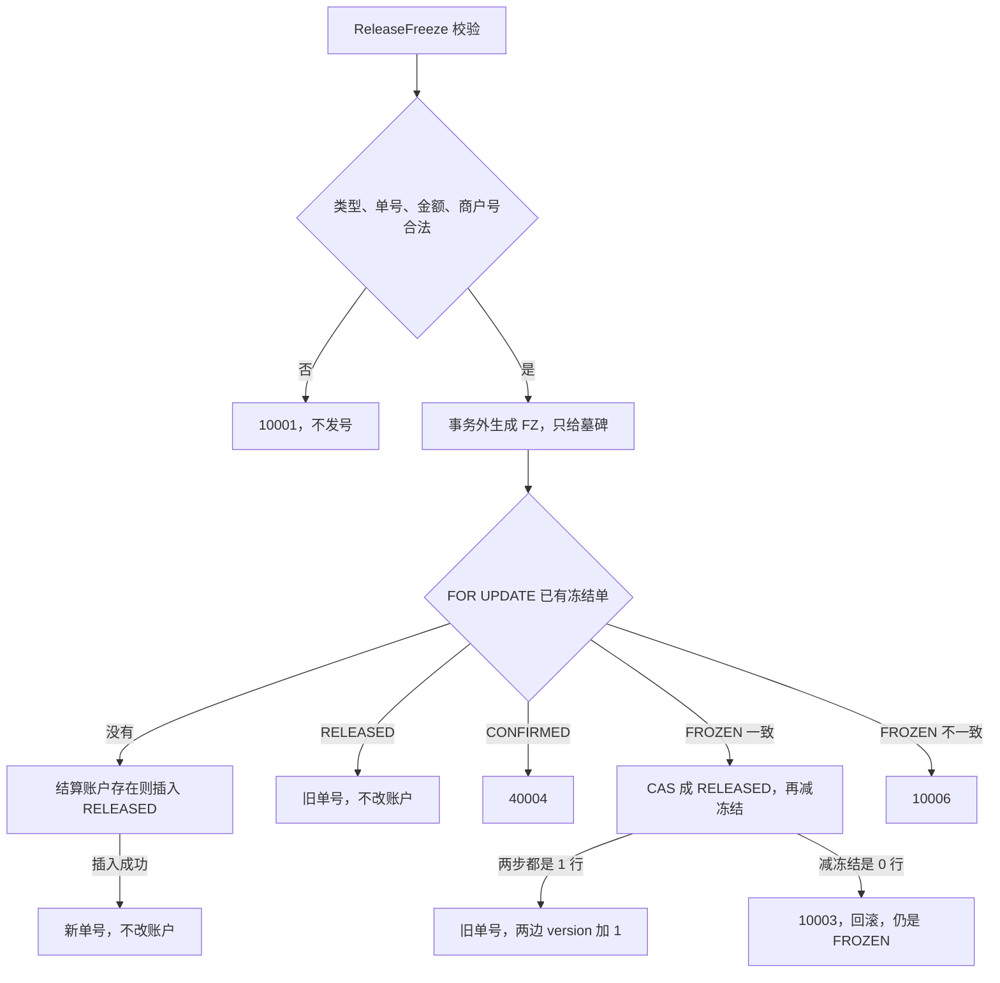

# ACC-05 解冻

| 项 | 内容 |
|---|---|
| 功能点 | ACC-05（P0，第 2 周） |
| 所属链路 | 基础设施 |
| 代码提交 | `1db50ae` `[ACC-05] add freeze release` |
| 分支 | `feat/ACC-05-release` |
| 日期 | 2026-10-20 |
| 状态 | DONE |

完整 hash：`1db50ae03650fd395628e76480364360d7179c8c`。这次代码提交 11 个文件，1621 行新增，36 行删除。本报告在该提交之后写，不包含在这 11 个文件里。

## 一句话结论

解冻是 account 进程里的方法 `ReleaseFreeze`。它自己用 `dbx.WithTx` 提交本分片事务。已有 `FROZEN` 单在金额和结算账户都一致时，用比较后更新改成 `RELEASED`，并在 `frozen_amount >= amount` 时减去本次金额；冻结单和账户的 `version` 各加 1，`balance` 不变，也不要求账户是 `ACTIVE`。没有冻结单时插入一张 `RELEASED` 墓碑，不改账户；随后真正的 `Freeze` 看到 `RELEASED` 返回 `40004`，不再增加冻结。商户 `M100002` 账面 1000 分（10.00 元）、已冻结 10 分（0.10 元）时，先冻 40 分（0.40 元）再解冻，冻结金额回到 10 分，余额仍是 1000 分，账户 `version` 是 2，冻结单 `version` 是 1。再解冻一次返回同一个 `freeze_no`，`Duplicated = true`，冻结金额不再减。依据是 `TestReleaseAfterFreezeRestoresFrozen`。

## 1. 背景

### 1.1 系统简介

pay-system 是一个用 Go 编写的小型支付后端，模拟商户收款、退款、商户间转账三条资金链路，重点在数据一致性和性能。系统由 5 个部分组成：gateway（对外 HTTP 入口，负责签名校验和限流）、payment（支付单、退款单、转账单的状态管理和流程推进）、account（账户余额与记账，数据按商户分到 2 个数据库分片）、channel-mock（模拟微信、支付宝这类外部支付渠道）、recon（对账，核对系统内外数据是否一致）。服务之间用 Kitex RPC 同步调用，或通过 Kafka 消息异步通知；数据存在 MySQL 8.4，Redis 用于防重放。所有金额用整数“分”表示，所有记账只追加不修改。「所有记账只追加不修改」指分录（`ledger_entry`）只插入、不改旧行。账户行上的 `balance`、`frozen_amount`、`version` 是当前值，用条件更新改这一行。解冻这次不写分录，也不改 `balance`。当前已完成：工程骨架到 IDL、账户分片路由、开户、账户查询、通用记账、冻结，以及本功能点的解冻。确认扣款、转账和 account 的 RPC 进程还没做。

Kitex 是本项目的 Go RPC 框架。RPC 是进程之间的同步调用。Kafka 是消息队列。简介里的 Redis 防重放是以后 gateway 用来挡住重复的对外 HTTP。`ReleaseFreeze` 不用 Redis。重复解冻和空回滚都靠 `account_freeze` 的唯一索引 `uk_biz`（`biz_type, biz_no`）。分片是账户数据所在的那一个库，这里只有 0 和 1。IDL 是接口定义文件。本次解冻不改 IDL，也没有进程在监听端口。

### 1.2 本功能点在系统中的位置

`ReleaseFreeze` 只在 account 进程内部被调用。现在会调用它的只有测试。计划里，退款失败和跨分片转账付款方取消都会调用它，把之前占住的钱放开。那些调用方还没做。通用记账 `Post` 仍然由调用方自己开事务。这次不改 `Post`，也不实现确认扣款。确认扣款会把冻结单改成 `CONFIRMED` 并改 `balance`，那是后面的功能。



图里的事务由 `ReleaseFreeze` 自己开始和结束。没有结算账户时是 `40001`，不插入。结算账户允许透支时是 `10001`，不插入。插入墓碑若撞上 `1062`，同一事务再读已有单，按图里已有单的出口处理。停用账户上的已有冻结仍然减 `frozen_amount`。两条更新都不改 `balance`。

### 1.3 为什么需要它

商户 `M100002` 的结算账户在分片 0。账面余额 1000 分（10.00 元），已经冻住 10 分（0.10 元），可用余额是 990 分（9.90 元）。一笔退款再冻 40 分（0.40 元）之后，冻结金额变成 50 分（0.50 元），可用余额变成 950 分（9.50 元）。退款后来失败。如果没有解冻，这 40 分会一直占着，商户能花的钱少了 0.40 元。解冻要把冻结金额减回 10 分，账面余额保持 1000 分。

同一张单如果被解冻两次，也不能减两次。第一次已经把 40 分放开之后，第二次必须回到第一次的冻结单号，冻结金额停在 10 分。如果第二次再减 40 分，冻结金额会变成 −30 分。

还有一种先到的取消。调用方等冻结结果时超时，不知道冻结有没有成功，于是先发解冻。这时库里还没有这张单。如果解冻只回答“没有这张单”就结束，后到的冻结仍会把 15 分（0.15 元）占上。钱被占住，取消方却以为已经放开。空回滚是：先插入一张状态为 `RELEASED` 的占位单，不改账户。后到的冻结看到这张单，返回 `40004`，冻结金额保持原样。

## 2. 术语

| 术语 | 含义 |
|---|---|
| 分 | 金额最小单位。100 分 = 1.00 元。1000 分是 10.00 元，40 分是 0.40 元，15 分是 0.15 元。金额是 `int64`，不用小数运算。 |
| 分片 | 账户数据所在的库，只有 0 和 1。商户号必须是 `M` 加恰好 6 位数字，分片是数字部分对 2 取模。`M100002` 的 `100002 % 2 = 0`，在分片 0。`M100001` 在分片 1。一次解冻只访问这一个库。 |
| 结算账户 | 表 `account` 里 `owner_type = MERCHANT`、`account_type = MERCHANT_SETTLE`、`currency = CNY`、`sub_no = 0` 的那一行。`sub_no` 是子账户序号。商户结算账户的检查约束要求它恒为 0。解冻只查 `sub_no = 0` 的商户结算账户。 |
| 余额 | 列 `balance`，账面金额，单位分。本次解冻不修改它。 |
| 冻结金额 | 列 `frozen_amount`，已经占住、不能再当可用金额花掉的部分，单位分。解冻成功时减去本次金额。墓碑插入不改它。 |
| 可用余额 | `balance - frozen_amount`。不单独存成一列。停用账户上的冻结如果不解开，可用余额会一直少掉这一笔。 |
| 透支 | 列 `allow_overdraft`。为 0 时不允许可用余额变成负数。结算账户的检查约束把它固定为 0。空回滚时它不是 0，解冻直接拒绝，不插入墓碑。已经存在且金额、账户都一致的 `FROZEN` 单，不因为这一列拒绝。 |
| `ACTIVE` | 账户可以新增冻结的状态。解冻不要求这个状态。`CLOSED` 是账户已关闭。账户状态也可以是 `FROZEN`，那是账户行上的状态，和冻结单状态 `FROZEN` 不是同一个字段。 |
| 冻结单 | 表 `account_freeze` 里的一行。上面有冻结单号、业务类型、业务单号、账户、金额和状态。`txn_no` 是这张单上可空的凭证号，确认扣款时才填。解冻不写它。 |
| `FROZEN` | 冻结单状态：钱已经占住，还没确认扣掉，也还没放开。解冻要把这种单改成 `RELEASED`。 |
| `CONFIRMED` | 冻结单状态：已经确认扣款。这次不实现确认。库里已经是这个状态时，解冻一律拒绝。 |
| `RELEASED` | 冻结单状态：已经解冻，或者是一张占位用的墓碑。再次解冻时幂等成功。 |
| 墓碑 | 直接插成 `RELEASED` 的冻结单。它占住业务单号，不改 `frozen_amount`。冻结单自己的 `version` 保持 0。 |
| 空回滚 | 冻结还没发生时先收到解冻。做法是插入一张 `RELEASED` 墓碑。 |
| 防悬挂 | 解冻先到、冻结后到时，不能让后到的冻结把钱再占上。已有的 `Freeze` 看到 `RELEASED` 返回 `40004`，不增加 `frozen_amount`。这次不重写 `Freeze`。 |
| 幂等 | 同一业务做两次，结果和只做一次相同。冻结单有两条唯一索引：`uk_biz (biz_type, biz_no)` 和 `uk_freeze_no (freeze_no)`。重复解冻走 `uk_biz`。 |
| 凭证 | `ledger_txn` 的一行，一笔业务一张。解冻这次不写凭证。 |
| 分录 | `ledger_entry` 的一行，记某个账户加或减了多少。只插入，不改旧行。解冻这次不写分录。 |
| `1062` | MySQL 报告“唯一索引冲突”的错误号。它只让这一条 `INSERT` 失败，不会把整个 InnoDB 事务作废。按业务单号再查不到行，说明撞上的是另一条唯一索引。 |
| InnoDB | MySQL 使用的事务引擎。未提交的修改可以整笔撤销。 |
| CAS | 比较后再更新。解冻把冻结单改成 `RELEASED` 时，条件里带着原来的状态、金额和账户，同时 `version = version + 1`。条件不满足时影响行数是 0，不能当成已经解开。 |
| `version` | 账户和冻结单上各自的整数。解冻成功时两边都加 1。墓碑插入时冻结单的 `version` 写 0，账户不加。 |
| `freeze_no` | 冻结单号。前缀 `FZ`，由进程内发号器 `NewNo(ctx, "FZ")` 生成，长度 21，不访问别的服务。事务外生成的这个号只在插入墓碑时使用。解开已有单时返回原来的号。 |
| `biz_type` / `biz_no` | 业务类型和业务单号。类型只能是 `REFUND`（退款）或 `TRANSFER`（转账）。同一类型加同一单号只能有一张冻结单。 |
| `Duplicated` | 返回值里的布尔字段。为 true 表示这次没有新写入，返回的是已经存在的 `RELEASED` 行。第一次解冻成功、以及第一次插入墓碑，都是 false。它只在进程内，不是 RPC 响应字段。响应契约仍是 `freeze_no` 和 `status`。 |
| `10001` | 业务码。对外英文固定为 `invalid parameter`。参数不合法，以及空回滚时结算账户允许透支，都用它。 |
| `10003` | 业务码。对外英文固定为 `internal error`。`Error()` 里不带 SQL。接收者、上下文、发号器或分片库是 nil，以及数据库失败、重复键之后读不到行、账户更新没写上，都用它。上下文已经取消或到期时不用这个码。 |
| `10004` | 业务码。对外英文固定为 `service unavailable`。发号时时钟回拨过大用它。 |
| `10006` | 业务码。对外英文固定为 `idempotent conflict`。已有冻结单仍是 `FROZEN`，但金额或账户和这次请求不同。已是 `RELEASED` 或 `CONFIRMED` 时不用这个码。 |
| `40001` | 业务码。对外英文固定为 `account not found`。空回滚时，该商户在所属分片上没有结算账户。已有 `FROZEN` 行对不上结算账户时用 `10006`，不用这个码。 |
| `40002` | 业务码。对外英文固定为 `insufficient balance`。解冻不用它。冻结金额对不上时是 `10003`。 |
| `40004` | 业务码。对外英文固定为 `freeze status conflict`。已有冻结单是 `CONFIRMED`。后到的 `Freeze` 看到墓碑时也用这个码。 |
| `40005` | 业务码。对外英文固定为 `account inactive`。解冻不返回它。停用账户上的冻结仍然解开。 |
| 码点 | 这里按 Go 的一个 Unicode 字符计，不是按字节。64 个汉字就是 64 个码点。 |
| goroutine | Go 里的一个并发执行单元。16 个 goroutine 就是 16 个同时发起的调用。 |
| 屏障 | 并发测试的起点。每个 goroutine 先报到，全部就绪后才一起进入调用。测试里不用 `time.Sleep` 等结果。 |
| `dbx.WithTx` | 已有的事务助手。它自己 `BEGIN`，回调返回错误就回滚，成功就提交。3 秒是这一次调用的总时长，含最多 4 次尝试和重试前的等待，也含从连接池拿到连接、以及事务里等同一行的时间。它从调用方的上下文派生，谁先到期用谁。只有死锁 `1213` 和锁等待超时 `1205` 会重试整段回调，重试沿用事务外已经生成的那个单号。隔离级别是 `READ COMMITTED`。`ReleaseFreeze` 调用它。`Post` 不调用它。`context.DeadlineExceeded` 和 `context.Canceled` 原样返回，不改成 `10003`。 |
| `READ COMMITTED` | 事务隔离级别：读到的是其他事务已经提交的数据。 |
| `dbx.IsDuplicate` | 只认 MySQL 错误号 `1062`。错误文本里出现“1062”这几个字不算重复键。 |
| 行锁 | InnoDB 为了改一行或占住唯一索引而持有的锁。别的事务要动同一行就必须等这次事务结束。 |
| `FOR UPDATE` | 读的时候就把这一行锁住，直到本事务结束。解冻按业务单号读冻结单时带它。 |
| schema | MySQL 里的一个库名。集成测试使用临时库，结束时只删临时库。 |
| RPC handler | 把网络请求转成进程内方法的那一层。IDL 里已经有 `ReleaseFreeze` 这个方法名，但这次不写 handler，也不启动监听。监听仍是以后的 ACC-11。 |
| `internalErr` | 事务结束后的包装。已经是业务码（`*errno.Error`，含 `10001`、`10003`、`10004`、`10006`、`40001`、`40004`）就原样返回。`context.Canceled` 和 `context.DeadlineExceeded` 也原样返回。其余数据库错误才包成 `10003`。 |
| 不连库 | 单元测试不打开 MySQL，用同一个包里的假事务代替。 |
| 手续费账户 | 平台账户，户主 `PLATFORM`，类型 `FEE_INCOME`，`sub_no = 0`。它不是商户结算账户。测试用它充当“冻结单指向别的账户”。 |

## 3. 技术讲解

### 3.1 要解决的问题

一次解冻要同时满足这些约束：

1. 只动该商户所属分片上的结算账户。商户号对不上分片规则、业务类型不是退款或转账、业务单号为空或超过 64 个码点、金额不是正整数，都不能写行。
2. 同一张 `FROZEN` 单只减少一次冻结金额。重复请求回到已有的 `RELEASED` 行，不再比较金额。
3. 请求金额必须等于冻结单金额，冻结单上的账户必须是该商户的结算账户。对不上时旧行保持 `FROZEN`，冻结金额不变。
4. 已经确认扣款的单不能被解冻改掉，即使这次金额和库里的金额不一样。
5. 冻结还没写入时先收到解冻，要占住业务单号，并且不改账户。后到的冻结不能再把钱占上。
6. 账户已经停用，这笔冻结也要能解开。否则关掉账户之后，钱会一直占着可用余额。
7. 失败时不能留下“单已放开、冻结金额还在”或“单仍冻着、金额已经减了”的半截结果。两步更新在同一个事务里。
8. 事务里面不调用别的服务。发号放在事务外面。这次不改 `balance`，不写凭证和分录，也不实现确认扣款。

### 3.2 方案

`ReleaseFreeze` 的签名是 `ReleaseFreeze(ctx, bizType, bizNo, merchantID, amount) (FreezeResult, error)`。`FreezeResult` 有三个字段：`FreezeNo`、`Status`、`Duplicated`。冻结和解冻共用这个结果。

先做纯校验，不访问数据库，也不看接收者是不是 nil。`biz_type` 只能是 `REFUND` 或 `TRANSFER`。`biz_no` 按码点计，不能是 0，也不能超过 64。`amount` 必须大于 0。商户号必须能算出分片，否则 `10001`。这些校验失败都不发号、不写行。参数不合法时，即使上下文已经取消，也先返回 `10001`。接收者是 nil 时，参数不合法同样先返回 `10001`。

参数合法之后：接收者是 nil、上下文是 nil、发号器是 nil，或者按分片拿数据库失败，都返回 `10003`，不发号。上下文已经取消或已经超过截止时间，原样返回 `context.Canceled` 或 `context.DeadlineExceeded`。这两个是 Go 的上下文错误，不是术语表里的业务码，也不发号，不改写成 `10003`。

然后在事务外调用 `NewNo(ctx, "FZ")`。这个号只准备给可能的墓碑。时钟回拨超过 5 毫秒时，发号器返回 `ErrClockRollback`，这里映射成已有的 `10004`，原因仍可被 `errors.Is` 认出来。发号的其他失败映射成 `10003`。`dbx.WithTx` 如果因为死锁或锁等待把回调重试，沿用这同一个单号。回滚过的插入不会留下行，所以重试时这个单号仍然可以用。

事务里先按 `(biz_type, biz_no)` 用 `SELECT ... FOR UPDATE` 读冻结单。读到就锁住这一行，然后才查账户或改账户。

没有冻结单，走空回滚。查出该商户在所属分片上的结算账户。没有这行，返回 `40001`，不插入。`allow_overdraft` 不是 0，返回 `10001`，不插入。真实库的检查约束 `ck_account_type_rule` 迫使结算账户的这一列就是 0，集成测试插不进透支的结算账户。这条分支只用同一个包里的假事务覆盖。有账户则插入 `account_freeze`：状态 `RELEASED`，冻结单 `version` 写 0，`txn_no` 留空，`freeze_no` 用事务外生成的号，`amount` 用请求金额，`account_id` 用该结算账户。不修改 `balance`，也不修改 `frozen_amount`。插入成功：`Duplicated = false`，状态 `RELEASED`。

插入返回 `1062` 时，只用 `dbx.IsDuplicate` 认错误号。同一事务再锁这张单。读到 `RELEASED`，幂等成功，`Duplicated = true`，返回已有 `freeze_no`，不改账户。读到别的状态，按下面的已有行处理。读不到，返回 `10003`，并把原来的 `1062` 留在原因里。错误文本里的“1062”不算重复键。

已有行按状态分：

- 已是 `RELEASED`：幂等成功。返回已有 `freeze_no` 和 `RELEASED`，`Duplicated = true`。不再比较金额和账户，不改冻结单，不改 `frozen_amount`，也不再查结算账户。
- 已是 `CONFIRMED`：返回 `40004`。不再比较金额和账户。旧行不变，`frozen_amount` 不变。
- 已是 `FROZEN`：请求金额必须等于冻结单金额，且 `account_id` 必须是该商户这笔结算账户。否则 `10006`。没有结算账户也对不上，同样是 `10006`，不是 `40001`。旧行保持 `FROZEN`，`frozen_amount` 不变。
- 其他状态：`10003`。表的检查约束只允许上面三种状态，真实库插不出第四种。这条只用假事务覆盖。

金额和账户都一致时，同一事务里先改冻结单，再改账户：

```sql
UPDATE account_freeze
SET status = 'RELEASED', version = version + 1
WHERE biz_type = ? AND biz_no = ? AND status = 'FROZEN' AND amount = ? AND account_id = ?

UPDATE account
SET frozen_amount = frozen_amount - ?, version = version + 1
WHERE id = ? AND frozen_amount >= ?
```

第一条影响 1 行之后才执行第二条。第二条不看账户是不是 `ACTIVE`，也不给 `balance` 赋值。两条都影响 1 行：提交，`Duplicated = false`，状态 `RELEASED`，`freeze_no` 用已有的，不用刚生成的那个。

第二条影响 0 行：同一事务按主键重读账户，并且不再发第二次更新。行没了，或 `frozen_amount` 仍小于本次金额，或重读后冻结金额仍然够：都返回 `10003`，回滚。冻结单保持 `FROZEN`。不改写成 `40002`，也不看是不是 `ACTIVE` 来返回 `40005`。调用方看到余额不足会重试，但这里是冻结金额和冻结单对不上，或者条件更新没写上却看不出业务原因。

第一条影响 0 行：同一事务重读冻结单。变成 `RELEASED` 则幂等成功，`Duplicated = true`，不再减冻结。变成 `CONFIRMED` 则 `40004`。仍是 `FROZEN`、其他状态或读不到，返回 `10003`，不空转。真实库里这次读已经带了 `FOR UPDATE`，行在本事务里不容易被别人改掉。这条 0 行出口只用假事务把更新结果强制成 0。

`3819` 是 MySQL 检查约束被违反的错误号。减冻结时如果仍然报 `3819`，它不是业务码，`internalErr` 包成 `10003`，不改写成 `40002` 或 `40005`。对外的 `Error()` 只有稳定英文，不带 SQL，也不带地址和口令。

下面这段代码在做的是：分片库已经取到之后才发号，发号在 `BEGIN` 之前，事务由 `WithTx` 提交或回滚。校验、接收者或发号器为空、以及上下文取消的判断在这段之前。

```go
// 发号可能要等下一毫秒。放在事务外，只给可能的墓碑用。1213/1205 重试沿用这个号。
freezeNo, err := s.ids.NewNo(ctx, freezeNoPrefix)
if err != nil {
    return FreezeResult{}, mapIDError(err)
}
req := freezeRequest{
    FreezeNo: freezeNo, BizType: bizType, BizNo: bizNo, MerchantID: merchantID, Amount: amount,
}
var out FreezeResult
err = dbx.WithTx(ctx, db, func(tx *sqlx.Tx) error {
    var applyErr error
    out, applyErr = applyRelease(ctx, sqlFreezeTx{tx: tx}, req)
    return applyErr
})
if err != nil {
    return FreezeResult{}, internalErr(err)
}
return out, nil
```

锁的顺序是先动冻结单，再更新账户。读到冻结单就用 `FOR UPDATE` 锁住；没有冻结单就用插入占住 `uk_biz`。`Freeze` 也是先占冻结单再改账户。两边都不会先锁账户，所以解冻和冻结不会组成“你先锁账户、我先锁冻结单”的环。`1213` 和 `1205` 仍交给 `WithTx` 重试整段回调。

防悬挂不在本方法里再写一遍 `Freeze`。墓碑占住 `(biz_type, biz_no)` 之后，已有的 `Freeze` 看到 `RELEASED` 会返回 `40004`，并且不增加 `frozen_amount`。验收里调用的是真正的 `Freeze`。

### 3.3 为什么这样做

| 方案 | 做法 | 优点 | 缺点 | 结论 |
|---|---|---|---|---|
| 采用：`ReleaseFreeze` 自己 `dbx.WithTx`，先锁或插入冻结单，再按条件减冻结金额 | 已有 `FROZEN` 用 CAS 改成 `RELEASED`；没有单就插墓碑；失败整笔撤销 | 不会留下单已放开、冻结金额还在的行；重复请求不二次减少；后到的冻结被墓碑挡住 | 3 秒从这次调用一开始就计时，含从连接池拿到连接和等同一行。16 个调用同时抢一行时，测试把该库最大连接数设为 8，父上下文设为 60 秒。这是测试设置，不是产品限制 | 采用 |
| 备选：像 `Post` 一样由调用方开事务，`ReleaseFreeze` 不提交 | 和记账的事务边界一致 | 以后可以把解冻和别的写入放进同一个调用方事务 | 这次要求解冻自己把状态和冻结金额一起提交或一起撤销。调用方现在也还没有。不采用它并不是去改 `Post`。`Post` 仍由调用方提交 | 不采用 |
| 备选：解冻也要求账户是 `ACTIVE`，否则返回 `40005` | 和新增冻结的账户检查看起来一样 | 停用账户的写操作更少 | 账户关掉之后，这笔冻结减不掉，可用余额会一直少掉这一笔 | 不采用 |
| 备选：已是 `RELEASED` 但金额不同就返回 `10006` | 所有不一致都当成参数冲突 | 错误种类更少 | 墓碑上的金额和后来的解冻请求经常不同。返回参数冲突会让重试失败，占位也保不住 | 不采用 |
| 备选：已是 `CONFIRMED` 且金额不同就返回 `10006` | 确认单也做金额核对 | 金额写错时能看出来 | 确认单无论金额、账户是否相同都不能解冻。分成两种错误会让调用方以为换个金额还能解开 | 不采用 |
| 备选：账户更新影响 0 行时返回 `40002` | 少一个内部错误 | 调用方已有余额不足的处理 | 这里不是可用余额不够。调用方按余额不足重试，冻结单仍是 `FROZEN`，问题不会消失 | 不采用 |
| 备选：重读后冻结金额仍然够时，在事务里再更新一次 | 把偶发的 0 行补上 | 少一个 `10003` | 原因不明时反复抢同一行锁，事务更容易拖过 3 秒 | 不采用 |
| 备选：解开已有单时也返回事务外新生成的 `freeze_no` | 每次响应都用刚发的号 | 调用方少记一个旧号 | 业务上这张单的号是冻结时生成的。新号没有对应的行，对账会对不上 | 不采用 |

### 3.4 正确性

| 场景 | 系统行为 | 最终状态 | 证明 |
|---|---|---|---|
| 账面 1000 分，已冻结 10 分，先冻 40 分再解冻，然后再解冻一次 | 第一次解冻 `Duplicated = false`，`freeze_no` 等于冻结时的号。第二次 `Duplicated = true`，同一个号 | 余额仍是 1000 分（10.00 元）。冻结金额回到 10 分（0.10 元），不再减。账户状态 `ACTIVE`，`version` 是 2。冻结单 `RELEASED`，金额 40 分，`version` 是 1，`txn_no` 为空。分片 0 只有这 1 行。分片 1 的冻结单数量不变。不写凭证和分录 | `TestReleaseAfterFreezeRestoresFrozen` |
| 同一张 `FROZEN` 单，16 个 goroutine 同时解冻 40 分 | 屏障对齐后一起进入。该库最多 8 条连接，父上下文 60 秒。这是测试设置。`WithTx` 的 3 秒含等连接和等行锁。`FOR UPDATE` 让这些调用排队锁同一张冻结单 | 期初余额 500 分（5.00 元）、冻结 0。恰好 1 次 `Duplicated = false`，15 次 `Duplicated = true`，16 次同一个 `freeze_no`，状态都是 `RELEASED`。余额仍是 500 分，冻结金额回到 0，账户 `version` 是 2。冻结单 1 行，金额 40 分（0.40 元），冻结单 `version` 是 1。测试没有拆开失败者是排队后读到 `RELEASED`，还是 CAS 影响 0 行后再读到 | `TestReleaseConcurrentSameFrozen` |
| 对不存在的 `biz_no` 解冻 15 分，再调用真正的 `Freeze`，再用 99 分重放解冻 | 第一次插入墓碑，`Duplicated = false`，单号前缀 `FZ`。随后 `Freeze` 返回 `40004`。再用 99 分解冻，`Duplicated = true`，不再比较金额 | 余额 200 分（2.00 元），冻结金额保持开头的 40 分（0.40 元），账户 `version` 保持 0。墓碑金额 15 分（0.15 元），状态 `RELEASED`，冻结单 `version` 是 0，`txn_no` 为空。分片 0 只有这 1 行 | `TestReleaseEmptyRollbackBlocksFreeze` |
| 16 个 goroutine 同时对一个新 `biz_no` 空回滚 12 分 | 出发时还没有冻结单。`uk_biz` 只允许一行。该库最多 8 条连接，父上下文 60 秒，同样是测试设置 | 恰好 1 次 `Duplicated = false`，其余 `Duplicated = true`，同一个 `freeze_no`。余额 80 分（0.80 元），冻结金额保持 5 分（0.05 元），账户 `version` 是 0。冻结单 1 行，金额 12 分（0.12 元），状态 `RELEASED`，冻结单 `version` 是 0 | `TestReleaseConcurrentEmptyRollback` |
| SQL 插入 `CONFIRMED` 后再解冻 | 先用相同的 30 分，再用 1 分。两次都是 `40004`，不是 `10006`。另一张单指向手续费账户，金额相同也是 `40004` | 商户余额 300 分（3.00 元），冻结金额保持 15 分（0.15 元），`version` 是 0。两张确认单的单号、账户、金额、状态、`version` 0 都不变。手续费账户余额 0、冻结 0、`version` 0 | `TestReleaseConfirmedRejected` |
| `FROZEN` 金额是 10 分，请求 11 分；或冻结单指向手续费账户 | 两次都返回 `10006` | 第一张单保持 `FROZEN`，金额 10 分（0.10 元），冻结单 `version` 0。商户余额 300 分，冻结金额 10 分，账户 `version` 停在冻结成功后的 1。第二张单仍指向手续费账户，状态 `FROZEN`。手续费账户的余额和冻结都是 0 | `TestReleaseFrozenMismatch` |
| SQL 插入的墓碑金额 25 分、账户是手续费账户，再用 80 分对商户解冻 | 幂等成功，`Duplicated = true`，返回墓碑上的 `freeze_no`。不比较金额和账户 | 墓碑仍是 25 分（0.25 元），`RELEASED`，`version` 0。商户余额 200 分，冻结金额保持 40 分（0.40 元），账户 `version` 0。手续费账户不变 | `TestReleaseSQLTombstoneIgnoresAmount` |
| 商户号、业务类型、业务单号或金额不合法 | 返回 `10001`。65 个“单”超过 64 个码点。金额 0 和 −5 分都不写行 | 两个分片的冻结单数量都不变 | `TestReleaseRejectsInvalidWritesNothing`。已取消上下文仍先返回 `10001`、以及 nil 接收者在参数不合法时也是 `10001`，在不连库的 `TestReleaseRejectsBeforeID` |
| 分片上没有这个商户的结算账户 | `M100003` 用退款、`M100004` 用转账，金额都是 10 分（0.10 元），都返回 `40001` | 两个分片都不新增冻结单 | `TestReleaseAccountNotFound` |
| 账户先被改成 `CLOSED`，再被改成账户状态 `FROZEN` | 先冻 30 分和 20 分。关闭后解开 30 分，`Duplicated = false`，不是 `40005`。再把账户状态改成 `FROZEN`，解开 20 分，同样成功 | 余额始终 100 分（1.00 元）。第一次解开后冻结金额 20 分（0.20 元），账户状态 `CLOSED`，`version` 是 3。第二次解开后冻结金额 0，账户状态 `FROZEN`，`version` 是 4。第二张冻结单 `RELEASED`，`version` 是 1。不写凭证和分录 | `TestReleaseInactiveAccount`。假事务里 `CLOSED` 和账户状态 `FROZEN` 也返回已有单号：`TestApplyReleaseFrozenSuccess` |
| 冻了 40 分之后，用 SQL 把 `frozen_amount` 改成 10 分，再按 40 分解冻 | 账户更新影响 0 行，返回 `10003`。不是 `40002`，也不是 `40005`。事务回滚 | 余额 100 分。冻结金额保持被改后的 10 分（0.10 元），账户 `version` 保持冻结时的 1。冻结单仍是 `FROZEN`，金额 40 分，冻结单 `version` 是 0 | `TestReleaseAccountUpdateMissRollsBack`。重读后仍然够、行没了、以及不再更新第二次，在 `TestApplyReleaseAccountMiss` |
| `TRANSFER` 解冻落在商户所在分片，业务单号是 64 个“转” | 先冻 15 分再解开。返回冻结时的单号，`Duplicated = false` | `M100001` 在分片 1。余额 50 分（0.50 元）不变，冻结金额回到 0，账户 `version` 是 2。分片 1 只有这 1 张冻结单。分片 0 的冻结单数量不变。不写凭证和分录 | `TestReleaseTransferShard` |
| 空回滚时结算账户允许透支 | 插入之前就返回 `10001`。已有 `FROZEN` 且金额、账户一致时，不因为透支拒绝，返回已有单号，`Duplicated = false` | 假实现里透支账户的插入次数是 0。真实 MySQL 上没有透支结算账户的集成测试 | `TestApplyReleaseTombstoneOverdraft` |
| `1062` 之后再读 | 读到 `RELEASED`：幂等，即使金额和账户都不同，也不改账户。读到匹配的 `FROZEN`：接着解开，`Duplicated = false`，返回已有单号。读不到：`10003`，原因里留着原来的 `1062`。普通文本里的“1062”走内部错误，不按重复键再读 | 不连库。幂等走 `uk_biz`。读不到，说明撞上的是另一条唯一索引 | `TestApplyReleaseDuplicate` |
| 冻结单 CAS 影响 0 行 | 重读成 `RELEASED` 则幂等，不再减冻结。重读成 `CONFIRMED` 则 `40004`。仍是 `FROZEN`、其他状态或读不到，都是 `10003`，更新只尝试一次 | 不连库。假事务把影响行数强制成 0 | `TestApplyReleaseCASMiss` |
| 发号和连库失败分三步，都不写库 | 第一步：发号成功后去连 `127.0.0.1:1`。这个端口没有 MySQL，`BEGIN` 失败，返回 `10003`，`Error()` 不含地址和口令。第二步：时钟相对上一次回拨 10 毫秒，超过 5 毫秒门槛，返回 `10004`，原因仍是 `ErrClockRollback`。第三步：时间是 2025-12-31，早于发号器纪元 2026-01-01 00:00:00 +08:00，返回 `10003`，原因是 `ErrTimeRange` | `Error()` 也不含 `idgen` 和 `SELECT` | `TestReleaseIDErrors` |
| 进程在提交前崩溃 | 没有做崩溃注入。未提交的状态修改和冻结金额由这一个库的事务撤销。已经提交的解冻停在 `RELEASED`，冻结金额已经减去。已经提交的墓碑不改账户。再来一次会看到 `RELEASED` 并幂等返回 | 推出来的，不是杀掉进程后看到的 | 无单独测试 |
| 事务里调用别的服务超时 | `ReleaseFreeze` 里面没有 RPC、HTTP 或发消息。发号前上下文已取消或已过截止时间，原样返回 `context.Canceled` 或 `context.DeadlineExceeded`，不发号 | 不连库测试里，参数合法且上下文已取消时发号器没有被调用 | `TestReleaseNilAndCanceled` |

审查没有必须修改项。reviewer 没有跑集成测试。上面集成测试的通过记录以 lead 在提交前的实测为准。

### 3.5 性能

不涉及性能开关，也没有测量单次解冻的耗时。不能把测试命令的耗时写成一次 `ReleaseFreeze` 的延迟。

`go test -race -count=1 -tags integration -timeout 15m ./service/account/biz/` 的 `29.896s`，是只跑账户 biz 这一个包的集成测试。全仓集成测试里，同一个包是 `57.180s`，旁边还有别的包在跑。两个都是 2026-10-20 的实测，不是同一次计时，也不能相加。16 个 goroutine 用来核对称好一次真正减少、或恰好一行墓碑，不是吞吐量测试。

## 4. 已完成内容

### 4.1 改动清单

| 文件 | 新增 / 修改 | 作用 |
|---|---|---|
| `service/account/biz/release.go` | 新增 | `ReleaseFreeze`：校验、事务外发号、自己提交事务、空回滚墓碑、CAS 解冻并减少冻结金额 |
| `service/account/biz/release_test.go` | 新增 | 不连库的校验、接收者或发号器为空、取消、发号、墓碑、重复键、已释放、已确认、金额冲突、停用账户、CAS 0 行和错误文本 |
| `service/account/biz/release_integration_test.go` | 新增 | 临时库上的三条验收，以及 16 路并发、金额冲突、停用账户、账户更新 0 行和分片 |
| `service/account/biz/freeze.go` | 修改 | `FreezeResult` 的注释写明：解冻时 `Duplicated` 表示返回的是已经存在的 `RELEASED` 行 |
| `service/account/biz/open.go` | 修改 | 包注释写明开户、查询、记账、冻结和解冻都不监听 RPC，冻结和解冻各自提交分片事务 |
| `docs/02-requirements.md` | 修改 | ACC-05 标为 DONE，三条验收勾上，并写明校验、空回滚、幂等和停用账户 |
| `docs/04-dev-plan.md` | 修改 | 只勾 ACC-05。确认扣款仍是未勾的下一行 |
| `docs/05-api.md` | 修改 | 文档版本 2.0.3。解冻的文字与实现对齐，不新增响应字段 |
| `docs/06-flows.md` | 修改 | 解冻控制流图补上参数、账户不存在、不一致、已确认、幂等、0 行回滚和停用账户 |
| `docs/database.md` | 修改 | 说明解冻成功时冻结单和账户的 `version` 都加 1，墓碑插入不改账户。没有新的表或列 |
| `docs/interview-notes.md` | 修改 | 记下锁顺序、停用账户、0 行更新、幂等不比金额、单号只给墓碑、并发连接数 |

### 4.2 对外变化

| 类别 | 变化 |
|---|---|
| 接口 | 无新的 RPC 字段，IDL 未改，没有 handler，没有进程监听。接口文档保留 `ReleaseFreeze` 的契约：请求仍是业务类型、业务单号、商户号、金额，响应仍是 `freeze_no` 和 `status`。进程内的 `Duplicated` 不进入 RPC 响应。文档开头的版本和最后修改改成了 2.0.3、2026-10-20。§1 总览里每个已有接口各自的「最后修改」列没有改，因为那些接口的字段没变。这是有意留下的 |
| 表结构 | 无。没有新迁移，也没有改已有迁移。用的是已有的 `account_freeze` 和 `account`。`version` 的说明补了一句：解冻成功时两边都加 1；墓碑插入不改账户，冻结单 `version` 保持 0 |
| 配置项 | 无 |
| 错误码 | 无新码。`10001`、`10003`、`10004`、`10006`、`40001`、`40004` 都是原有的码，英文也没改。解冻不使用 `40002` 和 `40005` |
| 单号前缀 | 无。冻结单号前缀 `FZ` 本来就已经登记。墓碑继续用这个前缀 |
| 指标 / 故障点 | 无 |

### 4.3 验收对照

| 验收条目 | 测试函数 | 类型 | 结果 |
|---|---|---|---|
| 冻结后解冻，`frozen_amount` 恢复；重复解冻幂等，不再减冻结 | `TestReleaseAfterFreezeRestoresFrozen` | 集成，`-race` | 通过。包含在 `29.896s` 那次包测试里，没有单独耗时。余额 1000 分不变，冻结金额回到 10 分 |
| 对不存在的 biz_no 解冻成功并生成墓碑；随后对同一 biz_no 冻结返回 `40004`，账户冻结金额不变 | `TestReleaseEmptyRollbackBlocksFreeze` | 集成，`-race` | 通过。调用的是真正的 `Freeze`。余额 200 分，冻结金额保持 40 分 |
| 已确认的冻结单解冻返回 `40004` | `TestReleaseConfirmedRejected` | 集成，`-race` | 通过。金额 30 分和 1 分都是 `40004`。指向别的账户也是 `40004` |

另外这些出口也在同一次集成测试里通过，没有单独耗时：16 路同时解冻 `TestReleaseConcurrentSameFrozen`，16 路同时空回滚 `TestReleaseConcurrentEmptyRollback`，金额或账户不一致 `TestReleaseFrozenMismatch`，SQL 墓碑不比较金额 `TestReleaseSQLTombstoneIgnoresAmount`，非法参数 `TestReleaseRejectsInvalidWritesNothing`，账户不存在 `TestReleaseAccountNotFound`，停用账户 `TestReleaseInactiveAccount`，账户更新 0 行回滚 `TestReleaseAccountUpdateMissRollsBack`，转账分片 `TestReleaseTransferShard`。透支和 CAS 影响 0 行只在不连库测试里通过。

### 4.4 验证记录

环境：`go version go1.27.2 darwin/arm64`，golangci-lint 2.14.0。以下都是 lead 在提交 `1db50ae` 之前、于 2026-10-20 在最终树上实测的输出。reviewer 没有跑集成测试，集成测试数字以 lead 的为准。没有列出的耗时不写进本报告。

| 命令 | 结果 |
|---|---|
| `gofmt -l .` | 无输出，退出码 0 |
| `golangci-lint run ./...`（即 `make lint`） | `0 issues.`，退出码 0 |
| `go test -race -count=1 -cover ./service/account/biz/` | `ok github.com/yym108/pay-system/service/account/biz 1.930s coverage: 77.0% of statements` |
| `go test -race -count=1 -tags integration -timeout 15m ./service/account/biz/` | `ok github.com/yym108/pay-system/service/account/biz 29.896s` |
| `go test -race -count=1 ./...`（`make test` 加了 `-count=1`） | 退出码 0。其中 `service/account/biz` 为 `1.624s`。这一次没有 `-cover` |
| `go test -race -count=1 -tags integration -timeout 15m ./...`（`make test-integration` 加了 `-count=1` 和 timeout） | 退出码 0。根包 `66.652s`；`internal/dbmigrate` `56.041s`；`internal/seed` `27.492s`；`service/account/biz` `57.180s`；`service/payment/biz` `28.897s` |
| `make cover` | 未运行。没有全库覆盖率。核心包语句覆盖率要求不低于 70%。上面的 77.0% 是这个包、不含 integration 标签的数字，已经不低于 70%，不是全库覆盖率。真实 MySQL 上的成功解冻和墓碑插入不在这个百分比里。透支分支和冻结单 CAS 影响 0 行只在假实现里 |
| `make gen`、`paycli` | 未运行。没有改 IDL，也没有改对外 HTTP |

`29.896s` 是只跑账户 biz 集成测试的那一次。`57.180s` 是同包在全仓集成测试里的耗时，旁边还有别的包在跑。两个都是实测，不要合成一个数字。

### 4.5 同步的文档

- 需求里 ACC-05 改为 DONE，三条验收勾上。写明：进程内方法；自己用 `dbx.WithTx` 提交；校验与冻结相同，不合法返回 `10001` 且不写行，上下文已取消时也先返回 `10001`；空回滚插入 `RELEASED` 墓碑，账户不存在是 `40001`，允许透支是 `10001` 且不插入；已 `RELEASED` 幂等成功且不再比较金额；已 `CONFIRMED` 一律 `40004`；`FROZEN` 必须金额和账户一致，否则 `10006`；解冻不要求账户 `ACTIVE`，不改 `balance`；冻结单和账户的 `version` 各加 1。需求版本仍是 v3.0。不改资金总规则，不把确认扣款标成完成。
- 开发计划第 2 周把原来连在一起的那一行拆开，只勾 ACC-05。确认扣款仍是未勾的下一行。ACC-07 和 ACC-14 未勾。
- 接口文档升到 2.0.3，最后修改 2026-10-20。`ReleaseFreeze` 的文字与上面一致。错误列写上已有的 `10001`、`10006`、`40001`、`40004`。RPC handler 仍是 ACC-11。不新增字段，不改 IDL，不新增错误码数字。§1 各接口自己的「最后修改」列没有改。
- 流程图版本记为 v2.4。解冻那张图补上参数 `10001`、账户不存在 `40001`、`FROZEN` 金额或账户不一致 `10006`、`CONFIRMED` 一律 `40004`、`RELEASED` 幂等、账户更新 0 行则 `10003` 且回滚、停用账户仍解冻。图和需求冲突时以需求为准。
- 表结构文档补了 `account.version` 和 `account_freeze.version` 的说明，并记了一行没有改表。没有新列，没有新的 DDL。
- 面试笔记记下：先锁冻结单再减冻结；停用账户为什么仍要解开；账户更新 0 行为什么是 `10003`；`RELEASED` 为什么不比较金额；真正解冻为什么返回原来的单号；16 个 goroutine 为什么把连接数收到 8。

约定文档没有改。`FZ` 本来就已经登记。迁移没有改。没有启动服务，也没有改命令行入口。

## 5. 未完成与风险

- 全库 `make cover` 未运行。77.0% 是 `service/account/biz`、不含 integration 标签的数字，不是全库覆盖率，也不含集成测试里的 SQL。真实 MySQL 上的成功路径要看 `29.896s` 和 `57.180s` 那两次测试是否通过，不能从 77.0% 里读出来。
- 没有进程崩溃注入。未提交的修改会随 `WithTx` 撤销，这是从一个库、一个事务推出来的，不是杀掉进程之后看到的结果。已经提交的解冻停在 `RELEASED`。没有补偿任务。
- 单次解冻的耗时没有测量。
- 确认扣款还没做。这次不会把冻结单改成 `CONFIRMED`，不会改 `balance`，不会写凭证和分录。
- 透支分支没有真实 MySQL 测试。结算账户的检查约束不允许那种行。
- 冻结单 CAS 影响 0 行没有真实 MySQL 测试。集成测试里的 16 路并发证明的是最终恰好减一次，没有单独造出“更新影响 0 行”。
- 冻结单状态如果不是 `FROZEN`、`CONFIRMED`、`RELEASED`，代码返回 `10003`。表的检查约束插不出第四种状态，这条只在假事务里有。
- account 的 RPC 进程、对外 HTTP 和命令行客户端都还没接上 `ReleaseFreeze`。没有监听端口。handler 仍是 ACC-11。

## 6. 如何复现

前置：本机 Go 为 `go version go1.27.2 darwin/arm64`，golangci-lint 为 2.14.0。集成测试会准备 MySQL 并使用临时 schema。不要把连接串或口令写进日志、错误或报告。下面的命令就是 2026-10-20 实测过的那些。

```bash
gofmt -l .
golangci-lint run ./...
go test -race -count=1 -cover ./service/account/biz/
go test -race -count=1 -tags integration -timeout 15m ./service/account/biz/
go test -race -count=1 ./...
go test -race -count=1 -tags integration -timeout 15m ./...
```

`gofmt -l .` 预期无输出、退出码 0。lint 预期 `0 issues.`、退出码 0。覆盖率命令预期 `ok github.com/yym108/pay-system/service/account/biz 1.930s coverage: 77.0% of statements`。只跑账户 biz 的集成测试预期 `ok github.com/yym108/pay-system/service/account/biz 29.896s`。不带 integration 标签的全库测试预期退出码 0，其中 `service/account/biz` 为 `1.624s`，这一次没有覆盖率。全仓集成测试预期退出码 0：根包 `66.652s`，`internal/dbmigrate` `56.041s`，`internal/seed` `27.492s`，`service/account/biz` `57.180s`，`service/payment/biz` `28.897s`。

`make cover`、`make gen` 和 `paycli` 这次没有跑。复现时不要把全库覆盖率、IDL 差异或手工 HTTP 写成已经测过。

## 7. 讲解要点

1. 问：退款失败之后，先前冻住的 40 分怎样回到可用余额，为什么不会减两次？答：解冻在同一个事务里先把冻结单从 `FROZEN` 改成 `RELEASED`，条件里带着原来的金额和账户，再在 `frozen_amount >= 40` 时减去 40 分（0.40 元）。两边的 `version` 各加 1，`balance` 保持 1000 分（10.00 元）。第二次再来时单已经是 `RELEASED`，返回原来的 `freeze_no`，`Duplicated = true`，不再减。16 个 goroutine 同时解冻同一张单时，恰好 1 次真正减少。这次把该库最大连接数设为 8、父上下文设为 60 秒，是测试设置。依据是 `TestReleaseAfterFreezeRestoresFrozen` 和 `TestReleaseConcurrentSameFrozen`。
2. 问：解冻比冻结先到，后到的冻结为什么不能再占钱？已释放的单为什么金额不同也不是参数冲突？答：库里还没有这张单时，解冻插入一张 `RELEASED` 墓碑，金额用这次请求的 15 分（0.15 元），不改账户上已有的 40 分冻结。随后真正的 `Freeze` 看到 `RELEASED`，返回 `40004`，冻结金额仍是 40 分。再用 99 分（0.99 元）来解冻，也是幂等成功，不比较金额。已确认的单则一律 `40004`，30 分和 1 分都一样。只有仍是 `FROZEN` 且金额或账户对不上，才是 `10006`。10 分的单用 11 分来解，旧行保持 `FROZEN`。
3. 问：账户已经关闭，为什么还要减冻结金额？减不动时为什么不是余额不足？答：关闭之后这笔钱仍占着可用余额。解冻的账户更新不看是不是 `ACTIVE`，所以 `CLOSED` 和账户状态 `FROZEN` 都能解开，不返回 `40005`。余额 100 分（1.00 元）上先冻 30 分再冻 20 分，关闭后解开 30 分，冻结金额剩 20 分，账户 `version` 是 3。如果账户上的冻结金额被改成只剩 10 分，再按 40 分解冻，更新影响 0 行，返回 `10003` 并回滚，冻结单保持 `FROZEN`。这不是可用余额不够，所以不返回 `40002`。

## 延伸阅读

- `docs/02-requirements.md` 里 ACC-05 的规则、三条验收，以及 2026-10-20 关于校验、空回滚、幂等和停用账户的记录
- `docs/04-dev-plan.md` 第 2 周里 ACC-05 已勾、ACC-06 仍未勾的位置
- `docs/05-api.md` §10.1 的 `ReleaseFreeze` 契约，文档版本 2.0.3
- `docs/06-flows.md` 的解冻控制流图，版本 v2.4
- `docs/database.md` 里 `account.version` 和 `account_freeze.version` 的字段说明
- `docs/interview-notes.md` 的 ACC-05 一节
- `service/account/biz/release.go`
- `docs/reports/ACC-04-freeze.md`：冻结怎样占住 `frozen_amount`，以及看到 `RELEASED` 时为什么返回 `40004`
- `docs/reports/ACC-03-ledger-post.md`：记账为什么不自己提交，以及为什么不改冻结金额
- `docs/reports/ACC-13-shard.md`：为什么 `M100002` 在分片 0、`M100001` 在分片 1

## 修订记录

| 日期 | 提交 | 修订内容 |
|---|---|---|
| 2026-10-20 | `1db50ae` | 初稿。对应代码提交 `[ACC-05] add freeze release`，报告本身不在该提交内 |
