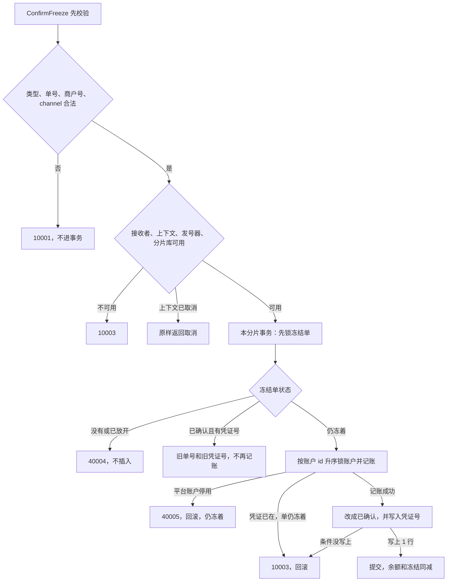

# ACC-06 确认扣款

| 项 | 内容 |
|---|---|
| 功能点 | ACC-06（P0，第 2 周） |
| 所属链路 | 基础设施 |
| 代码提交 | `0608708` `[ACC-06] add freeze confirm` |
| 分支 | `feat/ACC-06-confirm` |
| 日期 | 2026-10-20 |
| 状态 | DONE |

完整 hash：`060870887f09e88632b18dd5c4d4ff4140e444ae`。这次代码提交 12 个文件，2016 行新增，46 行删除。本报告在该提交之后写，不包含在这 12 个文件里。

## 一句话结论

确认扣款是 account 进程里的方法 `ConfirmFreeze`。它自己用 `dbx.WithTx` 提交本分片事务，并在这个事务里记账。请求不带金额。第一次成功时，商户结算账户的账面余额和冻结金额同时减去冻结单上的金额，冻结单改成 `CONFIRMED` 并写下这次的凭证号，返回的仍是冻结时已有的冻结单号。商户 `M100002` 账面 9940 分（99.40 元）、冻结 3000 分（30.00 元）时，退款确认后账面变成 6940 分（69.40 元）、冻结 0，本分片渠道应收从 10000 分（100.00 元）变成 7000 分（70.00 元）。再确认一次返回同一个冻结单号和同一个凭证号，余额不再变。依据是 `TestConfirmRefund` 和 `TestConfirmRepeat`。

## 1. 背景

### 1.1 系统简介

pay-system 是一个用 Go 编写的小型支付后端，模拟商户收款、退款、商户间转账三条资金链路，重点在数据一致性和性能。系统由 5 个部分组成：gateway（对外 HTTP 入口，负责签名校验和限流）、payment（支付单、退款单、转账单的状态管理和流程推进）、account（账户余额与记账，数据按商户分到 2 个数据库分片）、channel-mock（模拟微信、支付宝这类外部支付渠道）、recon（对账，核对系统内外数据是否一致）。服务之间用 Kitex RPC 同步调用，或通过 Kafka 消息异步通知；数据存在 MySQL 8.4，Redis 用于防重放。所有金额用整数“分”表示，所有记账只追加不修改。「所有记账只追加不修改」指分录只插入、不改旧行。账户行上的账面余额、冻结金额和 `version` 是当前值，用条件更新改这一行。当前已完成：工程骨架到 IDL、账户分片路由、开户、账户查询、通用记账、冻结、解冻，以及本功能点的确认扣款。余额核对和 account 的 RPC 进程还没做。现在会调用确认扣款的只有测试。以后两处会调用，都还没做：MQ-04 是账户消费退款成功事件，消费到了就确认扣掉先前冻住的退款；TRF-03 是跨分片转账里付款方的确认，让钱离开付款方结算账户。同分片转账 ACC-07 是同一分片内商户之间直接转账，不调用这个方法。收款方转账分支 ACC-14 是把在途账户里的钱记给收款方，也不调用这个方法。

Kitex 是本项目的 Go RPC 框架。RPC 是进程之间的同步调用。Kafka 是消息队列。简介里的 Redis 防重放是以后 gateway 用来挡住重复的对外 HTTP。`ConfirmFreeze` 不用 Redis。成功的重复确认看冻结单这一行：状态已经是 `CONFIRMED`，并且 `txn_no` 非空，就直接返回旧的冻结单号和凭证号，不再记账。这不靠凭证表的唯一索引。冻结单的唯一索引只保证同一业务键只有一行。凭证唯一索引只在“单还冻着、凭证却已由别的事务提交”时让记账发现冲突，然后整笔回滚并返回 `10003`，那不是幂等成功。分片是账户数据所在的那一个库，这里只有 0 和 1。IDL 是接口定义文件。本次确认不改 IDL，也没有进程在监听端口。

### 1.2 本功能点在系统中的位置

`ConfirmFreeze` 只在 account 进程内部被调用。现在会调用它的只有测试。以后两处会调用，都还没做。MQ-04 是账户消费退款成功事件：渠道退款成功后，由它来确认扣款。TRF-03 是跨分片转账里付款方的确认：由它把付款方冻住的钱扣掉。同分片转账 ACC-07 是同一分片内商户之间直接转账，不调用这个方法。收款方转账分支 ACC-14 是把在途账户里的钱记给收款方，也不调用这个方法。通用记账 `Post` 自己不提交，由调用它的人提交。这次调用它的人就是 `ConfirmFreeze`：确认自己开事务，并在里面调用同一套记账，然后提交。



图里的事务由 `ConfirmFreeze` 自己开始和结束。「凭证已在」从记账那一步出来，发生在把冻结单改成 `CONFIRMED` 之前，返回 `10003` 并回滚。改状态之后，只有比较条件没写上才再到 `10003`。「接收者」是这个方法所属的服务对象；它为空，表示服务还没装配好。「发号器」是按时间生成单号的组件。确认自己不用它发新的冻结单号；凭证号仍由记账在这个事务里调用它生成。一次确认写两条分录。减商户账面的那条叫商户腿，贷记平台账户的那条叫平台贷方。平台贷方是「这笔凭证要贷记的那个平台账户」，不是说这个账户的正常余额方向一定是贷：退款时它是渠道应收，转账时它是在途。冻结单仍冻着、但账户对不上时是 `10006`，不改行。本分片按所有者、类型、子账户号和币种 `CNY` 找不到平台贷方时是 `40001`，此时还没有账户 id，不记账。商户腿把账面余额和冻结金额一起减，不要求商户账户仍可使用。平台账户停用则整笔回滚，冻结单保持原样。

### 1.3 为什么需要它

商户 `M100002` 的结算账户在分片 0。一笔 3000 分（30.00 元）的退款已经冻住：账面余额 9940 分（99.40 元），冻结金额 3000 分（30.00 元），还能花的是 6940 分（69.40 元）。渠道侧这笔退款已经成功。如果没有确认扣款，这 30.00 元会一直占着，账面也仍是 99.40 元，和渠道已经退掉的钱对不上。

确认之后，账面应变成 6940 分（69.40 元），冻结变成 0。还能花的仍是 69.40 元，因为原先冻住的 30.00 元现在从账面上一并减掉了。同一分片上、这个渠道的应收余额要减少 3000 分（30.00 元）。测试里先把它设成 10000 分（100.00 元），确认后是 7000 分（70.00 元）。

同一张单如果被确认两次，也不能扣两次。第二次必须回到第一次的冻结单号和凭证号。如果再减 30.00 元，账面会变成 3940 分（39.40 元）。

还有一种全额冻住。账面和冻结都是 3000 分（30.00 元），还能花的是 0。这时仍要能确认，确认后两边都是 0。普通扣款会拒绝这种账户，所以确认不能走普通扣款。

## 2. 术语

| 术语 | 含义 |
|---|---|
| 分 | 金额最小单位。100 分 = 1.00 元。9940 分是 99.40 元，3000 分是 30.00 元，6940 分是 69.40 元，10000 分是 100.00 元，7000 分是 70.00 元。金额是 `int64`，不用小数运算。 |
| 分片 | 账户数据所在的库，只有 0 和 1。商户号必须是 `M` 加恰好 6 位数字，分片是数字部分对 2 取模。`M100002` 的 `100002 % 2 = 0`，在分片 0。`M100001` 在分片 1。一次确认只访问这一个库。 |
| 接收者 | 这个方法所属的服务对象，类型是 `*Service`。它为空，表示开户、发号或数据库连接还没装上。参数不合法时先返回 `10001`，不因为接收者为空改成别的码。 |
| 发号器 | 按时间生成单号的组件。冻结单号前缀是 `FZ`，凭证号前缀是 `TX`。确认不调用它发新的 `FZ`。凭证号由记账在同一事务里、锁账户之前调用它生成。 |
| 结算账户 | 表 `account` 里商户、类型 `MERCHANT_SETTLE`、币种 `CNY`、`sub_no = 0` 的那一行。`sub_no` 是子账户序号。商户结算账户恒为 0。确认只认这张账户。 |
| 余额 | 列 `balance`，账面金额，单位分。确认成功时和冻结金额一起减少。 |
| 冻结金额 | 列 `frozen_amount`，已经占住、不能再当可用金额花掉的部分，单位分。确认成功时减去这笔金额。 |
| 可用余额 | `balance - frozen_amount`。不单独存成一列。账面 3000 分、冻结 3000 分时，可用余额是 0。 |
| 透支 | 列 `allow_overdraft`。0 表示不允许透支，可用余额不能变成负数。结算账户的检查约束把这一列固定为 0。确认时如果读到的 `allow_overdraft` 不是 0，直接拒绝，不写行。真实库插不进这种商户行。 |
| `ACTIVE` | 账户可以做普通记账的状态。确认的商户腿不要求这个状态。平台贷方账户仍要求它。 |
| `CLOSED` | 账户已关闭。这种商户结算账户上的冻结仍然可以确认扣掉。 |
| 账户状态 `FROZEN` | 账户行上的状态，表示账户被停用。它和冻结单状态 `FROZEN` 不是同一个字段。停用的商户结算账户仍然可以确认。 |
| 冻结单 | 表 `account_freeze` 里的一行。上面有冻结单号、业务类型、业务单号、账户、金额、状态和可空的凭证号。 |
| `FROZEN` | 冻结单状态：钱已经占住，还没确认扣掉，也还没放开。确认要把这种单改成 `CONFIRMED`。 |
| `CONFIRMED` | 冻结单状态：已经确认扣款，并写上了凭证号。再次确认时幂等成功，不再记账。 |
| `RELEASED` | 冻结单状态：已经解冻，或者是一张占位用的墓碑。对它确认会拒绝，不能把占位单扣成真实扣款。 |
| 墓碑 | 直接插成 `RELEASED` 的冻结单。它占住业务单号，不代表曾经冻过这笔钱。确认不能把它变成扣款。 |
| 凭证 | `ledger_txn` 的一行，一笔业务一张。只追加。退款确认的凭证类型是 `REFUND`。转账确认的凭证类型是 `TRANSFER_OUT`。 |
| 分录 | `ledger_entry` 的一行，记某个账户这笔是借还是贷、金额多少、记账后账面余额是多少。只插入，不改旧行。一次确认写两条，金额相同。 |
| 借 / 贷 | 分录方向 `DEBIT` / `CREDIT`。它是这一笔的方向，不是账户自己的余额方向。商户结算账户是贷方余额账户，借方分录使账面减少。 |
| 商户腿 | 这次确认里、记在商户结算账户上的那条分录。方向是借，账面减少，冻结金额同时减少。 |
| 平台贷方 | 这次确认里被贷记的那个平台账户，不是「正常余额方向为贷」的意思。退款确认贷渠道应收，它的账面减少。转账确认贷在途账户，它的账面增加。 |
| 渠道应收 | 平台账户，类型 `CHANNEL_RECEIVABLE`，户主是渠道名（例如 `mockpay`）。它是借方余额账户：贷方分录使账面减少。退款确认贷的就是它。 |
| 在途账户 | 平台账户，类型 `TRANSIT`，户主固定是 `PLATFORM`。它是贷方余额账户：贷方分录使账面增加。跨分片转账确认付款方时，钱离开商户结算账户，先记进付款方所在分片的在途账户，账面增加。收款方把这笔在途扣走是 ACC-14，本功能点不做。转账确认贷的就是它。渠道应收和在途都允许透支，贷方不会因为余额不够失败。 |
| 子账户 | 平台账户按序号拆开的多行，序号是 `sub_no`。`shard.Sub` 用业务单号字节的 CRC-32 对子账户个数取余，得到 k。CRC-32 是一种固定的校验和。同一个业务单号和同一个个数，每次得到同一个 k。调用方不传 k。它失败的条件是：子账户个数小于 1、大到放不进 uint32，或业务单号为空。uint32 是无符号 32 位整数，最大 4294967295。确认在进事务之前已经把空单号拒成 `10001`，把子账户个数小于 1 拒成 `10003`。事务里若 `Sub` 仍失败，返回 `10003`，不写。确认只在本分片找 `sub_no = k` 的那一行。 |
| 幂等 | 同一业务做两次，结果和只做一次相同。成功的重复确认不靠凭证唯一索引：冻结单已经是 `CONFIRMED` 且 `txn_no` 非空时，直接返回旧的冻结单号和凭证号，不再记账，也不再核对请求商户。幂等键是该分片里的 `(biz_type, biz_no)`，不是商户号。冻结单的唯一索引只保证同一业务键只有一行。凭证表也有自己的 `(biz_type, biz_no)`。两张表的索引互不相通。凭证已经存在、冻结单仍是 `FROZEN` 时返回 `10003`，不是幂等成功。 |
| `1062` | MySQL 报告“唯一索引冲突”的错误号。它只让这一条插入失败，不会把整个 InnoDB 事务作废。 |
| `3819` | MySQL 报告“这一行违反了表上的检查约束”的错误号。确认不把它当成余额不足，对外是 `10003`。 |
| 时钟回拨 | 机器时钟比发号器上次用过的时间倒退太多。发号器拒绝发新号，避免单号里的时间倒流。这个失败原样沿用已有映射，业务码是 `10004`。 |
| InnoDB | MySQL 使用的事务引擎。未提交的修改可以整笔撤销。 |
| CAS | 比较后再更新。确认把冻结单改成 `CONFIRMED` 时，条件里带着原来的状态、金额和账户，同时写下凭证号，`version` 加 1。条件不满足时影响行数是 0。 |
| `version` | 账户和冻结单上各自的整数。确认成功时，冻结单加 1，商户账户加 1，平台账户再加 1。 |
| `freeze_no` | 冻结单号，前缀 `FZ`。确认不新发这个号，返回冻结单上已有的号。 |
| `txn_no` | 凭证号，前缀 `TX`，这一列可以空。还没确认，或者已经放开时，本来就是空的。确认自己不发号。记账在锁账户之前、同一个事务里生成它。本方法把状态改成 `CONFIRMED` 时，在同一条更新里写入这个号，自己提交不会留下“已确认但凭证号为空”。真实表允许空，所以用 SQL 可以造出这种行。确认看到就返回 `10003`，不写。假事务覆盖的是这个分支。正常确认不会留下它。 |
| `biz_type` / `biz_no` | 业务类型和业务单号。冻结单的类型只能是 `REFUND`（退款）或 `TRANSFER`（转账），冻结表放不下 `TRANSFER_OUT`。转账确认写的凭证类型是 `TRANSFER_OUT`，业务单号仍是这张转账单的号；冻结单自己的类型仍是 `TRANSFER`。两张表的唯一索引本来就不跨表。凭证用 `TRANSFER_OUT`，是为了和以后同分片转账要写的凭证类型 `TRANSFER` 分开。否则两张凭证会撞在凭证表 `(biz_type, biz_no)` 的同一个键上。退款确认的凭证类型仍是 `REFUND`，和冻结单相同。 |
| 码点 | 这里按 Go 的一个 Unicode 字符计，不是按字节。32 个汉字就是 32 个码点。业务单号最长 64 个码点。 |
| `channel` | 渠道名。冻结单不存渠道。退款确认必须非空，并且不超过 32 个码点。转账确认必须是空字符串。第一次确认退款时，请求里的 `channel` 决定贷哪一个渠道应收。换成另一个已经存在的渠道，就会减那个渠道的应收，不会去减别的渠道。已经确认之后再换渠道，不再比较它，也不再记账，另一个渠道的余额不变。已确认的重放也不再核对请求里的商户是不是冻结单上的那个商户。 |
| `Duplicated` | 只指确认结果里的布尔字段。为 true 只表示冻结单已经是 `CONFIRMED` 且凭证号非空，这次没有记账。第一次成功是 false。它只在进程内，不进入 RPC 响应。响应契约仍是 `freeze_no` 和 `txn_no`。记账内部发现凭证唯一索引冲突时另有一个“凭证已存在”标志。确认看到那个标志就返回 `10003`，调用方拿到的不是这个 `Duplicated = true`。两个不要混用同一个词。 |
| `10001` | 本系统的业务错误码，不是 HTTP 状态码。对外英文固定为 `invalid parameter`。参数不合法，以及结算账户允许透支，都用它。后面的 `10003` 到 `40005` 同样是业务码。 |
| `10003` | 业务码。对外英文固定为 `internal error`。`Error()` 里不带 SQL。接收者、上下文、发号器、连接池是空，子账户个数小于 1，分片库拿不到，冻结金额对不上，凭证已在而冻结单仍冻着，或者确认更新没写上，都用它。上下文已经取消或到期时不用这个码。 |
| `10004` | 业务码。对外英文固定为 `service unavailable`。记账发凭证号时时钟回拨过大，沿用记账已有的映射。确认不再在外面套一个新错误，所以它不会被改成 `10003`。 |
| `10006` | 业务码。对外英文固定为 `idempotent conflict`。冻结单仍是 `FROZEN`，但它的账户不是该商户的结算账户，或者本分片找不到这张结算账户。这种情况不用 `40001`。 |
| `40001` | 业务码。对外英文固定为 `account not found`。确认按所有者、类型、子账户号和币种 `CNY` 在本分片找平台账户。找不到，包括币种不是 `CNY` 的行没被选中，都在调用记账之前返回它。此时还没有账户 id。 |
| `40002` | 业务码。对外英文固定为 `insufficient balance`。确认的商户腿不用它。普通记账在可用余额不够时仍用它。 |
| `40003` | 业务码。对外英文固定为 `unbalanced entries`。这是已有记账错误的原文，不是说币种不同就算借贷不平。平台账户按所有者找不到是 `40001`。记账已经拿到账户 id、锁的时候本连接却看不到这行，会返回 `40003`，因为它分不清“没有这个 id”和“在另一个库”。确认把这个错误交出去，事务回滚，冻结单保持 `FROZEN`。所以调用方可能收到 `40003`，但那不是“平台账户查找失败”。方法表不列它，因为它是记账的已有码，不是这次新增的查找失败。币种不是 `CNY` 的行在查找时不会被选中，正常路径是 `40001`。锁住之后若这一行币种不是 `CNY`，记账也会返回 `40003`；确认的查找已经要求 `CNY`，正常路径走不到这条。 |
| `40004` | 业务码。对外英文固定为 `freeze status conflict`。冻结单不存在，或者已经是 `RELEASED`。另一个分片是另一个库，看不到这行，没有行也是这个码。 |
| `40005` | 业务码。对外英文固定为 `account inactive`。平台贷方不是 `ACTIVE` 时用它，整笔回滚，冻结单保持 `FROZEN`。商户腿不返回它。 |
| goroutine | Go 里的一个并发执行单元。16 个 goroutine 就是 16 个同时发起的调用。 |
| 屏障 | 并发测试的起点。每个 goroutine 先报到，全部就绪后才一起进入调用。测试里不用 `time.Sleep` 等结果。 |
| `dbx.WithTx` | 已有的事务助手。它自己开始事务，回调返回错误就回滚，成功就提交。3 秒是这一次调用的总时长，含从连接池拿到连接，以及事务里等同一行的时间。它从调用方的上下文派生，谁先到期用谁。只有死锁和锁等待超时会重试整段回调。隔离级别是 `READ COMMITTED`。`ConfirmFreeze` 调用它。`Post` 不调用它。 |
| `READ COMMITTED` | 事务隔离级别：读到的是其他事务已经提交的数据。不加锁的查询到后面 `SELECT ... FOR UPDATE` 之间，别的已提交事务可以改这些行。 |
| 行锁 | InnoDB 为了改一行而持有的锁。别的事务要动同一行就必须等这次事务结束。 |
| `FOR UPDATE` | 读的时候就把这一行锁住，直到本事务结束。确认按业务单号读冻结单时带它。 |
| 有符号增量 | 加到账面余额上的数，可正可负。商户结算账户被借记时，增量是负数，账面减少。冻结金额减去的是正数金额，不是这个增量。 |
| `Post` | 进程内的通用记账。调用方已经打开事务。它不开始事务，也不提交。普通借方要求账户是 `ACTIVE`，并且可用余额够，还不改冻结金额。 |
| RPC handler | 把网络请求转成进程内方法的那一层。IDL 里已经有 `ConfirmFreeze` 这个方法名，但这次不写 handler，也不启动监听。监听仍是以后的工作，还没做。 |
| `internalErr` | 事务结束后的包装。已经是业务码，或者是上下文取消、上下文到期，就原样返回。其余数据库错误才包成 `10003`。 |
| 不连库 | 单元测试不打开 MySQL，用同一个包里的假事务代替。 |
| 手续费账户 | 平台账户，户主 `PLATFORM`，类型 `FEE_INCOME`。它不是商户结算账户。测试用它充当“冻结单指向别的账户”。 |
| schema | MySQL 里的一个库名。集成测试建随机名字的库，结束时删掉，不写入固定的 `pay_account_0`。读者不需要自己准备业务数据。 |
| `-race` | Go 测试的数据竞争检测。下面的并发测试都带着它跑过。 |

## 3. 技术讲解

### 3.1 要解决的问题

一次确认要同时满足这些约束：

1. 请求没有金额。扣多少只看冻结单上已经记下的金额。业务类型、业务单号、商户号或渠道不合法时，不能写行，也不能发号。
2. 只动该商户所属分片。另一分片不能出现这张凭证，也不能改余额。
3. 同一张单只扣一次。已确认的重放回到已有的冻结单号和凭证号，不再比较渠道，也不再核对请求商户是不是冻结单上的商户。
4. 没有这张单，或者单已经放开（含墓碑），不能插入新行，也不能把墓碑扣成真实扣款。另一个分片看不到这行，同样按没有这张单处理。
5. 单仍是 `FROZEN` 时，冻结单上的账户必须是该请求商户的结算账户。对不上时旧行保持 `FROZEN`。已确认的重放不做这一步。
6. 全额冻住、可用余额为 0 时也要能扣。商户账户已经停用也要能扣。平台贷方停用则整笔撤销。
7. 商户账面和冻结金额必须一起减。只减账面会把冻结留在账户上。
8. 失败时不能留下“凭证已经插入、冻结单仍是 `FROZEN`”或“冻结已经减了、单还没确认”的半截结果。记账和改冻结单在同一个事务里。
9. 事务里面不调用别的服务。公开的 `Post` 仍不提交。

### 3.2 方案

`ConfirmFreeze` 的签名是 `ConfirmFreeze(ctx, bizType, bizNo, merchantID, channel) (ConfirmResult, error)`。`ConfirmResult` 有三个字段：`FreezeNo`、`TxnNo`、`Duplicated`。

先做纯校验，不访问数据库，也不看接收者是不是空。`biz_type` 只能是 `REFUND` 或 `TRANSFER`。`biz_no` 按码点计，不能是 0，也不能超过 64。商户号必须能算出分片。退款的 `channel` 必须非空且不超过 32 个码点。转账的 `channel` 必须是空字符串。否则返回 `10001`。参数不合法时，即使接收者是空，或者上下文已经取消，也先返回 `10001`。

参数合法之后：接收者是空、上下文是空、发号器是空、连接池是空、子账户个数小于 1，或者按分片拿数据库失败，都返回 `10003`。子账户个数小于 1 是服务配置问题，不是参数错误。上下文已经取消或已经超过截止时间，原样返回，不进事务，不改写成 `10003`。

确认自己不调用发号器，所以没有一张新的 `FZ`。凭证号仍由记账生成，并且生成发生在锁账户之前、同一次事务里面。发号失败沿用记账已有的映射，确认不再在外面套一个新错误：时钟回拨过大仍是 `10004`，其他发号失败仍是 `10003`。记账返回的 `40005` 这类业务码也同样原样返回；再套一层，调用方就会把它看成 `10003`。

然后 `ConfirmFreeze` 用 `dbx.WithTx` 提交该商户分片的一个事务。下面这段代码在做的是：分片库已经取到之后，把冻结单读写和记账放进同一个事务对象。校验和上下文判断在这段之前。

```go
err = dbx.WithTx(ctx, db, func(tx *sqlx.Tx) error {
    var applyErr error
    out, applyErr = applyConfirm(ctx, s.ids, s.subCount, sqlFreezeTx{tx: tx}, sqlPostTx{tx: tx}, req)
    return applyErr
})
```

事务里先按 `(biz_type, biz_no)` 用 `SELECT ... FOR UPDATE` 锁冻结单，并多读 `txn_no`。解冻用的那条冻结单查询不改列，确认用自己的查询。没有行，或者状态是 `RELEASED`：返回 `40004`，不插入、不记账、不改余额、不改冻结金额。

已是 `CONFIRMED` 且 `txn_no` 非空：返回已有的冻结单号和凭证号，确认结果的 `Duplicated = true`，不再记账。这一步不比较 `channel`，也不再核对请求里的商户是不是冻结单上的那个商户。路由只用请求商户号选出分片。幂等键是该分片里的 `(biz_type, biz_no)`，不是商户号。另一个分片是另一个库，看不到这行，没有行就是 `40004`。同一分片里另一个商户如果拿着同一个业务单号再确认，会碰到同一行：单已确认就返回原来的凭证号，不再记账。单仍是 `FROZEN` 时才会核对该商户的结算账户，对不上是 `10006`。`txn_no` 可以空，是因为还没确认或已放开时本来就空。本方法把状态改成 `CONFIRMED` 时在同一条更新里写入凭证号，自己提交不会留下“已确认但凭证号为空”。真实表允许空，所以用 SQL 可以造出这种行；确认看到就返回 `10003`，不写。假事务覆盖的是这个分支。其他未知状态也是 `10003`。表的检查约束只允许 `FROZEN`、`CONFIRMED`、`RELEASED` 三种状态，真实库插不出第四种，未知状态这条只用假事务覆盖。

仍是 `FROZEN` 时：

1. 查出本分片该商户的结算账户。没有这张账户，或者冻结单上的账户不是它，返回 `10006`，不写。不因为“找不到商户”返回 `40001`。
2. 这张结算账户允许透支，返回 `10001`，不写。真实库插不进这种商户行，只用假事务覆盖。
3. `shard.Sub` 用业务单号字节的 CRC-32 对子账户个数取余，得到序号 k。同一个业务单号和同一个个数，每次得到同一个 k。它失败的条件是：子账户个数小于 1、大到放不进 uint32（无符号 32 位整数，最大 4294967295），或业务单号为空。确认在进事务之前已经把空单号拒成 `10001`，把子账户个数小于 1 拒成 `10003`。事务里若 `Sub` 仍失败，返回 `10003`，不写。
4. 平台贷方只在本分片查，查找条件里带币种 `CNY`。冻结单不存渠道。退款：平台、户主是请求里的 `channel`、类型是渠道应收、`sub_no = k`。第一次确认时，这个 `channel` 决定贷哪一个渠道应收。换成另一个已经存在的渠道，就会减那个渠道的应收，不会去减别的渠道。已经确认之后再换渠道，不再记账，另一个渠道的余额不变。转账：平台、户主是 `PLATFORM`、类型是在途、`sub_no = k`。钱离开商户结算账户，先记进付款方所在分片的在途账户，账面增加。收款方把这笔在途扣走是 ACC-14，本功能点不做。按所有者、类型、子账户号和币种找不到这行，返回 `40001`，此时还没有账户 id，不调用记账，不改冻结单。不是 `CNY` 的行不会被选中，所以也是 `40001`，不会进到记账。
5. 平台账户 id 和商户账户 id 相同，返回 `10003`。商户结算账户的户主类型是商户，平台账户的户主类型是平台，正常不会是同一行。查出来的 id 一样，说明数据坏了。返回 `10003` 是为了避免同一行又借又贷。这是防御，不是一条正常业务。

查出商户结算账户和平台账户的那两次查询都不加 `FOR UPDATE`。它们只用来决定接下来锁哪个 id，并在加锁前看商户结算账户的 `allow_overdraft`。这两次读没有钉死余额。隔离级别是 `READ COMMITTED`，所以从这次读到后面按 id 的 `SELECT ... FOR UPDATE` 之间，别的已提交事务可以改这两行。真正改余额发生在按 id 锁住之后。锁住时，平台账户会再看币种和状态；商户腿的更新再看冻结金额是否不少于 R，不要求商户账户仍是 `ACTIVE`。

然后在同一事务里记两条分录。金额都是冻结单上已经记下的金额，下面记为 R。借商户结算账户，贷上面选出的平台子账户。`memo` 是空字符串。退款凭证的类型是 `REFUND`，业务单号就是冻结单的业务单号。转账凭证的类型是 `TRANSFER_OUT`，业务单号也是冻结单的业务单号。冻结单自己的类型仍是 `TRANSFER`。冻结表只允许 `REFUND` 和 `TRANSFER`，放不下 `TRANSFER_OUT`。两张表的唯一索引本来就不跨表。凭证用 `TRANSFER_OUT`，是为了和以后同分片转账要写的凭证类型 `TRANSFER` 分开，避免两张凭证撞在凭证表 `(biz_type, biz_no)` 的同一个键上。

公开的 `Post` 不加参数。只有确认会在内部记账请求上带一个未导出的商户账户 id。这个 id 为 0 时，路径和原来的记账完全一样。账户已经按 id 从小到大锁住之后，这个商户账户用下面这条更新代替普通借方更新：

```sql
UPDATE account
SET balance = balance + ?, frozen_amount = frozen_amount - ?, version = version + 1
WHERE id = ? AND frozen_amount >= ?
```

`balance` 加上的是这笔分录的有符号增量。商户结算账户被借记，增量是负数，账面减少。`frozen_amount` 减去的是正数 R。这条更新不要求账户是 `ACTIVE`，也不看可用余额，所以不返回 `40002`，商户腿也不返回 `40005`。它只把 `version` 加一次。平台账户仍走原来的余额更新，`version` 再加 1。

这条更新之前，这一行已经按 id 锁住，别的事务改不了 `frozen_amount`。条件是 `id` 加上 `frozen_amount >= R`。持有锁时更新影响 0 行、重读冻结仍够减，正常路径不该出现。这里不给它编一个并发原因。假事务测试 `TestApplyPostFrozenDebitMiss` 把更新结果强制成 0 行来覆盖这个分支。真库上如果仍出现，就回滚并返回 `10003`，不再更新第二次，也不改写成余额不足或账户停用。没有单独的生产场景。行已经没了，或者重读时冻结金额仍小于 R，同样回滚并返回 `10003`。MySQL 检查约束冲突的错误号 `3819` 若被假数据触发，也包成 `10003`，不是 `40002`。商户账面和冻结同减 R 之后，可用余额不变，所以“不允许可用余额为负”的检查仍然成立。

平台账户被这条查找选中之后，仍走已有记账规则。不是 `ACTIVE` 是 `40005`，整个事务回滚，冻结单保持 `FROZEN`。按所有者找不到是 `40001`，发生在调用记账之前。记账已经拿到账户 id、锁的时候本连接却看不到这行，会返回 `40003`，因为它分不清“没有这个 id”和“在另一个库”。确认把这个错误交出去，事务回滚，冻结单保持 `FROZEN`。所以调用方可能收到 `40003`，但那不是“平台账户查找失败”。方法表不列它，因为它是记账的已有码，不是这次新增的查找失败。币种不是 `CNY` 的行在查找时不会被选中，正常路径是 `40001`。锁住之后若这一行币种不是 `CNY`，记账也会返回 `40003`。对外英文 `unbalanced entries` 是这条错误的原文，不是说币种不同就算借贷不平。确认的查找已经要求 `CNY`，正常路径走不到这条。渠道应收和在途允许透支，贷方不会因为余额不够失败。渠道应收是借方余额账户，贷记使它的账面减少。在途是贷方余额账户，贷记使它的账面增加。分录上的记账后余额，是更新之后读到的账面余额。分录只追加。

同一笔确认里的凭证和冻结单状态在同一个事务里。提交前失败会一起撤销，不会新留下“凭证已提交、冻结单仍是 `FROZEN`”。另一层是库里已经有一张别的事务提交过的凭证，而这张冻结单仍是 `FROZEN`。这种数据不是这次正常确认留下的。记账发现凭证唯一索引冲突，给出“凭证已存在”时，发生在把冻结单改成 `CONFIRMED` 之前。确认看到这个标志就返回 `10003`，不改冻结单，也不减冻结，这次事务回滚。调用方拿到的不是确认结果的 `Duplicated = true`。已经提交的旧凭证不在这次事务里，所以还在。没有补偿任务。集成测试 `TestConfirmVoucherAlreadyExists` 先把这种凭证种进库，再确认，得到这个结果。

记账成功且不是重复凭证之后，才做 CAS：

```sql
UPDATE account_freeze
SET status = 'CONFIRMED', txn_no = ?, version = version + 1
WHERE biz_type = ? AND biz_no = ? AND status = 'FROZEN' AND amount = ? AND account_id = ?
```

影响 1 行：提交。`Duplicated = false`。返回已有的 `freeze_no` 和这次的 `txn_no`。影响 0 行：这行已经被 `FOR UPDATE` 锁住，别人不能先把它改成 `CONFIRMED`。0 行表示 WHERE 里的状态、金额或账户和锁住的这一行不一致。正常情况下 WHERE 用的就是刚读到的值，0 行说明这行和条件对不上，不是抢先成功，也不当成幂等。返回 `10003`，让事务回滚。当成成功会把本事务刚插入的凭证一起提交。也不再立刻重试这条更新。

锁的顺序是先锁冻结单，再按账户 id 从小到大锁账户。如果先改商户账户，再去锁一个 id 更小的平台账户，会和只按 id 升序锁账户的普通记账死锁。确认不插入墓碑。

### 3.3 为什么这样做

| 方案 | 做法 | 优点 | 缺点 | 结论 |
|---|---|---|---|---|
| 采用：`ConfirmFreeze` 自己开事务，在里面记账，再提交 | 先锁冻结单，商户腿同时减账面和冻结，成功后再把冻结单改成 `CONFIRMED` 并写入凭证号 | 记账和改单一起提交或一起撤销。重复确认不再扣第二次 | 3 秒从这次调用一开始就计时，含等连接和等行锁。16 个调用同时抢一行时，测试把该库最大连接数设为 8，父上下文设为 120 秒。这是测试设置 | 采用 |
| 备选：让调用方开事务，`ConfirmFreeze` 自己不提交 | 和 `Post` 的事务边界看起来一样，确认只做业务判断 | 以后可以把确认和别的写入放进同一个调用方事务 | 现在会调用的只有测试。以后两处会调用，都还没做：MQ-04 是账户消费退款成功事件，消费到了就确认扣款；TRF-03 是跨分片转账里付款方的确认，让钱离开付款方结算账户。ACC-07 是同一分片内商户之间直接转账，不调用这个方法。ACC-14 是把在途账户里的钱记给收款方，也不调用。这次要确认自己把记账和状态变更一起提交或一起撤销。不采用“确认不提交、等一个还不存在的调用方”，并不是去改 `Post`。`Post` 仍由调用它的人提交；这次调用它的人就是 `ConfirmFreeze` | 不采用 |
| 备选：商户腿直接用普通借方 | 普通借方要求账户是 `ACTIVE`，并且 `balance - frozen_amount >= R`，还不改 `frozen_amount` | 少一条更新语句 | 账面和冻结都是 3000 分（30.00 元）时，可用余额是 0。普通借方会拒绝，确认就做不成。即便可用余额够，它也不减冻结金额，30.00 元会继续占着 | 不采用 |
| 备选：商户腿更新影响 0 行时返回 `40002` | 少一个内部错误 | 调用方已有余额不足的处理 | 这一行已经按 id 锁住。持有锁时影响 0 行、重读冻结仍够减，正常路径不该出现，没有单独的生产场景。假事务把更新结果强制成 0 行。真库上如果仍出现，回滚并返回 `10003`。当成 `40002` 会让调用方按余额不足重试 | 不采用 |
| 备选：凭证已经存在、冻结单仍是 `FROZEN` 时当成幂等成功 | 少一个 `10003` | 重试能回到旧凭证号 | 冻结金额还没减，单也还没确认。当成成功会把这次不该提交的修改留下，或者让调用方以为已经扣过 | 不采用 |
| 备选：CAS 影响 0 行时当成幂等成功 | 和“已经确认”的重试看起来一样 | 少一次回滚 | 这行已被 `FOR UPDATE` 锁住，别人不能先改成 `CONFIRMED`。正常情况下 WHERE 用的就是刚读到的值，0 行说明状态、金额或账户和这行对不上，不是抢先成功。当成成功会把本事务刚插入的凭证一起提交 | 不采用 |

### 3.4 正确性

| 场景 | 系统行为 | 最终状态 | 证明 |
|---|---|---|---|
| 同一请求再来一次 | 第一次 `Duplicated = false`。第二次看到冻结单已经是 `CONFIRMED` 且 `txn_no` 非空，直接返回旧的冻结单号和凭证号，`Duplicated = true`，不再记账。不比较 `channel`，也不核对请求商户。路由只用请求商户号选分片。幂等键是该分片里的 `(biz_type, biz_no)`。这不靠凭证唯一索引。另一个分片看不到这行，是 `40004` | 账面、冻结、渠道余额、两个账户的 `version`、凭证数和分录数都与第一次成功后相同 | `TestConfirmRepeat` |
| 16 个 goroutine 同时确认同一张 `FROZEN` 单 | 屏障对齐后一起进入。该库最多 8 条连接，父上下文 120 秒。这是测试设置。`WithTx` 的 3 秒含等连接和等行锁。先锁冻结单，后来的调用排队 | 测试要求恰好 1 次 `Duplicated = false`、15 次 `Duplicated = true`，同一个冻结单号和凭证号。这次集成测试通过，所以这个断言成立。没有单独的 `-v` 日志，这里不另写一个成功次数。账面从 9940 分（99.40 元）变成 6940 分（69.40 元），冻结从 3000 分变成 0，渠道应收从 10000 分变成 7000 分。凭证 1 张，分录 2 条 | `TestConfirmConcurrent` |
| 确认和解冻同时抢同一张 `FROZEN` 单 | 8 个确认和 8 个解冻，屏障对齐后一起进入。商户 `M100002`，退款单 `RF-BOTH`，渠道 `mockpay`。期初账面 5000 分（50.00 元），冻结 2000 分（20.00 元），渠道应收被设成 9000 分（90.00 元）。连接数 8，父上下文 120 秒。先提交的一方完成。确认先提交：其余确认返回同一个冻结单号，`Duplicated = true`；解冻看到 `CONFIRMED`，返回 `40004`。解冻先提交：其余解冻是幂等成功；确认看到 `RELEASED`，返回 `40004`，不插入、不记账 | 最终只能是两种之一，不能既有凭证又是已放开，也不能减两次。确认胜出：恰好 1 张凭证，账面 3000 分（30.00 元），冻结 0，渠道应收 7000 分（70.00 元）。解冻胜出：没有凭证，账面仍是 5000 分（50.00 元），冻结 0，渠道应收仍是 9000 分（90.00 元）。两种终态里商户账户 `version` 都是 2：开户时是 0，冻结加到 1，胜出的一方再加 1。上面两种返回是按代码写的。测试只断言数据库终态，没有 `-v` 日志，所以不知道这一轮谁赢 | `TestConfirmReleaseRace` |
| 进程在提交前崩溃 | 没有做崩溃注入。同一次确认里，凭证、分录、余额和冻结单状态在同一个事务。提交前失败会一起撤销，不会新留下“凭证已提交、冻结单仍是 `FROZEN`”。已经提交的确认停在 `CONFIRMED`，余额和冻结已经同减。再来一次看到 `CONFIRMED` 且 `txn_no` 非空，返回旧单号，不再记账 | 推出来的，不是杀掉进程后看到的 | 无单独测试 |
| 库里已有别的事务提交过的凭证，冻结单仍是 `FROZEN` | 这不是这次正常确认留下的。记账发现凭证已存在时，在改成 `CONFIRMED` 之前返回 `10003`，不改冻结单，不减冻结，这次事务回滚。没有补偿任务。已提交的旧凭证还在 | 冻结单仍是 `FROZEN`，旧凭证还在，账面和冻结不因这次确认改变 | `TestConfirmVoucherAlreadyExists` |
| 事务里调用别的服务超时 | 本方法不调用 RPC、HTTP 或发消息，所以没有外部超时结果。这是代码路径。上下文在进事务之前已经取消或到期时，原样返回，不改写成 `10003`，也不进事务 | 没有外部调用的超时测试 | 代码路径，不是下面这个测试。`TestConfirmNilAndCanceled` 只证明：参数合法且上下文已取消时，进事务之前就返回，发号器没被调用 |

验收和其余出口见 4.3。它们都在同一次集成测试里通过，没有单独耗时。

### 3.5 性能

不涉及。这次没有性能开关，也没有测量单次确认的耗时。测试命令的耗时是整包测试的时间，不是一次 `ConfirmFreeze` 的延迟。

## 4. 已完成内容

### 4.1 改动清单

| 文件 | 新增 / 修改 | 作用 |
|---|---|---|
| `service/account/biz/confirm.go` | 新增 | `ConfirmFreeze`：校验、自己提交事务、锁冻结单、选择平台贷方、记账、CAS 写成已确认 |
| `service/account/biz/confirm_test.go` | 新增 | 不连库的参数、空接收者、取消、全额冻结、更新 0 行、已放开、空凭证号、凭证已存在、错账户和时钟回拨 |
| `service/account/biz/confirm_integration_test.go` | 新增 | 临时库上的四条验收，以及并发、全额冻结、停用账户、平台停用、缺平台账户和普通记账回归 |
| `service/account/biz/post.go` | 修改 | 内部记账增加未导出的商户账户 id。为 0 时仍是普通借方。非 0 时用同时减账面和冻结的更新 |
| `service/account/biz/post_test.go` | 修改 | 假事务补上这条更新，已有的普通记账测试仍能编译 |
| `service/account/biz/open.go` | 修改 | 包注释写明确认扣款也在这个包里，并且自己提交分片事务 |
| `docs/02-requirements.md` | 修改 | ACC-06 标为 DONE，四条验收勾上，并写明确认的进程内口径。需求版本仍是 v3.0 |
| `docs/04-dev-plan.md` | 修改 | 只勾 ACC-06。ACC-07 同分片转账和 ACC-14 收款方分支未勾。这两处不调用确认 |
| `docs/05-api.md` | 修改 | 文档版本 2.0.4。确认的文字与实现对齐，不新增响应字段 |
| `docs/06-flows.md` | 修改 | 确认的控制流图补上事务前拒绝、先锁冻结单、特殊更新和回滚出口 |
| `docs/database.md` | 修改 | 说明确认成功时冻结单版本加 1 并写入凭证号，商户账面和冻结同减，两边账户版本各加 1。没有新的表或列 |
| `docs/interview-notes.md` | 修改 | 记下普通扣款为什么不能用于确认、锁顺序、冻结更新 0 行为什么是内部错误 |

### 4.2 对外变化

| 类别 | 变化 |
|---|---|
| 接口 | 无新的 RPC 字段，IDL 未改，没有 handler，没有进程监听。接口文档保留 `ConfirmFreeze` 的契约：请求仍是业务类型、业务单号、商户号、渠道，响应仍是 `freeze_no` 和 `txn_no`。进程内的 `Duplicated` 不进入 RPC 响应。文档版本改成 2.0.4，最后修改 2026-10-20。方法表的业务错误列是 `10001`、`10006`、`40001`、`40004`、`40005`，不列 `40002`。`10003` 和 `10004` 是各方法共用的内部错误和发号回拨，冻结那一栏也没把它们重复列进业务错误。平台账户按所有者找不到是 `40001`。记账已经拿到账户 id、锁的时候本连接却看不到这行，会返回 `40003`，确认把这个错误交出去，事务回滚，冻结单保持 `FROZEN`。所以调用方可能收到 `40003`，但那不是“平台账户查找失败”。方法表不列它，因为它是记账的已有码，不是这次新增的查找失败。币种不是 `CNY` 的正常路径在查找时已经是 `40001`。这五个码是这一列的范围，不是把这种 `40003` 说成调用方收不到。§1 总览里每个已有接口各自的「最后修改」列没有改。这是有意留下的 |
| 表结构 | 无。没有新迁移，也没有改已有迁移。用的是已有的 `account_freeze`、`ledger_txn`、`ledger_entry` 和 `account`。确认成功时冻结单 `version` 加 1 且写入 `txn_no`；商户 `balance` 与 `frozen_amount` 同减；商户账户和平台账户的 `version` 各加 1 |
| 配置项 | 无 |
| 错误码 | 无新码。`10001`、`10003`、`10004`、`10006`、`40001`、`40003`、`40004`、`40005` 都是原有的码，英文也没改。确认的商户腿不使用 `40002`。方法表的业务错误列只列 `10001`、`10006`、`40001`、`40004`、`40005`。`10003`、`10004` 是共用的内部错误和发号回拨。平台账户查找失败是 `40001`。调用方仍可能收到记账交出来的 `40003`，那是锁的时候本连接看不到已有账户 id，不是查找失败 |
| 单号前缀 | 无。冻结单号前缀 `FZ` 和凭证号前缀 `TX` 本来就已经登记。确认不新发 `FZ` |
| 指标 / 故障点 | 无 |

### 4.3 验收对照

| 验收条目 | 测试函数 | 类型 | 结果 |
|---|---|---|---|
| 余额 9940 分（99.40 元）、冻结 3000 分（30.00 元），确认后余额 6940 分（69.40 元）、冻结 0，渠道应收减少 3000 分（30.00 元） | `TestConfirmRefund` | 集成，`-race` | 通过。包含在 `23.982s` 那次包测试里，没有单独耗时。渠道应收从 10000 分（100.00 元）到 7000 分（70.00 元）。凭证类型 `REFUND`，分录 2 条，记账后余额与账户列一致。冻结单 `CONFIRMED`，`txn_no` 等于凭证号，冻结单 `version` 加 1，两个账户 `version` 各加 1。另一分片没有这张凭证，余额快照不变 |
| `TRANSFER` 冻结确认后，商户余额与冻结各减 T，本分片在途增加 T，凭证类型为 `TRANSFER_OUT` | `TestConfirmTransfer` | 集成，`-race` | 通过。`M100001` 在分片 1，`channel` 是空字符串。T 是 2500 分（25.00 元），期初账面 8000 分（80.00 元）。确认后账面 5500 分（55.00 元）、冻结 0，在途增加 2500 分。冻结单类型仍是 `TRANSFER`。另一分片不变 |
| 重复确认只记一次账 | `TestConfirmRepeat`、`TestConfirmConcurrent` | 集成，`-race` | 通过。顺序重放：第二次 `Duplicated = true`，单号不变，余额只变一次。16 个 goroutine：断言恰好 1 次 `Duplicated = false`、15 次 `Duplicated = true`，这次通过，所以断言成立 |
| 对 `RELEASED` 冻结单确认返回 `40004`，无任何写入 | `TestConfirmReleasedAndMissing` | 集成，`-race` | 通过。已解开的单、墓碑、以及不存在的业务单号都是 `40004`。不插入冻结单，不写凭证，余额和冻结不变 |

另外这些出口也在同一次 `23.982s` 的集成测试里通过，没有单独耗时：可用余额为 0 仍成功 `TestConfirmFullHold`（3000 分对 3000 分，确认后都是 0）；非法参数不写行 `TestConfirmInvalidWritesNothing`；冻结单不是该商户结算账户 `TestConfirmAccountMismatch`（`10006`）；冻结单金额 5000 分（50.00 元）大于当前冻结 100 分（1.00 元）`TestConfirmFrozenShort`（`10003`，账面保持 1000 分（10.00 元），冻结保持 100 分，渠道应收保持 8000 分（80.00 元），单仍是 `FROZEN`，无凭证）；商户账户不是 `ACTIVE` 仍可确认 `TestConfirmInactiveMerchant`（账面先是 200 分（2.00 元），已冻退款 40 分（0.40 元）和转账 50 分（0.50 元）。账户改成 `CLOSED` 后确认退款：账面 160 分（1.60 元），冻结仍是 50 分，渠道应收从 500 分（5.00 元）到 460 分（4.60 元）。再把账户改成停用后确认转账：账面 110 分（1.10 元），冻结 0，在途增加 50 分。商户腿不返回 `40005`）；平台贷方不是 `ACTIVE` `TestConfirmInactivePlatform`（`40005`，回滚，单仍是 `FROZEN`）；平台子账户不存在 `TestConfirmPlatformMissing`（`40001`，调用记账之前返回，还没有账户 id）；已确认后再用另一个渠道 `TestConfirmReplayIgnoresChannel`（冻结单不存渠道。第一次用请求里的渠道决定减哪一个渠道应收。单已是 `CONFIRMED` 且凭证号非空后再换渠道，不再记账，另一个渠道余额不变，仍是第一次的凭证号）；确认与解冻并发 `TestConfirmReleaseRace`（只断言数据库终态，没有 `-v`，不知道谁赢）；先种入一张别的事务已经提交的凭证、冻结单仍是 `FROZEN`，再确认 `TestConfirmVoucherAlreadyExists`（`10003`，不改冻结单，旧凭证还在；这不是这次正常确认留下的，也没有补偿任务）；普通记账在有冻结时仍不改 `frozen_amount`，可用余额不足仍是 `40002` `TestPostStillGuardsFrozenAmount`。已有的通用记账断言没有改。

不连库的假事务另外覆盖了：全额冻结走特殊更新、`TestApplyPostFrozenDebitMiss` 把商户腿更新强制成 0 行后返回 `10003`（没有单独的生产场景）、已放开或没有单是 `40004` 且不记账、已确认但凭证号为空是 `10003`（真实表允许空，用 SQL 可以造出这种行；假事务覆盖这个分支；正常确认在同一条更新里写入凭证号，不会留下它）、记账给出“凭证已存在”而冻结单仍是 `FROZEN` 时不做 CAS，调用方拿到的不是确认结果的 `Duplicated = true`。最后这一条在真实库上的证明是上面的 `TestConfirmVoucherAlreadyExists`，不只在假事务里。

资金测试用 SQL 核对账面、冻结、凭证和分录。余额核对那个全量检查还没做，所以这里没有调用它。

### 4.4 验证记录

以下都是 lead 在提交 `0608708` 之前、于 2026-10-20 在最终树上实测的输出。本报告不改用更早一轮的耗时。没有列出的命令不写成已经跑过。`make cover` 没有跑。下面也没有把 `make test` 或 `make lint` 写成已经跑过；表里是实际执行的命令。

| 命令 | 结果 |
|---|---|
| `gofmt -l .` | 无输出，退出码 0 |
| `golangci-lint run ./...` | `0 issues.`，退出码 0 |
| `go test -race -count=1 -cover ./service/account/biz/` | `ok github.com/yym108/pay-system/service/account/biz 1.966s coverage: 74.8% of statements` |
| `go test -race -count=1 -tags integration -timeout 15m ./service/account/biz/` | `ok github.com/yym108/pay-system/service/account/biz 23.982s`，退出码 0 |
| `go test -race -count=1 ./...` | 退出码 0。其中 `service/account/biz` 是 `1.451s`。这一次没有 `-cover` |
| `go test -race -count=1 -tags integration -timeout 20m ./...` | 退出码 0。根包 `49.297s`，`internal/dbmigrate` `33.907s`，`internal/seed` `14.935s`，`service/account/biz` `39.843s`，`service/payment/biz` `15.189s` |
| `make cover` | 未运行。没有全库覆盖率 |

`1.966s` 和 74.8% 是带 `-cover`、不带 integration 标签的账户 biz 单元测试。`1.451s` 是全库单元测试里的同一个包，没有 `-cover`。两个都是实测，不要合成一个数字。

`23.982s` 是只跑账户 biz 集成测试的那一次。`39.843s` 是同包在全库集成测试里的耗时，旁边还有别的包在跑。两个都是实测，不要合成一个数字。

74.8% 是 `service/account/biz` 这次单元测试测到的语句覆盖率，不是全库覆盖率。项目编码流程要求这个包的语句覆盖率不低于 70%，这个百分比不含集成测试。74.8% 已经不低于这条线。测试输出里没有单独打出一个 70%。真实 MySQL 上的成功确认不在这个百分比里。

本仓库写报告时的工具链是 `go version go1.27.2 darwin/arm64`，golangci-lint 2.14.0。lead 的验证输出里没有单独打印这两个版本。

### 4.5 同步的文档

- 需求里 ACC-06 改为 DONE，四条验收勾上。写明：进程内方法；自己用 `dbx.WithTx` 提交；请求没有金额；校验在进库之前，不合法返回 `10001`；先锁冻结单再按账户 id 升序锁账户；商户腿同时减账面和冻结；平台停用是 `40005` 并回滚；已确认的重放不再比较渠道；不存在或已放开是 `40004` 且不插入。需求版本仍是 v3.0，只加了变更记录。
- 开发计划第 2 周只勾 ACC-06。ACC-07 同分片转账和 ACC-14 收款方分支那一行未勾。这两处不调用 `ConfirmFreeze`。以后会调用的是 MQ-04 和 TRF-03，都还没做。
- 接口文档升到 2.0.4，最后修改 2026-10-20。方法表的业务错误列是 `10001`、`10006`、`40001`、`40004`、`40005`，不列 `40002`。`10003` 和 `10004` 是各方法共用的内部错误和发号回拨，冻结那一栏也没把它们重复列进业务错误。平台账户按所有者找不到是 `40001`。记账已经拿到账户 id、锁的时候本连接却看不到这行，会返回 `40003`，确认把这个错误交出去。调用方可能收到 `40003`，但那不是“平台账户查找失败”。方法表不列它，因为它是记账的已有码，不是这次新增的查找失败。币种不是 `CNY` 的正常路径在查找时已经是 `40001`。不要把“方法表不列 `40003`”读成调用方收不到它。RPC handler 仍未实现。不新增字段，不改 IDL，不新增错误码数字。§1 各接口自己的「最后修改」列没有改。
- 流程图版本记为 v2.5。确认那张图补上事务前的 `10001`、先锁冻结单、`10006`、`40001`、商户腿特殊更新、平台 `40005` 回滚且保持 `FROZEN`、记账发现凭证已在但单仍冻着则在改成 `CONFIRMED` 之前返回 `10003` 并回滚、然后才 CAS 同时写凭证号、已确认且凭证号非空的重放不再记账、已放开或不存在是 `40004` 且不插入、冻结更新条件没写上是 `10003` 回滚。资金流向的含义没改。
- 表结构文档补了确认成功时冻结单 `version` 加 1 且写入 `txn_no`，商户账面和冻结同减，两边账户 `version` 各加 1。没有新的 DDL，没有改检查约束。
- 面试笔记记下三条：普通扣款条件为什么不能用于确认；为什么先锁冻结单；冻结更新影响 0 行为什么是 `10003` 而不是 `40002`。

约定文档没有改。迁移没有改。没有启动服务，也没有改命令行入口。

## 5. 未完成与风险

- 全库 `make cover` 未运行。74.8% 是 `service/account/biz`、不含 integration 标签的数字，不是全库覆盖率，也不含集成测试里的 SQL。真实 MySQL 上的成功路径要看 `23.982s` 和 `39.843s` 那两次测试是否通过，不能从 74.8% 里读出来。
- 没有进程崩溃注入。第一层：同一次确认里，凭证和冻结单状态在同一个事务，提交前失败会一起撤销，不会新留下“凭证已提交、冻结单仍是 `FROZEN`”。这是从一个库、一个事务推出来的，不是杀掉进程之后看到的结果。已经提交的确认停在 `CONFIRMED`。
- 第二层：库里已经有一张别的事务提交过的凭证，而这张冻结单仍是 `FROZEN` 时，这次返回 `10003`，不改冻结单，已提交的旧凭证还在。没有补偿任务。这种数据不是这次正常确认留下的。集成测试 `TestConfirmVoucherAlreadyExists` 把它种进去再确认。确认 CAS 影响 0 行主要在假事务里覆盖，没有在真实库里把影响行数强制成 0。
- 单次确认的耗时没有测量。
- 16 路并发通过了“恰好 1 次新确认、15 次重复”的断言。没有 `-v` 日志，不能再报一个别的成功次数。确认与解冻的并发也通过了。按代码：确认先提交时，其余确认 `Duplicated = true`，解冻返回 `40004`；解冻先提交时，其余解冻幂等成功，确认返回 `40004` 且不插入、不记账。测试只断言数据库终态，没有 `-v` 日志，不知道这一轮谁赢。金额仍是报告里的 5000 分、2000 分、9000 分例子。
- 结算账户的 `allow_overdraft` 不是 0 时拒绝、不写行。这条没有真实 MySQL 测试。检查约束把结算账户这一列固定为 0，真实库插不进那种行。
- 冻结单状态如果不是 `FROZEN`、`CONFIRMED`、`RELEASED`，代码返回 `10003`。表的检查约束插不出第四种状态，这条只在假事务里有。
- 余额核对和 account 的 RPC 进程还没做。没有监听端口，也没有对外 HTTP。以后会调用确认的是 MQ-04（账户消费退款成功事件）和 TRF-03（跨分片转账里付款方的确认），都还没做。ACC-07 同分片转账和 ACC-14 收款方分支不调用这个方法。

## 6. 如何复现

前置：本机 Go 为 `go version go1.27.2 darwin/arm64`，golangci-lint 为 2.14.0。没设置 `TEST_MYSQL_DSN` 时，测试用 testcontainers 自己拉起 MySQL 容器，镜像是项目锁定的 `mysql:8.4.11`。账户测试在这台容器上为两个分片各建一个随机名字的库，结束时删掉，不写入固定的 `pay_account_0`。设置了 `TEST_MYSQL_DSN` 就连那台已经在跑的 MySQL，不启动容器，同样建随机库并在结束时删掉。前一种要本机 Docker 能拉起容器，后一种要那台 MySQL 能连通。读者不需要自己准备业务数据。不要把连接串、口令或 `deploy/.env` 写进命令、日志或报告。

下面命令在 2026-10-20 由 lead 跑过。下面的秒数是那一轮的实测，用来对照当时的输出，不是以后再跑必须打出同样的秒数。再跑时耗时不同不算失败。通过的标准是退出码 0，以及测试里的断言，例如并发恰好 1 次 `Duplicated = false`、15 次 `Duplicated = true`。§4.4 仍只记录那一轮的数字。

```bash
gofmt -l .
golangci-lint run ./...
go test -race -count=1 -cover ./service/account/biz/
go test -race -count=1 -tags integration -timeout 15m ./service/account/biz/
go test -race -count=1 ./...
go test -race -count=1 -tags integration -timeout 20m ./...
```

`gofmt -l .` 那一轮无输出、退出码 0。`golangci-lint run ./...` 那一轮是 `0 issues.`、退出码 0。覆盖率命令那一轮打印 `ok github.com/yym108/pay-system/service/account/biz 1.966s coverage: 74.8% of statements`。只跑账户 biz 的集成测试那一轮打印 `ok github.com/yym108/pay-system/service/account/biz 23.982s`。不带 integration 标签的全库测试那一轮退出码 0，其中 `service/account/biz` 为 `1.451s`，这一次没有覆盖率。全库集成测试那一轮退出码 0：根包 `49.297s`，`internal/dbmigrate` `33.907s`，`internal/seed` `14.935s`，`service/account/biz` `39.843s`，`service/payment/biz` `15.189s`。再跑时这些秒数可以不同。失败只看退出码不是 0，或者测试断言没过。

`make cover` 这次没有跑。复现时不要把全库覆盖率写成已经测过。

## 7. 讲解要点

1. 问：退款成功之后，先前冻住的 3000 分怎样从账面和冻结里一起去掉，为什么不会扣两次？答：确认在同一个事务里借商户结算账户 3000 分（30.00 元），同时把冻结金额减 3000 分，再把冻结单改成 `CONFIRMED` 并写下凭证号。期初账面 9940 分（99.40 元）、冻结 3000 分，确认后账面 6940 分（69.40 元）、冻结 0。渠道应收从 10000 分（100.00 元）变成 7000 分（70.00 元）。第二次再来时单已经确认，返回原来的冻结单号和凭证号，`Duplicated = true`，不再记账。16 个 goroutine 同时确认时，测试断言恰好 1 次真正记账、15 次重复，这次集成测试通过，所以断言成立。依据是 `TestConfirmRefund`、`TestConfirmRepeat` 和 `TestConfirmConcurrent`。
2. 问：账面和冻结都是 3000 分时，为什么不能用普通扣款？答：普通借方要求账户是 `ACTIVE`，并且 `balance - frozen_amount >= R`，还不减 `frozen_amount`。这时可用余额是 0，普通借方会拒绝。确认用另一条更新：账面加上有符号增量（这里是 −3000 分），冻结减去 3000 分，条件只要求冻结金额不少于 3000 分。确认后两边都是 0。商户账户已经关闭也走这条更新，不返回 `40005`。公开的 `Post` 不带这个选项，普通借方仍会在可用余额不够时返回 `40002`，并且不改冻结金额。依据是 `TestConfirmFullHold` 和 `TestPostStillGuardsFrozenAmount`。
3. 问：为什么确认自己提交，而 `Post` 仍不提交？凭证已经在、冻结单却还冻着，为什么不是成功？答：现在会调用的只有测试。以后会调用的是 MQ-04（账户消费退款成功事件）和 TRF-03（跨分片转账里付款方的确认），都还没做。ACC-07 和 ACC-14 不调用这个方法。这次要确认自己把记账和状态变更一起提交或一起撤销，所以 `ConfirmFreeze` 自己开事务，在里面调用记账，然后提交。不采用“确认不提交、等一个还不存在的调用方”，并不是去改 `Post`。`Post` 仍由调用它的人提交；这次调用它的人就是 `ConfirmFreeze`。同一次确认里，提交前失败会一起撤销，不会新留下“凭证已提交、单仍冻着”。如果库里已经有别的事务提交过的凭证，而这张单仍是 `FROZEN`，记账给出“凭证已存在”，确认在改成 `CONFIRMED` 之前返回 `10003`。调用方拿到的不是确认结果的 `Duplicated = true`。不改冻结单，旧凭证还在，没有补偿任务。依据是 `TestConfirmVoucherAlreadyExists`。确认那条更新影响 0 行也是 `10003` 并回滚：行已被锁住，WHERE 和刚读到的值对不上，不当成幂等，否则刚插入的凭证会一起提交。

## 延伸阅读

- `docs/02-requirements.md` 里 ACC-06 的规则、四条验收，以及 2026-10-20 的变更记录。需求版本仍是 v3.0
- `docs/04-dev-plan.md` 第 2 周里 ACC-06 已勾、下一行转账仍未勾的位置
- `docs/05-api.md` §10.1 的 `ConfirmFreeze` 契约，文档版本 2.0.4
- `docs/06-flows.md` 的确认控制流图，版本 v2.5
- `docs/database.md` 里确认成功时 `account` 和 `account_freeze` 如何变化的说明
- `docs/interview-notes.md` 的 ACC-06 一节
- `service/account/biz/confirm.go`
- `docs/reports/ACC-05-release.md`：解冻怎样把冻结金额放开，以及为什么墓碑不能再被冻结
- `docs/reports/ACC-04-freeze.md`：冻结怎样占住 `frozen_amount`
- `docs/reports/ACC-03-ledger-post.md`：普通记账为什么不自己提交，以及普通借方为什么不改冻结金额
- `docs/reports/ACC-13-shard.md`：为什么 `M100002` 在分片 0、`M100001` 在分片 1

## 修订记录

| 日期 | 提交 | 修订内容 |
|---|---|---|
| 2026-10-20 | `0608708` | 初稿。对应代码提交 `[ACC-06] add freeze confirm`，报告本身不在该提交内 |
