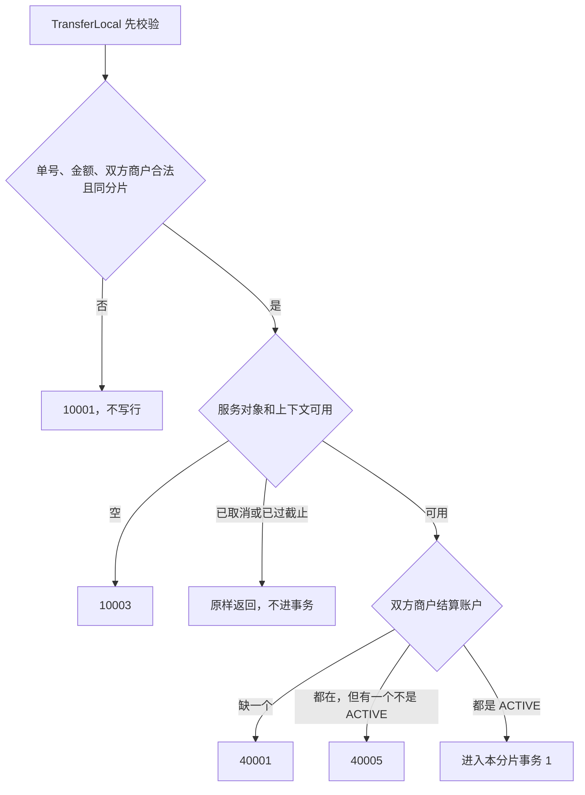
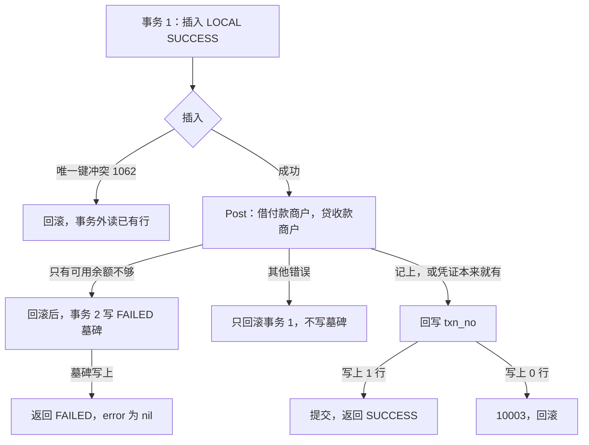

# ACC-07 同分片转账

| 项 | 内容 |
|---|---|
| 功能点 | ACC-07（P0，第 2 周） |
| 所属链路 | 基础设施 |
| 代码提交 | `7138c9f` `[ACC-07] add local transfer` |
| 分支 | `feat/ACC-07-transfer-local` |
| 日期 | 2026-10-21 |
| 状态 | DONE |

完整 hash：`7138c9f49b24e34efcb8ba28487e33a3cad2451c`。这次代码提交 9 个文件，1750 行新增，47 行删除。本报告在该提交之后写，不包含在这 9 个文件里。

## 一句话结论

同分片转账是 account 进程里的方法 `TransferLocal`。双方商户在同一个数据库分片、且不是同一个商户时，它自己开事务并提交：从付款商户的可用余额转出，记入收款商户。成功时返回 `status = SUCCESS` 和凭证号，error 为 nil。可用余额不够不是错误码 `40002`，而是一次成功返回的业务结果：`status = FAILED`，`fail_code = INSUFFICIENT_BALANCE`，error 为 nil，没有凭证。这个确定失败写在 `transfer_branch` 的失败墓碑里。墓碑提交之后，同一单号再来仍是 FAILED，即使付款方后来钱够了。`M100001` 与 `M100003` 各有 10000 分（100.00 元），A→B 与 B→A 各 500 笔、每笔 1 分（0.01 元）之后，双方仍各是 10000 分，合计 20000 分（200.00 元），共 1000 张 `TRANSFER` 凭证。这 10000 分对 10000 分是 `TestTransferLocalCrossConcurrent` 自己写入的起始余额，不是全库初始数据。重放测试另写一套起始余额，见 §3.4。

## 1. 背景

### 1.1 系统简介

pay-system 是一个用 Go 编写的小型支付后端，模拟商户收款、退款、商户间转账三条资金链路，重点在数据一致性和性能。系统由 5 个部分组成：gateway（对外 HTTP 入口，负责签名校验和限流）、payment（支付单、退款单、转账单的状态管理和流程推进）、account（账户余额与记账，数据按商户分到 2 个数据库分片）、channel-mock（模拟微信、支付宝这类外部支付渠道）、recon（对账，核对系统内外数据是否一致）。服务之间用 Kitex RPC 同步调用，或通过 Kafka 消息异步通知；数据存在 MySQL 8.4，Redis 用于防重放。所有金额用整数“分”表示，所有记账只追加不修改。「所有记账只追加不修改」指分录只插入、不改旧行。账户行上的账面余额、冻结金额和 `version` 是当前值，用条件更新改这一行。当前已完成：本地已有开户、查询、记账、冻结、解冻、确认扣款、同分片转账。余额核对、account 的 RPC 进程、收款方转账分支和转账单流程还没做。现在会调用 `TransferLocal` 的只有测试。以后转账单流程 TRF-02 会调用它，还没做。跨分片转账不走这个方法。

Kitex 是本项目的 Go RPC 框架。RPC 是进程之间的同步调用。Kafka 是消息队列。简介里的 Redis 防重放是以后 gateway 用来挡住重复的对外 HTTP。`TransferLocal` 不用 Redis。重复请求靠 `transfer_branch` 上 `(transfer_no, role)` 的唯一索引：已经有结果就返回那一次的结果，不再记账。分片是账户数据所在的那一个库，这里只有 0 和 1。IDL 是接口定义文件。本次不改 IDL，也没有进程在监听端口。

### 1.2 本功能点在系统中的位置

文首表格里的「所属链路：基础设施」指账户、分片、记账这些被收款、退款、转账三条业务共用的底层能力，不是第四条资金业务。转账单状态机（一笔转账从发起到结束要经过哪些状态）是以后的 TRF-02，它才会调用本方法。

`TransferLocal` 只在 account 进程内部被调用。它自己用 `dbx.WithTx` 开始并提交本分片的事务。公开的记账方法 `Post` 在调用方已经打开的事务里写凭证和分录，自己不开始事务，也不提交。这次调用它的人就是 `TransferLocal`。RPC 还没做，那是以后的 ACC-11。收款方分支 ACC-14、余额核对 ACC-10、转账单 TRF-02 都不在这次里。跨分片的两个商户在进事务之前就被拒绝，不会在这个方法里写行。



上图只画到进事务之前。账户不存在优先于账户停用：一个不存在、另一个不是 `ACTIVE` 时，返回的是 `40001`，不是 `40005`。这两个查询不加行锁，也不比较余额。发号器为空、连接池为空、按分片拿库失败，也是开事务前的 `10003`。



事务 1 里先插入 `SUCCESS`，再记账。可用余额不够时，这一整笔回滚，`SUCCESS` 行不会留下。然后才开事务 2，插入 `FAILED`。`1062` 之后事务仍开着，可以读到对方已提交的行，但不能接着记账。实现是先回滚，再到事务外按已有行返回，不把这次事务提交出去，也不把对方的 `SUCCESS` 盖成 `FAILED`。事务 2 撞上 `1062` 时按已有行返回；事务 2 的其他错误里，上下文取消或到期原样返回，其余收成 `10003`，并且不写墓碑。墓碑没写上时再次调用会重新执行，这是从事务边界推出来的，没有一支测试在墓碑写入失败之后再调用一次。

### 1.3 为什么需要它

商户 `M100001` 和 `M100003` 的结算账户都在分片 1。验收 1 的测试自己先把两边都写成各 10000 分（100.00 元），冻结都是 0。这不是全库一开始就有的数据，也不是重放测试用的那一套。A 要转给 B 1 分（0.01 元），同时 B 也转给 A 1 分。先查后改且不加锁：两次都读到 10000 分，又都按这个旧数写成 9999 分，后一次覆盖前一次，合计少 1 分。死锁是另一种错误：一笔先锁付款方再锁收款方，对向的一笔反过来锁，两笔互相等待。本方法不这么锁。`Post` 按账户 id 从小到大锁，两笔对向的锁顺序相同。

同一张转账单号如果超时重试，也不能出现“第一次因为钱不够失败，墓碑已经提交，重试时钱已经够了却又成功”。那会让调用方分不清这笔到底转成了没有。所以确定失败要留下一张墓碑，提交之后不能改口。墓碑没写上、事务 1 也已回滚时，库里没有这张单号，再次调用会重新做。这是从事务边界推出来的，没有一支测试在墓碑写入失败之后再调用一次并看到成功。

另一类容易混的是冻结。账面 1000 分（10.00 元）、冻结 800 分（8.00 元）时，还能转出的只有 200 分（2.00 元）。转 300 分（3.00 元）必须失败，账面和冻结都保持原样。确认扣款做的是把已经冻住的钱扣掉，这条转账不是那条路。

## 2. 术语

| 术语 | 含义 |
|---|---|
| 分 | 金额最小单位。100 分 = 1.00 元。10000 分是 100.00 元，20000 分是 200.00 元，1 分是 0.01 元，300 分是 3.00 元，800 分是 8.00 元。金额是 `int64`，不用小数运算。 |
| 分片 | 账户数据所在的库，只有 0 和 1。商户号必须是 `M` 加恰好 6 位数字，分片是数字部分对 2 取模。`M100001` 的 `100001 % 2 = 1`，`M100003` 的 `100003 % 2 = 1`，都在分片 1。`M100002` 在分片 0。一次同分片转账只访问这一个库。 |
| 接收者 | 这个方法所属的服务对象，类型是 `*Service`。它为空，表示服务还没装配好。参数不合法时，即使接收者为空，也先返回 `10001`。参数合法且接收者为空，才是 `10003`。 |
| 发号器 | 按时间生成单号的组件。凭证号前缀是 `TX`。`TransferLocal` 自己的代码不调用发号函数。凭证号由事务 1 里的 `Post` 在锁账户之前生成。发号器为空时，在开事务之前返回 `10003`，因为后面的 `Post` 要用它，避免先插入分支再在 `Post` 里失败。发号器若发现时钟回拨（本机时间比已经发出的号还早）超过 5 毫秒，`Post` 把它映射成 `10004`（服务暂时不可用）。 |
| 结算账户 | 表 `account` 里商户、类型 `MERCHANT_SETTLE`、币种 `CNY`、`sub_no = 0` 的那一行。`sub_no` 是子账户序号。商户结算账户的 `sub_no` 恒为 0。平台自己的账户才会拆成多个子账户，个数由配置决定。渠道应收、在途、手续费是这三类平台侧账户：渠道该付的钱、还没结算的钱、手续费。它们不是商户结算账户。本方法只在两个商户结算账户之间转，不选平台子账户，所以子账户个数是 0 也不失败。 |
| 余额 | 列 `balance`，账面金额，单位分。成功转账时付款方减少、收款方增加。 |
| 冻结金额 | 列 `frozen_amount`，已经占住、不能再当可用金额转出的部分，单位分。这次转账不改它。 |
| 可用余额 | `balance - frozen_amount`。不单独存成一列。账面 1000 分、冻结 800 分时，可用余额是 200 分（2.00 元）。 |
| `ACTIVE` | 账户可以做普通记账的状态。事务前两边都必须是它。锁里才发现不是，仍是 `40005`。 |
| 凭证 | `ledger_txn` 的一行，一笔业务一张。只追加。这次的类型是 `TRANSFER`，不是 `TRANSFER_OUT`，也不是 `TRANSFER_IN`。 |
| 分录 | `ledger_entry` 的一行，记某个账户这笔是借还是贷、金额多少。只插入，不改旧行。一次成功转账写两条，金额相同。 |
| `balance_after` | 分录上的一列：这一条记下这笔发生之后、该账户自己的账面余额。验收 1 检查的是该账户 `ledger_entry.id` 最大的那一条，等于该账户当前账面，不是 2000 条里全局最后一条。`id` 由数据库按插入顺序递增，所以是后写入的那条。测试用 `ORDER BY id DESC LIMIT 1`。两个账户的借方合计等于贷方合计。 |
| 借 / 贷 | 分录方向 `DEBIT` / `CREDIT`。商户结算账户是贷方余额账户：借方分录使账面减少，贷方分录使账面增加。这次借付款商户、贷收款商户。 |
| `transfer_branch` | 转账分支表。一行记录某个转账单号在某个角色上的最终结果。这次只写角色 `LOCAL`。 |
| `LOCAL` | 分支角色：双方在同一分片时，这一行就是整笔转账的最终结果。 |
| `PAYEE` | 分支角色：跨分片时收款方那一支。这次不写。那是以后的 ACC-14。 |
| `SUCCESS` | `LOCAL` 分支的成功状态。提交出去时必须带非空的 `txn_no`。 |
| `FAILED` | `LOCAL` 分支的确定失败状态。`fail_code` 必须有值，`txn_no` 为空，没有凭证。 |
| 失败墓碑 | 直接插入的 `FAILED` 行。它占住 `(transfer_no, LOCAL)`，表示这笔已经确定失败。它是事务 1 回滚之后、另一个事务写的。 |
| `fail_code` | 失败原因码。这次墓碑上的值固定是 `INSUFFICIENT_BALANCE`，不是错误码数字 `40002`，也不是英文 `insufficient balance`。 |
| `txn_no` | 凭证号，前缀 `TX`。插入 `SUCCESS` 时这一列写 SQL `NULL`，不是空字符串。回写条件是 `txn_no IS NULL`。`Post` 若返回空字符串凭证号，回写之前就返回 `10003`，事务 1 回滚。`NULL` 和空字符串不是一回事。成功分支提交后这一列非空。失败墓碑保持 SQL `NULL`。本方法自己的提交不会留下“`SUCCESS` 但 `txn_no` 仍是 `NULL`”。真实表允许 `NULL`，所以测试可以用 SQL 种出这种行。 |
| `transfer_no` | 转账单号。不强制 `TF` 前缀。记账用的业务单号最长 64 个码点。`transfer_branch.transfer_no` 是 `VARCHAR(32)`，所以上限是 32 个码点，不是 64。`migrations/account/000001_init.up.sql` 里这张表自己的建表语句没有另写字符集，文件要求执行时的连接字符集是 `utf8mb4`。在 `utf8mb4` 下，`VARCHAR(32)` 按字符计，32 个汉字放得下。 |
| 码点 | 这里按 Go 的一个 Unicode 字符计，不是按字节。32 个汉字就是 32 个码点。 |
| 幂等 | 同一业务做两次，结果和只做一次相同。幂等键是该分片里的 `(transfer_no, role)`。重放只比较金额和双方商户。一致就按库里的状态返回，不再看当前余额。 |
| `1062` | MySQL 报告“唯一索引冲突”的错误号。它只让这一条插入失败，不会把整个 InnoDB 事务作废。对方的 `SUCCESS` 插入还没提交时，这次 `INSERT` 会等待。对方提交后，等待的这次得到 `1062`。对方回滚后，等待的这次插入继续。按理接着能读到行，因为对方已经提交，这次才能收到 `1062`。若接着的 `SELECT` 仍然没有行，返回 `10003`，并且不会循环再读。 |
| `3819` | MySQL 报告“这一行违反了表上的检查约束”的错误号。正常调用不会走到。若插入的行违反检查约束（金额不大于 0、`FAILED` 却没有 `fail_code`、转给自己等），本方法把它收成 `10003`，错误文本里不带约束名。没有专门测试去撞它。 |
| InnoDB | MySQL 使用的事务引擎。未提交的修改可以整笔撤销。 |
| 行锁 | InnoDB 为了改一行而持有的锁。别的事务要动同一行就必须等这次事务结束。 |
| 按 id 升序加锁 | `Post` 先锁账户 id 较小的那一行，再锁较大的那一行。A→B 和 B→A 因此不会因为锁的先后相反而死锁。 |
| `version` | 这一行改过几次的计数。插入分支时是 0。回写 `txn_no` 时加 1，所以这次提交出去的 `SUCCESS` 行 `version` 是 1。这条 `UPDATE` 的 `WHERE` 不比较旧 `version`。它不是用来抢更新的条件。失败墓碑保持 0。账户行上的 `version` 由 `Post` 在改余额时加 1，那是另一列。 |
| `Duplicated` | 只指 `Post` 的返回值。`Post` 认定同一张凭证靠唯一键 `(biz_type, biz_no)`，这里是 `(TRANSFER, transfer_no)`。这条重复路径不比较分录上的账户和金额。为 true 表示凭证已经在，这次没有改余额。钱是更早那张凭证记下的。`TransferLocal` 仍把分支提交为 `SUCCESS`，`txn_no` 用已有凭证的号。本方法自己的成功路径不会只留下凭证、不留分支，因为它们在事务 1 里一起提交。凭证已在、分支不在，只可能是测试用 SQL 事先写入，或库里已经有这样的行。结果结构里没有这个字段。这和确认扣款“凭证已存在则 `10003`”不同。 |
| `10001` | 本系统的业务错误码，不是 HTTP 状态码。对外英文固定为 `invalid parameter`。单号长度不对、金额不是正数、商户号算不出分片、双方不在同一分片、转给自己，都用它。 |
| `10003` | 业务码。对外英文固定为 `internal error`。`Error()` 里不带 SQL、地址或密码。参数合法时，接收者或连接池是空，分片库拿不到，两个账户 id 相同，`SUCCESS` 的 `txn_no` 仍是 SQL `NULL`，回写影响 0 行，发号器为空，`3819`，或者其余认不出来的数据库错误，都用它。发号器为空发生在开事务之前。事务 2 里其余认不出来的错误也收成它，并且不写墓碑。上下文取消或到期不用这个码，包括事务 2 进行中，原样返回。4 次都是死锁 `1213` 或锁等待 `1205` 时，最后一次也收成它，不写墓碑。若 3 秒先到，调用方得到上下文到期。这些次数和 3 秒是 `WithTx` 里的常数，不是这次测试量出来的，也没有单独的测试去数重试次数。 |
| `10004` | 业务码。对外英文固定为 `service unavailable`，含义是服务暂时不可用。发号器发现时钟回拨超过 5 毫秒时，`Post` 把它映射成这个已有的码。`TransferLocal` 自己不调用发号器，但事务 1 里的 `Post` 会生成 `TX` 凭证号。这时事务 1 回滚，不写墓碑，调用方收到 `10004`。这是 `Post` 已有的映射。本功能点没有单独测试。 |
| `10006` | 业务码。对外英文固定为 `idempotent conflict`。已有 `LOCAL` 行的金额、付款方或收款方和这次请求不一致。不写、不记账，旧行和余额不变。 |
| `40001` | 业务码。对外英文固定为 `account not found`。付款方或收款方没有 `CNY` 的商户结算账户。不存在优先于非 `ACTIVE`。 |
| `40002` | 业务码。对外英文固定为 `insufficient balance`。`Post` 在可用余额不够时返回它。`TransferLocal` 不把这个码交给调用方。 |
| `40003` | 业务码。对外英文固定为 `unbalanced entries`。这是 `Post` 对分录或锁上那一行的错误：分录不平、行在查询之后消失，或锁住的行币种不是 `CNY`。事务前查结算账户时币种必须是 `CNY`，选不中是 `40001`。`Post` 若返回 `40003`，事务 1 回滚，不写墓碑，调用方原样收到。 |
| `40005` | 业务码。对外英文固定为 `account inactive`。两个账户都在、但有一个不是 `ACTIVE`。事务前就能发现。锁内才发现也是它：整笔回滚，不写墓碑，分支行不留下。 |
| goroutine | Go 里的一个并发执行单元。1000 个 goroutine 就是 1000 个同时发起的调用。 |
| 信号量 | 测试里一把容量为 32 的计数。调用 `TransferLocal` 之前先占一个位置，返回后再放开。它限制同时停在 `WithTx` 里的调用不超过 32。1000 个 goroutine 都会调用，不是只跑 32 笔。两个方向共用这一把。 |
| `dbx.WithTx` | 已有的事务助手。它自己开始事务，回调返回错误就回滚，成功就提交。`TransferLocal` 调用它。`Post` 不调用它。死锁（MySQL `1213`）和锁等待超时（MySQL `1205`）会重试整段回调，含第一次最多 4 次。三次重试前分别等 10、20、40 毫秒。总预算 3 秒，从进入 `WithTx` 起算，含等连接和等锁。4 次、10/20/40 毫秒和 3 秒是这个助手现有代码里的常数，不是本功能点测试量出来的，也没有单独的测试去数重试次数。这次没有改这些常数。4 次都是 `1213`，处理与 4 次都是 `1205` 相同：最后一次错误被收成 `10003`，不写墓碑。若 3 秒先到，调用方得到上下文到期，不是 `FAILED`。它从调用方的上下文派生，谁先到期用谁。隔离级别是 `READ COMMITTED`。 |
| `READ COMMITTED` | 事务隔离级别：读到的是其他事务已经提交的数据。事务前那两次不加锁的查询，到后面 `Post` 锁账户之间，别的已提交事务可以改余额。真正比较可用余额发生在锁住之后。 |
| `Post` | 进程内的通用记账。调用方已经打开事务。它不开始事务，也不提交。普通借方要求账户是 `ACTIVE`，并且可用余额够，还不改冻结金额。 |
| RPC handler | 把网络请求转成进程内方法的那一层。IDL 里已经有 `TransferLocal` 这个方法名，但这次不写 handler，也不启动监听。那是以后的 ACC-11。 |
| CheckBalance | 还没实现的余额核对，功能点是 ACC-10。验收原文写了调用它。这次资金测试结束时用 SQL 直接核对余额、冻结、凭证和分录，不调用一个还不存在的核对函数。 |

## 3. 技术讲解

### 3.1 要解决的问题

1. 不能把冻结占住的钱转出去。可用余额是账面减去冻结。账面够、可用不够，必须确定失败，两个数都不变。
2. 同一 `transfer_no` 在分支行已经提交之后只有一个最终结果。墓碑已经是 `FAILED` 时，重复请求不能再记一张凭证，也不能因为余额变多而改成成功。墓碑没写上、事务 1 也已回滚时，库里没有这张单号，再次调用会重新执行。这是从事务边界推出来的，没有一支测试在墓碑写入失败之后再调用一次并看到成功。
3. 并发的对向转账不能把双方余额之和改掉，也不能因为锁顺序相反而互相死锁。
4. 成功时，凭证、两条分录、两个余额变化和分支上的 `txn_no` 必须一起提交，或一起撤销。不能留下没有凭证号的 `SUCCESS`。
5. 参数不合法不能写任何行，而且要比“服务对象是不是空”更早拒绝。
6. 这次不访问另一个分片，也不调用别的进程。

### 3.2 方案

方法签名是 `TransferLocal(ctx, transferNo, payerMerchantID, payeeMerchantID, amount) (TransferLocalResult, error)`。`TransferLocalResult` 只有三个字段：`Status`、`TxnNo`、`FailCode`。没有进程内的 `duplicated` 字段。`Status` 只用 `SUCCESS` 或 `FAILED`。

转账成功：error 为 nil，`Status = SUCCESS`，`TxnNo` 非空，`FailCode` 为空。确定的余额不足：error 为 nil，`Status = FAILED`，`FailCode = INSUFFICIENT_BALANCE`，`TxnNo` 为空。只有这两种情况 error 为 nil。返回错误时，结果结构体是零值：`Status`、`TxnNo`、`FailCode` 都是空字符串，只有 error 非空。调用方因此能把“确定失败”和“调用出错”分开。

先做纯校验，不访问数据库，也不看接收者是不是空。记账用的业务单号最长 64 个码点。这里的 `transfer_no` 按码点计必须是 1 到 32 个，因为列是 `VARCHAR(32)`。建表语句没有另写字符集，执行时的连接字符集是 `utf8mb4`，`VARCHAR(32)` 按字符计，32 个汉字放得下。金额必须是正的 int64 分。付款方和收款方都要能被 `shard.Of` 解析，必须算出同一个分片，而且不能是同一个商户。分片不同、转给自己、商户号非法、金额不是正数、单号为空或超过 32 个码点，都返回 `10001`，不写行。参数不合法时，即使接收者是空，或者上下文已经取消，也先返回 `10001`。这只发生在参数不合法时。参数合法时，接收者为空是 `10003`，已取消的上下文原样返回、不进事务。

参数合法之后：接收者是空、上下文是空、连接池是空，返回 `10003`。发号器为空也返回 `10003`，因为后面的 `Post` 要用它生成凭证号。这个检查在开事务之前，避免先插入分支再在 `Post` 里失败。`TransferLocal` 自己的代码不调用发号函数。商户结算账户的 `sub_no` 恒为 0。平台自己的账户（渠道应收、在途、手续费）才会拆成多个子账户，个数由配置决定。本方法只在两个商户结算账户之间转，不选平台子账户，所以子账户个数是 0 也不失败。上下文已经取消或已经超过截止时间，原样返回那个上下文错误，不进事务。按分片拿数据库失败，返回 `10003`。

然后用普通 `SELECT` 查双方结算账户：户主类型是商户，户主是该商户号，账户类型是 `MERCHANT_SETTLE`，币种是 `CNY`，`sub_no = 0`。任一不存在，包括因为不是 `CNY` 而选不中，返回 `40001`。两个都存在时，任一状态不是 `ACTIVE`，返回 `40005`。不存在优先于非 `ACTIVE`。这两个查询不加行锁，也不读余额。两个账户 id 相同，或有一个 id 是 0，当成数据损坏，返回 `10003`，不写。

下面这段在做的是：参数和账户都已经查过之后，由 `dbx.WithTx` 打开本分片事务。回调拿到的是已经开始的同一个事务，SQL 的 `BEGIN` 已经执行。`*sqlx.Tx` 就是这次数据库事务。插入分支、`Post`、回写 `txn_no` 都用它。`Post` 自己不提交。

```go
dbx.WithTx(ctx, db, func(tx *sqlx.Tx) error {
    // tx 已经 BEGIN。插入分支、Post、回写 txn_no 都用这同一个 tx。
})
```

事务 1 的顺序是：

1. 插入 `transfer_branch`：`role = LOCAL`，`status = SUCCESS`，双方商户和金额，`fail_code` 与 `txn_no` 写的是 SQL `NULL`，不是空字符串，`version` 是 0。
2. 同一 `transfer_no`：对方的 `SUCCESS` 插入还没提交时，这次 `INSERT` 会等待。对方提交后，等待的这次得到 `1062`。对方回滚后，等待的这次插入继续。得到 `1062` 时事务仍然开着，里面可以读到对方已经提交的行。不能接着做的是记账，因为这行不是这次插入的，再记一次会在别人的分支之外又动一次余额。回调返回一个不含 SQL 的错误，让 `WithTx` 回滚。回滚是为了不提交这次事务。然后再到事务外读已有的 `LOCAL` 行。按理读得到，因为对方已经提交。若 `SELECT` 仍然没有行，返回 `10003`，并且不会循环再读。读到了就按下面的重放规则返回。
3. 插入成功后调用公开的 `Post`。凭证类型是 `TRANSFER`，业务单号就是 `transfer_no`，备注是空字符串。两条分录：借付款商户这笔金额，贷收款商户这笔金额。不走确认扣款那种“账面和冻结一起减”的路径。`Post` 仍用可用余额条件 `balance - frozen_amount`。账户按 id 从小到大加锁，这是 `Post` 已有的行为。这里不在 `Post` 之前用相反的顺序去锁账户。

`Post` 返回 error 为 nil 时，无论 `Duplicated` 是 true 还是 false，都回写 `Post` 给出的 `TxnNo`。`Post` 认定同一张凭证靠唯一键 `(biz_type, biz_no)`，这里是 `(TRANSFER, transfer_no)`。这条重复路径不比较分录上的账户和金额。`Duplicated` 为 true 表示凭证已经在，这次没有改余额，钱是更早那张凭证记下的。本方法自己的成功路径不会只留下凭证、不留分支，因为它们在事务 1 里一起提交。凭证已在、分支不在，只可能是测试用 SQL 事先写入，或库里已经有这样的行。遇到时不再改余额，补一条 `SUCCESS` 分支并写上已有凭证号。回写语句是：

```sql
UPDATE transfer_branch
SET txn_no = ?, version = version + 1
WHERE transfer_no = ? AND role = 'LOCAL' AND status = 'SUCCESS' AND txn_no IS NULL
  AND amount = ? AND payer_merchant_id = ? AND payee_merchant_id = ?
```

`version` 在这条语句里加 1，所以提交出去的 `SUCCESS` 行是 1。`WHERE` 不比较旧 `version`，它不是用来抢更新的条件。影响 1 行，`WithTx` 提交。影响 0 行，返回 `10003`，由 `WithTx` 回滚。不能留下 `txn_no` 仍是 SQL `NULL` 的 `SUCCESS`。`Post` 给出的凭证号如果是空字符串，在回写之前就返回 `10003`，事务 1 回滚。`NULL` 和空字符串不是一回事。

只有 `Post` 返回 `40002` 才在事务 1 回滚之后开事务 2。事务 2 插入 `LOCAL` / `FAILED`，`fail_code` 恰好是 `INSUFFICIENT_BALANCE`，`txn_no` 是 SQL `NULL`，`version` 为 0。事务 2 成功则返回 FAILED 业务结果，error 为 nil。事务 2 撞上 `1062` 时，回滚后按已有行返回。事务 2 的其他错误里，上下文取消或到期原样返回，不是 `10003`；其余认不出来的错误收成 `10003`，并且不写墓碑。

`Post` 的其他错误，包括 `40005`、`40003`、`10003`、`10004` 和上下文错误，只回滚事务 1，不写墓碑，把该错误返回给调用方。事务前已经查过 `ACTIVE`。锁内才发现不是 `ACTIVE`，仍然是 `40005`：整笔回滚，不写墓碑，分支行不留下。本方法不读、不写 `account_freeze`。失败留下的是 `transfer_branch` 上的 `FAILED` 行。`account_freeze` 是退款和跨分片转账用来占用余额的表，这次不碰。发号器发现时钟回拨超过 5 毫秒时，`Post` 把它映射成已有的 `10004`。这是 `Post` 已有的映射，本功能点没有单独测试。`TransferLocal` 自己不调用发号器，但事务 1 里的 `Post` 会生成 `TX` 凭证号。这时事务 1 回滚，不写墓碑，调用方收到 `10004`。

`Post` 不会把「余额更新影响 0 行」直接当成余额不足。它会再读这一行：停用是 `40005`，可用余额不够是 `40002`，行没了是 `40003`。再读时状态仍是 `ACTIVE`，并且按可用余额看这次仍然够扣，但更新影响了 0 行，于是 `10003`。`TransferLocal` 不改这些码。只有 `40002` 才写墓碑。

已有 `LOCAL` 行：比较金额、付款方、收款方。任一不一致，返回 `10006`，不写、不记账。一致时：`SUCCESS` 且 `txn_no` 非空，返回 `SUCCESS` 和该凭证号，error 为 nil，不再记账。`SUCCESS` 但 `txn_no` 仍是 SQL `NULL`，返回 `10003`，不写，结果结构体是零值。`FAILED` 返回 `FAILED` 和库里的 `fail_code`，error 为 nil，不再看当前余额，也没有凭证。这仍是余额不足那一种，不是调用出错。读不到行、状态不认识、或者 `FAILED` 却没有 `fail_code`，返回 `10003`。`1062` 之后按理读得到行。若接着的 `SELECT` 仍然没有行，返回 `10003`，并且不会循环再读。这和 `WithTx` 对死锁、锁等待的重试不是一回事。

重放只比较金额和双方商户。一致就按库里的状态返回，不再看当前余额。收款方属于另一分片时，校验阶段已经返回 `10001`，不会来读这一行。

`PAYEE` 角色不写。

### 3.3 为什么这样做

| 方案 | 做法 | 优点 | 缺点 | 结论 |
|---|---|---|---|---|
| 采用：先占住 `LOCAL` 行，再在同一事务里记账，余额不足则另开一笔写墓碑 | `Post` 返回 `40002` 时回滚事务 1，再开事务 2 写墓碑 | 成功的凭证、余额和 `txn_no` 一起提交。分支行提交之后，再次调用返回那一行 | 失败要两次事务。`1062` 之后可以读，但不能接着记账，所以先回滚再在事务外读。墓碑没写上时再次调用会重新执行。这是从事务边界推出来的，没有一支测试在墓碑写入失败之后再调用一次 | 采用 |
| 备选：余额不够时在同一个事务里把刚插入的 `SUCCESS` 改成 `FAILED` | 事务 1 不回滚。`Post` 返回 `40002` 之后，在同一事务里把这一行从 `SUCCESS` 改成 `FAILED`，并同时写上 `fail_code` | 提交后别人只能看到 `FAILED`。唯一键从插入一直占到这次提交。同一张 `transfer_no` 的其他调用只能等这次提交，然后读到 `FAILED`。检查约束挡不住，因为状态和 `fail_code` 是同一条更新写上的。这个做法也能得到确定结果 | 需求写的是：先回滚事务 1，再由事务 2 插入墓碑 | 不采用 |
| 备选：调用方看到 `40002` 自己决定要不要再试 | 不写墓碑 | 失败时少写一行。表本来就有 | 第一次失败、第二次钱够了就会成功，调用方无法知道第一次到底有没有转成 | 不采用 |
| 备选：凭证已存在就学确认扣款返回 `10003` | `Duplicated = true` 时回滚这次新分支 | 和确认扣款同一句话 | 成功路径不会只留下凭证、不留分支，二者在事务 1 里一起提交。凭证已在、分支不在，只可能是测试用 SQL 事先写入，或库里已经有这样的行。若回滚这次新分支，缺口还在，下次仍看到同一张凭证。若那时返回 `10003`，调用方永远得不到 `SUCCESS` 或 `FAILED` | 不采用。不再改余额，补一条 `SUCCESS` 分支并写上已有凭证号 |

采用的做法多一个窗口，这不是上面那一行备选的步骤。事务 1 回滚后，同一张 `transfer_no` 上还在等唯一键的另一次插入会继续。钱不够的原因如果还在，那一次也会得到 `40002`，再去写墓碑。若在此之前另一张单号已经给付款方补进足够的钱，这一次就可能记账成功并提交 `SUCCESS`。后到的墓碑插入撞上 `1062`，就返回这次 `SUCCESS`，不会把已经成功的行改成 `FAILED`。等待发生在同一张单号的插入上，不是先等账户行锁再变成成功。

账户按 id 升序加锁已经由 `Post` 保证。A→B 与 B→A 不会因为一个先锁付款方、一个先锁收款方而死锁。这次不在 `Post` 之前再锁一次。

### 3.4 正确性

| 场景 | 系统行为 | 最终状态 | 证明 |
|---|---|---|---|
| 同一请求重复到达 | 第一次提交之后，第二次插入会得到 `1062`，回滚后读到 `SUCCESS` 且凭证号非空，不再记账。这条测试自己先写入起始余额：付款方 1000 分（10.00 元）、收款方 0，不是验收 1 的 10000 分对 10000 分，也不是同一次运行 | 仍是 1 张 `TRANSFER` 凭证。转 250 分（2.50 元）后付款方 750 分（7.50 元）、收款方 250 分（2.50 元），余额不再变，返回同一个 `txn_no` | `TestTransferLocalReplaySuccess` |
| 两个方向同时转很多小额 | 测试自己先写入 `M100001`、`M100003` 各 10000 分。这不是全库初始数据。A→B 与 B→A 各 500 笔，每笔 1 分，单号各不相同。`Post` 按账户 id 从小到大锁，两笔对向的锁顺序相同 | 双方仍各 10000 分，合计 20000 分，冻结仍是 0。1000 张金额为 1 分的 `TRANSFER` 凭证，2000 条分录。每个账户 `ledger_entry.id` 最大的那一条，其 `balance_after` 等于该账户当前账面。`id` 按插入顺序递增，测试用 `ORDER BY id DESC LIMIT 1`。不是 2000 条里全局最后一条。两个账户的借方合计等于贷方合计。分片 0 没有这次的分支和凭证 | `TestTransferLocalCrossConcurrent` |
| 同一单号并发 50 次 | 对方的 `SUCCESS` 还没提交时，其余 `INSERT` 会等待。对方提交后，等待的那些得到 `1062`，再读到同一行。起始的各 10000 分是这条测试自己写入的，不是验收 1 跑完剩下的余额 | 恰好 1 张凭证，50 个结果完全相同。测试金额是 40 分（0.40 元）：付款方从 10000 分到 9960 分（99.60 元），收款方从 10000 分到 10040 分（100.40 元），冻结仍是 0 | `TestTransferLocalSameNoConcurrent` |
| 在回写 `txn_no` 之前进程崩溃 | 凭证、余额变化和分支上的 `txn_no` 都在事务 1 里。提交前崩溃会整笔回滚 | 要么一起留下，要么一起没有。没有崩溃注入测试。结论只来自一个库、一个事务 | 没有这支测试 |
| 回写 `txn_no` 影响 0 行 | 返回 `10003`，事务回滚，不会提交 `txn_no` 仍是 SQL `NULL` 的 `SUCCESS` | 这次不提交 | `TestExecuteLocalWriteTxnMiss`。这是另一个场景，不用它证明崩溃 |
| 下游调用超时 | 本方法不调用 RPC、HTTP 或消息队列。没有“外部超时”的业务结果。取消的上下文在进事务之前原样返回，不调用发号器 | 不写行 | `TestTransferLocalNilAndCanceled` |
| 可用余额不够 | `Post` 返回 `40002`。事务 1 回滚，事务 2 写墓碑。调用方拿到 FAILED，error 为 nil | 没有凭证。付款方 100 分（1.00 元）转 500 分（5.00 元）时，双方余额不变。然后这条测试把付款方加到 10000 分（100.00 元）。这是入账后的余额，不是验收 1 的起始数据。同一 `transfer_no` 仍是 FAILED，仍然没有凭证 | `TestTransferLocalInsufficientStaysFailed` |
| 账面够、可用不够 | 账面 1000 分、冻结 800 分，可用余额是 200 分，转 300 分。普通借方看可用余额，不是把已经冻住的钱扣掉 | 账面仍是 1000 分，冻结仍是 800 分，没有凭证，墓碑是 `INSUFFICIENT_BALANCE` | `TestTransferLocalFrozenHoldsAvailable` |
| 双方不同分片，或转给自己 | 校验阶段返回 `10001`，不进事务 | 两个分片的行数都不变 | `TestTransferLocalRejectsCrossShardAndSelf` |
| 已有分支的金额或某一方不同 | 返回 `10006`，不记账 | 旧行和双方余额不变 | `TestTransferLocalIdempotentConflict` |
| 账户不存在，或不是 `ACTIVE` | 不存在是 `40001`，并且优先于非 `ACTIVE`。两个都在但一个不是 `ACTIVE` 是 `40005` | 不写分支 | `TestTransferLocalAccountState` |
| 这张 `TRANSFER` 凭证已经在库里 | `Post` 的 `Duplicated` 为 true，这次不改余额，分支仍提交为 `SUCCESS`，`txn_no` 用已有号 | 仍是 1 张凭证，余额不再动 | `TestTransferLocalDuplicateVoucherStillSucceeds` |
| `Post` 返回 `40005` 或 `40003` | 只回滚事务 1，不写墓碑 | 假事务里墓碑计数为 0 | `TestExecuteLocalPostErrorNoTombstone` |
| 事务 1 的 `1062` 之后已有 `SUCCESS` 或 `FAILED` | 回滚后按已有行返回，不再记账 | 假事务不提交新的成功分支 | `TestExecuteLocalDuplicateBranch` |
| 墓碑插入遇到 `1062`，已有的是 `SUCCESS` | 不把墓碑写成别的状态，改为返回已有成功结果 | 假事务的提交次数是 0 | `TestExecuteLocalTombstoneDuplicateReturnsSuccess` |
| `SUCCESS` 但 `txn_no` 是 SQL `NULL` | 返回 `10003`，不写。本方法自己的提交不会留下这种行。真实表允许 `NULL`，假事务把这种行放进来。`NULL` 不是空字符串 | 不记账 | `TestExecuteLocalSuccessWithoutTxnNo` |

验收第 1 条原文写了调用 CheckBalance。ACC-10 还没做。这次在测试结束时用 SQL 断言代替：双方余额之和、各自余额、冻结金额不变、凭证张数、分录借贷，以及另一分片没有这次的分支和凭证。`balance_after` 是每条分录记下这笔之后该账户自己的账面。检查的是该账户 `id` 最大的那一条，等于该账户当前账面，不是 2000 条里全局最后一条。`id` 按插入顺序递增。测试用 `ORDER BY id DESC LIMIT 1`。两个账户的借方合计等于贷方合计。

### 3.5 性能

不涉及。这次没有做吞吐或延迟测量。验收 1 证明的是 1000 笔记完之后余额和凭证对得上，不是每秒能转多少笔。

## 4. 已完成内容

### 4.1 改动清单

| 文件 | 新增 / 修改 | 作用 |
|---|---|---|
| `service/account/biz/transfer.go` | 新增 | `TransferLocal`：校验、查双方结算账户、事务 1 记账、事务 2 写失败墓碑、`1062` 之后在事务外重放 |
| `service/account/biz/transfer_test.go` | 新增 | 不连库的参数、空服务、取消上下文，以及假事务上的 `1062`、0 行回写、墓碑和 `Post` 错误 |
| `service/account/biz/transfer_integration_test.go` | 新增 | 真 MySQL 上的对向并发、同一单号并发、余额不足、分片、账户状态和冻结占住可用余额 |
| `service/account/biz/open.go` | 修改 | 包注释写上同分片转账也自己提交本分片事务 |
| `docs/02-requirements.md` | 修改 | ACC-07 改为 DONE，补上这次的做法和四条验收，变更记录加 2026-10-21 |
| `docs/04-dev-plan.md` | 修改 | 只勾 ACC-07。同一行的 ACC-14 仍未勾 |
| `docs/05-api.md` | 修改 | 文档版本 2.0.5。写明 `TransferLocal` 已是进程内方法 |
| `docs/06-flows.md` | 修改 | 版本 v2.6。流程图里的同分片转账控制流已按这些分支改过 |
| `docs/interview-notes.md` | 修改 | 记下冻结占住的钱转不走、失败墓碑是另一个事务、`1062` 必须先回滚再读 |

### 4.2 对外变化

| 类别 | 变化 |
|---|---|
| 接口 | 无新字段，无新错误码，IDL 未改，没有 handler，没有进程监听。接口文档保留 `TransferLocal` 的契约：请求是 `transfer_no`、付款商户、收款商户、金额；响应是 `status`、`txn_no`、`fail_code`。方法表的业务错误列只有 `10001`、`10006`、`40001`、`40005`，不列 `40002`。`10003` 和 `10004` 是各方法共用的内部错误，这张表的其他方法也没把它们列进去。`40003` 是 `Post` 对分录或锁上行的错误，调用方仍然可以原样收到：事务前的查询要求币种是 `CNY`，选不中是 `40001`；行在查询之后消失，或锁住的行币种不是 `CNY`，`Post` 返回 `40003`。`Post` 返回 `40005` 时调用方也会原样收到。文档版本 2.0.5，最后修改 2026-10-21。§1 各接口自己的「最后修改」列是故意不改的，因为这次只是文字对齐，没有新字段 |
| 表结构 | 无。没有新迁移，也没有改已有迁移和检查约束。用的是已有的 `transfer_branch`、`ledger_txn`、`ledger_entry` 和 `account`。成功时分支 `version` 从 0 加到 1 并写入 `txn_no`。这条更新的 `WHERE` 不比较旧 `version`。失败墓碑 `version` 保持 0，`txn_no` 是 SQL `NULL` |
| 配置项 | 无。不读、不写 `deploy/.env` |
| 错误码 | 无新码。`10001`、`10003`、`10004`、`10006`、`40001`、`40002`、`40003`、`40005` 都是原有的码，英文也没改。`40002` 只在内部出现，不返回给调用方。`10004` 会原样返回给调用方 |
| 单号前缀 | 无。`transfer_no` 不强制 `TF`。凭证号仍是已有的 `TX`，由 `Post` 生成 |
| 指标 / 故障点 | 无 |

### 4.3 验收对照

| 验收条目 | 测试函数 | 类型 | 结果 |
|---|---|---|---|
| A、B 各 10000 分（100.00 元），A→B 与 B→A 各 500 次并发转 1 分（0.01 元），无死锁报错，结束后 A + B = 20000 分（200.00 元）。CheckBalance 用 SQL 代替。这 10000 分是本测试自己写入的起始余额 | `TestTransferLocalCrossConcurrent` | 集成，`-race` | 通过。包含在账户 biz 集成测试里，没有单独耗时。双方仍各 10000 分，冻结仍是 0。1000 张 `TRANSFER` 凭证。每个账户 `id` 最大的分录，其 `balance_after` 等于该账户当前账面。两个账户借方合计等于贷方合计。另一分片无写入。连接池 64 来自这个测试调用 `SetMaxOpenConns(64)`，不是配置文件，也不是命令输出。测试不读 `deploy/.env`。调用前有容量 32 的信号量，两个方向共用，1000 个 goroutine 都会调用 |
| 同一 `transfer_no` 并发 50 次，只生成 1 张凭证，全部返回同一结果 | `TestTransferLocalSameNoConcurrent` | 集成，`-race` | 通过。50 个结果相同。付款方 9960 分（99.60 元），收款方 10040 分（100.40 元） |
| 余额不足失败后，给付款方入账使余额充足，再用同一 `transfer_no` 请求仍返回 FAILED，没有凭证 | `TestTransferLocalInsufficientStaysFailed` | 集成，`-race` | 通过。先是 100 分转 500 分，error 为 nil，`fail_code` 是 `INSUFFICIENT_BALANCE`。这条测试再把付款方加到 10000 分，仍是 FAILED，余额没有被扣掉。这里的 10000 分不是验收 1 的起始余额 |
| 双方不在同一分片、转给自己，返回 `10001` | `TestTransferLocalRejectsCrossShardAndSelf` | 集成，`-race` | 通过。两次都没有任何写入 |

另外这些出口也在同一次账户 biz 集成测试里通过，没有单独耗时：顺序重放返回同一 `txn_no` 且不产生第二张凭证 `TestTransferLocalReplaySuccess`。重放测试另写一套起始余额，付款方 1000 分（10.00 元）、收款方 0，转 250 分（2.50 元）后付款方到 750 分、收款方到 250 分。这和验收 1 的 10000 分对 10000 分不是同一次运行。已有分支金额、付款方、收款方各不一致 `TestTransferLocalIdempotentConflict`（都是 `10006`，旧行和余额不变）；账户不存在是 `40001` 且优先于非 `ACTIVE`，两个都在但一个非 `ACTIVE` 是 `40005` `TestTransferLocalAccountState`（都不写分支）；账面 1000 分、冻结 800 分、转 300 分 `TestTransferLocalFrozenHoldsAvailable`（FAILED，两个数都不变）；已有 `TRANSFER` 凭证仍提交 SUCCESS 并回写已有 `txn_no` `TestTransferLocalDuplicateVoucherStillSucceeds`（这次不改余额，钱是更早那张凭证记下的；凭证已在而分支不在时，补一条 `SUCCESS` 分支）；子账户个数为 0 仍能转 `TestTransferLocalSubCountZero`，因为只转商户结算账户，不选平台子账户。不读、不写 `account_freeze`，不写 `PAYEE`，凭证类型不是 `TRANSFER_OUT` 或 `TRANSFER_IN`，由重放那条测试里的计数覆盖。已有的开户、记账、冻结、解冻、确认扣款断言没有改。

不连库的测试另外覆盖了：空单号、33 个码点、金额 0、负数、非法商户号，以及接收者为空时这些仍是 `10001` `TestTransferLocalRejectsParams`；合法参数下接收者或上下文为空是 `10003`，已取消或已过截止时间的上下文原样返回且不调用发号器 `TestTransferLocalNilAndCanceled`；事务 1 的 `1062` 后按已有 `SUCCESS` 或 `FAILED` 返回 `TestExecuteLocalDuplicateBranch`；回写 `txn_no` 影响 0 行得到 `10003` 且不提交 `TestExecuteLocalWriteTxnMiss`，这不证明进程崩溃；`SUCCESS` 但 `txn_no` 是 SQL `NULL` 时得到 `10003` `TestExecuteLocalSuccessWithoutTxnNo`；`Post` 返回 `40005` 或 `40003` 时不写墓碑 `TestExecuteLocalPostErrorNoTombstone`；`Post` 返回 `40002` 时写墓碑 `TestExecuteLocalInsufficientWritesTombstone`；墓碑的 `1062` 改为返回已有 `SUCCESS` `TestExecuteLocalTombstoneDuplicateReturnsSuccess`。没有专门测试去撞 `3819`。`10004` 没有单独测试。也没有测试去数 `WithTx` 的重试次数。没有一支测试在墓碑写入失败之后再调用一次。

### 4.4 验证记录

这些命令是写代码的人之外再跑的一次，日期是 2026-10-21。没有列出的命令不写成已经跑过。`make lint`、`make test`、`make test-integration`、`make cover` 都没有作为这次的验证命令运行。全仓库 `make cover` 未运行，没有全库覆盖率。

| 命令 | 结果 |
|---|---|
| `gofmt -l .` | 无输出，退出码 0 |
| `golangci-lint run ./...` | `0 issues.`，退出码 0 |
| `go test -race -count=1 -cover ./service/account/biz/` | `ok github.com/yym108/pay-system/service/account/biz 1.564s coverage: 74.1% of statements` |
| `go test -race -count=1 -tags integration -timeout 20m ./service/account/biz/` | `ok github.com/yym108/pay-system/service/account/biz 29.251s`，退出码 0 |
| `go test -race -count=1 ./...` | 退出码 0。其中 `ok github.com/yym108/pay-system/service/account/biz 1.972s`。这一次没有 `-cover` |
| `go test -race -count=1 -tags integration -timeout 20m ./...` | 退出码 0。根模块 `46.435s`，`internal/dbmigrate` `37.115s`，`internal/seed` `16.507s`，`service/account/biz` `46.668s`，`service/payment/biz` `17.231s` |
| `make cover` | 未运行 |

`1.564s` 和 74.1% 是带 `-cover`、不带 integration 标签的账户 biz 单元测试。`1.972s` 是全库单元测试里的同一个包，没有 `-cover`。两个都是实测，不要合成一个数字。

`29.251s` 是只跑账户 biz 集成测试的那一次。`46.668s` 是同包在全库集成测试里的耗时，旁边还有别的包在跑。两个都是实测，不要合成一个数字。

70% 是功能点流程里对 `service/account/biz`、不含 integration 标签的语句覆盖率要求。测试输出本身只打印了 74.1%，没有打印 70%。74.1% 达到这个要求。真 MySQL 通过的证据是集成测试退出码 0，不是这个百分比。集成测试里的 SQL 不在 74.1% 里面。这次的验证输出里没有打印 Go 或 golangci-lint 的版本号。

### 4.5 同步的文档

- 需求里 ACC-07 改为 DONE，四条验收勾上。写明：进程内方法；自己用 `dbx.WithTx` 提交；校验先于空服务判断，不合法返回 `10001`；`transfer_no` 是 1 到 32 个码点；事务前查双方结算账户，不存在优先于非 `ACTIVE`；事务 1 插入 `SUCCESS` 后调用公开 `Post`，类型是 `TRANSFER`；`Duplicated` 为 true 仍提交并回写已有凭证号；只有 `40002` 才另开事务写 `INSUFFICIENT_BALANCE` 墓碑；`1062` 先回滚再读；金额或双方不一致是 `10006`；`SUCCESS` 但 `txn_no` 为空是 `10003`。验收第 1 条的 CheckBalance 在 ACC-10 完成前用 SQL 代替。需求版本仍是 v3.0。
- 开发计划第 2 周只勾 ACC-07。ACC-14 收款方分支仍未勾。
- 接口文档升到 2.0.5，最后修改 2026-10-21。开头说明 `TransferLocal` 已是进程内方法，RPC 仍是 ACC-11。方法表业务错误只有 `10001`、`10006`、`40001`、`40005`。`10003` 和 `10004` 是各方法共用的内部错误，其他方法也没列进去。`40002` 不列进这一栏。`40003` 仍可能原样返回给调用方：事务前选不中 `CNY` 账户是 `40001`；行在查询之后消失，或锁住的行币种不是 `CNY`，`Post` 返回 `40003`。没有新字段，没有新错误码，没有改 IDL。§1 各接口自己的「最后修改」列是故意不改的，因为这次只是文字对齐，没有新字段。
- 流程图版本记为 v2.6。流程图里的同分片转账控制流已按这些分支改过。图上的出口包括：参数 `10001`、发号器或连接池为空以及拿库失败是 `10003`、已取消上下文原样返回、账户不存在 `40001`、非 `ACTIVE` 是 `40005`、事务 1 与事务 2、`1062` 回滚后再读、回写 0 行是 `10003`、只有 `40002` 写墓碑。事务 2 里上下文取消或到期原样返回，其余认不出来的错误收成 `10003`。
- 表结构文档没有改。没有新的迁移句子，已有表和检查约束已经能放下这次的行。
- 面试笔记记下三条：普通借方用账面减去冻结判断还能转出多少，所以冻住的钱转不走；失败墓碑是另一个事务，墓碑提交之后余额后来够了也不会成功；`1062` 之后事务仍开着，可以读到已提交的行，但不能接着记账，所以先回滚再在事务外读。账户按 id 升序加锁，A→B 与 B→A 不会因为锁顺序死锁。

约定文档没有改。迁移没有改。没有启动服务，也没有改命令行入口。

## 5. 未完成与风险

审查只读差异，没有再跑测试，结论是没有必须修改的问题。测试里容量 32 的信号量不是缺陷。1000 个 goroutine 都会调用 `TransferLocal`。信号量只限制同时停在 `WithTx` 里的不超过 32，A→B 和 B→A 共用这一把，不是只跑 32 笔。两边转账都要锁同一对账户，`Post` 按账户 id 从小到大锁，实际接近串行。`WithTx` 的 4 次、三次重试前的 10/20/40 毫秒、以及 3 秒总预算，都是这个助手现有代码里的常数，不是本功能点测试量出来的，也没有单独的测试去数重试次数。3 秒从进入 `WithTx` 起算，含等连接和等锁。4 次都是死锁 `1213`，处理与 4 次都是锁等待 `1205` 相同：最后一次错误收成 `10003`，不写墓碑。若 3 秒先到，调用方得到上下文到期，不是 `FAILED`。没有改这些常数，也没有改 `WithTx`。连接池 64 来自验收 1 的测试调用 `SetMaxOpenConns(64)`，不是配置文件，也不是命令输出。测试不读 `deploy/.env`。

- 全仓库 `make cover` 未运行。74.1% 是 `service/account/biz`、不含 integration 标签、带 `-cover` 的那次 `1.564s`，不是全库覆盖率，也不含集成测试里的 SQL。测试输出没有打印 70%。`1.972s` 是全量单元里不带 `-cover` 的同一包。真实 MySQL 通过要看退出码 0：单独的包集成是 `29.251s`，全量集成里的同一包是 `46.668s`。不能从 74.1% 里读出来，也不要把这四个数字合成一个。
- 回写 `txn_no` 之前进程崩溃：没有崩溃注入测试。结论只来自一个库、一个事务，提交前崩溃会回滚。凭证、两个余额变化和分支上的 `txn_no` 在事务 1 里一起提交或一起撤销。
- 回写影响 0 行是另一个场景。假事务测试 `TestExecuteLocalWriteTxnMiss` 证明返回 `10003` 且不提交。不用它证明崩溃。
- 失败墓碑是事务 1 回滚之后的另一个事务。只有分支行已经提交时，再次调用才返回那一行。事务 2 返回 `10003` 时墓碑没写上，事务 1 也已回滚，库里没有这张单号的分支和凭证，余额没变。再次调用会重新执行。这是从事务边界推出来的，没有一支测试在墓碑写入失败之后再调用一次并看到成功。事务 1 已回滚、事务 2 尚未提交时进程崩溃，同样没有分支、没有凭证、余额不变，再次调用重新执行。没有崩溃注入测试，这是从两个独立事务推出来的。
- 不实现 ACC-14 收款方分支、ACC-11 的 RPC、ACC-10 的核对、TRF-02 的转账单。以后 TRF-02 调用本方法。跨分片转账不走 `TransferLocal`。没有后台任务来补写结果。调用方再调一次即可。
- 单次转账的耗时没有测量。

## 6. 如何复现

前置：需要 Go、golangci-lint，以及 Docker 或已设置的 `TEST_MYSQL_DSN`。若未设置 `TEST_MYSQL_DSN`，testcontainers 启动项目固定的 `mysql:8.4.11`，每个分片一个随机 schema，结束时删除。若设置了 `TEST_MYSQL_DSN`，就用那台已有 MySQL，不另起容器，同样建随机库并在结束时删除。读者不需要自己准备业务数据。不要把连接串、口令或 `deploy/.env` 写进命令、日志或报告。

下面命令在 2026-10-21 由写代码的人之外再跑了一次。下面的秒数是那一次的输出，用来对照，不是以后再跑必须打出同样的秒数。再跑时耗时不同不算失败。通过是指退出码 0，并且测试里的断言成立。§4.4 仍只记录那一次的数字。这次输出里没有打印 Go 或 golangci-lint 的版本号。

```bash
gofmt -l .
golangci-lint run ./...
go test -race -count=1 -cover ./service/account/biz/
go test -race -count=1 -tags integration -timeout 20m ./service/account/biz/
go test -race -count=1 ./...
go test -race -count=1 -tags integration -timeout 20m ./...
```

`gofmt -l .` 那一次无输出、退出码 0。`golangci-lint run ./...` 那一次是 `0 issues.`、退出码 0。覆盖率命令那一次打印 `ok github.com/yym108/pay-system/service/account/biz 1.564s coverage: 74.1% of statements`。只跑账户 biz 的集成测试那一次打印 `ok github.com/yym108/pay-system/service/account/biz 29.251s`，退出码 0。不带 integration 标签的全库测试那一次退出码 0，其中 `service/account/biz` 为 `1.972s`，这一次没有覆盖率。全库集成测试那一次退出码 0：根模块 `46.435s`，`internal/dbmigrate` `37.115s`，`internal/seed` `16.507s`，`service/account/biz` `46.668s`，`service/payment/biz` `17.231s`。再跑时这些秒数可以不同。失败只看退出码不是 0，或者测试断言没过。

`make cover` 这次没有跑。复现时不要把全库覆盖率写成已经测过。

## 7. 讲解要点

1. 问：余额不够时，调用方拿到的是什么？为什么加钱之后同一单号仍失败？答：不是错误码 `40002`。调用方拿到的是成功返回的业务结果：`status = FAILED`，`fail_code = INSUFFICIENT_BALANCE`，error 为 nil，没有凭证。事务 1 先插入 `SUCCESS` 再记账；可用余额不够就整笔回滚，`SUCCESS` 行不会留下。然后另一个事务才插入 `FAILED` 墓碑。墓碑占住这个 `transfer_no`，以后不再看当前余额。付款方从 100 分加到 10000 分，同一单号仍是 FAILED。依据是 `TestTransferLocalInsufficientStaysFailed`。
2. 问：账面 1000 分、冻结 800 分，为什么转 300 分会失败，而且和确认扣款不同？答：可用余额是 `balance - frozen_amount`，这里是 200 分（2.00 元），小于 300 分（3.00 元）。普通借方要求可用余额够，所以转不走，账面和冻结都不变。确认扣款是把已经冻住的钱扣掉，用的是另一条更新。这次调用的是公开 `Post`，不走那条路。依据是 `TestTransferLocalFrozenHoldsAvailable`。
3. 问：`1062` 为什么不能在同一个事务里接着读？凭证已经存在为什么不是 `10003`？答：可以读。对方的插入还没提交时，这次 `INSERT` 会等待。对方提交之后才得到 `1062`。对方回滚之后，等待的插入继续。得到 `1062` 时事务仍然开着，里面也能读到对方已经提交的行。不能接着做的是记账：这行不是这次插入的，再记一次会在别人的分支之外又动一次余额。实现选择先回滚，再到事务外读，这样不会把这次事务提交出去。金额或双方不一致是 `10006`。若接着的 `SELECT` 仍然没有行，返回 `10003`，并且不会循环再读。凭证已经存在是另一件事。`Post` 靠 `(biz_type, biz_no)` 认定同一张凭证，这里是 `(TRANSFER, transfer_no)`，不比较分录上的账户和金额。`Duplicated` 为 true 时这次没有改余额，钱是更早那张凭证记下的。本方法自己的成功路径不会只留下凭证、不留分支。凭证已在、分支不在，只可能是测试用 SQL 事先写入，或库里已经有这样的行。遇到时补一条 `SUCCESS` 分支并写上已有凭证号。若改成返回 `10003`，调用方永远得不到 `SUCCESS` 或 `FAILED`。这和确认扣款“凭证已存在则 `10003`”不同。依据是 `TestExecuteLocalDuplicateBranch` 和 `TestTransferLocalDuplicateVoucherStillSucceeds`。

## 延伸阅读

- `docs/02-requirements.md` 里 ACC-07 的规则、四条验收，以及 2026-10-21 的变更记录。需求版本仍是 v3.0
- `docs/04-dev-plan.md` 第 2 周里 ACC-07 已勾、ACC-14 仍未勾的位置
- `docs/05-api.md` §10.1 的 `TransferLocal` 契约，文档版本 2.0.5
- `docs/06-flows.md` 的 CF-32，版本 v2.6
- `docs/database.md` 里 `transfer_branch` 的列、唯一键和检查约束
- `docs/interview-notes.md` 的 ACC-07 一节
- `service/account/biz/transfer.go`
- `docs/reports/ACC-06-confirm.md`：确认扣款为什么在凭证已存在时返回 `10003`，以及为什么要把账面和冻结一起减
- `docs/reports/ACC-03-ledger-post.md`：普通记账为什么不自己提交，以及借方为什么看可用余额
- `docs/reports/ACC-13-shard.md`：为什么 `M100001` 和 `M100003` 在分片 1、`M100002` 在分片 0

## 修订记录

| 日期 | 提交 | 修订内容 |
|---|---|---|
| 2026-10-21 | `7138c9f` | 初稿。对应代码提交 `[ACC-07] add local transfer`，报告本身不在该提交内 |
| 2026-10-21 | 本报告提交 | 按可读性反馈改了 `10004`、发号器、平台子账户、基础设施、两套起始余额、墓碑与并发、`Duplicated`、`Post` 再读、`1062`、失败后重试、`WithTx`、方法表错误列、空接收者、`balance_after`。业务代码未改 |
| 2026-10-21 | 本报告提交 | 第二轮：补上图外出口、锁顺序与覆盖写、`utf8mb4` 的 32 字符、`version` 不参与抢更新、`3819`、事务 2 的上下文错误、`WithTx` 常数、SQL `NULL`、凭证唯一键、0 行再读、等待后的 `1062`、墓碑失败后没有再调用测试、`account_freeze`、重放比较范围、错误时的零值、两段事务的并发差别、崩溃与 0 行回写拆开。业务代码未改 |
