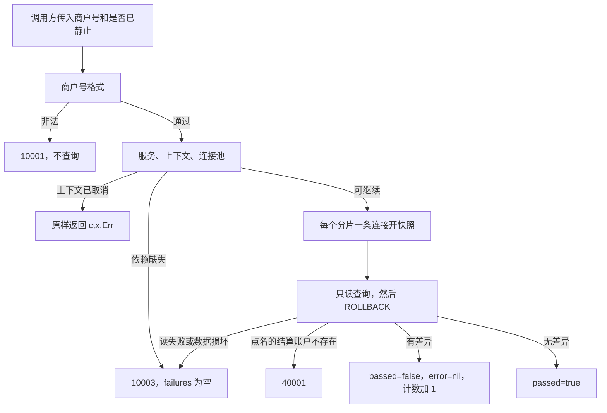

# ACC-10 余额核对

| 项 | 内容 |
|---|---|
| 功能点 | ACC-10（P0，第 2 周） |
| 所属链路 | 基础设施 |
| 代码提交 | `db8c0db` `[ACC-10] add balance check` |
| 分支 | `feat/ACC-10-check-balance` |
| 日期 | 2026-10-21 |
| 状态 | DONE |

完整 hash：`db8c0db1d0ecdbd88760378c465529ec513c7280`。这次代码提交 10 个文件，2177 行新增，46 行删除。本报告在该提交之后写，不包含在这 10 个文件里。

## 一句话结论

余额核对是 account 进程里的只读方法 `CheckBalance`。商户号为空时，它在两个数据库分片上各开一次可重复读的一致性快照，核对账面、分录、冻结和在途是否对得上；商户号合法时只核对该商户的结算账户。差异不是错误码：`passed = false` 且 `error` 为 nil，进程内计数加 1。验收里把某一账户余额用 SQL 加上 1 分（0.01 元）之后，结果里有 `BALANCE_SUM`，期望和实际相差 1 分，计数只加一次。付款方已经确认、收款方分支还停在 `TRIED`（只插入一行、还没记账）的 80 分（0.80 元）跨分片转账，在调用方没有声明“已经静止”时通过；声明静止时期望在途合计为 0，实际是 +80 分。

## 1. 背景

### 1.1 系统简介

pay-system 是一个用 Go 编写的小型支付后端，模拟商户收款、退款、商户间转账三条资金链路，重点在数据一致性和性能。系统由 5 个部分组成：gateway（对外 HTTP 入口，负责签名校验和限流）、payment（支付单、退款单、转账单的状态管理和流程推进）、account（账户余额与记账，数据按商户分到 2 个数据库分片）、channel-mock（模拟微信、支付宝这类外部支付渠道）、recon（对账，核对系统内外数据是否一致）。服务之间用 Kitex RPC 同步调用，或通过 Kafka 消息异步通知；数据存在 MySQL 8.4，Redis 用于防重放。所有金额用整数“分”表示，所有记账只追加不修改。当前已完成：开户、查询、记账、冻结、解冻、确认扣款、同分片转账、收款方转账分支，以及这次的余额核对。RPC、冲正、管理接口还没做。

Kitex 是本项目的 Go RPC 框架。RPC 是进程之间的同步调用。这次的方法不监听端口。ACC-11 是以后才做的账户 RPC 服务和管理 HTTP，网络层留给它。Kafka 是消息队列。Redis 防重放是以后 gateway 用来挡住重复的对外 HTTP。这个方法不访问 Redis，也不发消息。分片是账户数据所在的那一个库，这里只有 0 和 1。100 分等于 1.00 元。「记账只追加不修改」指分录只插入、不改旧行。分录是凭证下面的一条明细，记某个账户这笔是借还是贷。账户行上的 `balance` 是当前账面，单位是分。这次核对只读这些行，不插入、也不更新。

文首表格里的「所属链路：基础设施」指账户、分片、记账这些被三条业务共用的底层能力，不是第四条资金业务。P0 是必须先做的优先级。第 2 周是开发计划里的 M2。

### 1.2 本功能点在系统中的位置

今天会调用 `CheckBalance` 的只有测试和以后想手工核对的进程内代码。它不对外提供 HTTP，也不注册 RPC。



商户号为空走全量，两个分片都查。商户号合法时只查那一个结算账户，并且不管调用方有没有说“已经静止”。全量并且调用方声明已经静止时，最后再比一次两个分片的在途合计是不是 0。图里的三个码都是这次调用可以返回的已有错误，不是 HTTP 状态码。它们和「核对完成」不是一回事：`10001` 是参数不合法，`10003` 是内部错误，`40001` 才是接口契约里列出的业务错误（点名的商户结算账户不存在）。核对做完且发现差异时，`Passed` 也是 false，但 `error` 为 nil，不占用这三个码。

### 1.3 为什么需要它

记账、冻结、转账各自在自己的事务里改一行账户和若干分录。单笔事务能保证自己这一笔借贷相等，挡不住事后有人用 SQL 改了余额，也挡不住跨分片转账只做完一边。

商户 `M100002` 在分片 0。商户号必须是 `M` 加恰好 6 位数字，分片号是数字对 2 取模。`100002 % 2 = 0`，`100001 % 2 = 1`。验收 2 先按正常记账给这个商户记入 100 分（1.00 元），账面和分录一致。然后测试用 SQL 执行 `balance = balance + 1`，不写分录。账面变成 101 分（1.01 元），分录仍只解释得了 100 分。若不核对，这个 1 分会一直留在账上。`CheckBalance` 把这种差异列出来：期望 100 分，实际 101 分。

另一笔是 80 分（0.80 元）的跨分片转账。付款方 `M100001` 在分片 1 已经确认，分片 1 的在途增加 80 分。收款方 `M100002` 的分支还是 `TRIED`：表 `transfer_branch` 里只有一行，角色是 `PAYEE`，还没记账，所以不计入已确认收款，分片 0 的在途仍是 0。付款方分片的在途期望是 80 分、实际是 80 分；收款方分片的期望是 0、实际是 0。两个分片各自相等，所以调用方没有声明已经静止（参数 `expect_quiescent` 为 false）时，全量核对通过。加在一起在途多了 80 分。两次快照不是同一时刻，只解释为什么不把两个分片的在途加总去和 0 比，除非调用方声明已经静止。声明静止时，这一笔被报出来：期望 0，实际 80 分。

## 2. 术语

下面按正文第一次出现的顺序列出。后面再用到这些词，不再重复定义。

| 术语 | 含义 |
|---|---|
| 分 | 金额最小单位。100 分 = 1.00 元。类型是 `int64`，不用小数。本报告里的 1 分是 0.01 元，80 分是 0.80 元，100 分是 1.00 元。 |
| 分片 | 账户数据所在的库，只有 0 和 1。全量核对两个库都读。商户模式只读该商户所在的那一个库。 |
| 结算账户 | 表 `account` 里户主类型 `MERCHANT`、户主是该商户号、账户类型 `MERCHANT_SETTLE`、币种 `CNY`（人民币）、子账户序号 `sub_no = 0` 的那一行。商户模式只核这一行。 |
| 分录 | 表 `ledger_entry` 的一行。记某个账户这笔是借还是贷、金额多少、记下之后的账面 `balance_after`。只插入，不改旧行。 |
| 凭证 | 表 `ledger_txn` 的一行，一笔业务一张。`entry_count` 是它声称的分录条数。 |
| 借 / 贷 | 分录方向 `DEBIT` / `CREDIT`。余额方向是 `CREDIT` 的账户，贷方让账面增加、借方让账面减少。余额方向是 `DEBIT` 的账户相反。 |
| 余额方向 | 列 `balance_direction`，只允许 `DEBIT` 或 `CREDIT`。渠道应收是 `DEBIT`，商户结算账户和在途是 `CREDIT`。 |
| 在途账户 | 类型 `TRANSIT`，户主类型和户主都是 `PLATFORM`，币种 `CNY`。每个分片可以有多行，用 `sub_no` 区分。付款方确认时，付款方分片的在途增加 T。收款方确认时，收款方分片的在途减少 T。收款方可以先确认，在途就从 0 变成 −T：钱已经记给收款商户，付款方那一笔在途还没加上。所以账面可以为负。 |
| 冻结单 | 表 `account_freeze` 的一行。冻结单自己的状态是 `FROZEN`（金额还占着）、`RELEASED`（已解开）、`CONFIRMED`（已扣走）。这套状态和下面的收款分支状态不是同一张表。核对冻结合计时只加状态为 `FROZEN` 的行，加的是冻结单列 `amount`，不是把账户列自己加一遍。 |
| `frozen_amount` | 账户表上的一列，表示该账户已经占住、还没扣走的金额。它应当等于该账户所有 `FROZEN` 冻结单的 `amount` 之和。 |
| `biz_type` | 冻结单上的业务类型。跨分片转账的付款冻结写成 `TRANSFER`。退款冻结是另一类业务，不进在途公式。 |
| `transfer_branch` | 转账分支表。一行记录某个转账单号在某个角色上的状态。 |
| `role` | 分支上的角色。`PAYEE` 是跨分片转账的收款方。`LOCAL` 是同分片转账在 `transfer_branch` 上的角色。`TransferLocal` 是同分片转账方法：直接记一张凭证类型为 `TRANSFER` 的凭证，付款商户记借、收款商户记贷。它不插入 `biz_type = TRANSFER` 的冻结单，也不改在途。成功的 `LOCAL` 行不进在途减法。 |
| `TRIED` | 收款分支的状态：只在 `transfer_branch` 插入一行，还没记账，余额不变。 |
| 分支 `CONFIRMED` | 收款分支已经记账。和冻结单的 `CONFIRMED` 同名，但是另一张表：冻结单表示钱已从冻结里扣走，分支表示收款方这支已经入账。 |
| `CANCELLED` | 收款分支的取消状态。在途公式不统计取消的分支。 |
| `TRANSFER_IN` | 凭证类型。只有收款方确认、真正记账时才写入。只把分支状态改成 `CONFIRMED`、不记账时，这种凭证的条数仍是 0。 |
| 可用余额 | `balance - frozen_amount`。`allow_overdraft = 0` 时必须大于等于 0。`allow_overdraft = 1` 允许为负，在途账户就是这种。 |
| 一致性快照 | 事务开始时钉住一份“当时已经提交”的数据视图。这个事务里后面的只读查询都看这一份，看不到开始之后别的事务新提交的修改。 |
| 可重复读 | MySQL 隔离级别 `REPEATABLE READ`。配合 `WITH CONSISTENT SNAPSHOT`，同一事务里的多次查询看到同一份已提交数据。 |
| 读已提交 | 隔离级别 `READ COMMITTED`。每一条查询都能看到查询开始前已经提交的最新行。项目里的写事务助手用这一级。 |
| `dbx.WithTx` | 已有的写事务助手。隔离级别是读已提交，整次调用最长 3 秒。这次核对不用它。 |
| `Connx` | 从连接池取出一条连接并钉住，后面的语句都走这一条，用完归还。快照必须钉住同一条连接，否则下一条语句可能换连接，事务就断了。 |
| `expect_quiescent` | 方法参数，类型 `bool`。调用方声明：现在没有进行中的转账，两个分片的在途余额加起来应该是 0。商户模式忽略它。 |
| `passed` | 结果字段 `Passed`。true 表示这一次列出的检查都通过。`Passed = false` 有两种，不能只理解成有差异。error 为 nil 且 `Failures` 非空：核对做完并发现差异。error 非 nil 且 `Failures` 为 nil：调用失败（`10001`、`10003`、`40001`），不是一份完成的核对结果。结构体零值也是 `Passed = false`、`Failures` 为 nil；这三种错误返回的就是这个零值再加上对应的 error。 |
| `Failures` | 差异列表。每一条有分片、账户号、检查名、期望金额、实际金额。分片指针为 nil、账户号为空，表示这一条不属于某一个账户或不属于某一个分片。 |
| `10001` | 已有业务码。对外英文固定为 `invalid parameter`。非空商户号算不出分片时用它。空商户号不是这个码。 |
| `10003` | 已有业务码。对外英文固定为 `internal error`。`Error()` 不带 SQL、地址或密码。服务或上下文或连接池为空、分片库拿不到、SQL 失败、未知方向、金额相加溢出，都用它。 |
| `40001` | 已有业务码。对外英文固定为 `account not found`。这里只表示点名的那个商户结算账户不存在。 |
| `ctx.Err()` | Go 上下文上的错误。已取消是 `context.Canceled`，已过截止时间是 `context.DeadlineExceeded`。参数合法之后若上下文已经结束，原样返回这个错误，不开事务。 |
| `pay_ledger_check_failures_total` | 进程内计数的名字。没有标签。一次核对发现差异并正常返回时加 1，不是每个差异加 1。进程退出后归零。HTTP 的 `/metrics` 还没做。 |
| `slog.ErrorContext` | Go 标准库带上下文的错误日志。上下文里若有链路标识，日志组件才能把它写进 JSON。 |
| `trace_id` / `span_id` / `request_id` | 一次调用的链路标识。前两个来自 OpenTelemetry 的 span，第三个由 `logx.WithRequestID` 放进上下文。 |
| logx | 项目的 JSON 日志。每条日志都带 service 和上面三个标识。标识从打日志时传入的上下文读取。 |
| gateway | 对外 HTTP 入口。这次不改它。 |
| payment | 支付单、退款单、转账单的状态管理。这次不改它。 |
| account | 账户余额与记账。这个方法在这个进程里。 |
| channel-mock | 模拟外部支付渠道。这次不调用它。 |
| recon | 对账。这次不改它。核对的是账户库内部是否自洽，不是和渠道账单比对。 |
| ACC-11 | 以后的账户 RPC 和管理 HTTP `POST /admin/accounts/check`。这次不实现。 |
| OPS-01 | 以后把进程内计数暴露成 `/metrics` 的功能点。这次不起 HTTP，也不引入 Prometheus 客户端。 |
| OPS-03 | 指标清单里的一节。这次只在那张表旁边写明：这个无标签计数在进程内加 1。HTTP 暴露仍然留给 OPS-01。 |
| 冲正 | 把已经记下的一笔用反向分录抵消。功能点 ACC-08，这次不做。 |
| IDL | RPC 的接口定义文件。改它才会重新生成网络层的请求和响应类型。这次没有改 IDL，所以 RPC 契约里的字段名和原来一样。 |
| TRF-03 | 以后要做的跨分片转账协调。它会把付款方确认和收款方确认配成一对。这次不实现，余额核对也不去推进那笔在途。 |
| `mmdc` | 把 Mermaid 流程图渲染成 SVG 的命令。这次环境里没有它，所以没有生成 SVG。流程图的源文本已经改过。 |

## 3. 技术讲解

### 3.1 要解决的问题

1. 一个账户的账面必须能被它的全部分录解释。贷方账户的期望账面是贷方合计减去借方合计；借方账户相反。没有分录时期望是 0。这是资金不变量里“余额等于分录合计”的落地。
2. 该账户 `ledger_entry.id` 最大的那一条，它的 `balance_after` 必须等于当前账面。`ledger_entry.id` 由数据库按插入分配，后插入的行拿到更大的 id。它又是这张表的主键，在一个分片里唯一，所以 `max(id)` 只会落到一行，不用再在相同 id 里挑。因此最大 id 就是最后写入的那条。不用 `created_at`，因为两行的创建时间可以相同。没有分录且账面为 0 算通过；没有分录但账面不是 0，期望 0、实际是账面。
3. 账户列 `frozen_amount` 必须等于该账户冻结单里 `status = FROZEN` 的 `account_freeze.amount` 合计。`RELEASED` 和冻结单上的 `CONFIRMED` 不计。没有这种冻结单时期望 0。账户上的 `frozen_amount` 为负也会和这个合计比较。
4. `allow_overdraft = 0` 时，可用余额必须大于等于 0。失败时期望是 0，实际是那个负数。`allow_overdraft = 1` 即使可用余额为负也跳过，在途账户靠这条跳过。
5. 全量时，每张凭证的借方合计等于贷方合计，分录行数等于 `entry_count`，并且每条分录的 `account_id` 都在本分片 `account` 表里有对应行。一张凭证可以因为不同原因各有一行差异。`entry_count` 与行数一致即可，不额外要求至少 2 条。`entry_count` 为 0 且一行分录都没有时，借贷都是 0，按这条公式算平衡。这和余额方向损坏不是一种处理：余额方向不是 `CREDIT` 或 `DEBIT` 时，不知道该用贷方公式还是借方公式，整次返回 `10003`，不记成一条差异。`entry_count` 为 0 则公式仍然算得出来。真实表的检查约束 `ck_ledger_txn_entries` 要求 `entry_count >= 2`，集成测试插不进这种凭证。0 条只出现在单元假数据里，用来把公式锁住，不是说生产库允许这样的凭证。
6. 全量时，本分片全部分录的借方总额等于贷方总额。分录的 `account_id` 在本分片 `account` 表里没有对应行时，这行分录仍然算进这个总额。这次核对不删除账户，代码里也没有删除语句。没有对应账户的分录是损坏数据。`ledger_entry` 没有指向 `account` 的外键，数据库不会强制 `account_id` 必须有对应账户行，所以这样的行有可能存在。单元假数据放了一行账户不存在的分录来锁住这条规则：对不上账户也要报出来，全局合计也不把这种行丢掉。正常记账不删除账户。那一行放在凭证列表里（凭证 id 12 的第二行，金额 1 分）。这次假数据的账户分录列表里没有它，所以它没有加进下面的 18 和 15。生产查询读的是全部 `ledger_entry`，同一行会进入全局合计。
7. 全量时，本分片在途账面合计等于：本分片冻结单里 `biz_type = TRANSFER` 且 `status = CONFIRMED` 的 `amount` 合计，减去本分片 `transfer_branch` 里 `role = PAYEE` 且 `status = CONFIRMED` 的 `amount` 合计。在途只记录跨分片转账里已经确认的付款冻结，再减去已经确认的收款分支。`TransferLocal` 直接记一张 `TRANSFER` 凭证，不插入 `biz_type = TRANSFER` 的冻结单，也不改在途，所以验收 1 里那笔 50 分（0.50 元）不会进在途期望。在途公式只减跨分片里已经 `CONFIRMED` 的 `PAYEE` 分支。成功的 `LOCAL` 行不在这个减法里。退款冻结的 `biz_type` 不是 `TRANSFER`，它占的是退款，不是跨分片在途，也不进。这个数可以不是 0，两个分片也不互相比较。
8. 只有全量且 `expect_quiescent` 为 true 时，才把分片 0 的在途合计加上分片 1 的在途合计，期望是 0。两次快照不是同一时刻，所以不声明静止就不做这一条。
9. 核对自己不写 `ledger_*` 和 `account`，不调用外部系统。重复调用不记账、不冻结、不通知。发现差异不是错误码。非法商户号、内部失败、点名账户不存在，才返回已有的三个码。这三种都不是「查询做完、error 为 nil、Failures 非空」的完成调用，计数不加。

### 3.2 方案

方法签名是 `CheckBalance(ctx, merchantID string, expectQuiescent bool) (CheckBalanceResult, error)`。`CheckBalanceResult` 有 `Passed` 和 `Failures`。`BalanceFailure` 有 `Shard`（`*int`，nil 表示省略）、`AccountNo`（空表示省略）、`Check`、`Expected`、`Actual`。金额是 `money.Amount`，也就是 int64 分。检查名只有这八个：`BALANCE_SUM`、`LAST_BALANCE_AFTER`、`FROZEN_SUM`、`AVAILABLE_NON_NEGATIVE`、`TXN_BALANCED`、`GLOBAL_BALANCED`、`TRANSIT_EXPECTED`、`TRANSIT_ZERO`。

参数顺序是固定的。商户号非空时先用 `shard.Of` 算分片，失败就返回 `10001`，此时即使服务对象是 nil、上下文已经取消，也不查询。空商户号是全量，不是参数错误。商户模式忽略 `expectQuiescent`，不会因为它是 true 就返回 `10001`。

这三种调用失败都是 `return CheckBalanceResult{}, err`。`CheckBalanceResult` 的零值里 `Passed` 是 false，`Failures` 是 nil。`Passed` 为 false 在这里只表示结构体还没被填成「通过」，调用本身失败了，不能把它当成「核对完成且发现了差异」。发现差异时 `Passed` 同样是 false，但 `error` 为 nil，并且 `Failures` 里至少有一条。

参数合法之后：服务、上下文或连接池为 nil，返回 `10003`。上下文在进查询之前就已经取消或过期，原样返回 `ctx.Err()`，不开事务。某个分片库拿不到、任何 SQL 失败、余额方向或分录方向不是借/贷、金额用 `money.Add` / `money.Sub` 溢出，整次都是 `10003`，`Failures` 为空，计数不加。全量必须两个分片都成功，任一边失败不返回另一边已经算出来的差异。余额方向不是 `CREDIT` 或 `DEBIT` 时整次 `10003`，不记成差异，因为两条余额公式都没法选。`entry_count` 为 0 且没有分录则按公式算平衡，处理见 §3.1 第 5 点。

商户模式用和记账相同的条件选结算账户。0 行返回 `40001`。非 `CNY` 的行选不中，也算不存在。多于 1 行是 `10003`。全量没有点名商户，不会因为某个商户没开户就返回 `40001`。两个分片都是空库时，全量通过，包括 `expect_quiescent = true`。`40001` 和 `10003` 一样，`Passed` 是零值 false，`Failures` 是 nil，计数不加。

每个分片的做法相同，全量先 0 后 1。从一个池里 `Connx` 钉住一条连接，按顺序执行：

```go
SET TRANSACTION ISOLATION LEVEL REPEATABLE READ
START TRANSACTION READ ONLY, WITH CONSISTENT SNAPSHOT
-- 只读查询，全部带调用方 ctx
ROLLBACK
```

成功也 `ROLLBACK`。没有 `INSERT`、`UPDATE`、`DELETE`。查询能看多久，只由调用方的 `ctx` 决定。下面用来结束快照的回滚另有 3 秒上限。那 3 秒是回滚上限，不是查询预算，不限制这些只读语句。

查询中途 `ctx` 取消或到点时，读取返回原来的 `ctx.Err()`，也就是 `context.Canceled` 或 `context.DeadlineExceeded`。回滚仍然执行，但用 `context.WithoutCancel` 包一层，再加 3 秒，只为了把事务结束掉，避免连接带着未结束的事务回池。读取错误已经非空，所以回滚成功或失败都不改这个错误。`checkFull` / `checkMerchant` 把错误交给 `internalErr`。`internalErr` 遇到 `context.Canceled` 或 `context.DeadlineExceeded` 原样返回，不包成 `10003`。调用方得到的就是原来的 `ctx.Err()`。函数返回的是空的 `CheckBalanceResult{}`，已经扫到的差异不带出去，`Failures` 为 nil，`finishBalance` 不会执行，计数不加。

读取本身成功、只有回滚失败时，返回值才改成回滚错误，并关掉底层连接，不把这个会话放回池。回滚错误若不是取消或截止时间，`internalErr` 把它收成 `10003`。回滚用的那 3 秒自己到点时，错误是 `context.DeadlineExceeded`，`internalErr` 仍原样返回。这种失败同样不返回差异、不加计数。

一个分片的查询都在这一条连接的同一次快照里做完，回滚，再开下一个分片。两个分片是两次独立快照。`TRANSIT_ZERO` 用的两个合计数就来自这两次，仍然可能不是同一时刻。

返回全部差异，不是碰到第一条就停。顺序：分片 0 然后分片 1；分片内账户按 `account.id` 升序；每个账户依次是 `BALANCE_SUM`、`LAST_BALANCE_AFTER`、`FROZEN_SUM`、`AVAILABLE_NON_NEGATIVE`；然后该分片的 `TXN_BALANCED`（凭证按 `ledger_txn.id` 升序；同一张凭证先比借贷，再比 `entry_count` 和行数，再比账户不存在的分录条数）、`GLOBAL_BALANCED`、`TRANSIT_EXPECTED`。`TRANSIT_ZERO` 放在最后，不属于某个分片，`Shard` 为 nil，`AccountNo` 为空。商户模式只做那一个结算账户的前四项，不读平台账户、其他商户、凭证和在途。

分录金额在 Go 里逐笔用 `money.Add` 相加，相减用 `money.Sub`。超出 int64 时这两个函数返回溢出错误，整次核对变成 `10003`，`Failures` 为空。

有差异时 `finishBalance` 把计数加 1，并打一条错误日志：

```go
slog.ErrorContext(ctx, "balance check failed", slog.String("merchant_id", merchantID))
```

全量没有商户号，就只有这一句 msg，不加别的字段。msg 是短英文动宾，不把账户号拼进去，也不打 SQL。上下文传进去之后，logx 从这次调用的 ctx 取出 `trace_id`、`span_id`、`request_id`。不调用 `shard.WithShard`，因为一次失败可以跨两个分片，`TRANSIT_ZERO` 还省略分片。计数是包级 `atomic.Uint64`，测试能读到当前值。生产路径走这个加一。它没有标签，进程重启后从 0 开始。`/metrics` 留给 OPS-01。

「一次失败的完成调用」是：查询做完，`error` 为 nil，并且 `Failures` 非空。只有这种返回才把计数加 1，并打上面那条日志。`10001`、`10003`、`40001` 以及查询中途取消得到的 `ctx.Err()` 都不是这种调用，不加计数，也不打这条日志。成功时 `Passed` 为 true，`Failures` 为空，同样不加。

用验收里的数字把公式走一遍。

贷方账户。验收 2 给 `M100002` 记入 100 分（1.00 元），方向是贷。贷方合计 100，借方合计 0，期望账面 = 100 − 0 = 100 分（1.00 元）。SQL 把账面改成 101 分（1.01 元）之后，`BALANCE_SUM` 的期望是 100、实际是 101。`max(ledger_entry.id)` 那条的 `balance_after` 仍是 100，所以 `LAST_BALANCE_AFTER` 也可以失败。测试只要求至少有一条 `BALANCE_SUM`，并且期望和实际相差 1 分，不要求它是唯一的一行。

借方账户。单元假数据里一个借方账户：借方合计 9 分（0.09 元），贷方合计 5 分（0.05 元），期望账面 = 9 − 5 = 4 分（0.04 元），账面也是 4，这一条通过。同一份数据里再放一个贷方 4 分的账户，整片借方总额 9 等于贷方总额 9，`GLOBAL_BALANCED` 才通过。只改借方公式、不配平整片，会多出一条不该有的全局差异。

冻结和可用余额。单元假账户 `ACCT-A`：账面 1 分（0.01 元），冻结金额 5 分（0.05 元），没有分录，也没有状态为 `FROZEN` 的冻结单，`allow_overdraft = 0`。于是 `BALANCE_SUM` 期望 0、实际 1；`LAST_BALANCE_AFTER` 期望 0、实际 1；`FROZEN_SUM` 期望 0、实际 5；可用余额 = 1 − 5 = −4 分（−0.04 元），`AVAILABLE_NON_NEGATIVE` 期望 0、实际 −4。另一个账户账面 −8 分（−0.08 元）且 `allow_overdraft = 1`，可用余额为负也不产生这一条。

在途。付款方确认一笔 80 分（0.80 元）的 `TRANSFER` 冻结时，付款方分片的在途增加 80。收款方分支还是 `TRIED`，收款方分片没有已确认的 `PAYEE` 行，在途合计是 0。付款方分片：期望 = 80 − 0 = 80，实际 = 80，`TRANSIT_EXPECTED` 通过。收款方分片：期望 = 0 − 0 = 0，实际 = 0，也通过。`expect_quiescent = false` 时不把 80 和 0 加起来跟 0 比，所以全量通过。`expect_quiescent = true` 时，`TRANSIT_ZERO` 期望 0、实际 80 分（0.80 元），`Shard` 为 nil，账户号为空。此时商户模式即使传入 true，也只看那个结算账户，仍然通过。收款方若先于付款方确认，收款方分片的在途会从 0 减到 −80 分（−0.80 元），表示 80 分已经记给收款商户，付款方分片的 +80 还没出现。验收 3 的顺序是付款方先确认，所以看到的是 +80 而不是 −80。

接着只用 SQL 把表 `transfer_branch` 里角色为 `PAYEE` 的那一行从 `TRIED` 改成 `CONFIRMED`，不调用记账。`TRANSFER_IN` 是收款方确认并且真正记账时才会写入的凭证类型。这里没有记账，所以这种凭证的条数仍是 0，用来证明改状态没有补记一笔账。收款方分片的期望变成 0 − 80 = −80 分（−0.80 元），实际在途仍是 0，`TRANSIT_EXPECTED` 失败。

同一次单元调用里的 14 条差异如下。数据是假账本 `manyBooks`，不是上面那笔 80 分。子测试名是 `all failures once`。计数只加 1。假账本把输入分成两份列表。账户分录列表用来算各账户的 `BALANCE_SUM`，也用来算 `GLOBAL_BALANCED`。凭证列表是另一份输入，用来算 `TXN_BALANCED`。

账户分录列表：

- 账户 2（`ACCT-B`，借方）：借 10 分（0.10 元），贷 3 分（0.03 元）。
- 账户 3（`ACCT-C`，贷方，允许透支）：借 8 分（0.08 元）。
- 账户 5（`ACCT-E`，贷方）：贷 12 分（0.12 元）。

借方总额 = 10 + 8 = 18 分（0.18 元）。贷方总额 = 3 + 12 = 15 分（0.15 元）。

凭证列表：

- id 10：借 5 分（0.05 元）、贷 4 分（0.04 元），`entry_count` 是 2，两行账户都在。
- id 11：`entry_count` 是 0，且没有分录，借贷都是 0，不算差异。
- id 12：`entry_count` 是 5，但只有 2 行，其中 1 行账户不存在。

生产 SQL 里，全局合计读的是 `ledger_entry` 全表，凭证分录是 `ledger_txn` 左连接同一张 `ledger_entry`。同一行会同时进入两边。这份单元假数据把两份列表分开，才能在同一次调用里既看到 18 对 15，又看到凭证自己的 5 对 4。不是生产环境的全局合计会排除凭证上的分录。

| # | 分片 | 账户 | 检查 | 期望 | 实际 | 这行怎么来的 |
|---|---|---|---|---|---|---|
| 1 | 0 | `ACCT-A` | `BALANCE_SUM` | 0 | 1 | 贷方账户没有分录，期望 0。账面是 1 分（0.01 元） |
| 2 | 0 | `ACCT-A` | `LAST_BALANCE_AFTER` | 0 | 1 | 没有分录，账面不是 0 |
| 3 | 0 | `ACCT-A` | `FROZEN_SUM` | 0 | 5 | 没有 `FROZEN` 冻结单。账户列 `frozen_amount` 是 5 分（0.05 元） |
| 4 | 0 | `ACCT-A` | `AVAILABLE_NON_NEGATIVE` | 0 | −4 | `allow_overdraft = 0`。可用余额 1 − 5 = −4 分（−0.04 元） |
| 5 | 0 | `ACCT-B` | `BALANCE_SUM` | 7 | 5 | 借方账户。期望 10 − 3 = 7 分（0.07 元）。账面是 5 分（0.05 元） |
| 6 | 0 | `ACCT-B` | `LAST_BALANCE_AFTER` | 7 | 5 | `max(id)` 的 `balance_after` 是 7，账面是 5 |
| 7 | 0 | `ACCT-D` | `FROZEN_SUM` | 0 | −3 | 没有 `FROZEN` 冻结单。账户列是 −3 分（−0.03 元）。真实表的检查约束不允许这个负数，所以只在假数据里 |
| 8 | 0 | （空） | `TXN_BALANCED` | 5 | 4 | 凭证 id 10：借 5 分、贷 4 分。`entry_count` 是 2，行数也是 2，这一条只比借贷 |
| 9 | 0 | （空） | `TXN_BALANCED` | 5 | 2 | 凭证 id 12：`entry_count` 是 5，实际 2 行。两行金额都是 1 分，借贷相等，所以没有「借对贷」那一行 |
| 10 | 0 | （空） | `TXN_BALANCED` | 0 | 1 | 仍是凭证 id 12：2 行里有 1 行的 `account_id` 在本分片 `account` 表没有对应行 |
| 11 | 0 | （空） | `GLOBAL_BALANCED` | 18 | 15 | 账户分录列表的借方总额 18 分、贷方总额 15 分。凭证 id 10 的 5 和 4 在另一份列表里，这次没有加进 18 和 15。生产查询不会把凭证分录排除在全局合计之外 |
| 12 | 0 | （空） | `TRANSIT_EXPECTED` | 6 | 1 | 已确认的 `TRANSFER` 冻结 10 分，减去已确认的 `PAYEE` 分支 4 分，等于 6 分（0.06 元）。在途账面合计是 1 分（0.01 元） |
| 13 | 1 | （空） | `TRANSIT_EXPECTED` | 0 | 2 | 分片 1 没有这两类行。在途账面合计是 2 分（0.02 元） |
| 14 | （省略） | （空） | `TRANSIT_ZERO` | 0 | 3 | 分片 0 的在途 1 分加上分片 1 的在途 2 分 |

同一次调用里这些账户或凭证没有差异，所以不在表里：`ACCT-C` 的期望账面是 0 − 8 = −8，和账面相同，又允许透支，负的可用余额不查；`ACCT-E` 贷方分录 12 分，冻结单 5 分加 7 分等于账户列 12 分，可用余额是 0；分片 1 的 `ACCT-F` 账面、分录、冻结都是 0；凭证 id 11 的 `entry_count` 是 0 且没有分录行，借贷都是 0，算平衡。这张 0 条凭证只在假数据里，真实表插不进去。

### 3.3 为什么这样做

| 方案 | 做法 | 优点 | 缺点 | 结论 |
|---|---|---|---|---|
| 采用：每个分片钉住一条连接，先 `SET TRANSACTION ISOLATION LEVEL REPEATABLE READ`，再 `START TRANSACTION READ ONLY, WITH CONSISTENT SNAPSHOT`，查完回滚 | 同一分片里的账户、分录、冻结、在途来自同一次已提交视图 | 并发的合法记账不会让“先读到新余额、后读到旧分录”这种错位变成差异。这条 `SET TRANSACTION` 不带 `SESSION`，只作用于紧跟着的那一次事务，不会把连接的默认隔离级别改成可重复读 | 两个分片不是同一时刻，所以在途合计为 0 只能在调用方声明静止时做 | 采用 |
| 备选：用 `dbx.WithTx` | 写事务那条路径，读已提交，最长 3 秒 | 和记账共用一个助手 | 读已提交时，两次查询之间别人提交的记账会让核对误报。助手内部的 `BeginTx` 只发 `START TRANSACTION READ ONLY`，带不上 `WITH CONSISTENT SNAPSHOT`。3 秒也会掐断一次较大的扫描 | 不采用 |
| 备选：`SET SESSION TRANSACTION ISOLATION LEVEL REPEATABLE READ` | 把这条连接上之后每个事务的默认隔离级别都改成可重复读 | 写在会话上，作用范围一眼能看懂 | 连接回到池里之后，后面的写事务也会变成可重复读，和写路径的读已提交不一致。这次的代码没有发 `SET SESSION`。代码和测试也没有查询 `@@transaction_isolation` | 不采用 |
| 备选：发现第一条差异就返回错误码 | 调用方只处理一个 error | 接口简单 | 一次篡改往往同时打坏余额和最后一条 `balance_after`。停在第一条，修好之后才看见下一条。差异本身不是失败的调用 | 不采用 |

`WITH CONSISTENT SNAPSHOT` 在可重复读下，于事务开始时建立一致性读。在别的隔离级别下，MySQL 会忽略这个子句。所以隔离级别和这条 `START` 要一起发。验收 4 在合法的并发记账、同分片转账和跨分片确认进行时反复全量核对，这些核对的 `expect_quiescent` 为 false，`passed` 保持 true。静止核对是全部 goroutine 结束之后才做的。进行中如果做静止核对，在途合计可以不是 0，因为付款确认和收款确认不会在同一时刻完成。这条测试证明的是：这些正在提交的合法账没有被报成差异。它没有读取会话隔离级别。

### 3.4 正确性

| 场景 | 系统行为 | 最终状态 | 证明 |
|---|---|---|---|
| 同一请求重复到达 | 每次都重新开只读快照。不写账户、不写分录、不写冻结、不发通知。通过时计数不变 | 核对前后，两个分片的行快照相同 | `TestCheckBalanceClean` 在通过之后再调一次，并比较核对前后的行快照 |
| 核对自己没有并发写入 | 这个方法没有 `INSERT` / `UPDATE` / `DELETE`。和它同时跑的是别的方法的合法转账和记账 | 核对不留下自己的行。那些转账走到终态后，静止核对通过，计数相对开始时不变 | `TestCheckBalanceDuringConcurrentPostAndTransfer` |
| 查询过程中进程崩溃 | 已经发出的语句只是只读事务。进程消失后连接断开，数据库丢掉这个未结束的只读事务。没有“核对记录”这张表 | 账务行保持崩溃前由别的事务提交下来的样子。不存在写了一半的核对结果 | 代码路径上没有写语句。集成测试没有在快照中途杀进程，这一格的证据是“不写行”，不是一次故障注入 |
| 下游调用超时 | 不涉及。不调用渠道、不访问别的服务、不发消息，所以没有“超时了不知道对方是否成功”这一条 | 无外部副作用 | `CheckBalance` 的实现里没有这些调用 |

两个相同的核对调用可以同时读。它们都不写，不需要抢一个幂等键。幂等键是写操作用来认出“这是同一笔业务”的唯一号；这里没有新的业务写入。

上下文在进入方法时已经取消：参数合法则返回 `context.Canceled` 或 `context.DeadlineExceeded`，不执行 `START TRANSACTION`。参数不合法仍先返回 `10001`。查询已经开始之后才取消的路径见 §3.2：回滚用不受取消影响的 3 秒上下文结束事务，返回给调用方的仍是原来的 `ctx.Err()`。

### 3.5 性能

不涉及。这次没有性能开关，也没有吞吐或延迟的对比数据。验证记录里的秒数是测试进程的耗时，不是这个方法的性能指标。

## 4. 已完成内容

### 4.1 改动清单

| 文件 | 新增 / 修改 | 作用 |
|---|---|---|
| `service/account/biz/check.go` | 新增 | `CheckBalance`、八项核对、快照事务、失败计数和一条错误日志 |
| `service/account/biz/check_test.go` | 新增 | 参数、空服务、公式、溢出、日志和链路标识的单元测试 |
| `service/account/biz/check_sql_test.go` | 新增 | 用标准库假驱动走生产代码的 SQL 扫描，不连接 MySQL |
| `service/account/biz/check_integration_test.go` | 新增 | 四条验收，连接 MySQL 8.4 |
| `service/account/biz/open.go` | 修改 | 包注释和 `Service` 注释写明只读快照、不监听 RPC。`Service` 上有一个测试用的替换口：生产构造出来它是 nil，于是走真 SQL；测试塞进内存账本，不连数据库 |
| `docs/02-requirements.md` | 修改 | ACC-10 状态改为 DONE，规则和四条验收按上述口径写上。需求版本仍是 v3.0 |
| `docs/04-dev-plan.md` | 修改 | 只勾选 ACC-10 |
| `docs/05-api.md` | 修改 | 文档版本 2.0.6 改为 2.0.7 |
| `docs/06-flows.md` | 修改 | 版本 v2.7 改为 v2.8，重画 CF-17 的正文图 |
| `docs/interview-notes.md` | 修改 | 增加 ACC-10 三条讲解 |

`docs/database.md` 没有改。没有新的迁移文件。

### 4.2 对外变化

| 类别 | 变化 |
|---|---|
| 接口 | 进程内增加 `CheckBalance`。RPC 和管理 HTTP 仍未实现，契约留在 ACC-11。IDL 是 RPC 的接口定义文件，这次没有改，所以 RPC 请求和响应的字段与原来的契约相同。进程内的 Go 结构体本来就按这个契约返回 `Passed` 和 `Failures`。接口文档正文的版本是 2.0.7，最后修改 2026-10-21。总览表里 `POST /admin/accounts/check` 那一行的「最后修改」故意仍是 2026-10-12：这次只是把已有契约写成进程内行为，没有新增或改名 JSON 字段 |
| 表结构 | 无。不新增表，不改列，不改检查约束 |
| 配置项 | 无 |
| 错误码 | 无新的数字。调用可以返回 `10001`（参数不合法）、`10003`（内部错误）、`40001`（商户结算账户不存在）。接口表的业务错误列仍然只列 `40001`。`passed = false` 且 `error` 为 nil 不占用任何一个错误码 |
| 指标 / 故障点 | 进程内无标签计数 `pay_ledger_check_failures_total`。一次失败的完成调用是：查询做完、`error` 为 nil、`Failures` 非空，这时加 1。`10001`、`10003`、`40001` 不加。不起 HTTP，不引入 Prometheus 客户端。`/metrics` 仍是 OPS-01。没有新的故障注入点 |

### 4.3 验收对照

| 验收条目 | 测试函数 | 类型 | 结果 |
|---|---|---|---|
| 开户、记账、冻结、解冻、一笔 50 分（0.50 元）的同分片转账，以及一笔付款方确认金额和收款方确认金额都是 80 分（0.80 元）的完整跨分片转账之后，全量 `expect_quiescent` 为 false 和 true 都通过；已开商户的商户模式通过；商户模式传入 true 仍只核对该结算账户；合法但未开户的 `M100003` 返回 `40001`，差异为空，计数不变。50 分和 80 分是两笔不同的转账 | `TestCheckBalanceClean` | 集成 | 通过。包含在 `make test-integration` 里，没有单独耗时 |
| SQL 把某一账户 `balance = balance + 1` 之后，`passed = false`，`error` 为 nil，至少一条 `BALANCE_SUM` 带该分片和账户号，期望与实际相差 1 分（0.01 元）。计数加 1 一次 | `TestCheckBalanceTamperBalance` | 集成 | 通过。包含在 `make test-integration` 里，没有单独耗时 |
| 付款方确认 80 分（0.80 元）、收款方分支仍是 `TRIED`：全量 false 通过；全量 true 失败，且是 `TRANSIT_ZERO`，期望 0、实际 80，分片省略。再把 `transfer_branch` 里角色 `PAYEE` 从 `TRIED` 改成 `CONFIRMED` 且不记账：全量 false 失败，收款方分片有 `TRANSIT_EXPECTED`，期望 −80、实际 0。`TRANSFER_IN` 凭证条数仍是 0 | `TestCheckBalancePartialTransferAndTamperedPayee` | 集成 | 通过。包含在 `make test-integration` 里，没有单独耗时 |
| 并发的合法同分片转账，以及并发的跨分片付款确认和收款确认都走到终态时，重叠的全量 false 核对 `passed = true` 且 `error` 为 nil。全部结束后全量 true 通过。不篡改 SQL | `TestCheckBalanceDuringConcurrentPostAndTransfer` | 集成 | 通过。包含在 `make test-integration` 里，没有单独耗时 |
| 非法商户号返回 `10001`，即使服务为 nil、上下文已取消也不查询。空商户号不是 `10001` | `TestCheckBalanceRejectsParams` | 单元 | 通过 |
| 参数合法后，nil 服务、nil 上下文、nil 连接池为 `10003`；已取消或已过期的上下文原样返回 | `TestCheckBalanceNilAndCanceled` | 单元 | 通过 |
| 无分录且账面非 0；透支账户的负可用余额跳过；借方公式；未知方向是 `10003` 且不加计数；商户模式不跑凭证和在途；读取错误整次 `10003`、差异为空、不加计数；多条差异只加一次计数；溢出是 `10003`；不声明静止时不把两个在途合计相加 | `TestCheckBalanceFormulas` | 单元 | 通过 |
| 失败打一条 `balance check failed`。有商户号才有 `merchant_id`。不泄漏账户号和 SQL。`40001` 不打这条。带 span 和 request id 的上下文能写入 `trace_id`、`span_id`、`request_id` | `TestCheckBalanceLogsOnce` | 单元 | 通过 |
| 快照语句就是上面那两句加 `ROLLBACK`；最后一条分录的 SQL 使用 `MAX(id)`，不含 `created_at` | `TestCheckBalanceSnapshotSQL` | 单元 | 通过 |
| 假驱动上的语句顺序、扫描失败和计数 | `TestCheckBalanceSQL` | 单元 | 通过 |

验收 1 的数据是测试自己写入的：`M100001` 记入 1000 分（10.00 元），`M100005` 记入 400 分（4.00 元），`M100002` 记入 200 分（2.00 元）；退款冻结 30 分（0.30 元）再解冻；同分片转 50 分（0.50 元）；跨分片完整确认 80 分（0.80 元）。`M100001` 和 `M100005` 都在分片 1，`M100002` 在分片 0。`M100003` 也在分片 1，但这次不开户，用来要 `40001`。

验收 4 的并发度是测试设置，不是产品上限：两个池的最大连接数都设为 32；父上下文 120 秒；事先记入付款方 20000 分（200.00 元）、对手方 5000 分（50.00 元）；3 笔跨分片各 20 分（0.20 元）先冻结并把收款分支放到 `TRIED`，再并发确认两边；`M100001` 转给 `M100005` 共 4 笔，`M100005` 转回 `M100001` 共 4 笔，每笔 1 分（0.01 元）；另有 3 笔记账各 1 分；4 个 goroutine 各做 3 次重叠核对，这些核对的 `expect_quiescent` 为 false。静止核对在全部结束后才做。120 秒和 32 都是这次测试为了让等待留在调用方预算里而设的，不是 `CheckBalance` 的常数。

表上的检查约束让集成测试插不进三类行，它们只在单元假数据里：`ck_account_frozen` 要求 `frozen_amount >= 0`，所以账面冻结为 −3 分（−0.03 元）只在假数据；`ck_account_direction` 只允许 `DEBIT` 和 `CREDIT`，未知方向只在假数据；`ck_ledger_txn_entries` 要求 `entry_count >= 2`，所以 `entry_count = 0` 且没有分录、从而算平衡的那张凭证只在假数据。`ck_account_available` 还要求不许透支时可用余额大于等于 0，因此验收不靠往真实表里插一条负的可用余额。

ACC-04 到 ACC-14 已有的测试没有改成调用 `CheckBalance`，它们仍用 SQL 断言。开发计划里「之后所有资金类测试结束时调用」指这次之后新写的资金测试。

### 4.4 验证记录

环境：2026-10-21，`go version go1.27.2 darwin/arm64`，golangci-lint 2.14.0（built with go1.27.1），`uname -sm` 为 Darwin arm64。

| 命令 | 结果 |
|---|---|
| `gofmt -l .` | 无输出 |
| `make lint`（`golangci-lint run ./...`） | `0 issues.` |
| `go test -race -count=1 -cover ./service/account/biz/` | `ok github.com/yym108/pay-system/service/account/biz 1.524s coverage: 76.1% of statements`。这是账户 biz 包的覆盖率门禁，不是 `make cover` |
| `make test`（`go test -race ./...`） | 通过。根包 `ok github.com/yym108/pay-system 2.598s`，`service/account/biz` `1.295s` |
| `make test-integration`（`go test -race -tags integration ./...`） | 通过。根包 `37.267s`，`service/account/biz` `37.788s`。四条验收集成测试在这一次里面，没有单独耗时 |
| `make cover` | 未运行。没有全仓库覆盖率 |

`make test` 和 `make test-integration` 都带了 `-race`。`1.295s` 那一行没有覆盖率；覆盖率只来自单独的 `-cover` 那一条，是 76.1%。

### 4.5 同步的文档

- `docs/02-requirements.md`：§3 ACC-10 为 DONE；§4 写上进程内方法、快照 SQL、三个错误码、`passed = false`、商户模式忽略 `expect_quiescent`、最后一条分录是 `max(id)`、计数一次。需求版本仍是 v3.0，因为这次只澄清已有规则，没有改版本号所代表的需求基线。§8.2 增加 2026-10-21 一行。OPS-03 是指标清单里的一节，旁边写明进程内无标签计数加 1，`/metrics` 仍是 OPS-01，这次不做 HTTP。更早功能点自己的验收里留着「用 SQL 代替」这几句。那些测试写的时候还没有 `CheckBalance`，所以当时用 SQL 看余额。它们描述的是那些旧测试，不是说现在还可以不调用这个函数。本报告不改那些旧句子。
- `docs/04-dev-plan.md`：勾选 ACC-10。
- `docs/05-api.md`：版本 2.0.7，最后修改 2026-10-21。§8.4 和 §10.1 与上述行为对齐。§1 该行的最后修改列仍是 2026-10-12。
- `docs/06-flows.md`：版本 v2.8。CF-17 的源文本重画，补上 `10001` 在 nil 之前、`10003`、`40001`、商户模式与全量、快照 SQL、`TRANSIT_ZERO` 的条件、计数加 1 一次。`mmdc` 是把 Mermaid 画成 SVG 的命令，环境里没有它，所以没有生成 SVG。
- `docs/interview-notes.md`：三条。两次快照不是同一时刻；这次是可重复读一致性快照，不是 `WithTx` 的读已提交；最后一条分录是 `max(id)`，不是 `created_at`。

## 5. 未完成与风险

- ACC-11 仍要做 RPC handler，以及管理 HTTP `POST /admin/accounts/check`。现在进程外调用不到这个方法。
- OPS-01 仍要把 `pay_ledger_check_failures_total` 暴露到 `/metrics`。现在只是进程内的 `atomic.Uint64`，没有标签，进程退出后归零，多个账户进程也不会加总。
- 两个分片的快照不是同一时刻。不声明静止时，在途合计不为 0 是允许的。声明静止时，若刚好有一笔跨分片转账卡在两边之间，`TRANSIT_ZERO` 会失败。这是规则：静止意味着调用方保证没有这种在途。
- 崩溃中途的只读事务没有做故障注入。证据是代码不写账务行，见 §3.4。
- 负的冻结金额、非法余额方向、`entry_count = 0` 的凭证受检查约束限制，只在单元假数据里出现过。
- 冲正 ACC-08、跨分片转账协调 TRF-03、消息队列都还没做。TRF-03 是以后把付款方确认和收款方确认配成一对的协调者。这次核对不会主动去修账，也不会去推进卡在中间的转账。

## 6. 如何复现

前置：本机是 Darwin arm64，Go 1.27.2，golangci-lint 2.14.0。`make test-integration` 在没设置 `TEST_MYSQL_DSN` 时，由测试自己用 Docker 拉起 MySQL 8.4 容器。每个测试包用独立库，结束时删掉。不需要先手工建库。不要把 DSN 或密码写进命令输出再扩散。

```bash
gofmt -l .
make lint
go test -race -count=1 -cover ./service/account/biz/
make test
make test-integration
```

那一次：`go version` 打印 `go version go1.27.2 darwin/arm64`。`uname -sm` 打印 `Darwin arm64`。`gofmt -l .` 无输出。`make lint` 打印 `0 issues.`。覆盖率命令打印 `ok github.com/yym108/pay-system/service/account/biz 1.524s coverage: 76.1% of statements`。`make test` 里根包 `ok github.com/yym108/pay-system 2.598s`，`service/account/biz` 是 `1.295s`。`make test-integration` 里根包 `37.267s`，`service/account/biz` 是 `37.788s`。

`make cover` 这次没有跑。复现时不要补写一份把仓库里各包合在一起的覆盖率百分比。

## 7. 讲解要点

1. 问：两个分片的在途加起来是 80 分（0.80 元），为什么有时通过、有时失败？答：付款方分片期望在途 80 分、实际 80 分。收款方还是 `TRIED`，不计入已确认收款，期望 0、实际 0。两个分片各自相等，所以 `expect_quiescent` 为 false 时通过。声明已经静止时才把两个合计数相加并期望 0，这时失败，实际是 80 分。两次快照不是同一时刻，只解释为什么不声明静止就不做这个加总。依据是 `TestCheckBalancePartialTransferAndTamperedPayee`。
2. 问：为什么不用 `dbx.WithTx`？并发测试证明了什么？答：`WithTx` 是读已提交，而且驱动的 `BeginTx(ReadOnly)` 发不出 `WITH CONSISTENT SNAPSHOT`。核对在钉住的连接上先 `SET TRANSACTION ISOLATION LEVEL REPEATABLE READ`，再 `START TRANSACTION READ ONLY, WITH CONSISTENT SNAPSHOT`。前一句不带 `SESSION`，只作用于紧跟着的那一次事务，代码没有把它改成会话级。代码和测试都没有查询 `@@transaction_isolation`。`TestCheckBalanceDuringConcurrentPostAndTransfer` 在并发期间做的全量核对，`expect_quiescent` 为 false。它证明这些正在提交的合法账没有被报成差异。静止核对是全部 goroutine 结束之后才做的。它不是「已经读过会话隔离级别」的证据。
3. 问：最后一条分录为什么不用 `created_at`？答：同一账户可能有相同的创建时间。代码取 `max(ledger_entry.id)` 的 `balance_after`，和当前账面比较。没有分录且账面不是 0 时，期望是 0。依据是 `TestCheckBalanceSnapshotSQL` 和公式单元测试里 `ACCT-A` 的那一行。

## 延伸阅读

想核对原文时再看这些路径。读懂上文不依赖它们。

- `docs/02-requirements.md` 里 ACC-10 的规则和四条验收。需求版本仍是 v3.0
- `docs/04-dev-plan.md` 第 2 周，ACC-10 已勾
- `docs/05-api.md` §8.4 与 §10.1，文档版本 2.0.7
- `docs/06-flows.md` 的 CF-17，版本 v2.8。正文是 Mermaid，没有 SVG
- `docs/database.md` 里 `account`、`ledger_entry`、`ledger_txn`、`account_freeze`、`transfer_branch` 的列和检查约束
- `docs/interview-notes.md` 的 ACC-10 一节
- `service/account/biz/check.go`
- `docs/reports/ACC-03-ledger-post.md`：分录如何写成借贷
- `docs/reports/ACC-06-confirm.md`：确认转账冻结时在途如何增加
- `docs/reports/ACC-14-transfer-in.md`：收款方确认时在途如何减少

## 修订记录

| 日期 | 提交 | 修订内容 |
|---|---|---|
| 2026-10-21 | `db8c0db` | 初稿。对应代码提交 `[ACC-10] add balance check`。报告本身不在该提交内 |
| 2026-10-21 | 本报告文件 | 按可读性反馈补上分支状态、在途公式、14 条差异、取消时的返回值，以及业务错误列只有 `40001`。没有新的验证数字。业务代码未改 |
| 2026-10-21 | 本报告文件 | 改正半套转账通过的原因、`Passed` 的两种 false、假数据里两份列表，以及静止核对的时机。没有新的验证数字。业务代码未改 |
