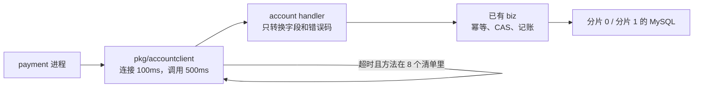

# ACC-11 account RPC 服务

| 项 | 内容 |
|---|---|
| 功能点 | ACC-11（P0，第 2 周） |
| 所属链路 | 基础设施 |
| 代码提交 | `5c7e33a` `[ACC-11] add account rpc service` |
| 分支 | `feat/ACC-11-account-rpc` |
| 日期 | 2026-10-22 |
| 状态 | DONE |

完整 hash：`5c7e33a4a25988dfaa3cd4f4b70cd9ab80d39b4e`。这次代码提交 18 个文件，2148 行新增，17 行删除。本报告在该提交之后写，不包含在这 18 个文件里。

## 一句话结论

account 进程现在用 Kitex 监听 `:8882`，把已有的开户、查询、冻结、转账和余额核对暴露成 RPC。handler 只做字段和错误码转换，不改原来的幂等和 CAS。payment 使用 `pkg/accountclient`：连接 100 毫秒、调用 500 毫秒，只对 8 个幂等方法在超时时再调 1 次。`TestKitexErrorPassthrough` 用假的 biz 注入错误，再经真实 Kitex 客户端打完全部方法，业务码原样回来。handler 里故意 panic 后调用方收到 `10003`，下一次调用仍然成功。

## 1. 背景

### 1.1 系统简介

pay-system 是一个用 Go 编写的小型支付后端，模拟商户收款、退款、商户间转账三条资金链路，重点在数据一致性和性能。系统由 5 个部分组成：gateway（对外 HTTP 入口，负责签名校验和限流）、payment（支付单、退款单、转账单的状态管理和流程推进）、account（账户余额与记账，数据按商户分到 2 个数据库分片）、channel-mock（模拟微信、支付宝这类外部支付渠道）、recon（对账，核对系统内外数据是否一致）。服务之间用 Kitex RPC 同步调用，或通过 Kafka 消息异步通知；数据存在 MySQL 8.4。所有金额用整数“分”表示。分录只追加不修改：追加的是 `ledger_entry` 里的明细行。账户上的 `balance` 和 `frozen_amount` 是汇总列，用带条件的 `UPDATE` 改当前值，不是再插一行余额。两件事不矛盾。

上面是目标形态。今天已经存在的是：开户、查询、记账、冻结、解冻、确认扣款、同分片转账、收款方转账分支、余额核对，以及这次的 account RPC 进程。还没做的是：冲正、网关进程、支付单、Redis 防重放。Redis 防重放是以后 gateway 用来挡住重复的对外 HTTP，不参与这次 RPC 的幂等。RPC 重复请求靠数据库唯一索引，不靠 Redis。

Kitex 是本项目的 Go RPC 框架。RPC 是一个进程同步调用另一个进程的函数，调用方等着结果回来。Thrift 是接口描述语言，字段编号和类型写在 `idl/` 里，生成代码在 `kitex_gen/`，这次没有改 IDL。分片是账户数据所在的库，只有 0 和 1。商户号必须是 `M` 加恰好 6 位数字，分片号是数字对 2 取模。`M100002` 的数字是 100002，`100002 % 2 = 0`，在分片 0。`M100004` 也在分片 0。100 分等于 1.00 元。

文首表格里的「所属链路：基础设施」指账户、分片、记账这些被三条业务共用的底层能力，不是第四条资金业务。P0 是必须先做的优先级。第 2 周是开发计划里的 M2。

### 1.2 本功能点在系统中的位置

以前那些账户方法只活在 account 进程内部，别的进程调用不到。这次加上网络层。payment 以后退款、转账时，通过 `pkg/accountclient` 调用 account。gateway 以后查余额、做管理核对时，要自己建客户端，不用这个包。



图里的回边是「再调 1 次」，不是无限重试。handler 不打开新的事务，也不在事务里发 RPC。记账 `Post` 仍然不是 RPC，别的进程调不到它。

### 1.3 为什么需要它

退款要先冻结商户的钱，再去渠道退。冻结写在 account 的库里，退款单写在 payment 的库里。两个服务各用各的 schema，账号也不能跨库写：recon 对交易库只读，payment 没有账户库的写账号。静态检查 `depguard` 还禁止 payment 的代码 import `service/account`。所以 payment 不能自己改账户行，必须通过 RPC。

有了 RPC 之后，调用会超时。这不是「没有 RPC 时已经存在的 bug」，而是网络调用必须处理的未知结果。具体数字：商户 `M100002` 可用余额 10000 分（100.00 元）。payment 要冻 3000 分（30.00 元），业务单号 `RF1`。调用发出去 500 毫秒没有回来。payment 不知道冻结行有没有写上。若把它当成失败，再换一个单号冻一次，可能冻成 6000 分（60.00 元）。若把它当成成功却其实没写上，后面的退款会扣一笔不存在的冻结。这次的客户端只在超时后再调一次，而且用同一个单号。第二次若第一次已经写上，biz 返回已有冻结单，不再加冻结金额。

## 2. 术语

| 术语 | 含义 |
|---|---|
| 分 | 金额最小单位。100 分 = 1.00 元。类型是 `int64`，不用小数。 |
| 分片 | 账户数据所在的库，只有 0 和 1。一次会改余额的 RPC 只在一个分片上开事务。 |
| 分录 | 表 `ledger_entry` 的一行，记某个账户这笔是借还是贷。只插入，不改旧行。 |
| 借 / 贷 | 分录方向 `DEBIT` / `CREDIT`。余额方向是 `CREDIT` 的商户结算账户，贷方让账面增加、借方让账面减少。渠道应收的余额方向是 `DEBIT`，方向相反。 |
| 种子 | 启动前写入的演示数据，例如演示商户。这次 RPC 不负责灌种子。开户方法以后给种子和测试调用，不给商户 HTTP。 |
| Kitex | Go 的 RPC 框架。服务端监听端口，客户端按方法名调用。 |
| Thrift | 接口描述。方法、请求字段、响应字段写在 IDL 里，生成 Go 结构体。 |
| IDL | 接口定义文件。这次没有改，所以网络上的字段名和原来的契约一样。 |
| handler | 网络层。把 Thrift 请求转成 biz 的参数，把 biz 的结果和错误转回 Thrift。不写 SQL。 |
| biz | 业务规则所在的包。幂等、加锁、记账都在这里，这次以前就已经写好。 |
| 幂等 | 同一个键的请求做多少次，效果和做一次一样。 |
| 幂等键 | 用来认出「这是同一笔」的字段组合。重复到达时返回已有结果，不写第二笔。 |
| CAS | 比较并交换。更新语句写成 `WHERE 主键 AND status = ?`，同时 `version = version + 1`。别人已经改过状态时，影响行数是 0，不当成成功。 |
| 唯一索引 | 数据库不允许两行有相同的键。两个并发请求只有一个能插入，另一个收到冲突号 1062 后再去读已有行。 |
| BizStatusError | Kitex 用来传递业务码的错误。里面只有码和固定英文，没有 SQL。 |
| TTHeader | Kitex 的一种传输头。业务码写在这个头里，不写进 Thrift 正文。客户端不启用它，会把业务错误看成成功的空响应。 |
| `biz_code` | 响应结构体里的一个整数字段，类型是普通 `int32`，不是指针。只有「必须连同业务对象一起返回」的错误才用它，那时 RPC 的 error 为 nil。account 的方法没有这种错误。 |
| `fail_code` | 业务失败原因字符串，例如 `INSUFFICIENT_BALANCE`。同分片转账余额不足时，RPC 是成功的，失败写在这个字段里。Thrift 里它是可选字符串指针，空就不传。 |
| 失败墓碑 | 转账确定失败后插入的一行，状态 `FAILED`，`fail_code` 为 `INSUFFICIENT_BALANCE`。以后同一单号再来，直接返回这次失败，不再看当前余额够不够。它不改账户余额。 |
| 解冻墓碑 | 解冻时冻结单还不存在，插入一行状态已经是 `RELEASED` 的冻结单，不改余额、不改冻结金额。占住唯一键，让迟到的冻结返回 `40004`。和失败墓碑不是同一张表：解冻墓碑在 `account_freeze`，转账失败墓碑在 `transfer_branch`。 |
| 静止 | 参数 `expect_quiescent`。调用方声明现在没有进行中的转账，两个分片的在途余额加起来应该是 0。只在全量核对时生效。 |
| 失败项 | `CheckBalance` 响应里的 `failures`。每一项有检查名、期望金额、实际金额。分片和账户号是可选指针，省略表示这一项不属于某一个分片或某一个账户。`passed = false` 且 error 为 nil 时，这些项就是差异，不是错误码。 |
| `10001` | 已有业务码。对外英文固定为 `invalid parameter`。参数不合法。 |
| `10003` | 已有业务码。对外英文固定为 `internal error`。内部错误。响应里不带原因。 |
| `10004` | 已有业务码。对外英文固定为 `service unavailable`。依赖暂时不可用，例如发号时钟回拨超过 5 毫秒。 |
| `10006` | 已有业务码。对外英文固定为 `idempotent conflict`。幂等键相同，但金额或账户和已有行不一致。旧行不变。 |
| `30006` | 已有业务码。对外英文固定为 `channel rejected`。渠道明确拒绝，支付单或退款单已是失败，响应要带上那张单据。这是 payment 的错误，不是 account 的方法。转换函数用 `biz_code` 带出它。 |
| `40001` | 已有业务码。对外英文固定为 `account not found`。账户不存在。 |
| `40002` | 已有业务码。对外英文固定为 `insufficient balance`。冻结时余额不足用这个码，并且不留冻结单。同分片转账余额不足不用这个码当 RPC 错误。 |
| `40004` | 已有业务码。对外英文固定为 `freeze status conflict`。冻结单或转账分支的状态不允许这次操作，含墓碑拦住迟到的 Try。 |
| `40005` | 已有业务码。对外英文固定为 `account inactive`。账户不是 `ACTIVE`。 |
| 超时 | 调用方在截止时间前没有得到确定结果。结果未知，不能当成「一定失败」。 |
| 连接超时 | 还没连上服务端就到了 100 毫秒。这次调用没有发出去。代码把它当成超时，幂等方法会再试 1 次。 |
| 调用超时 | 已经发出去，500 毫秒内没有响应。服务端可能已经提交，也可能还在跑。幂等方法会再试 1 次。 |
| 连接被拒绝 | 端口没有进程在听。这不是超时，不重试。 |
| 连接被重置 | 对端把连接掐断，例如进程崩溃。代码不把这种错误单独列成超时。只要它的 `Timeout()` 为 false，且消息不是 `rpc timeout`，就不重试。 |
| 结算账户 | 商户用来收付款的那一行。户主类型 `MERCHANT`，账户类型 `MERCHANT_SETTLE`，币种 `CNY`，子账户号 0。 |
| 冻结 | 把可用余额里的一笔划到 `frozen_amount`，账面 `balance` 先不变。解冻把冻结减回去。确认才同时减少账面和冻结。 |
| 在途 | 类型 `TRANSIT` 的平台账户。跨分片转账付款方确认时增加，收款方确认时减少。 |
| 平台汇总 | 查平台账户时，两个分片的子账户余额加总。响应里账户号是空字符串。分片号和子账户号是可选指针，汇总时不设置，不是指向 0。 |
| depguard | 静态检查。禁止 payment 的代码 import `service/account`。两个服务只能通过生成出来的 RPC 类型和消息交互。 |
| gateway | 对外 HTTP。这次不改它。它以后调用 account 时不自动重试。 |
| GW-01 | 以后启动 gateway 进程、并建立它自己的 Kitex 客户端。必须自己启用 TTHeader。不要用 `pkg/accountclient`，因为那个包会重试，网关不重试。 |
| payment | 支付、退款、转账单所在的进程。这次给它准备客户端，不在它的 `main` 里接线。 |
| OPS-01 | 以后做健康检查和收到退出信号后的排空。这次不做。 |
| OPS-02 / OPS-03 | 以后做链路追踪和指标。这次只留空接口。 |
| GW-07 | 以后在网关的管理端口提供 `POST /admin/accounts/check`。这次不做这个 HTTP。 |
| ACC-08 | 冲正。把已记下的一笔用反向分录抵消。这次只把 RPC 方法挂上，调用一律返回 `10003`。 |

## 3. 技术讲解

### 3.1 要解决的问题

1. payment 和 gateway 必须能调用 account，但不能读 account 的表，也不能 import account 的内部包。
2. 网络层不能改资金规则。重复请求不能因为多了一次 RPC 就多冻一次、多转一次。状态仍然只按原状态更新。
3. 业务码要原样到达调用方。`40001` 不能变成 `10003`，也不能变成成功。
4. 内部错误对外只有 `internal error`。SQL、地址、密码不能出现在响应里，但原因要留在日志里，否则排障只能看到 `10003`。
5. 调用超时的结果是未知，不是确定失败。不能把它映射成 `10003`，否则客户端不会重试，调用方可能按失败去做补偿，和已经提交的那一笔叠在一起。
6. 只有幂等的方法才能自动重试，而且只重试 1 次，只在超时的时候。连接被拒绝、业务错误、调用方自己取消，都不重试。
7. handler 里的 panic 不能把进程打退出。调用方收到 `10003`，下一次调用还要能用。

### 3.2 方案

整体是三层：payment 持有一个带超时和重试的客户端；account 进程里的 handler 做协议转换；真正改余额的仍是原来的 biz。

AccountService 现在暴露这些方法。记账 `Post` 不在其中。接口定义里没有 `Post` 这个 RPC：它只在 account 进程内部被确认扣款和转账调用，调用方已经打开了本分片事务。若再暴露成 RPC，payment 就会在自己的事务外面再等一次记账，或者在事务里发 RPC，两条都违反「事务内不调用外部系统」。

| 方法 | 做什么 | 幂等键 | 重复时返回 | 自动重试 |
|---|---|---|---|---|
| `OpenAccount` | 开户。已有同一组户主、类型、币种、子账户号时返回已有行，不把余额改回 0。 | 分片内 `uk_owner_account_type_sub`：户主类型、户主、账户类型、币种、子账户号 | 已有账户 | 否 |
| `GetAccount` | 查账户。商户只读所属分片的一行。平台账户把两个分片加总。 | 无写入键。再查一次只读当前已提交的行，不插行 | 当前账户或 `40001` | 是。只读，再查不会多记账 |
| `Freeze` | 冻结商户结算账户。余额不足是 `40002`，不留冻结单。 | 分片内 `account_freeze.uk_biz`：`biz_type` + `biz_no` | 金额和账户一致则已有 `freeze_no` 和状态；不一致是 `10006`；已解冻是 `40004` | 是 |
| `ReleaseFreeze` | 解冻。没有行时插入解冻墓碑。 | 同上 `uk_biz` | 已解冻则成功，不再比金额；已确认是 `40004` | 是 |
| `ConfirmFreeze` | 确认扣款。金额用冻结单上的数，请求里没有金额。 | 同上 `uk_biz` | 已确认且凭证号非空则返回已有凭证号，不再记账 | 是 |
| `TransferLocal` | 同分片转账。余额不足时 error 为 nil，状态 `FAILED`，`fail_code` 为 `INSUFFICIENT_BALANCE`，并留下失败墓碑。 | 分片内 `transfer_branch.uk_transfer_role`：`transfer_no` + `LOCAL` | 已成功返回已有凭证号；已失败返回库里的 `fail_code`，不再看当前余额 | 是 |
| `TransferInTry` | 收款方预留。插入 `TRIED`，不动余额。 | 同上，角色是 `PAYEE` | 已有 `TRIED` 或 `CONFIRMED` 且金额、收款商户一致则返回库里的状态；已取消是 `40004` | 是 |
| `TransferInConfirm` | 收款方确认。借在途，贷收款商户。 | 同上 `PAYEE` | 已确认且凭证号非空则返回该凭证号，不再记账 | 是 |
| `TransferInCancel` | 收款方取消。没有行时插入已取消墓碑。 | 同上 `PAYEE` | 已取消则成功，不再比金额；已确认是 `40004` | 是 |
| `CheckBalance` | 只读核对。`passed = false` 不是错误码。 | 无。再核一次仍只读 | 核对结果或 `40001` | 否。不在 8 个清单里。它可能扫两个分片，自动再跑一次会把还在跑的第一次和第二次叠在一起。调用方要再核，自己再调 |
| `Reverse` | 方法名已经挂上。冲正还没做。 | 无。这次不写行 | 一律 `10003` | 否 |

`GetAccount` 重试、`CheckBalance` 不重试，都按这份清单，不是因为一个会写、一个不会写。`GetAccount` 只读，重复调用不会多记账，所以清单允许超时后再查一次。`CheckBalance` 也只读，但清单没有它：网关侧对它的等待可以到 120 秒（需求超时表写的是调用方等待，不是这次测出来的），而且一次全量核对自己会占服务端最多 2 秒。客户端若再自动开第二次，两次快照会叠在同一进程上。

错误怎么离开进程，分四条，不要混：

1. 普通业务错误，例如账户不存在，走 BizStatusError。码是 `40001`，英文是 `account not found`。传输要开 TTHeader，否则调用方看到的是成功的空响应。
2. 必须连同业务对象返回的错误，响应里放 `biz_code`，RPC 的 error 为 nil。`30006` 和 payment 侧转账的 `40002` 属于这一类。account 的响应结构里没有 `biz_code` 字段。转换函数 `errno.RPCExit` 已经能把这类错误收成码，account 的 handler 一律传入 `carryObject=false`。
3. 同分片转账余额不足是成功响应。状态 `FAILED`，`fail_code` 是 `INSUFFICIENT_BALANCE`，error 为 nil。`TxnNo` 和 `FailCode` 在 Thrift 里是可选字符串指针，空就不设置。若把余额不足改成 `40002`，调用方会丢掉已经写下的失败墓碑。
4. 认不出的错误变成 `10003`。响应英文只有 `internal error`。若这个错误还包着原因（例如 `shard lookup failed`），handler 在转换之前打一条 ERROR，字段是 `path`、`err_code`、`error`。登记过的业务错误，包括没有额外原因的 `10003` 哨兵，不打这条。

这段代码在做第 4 条。看转换后的码是不是内部错误，以及 `Unwrap` 有没有原因。没有原因就不打日志。

```go
func logInternalCause(ctx context.Context, raw, rpcErr error) {
    biz, ok := kerrors.FromBizStatusError(rpcErr)
    if !ok || biz == nil || biz.BizStatusCode() != errno.ErrInternal.Code {
        return
    }
    e := errno.From(raw)
    if e == nil || e.Unwrap() == nil {
        return
    }
    slog.ErrorContext(ctx, "map internal error",
        "path", methodName(ctx),
        "err_code", strconv.FormatInt(int64(errno.ErrInternal.Code), 10),
        "error", e.Unwrap(),
    )
}
```

panic 单独处理。恢复后返回 `10003`，日志只有固定句子 `handler panicked`，不把 panic 的值写进去。值里可能有 SQL 或地址。这和「原因要进日志」不冲突：panic 的值不是一条可脱敏的业务原因，所以故意不记。

服务端给 handler 的上下文加 2 秒截止时间。调用方的上下文更短时，先到期的生效。biz 发现上下文到期后返回的取消或截止时间，转换成 Kitex 的超时，不是 `10003`。客户端只把超时当成「可以再试一次」的信号。

平台汇总的映射：biz 里 `Shard` 和 `SubNo` 是普通 `int`，写成 0 表示「没有单一分片」，不是分片 0。Thrift 的 `Account.Shard`、`Account.SubNo` 是可选的 `*int32`。账户号为空字符串时，这两个指针留 nil。有账户号时，即使值是 0，也要传指向 0 的指针。核对失败项的 `Shard` 是 `*int32`，`AccountNo` 是 `*string`，省略时也不设置。

### 3.2.1 核实过的传输、重试和地址

这些是对着当前代码核对的，不是从报告初稿推断的。

A. TTHeader 已启用，不是缺陷。客户端 `Dial` 固定 `client.WithTransportProtocol(transport.TTHeader)` 和 `client.WithMetaHandler(transmeta.ClientTTHeaderHandler)`（`pkg/accountclient/client.go` 第 73–74 行）。服务端 `Run` 固定 `server.WithMetaHandler(transmeta.ServerTTHeaderHandler)`（`service/account/handler/server.go` 第 44 行）。`TestNoRetryOnBizErrorOrCallerCancel` 用的就是 `Dial`，假服务返回 `40001`，测试用 `FromBizStatus` 还原出同一个码。若没开 TTHeader，这次调用的 error 会是 nil，测试不会通过。`TestKitexErrorPassthrough` 的测试客户端也设置了同样的两个选项。

B. 重试只看「调用方上下文还活着」并且 `isTimeout` 为真（`client.go` 第 177–181 行）。连接超时：`WithConnectTimeout` 是 100 毫秒；`Timeout()` 为 true 的网络错误算超时，会重试。`TestRetryPredicateAndDefaults` 用假的 `net.Error` 证明这一点，没有对真实黑洞地址等满 100 毫秒。调用超时：`WithRPCTimeout` 是 500 毫秒；`TestRetryOnlyIdempotentMethods` 把客户端超时注入成 40 毫秒、假 handler 睡 200 毫秒，幂等方法被调用 2 次。连接被拒绝：`Timeout()` 为 false，不重试，同一条谓词测试覆盖。连接被重置：没有单独分支。只要错误不是超时、消息也不是恰好的 `rpc timeout`，就不重试。进程崩溃多半是这种错误，客户端不会自动再调。这不是「重置也重试」的缺陷。没有对真实进程做崩溃测试。

C. 客户端 500 毫秒放弃时，服务端那次调用的上下文还可以活到 2 秒。第二次同键请求若在第一次还没提交时到达，插入会等 InnoDB 的唯一索引锁，不是立刻拿到 1062。第一次提交后，第二次收到 1062，再在同一事务里读已有行（`freeze.go` 第 155–157 行）。金额和账户一致就返回已有冻结号，不再 `addFrozen`。不一致返回 `10006`。若第二次自己的 2 秒也到了，handler 返回超时，第一次仍可能提交。客户端两次都超时后就停止。调用方以后用同一键再调，是安全的：biz 会返回已有行，不会再加一遍金额。这次 RPC 测试没有覆盖「第一次还握着锁时第二次进来」。

D. `CheckBalance` 不重试、`GetAccount` 重试，原因见上面的方法表。`Post` 不暴露为 RPC，因为接口清单里它是进程内方法，IDL 没有这个方法。

E. `GetAccount` 查平台账户是两次独立 `SELECT`，各走各的连接，不放进跨库事务（`get.go` 第 38 行和第 101 行）。商户查询只读所属分片的一行，不开写事务。`CheckBalance` 每个分片自己开一次可重复读的一致性快照，查完 `ROLLBACK`。两个分片是两次快照，不是同一个事务。

F. 服务端地址写死 `:8882`（`server.go` 第 16–17 行）。`cmd/account` 传入空配置，因此用这个常量。没有 `ACCOUNT_RPC_ADDR` 这类环境变量。客户端地址是调用 `Dial` 时传入的 `host:port`，例如 `127.0.0.1:8882`。payment 的 `main` 这次还没有调用 `Dial`。

### 3.3 为什么这样做

| 方案 | 做法 | 优点 | 缺点 | 结论 |
|---|---|---|---|---|
| 采用：客户端放在 `pkg/accountclient` | 只包装生成出来的 Kitex 客户端和错误码包 | payment 不 import account 内部包，测试现在就能用假服务数调用次数 | gateway 若误用，会按 500 毫秒重试，和网关「不重试、核对等待可到 120 秒」不一致 | 采用。包注释写明网关不要用 |
| 备选：客户端放在 `service/account` | account 提供一个给别人用的包 | 和实现放在一起 | 静态检查禁止 payment import `service/account`。放行这条就拆掉服务边界 | 不采用 |
| 备选：客户端放在 `service/payment` | 超时表写在 payment 里 | 只有 payment 能看见 | 超时清单是 account RPC 的契约。payment 业务还没做，测试和以后的调用方会复制一份清单 | 不采用 |
| 备选：超时也返回 `10003` | 截止时间统一收成内部错误 | 调用方只处理一种错误 | 内部错误表示确定失败。超时是未知。客户端不会重试，可能和已提交的冻结叠成两笔 | 不采用 |

120 秒来自需求里的超时表：gateway 调用 `CheckBalance` 的等待上限写成 120 秒，因为全量核对或整批对账可能很久。这不是这次测出来的耗时。这次集成测试的小库核对成功返回，说明那一次没有撞上服务端 2 秒上限。没有对大库计时，不能说生产全量核对远低于 2 秒。

### 3.4 正确性

| 场景 | 系统行为 | 最终状态 | 证明 |
|---|---|---|---|
| 同一开户请求再来一次 | 第二次 RPC 仍调用 `OpenAccount`。biz 命中已有行，返回同一个账户号，不把余额改回 0 | 集成测试里第二次的账户号等于第一次。仍然一行 | `TestRPCMovesMoneyThenCheckBalance`。只证明了开户。冻结、转账的重复 RPC 没有在这次用真实库再打一遍 |
| 调用超时后再试一次 | 客户端只对 8 个幂等方法再调 1 次。假服务每次进来就睡过客户端超时。`Freeze` 被调用 2 次，`OpenAccount` 被调用 1 次 | 假服务不写库。次数就是证据 | `TestRetryOnlyIdempotentMethods`。没有在真实事务提交之后再注入超时 |
| 调用方超时，但服务端事务已经提交 | 第一次可能已经把 3000 分（30.00 元）加进 `frozen_amount` 并提交。客户端 500 毫秒超时后再用同一个 `REFUND` + `RF1` 调一次。若第一次已提交，第二次 1062 后读已有行，不再加冻结。若第一次还没提交，第二次会等行锁，等不到就自己超时 | 依据 biz 唯一键设计推断：同一键最终只有一行，冻结金额只加一次。本次 RPC 路径未验证「提交后丢掉响应」 | biz 测试 `TestFreezeRepeatAndConcurrentSameBizNo`：同一 `biz_no` 再冻 40 分（0.40 元），`frozen` 仍是 40，不是 80；另有 16 个并发同键。那是直接调 biz，不经过这次的 handler |
| 两个相同冻结并发到达 | handler 不加锁。两个调用会同时进入 biz。唯一索引只让一个插入成功，另一个等锁或在 1062 后读已有行 | 依据 biz 唯一键设计推断：一行冻结单，冻结金额只加一次。本次没有两个并发 RPC 打同一键 | 同上 `TestFreezeRepeatAndConcurrentSameBizNo`。同分片转账同号并发是 `TestTransferLocalSameNoConcurrent`。确认并发是 `TestConfirmConcurrent`。解冻同键并发是 `TestReleaseConcurrentSameFrozen`。收款方 Try 与 Cancel 并发是 `TestTransferInTryCancelRace`。都是直接调 biz |
| handler panic | 恢复后返回 `10003`，响应文本里没有 panic 值。同一进程再查一次，返回账户号 | 进程还在，没有因为 panic 退出 | `TestHandlerPanicReturns10003AndServerStaysUp` |
| 进程在提交前退出 | 未提交的事务由数据库回滚。调用方看到的多半是连接被重置或连接错误，不是业务码，也不是超时。客户端不自动重试 | 没有半笔冻结。调用方必须自己再调 | 未验证。没有对 account 进程做 `kill -9`。与 §5 一致 |
| 进程在提交后、响应前退出 | 行已经提交。调用方多半看到连接被重置，不是业务码。客户端不把连接重置当成超时，所以不自动再调 | 数据停在已提交的那一笔。调用方用同一键再调一次才会读到已有行；客户端不会替他再调 | 未验证。没有崩溃注入。与 §5 一致 |

数字例子，说明「同一键再调为什么不会多冻」。这是按 biz 的唯一索引推断的，不是这次 RPC 测试跑出来的：

1. `M100002` 可用余额 10000 分（100.00 元），`frozen_amount` 为 0。
2. payment 调用 `Freeze(REFUND, RF1, M100002, 3000)`。服务端在 500 毫秒内提交：冻结单状态 `FROZEN`，`frozen_amount` 变成 3000 分（30.00 元），`balance` 仍是原来的账面。响应还没回到客户端。
3. 客户端调用超时，再调一次，键仍是 `REFUND` + `RF1`，金额仍是 3000 分。
4. 第二次插入撞上唯一索引。biz 读到已有行，金额和账户都一致，返回已有冻结号和 `FROZEN`。`frozen_amount` 保持 3000 分。

若两次客户端调用都在 500 毫秒超时，而服务端在 2 秒内仍然提交了这一笔，客户端已经放弃。账上有这一笔冻结。调用方以后用同一键再调，会拿到已有行，不会变成 6000 分。若调用方换一个新单号，那是另一笔业务，会再冻 3000 分。

若第二次的金额改成 2000 分（20.00 元），那不是超时重试，是另一笔参数。biz 返回 `10006`，旧行不变。客户端不对业务错误重试。

`OpenAccount` 在 biz 里也是幂等的，但客户端不自动重试。它不在那 8 个清单里。开户给种子和测试用，不在 payment 的退款、转账热路径上。响应丢了，调用方自己再调一次，会拿到同一个账户号。测试里 handler 睡过超时，`OpenAccount` 只被调用 1 次。

### 3.5 性能

不涉及。这次没有压测，没有开关对比。2 秒是处理上限，不是吞吐指标。

`TestServerTimeoutTwoSeconds` 断言那一次 RPC 的耗时落在 1.5 秒到 4 秒之间，并且错误是超时不是 `10003`。窗口比 2 秒宽，是为了给调度留余量：太窄会把慢机器上刚好 2.1 秒的正确超时判失败；太宽会把没生效的超时也放过去。下限 1.5 秒用来拦住「立刻返回」的假超时。2026-10-22 这次 `go test -race -count=1 -v` 里，整个测试函数是 `PASS`，耗时 2.16 秒，含启动和停止服务。测试成功时不打印 RPC 本身的毫秒数，所以没有单独的实测毫秒数。

## 4. 已完成内容

### 4.1 改动清单

| 文件 | 新增 / 修改 | 作用 |
|---|---|---|
| `service/account/handler/` | 新增 | Kitex handler、2 秒超时、panic 恢复、访问日志、TTHeader、内部错误原因日志 |
| `pkg/accountclient/` | 新增 | payment 用的客户端。超时和只重试 8 个方法 |
| `pkg/errno/errno.go` | 修改 | `RPCExit`：携带对象的错误给出 `biz_code`，超时不变成 `10003` |
| `cmd/account/main.go` | 修改 | 配置通过后打开两个分片池，监听 `:8882` |
| `docs/02-requirements.md` 等 | 修改 | 口径澄清，见 4.5 |

### 4.2 对外变化

| 类别 | 变化 |
|---|---|
| 接口 | 没有新字段，没有新错误码数字。account 进程开始提供已有的 AccountService。业务错误必须走 TTHeader。管理 HTTP 仍不在这个进程上 |
| 表结构 | 无 |
| 配置项 | 无。服务端端口写死 `:8882`。客户端地址由 `Dial` 的参数传入，没有环境变量 |
| 错误码 | 无新码。`Reverse` 在冲正实现前返回已有的 `10003` |
| 指标 / 故障点 | 无。trace 和指标是空接口，不计数 |

### 4.3 验收对照

`TestKitexErrorPassthrough` 不连 MySQL。它用假 biz 按调用注入错误，再用真实 Kitex 客户端断言码。集成测试才连库。

| 验收条目 | 测试函数 | 类型 | 结果 |
|---|---|---|---|
| 通过 Kitex 客户端调用全部方法，错误码正确透传 | `TestKitexErrorPassthrough` | 单元，真实 Kitex，假 biz 注入错误 | 通过。每个方法对 `10001`、`10003`、`10004`、`10006`、`40001`、`40002`、`40004`、`40005` 都断言了码和访问日志里的 `err_code` |
| 成功响应字段透传；转账余额不足和核对失败不是 RPC 错误 | `TestKitexSuccessAndObjectFields` | 单元，真实 Kitex，假 biz | 通过。平台汇总的 `Shard`、`SubNo` 指针未设置；有账户号时分片 0 仍是指向 0 的指针 |
| 必须连同对象返回的错误走 `biz_code`，响应 error 为 nil | `TestRPCExitCarryObjectAndTimeout` | 单元 | 通过。`40002` 和 `30006` 给出码且 error 为 nil。account 的方法不使用这条 |
| 未知错误变成 `10003` 时原因在 ERROR 日志，不在响应里；登记过的 `40001` 不打 ERROR | `TestInternalCauseLoggedNotReturned` | 单元，真实 Kitex | 通过。原因字符串是 `shard lookup failed` |
| handler panic 不导致进程退出，调用方收到 `10003`，之后仍能调用 | `TestHandlerPanicReturns10003AndServerStaysUp` | 单元，真实 Kitex | 通过 |
| 服务端处理超时 2 秒，调用方收到超时而不是 `10003` | `TestServerTimeoutTwoSeconds` | 单元 | 通过。见 §3.5 |
| 只对幂等方法在超时时重试 1 次 | `TestRetryOnlyIdempotentMethods` | 单元，假 handler 计数 | 通过。幂等方法 2 次，其余 1 次 |
| 业务错误和调用方已取消不重试 | `TestNoRetryOnBizErrorOrCallerCancel` | 单元 | 通过。这条用 `Dial`，因此也证明客户端开了 TTHeader |
| 真实库上走开会改余额的 RPC，结束时全量核对通过 | `TestRPCMovesMoneyThenCheckBalance` | 集成 | 通过。见下面的账户和金额 |

集成测试的商户和分片：`M100002`、`M100004` 都在分片 0。渠道应收 `mockpay` 和在途账户也开在分片 0、子账户 0。分片 1 这次没有业务行。

调用顺序和金额：

1. RPC 开户：渠道应收、两个商户结算账户、在途账户。`M100002` 再开一次，账户号与第一次相同。
2. RPC 查不存在的 `M100099`，得到 `40001`。
3. 进程内记账给 `M100002` 记入 10000 分（100.00 元）。这一步不是 RPC，因为 `Post` 不是 RPC。渠道应收按借方增加 10000 分。
4. RPC `TransferLocal` 1000 分（10.00 元），`M100002` 转给 `M100004`。
5. RPC 冻结再解冻 500 分（5.00 元），业务类型 `REFUND`，单号 `RFACC1101`。
6. RPC 冻结 2000 分（20.00 元）并确认，业务类型 `TRANSFER`，单号 `TFACC1102`。在途先加 2000 分。
7. RPC 收款方 Try 再 Confirm 同一单号、同一 2000 分。在途减回 0，`M100004` 再加 2000 分。
8. RPC 另开单号 `TFACC1103`，Try 100 分（1.00 元）再 Cancel。余额不变。
9. RPC 查平台在途汇总：账户号为空，`Shard` 和 `SubNo` 指针未设置。
10. RPC `CheckBalance`，`expect_quiescent` 为 true。`passed = true`。

按这些操作，期末应是：`M100002` 账面 7000 分（70.00 元）、冻结 0；`M100004` 账面 3000 分（30.00 元）、冻结 0；渠道应收 10000 分（100.00 元）；在途 0。测试没有单独打印这四个数，它断言的是核对通过。核对通过表示账面和分录、冻结、在途对得上这些操作，不是测试里写死了 7000 和 3000。

### 4.4 验证记录

环境：2026-10-22，`go version go1.27.2 darwin/arm64`，机器是 Apple M5。

| 命令 | 结果 |
|---|---|
| `gofmt -l .` | 无输出 |
| `make lint`（`golangci-lint run ./...`） | `0 issues.` |
| `make test`（`go test -race ./...`） | 通过。根包 `ok github.com/yym108/pay-system 5.460s`。当时 handler 与 accountclient 命中缓存 |
| `go test -race -count=1 -v ./service/account/handler ./pkg/accountclient` | 通过。handler `5.321s`，accountclient `3.224s`。关键 PASS 行见下 |
| `go test -race -tags integration -count=1 ./service/account/handler ./pkg/accountclient` | 通过。handler `16.016s`，accountclient `2.566s`。这次没有跑全仓库的 `make test-integration` |
| `make cover` | 通过。handler 82.5%（207/251 条语句）。accountclient 91.8%（56/61）。全仓合计 16.7%，主要是未测的生成代码 `kitex_gen` |

`go test -race -count=1 -v` 里和本功能点直接相关的 PASS 行：

- `--- PASS: TestKitexErrorPassthrough (0.19s)`
- `--- PASS: TestInternalCauseLoggedNotReturned (0.16s)`
- `--- PASS: TestKitexSuccessAndObjectFields (0.17s)`
- `--- PASS: TestHandlerPanicReturns10003AndServerStaysUp (0.16s)`
- `--- PASS: TestServerTimeoutTwoSeconds (2.16s)`
- `--- PASS: TestRetryOnlyIdempotentMethods (0.98s)`
- `--- PASS: TestNoRetryOnBizErrorOrCallerCancel (0.15s)`
- `--- PASS: TestRetryPredicateAndDefaults (0.00s)`

覆盖率只来自 `make cover`，不是上面 `-v` 那一行。

### 4.5 同步的文档

- `docs/02-requirements.md`：ACC-11 写成 handler 只做转换；trace 和指标是空实现；健康检查和 10 秒排空仍是 OPS-01；管理 HTTP 仍是 GW-07；客户端在 `pkg/accountclient`；`OpenAccount` 不重试；`Reverse` 在冲正实现前返回 `10003`；2 秒是服务端上限。审查修正补了一句：未识别错误的原因打 ERROR，不进对外消息。§3 状态 DONE。§8.2 有 2026-10-22 两行。
- `docs/04-dev-plan.md`：勾选 ACC-11。
- `docs/05-api.md`：版本 2.0.8，最后修改 2026-10-22。写明业务错误走 TTHeader，account 不加 `biz_code`。§1 各接口自己的「最后修改」列没改。
- `docs/01-tech-decisions.md`：D22，客户端放在 `pkg` 的理由。
- `docs/interview-notes.md`：TTHeader、超时不能收成 `10003`、平台汇总的分片指针要留空。

## 5. 未完成与风险

- OPS-01 还没做。compose 里的 account 容器仍是占位，不会因为这次代码就在 `make up` 里监听。收到 SIGTERM 后只停 Kitex 再关连接池，在途请求可能被掐断。没有 `kill -9` 测试。进程崩溃时调用方看到的是连接被重置或连接错误，客户端不自动重试。
- OPS-02、OPS-03 还没做。trace 和指标的接口被调用，但是空的，不产生链路，也不增加计数。
- GW-01 建 account 客户端时必须启用 TTHeader。不要用 `pkg/accountclient`。网关不重试。需求超时表把 gateway 调用 `CheckBalance` 的等待写成 120 秒。account 服务端仍是 2 秒上限。这次小库核对成功返回，没有撞上这 2 秒。大库会不会超过 2 秒，未验证。
- GW-07 的管理 HTTP 还没做。核对的 RPC 已经能调，HTTP 还不能调。
- `Reverse` 不能用。冲正是 ACC-08。
- 超时后重试的安全性没有用「真实事务提交后丢掉响应」测过。并发的两个相同 RPC 也没有在这次打过。见 §3.4。调用方两次都超时后，服务端仍可能提交一笔；以后用同一键再调是安全的，换新单号则会再记一笔。
- 连接被拒绝、连接被重置，客户端不自动重试。只有超时才再调 1 次。

## 6. 如何复现

前置：本机 Go 1.27.2，Docker 可用（集成测试要起 MySQL）。在仓库根目录执行。

```bash
gofmt -l .
make lint
make test
go test -race -count=1 -v ./service/account/handler ./pkg/accountclient
go test -race -tags integration -count=1 ./service/account/handler ./pkg/accountclient
make cover
```

预期：`gofmt` 无输出；`make lint` 打印 `0 issues.`；`make test` 全部 `ok`；`-v` 那条能看到 §4.4 列出的 `PASS` 行；集成那条两个包都是 `ok`；覆盖率分别是 82.5%（207/251）和 91.8%（56/61）。机器不同时耗时会变，覆盖率应相同，除非代码又改过。

## 7. 讲解要点

1. 问：调用超时为什么不能返回 `10003`？答：`10003` 是确定的内部失败，客户端不重试。超时表示不知道服务端有没有提交。幂等方法用同一个键再调一次，已提交的冻结不会再加一遍金额。两次都超时后服务端仍可能提交，调用方以后必须用同一键再调，不能换新单号。
2. 问：为什么客户端不放在 account 服务包里？答：payment 不能 import `service/account`，也不能写账户库。放在 `pkg`，只依赖生成出来的 RPC 类型。网关不要用这个包，因为网关不重试，核对的等待表也更长。
3. 问：转账余额不足为什么不是 `40002`？答：那笔已经写成失败墓碑。RPC 成功返回，状态是 `FAILED`，`fail_code` 是 `INSUFFICIENT_BALANCE`。改成错误码会让调用方丢掉这个结果。这和「冻结余额不足返回 `40002`、不留冻结单」不是同一条规则。

## 延伸阅读

- `docs/02-requirements.md` 的 ACC-11 小节，以及超时表（可靠性一节）。
- `docs/05-api.md` §10.1 AccountService，版本 2.0.8。
- `docs/03-conventions.md` §5.3：未识别错误转成 `10003`，原因只进日志。
- `docs/01-tech-decisions.md` D22。

## 修订记录

| 日期 | 提交 | 修订内容 |
|---|---|---|
| 2026-10-22 | 与报告同提交 | 初稿 |
| 2026-10-22 | 与报告同提交 | 可读性自检修订：补术语和错误码；区分已完成与目标态；写明 TTHeader、重试触发条件、地址和跨分片读的事务数；超时已提交与并发同键改为「依据 biz 唯一键推断，RPC 路径未验证」并引用既有 biz 测试；集成测试补商户、分片和操作金额；120 秒标明出处，大库是否低于 2 秒标未验证 |
