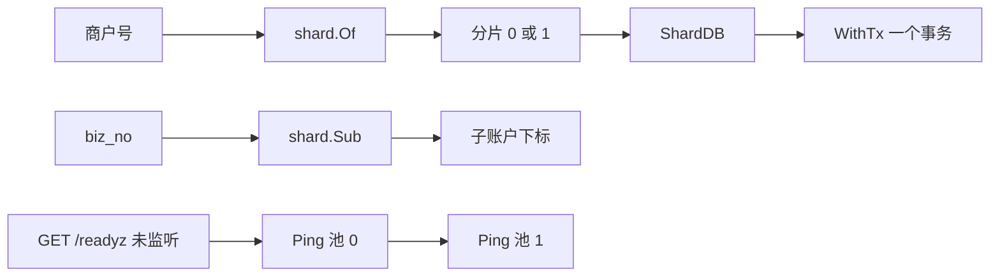

# ACC-13 账户分片路由

| 项 | 内容 |
|---|---|
| 功能点 | ACC-13（P0，第 1 周） |
| 所属链路 | 基础设施 |
| 代码提交 | `a8be4d2` `[ACC-13] add account shard routing` |
| 分支 | `feat/ACC-13-shard` |
| 日期 | 2026-10-15 |
| 状态 | DONE |

完整 hash：`a8be4d24b7bd146bc5f20f679da170e37acededa`。作者时间 `2026-10-15 04:20:53 +0800`。这次代码提交 15 个文件，917 行新增，11 行删除。本报告在该提交之后写，不包含在这 15 个文件里。

## 一句话结论

商户号是 `M` 加恰好 6 位数字，数字对写死的 2 取模，得到账户库 0 或 1。平台账户的子账户下标是 `crc32.ChecksumIEEE` 对调用方传入的 n 取模；返回值是下标，不是账户号。两个库各有一个连接池。事务回调的类型只有一个 `*sqlx.Tx`，函数参数里没有第二个库。`GET /readyz` 在两个池都在 1 秒内 Ping 成功时正文为 `ok`、状态 200，否则正文恰好是 `unavailable`、状态 503。它是一个 `http.Handler`，这次没有把它挂到监听端口。日志里的 `shard` 是整数。

## 1. 背景

### 1.1 系统简介

pay-system 是一个用 Go 编写的小型支付后端，模拟商户收款、退款、商户间转账三条资金链路，重点在数据一致性和性能。系统由 5 个部分组成：gateway（对外 HTTP 入口，负责签名校验和限流）、payment（支付单、退款单、转账单的状态管理和流程推进）、account（账户余额与记账，数据按商户分到 2 个数据库分片）、channel-mock（模拟微信、支付宝这类外部支付渠道）、recon（对账，核对系统内外数据是否一致）。服务之间用 Kitex RPC 同步调用，或通过 Kafka 消息异步通知；数据存在 MySQL 8.4，Redis 用于防重放。所有金额用整数“分”表示，所有记账只追加不修改。当前已完成：工程骨架到 IDL，加上账户分片路由。开户还没做。

Kitex 是本项目的 Go RPC 框架，服务之间的同步调用走它。IDL 是接口定义文件，用来写下这些 RPC 的方法和字段。Kafka 是消息队列，服务用它把结果异步通知出去。Redis 防重放是把已经见过的请求记在 Redis 里，避免同一请求被再处理一次。工程骨架是仓库目录、构建方式和命令入口。

### 1.2 本功能点在系统中的位置

本功能点做这些事：两个纯函数做路由；为两个库各准备一个连接池；事务只从一个库进入；提供一个没有监听端口的 `GET /readyz`；在日志和 span 上放整数 `shard`。它不写余额，不写分录，不开户，也不创建凭证。



`Of` 把商户号变成分片 0 或 1，`ShardDB` 取出那个库的池，`WithTx` 在这个池上开事务。`Sub` 把 `biz_no` 变成平台账户的下标。下标不是账户号，也不决定库。`/readyz` 依次 Ping 两个池，这次没有进程在监听它。开户和记账不在这次范围内。

### 1.3 为什么需要它

演示商户 `M100001` 和 `M100003` 必须进分片 1，`M100002` 必须进分片 0。这样以后才能在同一个库里做同分片转账，并在两个库之间做跨分片转账。

这 10000 分（100.00 元）是假设，这次测试没有写入。它本应只记在一个库里的一个商户账户上。如果路由不稳定，第一次把整笔记进库 0，第二次又把另一笔记进库 1，没有一个库拥有这个商户的全部账。

凭证是一次记账的头记录，下面挂多条分录。本功能点不创建凭证。它要留给以后的保证是：一张凭证的全部分录只能落在一个分片。事务回调的类型里只有一个 `*sqlx.Tx`，函数参数里没有第二个库。调用方如果在 SQL 里手写另一个库名，本功能点挡不住。本功能点的 `Of` 和 `Sub` 不写数据库。“提交进行到一半，10000 分只出现在其中一个库”说的是被否决的方案：一次调用同时拿两个库的事务。那不是本功能点的行为。

## 2. 术语

| 术语 | 含义 |
|---|---|
| 分 | 金额最小单位。10000 分等于 100.00 元。本功能点不计算金额，也不写入这笔假设金额。 |
| 分片 | 账户数据所在的那一个库。这里只有 0 和 1 两个。 |
| Kitex | 本项目的 Go RPC 框架。 |
| RPC | 进程之间的同步调用。 |
| IDL | 接口定义文件。RPC 的方法和字段写在这里。 |
| Kafka | 消息队列。服务用它做异步通知。 |
| Redis 防重放 | 用 Redis 记下已经见过的请求，避免同一请求被再处理一次。 |
| 工程骨架 | 仓库目录、构建方式和命令入口。 |
| 分录 | 记账追加的一行。本功能点不写分录。 |
| 凭证 | 一次记账的头记录，下面挂多条分录。本功能点不创建凭证。 |
| 平台账户 | 不是商户自己的余额，而是每个分片上平台持有的账户行，例如渠道应收、手续费收入、在途。本功能点不建这些行。 |
| 在途 | 钱已经离开一方、还没有进入另一方时，平台暂记的那一类账户。本功能点不写它的余额。 |
| 子账户下标 | 平台账户在一个分片上拆成多行时的序号，范围是 0 到 n−1。`Sub` 返回的是这个下标，不是账户号。 |
| 账户号 | 某一行账户自己的编号。本功能点不生成账户号。 |
| 商户号 | `M` 后面恰好 6 位数字，例如 `M100001`。小写 `m`、位数不对、夹字母都非法。 |
| `Of` | `pkg/shard` 的纯函数。输入商户号，输出分片 0 或 1。 |
| `Sub` | `pkg/shard` 的纯函数。输入业务单号和子账户个数 n，输出下标。 |
| `biz_no` | 业务单号，一段非空字符串。同一单号配同一个 n，下标不变。 |
| `crc32.ChecksumIEEE` | Go 标准库的 CRC-32，多项式用 IEEE 约定。输入是单号的字节。 |
| 偏差 | `abs(桶计数 − 12500) / 12500`。10 万个样本、8 个桶时，每个桶的期望计数是 12500。 |
| 连接池 | `*sqlx.DB`。它持有一组到某一个库的连接，本身不是一个事务。 |
| `Pools` | 同时持有分片 0 和分片 1 两个 `*sqlx.DB` 的结构。 |
| `own` | `Pools` 里的关闭权。`Open` 成功时为 true，`New` 装进来的池为 false。 |
| `ShardDB` | 按分片号取出其中一个池。只接受 0 和 1。 |
| `WithTx` | `pkg/dbx` 已有的事务函数。回调签名是 `func(*sqlx.Tx) error`，这次没有改它。 |
| `*sqlx.Tx` | 某一个库上的一个事务。回调的参数列表里只有这一个。 |
| schema | MySQL 里的一个库名。这次集成测试在同一台 MySQL 上建两个临时 schema。 |
| `/readyz` | 就绪检查的路径。两个池都能 Ping 才回答可以接流量。这次没有监听端口。 |
| Ping | 对数据库发一次连通检查。这里每个池单独最多等 1 秒。 |
| Handler | Go 标准库的 `http.Handler`。它处理已经到来的请求，自己不监听端口。 |
| `slog` | Go 标准库的结构化日志。整数属性会进 JSON 的数字，而不是字符串。 |
| span | 一次调用在链路追踪里的区间。没有真实追踪器时，接口返回一个空操作对象，调用它不会 panic。 |
| `embedded.Span` | OpenTelemetry 的 trace 包里、span 接口中的嵌入类型。它含未导出方法，本模块的测试文件实现不了这个接口。 |
| `10001` | 项目里“参数不合法”的业务码。本包故意不返回这个数字。 |
| `ACCOUNT_SHARD_COUNT` | 已有配置，默认 2，而且只允许 2。`Of` 不读它。 |
| `PLATFORM_SUB_ACCOUNTS` | 已有配置，默认 8。`Sub` 不读它，n 由参数传入。 |
| 种子 | 以前的初始化程序，按配置把平台账户的多行插进库。本功能点不执行它。 |
| 汇总 | 把同一类平台账户各行的余额相加。本功能点不做汇总。 |
| CAS | 比较后再更新状态。本功能点没有状态行，不用 CAS。 |
| 幂等 | 同一输入做一次和做多次，结果相同。这里指同一商户号、同一 `biz_no` 与 n 的路由结果不变。 |
| 哨兵错误 | 用 `errors.New` 固定下来的 Go 错误值，调用方用 `errors.Is` 识别。它不是对外的数字业务码。 |
| OPS-01 | 后面的运维功能点，负责进程监听、`/healthz`、Kafka 检查，以及收到 SIGTERM 后退出。本功能点不实现这些。 |
| BASE-11 | 已完成的集成测试基座，负责启动 MySQL、建随机 schema。 |
| 约定文档 | 项目的全局命名和错误码约定。这次没有改它的版本号。 |
| 流程说明文档 | 状态机和泳道图。不在这次 15 个文件里，图里的路由仍是概念调用。 |

## 3. 技术讲解

### 3.1 要解决的问题

1. 三个演示商户必须落到固定分片：`M100001`、`M100003` 为 1，`M100002` 为 0。payment 和 account 以后共用这一个函数。
2. `10001` 是项目里“参数不合法”的业务码。商户号格式非法时，本包返回哨兵错误，故意不返回这个数字，调用方以后自己映射。`M10001` 这个非法例子的字符里碰巧含有 `10001`。错误文本如果回显输入，就会出现这五个字符。因此错误文本是固定句子，不回显输入。
3. `ACCOUNT_SHARD_COUNT` 是已有配置，默认 2，而且只允许 2。`Of` 故意不读它，分片数写死为 2。测试把它设成 1，`M100002` 仍然是 0。
4. 平台子账户下标等于 `crc32.ChecksumIEEE([]byte(bizNo)) % uint32(n)`。返回值是 0 到 n−1 的下标，不是账户号。`PLATFORM_SUB_ACCOUNTS` 是已有配置，默认 8。函数不读它。n 由参数传入，函数不记住以前用过的 n。
5. 空 `bizNo`，或 n &lt; 1，返回错误。n 大于 `math.MaxUint32` 时也返回 `ErrSubCount`。Go 把超出范围的 int 转成 uint32 时只保留低 32 位，不是每个更大的数都会变成 0。只有低 32 位全是 0 时，接着取模才会 panic。函数对所有超过上限的 n 都直接返回错误，避免截断。这个哨兵的文本只写了 `must be positive`，超过上限时也用它，文本没有单独说“太大”。
6. 10 万个样本在 8 个桶上，每个桶都要满足 `abs(count-12500)/12500 < 0.05`。
7. 两个池由 `dbx.Open` 打开。第二个失败时，调用方还拿不到第一个池，打开函数必须先关掉它。
8. `ShardDB` 只接受 0 和 1。错误文本不包含调用方传入的分片号。
9. 事务入口只把一个库交给回调。`SELECT DATABASE()` 读到的是当前默认库。要证明的是两个事务的当前库不同。回调类型只有一个 `*sqlx.Tx`。调用方若在 SQL 里写另一个库名，这里挡不住。
10. `GET /readyz`：两池都在 1 秒内 Ping 成功则正文 `ok`、200；否则正文恰好 `unavailable`、503。不回显 Ping 的错误。不监听端口。`/healthz`、Kafka、SIGTERM 仍属于 OPS-01。
11. 日志和 trace 带整数属性 `shard`。
12. `ShardDB` 的读和 `Close` 的写可以同时发生。锁内只复制或摘下 `*sqlx.DB`，不在锁内 Ping，也不在锁内 `Close`。并发测试里请求的 context 事先取消，Ping 马上返回，所以测到的是读和写同时发生，不是 Ping 还在等待时重叠 `Close`。

### 3.2 方案

`pkg/shard` 只有纯函数和往 context、日志、span 上放分片号的辅助函数。它不引用数据库、配置、错误码包或业务服务。

`Of` 先看长度是不是 7、首字符是不是 `M`，再把后面 6 个字符按十进制累加成整数，最后对 2 取模。`M100001` 的数字是 100001，100001 除以 2 余 1。`M100002` 余 0。`M100003` 余 1。`M000001` 的数字是 1，余数仍是 1，前导零不改变位数规则。

```go
func Of(merchantID string) (int, error) {
	if len(merchantID) != merchantDigits+1 || merchantID[0] != 'M' {
		return 0, ErrMerchantID
	}
	n := 0
	for i := 1; i < len(merchantID); i++ {
		c := merchantID[i]
		if c < '0' || c > '9' {
			return 0, ErrMerchantID
		}
		n = n*10 + int(c-'0')
	}
	return n % shardCount, nil
}
```

这段在做格式检查和取模。`merchantDigits` 是 6，`shardCount` 是 2。非法时返回的 `ErrMerchantID` 文本是 `shard: merchant id must be M followed by 6 digits`。空串、`M10000`、`M10001`、`M1000011`、`m100001`、`M10000A`、`100001` 都走这个错误。`M10001` 只有 5 位数字，字符里碰巧含有 `10001`，固定句子不会把输入抄进去。

`Sub` 不保存 n。同一次进程里，调用方先传 8 再传 16，两次结果按各自的 n 计算。种子是以前的初始化程序，按配置把平台账户的多行插进库。本功能点不执行它。调大 n 之后，那些新下标要等以后重新跑初始化才有行。调小 n 后，较大下标不再被选中；那些行如果已经有余额，以后汇总时仍要加进去。汇总是把同一类平台账户各行的余额相加。本功能点不做汇总。函数看不到旧的 n，所以它自己拒绝不了“调小”。

```go
func Sub(bizNo string, n int) (int, error) {
	if n < 1 || uint64(n) > math.MaxUint32 {
		return 0, ErrSubCount
	}
	if bizNo == "" {
		return 0, ErrBizNo
	}
	sum := crc32.ChecksumIEEE([]byte(bizNo))
	return int(sum % uint32(n)), nil
}
```

这段先拒绝非法 n 和空单号，再做 CRC-32 取模。n 为 1 时余数永远是 0。`ErrSubCount` 的文本是 `shard: sub account count must be positive`。n 小于 1 和 n 超过 `math.MaxUint32` 都返回这同一个哨兵，文本没有单独说“太大”。`ErrBizNo` 的文本是 `shard: biz no is empty`。`PLATFORM_SUB_ACCOUNTS` 默认 8，函数不读它。测试把这个变量设成 `1`，函数仍按参数 n 计算。

超过 `math.MaxUint32` 的 n 不能先转成 `uint32` 再取模。转换只保留低 32 位。低 32 位不全是 0 时，会得到另一个余数，而不是 panic。低 32 位全是 0 时，模数变成 0，取模才会 panic。函数对所有超过上限的 n 都直接返回 `ErrSubCount`，避免这种截断。

分布测试的单号用 `math/rand`、种子 `20261015` 生成 16 字节，再转成十六进制字符串，一共 10 万个，n 为 8。验收要求每个桶的偏差严格小于 0.05，也就是计数与 12500 的差严格小于 625。如果某一轮不通过，就换一个写死的种子再测，不放宽 0.05。本报告这一轮没有换种子，种子 `20261015` 通过了。2026-10-15 这一轮的计数如下，总和 100000，最大偏差 0.01328，来自第 7 桶：`abs(12334-12500)/12500 = 166/12500`。

| 桶 | 计数 | 与 12500 的绝对差 | 偏差 |
|---|---|---|---|
| 0 | 12499 | 1 | 0.00008 |
| 1 | 12645 | 145 | 0.01160 |
| 2 | 12387 | 113 | 0.00904 |
| 3 | 12549 | 49 | 0.00392 |
| 4 | 12535 | 35 | 0.00280 |
| 5 | 12456 | 44 | 0.00352 |
| 6 | 12595 | 95 | 0.00760 |
| 7 | 12334 | 166 | 0.01328 |

`dal.Open` 用 `dbx.Open` 依次打开两个池。第二个返回错误时，先对第一个调用 `Close`，再把错误返回给调用方。成功时 `own` 为 true，调用方负责最终的 `Pools.Close`。`Pools.Close` 只关闭 `Open` 创建且 `own` 为 true 的两个池。`New` 把两个已经打开的池装进来，`own` 为 false。对它调用 `Pools.Close` 直接返回，不把池关掉，也不把字段改成 nil。

既有的 `dbx.Open` 失败时，错误文本里可能含有地址。本功能点的注释要求调用方不要把这个错误原文写进日志。本报告没有单独的日志样本证明所有调用方都没打印它。就绪检查失败时正文是固定的 `unavailable`，测试断言正文不含地址。

`dbx.Open` 已有的池参数里，最大打开连接数、最大空闲连接数或连接最长存活时间为负时，在拨号前返回错误。本功能点的测试覆盖了这条既有拒绝。已经取消的 context 也会在拨号前失败。

`ShardDB` 在读锁里把 `*sqlx.DB` 复制到局部变量，解锁后再交给调用方。Ping 和事务发生在锁外面。传入 −1、2、3，或 `Pools` 本身是 nil，或锁里复制出来的池是 nil，都返回错误。错误句子是 `dal: shard must be 0 or 1` 或 `dal: shard db is nil`。错误文本不包含调用方传入的分片号。

```go
p.mu.Lock()
if !p.own {
	p.mu.Unlock()
	return nil
}
dbs := p.db
p.db = [2]*sqlx.DB{}
p.own = false
p.mu.Unlock()
```

这段是 `Pools.Close` 在写锁内做的全部事情：确认自己拥有关闭权，把两个池复制出来，字段清空，`own` 改成 false，然后解锁。真正的 `DB.Close` 在锁外面。锁内不做 Ping，也不做 `DB.Close`。并发测试没有覆盖“Ping 还在等待时又调用 Close”：那个测试的请求 context 事先取消，Ping 马上返回，测到的是 `ShardDB` 读和 `Close` 写同时发生。

`dbx.WithTx(ctx, db, fn)` 的 `db` 是 `ShardDB` 返回的那一个池。`fn` 的参数类型只有一个 `*sqlx.Tx`，函数参数里没有第二个库。集成测试在回调里执行 `SELECT DATABASE()`。这条语句只说明当前默认库。测试证明两个事务的当前库不同。调用方如果在 SQL 里手写另一个库名，本功能点挡不住。`pay_account_0` 和 `pay_account_1` 是设计中两个账户分片的固定库名。这次测试没有创建它们，也没有删除它们。测试用的是临时 schema：同一台 MySQL 上两个库，名字形如 `tk_` 加 16 位十六进制，不是两台机器。结束时只删除这两个临时 schema。

`ReadyHandler` 只接受路径 `/readyz`。别的路径交给 `http.NotFound`，所以 `/healthz` 不是这里实现的。方法不是 GET 时，状态 405，正文 `method not allowed`，并设置 `Allow: GET`。GET 时先取分片 0 再取分片 1，每个池用请求 context 派生出最多 1 秒的超时再 Ping。两个都成功才写 `ok` 和 200。任一失败写 `unavailable` 和 503。正文就是这两个词，没有额外换行，也没有 Ping 返回的错误文本。`Pools` 为 nil 时同样是 503 和 `unavailable`。这个函数不调用 `ListenAndServe`。`cmd/account/main.go` 没有改，进程仍然只加载配置后返回。

集成测试里，两个池都能 Ping 时先看到 200 和 `ok`。随后关掉的是 `New` 装进去的那个分片 1 的 `*sqlx.DB`，调用的是 `DB.Close`，不是 `Pools.Close`。`Pools.Close` 只关闭 `Open` 创建且 `own` 为 true 的两个池。`New` 的 `own` 是 false，所以这次关闭不会把分片 0 一起关掉。关掉分片 1 之后，就绪检查得到 503 和 `unavailable`，分片 0 的池还能 Ping。

日志通过 `slog.Int("shard", shard)` 带上整数。测试用 JSON 解码器的 `UseNumber`，断言字段 `shard` 的类型是 `json.Number` 且值为 `1`。`WithShard` 总会对 `trace.SpanFromContext` 的返回值调用 `SetAttributes`，属性名 `shard`，类型是整数。没有安装追踪器时，这个返回值是空操作 span，`IsRecording` 为 false，`SetAttributes` 不 panic。context 为 nil 时从 `context.Background` 起。

审查时有人建议写一个会记录属性的假 span，用来断言属性值。这条没有做。`embedded.Span` 来自 OpenTelemetry 的 trace 包，是 span 接口里的嵌入类型，含未导出方法，所以本模块的测试文件实现不了这个接口。因此没有断言 recording span 上的属性值。日志里的整数 `shard` 有测试。`go.opentelemetry.io/otel` 变成直接依赖，是因为代码 import 了它的 `attribute` 包。版本仍是 v1.47.0。`go.opentelemetry.io/otel/trace` 仍是 v1.47.0。没有加 `otel/sdk`，也没有升级。

`TestReadyHandlerCloseRace` 构造 `Pools` 时 `own` 为 true，所以 `Close` 会在锁里把两个池指针摘成 nil，之后 `ShardDB` 返回错误。这和 `New`（`own` 为 false，`Close` 什么都不做）不是同一条路径。测试用 `sqlx.Open` 准备两个池，请求的 context 事先取消，Ping 马上返回。多个 goroutine 调用 `ReadyHandler` 的同时，主流程调用 `Close`。`go test -race` 下没有报告竞争。测到的是 `ShardDB` 读和 `Close` 写同时发生，不是 Ping 还在等待时重叠 `Close`。关闭结束后 `ShardDB(0)` 和 `ShardDB(1)` 都返回错误，测试进程没有 panic。

第二个池打开失败的集成测试传入一个非法 DSN。本报告不写出该 DSN。连接数来自 MySQL 的 `information_schema.processlist` 里、当前 schema 的连接行数。失败之后该 schema 的连接数回到打开前。调用方拿不到第一个池。

### 3.3 为什么这样做

| 方案 | 做法 | 优点 | 缺点 | 结论 |
|---|---|---|---|---|
| 采用：商户号数字对 2 取模；子账户用 CRC-32；两池分开，事务回调只有一个 `*sqlx.Tx` | 模数写死。n 由调用方传入。第二个池打开失败就关掉第一个。就绪检查只返回固定正文 | 三个演示商户的分片可以手算。同一单号的下标稳定。回调的参数列表里没有第二个库 | 商户号格式很死。函数不阻止调用方把 n 调小。SQL 里手写另一个库名挡不住 | 采用 |
| 备选：用 CRC-32 路由商户 | `ChecksumIEEE(商户号) % 2` | 和子账户是同一套哈希 | CRC-32 的落点要算完才知道。演示时不能一眼看出 `M100002` 在分片 0、另外两个在分片 1 | 不采用 |
| 备选：一个事务里拿两个库 | 回调同时收到两个 `*sqlx.Tx`，或在一个函数里对两个池各开一个事务再一起提交 | 跨库写看起来可以放进同一次调用 | 两个库没有同一个提交点。进程在中间停掉时，假设的 10000 分（100.00 元）可能只写进其中一个库 | 不采用 |

空操作 span 的测试只证明不 panic。recording span 上的属性值没有断言，因为测试文件实现不了带 `embedded.Span` 的接口。这次不加 SDK。

### 3.4 正确性

本功能点不写余额、不写分录、不开户，也不创建凭证。重复记账和并发扣款在这里没有数据可写，所以这两项不涉及。要证明的是路由和池的边界。表里的 10000 分是假设，不是测试写入的金额。

| 场景 | 系统行为 | 最终状态 | 证明 |
|---|---|---|---|
| 重复记账 | 不涉及。同一商户多次调用 `Of` 得到同一分片，同一 `bizNo` 和 n 多次调用 `Sub` 得到同一下标。代码路径没有 INSERT/UPDATE，不存在记两次账 | 没有写下账户行，因为代码路径没有 INSERT/UPDATE。这两个测试不查数据库 | `TestMerchantRoute`、`TestSubAccountDistribution` 不访问数据库 |
| 并发扣款 | 不涉及。没有账户行，没有余额更新，也没有两个请求去减同一笔假设的 10000 分（100.00 元） | 无余额变化 | 本功能点没有扣款测试 |
| 一个事务的当前库 | `WithTx` 的回调只有一个 `*sqlx.Tx`。回调执行 `SELECT DATABASE()`，这条语句只说明当前默认库。函数参数里没有第二个库。SQL 里手写另一个库名挡不住 | 分片 0 的事务和分片 1 的事务，当前库名不同。两个 schema 在同一台 MySQL 上，名字形如 `tk_` 加 16 位十六进制 | `TestWithTxSeesOwnDatabase` |
| 关掉一个池后的就绪检查 | 两个池都能 Ping 时，`GET /readyz` 为 200、正文 `ok`。关掉的是 `New` 装进去的分片 1 的 `*sqlx.DB`，调用 `DB.Close`，不是 `Pools.Close`。然后再请求，得到 503、正文 `unavailable`。分片 0 的池随后仍能在 1 秒内 Ping 成功 | 分片 1 的池已关闭；分片 0 的池仍打开；响应正文没有 Ping 错误 | `TestReadyzWhenShardClosed` |
| `ShardDB` 与 `Close` 同时进行 | 读锁内只复制 `*sqlx.DB`。写锁内摘下池并清掉关闭权，锁外再 `Close`。请求 context 事先取消，Ping 马上返回。测到的是 `ShardDB` 读和 `Close` 写同时发生，不是 Ping 还在等待时重叠 `Close` | 关闭后两个 `ShardDB` 都返回错误，进程不 panic | `TestReadyHandlerCloseRace`（`go test -race`） |
| 进程在路由之后崩溃 | `Of` 和 `Sub` 不落库。进程消失后，内存里的连接池一起消失。代码路径没有 INSERT/UPDATE，没有待恢复的余额或分录 | 没有写下账户行，因为代码路径没有 INSERT/UPDATE | 崩溃恢复测试未做。路由测试不访问数据库 |
| 下游调用超时 | 路由函数不调用外部系统。就绪检查对每个池单独限时 1 秒，不是两个池共用 1 秒。超时或 Ping 失败时正文为 `unavailable`、状态 503 | 无业务行变化；响应不带 Ping 错误。测试断言正文不含地址 | `TestReadyzHidesPingError`、`TestReadyzWhenShardClosed` |

第二个池打开失败时，测试传入一个非法 DSN，本报告不写出该 DSN。第一个池在返回前被关掉。连接数来自 `information_schema.processlist` 里、当前 schema 的连接行数，失败之后回到打开前。`TestOpenSecondFailureClosesFirst` 证明这一点。`New` 不拥有关闭权，`TestShardDBRangeAndNewDoesNotOwnClose` 在 `Pools.Close` 之后确认两个池仍可用，并且 0 与 1 返回的就是当初放进去的那两个池。

### 3.5 性能

不涉及。本功能点没有基线开关，也没有延迟或吞吐测量。上面的 0.01328 是分布偏差，不是耗时。

## 4. 已完成内容

### 4.1 改动清单

| 文件 | 新增 / 修改 | 作用 |
|---|---|---|
| `pkg/shard/shard.go` | 新增 | `Of`、`Sub` 和三个哨兵错误 |
| `pkg/shard/shard_test.go` | 新增 | 商户路由、子账户下标稳定性和 10 万样本分布 |
| `pkg/shard/context.go` | 新增 | 把整数 `shard` 放进 context、日志和 span |
| `pkg/shard/context_test.go` | 新增 | JSON 里的 `shard` 是数字；空操作 span 不 panic |
| `service/account/dal/pool.go` | 新增 | 两个池的打开、取出、关闭，以及读写锁 |
| `service/account/dal/ready.go` | 新增 | `GET /readyz` 的 Handler |
| `service/account/dal/pool_test.go` | 新增 | 分片号范围、`New` 不关闭池、就绪正文、关闭竞争 |
| `service/account/dal/shard_integration_test.go` | 新增 | 两个事务的当前库不同、关掉 `New` 装入的分片 1 后 503、第二个打开失败时关掉第一个 |
| `internal/testkit/mysql.go` | 修改 | 给测试 schema 增加 `DSN()`，供打开池的集成测试使用。返回值含口令，测试不得把它写进日志 |
| `.golangci.yml` | 修改 | 测试文件可以引用 `internal`。生产代码仍然不能引用 |
| `go.mod` | 修改 | `go.opentelemetry.io/otel v1.47.0` 变为直接依赖，版本不变 |
| `docs/02-requirements.md` | 修改 | ACC-13 标为 DONE，三条验收勾上；口径记在文末变更记录 |
| `docs/04-dev-plan.md` | 修改 | 只勾选 ACC-13。开户、查询、记账仍未勾 |
| `docs/01-tech-decisions.md` | 修改 | 记录模数写死、n 由调用方传入、otel 直接依赖 |
| `docs/interview-notes.md` | 修改 | 记录偏差公式、这一轮计数、就绪检查与 OPS-01 的边界 |

`cmd/account/main.go` 不在这 15 个文件里。没有新增 `service/account/biz`。没有改 `pkg/dbx`。

### 4.2 对外变化

| 类别 | 变化 |
|---|---|
| 接口 | 无对外 RPC，也无已监听的 HTTP。库内新增 `GET /readyz` 的 Handler，未挂到端口 |
| 表结构 | 无 |
| 配置项 | 无新增键。`ACCOUNT_SHARD_COUNT` 仍是已有配置，默认 2，只允许 2，`Of` 不读它。`PLATFORM_SUB_ACCOUNTS` 仍是已有配置，默认 8，`Sub` 不读它，n 由参数传入 |
| 错误码 | 无新的数字业务码。`10001` 仍是“参数不合法”。非法商户号是哨兵错误 `ErrMerchantID`，文本不含 `10001`。调用方以后才映射成 `10001` |
| 指标 / 故障点 | 无 metrics。两个池 Ping 失败时，Handler 回 503、正文 `unavailable`。监听、Kafka、SIGTERM 仍是 OPS-01 |

### 4.3 验收对照

需求里的验收是这三条，没有第四条：

1. `M100001`、`M100003` 路由到 1，`M100002` 路由到 0；非法商户号返回错误。
2. 同一 `biz_no` 多次选择的子账户相同；10 万个随机 `biz_no` 在 8 个子账户上的分布偏差 &lt; 5%。
3. 停掉一个分片的连接（测试中关闭连接池）后 `/readyz` 返回 503。

表里多出来的行是规则或审查项，不是第四条验收。

| 类别 | 条目 | 测试函数 | 类型 | 结果 |
|---|---|---|---|---|
| 验收 1 | `M100001`、`M100003` 路由到 1，`M100002` 路由到 0；非法商户号返回错误 | `TestMerchantRoute` | 单元 | 通过 |
| 规则 | 同一次测试还检查：`M000001` 路由到 1；空串、`M10000`、`M10001`、`M1000011`、`m100001`、`M10000A`、`100001` 返回 `ErrMerchantID`；错误文本不含 `10001`；把已有配置 `ACCOUNT_SHARD_COUNT` 设成 1，结果仍不变 | `TestMerchantRoute` | 单元 | 通过 |
| 验收 2 | 同一 `biz_no` 多次选择的子账户相同；10 万个随机 `biz_no` 在 8 个子账户上的分布偏差 &lt; 5% | `TestSubAccountDistribution` | 单元 | 通过。本轮最大偏差 0.01328，种子 `20261015`，这一轮没有换种子 |
| 规则 | 同一次测试还检查：结果等于 CRC-32 取模；n 为 1 时结果为 0；空单号、n 为 0、n 为 −1、n 超过 `uint32` 返回错误；函数不读 `PLATFORM_SUB_ACCOUNTS` | `TestSubAccountDistribution` | 单元 | 通过 |
| 验收 3 | 停掉一个分片的连接（测试中关闭连接池）后 `/readyz` 返回 503 | `TestReadyzWhenShardClosed` | 集成 | 通过。关的是 `New` 装进去的分片 1 的 `*sqlx.DB`（`DB.Close`），不是 `Pools.Close`。正文是 `unavailable` |
| 规则 | 两池都能 Ping 时同一测试先得到 200、正文 `ok`；关掉分片 1 后，分片 0 仍能 Ping | `TestReadyzWhenShardClosed` | 集成 | 通过 |
| 规则 | JSON 日志的 `shard` 是整数 `1`；空操作 span 不 panic。没有断言 recording span 上的属性值 | `TestShardLogAndNoopSpan` | 单元 | 通过 |
| 规则 | `ShardDB` 只接受 0 和 1，错误文本不包含调用方传入的分片号；`New` 之后的 `Pools.Close` 不关闭池 | `TestShardDBRangeAndNewDoesNotOwnClose` | 单元 | 通过 |
| 规则 | 已取消的 context 在拨号前失败。最大打开连接数、最大空闲连接数或连接最长存活时间为负时，`dbx.Open` 在拨号前返回错误。本测试覆盖了这条既有拒绝 | `TestOpenRejectsBeforeConnect` | 单元 | 通过 |
| 规则 | Ping 失败时正文恰好 `unavailable`、状态 503，正文不含地址；POST 不是 200；`GET /healthz` 不是 200；nil 池同样是 503 和 `unavailable` | `TestReadyzHidesPingError` | 单元 | 通过 |
| 审查 | 请求 context 事先取消，Ping 马上返回。`ShardDB` 读和 `Close` 写同时发生时没有数据竞争；关闭后 `ShardDB` 返回错误。不是 Ping 还在等待时重叠 `Close` | `TestReadyHandlerCloseRace` | 单元 | 通过 |
| 规则 | 两个事务执行 `SELECT DATABASE()`，当前库不同。测试库是同一台 MySQL 上两个形如 `tk_` 加 16 位十六进制的 schema。不删除 `pay_account_0` 和 `pay_account_1` | `TestWithTxSeesOwnDatabase` | 集成 | 通过 |
| 规则 | 第二个池用一个非法 DSN 打开失败时，第一个池被关闭。连接数取自 `information_schema.processlist` 里当前 schema 的行数，失败后回到打开前。报告不写出该 DSN | `TestOpenSecondFailureClosesFirst` | 集成 | 通过 |

### 4.4 验证记录

环境：`go version go1.27.2 darwin/arm64`。以下都是 2026-10-15 的实测。没有列出的耗时不写进本报告。

| 命令 | 结果 |
|---|---|
| `gofmt -l .` | 无输出，退出码 0 |
| `make lint` | `0 issues.` |
| `make test` | 通过。根包 `ok github.com/yym108/pay-system 2.494s`。`service/account/dal` 这次是 `1.260s`。`pkg/shard` 这次是 cached。其余包的耗时没有记入本报告 |
| `go test -race -count=1 -cover ./pkg/shard/` | `ok github.com/yym108/pay-system/pkg/shard 1.559s coverage: 96.3% of statements` |
| `go test -race -count=1 -cover ./service/account/dal/` | `ok github.com/yym108/pay-system/service/account/dal 1.436s coverage: 83.1% of statements`。没有 integration 标签，这是单元覆盖率 |
| `go test -race -count=1 -tags integration -timeout 10m ./service/account/dal/` | `ok github.com/yym108/pay-system/service/account/dal 9.137s`。这条输出没有覆盖率 |
| `go test -race -count=1 -v -run TestSubAccountDistribution ./pkg/shard/` | 日志：`ACC-13 distribution seed=20261015 counts=[12499 12645 12387 12549 12535 12456 12595 12334] max_deviation=0.01328`。该测试 0.11s。这是筛中的一个测试的耗时，不是 `pkg/shard` 全包耗时。全包耗时是上面带 `-cover` 的 1.559s |
| `make test-integration` | 未运行。BASE-11 是已完成的集成测试基座，负责启动 MySQL、建随机 schema。本次给它加了 `DSN()`，所以没有重跑它原来的并行库测试。本功能点的集成测试已单独跑 `service/account/dal`。除了 `internal/testkit` 增加 `Schema.DSN()`，没有改其他集成包 |
| `make cover` | 未运行。覆盖率只有上面两个数字：`pkg/shard` 语句覆盖率 96.3%，`service/account/dal` 单元语句覆盖率 83.1% |
| `make up` | 未运行。`/readyz` 没有挂到监听端口 |

### 4.5 同步的文档

- 需求里 ACC-13 的状态改为 DONE，上面三条验收勾上。文末变更记录写明：`/readyz` 只是处理函数，监听、Kafka、SIGTERM 仍属 OPS-01；`Of` 不读环境变量，分片数写死 2；`Sub` 的 n 由调用方传入。资金规则、接口、表结构和错误码没有改。
- 开发计划只勾选第 1 周的 ACC-13。同一行里的开户、账户查询、通用记账保持未勾。
- 技术决策记下 otel 模块改为直接依赖且版本不变，以及 `Of` / `Sub` 的入参规则。
- 面试笔记记下偏差定义、这一轮八个桶的计数，以及就绪检查不回显 Ping 错误的原因。

约定文档是项目的全局命名和错误码约定，这次没有改它的版本号。接口文档、表结构文档、迁移、编排文件和 `.env.example` 没有改。

## 5. 未完成与风险

- 全库 `make test-integration` 未运行。BASE-11 是已完成的集成测试基座，负责启动 MySQL、建随机 schema。本次给它加了 `DSN()`，所以没有重跑它原来的并行库测试。
- 全库 `make cover` 未运行。集成测试没有覆盖率数字。83.1% 不能当成含集成测试的覆盖率。
- `make up` 未运行。就绪检查没有挂到端口，不能对一个已监听的地址发请求。
- 开户（ACC-01）、账户查询（ACC-02）、通用记账（ACC-03）、account 进程（ACC-11）都还没做。凭证和平台账户行都还没有创建。
- `/healthz`、Kafka 检查、SIGTERM 和 metrics 属于 OPS-01，这次没有实现。
- 日志里的整数 `shard` 有测试。recording span 上的属性值没有断言：`embedded.Span` 含未导出方法，本模块的测试文件实现不了这个接口。没有加 `otel/sdk`。
- 流程说明文档是状态机和泳道图，不在这次 15 个文件里。图里的路由仍是概念调用。
- 崩溃恢复测试未做。`SELECT DATABASE()` 只证明当前默认库不同；调用方在 SQL 里手写另一个库名时，本功能点挡不住。
- 并发测试没有覆盖 Ping 仍在等待时重叠 `Close`。

## 6. 如何复现

前置：本机 Go 为 `go version go1.27.2 darwin/arm64`。集成测试使用 BASE-11 这套基座：它负责启动 MySQL、建随机 schema。不要把连接串、口令写进日志或报告。

```bash
gofmt -l .
make lint
make test
go test -race -count=1 -cover ./pkg/shard/
go test -race -count=1 -cover ./service/account/dal/
go test -race -count=1 -tags integration -timeout 10m ./service/account/dal/
go test -race -count=1 -v -run TestSubAccountDistribution ./pkg/shard/
```

`gofmt -l .` 预期无输出且退出码 0。`make lint` 预期出现 `0 issues.`。`make test` 预期通过；本次根包是 `ok github.com/yym108/pay-system 2.494s`，`service/account/dal` 是 `1.260s`，`pkg/shard` 为 cached。两条 `-cover` 的预期分别是 `pkg/shard` 的 `1.559s` 与 `coverage: 96.3% of statements`，以及不带 integration 标签的 dal `1.436s` 与 `coverage: 83.1% of statements`。集成测试预期 `ok github.com/yym108/pay-system/service/account/dal 9.137s`。

分布那条命令预期打出：

```text
ACC-13 distribution seed=20261015 counts=[12499 12645 12387 12549 12535 12456 12595 12334] max_deviation=0.01328
```

本次该测试耗时 0.11s。种子写死为 `20261015`，这一轮没有换种子，计数由这套随机序列决定。不要把这次筛选运行的包耗时写成全包耗时。

`make test-integration`、`make cover`、`make up` 这次没有跑，复现上述结论时也不要补写没有测过的通过结果。

## 7. 讲解要点

1. 问：为什么商户不用 CRC-32？答：`M100001`、`M100002`、`M100003` 必须稳定在分片 1、0、1，数字对 2 取模可以手算。CRC-32 的落点要算完才知道，演示时不能一眼看出 `M100002` 在分片 0、另外两个在分片 1。
2. 问：一个事务和两个库是什么关系？答：`WithTx` 的回调只有一个 `*sqlx.Tx`，函数参数里没有第二个库。`SELECT DATABASE()` 只说明当前默认库，测试看到两个事务的当前库不同。调用方在 SQL 里手写另一个库名时，本功能点挡不住。
3. 问：`/readyz` 失败时为什么正文是固定的 `unavailable`？答：既有的 `dbx.Open` 错误里可能含有地址，本功能点的注释要求调用方不要把那个错误原文写进日志。就绪失败的正文固定为 `unavailable`，状态 503，测试断言正文不含地址。成功时正文固定为 `ok`，状态 200。监听端口仍然是 OPS-01 的事。

## 延伸阅读

- `docs/02-requirements.md` 中 ACC-13 的规则、验收和文末 2026-10-15 的口径记录
- `docs/04-dev-plan.md` 第 1 周里 ACC-13 的勾选位置
- `docs/01-tech-decisions.md` 里关于分片模数和 otel 直接依赖的补充
- `docs/interview-notes.md` 的 ACC-13 一节
- `pkg/shard/shard.go`、`pkg/shard/context.go`
- `service/account/dal/pool.go`、`service/account/dal/ready.go`

## 修订记录

| 日期 | 提交 | 修订内容 |
|---|---|---|
| 2026-10-15 | `a8be4d2` | 初稿。对应代码提交 `[ACC-13] add account shard routing`，报告本身不在该提交内 |
| 2026-10-15 | 无新的代码提交 | 按可读性检查补术语和边界。命令耗时、覆盖率、分布计数未改 |
