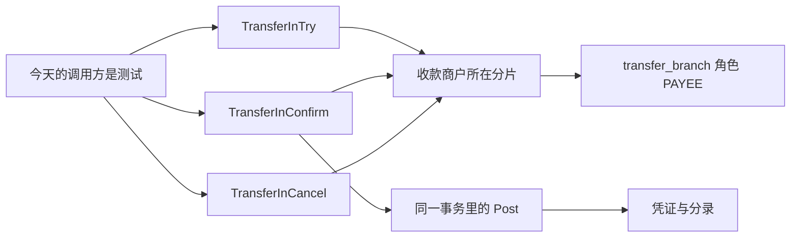
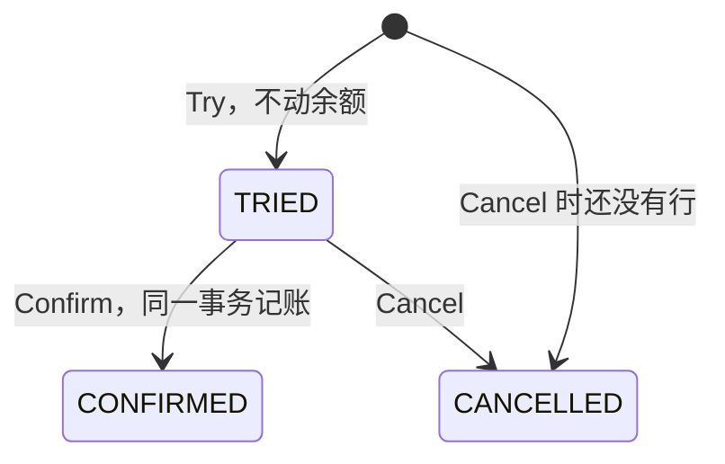
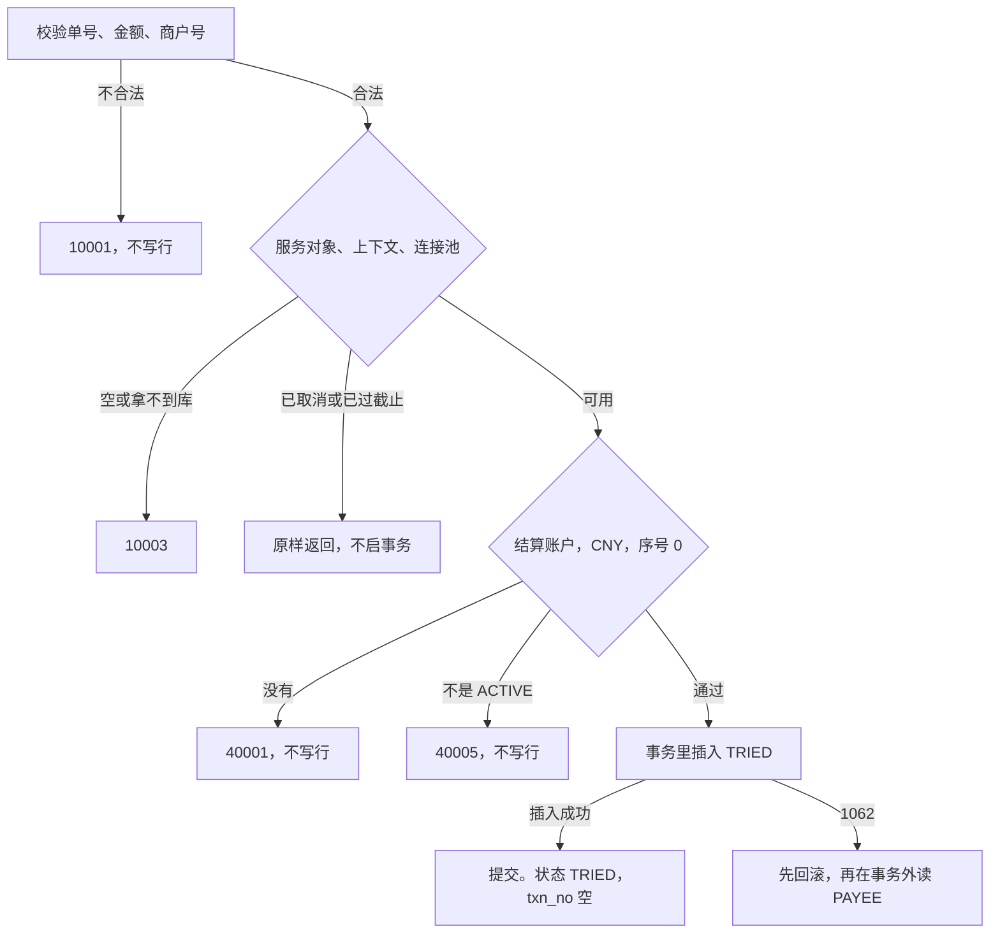
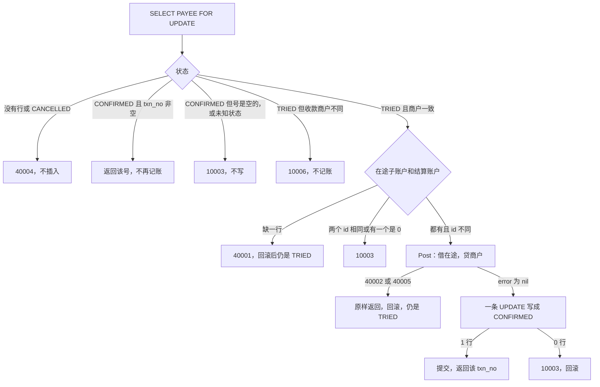
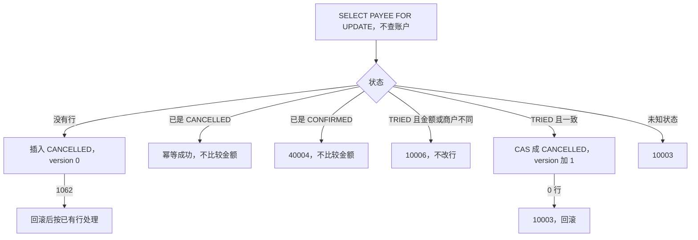

# ACC-14 收款方转账分支

| 项 | 内容 |
|---|---|
| 功能点 | ACC-14（P0，第 2 周） |
| 所属链路 | 基础设施 |
| 代码提交 | `3cfa46b` `[ACC-14] add transfer in` |
| 分支 | `feat/ACC-14-transfer-in` |
| 日期 | 2026-10-21 |
| 状态 | DONE |

完整 hash：`3cfa46bcae826fdffbf74b0e0693c01dd4dd6199`。这次代码提交 9 个文件，2057 行新增，56 行删除。本报告在该提交之后写，不包含在这 9 个文件里。

## 一句话结论

收款方转账分支是 account 进程里的三个方法：`TransferInTry`、`TransferInConfirm`、`TransferInCancel`。它们只改收款商户所在的一个数据库分片（账户按商户分开放在两个库里），各自用 `dbx.WithTx` 提交事务：回调成功就提交，失败就把这次写入整笔撤销。Try 只插入准备状态 `TRIED`，不改余额；Confirm 在同一事务里借在途账户（平台的过渡账户，账面减少）、贷收款商户（账面增加），记一张只追加的 `TRANSFER_IN` 凭证，状态改为 `CONFIRMED`；Cancel 改为 `CANCELLED`，没有行时插入墓碑（占住单号的取消记录），不查账户。验收 1 里收款商户从 1000 分（10.00 元）确认 250 分（2.50 元）后变成 1250 分（12.50 元），在途从 0 分（0.00 元）变成 −250 分（−2.50 元），凭证只有 1 张；同一单号上 Try 与 Cancel 各 20 个并发调用结束后是 `CANCELLED`，没有这张凭证，两边余额不变。

## 1. 背景

### 1.1 系统简介

pay-system 是一个用 Go 编写的小型支付后端，模拟商户收款、退款、商户间转账三条资金链路，重点在数据一致性和性能。系统由 5 个部分组成：gateway（对外 HTTP 入口，负责签名校验和限流）、payment（支付单、退款单、转账单的状态管理和流程推进）、account（账户余额与记账，数据按商户分到 2 个数据库分片）、channel-mock（模拟微信、支付宝这类外部支付渠道）、recon（对账，核对系统内外数据是否一致）。服务之间用 Kitex RPC 同步调用，或通过 Kafka 消息异步通知；数据存在 MySQL 8.4，Redis 用于防重放。所有金额用整数“分”表示，所有记账只追加不修改。当前已完成：开户、查询、记账、冻结、解冻、确认扣款、同分片转账，以及这次的收款方转账分支。余额核对是把各分片余额加总，看是否和业务相符，功能点 ACC-10，这次不做。account 的 RPC 服务、跨分片转账的协调也还没做。

Kitex 是本项目的 Go RPC 框架。RPC 是进程之间的同步调用。这次三个方法都不监听端口。ACC-11 是以后才做的账户 RPC 服务，网络层留给它。Kafka 是消息队列。Redis 防重放是以后 gateway 用来挡住重复的对外 HTTP。这三个方法不用 Redis，也不发消息。重复请求靠表 `transfer_branch` 上 `(transfer_no, role)` 的唯一索引。这张表的一行是某个转账单号在某个角色上的状态。`transfer_no` 是转账单号，长度按码点计：一个码点是一个 Unicode 字符，不是一个字节。`role` 是角色。分片是账户数据所在的那一个库，这里只有 0 和 1。100 分等于 1.00 元。「记账只追加不修改」指分录只插入、不改旧行。分录是凭证下面的明细，记某个账户这笔是借还是贷。账户行上的账面余额是当前金额，`version` 是这一行被改过的次数，确认时由记账去更新这两列。

文首表格里的「所属链路：基础设施」指账户、分片、记账这些被三条业务共用的底层能力，不是第四条资金业务。P0 是必须先做的优先级。第 2 周是开发计划里做冻结和转账分支的那一周。

### 1.2 本功能点在系统中的位置

今天会调用这三个方法的只有测试。以后跨分片转账的协调者会调用它们，那个功能点叫 TRF-03，这次不做。跨分片时两边不能放进同一个数据库事务，协调者就用 Try、Confirm、Cancel 三步先让两边各自准备，再一起确认或一起取消。这三步合称 TCC。本功能点只做收款方这一支，并且只在收款商户所在的分片上写。



三个方法各自提交自己的事务。`Post` 是已经做好的进程内记账：调用方把已经打开的事务交给它，它写凭证和分录，自己不提交。这次只有 Confirm 调用它。Try 和 Cancel 不调用它，所以不改余额。`PAYEE` 是跨分片转账里收款方这一支的角色。`LOCAL` 是双方本来就在同一个分片时的角色，这次不读也不改。同一 `transfer_no` 可以同时有这两种行，因为唯一键带了角色。一笔只走收款方的转账业务上不会自己出现 `LOCAL` 行。验收 1 里的那一行，是测试为了证明两个角色不冲突而事先插入的。另一分片上不会出现这次的 `PAYEE` 行，也不会出现这次的 `TRANSFER_IN` 凭证。

### 1.3 为什么需要它

如果确认可以做两次，或者取消先到之后 Try 仍能占位并被确认，就会出现下面这两种账。

商户 `M100002` 在分片 0。商户号必须是 `M` 加恰好 6 位数字，分片号是数字对 2 取模，已有函数 `shard.Of` 做这件事。`100002 % 2 = 0`。验收 1 的测试自己先把这个商户的结算账户写成 1000 分（10.00 元），冻结金额是 0 分（0.00 元），再把本分片对应的在途子账户写成 0 分（0.00 元）。结算账户是商户收钱的那一行，类型 `MERCHANT_SETTLE`，币种 `CNY`（人民币），子账户序号 `sub_no` 为 0。冻结金额是已经占住、还没扣走的部分。这组起始余额是测试自己写入的。确认要转入 250 分（2.50 元）。

第一种账是确认做了两次。第二次又记一笔，收款方会变成 1500 分（15.00 元），在途会变成 −500 分（−5.00 元）。钱被记了两次。所以第二次确认必须返回第一次的凭证号，库里仍然只有 1 张凭证，余额停在 1250 分（12.50 元）和 −250 分（−2.50 元）。

第二种账是取消先到。协调者可能已经决定取消，收款方的 Try 才到达。如果这时仍插入 `TRIED` 并在后来确认入账，一笔已经取消的转账会到账。所以取消在没有行时也要先占住这个单号，这叫空回滚。之后的 Try 不能再把这笔做成可确认，这叫防悬挂。

在途从 0 分（0.00 元）减到 −250 分（−2.50 元）是故意的。商户结算账户和在途的余额方向都是 `CREDIT`。余额方向是表 `account` 的列 `balance_direction`。值是 `CREDIT` 时，贷方分录让 `balance` 增加，借方分录让 `balance` 减少。在途账户允许透支，账面可以变成负数，表示先把钱记给收款商户，在途暂时垫上。正常的在途行不会因为余额是 0 分（0.00 元）就拒绝确认。这笔负数留在收款商户所在分片的在途上。付款方确认是已经做好的确认扣款，在付款方分片把在途增加。这次的三个方法不调用它，也不写付款方所在分片。今天没有协调者把两边配成一对。负数留在收款分片，不会被这次的代码在另一分片补上。全部分片加总留给以后的余额核对，现在没有人做这件事。

## 2. 术语

下面按正文第一次出现的顺序列出。后面再用到这些词，不再重复定义。

| 术语 | 含义 |
|---|---|
| 分 | 金额最小单位。100 分 = 1.00 元。金额类型是 `int64`，不用小数运算。本报告里的 1000 分是 10.00 元，250 分是 2.50 元，1250 分是 12.50 元，500 分是 5.00 元，30 分是 0.30 元，15 分是 0.15 元。 |
| 分片 | 账户数据所在的库，只有 0 和 1。一次收款方操作只访问收款商户所在的那一个库。 |
| `dbx.WithTx` | 已有的事务助手。它自己开始事务，回调返回 nil 就提交，返回错误就整笔撤销。死锁（MySQL `1213`）和锁等待超时（MySQL `1205`）会重试整段回调，含第一次最多 4 次。三次重试前分别等 10、20、40 毫秒。总预算 3 秒，从进入它起算，含等连接和等锁。3 秒用完时取消并回滚，调用方得到 `context.DeadlineExceeded`，不是 `10003`（内部错误）。`internalErr` 原样交回上下文的取消和截止。4 次都是死锁或锁等待时，最后那次数据库错误才收成 `10003`。这些次数和时长是助手里的常数，不是这次测试量出来的，也没有单独的测试去数重试次数，也没有把调用卡到 3 秒去量。这次没有改它。隔离级别是 `READ COMMITTED`：能读到其他事务已经提交的行。 |
| `context.DeadlineExceeded` | Go 的上下文到了截止时间。`WithTx` 用父上下文派生 3 秒超时，到点后调用方得到这个错误，不是 `10003`（内部错误）。 |
| `context.Canceled` | Go 的上下文已被取消。进事务之前就已经取消，则不启事务。事务开始之后取消，事务里的语句失败，回滚，把这个错误原样返回。 |
| `internalErr` | 把未知错误收成 `10003` 的函数。遇到 `context.Canceled` 或 `context.DeadlineExceeded` 时原样返回，不包成 `10003`。 |
| `TRIED` | 收款方分支的准备状态。插入时凭证号是 SQL `NULL`，`version` 是 0。余额还没变。 |
| 余额 | 列 `balance`，账面金额，单位分。100 分是 1.00 元。Try 和 Cancel 不读、也不改它。 |
| 借 / 贷 | 分录方向 `DEBIT` / `CREDIT`。借使在途账面减少，贷使收款商户账面增加。 |
| 在途账户 | 类型 `TRANSIT`，户主类型和户主都是 `PLATFORM`，币种 `CNY`（人民币）。每个分片有多行，用子账户序号 `sub_no` 区分。贷方分录让账面增加，借方分录让账面减少，但允许账面变成负数。确认时借的是本分片按转账单号选出的那一行。 |
| 凭证 | 表 `ledger_txn` 的一行，一笔业务一张，只追加。这次的类型是 `TRANSFER_IN`，业务单号是 `transfer_no`。Try 和 Cancel 不写它。 |
| `CONFIRMED` | 收款方分支的确认状态。提交出去时凭证号必须非空。`version` 从 0 加到 1。 |
| `CANCELLED` | 收款方分支的取消状态。凭证号保持 SQL `NULL`。从 `TRIED` 改过来时 `version` 变成 1。没有旧行、直接插入的墓碑 `version` 是 0。 |
| 墓碑 | 取消时行还不存在，直接插入的 `CANCELLED` 行。它占住 `(transfer_no, PAYEE)`。 |
| gateway | 系统的对外 HTTP 入口，负责签名校验和限流。这次不改它。 |
| payment | 支付单、退款单、转账单的状态管理和流程推进。这次不改它。 |
| account | 账户余额与记账。数据按商户分到 2 个库。这次的三个方法在这个进程里。 |
| channel-mock | 模拟微信、支付宝这类外部支付渠道。这次不调用它。 |
| recon | 对账，核对系统内外数据是否一致。这次不改它。 |
| Kitex | 本项目的 Go RPC 框架。这次三个方法不监听端口。 |
| RPC | 进程之间的同步调用。网络上的账户 RPC 留给 ACC-11。 |
| Kafka | 消息队列。这次不发消息。 |
| Redis | 内存数据库。以后 gateway 用它挡住重复的对外 HTTP。这次不用它。 |
| 余额核对 | 把各分片的余额加总，看是否和业务相符。功能点 ACC-10。这次不做，也没有拿在途负数去做这个加总。 |
| ACC-11 | 以后才做的账户 RPC 服务。这次不实现。 |
| `transfer_branch` | 转账分支表。一行记录某个转账单号在某个角色上的状态。唯一键是 `(transfer_no, role)`。 |
| `transfer_no` | 转账单号。1 到 32 个码点，不强制 `TF` 前缀。列类型是 `VARCHAR(32)`，按字符计数。字符集是 `utf8mb4`，32 个汉字写得进这一列。 |
| 码点 | 按 Go 的一个 Unicode 字符计，不是按字节。 |
| `role` | 分支上的角色列。唯一键是转账单号加角色，所以同一单号可以有两行。 |
| 分录 | 表 `ledger_entry` 的一行，记某个账户这笔是借还是贷、金额多少、记下之后的账面。只插入，不改旧行。一次成功确认写两条，金额相同。 |
| `version` | 这一行被改过的次数。插入时是 0。确认或从 `TRIED` 取消时语句里写 `version = version + 1`。`WHERE` 不比较旧的 `version`。账户行上的 `version` 是另一列，记账在改余额时加 1。 |
| 基础设施 | 文首表格里的所属链路。指账户、分片、记账这些被收款、退款、转账共用的底层能力。 |
| P0 | 必须先做的优先级。ACC-14 排在开发计划第 2 周。 |
| TRF-03 | 以后的跨分片转账协调。它会调用这三个方法。这次不实现，也没有补偿任务去推进分支。 |
| TCC | Try、Confirm、Cancel 三步。两边不能放进同一个数据库事务时，先各自准备，再一起确认或一起取消。这次只做收款方的三步。 |
| `Post` | 进程内的通用记账。调用方已经打开事务。它写凭证和分录，自己不开始事务，也不提交。普通借方要求账户可以记账。账户不允许账面为负时，还要求减完不会变成负数。 |
| `PAYEE` | 分支角色：跨分片转账里收款方这一支。这次只写这个角色。`payer_merchant_id` 和 `fail_code` 必须是 SQL `NULL`，不能写成空字符串。 |
| `LOCAL` | 分支角色：双方在同一分片时，那一行就是整笔转账的结果，状态是 `SUCCESS` 或 `FAILED`，不是 `TRIED`。这次不读、不改它。一笔只走收款方的转账业务上不会自己出现这种行。验收 1 里的那一行是测试事先插入的。 |
| `shard.Of` | 已有函数。商户号是 `M` 加恰好 6 位数字时，返回数字对 2 取模的分片号。格式不对就失败。`M100002` 得到 0。 |
| 结算账户 | 表 `account` 里商户、类型 `MERCHANT_SETTLE`、币种 `CNY`（人民币）、`sub_no = 0` 的那一行。`sub_no` 是子账户序号，商户结算账户恒为 0。贷方分录让账面增加，借方分录让账面减少。不允许账面变成负数。 |
| 冻结金额 | 列 `frozen_amount`，已经占住、还没扣走的金额。这次三个方法都不改它。公开 `Post` 的普通借方也不动它。 |
| 空回滚 | 取消先于准备到达，行还不存在，仍然插入一条 `CANCELLED` 墓碑。不查账户，也不改余额。 |
| 防悬挂 | 墓碑已经留下之后，迟到的 Try 不能再把这笔做成可确认。账户后来建成并且可以记账时，Try 被拒绝，不再比较金额。账户还不存在时，Try 先查账户就返回，读不到墓碑。后一种叠在同一次调用上，没有单独的测试。 |
| 余额方向 | 表 `account` 的列 `balance_direction`。值是 `CREDIT` 时，贷方分录让 `balance` 增加，借方分录让 `balance` 减少。商户结算账户和在途都是这个方向。 |
| 透支 | 列 `allow_overdraft = 1`。借方使账面减少时，不要求减完仍大于等于 0。在途因此可以从 0 分（0.00 元）变成 −250 分（−2.50 元）。商户结算账户这一列是 0，不够扣会失败。 |
| 付款方 | 把钱转出的商户。付款方确认是已经做好的确认扣款，在付款方分片把在途增加。这次的三个方法不调用它，也不写那个分片。今天没有协调者把两边配成一对。收款分片上的负数不会被这次的代码在另一分片补上。 |
| 服务对象 | 三个方法所属的 `*Service`。它为空，表示服务还没装配好。参数不合法时，即使它为空，也先返回 `10001`。参数合法且它为空，才是 `10003`。 |
| `10001` | 已有业务错误码，不是 HTTP 状态码。对外英文固定为 `invalid parameter`。单号不是 1 到 32 个码点、Try 或 Cancel 的金额不是正数、商户号算不出分片，都用它。 |
| 发号器 | 按时间生成单号的组件。凭证号前缀是 `TX`。Try 和 Cancel 不要求它非空。Confirm 在开事务之前要求它非空，因为后面的 `Post` 要发凭证号。时钟回拨超过 5 毫秒时，`Post` 把它映射成服务不可用：错误码 `10004`，英文 `service unavailable`。本功能点没有单独测试这条映射。 |
| 子账户个数 | 平台侧账户拆成几份，用来把热点写分散开。测试里的服务对象把它设成 8。Try 和 Cancel 不选平台子账户，这个数小于 1 也不因此失败。Confirm 在开事务前要求它至少是 1。 |
| `shard.Sub` | 已有函数。子账户号是 `crc32.ChecksumIEEE(transfer_no) % 子账户个数`。`crc32` 是一种校验和，这里只用来把单号分到各子账户。个数小于 1、超过 32 位无符号整数上限、或单号为空时返回错误。业务代码不自己算这个余数。失败收成 `10003`，不写行。 |
| `10003` | 已有业务码。对外英文固定为 `internal error`。`Error()` 不带 SQL、地址或密码。参数合法时，服务对象、上下文或连接池为空，分片库拿不到，Confirm 的发号器为空或子账户个数小于 1，`shard.Sub` 失败，两个账户 id 相同或有一个是 0，回写 0 行，凭证号是空字符串，`CONFIRMED` 但凭证号仍空，未知状态，`3819`，都用它。 |
| `3819` | MySQL 检查约束失败的错误号。这三个方法在插入前已经挡住金额不大于 0。若数据库检查约束仍然拒绝这一行，错误号收成 `10003`，错误文本不带约束名，也不带 `INSERT`。`TestExecutePayeeInsertErrors` 只是把错误号 `3819` 交给假实现，没有往库里写一条违反检查约束的行。 |
| `ACTIVE` | 账户可以做普通记账的状态。Try 在插入之前要求收款商户结算账户是它。Confirm 不自己先查状态，交给 `Post`。不是 `ACTIVE` 时 `Post` 返回 `40005`。 |
| `40001` | 已有业务码。对外英文固定为 `account not found`。Try 时收款商户结算账户不存在，含非 `CNY` 选不中。Confirm 时在途子账户不存在，或这时商户结算账户已经没了。Cancel 不查账户，所以不用这个码。 |
| `40005` | 已有业务码。对外英文固定为 `account inactive`。Try 时结算账户存在但不是 `ACTIVE`。Confirm 时 `Post` 发现商户或在途不是 `ACTIVE`，原样交回，分支保持 `TRIED`。 |
| `txn_no` | 凭证号。插入 `TRIED` 或 `CANCELLED` 时写 SQL `NULL`，不是空字符串。确认的 `UPDATE` 要求 `txn_no IS NULL`。`Post` 若返回空字符串，回写之前就返回 `10003` 并回滚。`NULL` 和空字符串不是一回事。 |
| `1062` | MySQL 唯一索引冲突的错误号。它只让这一条语句失败，不把整个 InnoDB 事务作废。这个还开着的事务里可以读到对方已经提交的行。这次仍先回滚再读，是为了不在一次已经失败的插入事务里继续做决定并提交。读到的内容和事务外读相同。 |
| InnoDB | MySQL 的事务引擎。事务在提交之前，这次的修改可以整笔撤销。 |
| `10006` | 已有业务码。对外英文固定为 `idempotent conflict`。Try 看到已有 `TRIED` 或 `CONFIRMED`，金额或收款商户不一致，才是 `10006`。Cancel 只在已有 `TRIED` 且不一致时是 `10006`。已确认后再 Confirm 不比较收款商户，返回原凭证号，不是 `10006`。已确认后再 Cancel 是 `40004`。`CANCELLED` 不走这个码。 |
| `40004` | 已有业务码。对外英文固定为 `freeze status conflict`。名字来自冻结单，收款方分支的状态冲突也用它，没有新码。`CANCELLED` 上的 Try、没有行或已取消时的 Confirm、对已确认再取消，都是它。对已确认再取消不比较金额：已经入账的转账，不论带来的金额是多少都不能取消，所以是状态冲突，不是幂等冲突。 |
| 行锁 | 为了改一行而持有的锁。别的事务要改同一行就必须等。`SELECT ... FOR UPDATE` 是读出来并锁到本事务结束。 |
| 按 id 升序加锁 | `Post` 先锁账户 id 较小的那一行，再锁较大的那一行。账户行仍由 `Post` 按 id 升序加锁，这和普通记账相同。分支行在账户之前锁。普通记账不碰 `transfer_branch`，所以不会和这条分支锁组成相反顺序。同分片转账也是先插入自己的分支行，再调用 `Post` 按账户 id 升序加锁。和这次一样，都是先分支、后账户，不会互相反过来。 |
| 幂等 | 同一业务做两次，效果和只做一次相同。键是该分片里的 `(transfer_no, PAYEE)`。 |
| CAS | 比较并设置。这里的意思是：`UPDATE` 的 `WHERE` 带上当前状态、金额和收款商户，只有仍然对得上才改。对不上就是 0 行。 |
| `Duplicated` | 只指 `Post` 的返回值。为 true 表示这张 `(TRANSFER_IN, transfer_no)` 凭证已经在，这次没有改余额。Confirm 仍把分支提交为 `CONFIRMED`，并写上已有凭证号。结果结构里没有这个字段。 |
| `FrozenAccountID` | `Post` 内部的一个选项。只有确认扣款在改商户账户时才会填这个 id，用来把账面和冻结一起减。这次不填，所以走普通分录。 |
| `40002` | 已有业务码。对外英文固定为 `insufficient balance`。正常在途行允许透支，不会因为余额是 0 分（0.00 元）返回它。若库里的在途被改成不许透支并且不够扣，`Post` 仍返回它。Confirm 原样交回，回滚，分支保持 `TRIED`，不写墓碑。集成测试插不进不许透支的在途行，因为表上的检查约束要求在途允许透支。这条原样返回只在不连库的假实现里测过。 |
| `pay_transfer_inconsistent_total` | 计划里的一个计数：确认时发现分支已经取消，或确认时账户已经停用，由以后的 TRF-03 累加。本方法只返回 `40004` 或 `40005`，自己不加这个计数。 |
| `10004` | 已有业务码。对外英文固定为 `service unavailable`。发号器发现时钟回拨超过 5 毫秒时，由 `Post` 映射成它。Confirm 原样交回，事务回滚，分支保持 `TRIED`。本功能点没有单独测试。 |
| goroutine | Go 里的一个并发执行单元。20 个 goroutine 就是 20 个同时发起的调用。 |
| CheckBalance | 余额核对的函数名，还没实现。验收原文写了调用它。这次资金测试结束时用 SQL 直接看余额、冻结、凭证和分录，不调用这个函数。 |
| IDL | 描述 RPC 的接口定义文件。这次没改它，也不重新生成调用代码。 |
| `integration` | Go 的构建标签。集成测试文件带这个标签。不带标签的 `go test` 不会编译这些文件。 |
| CF-33 | 流程图里收款方分支那一张的编号。这次按三个方法的出口重画了它。 |
| `mmdc` | 把 Mermaid 图源码画成 svg 图片的命令。这次的环境里没有它。 |
| svg | 一种图片文件。仓库里本来没有流程图的 svg，这次也没有放进去。 |
| 冲正 | 把已经入账的一笔记回去。功能点 ACC-08，这次不做。 |
| `(cached)` | `go test` 的一行结果。输入没变的包沿用以前一次成功结果。退出码 0 表示缓存里是通过，不是这次又跑了一遍断言。 |
| testcontainers | 在测试里临时启动容器的库。没设置 `TEST_MYSQL_DSN` 时，集成测试用它启动 `mysql:8.4.11`。 |
| schema | 一套独立的库名。每个集成测试建自己的 schema，结束时删除。 |

## 3. 技术讲解

### 3.1 要解决的问题

要同时守住六件事：确认只入账一次，取消可以先到，准备不动余额，准备和取消并发不能停在已确认，状态用带条件的更新，并且不新增错误码。

1. 确认只能入账一次。重复确认必须返回同一张凭证号，余额不再变。再记一次 250 分（2.50 元），收款方从 1250 分（12.50 元）变成 1500 分（15.00 元），在途从 −250 分（−2.50 元）变成 −500 分（−5.00 元）。被多记的是另外 250 分（2.50 元），不是把余额说成 500 分（5.00 元）。
2. 取消可以先于准备到达。没有行也要留下 `CANCELLED`，后到的 Try 不能再做成可确认。
3. 准备阶段不能动余额。账户不存在或已停用要在入账前拒绝，避免钱先记进在途、确认时才发现收款方不能收。
4. 同一单号的准备和取消并发时，不能停在 `CONFIRMED`，也不能留下 `TRANSFER_IN` 凭证。验收只要求 Try 和 Cancel 对打，这次没有人调用 Confirm，所以结束时不可能是 `CONFIRMED`。没有测过 Confirm 和 Cancel 同时进行。
5. 状态用带条件的 `UPDATE` 改，不先读出来再无条件覆盖。分录只追加。一次事务只访问收款商户那一个分片。事务里不调用别的进程。
6. 错误码只用已经登记的那些。不改表，不改接口定义文件。

### 3.2 方案

三个方法各自只提交收款商户那一个分片：Try 只占位，Confirm 在同一个事务里记账并改状态，Cancel 可以先写墓碑。

三个方法的签名是：

- `TransferInTry(ctx, transferNo, payeeMerchantID, amount) (TransferInResult, error)`
- `TransferInConfirm(ctx, transferNo, payeeMerchantID) (TransferInResult, error)`
- `TransferInCancel(ctx, transferNo, payeeMerchantID, amount) (TransferInResult, error)`

`TransferInResult` 只有 `Status` 和 `TxnNo`。没有 `duplicated` 字段。error 为 nil 才表示业务成功。Try 和 Cancel 成功时 `TxnNo` 是空字符串。Confirm 成功时 `Status` 是 `CONFIRMED`，`TxnNo` 非空。返回错误时两个字段都是空字符串。

`PAYEE` 行只允许三种状态：



没有行时，Try 进入 `TRIED`，Cancel 进入 `CANCELLED`。这个 Try 的前提是结算账户已经存在并且是 `ACTIVE`。已确认后再 Try 返回 `CONFIRMED`，也要这个前提。账户行已经没了时，Try 在读分支之前就返回 `40001`，不会去读那条已确认行。这次没有测试把“已确认之后删掉账户再 Try”叠在一起。只有 `TRIED` 还能再走到确认或取消。`CONFIRMED` 和 `CANCELLED` 都不再往下变。

参数校验在看服务对象和上下文之前。单号不是 1 到 32 个码点、商户号不能被 `shard.Of` 解析，三个方法都返回 `10001`，不写行。Try 和 Cancel 还要求金额是正的 int64 分，100 分等于 1.00 元。Confirm 没有金额。这些不合法时，服务对象为空，或者上下文已经取消，仍然先返回 `10001`。

参数合法之后，服务对象为空、上下文为空、连接池为空，是 `10003`。进事务之前就已经取消或已经过了截止时间，原样返回那个上下文错误，不启事务。事务开始之后调用方取消：传给 `WithTx` 的就是这个上下文。取消或到点之后，事务里的语句失败，回滚，把该上下文错误原样返回。`WithTx` 的 3 秒用完时也一样：它用父上下文派生 3 秒超时，超时后取消并回滚。调用方得到的是 `context.DeadlineExceeded`，不是 `10003`。`internalErr` 会原样交回上下文的取消和截止。4 次都是死锁或锁等待时，最后那次数据库错误才收成 `10003`。这些是助手里的常数，不是这次量出来的。按分片拿库失败是 `10003`。Try 和 Cancel 到这里就够了，不因为子账户个数小于 1 或发号器为空而失败。Confirm 还要求发号器非空、子账户个数至少为 1，并且 `shard.Sub(transfer_no, 子账户个数)` 成功，否则 `10003`，不写、不发号。

Try 的顺序是：先查收款商户结算账户，通过之后才插入。



上面这张图是 Try：先检查账户，通过后才在事务里插入 `TRIED`；唯一键冲突则先回滚再读。账户查询在 `WithTx` 之外，不加行锁，也不读余额。检查通过、插入之前，账户可能被删掉或停用。这次 Try 仍会插入 `TRIED`。之后的 Confirm 才会看到账户没了（`40001`）或已停用（`40005`），分支保持 `TRIED`。没有单独的测试卡在这两步之间。账户还不存在时，即使已经有 `CANCELLED` 墓碑，Try 也到不了读墓碑那一步，返回的是 `40001`。缺账户的 `40001` 由 `TestTransferInConflictsAndAccounts` 证明，那次还没有墓碑。墓碑和缺账户叠在同一次 Try 上，没有单独的测试；账户检查写在读分支之前，所以有墓碑也会先返回 `40001`。账户后来建成并且是 `ACTIVE`，再对同一墓碑调用 Try，才是 `40004`。验收 3 测的是后一种：先在没有账户时 Cancel，再开户，再用 20 分（0.20 元）Try。

插入语句把 `payer_merchant_id`、`fail_code`、`txn_no` 写成 SQL `NULL`，`version` 写成 0，状态写成 `TRIED`，金额用请求金额。不动余额，不调用 `Post`。

`1062` 之后事务仍然开着。插入得到 `1062` 时，这一行没有插进去。Try 和 Cancel 本来就不记账。插入没有成功，事务却还开着。若把这次当成成功提交，调用方会以为行已经写下。所以返回错误让事务回滚，再到事务外读已有行。这个还开着的事务里可以读到对方已经提交的行。这次仍先回滚再读，是为了不在一次已经失败的插入事务里继续做决定并提交。读到的内容和事务外读相同。这三个方法都不删除 `transfer_branch` 的行。正常情况下冲突之后读得到那一行。读不到不当成功，也不再插入，返回 `10003`。状态不是这三种，也返回 `10003`。已是 `CANCELLED`：返回 `40004`，不比较金额和收款商户。已是 `TRIED` 或 `CONFIRMED`：金额或收款商户不一致是 `10006`，旧行不变；一致则返回库里的状态，不记账。已经确认的 Try 只返回状态 `CONFIRMED`，`TxnNo` 仍是空字符串。这也要结算账户仍然存在并且是 `ACTIVE`。账户行已经没了时，Try 在读分支之前就返回 `40001`，不会去读那条已确认行。这次没有测试把“已确认之后删掉账户再 Try”叠在一起。Try 的约定只返回状态。凭证号只从 Confirm 交出去，避免调用方把一次准备当成已经入账。同一条已确认记录上，Try 金额不一致是 `10006`，因为这是要用不同的金额再占同一个键。Cancel 对这条已确认记录是 `40004`，不比较金额。

Confirm 在一个 `WithTx` 里做完。先锁分支，再记账，再改状态。



上面这张图是 Confirm：先锁收款方分支，再在同一个事务里记账，最后用一条 `UPDATE` 写成 `CONFIRMED`。金额只用刚锁到的那一行，不用调用方再传一次。在途行的条件是户主 `PLATFORM`、户主号 `PLATFORM`、类型 `TRANSIT`、币种 `CNY`、`sub_no` 等于 `shard.Sub` 的结果。两个查询都不加行锁。账户锁发生在 `Post` 里面，按 id 从小到大。

下面这段在做的是：分支已经锁住、两个账户都找到之后，在同一个事务里记 `TRANSFER_IN`。备注是空字符串。

```go
// service/account/biz/transfer_in.go
return q.svc.Post(ctx, q.tx, bizTransferIn, transferNo, "", []Entry{
    {AccountID: transitID, Direction: directionDebit, Amount: amount},
    {AccountID: merchantID, Direction: directionCredit, Amount: amount},
})
```

`return q.svc.Post(...)` 只是从记账的小函数回到确认函数，不是离开事务。外层还在同一个 `WithTx` 里，接着执行那条 `UPDATE`，最后由 `WithTx` 提交或回滚。

调用的是公开的 `Post`，内部选项 `FrozenAccountID` 保持 0。只有确认扣款在改商户账户时才会填这个 id，用来把账面和冻结一起减。这次不填，所以不把冻结金额一起减掉。备注是空字符串。`Post` 的 error 原样返回。`40002` 和 `40005` 都不改成别的码，也不把分支改成 `CANCELLED`，本方法也不加 `pay_transfer_inconsistent_total`。那个计数留给还没做的 TRF-03。error 为 nil 时，无论 `Duplicated` 是 true 还是 false，都用下面这一条语句同时写上状态和凭证号：

```sql
UPDATE transfer_branch
SET status = 'CONFIRMED', txn_no = ?, version = version + 1
WHERE transfer_no = ? AND role = 'PAYEE' AND status = 'TRIED' AND txn_no IS NULL
  AND amount = ? AND payee_merchant_id = ?
```

`WHERE` 里的金额和收款商户是刚锁到的值。影响 1 行就提交。持有 `FOR UPDATE` 时别人不能在这把锁里改这行。回写 0 行表示刚读到的状态、金额、收款商户或 `txn_no IS NULL` 和这条 `UPDATE` 的条件对不上，当成内部错误 `10003` 回滚，不能当成已经成功。若把 0 行当成成功，刚插入的凭证会跟着提交，分支却还是 `TRIED`。凭证号是空字符串时，在这条 `UPDATE` 之前就返回 `10003`。

`Duplicated` 为 true 表示凭证已经在、这次没有改余额。分支仍提交为 `CONFIRMED`，写上已有的凭证号。确认扣款在“凭证已在、冻结单仍是冻结”时返回 `10003`，是因为那条路径还没把冻结减掉，不能假装确认完成。这里钱的变动就是这张 `TRANSFER_IN` 凭证。本方法自己的提交不会留下“凭证已提交、分支仍是 `TRIED`”，因为凭证和分支在同一个事务里。这种数据只可能是测试用 SQL 事先插入的凭证，或库里已经坏了的数据。这时再确认一次要把分支补成 `CONFIRMED` 并写上已有凭证号，而不是永远返回 `10003`。集成测试没有事先插入这种凭证。

已确认且 `txn_no` 非空时，不再比较这次传来的收款商户，也不再记账。钱已经记给分支上的那个商户。再确认只取回凭证号，不再决定收款人，也就是不再改分支上的收款商户。同一个分片上的另一个商户再确认，仍返回原来的凭证号。准备阶段还没入账，这次传来的收款商户和分支上的不一致，就不能入账，所以 `TRIED` 上的 Confirm 是 `10006`。

Cancel 也在一个 `WithTx` 里先锁行。它不查结算账户，不查在途，不调用 `Post`。



上面这张图是 Cancel：不查账户。没有行就插入墓碑；已取消则直接成功；已确认再取消被拒绝；只有金额和收款商户都一致的 `TRIED` 才会改成 `CANCELLED`。

没有行时插入的金额和收款商户用这次请求，付款方、`fail_code`、`txn_no` 都是 SQL `NULL`。账户可以还不存在。`1062` 同样先回滚再读。读到 `CANCELLED` 就幂等成功。读到 `CONFIRMED` 返回 `40004`，不比较金额。已经入账的转账，不论带来的金额是多少都不能取消，所以是状态冲突，不是 Try 那种再用不同金额占同一个键的 `10006`。读到 `TRIED` 且金额、收款商户一致，再开一个事务锁住后做取消。锁到时如果已经是 `CONFIRMED`，返回 `40004`，不是 `10003`。新事务里对仍在的 `TRIED` 行是 `UPDATE`，不是再插入。这里的两种 `10003` 只属于 `1062` 之后那次新的取消事务，不是全部 `10003`：持锁的更新影响 0 行；或者行已经不在、改走插入、插入又冲突。服务对象为空、未知状态、`3819` 也是 `10003`。这三个方法不删除行，「行已经不在」不是正常路径，也不再循环。取消用的 `UPDATE` 本身不会产生 `1062`。持有 `FOR UPDATE` 时别人不能改这行。0 行表示刚读到的状态、金额或收款商户和 `UPDATE` 的条件对不上。这条语句不判断 `txn_no IS NULL`。不能把 0 行当成已经取消成功。

调用方超时或想再试一次时，再调同一个方法。没有单独的补偿任务来推进这张分支。

### 3.3 为什么这样做

采用先锁分支再记账，因为凭证和状态必须一起提交，或者一起撤销。

| 方案 | 做法 | 优点 | 缺点 | 结论 |
|---|---|---|---|---|
| 采用：先锁 `PAYEE` 行，再让 `Post` 按账户 id 升序锁账户；确认的记账和状态回写在同一个 `WithTx` 里 | 准备不记账。取消可以先写墓碑。`1062` 先回滚再读 | 重复确认不会第二次入账。提交前进程消失时，凭证和状态一起撤销，分支仍是 `TRIED`。账户行仍由 `Post` 按 id 升序加锁，这和普通记账相同。分支行在账户之前锁。普通记账不碰 `transfer_branch`，所以不会和这条分支锁组成相反顺序。同分片转账也是先插入自己的分支行，再调用 `Post` 按账户 id 升序加锁。和这次一样，都是先分支、后账户，不会互相反过来 | 一次确认要锁分支再锁两个账户 | 采用 |
| 备选：先提交 `CONFIRMED`，再另开事务记账 | 先把状态提交成 `CONFIRMED`，再开另一个事务调用 `Post` | 少一次判断回写是否成功 | 两步之间进程消失会留下已确认、但没有凭证的行 | 不采用。这次不这么做。记账和改状态在同一个还没提交的事务里，记账失败就整笔回滚，状态不会先变成确认 |
| 备选：凭证已存在就返回 `10003` | 和确认扣款一样，`Duplicated` 为 true 时返回 `10003` | 多一个拒绝条件 | 本方法自己的提交不会留下“凭证已在、分支仍是 `TRIED`”。它只可能是事先插入的凭证或已经坏了的数据。这时返回 `10003`，分支补不上 | 不采用。再确认一次应把分支补成 `CONFIRMED` 并写上已有凭证号 |
| 备选：空回滚也先查收款账户 | 账户不存在就返回 `40001`，不写墓碑 | 少写一行 | 取消先到、账户稍后才开立时，单号没被占住，后到的 Try 仍能变成 `TRIED` 并被确认 | 不采用 |

### 3.4 正确性

重复确认不会记第二次。准备和取消并发结束时是已取消，不是已确认。提交前进程消失会整笔撤销。事务里不调用别的进程，所以没有下游超时。

| 场景 | 系统行为 | 最终状态 | 证明 |
|---|---|---|---|
| 同一确认再来一次 | 第一次：借在途 250 分（2.50 元）、贷商户 250 分（2.50 元），分支 `CONFIRMED`，`version` 1。第二次锁到已确认行，返回同一 `txn_no`，不再调用会改余额的路径 | 商户 1250 分（12.50 元），在途 −250 分（−2.50 元），凭证仍是 1 张，两条分录。另一分片没有这行分支和这张凭证。同一单号上的 `LOCAL` 行不变。这行是测试为了证明两个角色不冲突而事先插入的。一笔只走收款方的转账业务上不会自己出现 `LOCAL` 行 | `TestTransferInTryThenConfirm` |
| Try 之后再 Try | 第二次插入得到 `1062`，回滚后读到 `TRIED`，金额和商户一致 | 仍是 1 行，`version` 仍是 0，没有凭证。商户仍是 1000 分（10.00 元），在途仍是 0 分（0.00 元） | 同一个测试里确认之前的重放 |
| 已确认后再 Try | 返回状态 `CONFIRMED`，`TxnNo` 为空字符串。前提是结算账户仍然存在并且是 `ACTIVE`。账户行已经没了时，Try 在读分支之前就返回 `40001`，不会去读那条已确认行。Try 的约定只返回状态。凭证号只从 Confirm 交出去，避免调用方把一次准备当成已经入账 | 凭证仍是 1 张。这次没有测试把“已确认之后删掉账户再 Try”叠在一起 | 同一个测试的最后一次 Try。那次账户还在 |
| Try 之后 Cancel，再用不同金额 Cancel | 第一次把 `TRIED` 改成 `CANCELLED`，`version` 变成 1。第二次已是取消，不比较金额。800 分（8.00 元）是测试在调用前写入的起始账面，50 分（0.50 元）是起始在途，60 分（0.60 元）是请求金额，不是库里原来就有的 | 商户仍是 800 分（8.00 元），在途仍是 50 分（0.50 元），账户 `version` 仍是 0，没有凭证，仍是 1 行，金额仍是 60 分（0.60 元） | `TestTransferInTryThenCancel` |
| 没有账户时先 Cancel，再开户，再用 20 分（0.20 元）Try 和 Confirm | Cancel 插入墓碑，金额 15 分（0.15 元），`version` 0。100 分（1.00 元）和在途 20 分（0.20 元）是开户时测试写入的。Try 的 20 分（0.20 元）是请求金额，等于墓碑 15 分（0.15 元）再加 5 分（0.05 元）。这次 Try 被拒绝，没有改在途。Confirm 也是 `40004` | 墓碑金额仍是 15 分（0.15 元）。商户仍是开户时写入的 100 分（1.00 元），在途仍是 20 分（0.20 元），没有凭证 | `TestTransferInEmptyCancel` |
| 已确认后再 Cancel，金额故意加 1 分（0.01 元） | 返回 `40004`，不比较金额 | 分支仍是 `CONFIRMED`，`version` 1，凭证仍是 1 张。商户 490 分（4.90 元），在途 −90 分（−0.90 元），和确认刚结束时相同 | `TestTransferInCancelAfterConfirm`。起始账面 400 分（4.00 元），确认金额 90 分（0.90 元），在途从 0 分（0.00 元）开始 |
| 同一单号 Try 与 Cancel 各 20 个 goroutine | 每个 Try 要么返回 `TRIED` 且 error 为 nil，要么返回 `40004`。每个 Cancel 都返回 `CANCELLED` 且 error 为 nil。没有人调用 Confirm。40 个调用用的都是 30 分（0.30 元）。500 分（5.00 元）和在途 0 分（0.00 元）是测试事先写入的 | 结束时恰好 1 行 `CANCELLED`，`version` 是 0 或 1，没有 `TRANSFER_IN` 凭证。商户仍是 500 分（5.00 元），在途仍是 0 分（0.00 元）。墓碑金额仍是 30 分（0.30 元）。之后再用 31 分（0.31 元）Try，返回 `40004`，墓碑金额不被改成 31 分 | `TestTransferInTryCancelRace`。40 个事务抢同一行，父上下文 120 秒。收款分片连接池设成 64，是为了不要把 `WithTx` 的 3 秒预算耗在等连接上。另一分片的池设成 4。没有 `time.Sleep`，也没有在进事务前用信号量限流。没有测过 Confirm 和 Cancel 同时进行 |
| 金额或收款商户和已有 `TRIED` 不一致 | Try 或 Cancel 返回 `10006`，不改行。Confirm 对另一个收款商户返回 `10006`，不记账 | 旧行仍是 `TRIED`，没有凭证 | `TestTransferInConflictsAndAccounts` |
| `CANCELLED` 上再用不同金额 Try | 返回 `40004` | 墓碑金额不变 | 同一个测试 |
| 商户不存在就 Try；商户不是 `ACTIVE` 就 Try | `40001`；`40005` | 都不写 `PAYEE` 行 | 同一个测试 |
| 确认时在途子账户不存在 | `40001`，不调用 `Post` | 分支保持 `TRIED`，没有凭证 | 同一个测试 |
| Try 之后把商户改成非 `ACTIVE` 再确认 | `Post` 返回 `40005`，原样交回 | 分支保持 `TRIED`，没有凭证，余额不变。测试随后再把商户改回 `ACTIVE`，避免影响后面的确认用例 | 同一个测试 |
| 已确认后，用同分片的另一个商户再确认 | 返回原来的 `txn_no`，不再记账 | 凭证仍是 1 张，分支上的收款商户不变，另一个商户的余额不变 | 同一个测试 |
| Try 之后把结算账户行删掉再确认 | `40001` | 分支仍是 `TRIED`，`version` 0，没有凭证 | `TestTransferInConfirmMissingMerchant` |
| 参数不合法，即使服务对象是 nil，或上下文已经取消 | 先返回 `10001`，两个结果字段都是空字符串，不调用发号器。33 个汉字的单号不合法。恰好 32 个汉字能过校验，随后因为测试里的库是 nil 才得到 `10003` | 两种情况都不写行 | `TestTransferInRejectsParams` |
| 参数合法，但服务对象、上下文或连接池是 nil | 返回 `10003`。已取消或已过截止时间的上下文原样返回，Confirm 不调用发号器 | 不启事务 | `TestTransferInNilAndCanceled` |
| 连接池可用，发号器是 nil，子账户个数是 0 | 单号 `IN-BARE`、金额 5 分（0.05 元）的 Try 得到 `TRIED`。这是因为同一个测试前面已经为 `M100002` 开好了结算账户。这 5 分不是在没有账户时插入的。这个例子要证明的是：发号器为空、子账户个数为 0 时，Try 仍然可以成功。另一个单号 `IN-BARE-CANCEL`、同样 5 分（0.05 元）的 Cancel 得到 `CANCELLED`。再对 `IN-BARE` 做 Confirm：子账户个数为 0、发号器为 nil、或个数超过 32 位无符号整数上限，都在开事务前返回 `10003`，不发号 | `IN-BARE` 仍是 `TRIED`，金额仍是 5 分（0.05 元），没有凭证 | `TestTransferInConflictsAndAccounts`。不连库、又拿不到库时，个数为 0 的 Try 是 `10003` 而不是 `10001`，见 `TestTransferInNilAndCanceled` |
| 插入错误不是 MySQL 错误号 `1062`，或是检查约束 `3819` | 文本 “Error 1062” 收成 `10003`，不按已有行处理。这三个方法在插入前已经挡住金额不大于 0。若检查约束仍然拒绝这一行，`3819` 收成 `10003`，`Error()` 不带约束名，也不带 `INSERT`。这次测试没有故意写一条违反检查约束的行，只是把错误号交给假实现 | 假实现不提交 | `TestExecutePayeeInsertErrors` |
| 两个相同请求里后插入的那个得到 `1062` | Try：按已有 `TRIED`、`CONFIRMED` 或 `CANCELLED` 返回，不记账。Cancel：读到 `TRIED` 就再开事务取消；读到 `CONFIRMED` 返回 `40004`；读到 `CANCELLED` 幂等成功 | 假实现里，回滚次数和提交次数与这些分支一致，没有去查账户 | `TestExecuteTryDuplicateBranch`、`TestExecuteCancelDuplicate` |
| 确认回写影响 0 行，或 `Post` 给出空凭证号，或已确认但 `txn_no` 为空 | 返回 `10003` | 假实现的事务不提交，行仍是原来的 `TRIED` 或空凭证号的 `CONFIRMED` | `TestExecuteConfirmWriteMissAndEmptyTxn`。这证明 0 行不会被当成成功提交。它不是崩溃注入 |
| `Post` 返回 `Duplicated = true` | 仍把分支标成 `CONFIRMED`，写上已有凭证号 | 假实现提交 1 次 | `TestExecuteConfirmDuplicatedPostStillCommits`。集成测试没有事先插入一张 `TRANSFER_IN` 再确认 |
| `Post` 返回 `40005` 或 `40002` | 原样返回 | 假实现不提交，状态仍是 `TRIED` | `TestExecuteConfirmPostErrorKeepsTried`。`40002` 没有真表上的集成测试 |
| 在 Confirm 的 `Post` 和回写都已执行、但 `WithTx` 还没把事务提交出去时进程消失 | 整个事务回滚。这次插入的凭证和这次的状态修改一起消失 | 分支仍是提交前的 `TRIED`，没有这次的新凭证，余额不变。再次调用会重新确认 | 没有崩溃注入测试。依据是 Confirm 只用一个 `WithTx`，`Post` 不自己提交。`TestExecuteConfirmWriteMissAndEmptyTxn` 证明回写 0 行或空凭证号时事务不提交 |
| `WithTx` 的 3 秒用完 | 它用父上下文派生 3 秒超时，超时后取消并回滚。调用方得到 `context.DeadlineExceeded`，不是 `10003`。`internalErr` 原样交回上下文的取消和截止。4 次都是死锁或锁等待时，最后那次数据库错误才收成 `10003` | 这次写入整笔撤销 | 3 秒和 4 次是助手里的常数，不是这次量出来的。这次没有单独把调用卡到 3 秒 |
| 事务开始之后调用方取消 | 传给 `WithTx` 的就是这个上下文。取消或到点之后，事务里的语句失败，回滚，把该上下文错误原样返回。进事务之前就已经取消的，则不启事务 | 不留下这次事务里的分支修改或凭证 | 进事务前取消见 `TestTransferInNilAndCanceled`。事务开始之后才取消，这次没有单独测试 |
| 下游 RPC 或 HTTP 超时 | 这三个方法在事务里不调用别的进程 | 不涉及外部超时。调用方自己的上下文若在进事务前已取消，原样返回，Confirm 不调用发号器 | `TestTransferInNilAndCanceled` |

### 3.5 性能

不涉及。这次没有性能开关，也没有单独的压测。§4.4 里的秒数是验证命令的耗时，不是优化前后的对比。

## 4. 已完成内容

### 4.1 改动清单

这次新增收款方三个进程内方法，并改了需求、开发计划、接口文档、流程图和面试笔记。

| 文件 | 新增 / 修改 | 作用 |
|---|---|---|
| `service/account/biz/transfer_in.go` | 新增 | 三个方法、`PAYEE` 的 SQL、`1062` 之后的读取 |
| `service/account/biz/transfer_in_test.go` | 新增 | 不连库的参数、假事务和 `1062` 测试 |
| `service/account/biz/transfer_in_integration_test.go` | 新增 | 连 MySQL 的五条验收和其余出口。文件带构建标签 `integration`，不带这个标签的 `go test` 不会编译它 |
| `service/account/biz/open.go` | 修改 | 包注释写上这三个方法。没有改记账或事务的实现 |
| `docs/02-requirements.md` | 修改 | ACC-14 标成 DONE，补上规则和验收 |
| `docs/04-dev-plan.md` | 修改 | 只勾 ACC-14 |
| `docs/05-api.md` | 修改 | 文档版本 2.0.6，写明三个方法已是进程内方法 |
| `docs/06-flows.md` | 修改 | 流程图版本 v2.7。CF-33 是收款方分支那一张图，按这些出口重画 |
| `docs/interview-notes.md` | 修改 | 记下锁顺序、在途透支、空回滚三件事 |

### 4.2 对外变化

对外没有新接口、新表、新错误码和新指标。接口文档只把文字对齐到 2.0.6。

| 类别 | 变化 |
|---|---|
| 接口 | 没有新字段，没有新错误码，没有改 IDL。接口文档从 2.0.5 升到 2.0.6，最后修改日期是 2026-10-21。接口清单里每个接口自己的「最后修改」列故意不改，因为这次只是文字对齐，不是改了某个 RPC。Try 的业务错误列仍是 `10006`、`40001`、`40004`、`40005`。Confirm 的业务错误列改为 `10006`、`40001`、`40004`、`40005`。Cancel 的业务错误列改为 `10006`、`40004`。`10001`、`10003`、`10004` 不进这三列。Confirm 会原样返回 `40002`，但接口表的业务错误列没有列入它，和 `10003`、`10004` 一样。正常在途允许透支，验收路径不会得到 `40002`。这一列不加入 `40002`。 |
| 表结构 | 无。没有新迁移。表结构文档没有新句子，所以没有加变更记录。已有的 `transfer_branch` 检查约束已经要求：`PAYEE` 的状态只能是这三种，付款方为空当且仅当角色是 `PAYEE`，`fail_code` 只在 `LOCAL` 且失败时有值。 |
| 配置项 | 无。不读 `deploy/.env`。 |
| 错误码 | 无新增。 |
| 指标 / 故障点 | 无。不增加 `pay_transfer_inconsistent_total`。没有新增故障注入点。 |

### 4.3 验收对照

五条验收都在带 `integration` 标签的测试里通过。余额用 SQL 直接查看，不调用还没实现的 CheckBalance。

| 验收条目 | 测试函数 | 类型 | 结果 |
|---|---|---|---|
| Try 后 Confirm：收款商户余额增加 T，本分片对应在途减少 T。在途从 0 分（0.00 元）开始，确认后为 −T。凭证恰好 1 张，类型 `TRANSFER_IN`。重复 Confirm 返回同一 `txn_no`，仍是 1 张。另一分片没有这次的分支和凭证。CheckBalance 用 SQL 代替 | `TestTransferInTryThenConfirm` | 集成，`-race` | 通过。包含在 `make test-integration` 里，没有单独耗时。商户从 1000 分（10.00 元）到 1250 分（12.50 元），在途从 0 分（0.00 元）到 −250 分（−2.50 元）。分支 `version` 从 0 到 1，两个账户 `version` 都是 1。同一单号的 `LOCAL` 行不变。这行是测试为了证明两个角色不冲突而事先插入的。一笔只走收款方的转账业务上不会自己出现 `LOCAL` 行 |
| Try 后 Cancel：商户和在途余额不变，分支 `CANCELLED`。重复 Cancel 成功，仍是一行。CheckBalance 用 SQL 代替 | `TestTransferInTryThenCancel` | 集成，`-race` | 通过。800 分（8.00 元）是测试在调用前写入的起始账面，50 分（0.50 元）是起始在途，60 分（0.60 元）是请求金额，不是库里原来就有的。取消后商户和在途仍是这两个起始数。重复时请求金额多 1 分（0.01 元），行上金额仍是 60 分（0.60 元） |
| 没有行时先 Cancel，生成墓碑，不要求账户事先存在。随后 Try 和 Confirm 都是 `40004`，没有凭证，余额不变。CheckBalance 用 SQL 代替 | `TestTransferInEmptyCancel` | 集成，`-race` | 通过。先没有结算账户就写下 15 分（0.15 元）的墓碑。100 分（1.00 元）和在途 20 分（0.20 元）是开户时测试写入的。Try 的 20 分（0.20 元）是请求金额，等于墓碑 15 分（0.15 元）再加 5 分（0.05 元）。这次 Try 被拒绝，没有改在途 |
| 已 `CONFIRMED` 再 Cancel 返回 `40004`，分支仍是 `CONFIRMED`，凭证仍是 1 张，余额不再变。CheckBalance 用 SQL 代替 | `TestTransferInCancelAfterConfirm` | 集成，`-race` | 通过。400 分（4.00 元）确认 90 分（0.90 元）后，商户是 490 分（4.90 元），在途是 −90 分（−0.90 元），取消不再改余额 |
| 同一 `transfer_no`，Try 与 Cancel 各 20 次并发：结束时不是 `CONFIRMED`，没有 `TRANSFER_IN` 凭证，余额不变，最终是 `CANCELLED`。墓碑之后的 Try 返回 `40004`。CheckBalance 用 SQL 代替 | `TestTransferInTryCancelRace` | 集成，`-race` | 通过。20 加 20 个 goroutine，40 个调用用的都是 30 分（0.30 元）。结束后墓碑金额仍是 30 分（0.30 元）。500 分（5.00 元）和在途 0 分（0.00 元）是测试事先写入的。40 个事务抢同一行，连接池调到 64，避免把 3 秒事务预算耗在等连接上。另一分片的池是 4。这个 64 来自测试里的 `SetMaxOpenConns(64)`，不是配置文件。没有信号量，没有 `time.Sleep`。没有测过 Confirm 和 Cancel 同时进行 |

同一次集成测试里还有这些出口，没有单独耗时：`TestTransferInConflictsAndAccounts`、`TestTransferInConfirmMissingMerchant`。不连库的测试覆盖参数、`1062`、回写 0 行、`Duplicated = true`、`40002`、`40005`、`3819` 和空回滚不查账户。`3819` 是把错误号交给假实现，没有往库里写一条违反检查约束的行。已有的开户、记账、冻结、解冻、确认扣款、同分片转账断言没有改弱。这次 `make test` 和 `make test-integration` 的退出码都是 0，这些旧测试和这次的测试在同一次命令里跑过。

### 4.4 验证记录

这些命令是代码提交 `3cfa46b` 之后、写这份报告之前跑的，日期 2026-10-21。机器是 `Darwin arm64`。`go version` 的输出是 `go version go1.27.2 darwin/arm64`。`golangci-lint version` 的输出是 `golangci-lint has version 2.14.0 built with go1.27.1 from 114493f on 2026-09-24T10:54:53Z`。这三个环境命令是单独跑的，测试输出里没有版本号。没有列出的命令不写成已经跑过。

| 命令 | 结果 |
|---|---|
| `gofmt -l .` | 无输出，退出码 0 |
| `golangci-lint run ./...` | `0 issues.`，退出码 0。这是在 `make lint` 之前单独跑的一次 |
| `make lint` | 输出两行：`golangci-lint run ./...`，然后 `0 issues.`。退出码 0。Makefile 里这条目标就是再跑一遍 `golangci-lint run ./...` |
| `go test -race -count=1 -cover ./service/account/biz/` | `ok github.com/yym108/pay-system/service/account/biz 1.797s coverage: 73.8% of statements`。没有 integration 标签 |
| `make test` | 退出码 0。实际命令是 `go test -race ./...`，没有 `-count=1`，没有 `-cover`。根模块 `ok github.com/yym108/pay-system 2.728s`。`service/account/biz` 是 `1.508s`。其余有测试的包是 `(cached)`。`cmd/bootstrap`、`cmd/seed`、`internal/bootstrap`、`internal/dbmigrate`、`internal/dbschema`、`kitex_gen` 下各包、`tools` 是 `[no test files]` |
| `make test-integration` | 退出码 0。实际命令是 `go test -race -tags integration ./...`，没有 `-count=1`。根模块 `37.998s`。`service/account/biz` `36.819s`。`internal/dbmigrate`、`internal/seed`、`service/payment/biz`、`internal/testkit`、`internal/testkit/itest/left`、`internal/testkit/itest/right` 以及各 cmd 包是 `(cached)`，这次没有重新执行 |
| `make cover` | 未运行 |

`1.797s` 和 `73.8%` 来自带 `-cover`、带 `-count=1`、不带 integration 标签的那一条。`1.508s` 来自 `make test` 里的同一个包，那次没有 `-cover`，不能把它写成覆盖率。两个秒数都是实测，不要合成一个数字。

`36.819s` 是 `make test-integration` 整库输出里 `service/account/biz` 那一行。没有单独再跑 `go test -tags integration ./service/account/biz/`。`(cached)` 是 Go 对输入没变的包沿用以前一次成功结果。退出码 0 对那些包表示缓存里是通过，不是这次又跑了一遍断言。这次真正执行的是根模块和 `service/account/biz`。缓存的包这次没有重新执行，所以不写它们的秒数。不带 integration 标签时 `internal/dbmigrate` 显示没有测试文件；带上这个标签时它有集成测试，但这次命中缓存。

70% 的出处是工程流程 `.opencode/skills/pay-feature-dev/SKILL.md` 的验证一节。它要求 `service/account/biz` 不带集成测试标签时语句覆盖率至少 70%。这次命令没有打印 70，只打印了 `73.8%`。`73.8%` 高于这个门槛。真 MySQL 通过的证据是 `make test-integration` 退出码 0，不是这个百分比。集成测试里的 SQL 不在这 `73.8%` 里。

`make cover` 会跑 `go test -race -coverprofile=coverage.out ./...`，再按函数汇总。这次没跑，所以没有一份把仓库里各包合在一起的覆盖率百分比。

### 4.5 同步的文档

需求、开发计划、接口文档、流程图和面试笔记已经按这次的规则改过。表结构文档没改，图也没有画成图片文件。

- 需求里 ACC-14 改为 DONE。规则写明：校验先于空服务对象；Try 先查结算账户再插入 `TRIED`；账户还不存在时即使已有墓碑也是 `40001`，账户建成且为 `ACTIVE` 之后对墓碑 Try 才是 `40004`；`1062` 先回滚再读；Confirm 先锁分支再记账；在途允许透支；`Duplicated` 为 true 仍提交 `CONFIRMED`；`40002` 和 `40005` 原样返回并保持 `TRIED`，本方法不加 `pay_transfer_inconsistent_total`；Cancel 不查账户。五条验收勾上，并写明 CheckBalance 用 SQL 代替。需求版本仍是 v3.0。2026-10-21 的变更记录加了一行。
- 开发计划第 2 周只勾了 ACC-14。余额核对和 account RPC 仍未勾。
- 接口文档 2.0.6。写三个方法的那一节开头说明它们已经是进程内方法，RPC 仍是 ACC-11。
- 流程图 v2.7。CF-33 那一张已按这次的出口对齐。图下说明资金流向仍是借在途、贷收款商户。
- 面试笔记增加 ACC-14 三条：Confirm 先锁分支，再让 `Post` 按 id 锁账户，并且 `1062` 要先回滚再读；在途允许透支，余额 0 分（0.00 元）也能确认；Cancel 的空回滚不查账户，账户后来建成且为 `ACTIVE` 时，迟到的 Try 一律 `40004`。
- 表结构文档没有改。

环境里没有 `mmdc`，流程图没有渲染成 svg。仓库里本来也没有 svg，这次没有放进去。

## 5. 未完成与风险

还没做的是运行 `make cover`、崩溃注入、账户 RPC、余额核对、冲正和跨分片协调。

- `make cover` 未运行，因此没有一份把仓库里各包合在一起的覆盖率百分比。`73.8%` 只属于不带 integration 标签的 `service/account/biz`。
- 没有崩溃注入测试。Confirm 在提交前崩溃会回滚，这个结论来自一个 `dbx.WithTx` 包住 `Post` 和状态回写。`TestExecuteConfirmWriteMissAndEmptyTxn` 只证明回写 0 行或空凭证号时不提交，不能当成做过崩溃注入。
- `40002` 原样返回只在假实现里测过。真表上的在途必须允许透支，集成测试无法把这一列改成不许透支。验收 1 证明的是：在途从 0 分（0.00 元）可以确认成 −250 分（−2.50 元），不会因为余额是 0 分（0.00 元）而失败。
- 时钟回拨映射成 `10004` 没有单独测试。`WithTx` 的 4 次重试和 3 秒预算没有单独计数。3 秒用完交回 `context.DeadlineExceeded`，以及事务开始之后才取消，这次都没有单独测试。验收的并发只有 Try 和 Cancel，没有测过 Confirm 和 Cancel 同时进行。
- 不实现 ACC-11 的 RPC、ACC-10 的核对、ACC-08 的冲正、TRF-03 的协调。今天没有业务进程调用这三个方法。没有补偿任务。调用方重试就是再调同一个方法。
- 单次调用的耗时没有测量。墓碑已经在、账户仍不存在时再 Try 会先返回 `40001`，这一组合没有单独的测试。

## 6. 如何复现

按下面的命令可以复现这次的检查和测试。再跑时秒数可以不同，通过是指退出码 0，并且测试断言成立。

前置：本机是 Darwin arm64，Go 1.27.2，golangci-lint 2.14.0。集成测试需要 Docker，或已经设置 `TEST_MYSQL_DSN`。没有设置时，测试基座用 testcontainers 启动 `mysql:8.4.11`。设置了就复用那台 MySQL，不再启动容器。每个测试库用自己的 schema，结束时删除。不要把连接串、口令或 `deploy/.env` 写进命令。

下面命令在 2026-10-21、代码提交 `3cfa46b` 之后跑过。秒数是那一次的输出。

```bash
go version
golangci-lint version
uname -sm
gofmt -l .
golangci-lint run ./...
make lint
go test -race -count=1 -cover ./service/account/biz/
make test
make test-integration
```

那一次：`go version` 打印 `go version go1.27.2 darwin/arm64`。`golangci-lint version` 打印 `golangci-lint has version 2.14.0 built with go1.27.1 from 114493f on 2026-09-24T10:54:53Z`。`uname -sm` 打印 `Darwin arm64`。`gofmt -l .` 无输出、退出码 0。单独的 `golangci-lint run ./...` 是 `0 issues.`、退出码 0。`make lint` 先打印 `golangci-lint run ./...`，再打印 `0 issues.`，退出码 0。覆盖率命令打印 `ok github.com/yym108/pay-system/service/account/biz 1.797s coverage: 73.8% of statements`。`make test` 退出码 0，根模块 `2.728s`，`service/account/biz` `1.508s`，这个 `1.508s` 没有覆盖率。`make test-integration` 退出码 0，根模块 `37.998s`，`service/account/biz` `36.819s`。`(cached)` 是 Go 对输入没变的包沿用以前一次成功结果。退出码 0 对那些包表示缓存里是通过，不是这次又跑了一遍断言。这次真正执行的是根模块和 `service/account/biz`。

`make cover` 这次没有跑。复现时不要补写一份把仓库里各包合在一起的覆盖率百分比。

## 7. 讲解要点

讲这个功能点时，最容易被追问的是透支、空回滚和 `1062`。

1. 问：在途余额是 0 分（0.00 元），为什么确认 250 分（2.50 元）仍能成功，确认后是多少？答：在途允许透支。借方分录让账面减少，0 分（0.00 元）变成 −250 分（−2.50 元），收款商户从 1000 分（10.00 元）变成 1250 分（12.50 元）。正常行不会因为在途不足返回 `40002`。依据是 `TestTransferInTryThenConfirm`。若有人把在途改成不许透支并且不够扣，`Post` 仍返回 `40002`，分支保持 `TRIED`。那条只在假实现 `TestExecuteConfirmPostErrorKeepsTried` 里证明过。
2. 问：取消先到、账户还不存在，为什么不返回 `40001`？账户建好之后 Try 又是什么？答：Cancel 不查账户，直接插入 `CANCELLED` 墓碑，占住 `(transfer_no, PAYEE)`。Try 则先查结算账户。商户不存在时的 `40001` 由 `TestTransferInConflictsAndAccounts` 证明，那次还没有墓碑。墓碑已经在、账户仍不在时再 Try，会走同一段账户检查，也是 `40001`；这次没有单独的测试把这两件事叠在同一次调用里。验收 3 的顺序是先 Cancel、再开户、再 Try：账户已是 `ACTIVE` 之后，Try 返回 `40004`。墓碑金额是 15 分（0.15 元）。100 分（1.00 元）和在途 20 分（0.20 元）是开户时测试写入的。Try 的 20 分（0.20 元）是请求金额，等于墓碑 15 分（0.15 元）再加 5 分（0.05 元）。这次 Try 被拒绝，没有改在途，也不改成 `10006`。依据是 `TestTransferInEmptyCancel`。
3. 问：为什么 `1062` 要先回滚？凭证已经存在为什么不是 `10003`？答：插入得到 `1062` 时，这一行没有插进去。Try 和 Cancel 本来就不记账。插入没有成功，事务却还开着。若把这次当成成功提交，调用方会以为行已经写下。所以返回错误让事务回滚，再到事务外读已有行。这个还开着的事务里可以读到对方已经提交的行。这次仍先回滚再读，是为了不在一次已经失败的插入事务里继续做决定并提交。读到的内容和事务外读相同。Confirm 的成功路径不靠 `1062`。Confirm 先 `SELECT ... FOR UPDATE` 锁分支，再让 `Post` 按账户 id 升序锁账户。`Duplicated` 为 true 表示这张 `TRANSFER_IN` 已经在、这次没改余额。本方法自己的提交不会留下“凭证已在、分支仍是 `TRIED`”，因为两者在同一个事务里。这种数据只可能是测试用 SQL 事先插入的凭证，或库里已经坏了的数据。这时分支仍提交为 `CONFIRMED` 并写上已有凭证号。这和确认扣款“凭证已在则 `10003`”不同，否则分支会一直停在 `TRIED`。集成测试没有事先插入这种凭证。依据是 `TestExecuteTryDuplicateBranch` 和 `TestExecuteConfirmDuplicatedPostStillCommits`。

## 延伸阅读

想核对原文时再看这些路径。读懂上文不依赖它们。

- `docs/02-requirements.md` 里 ACC-14 的规则和五条验收。需求版本仍是 v3.0
- `docs/04-dev-plan.md` 第 2 周，ACC-14 已勾
- `docs/05-api.md` 里三个进程内方法那一节（§10.1），文档版本 2.0.6
- `docs/06-flows.md` 的 CF-33，版本 v2.7
- `docs/database.md` 里 `transfer_branch` 的列和检查约束
- `docs/interview-notes.md` 的 ACC-14 一节
- `service/account/biz/transfer_in.go`
- `docs/reports/ACC-03-ledger-post.md`：`Post` 为什么不自己提交，以及借方什么时候看透支
- `docs/reports/ACC-06-confirm.md`：确认扣款为什么在凭证已存在时返回 `10003`
- `docs/reports/ACC-07-transfer-local.md`：同分片转账为什么写 `LOCAL` 而不是 `PAYEE`
- `docs/reports/ACC-13-shard.md`：为什么 `M100002` 在分片 0，以及 `shard.Sub` 怎么算

## 修订记录

| 日期 | 提交 | 修订内容 |
|---|---|---|
| 2026-10-21 | `3cfa46b` | 初稿。对应代码提交 [ACC-14] add transfer in，报告本身不在该提交内 |
| 2026-10-21 | 本报告提交 | 按可读性反馈补上重复入账金额、余额方向、在途负数去向、1062 与回写 0 行的原因，以及验收金额是测试事先写入的。业务代码未改 |
| 2026-10-21 | 本报告提交 | 补上 1062 后读不到行、取消第二次事务的错误码、10006 的范围和 40002 不进业务错误列。业务代码未改 |
| 2026-10-21 | 本报告提交 | 补上账户检查在事务外、已确认后再 Try 的前提、Post 的 return 是内层返回、付款方确认不在这次调用里，以及缓存包没有重跑。业务代码未改 |
