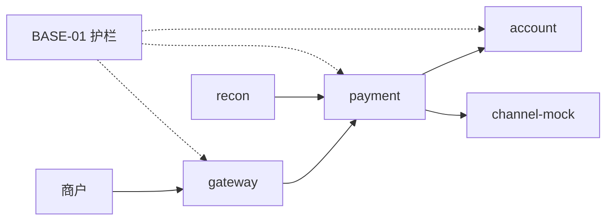

# BASE-01 工程骨架与构建

| 项 | 内容 |
|---|---|
| 功能点 | BASE-01（P0，第 1 周） |
| 所属链路 | 基础设施 |
| 代码提交 | `85f103d` `[BASE-01] add project skeleton and build tooling` |
| 分支 | `feat/BASE-01-skeleton` |
| 日期 | 2026-10-13 |
| 状态 | DONE |

## 一句话结论

仓库收成一个 Go 模块，并装上三条护栏：金额路径禁止浮点，业务包禁止直接取当前时间，服务之间禁止互相 import。本次在 macOS arm64 上 `make build` 产出 7 个二进制，`make lint` 为 0 告警；注入的 `time.Now()` 和跨服务 import 被拒绝；gateway 镜像以 uid 65532 运行。

## 1. 背景

### 1.1 系统简介

pay-system 是一个用 Go 编写的小型支付后端，模拟商户收款、退款、商户间转账三条资金链路，重点在数据一致性和性能。系统由 5 个部分组成：gateway（对外 HTTP 入口，负责签名校验和限流）、payment（支付单、退款单、转账单的状态管理和流程推进）、account（账户余额与记账，数据按商户分到 2 个数据库分片）、channel-mock（模拟微信、支付宝这类外部支付渠道）、recon（对账，核对系统内外数据是否一致）。服务之间用 Kitex RPC 同步调用，或通过 Kafka 消息异步通知；数据存在 MySQL 8.4，Redis 用于防重放。所有金额用整数“分”表示，所有记账只追加不修改。当前已完成：工程骨架与构建。7 个程序入口还是空的 `main`，没有业务代码。

### 1.2 本功能点在系统中的位置

BASE-01 不处理任何一笔支付。它规定后面的代码怎么编译、怎么被静态检查拦住、怎么打进镜像。



实线是将来的请求方向。虚线表示护栏盖住这些程序，不在请求链路上。

### 1.3 为什么需要它

不做这层护栏，第一笔账就会算错，而且编译器不会报错。商户收 100.00 元（10000 分），费率 60 个基点（0.60%）。整数公式 `(10000 × 60 + 5000) / 10000 = 60` 分，商户实收 9940 分（99.40 元）。金额若用浮点“元”，0.01 不能精确表示，多笔累加会差出 1 分，借方和贷方对不上。单模块仓库里，payment 还可以直接 import account 的数据库代码，绕过进程边界改余额。

## 2. 术语

| 术语 | 含义 |
|---|---|
| 分 | 金额最小单位。100 分 = 1.00 元。10000 分 = 100.00 元。全程用整数。 |
| 基点 | 费率单位。1 个基点 = 0.01%。60 个基点 = 0.60%。 |
| 分录 | 记账的一条记录，只追加、不修改。本功能点还没有分录代码。 |
| 分片 | 账户数据按商户拆进两个数据库。本功能点还没有分片代码。 |
| 签名校验 | 用密钥检查请求没有被篡改。gateway 以后做。 |
| 限流 | 限制单个商户的请求速率。gateway 以后做。 |
| Kitex RPC | 服务之间的同步调用。生成代码放在 `kitex_gen/`，本功能点还没生成。 |
| Kafka | 服务之间发异步消息的队列。本功能点还没接入。 |
| 单模块 | 整个仓库只有根目录一个 `go.mod`。编译器不阻止服务互相 import。 |
| depguard | golangci-lint 的规则，按目录拒绝指定的 import。 |
| forbidigo | golangci-lint 的规则，按源码文本拒绝指定写法。 |
| `clock.Clock` | 以后注入的时钟。测试可以把“现在”固定住。本功能点只先禁止业务包自己取时间。 |
| digest | 镜像内容的 sha256。写在标签后面，钉死具体字节，不跟随标签被重新推送。 |
| 多阶段构建 | Dockerfile 里两个 `FROM`。第一阶段编译，第二阶段只拷贝二进制。 |
| 非 root | 容器进程不是 uid 0。这里是 uid/gid 65532，用户名 `nonroot`。 |
| CGO | Go 调用 C 的开关。`CGO_ENABLED=0` 打出不依赖 C 库的静态二进制。 |
| sonic | JSON 库。旧版本在 Go 1.27 上会退回标准库 `encoding/json`。 |
| golangci-lint | 静态检查工具。本机 v2.14.0，不放进 `go.mod`。 |

## 3. 技术讲解

### 3.1 要解决的问题

本功能点只建立护栏，不实现收付款：

1. 金额不能用浮点。0.01 不能被二进制精确表示，差 1 分就让借贷不平。
2. 业务包不能调用 `time.Now()`。过期、重试、账单日都依赖“现在”，测试必须能把时间固定住。
3. 服务不能 import 另一个服务。否则 payment 能直接改 account 的表。
4. 公共包不能依赖上层。`pkg` 被所有程序使用，一旦引用某个服务，依赖就会倒过来。
5. 每个 `cmd` 只装配自己的服务，不能把另一个服务编进同一个进程。
6. 镜像可复现，且进程不是 root。标签会被覆盖；root 被攻破后能改系统文件。
7. 还没实现的构建目标必须失败。静默成功会让人以为环境或代码生成已经可用。

### 3.2 方案

根目录一个模块 `github.com/yym108/pay-system`，语言版本 `go 1.27.0`。本机编译器是 Go 1.27.2；`go 1.27.0` 是语言版本下限，不是编译器补丁号。显式依赖只有 `github.com/bytedance/sonic v1.15.4`：框架默认拉到的 v1.15.0 在 Go 1.27 上会退回 `encoding/json`。现在还没有 HTTP 框架，先把能用的版本锁进 `go.mod` 和 `go.sum`。

7 个入口在 `cmd/<name>/main.go`：`gateway`、`payment`、`account`、`recon`、`channel-mock`、`merchant-demo`、`paycli`。`main` 以后只做配置加载、装配、启动和退出。现在没有可装配的依赖，函数体是空的。

```go
// cmd/gateway/main.go：入口还没有业务逻辑。
func main() {
	// TODO(BASE-09): 加载网关配置；TODO(GW-01): 装配并启动网关服务。
}
```

**金额禁止浮点。** `forbidigo` 在 `service/` 和 `pkg/money` 里拒绝 `float32`、`float64` 这两个类型名，不限于名叫 amount 的字段，避免旁边混进一个 float 临时变量。`pkg/money` 还不存在，规则先占住目录。其他目录不禁，展示和脚本不走记账。手续费用整数：`(金额分 × 基点 + 5000) / 10000`，10000 分、60 基点得到正好 60 分。

**业务包禁止 `time.Now()`。** 只禁 `service/<服务名>/biz` 和 `job`。测试要把“现在”固定成 `2026-10-13 10:30:00+08:00`，不能读机器时间，也不能干等 30 分钟。真实时钟的实现本身要调用 `time.Now()`，所以不能全仓库一刀切。配置先在全仓库匹配，再用 `path-except` 收窄：除了列出的目录，其他路径上的告警被排除。

下面几行分别摘自 `.golangci.yml` 的禁止列表和排除规则，不是文件里连续的一段。`path-except` 表示：除了这些路径，其他文件上的对应告警被丢掉。

```yaml
- pattern: time\.Now
  msg: 当前时间必须通过注入的 clock.Clock 获取
- pattern: float64
  msg: 金额链路禁止使用浮点类型
- path-except: '(^|/)service/[^/]+/biz(/|/.*\.go$)|(^|/)job(/|/.*\.go$)'
  text: 'use of `time\.Now` forbidden'
- path-except: '(^|/)service(/|/.*\.go$)|(^|/)pkg/money(/|/.*\.go$)'
  text: 'use of `float(32|64)` forbidden'
```

**depguard 按目录划边界。** 单模块没有编译期隔离，用 lint 补上。`list-mode: lax` 时，没点名的包（标准库、第三方）放行；命中 deny 前缀的拒绝；若同时命中 allow，以 allow 为准。所以“拒绝整个 `service/`，但允许自己的服务前缀”能让同服务通过、跨服务失败。脚本已证实：account 引用 account 通过，payment 引用 account 被拒。

```yaml
# .golangci.yml：account 只能引用自己。payment、channel_mock 各有一条同样的规则。
service_account:
  list-mode: lax
  files:
    - "**/service/account/**/*.go"
  allow:
    - github.com/yym108/pay-system/service/account
  deny:
    - pkg: github.com/yym108/pay-system/service/
      desc: 服务之间必须通过 kitex_gen 或事件结构交互
```

命令名是 `channel-mock`（连字符），包目录是 `service/channel_mock`（下划线），规则两边都写了。`gateway/` 和 `job/` 只 deny `service/`。`pkg/` deny `service/`、`gateway/`、`job/`，公共库不能依赖上层。

| 入口 | 允许引用 | 拒绝 |
|---|---|---|
| `cmd/account` | `service/account` | 其他 `service/` |
| `cmd/payment` | `service/payment` | 其他 `service/` |
| `cmd/channel-mock` | `service/channel_mock` | 其他 `service/` |
| `cmd/recon` | `job/recon` | `service/`（对账是任务，不是 `service/recon`） |
| `cmd/gateway`、`cmd/merchant-demo`、`cmd/paycli` | 无服务包 | 全部 `service/` |

服务之间以后只走 `kitex_gen` 或事件结构。payment 不能直接执行 account 的 SQL，超时和崩溃停在进程边界上。

**镜像：多阶段、digest、非 root。** `--build-arg APP=<name>` 选择入口。构建阶段是带编译器的 `golang:1.27.2-alpine`，运行阶段只留 alpine 和一个静态二进制，源码和编译器不进最终镜像。`CGO_ENABLED=0` 不依赖 C 库。`test -n "$APP"` 在没传 APP 时失败。

```dockerfile
# deploy/Dockerfile：digest 钉死字节；运行用户不是 root。
FROM golang:1.27.2-alpine@sha256:f92b6ef800e499660581efdabdf25d9d817a9d124eaf900924f0504e7e27e12d AS builder
FROM alpine:3.22.1@sha256:4bcff63911fcb4448bd4fdacec207030997caf25e9bea4045fa6c8c44de311d1
USER nonroot
```

标签 `golang:1.27.2-alpine` 可以被重新推送，同一名字会指向另一层内容。`@sha256:` 变了，引用就变了，构建不会悄悄换基础镜像。用户由 `adduser -u 65532` 创建。非 root 时，进程被攻破也不能改系统目录或安装包。`.dockerignore` 排除 `deploy/.env`，密钥不进构建上下文。

**还没实现的 Makefile 目标故意失败。** `build`、`lint`、`test`、`test-integration`、`cover` 已经能跑。`gen`、`up`、`down`、`migrate`、`seed`、`e2e`、`chaos`、`load` 先占住名字，打印归属功能点后 `exit 1`。若退出码是 0，`make up` 会像成功一样返回。

```makefile
# Makefile：占位目标必须失败。
gen:
	@echo "gen 由 BASE-12 实现"
	@exit 1
```

本次 `make gen` 打印 `gen 由 BASE-12 实现`，make 报 `Error 1`，进程退出码 2。2 是 make 在配方失败时的退出码，配方本身是 `exit 1`。这是故意的。

### 3.3 为什么这样做

| 方案 | 做法 | 优点 | 缺点 | 结论 |
|---|---|---|---|---|
| 采用：单模块 + depguard | 一个 `go.mod`，lint 按目录拒绝跨服务 import | 一次 `go test ./...` 覆盖全仓 | 漏配规则就会放过 | 采用。一个人维护，不必同步多个模块的版本 |
| 备选：多模块 | 每个服务一个 `go.mod` | 编译器直接禁止跨服务 import | 公共包版本要反复同步 | 不采用 |
| 备选：金额用 float64 元 | 100.00 存成浮点 | 读起来像金额 | 0.01 不能精确表示 | 不采用。用 int64 分 |
| 备选：业务包直接 `time.Now()` | 需要时间就读机器时钟 | 少一个接口 | 过期测试只能真等或碰运气 | 不采用 |
| 备选：golang 标签 + root，占位目标退出 0 | 一个阶段，空配方 | 文件更短，命令不红 | 标签可被换掉；`make up` 假装成功 | 不采用 |

### 3.4 正确性

不涉及。本功能点不改余额、不推进订单、不调用外部系统，没有重复请求、并发冲突、中途崩溃或下游超时这条路径。

### 3.5 性能

不涉及。没有请求处理路径，也没有性能开关。本次没有压测数据。

## 4. 已完成内容

### 4.1 改动清单

以下是提交 `85f103d` 的文件。本报告和索引不在该提交里。

| 文件 | 新增 / 修改 | 作用 |
|---|---|---|
| `go.mod`、`go.sum` | 新增 | 模块路径、Go 1.27.0、锁定 sonic v1.15.4 |
| `cmd/*/main.go`（7 个） | 新增 | 空入口 |
| `Makefile` | 新增 | 可运行的构建/检查，和故意失败的占位目标 |
| `.golangci.yml` | 新增 | 规定的 linter，加上 depguard、forbidigo |
| `deploy/Dockerfile` | 新增 | 按 APP 多阶段构建，digest 锁定，非 root |
| `.dockerignore` | 新增 | 排除 git、IDE、二进制、覆盖率和 `deploy/.env` |
| `.gitignore` | 修改 | 补上 `*.log`、`.cache/` |
| `base_skeleton_test.go` | 新增 | 检查入口、模块、Makefile、配置文本、Dockerfile 文本、gitignore |
| `scripts/verify_lint_rules.sh` | 新增 | 注入违规代码，确认 lint 拒绝后再删掉 |
| `docs/01-tech-decisions.md` | 修改 | 本机 Go 改为 1.27.2，写入两个镜像 digest |
| `docs/02-requirements.md` | 修改 | 总表中 BASE-01 改为 DONE |
| `docs/03-conventions.md` | 修改 | v2.1，登记单模块和版本锁定 |
| `docs/04-dev-plan.md` | 修改 | 第 1 周勾选 BASE-01 所在的那一行 |

### 4.2 对外变化

| 类别 | 变化 |
|---|---|
| 接口 | 无 |
| 表结构 | 无 |
| 配置项 | 无新增运行配置。构建参数 `APP` 选择入口 |
| 错误码 | 无 |
| 指标 / 故障点 | 无 |

### 4.3 验收对照

运行环境：macOS Darwin arm64，Go 1.27.2，golangci-lint 2.14.0（该二进制用 Go 1.27.1 编译），Docker 引擎 29.4.0（客户端 29.8.2）。

| 验收条目 | 测试函数 | 类型 | 结果 |
|---|---|---|---|
| `make build` 产出 7 个二进制 | `TestBASE01BuildOutputs`；另手工清点 `bin/` | 单元 + 手工 | 通过。7 个 Mach-O arm64，各 1831794 字节 |
| `make lint` 无告警 | 无单独测试函数；本次 `make lint` | 手工 | 通过。`0 issues` |
| 在 `service/payment/biz` 写 `time.Now()` 能被拦截 | `scripts/verify_lint_rules.sh`。`TestBASE01LintPolicy` 只检查配置文本，不注入违规代码 | 脚本 | 通过。输出含 `rejected time.Now() in service/payment/biz` |
| `docker build --build-arg APP=gateway` 成功，且以非 root 运行 | `TestBASE01Dockerfile` 只检查文件文本；本次 `docker build` 与 `docker run --entrypoint id` | 单元 + 手工 | 通过。`uid=65532(nonroot) gid=65532(nonroot)` |

`make test` 还跑过 `TestBASE01CommandEntrypoints`、`TestBASE01ModuleMetadata`、`TestBASE01MakeTargets`、`TestBASE01LintPolicy`、`TestBASE01Gitignore`，包结果为 `ok`。它们检查文件是否存在、文本是否含规定字符串，不代替上面的 lint 注入和容器运行。

### 4.4 验证记录

| 命令 | 结果 |
|---|---|
| `gofmt -l .` | 无输出，退出码 0 |
| `make lint` | `0 issues`，退出码 0 |
| `make test` | `ok github.com/yym108/pay-system 2.724s`；7 个 `cmd` 包 `[no test files]`；退出码 0 |
| `make build` | `bin/` 下 7 个文件：`gateway`、`payment`、`account`、`recon`、`channel-mock`、`merchant-demo`、`paycli` |
| `./scripts/verify_lint_rules.sh` | 拒绝 `time.Now()`；允许 account 引用 account；拒绝 payment 引用 account；拒绝 pkg 引用 service。退出码 0 |
| `make cover` | 合计 **0.0%**。根包 `[no statements]`；7 个空 `main` 各 0.0% |
| `docker build --build-arg APP=gateway -f deploy/Dockerfile -t pay-system-base01-gateway .` | 成功。部分层命中缓存；编译步骤本次 1.4 秒。清单 `sha256:05e68d959f18...` |
| `docker run --rm --entrypoint id pay-system-base01-gateway` | `uid=65532(nonroot) gid=65532(nonroot) groups=65532(nonroot),65532(nonroot)`，退出码 0 |
| `make gen` | 打印 `gen 由 BASE-12 实现`，make 报 `Error 1`，进程退出码 2。故意失败 |
| `make test-integration` | 未运行。没有集成测试，也不访问 MySQL、Redis、Kafka |

0.0% 是因为还没有业务语句，测试也没有执行空的 `main`。项目对以后的核心包（`service/*/biz`、`pkg/money` 等）要求覆盖率不低于 70%。那些包还不存在，所以这条现在不适用。`groups` 列了两次，这是 `id` 的原样输出；uid 不是 0。`docker run` 用 `id` 换了入口，没有执行镜像里的 `/usr/local/bin/app`。空 `main` 执行了也只是马上退出，不能说明服务可用。

### 4.5 同步的文档

- `docs/01-tech-decisions.md`：本机 Go 改为 1.27.2；写入两个镜像 digest 和非 root 的 uid/gid。
- `docs/02-requirements.md`：总表中 BASE-01 从 TODO 改为 DONE。
- `docs/03-conventions.md`：记为 v2.1，说明已是根目录单模块，版本按技术决策锁定。
- `docs/04-dev-plan.md`：第 1 周勾选 BASE-01（与 BASE-02、BASE-03 拆成两行，避免误读为一起完成）。
- `docs/02-requirements.md`：BASE-01 的三条验收复选框已勾选。

## 5. 未完成与风险

- 7 个 `main` 仍是空函数。配置加载留给 BASE-09，启动留给 GW-01、ACC-11、PAY-01 等。
- `gen` 归 BASE-12，`up`/`down` 归 BASE-02，`migrate`/`seed` 归 BASE-03，`e2e` 归 QA-04，`chaos` 归 QA-01，`load` 归 QA-02。现在调用会失败。
- 版本已由 `go.sum` 和镜像 digest 锁定。另一条安全要求是在持续集成里跑 `govulncheck` 查已知漏洞。仓库没有 CI 配置，本次也未运行。
- 浮点禁令在配置里，脚本没有注入 `float32`/`float64`。`pkg/money` 还不存在。
- “cmd 只装配自己的服务”写在配置里，测试只检查规则名在不在。脚本没有注入 `cmd` 的跨服务 import，这条没有被实际拒绝过。

## 6. 如何复现

前置：Go 1.27.2、golangci-lint 2.14.0、Docker 可用。仓库根目录、分支 `feat/BASE-01-skeleton`、含提交 `85f103d`。

```bash
gofmt -l .                          # 无输出
make lint                           # 0 issues
make test                           # ok github.com/yym108/pay-system
make build && ls bin                # 7 个可执行文件
./scripts/verify_lint_rules.sh      # 四行 rejected/allowed，临时文件会删掉
make cover                          # total 0.0%
make gen                            # 非零退出，打印“gen 由 BASE-12 实现”
docker build --build-arg APP=gateway -f deploy/Dockerfile -t pay-system-base01-gateway .
docker run --rm --entrypoint id pay-system-base01-gateway
# uid=65532(nonroot) gid=65532(nonroot)
```

不要在验证脚本运行期间另起 `make lint`：它会临时写入 `service/` 和 `pkg/`，退出时删除。

## 7. 讲解要点

1. 为什么金额不用浮点？0.01 元在二进制里是无穷小数。10000 分乘 60 个基点，整数除法得到正好 60 分；浮点累加会差 1 分。
2. 为什么用 depguard 而不是多模块？一个 `go.mod` 让测试简单，编译器却不阻止跨服务 import。规则是拒绝 `service/` 前缀、允许自己的前缀：同服务通过，跨服务失败，`pkg` 不能依赖上层，`cmd` 只装配自己的服务。
3. 为什么占位目标要失败，镜像还要锁 digest、不用 root？退出码 0 会假装环境已经可用。digest 防止标签被悄悄换掉；本次 `id` 显示 uid 65532，不是 root。

## 延伸阅读

- `docs/02-requirements.md`：BASE-01 小节、§2.3 仓库分层、§2.5.3 第 1 条
- `docs/03-conventions.md`：§3 金额、§4 时间
- `docs/01-tech-decisions.md`：D1 单模块、D8 sonic、§2 镜像 digest
- `.golangci.yml`、`deploy/Dockerfile`、`Makefile`、`scripts/verify_lint_rules.sh`

## 修订记录

| 日期 | 提交 | 修订内容 |
|---|---|---|
| 2026-10-13 | 尚未提交 | 初稿 |
