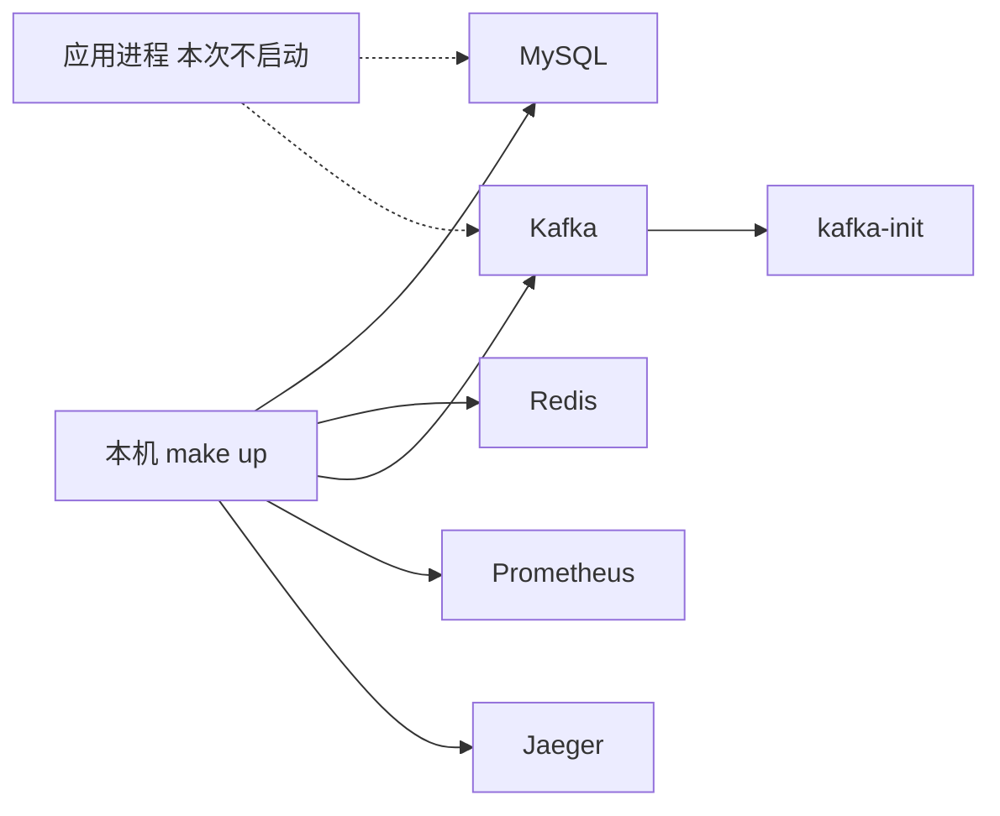
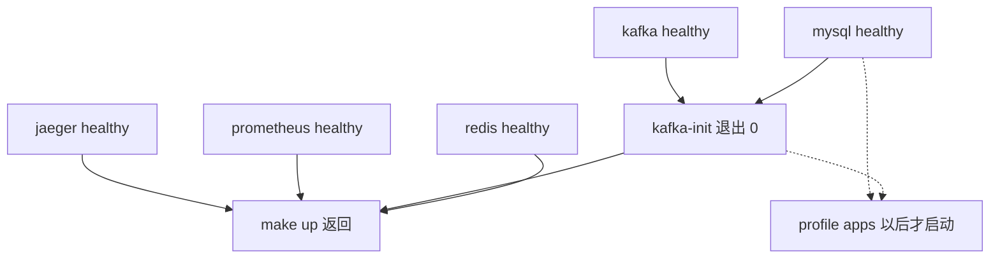

# BASE-02 本地环境编排

| 项 | 内容 |
|---|---|
| 功能点 | BASE-02（P0，第 1 周） |
| 所属链路 | 基础设施 |
| 代码提交 | `df47a17` `[BASE-02] add local docker compose environment` |
| 分支 | `feat/BASE-02-local-env` |
| 日期 | 2026-10-14 |
| 状态 | DONE |

## 一句话结论

一条 `make up` 拉起本机支付后端依赖的数据库、缓存、消息队列和可观测组件。镜像已在本地时，mysql、redis、kafka、prometheus、jaeger 在 14 秒内变为 healthy，一次性容器 `kafka-init` 退出码为 0，并建好 6 个各 3 分区的 topic。应用进程这次不启动：入口还是空的 `main`，健康检查和迁移都还没做。

## 1. 背景

### 1.1 系统简介

pay-system 是一个用 Go 编写的小型支付后端，模拟商户收款、退款、商户间转账三条资金链路，重点在数据一致性和性能。系统由 5 个部分组成：gateway（对外 HTTP 入口，负责签名校验和限流）、payment（支付单、退款单、转账单的状态管理和流程推进）、account（账户余额与记账，数据按商户分到 2 个数据库分片）、channel-mock（模拟微信、支付宝这类外部支付渠道）、recon（对账，核对系统内外数据是否一致）。服务之间用 Kitex RPC 同步调用，或通过 Kafka 消息异步通知；数据存在 MySQL 8.4，Redis 用于防重放。所有金额用整数“分”表示，所有记账只追加不修改。当前已完成：工程骨架与构建、本地环境编排。7 个程序入口仍是空的 `main`，没有业务代码。

### 1.2 本功能点在系统中的位置

BASE-02 不处理任何一笔支付。它把后面的服务要连的 MySQL、Redis、Kafka，以及看指标、看链路的 Prometheus、Jaeger，放进同一份编排里。



实线是这次真正启动的容器。虚线是以后应用会连的依赖，现在没有进程去连。

### 1.3 为什么需要它

没有统一编排，每个人自己起一套版本不同的 MySQL 和 Kafka，后面的迁移和集成测试无法对齐。更具体的失败是：Kafka 4 单节点如果沿用默认“每个内部 topic 存 3 份”，唯一的那个进程满足不了 3 份，broker 起不来，topic 建不出来，支付成功后的异步入账没有地方投递。本功能点把版本、端口、副本数和 topic 名单写死，并证明 `make up` 在镜像已拉取时 3 分钟内能到 healthy。

## 2. 术语

| 术语 | 含义 |
|---|---|
| Docker Compose | 用一个 YAML 文件描述一组容器，一条命令一起启动或停止。 |
| profile | Compose 的可选分组。不点名就不启动。这里有 `obs`（可观测）和 `apps`（应用）。 |
| 健康检查 | 容器里定期跑的一条命令。成功则状态是 healthy，失败则是 unhealthy。 |
| `depends_on` | 声明启动顺序。`service_healthy` 表示等对方 healthy；`service_completed_successfully` 表示等一次性容器退出码为 0。 |
| KRaft | Kafka 4 的集群管理模式，不再使用 ZooKeeper。一个进程可以同时当 broker（收发消息）和 controller（管集群元数据）。 |
| topic | Kafka 里的一条消息管道，按名字区分。支付成功、退款成功是不同 topic。 |
| 分区 | topic 被切成的独立队列。3 分区表示最多 3 个消费者可以并行读，互不抢同一条队列。 |
| 副本数 | 同一份分区数据写在几个 broker 上。单节点只能是 1。 |
| 自动建 topic | 生产者往一个不存在的名字发消息时，broker 自己建出来。这里关掉，避免拼错名字也“成功”。 |
| `127.0.0.1` | 本机回环地址。绑在这里的端口，局域网里的其他机器连不上。 |
| `0.0.0.0` | 监听所有网卡。同一网络的其他机器也能连到。 |
| OTLP | 发送链路追踪数据的协议。应用以后把 trace 发到 Jaeger 的 4317 端口。 |
| `.env` | 环境变量文件。真正含密码的 `deploy/.env` 不提交；仓库只提交演示用的 `.env.example`。 |

## 3. 技术讲解

### 3.1 要解决的问题

1. 版本必须和已锁定的镜像一致：MySQL 8.4.11、Redis 8.10.2、Kafka 4.3.1、迁移工具 v4.20.1、Prometheus v3.15.0、Jaeger 2.22.0。
2. 长期容器要有健康检查。一次性的建 topic 容器成功标准是退出码 0，不是一直活着。
3. Kafka 单节点必须能启动，并且只存在事先列好的 topic，每个 3 分区、1 个副本。
4. 数据库密码、管理令牌、渠道密钥不进 Git。
5. 除了三个对外演示端口，宿主机端口只绑 `127.0.0.1`，避免笔记本在公共网络上露出数据库和管理端口。
6. 应用进程这次不能假装 healthy。空的 `main` 一启动就退出；健康检查接口和数据库迁移还没实现。

### 3.2 方案

`make up` 启动 5 个长期容器和 1 个一次性容器。`make up-lite` 少启动后两个可观测容器。

| 容器 | 作用 | 这次是否启动 | 成功标准 |
|---|---|---|---|
| mysql | 账户、支付、对账以后共用的数据库。缓冲池 256MB，最大连接 500，时区 `+08:00` | 是 | `mysqladmin ping` 成功 |
| redis | 以后存防重放用的临时键 | 是 | `redis-cli ping` 返回 PONG |
| kafka | 单节点 KRaft，堆 512MB。容器之间走 `kafka:9092`，本机工具走 `127.0.0.1:9094` | 是 | broker API 能应答 |
| kafka-init | 创建 6 个 topic 后退出 | 是 | 退出码 0 |
| prometheus | 拉取指标。现在只抓它自己，应用指标以后再加 | `make up` 是，`make up-lite` 否 | `/-/healthy` 返回成功 |
| jaeger | 接收链路数据并提供网页。健康检查打容器内的 13133，这个端口不映射到宿主机 | 同 prometheus | `127.0.0.1:13133/status` 成功 |
| migrate、seed | 以后跑迁移和种子数据。现在的命令打印说明并 `exit 1` | 否 | 不由 `make up` 启动 |
| gateway 等 6 个应用 | 占位，声明端口和依赖。命令同样 `exit 1` | 否 | 不由 `make up` 启动 |

6 个 topic 是：`pay.payment.succeeded`、`pay.refund.succeeded`、`pay.refund.failed`、`pay.transfer.succeeded`、`pay.transfer.failed`、`pay.dlq`。前五个对应支付、退款、转账的结果通知；`pay.dlq` 是消费失败后的死信，方便事后排查，不自动重放进业务 topic。

启动顺序如下。`make up` 只走到 `kafka-init` 退出；虚线是写在 YAML 里、这次不执行的应用依赖。



Kafka 的内部 topic（保存消费进度、事务状态、共享协调状态）默认要 3 个副本。只有 1 个 broker 时，这个默认值无法满足，进程起不来。所以副本数和最小同步副本都设为 1。业务 topic 也是 1 个副本：本地没有第二台机器可抄。3 分区的含义是：以后 account 可以起最多 3 个并行消费者，每个读一个分区；它不提高单条消息的可靠性。

自动建 topic 关闭。生产者发到 `pay.payment.succeded`（少一个字母）时，broker 不会悄悄建一个新管道，发送会失败，错误留在调用方。topic 只由 `kafka-init` 按名单创建，并带 `--if-not-exists`，重复执行不会因为“已存在”失败。

下面这段是 broker 的关键环境变量，不是完整配置。`CLUSTER_ID` 固定，是为了数据卷还在时重启不会因为集群 ID 对不上而拒绝启动。

```yaml
# deploy/docker-compose.yml：单节点必须把内部 topic 副本数从默认 3 改为 1。
KAFKA_OFFSETS_TOPIC_REPLICATION_FACTOR: 1
KAFKA_TRANSACTION_STATE_LOG_REPLICATION_FACTOR: 1
KAFKA_SHARE_COORDINATOR_STATE_TOPIC_REPLICATION_FACTOR: 1
KAFKA_AUTO_CREATE_TOPICS_ENABLE: "false"
KAFKA_NUM_PARTITIONS: 3
KAFKA_HEAP_OPTS: "-Xms512m -Xmx512m"
```

**为什么应用容器不启动。** 7 个 `cmd/*/main.go` 的 `main` 是空的，进程马上退出，不可能保持 healthy。健康检查接口还没做，数据库迁移和种子数据也还没做。如果现在把它们放进 `make up`，要么容器反复退出，要么用假的健康检查假装可用。两者都会让“3 分钟内全部 healthy”变成一句假话。

因此应用、`migrate`、`seed` 放在 profile `apps` 里，只声明端口和依赖，占位命令以非 0 退出。`make up` 和 `make up-lite` 都不启用这个 profile。以后迁移命令换成真的、健康检查能返回成功，再把它们并进默认启动。完整的“新克隆后一条命令拉起全部服务”仍要等迁移和健康检查两个功能点，本功能点不把它标成完成。

**端口。** 数据库、Redis、Kafka、Prometheus、Jaeger、管理端口和指标端口都绑 `127.0.0.1`。只有 gateway 的 8080、channel-mock 的 9080、merchant-demo 的 9100 绑 `0.0.0.0`，因为它们是以后给本机以外的演示客户端调用的业务口。管理口 8090 和各进程的 6060–6064 仍然只在本机。Jaeger 的健康检查口 13133 只在容器网络里，不映射出来。

**不自动读 `deploy/.env`。** Compose 会从“项目目录”自动加载名为 `.env` 的文件。如果项目目录是 `deploy/`，它会读到可能含真实密码的 `deploy/.env`。`deploy/compose.sh` 把项目目录设为仓库根，并用 `--env-file` 显式指定文件。开发时默认是 `deploy/.env`（由 `.env.example` 复制而来，不提交）；测试把 `ENV_FILE` 指到临时副本，不创建 `deploy/.env`。副作用是：相对路径的文件挂载相对仓库根，所以脚本路径写成 `./deploy/kafka/init-topics.sh`，不是 `./kafka/init-topics.sh`。

```sh
# deploy/compose.sh：项目目录是仓库根，环境文件由调用方指定。
exec docker compose \
  --project-name pay-system \
  --project-directory "$root" \
  --env-file "$env_file" \
  -f "$root/deploy/docker-compose.yml" \
  "$@"
```

**`.env.example` 的作用。** 它是唯一提交进仓库的环境文件，里面全是演示值。Compose 真正插值用到的是 `MYSQL_ROOT_PASSWORD`（MySQL root，应用以后不用这个账号）。其余变量是以后各程序要读的数据库地址、Kafka 地址、32 字节主密钥和管理令牌，现在没有进程去读。复制成 `deploy/.env` 再改，是本机日常用法；验证可以不复制，用 `ENV_FILE=deploy/.env.example`。

`make down` 停掉 `obs` 和 `apps` 两个 profile 里的容器，默认保留数据卷。`make down V=1` 同时删除本项目的命名卷。环境文件不存在时，`down` 回退到 example，避免为了清理而必须先造一个含密码的文件。

### 3.3 为什么这样做

| 方案 | 做法 | 优点 | 缺点 | 结论 |
|---|---|---|---|---|
| 采用：基础设施先启动，应用放在未启用的 profile | `make up` 只等 5 个长期容器 healthy 和 `kafka-init` 退出 0 | 验收可测，不会把空进程说成健康 | 现在还不能一条命令看到支付接口 | 采用 |
| 备选：现在就启动 7 个应用镜像 | 用项目 Dockerfile 构建空 `main` | YAML 看起来“全启动了” | 进程马上退出，healthy 永远到不了；或要写假健康检查 | 不采用 |
| 备选：内部 topic 保持默认 3 副本 | 不改 Kafka 环境变量 | 少写几行 | 单节点满足不了 3 副本，broker 起不来 | 不采用 |
| 备选：项目目录设为 `deploy/` | 挂载路径可以写成 `./prometheus/...` | 路径更短 | Compose 会自动读 `deploy/.env`，验证时可能碰到真实密码 | 不采用 |

### 3.4 正确性

不涉及资金正确性：本功能点不写账户、不改余额、不调用支付接口。环境本身的重复启动和清理由下面的测试覆盖。

| 场景 | 系统行为 | 最终状态 | 证明 |
|---|---|---|---|
| 再次执行建 topic | 脚本带 `--if-not-exists` | 本次测试没有在保留卷的情况下第二次 `make up`。测到的是删卷后 `up-lite` 仍能建 topic | `TestBASE02Stack` |
| `make down` 之后再 `make down V=1` | 先停容器留卷，再删卷 | 卷被删光，随后 `up-lite` 从空数据启动 | `TestBASE02Stack` |
| 进程在 `kafka-init` 成功前崩溃 | 等待脚本看到非 0 退出码就失败 | 本次只跑了成功路径，没有人为杀掉 `kafka-init` | 未单独注入 |
| 应用容器被误启动 | 占位命令 `exit 1`，且 `make up` 不启用 `apps` | 测试确认 `make up` 后没有 gateway、migrate、seed | `TestBASE02Stack` |

### 3.5 性能

不涉及性能优化对比。没有开关，也没有吞吐基线。本次只测了启动耗时，见 4.4：镜像已在本地时，`make up` 到 5 个长期容器 healthy 用了 14 秒。

## 4. 已完成内容

### 4.1 改动清单

以下是提交 `df47a17` 的文件。本报告和索引不在该提交里。

| 文件 | 新增 / 修改 | 作用 |
|---|---|---|
| `deploy/docker-compose.yml` | 新增 | 基础设施、`kafka-init`、`obs` 与 `apps` profile |
| `deploy/docker-compose.chaos.yml` | 新增 | 可合并的空覆盖，故障注入以后再写 |
| `deploy/.env.example` | 新增 | 演示环境变量 |
| `deploy/compose.sh` | 新增 | 固定项目名和项目目录，显式指定 env 文件 |
| `deploy/wait-ready.sh` | 新增 | 轮询到 healthy，且 `kafka-init` 退出码为 0；超时 180 秒 |
| `deploy/kafka/init-topics.sh` | 新增 | 创建 6 个 topic |
| `deploy/prometheus/prometheus.yml` | 新增 | 只抓取 Prometheus 自己 |
| `Makefile` | 修改 | `up`、`up-lite`、`down`；`V=1` 删卷 |
| `base02_local_env_test.go` | 新增 | 检查文件里的镜像、端口、topic、Makefile |
| `base02_local_env_integration_test.go` | 新增 | 渲染端口、启动、topic、停机和删卷 |
| `docs/01-tech-decisions.md` | 修改 | 记下单节点副本数必须为 1，以及项目目录的取舍 |
| `docs/02-requirements.md` | 修改 | 澄清 healthy 范围，状态改为 DONE |
| `docs/03-conventions.md` | 修改 | 登记 `MYSQL_ROOT_PASSWORD` |
| `docs/04-dev-plan.md` | 修改 | 勾选 BASE-02，BASE-03 仍未完成 |
| `docs/interview-notes.md` | 新增 | 副本数、挂载路径、`ps` 分列错位 |

### 4.2 对外变化

| 类别 | 变化 |
|---|---|
| 接口 | 无 |
| 表结构 | 无。MySQL 只是空实例，没有建业务库 |
| 配置项 | 新增 compose 专用的 `MYSQL_ROOT_PASSWORD`。`.env.example` 写入以后各程序要用的演示值，当前没有进程读取 |
| 错误码 | 无 |
| 指标 / 故障点 | 无新指标。故障注入文件只是占位，不设置任何故障点 |

### 4.3 验收对照

运行环境：macOS Darwin arm64，Go 1.27.2，golangci-lint 2.14.0（该二进制用 Go 1.27.1 编译），Docker 引擎 29.4.0（客户端 29.8.2）。镜像在测试开始前已经在本地。

| 验收条目 | 测试函数 | 类型 | 结果 |
|---|---|---|---|
| 复制 example 后 `make up`，3 分钟内 mysql、redis、kafka、prometheus、jaeger healthy，`kafka-init` 退出码 0，不启动 apps | `TestBASE02Stack` | 集成 | 通过。healthy 用时 14 秒 |
| `make down` 停容器并保留卷；`make down V=1` 删除本项目数据卷 | `TestBASE02Stack` | 集成 | 通过 |
| `obs` 渲染结果的宿主机端口全部绑定 `127.0.0.1`；`apps` 里只有 8080、9080、9100 可以不绑 | `TestBASE02ComposeConfig` | 集成 | 通过。0.36 秒 |
| `make up-lite` 不包含 prometheus、jaeger | `TestBASE02Stack` | 集成 | 通过 |
| 6 个 topic 各 3 分区、副本数 1，且关闭自动建 topic | `TestBASE02Stack` | 集成 | 通过 |

同一次 `go test -run TestBASE02` 还跑了 `TestBASE02ComposeDeclaresInfra`、`TestBASE02TopicScript`、`TestBASE02EnvExample`、`TestBASE02MakefileTargets`、`TestBASE02ChaosPlaceholder`、`TestBASE02ConventionsRegisterRootPassword`，全部通过。它们只检查文件文本，不代替上面的容器启动。

### 4.4 验证记录

写报告时在仓库根目录、分支 `feat/BASE-02-local-env`、含提交 `df47a17` 上重新执行。

| 命令 | 结果 |
|---|---|
| `gofmt -l .` | 无输出，退出码 0 |
| `make lint` | `0 issues`，退出码 0 |
| `make test` | `ok github.com/yym108/pay-system 3.207s`；7 个 `cmd` 包 `[no test files]`；退出码 0 |
| `go test -race -tags integration -count=1 -timeout 20m -v -run TestBASE02 .` | 通过，包耗时 33.825 秒。`TestBASE02Stack` 日志：`make up 到全部 healthy 用时 14s` |
| `make down V=1 ENV_FILE=deploy/.env.example` | 退出码 0。随后 `docker ps` 与 `docker volume ls` 按项目标签过滤，都无输出。`deploy/.env` 不存在 |
| `make test-integration` | 未单独执行。上面的 `go test -run TestBASE02` 覆盖了当前仓库里的全部 BASE-02 测试；没有再跑一遍无过滤的集成测试 |
| `make cover` | 未运行。本功能点没有业务包语句，覆盖率门禁不适用；写报告时没有执行这条命令 |

14 秒是从 `make up` 开始到等待脚本返回，包含 MySQL 初始化、Kafka 变成 healthy、`kafka-init` 建完 topic。测试把 `.env.example` 复制到临时文件再传给 `ENV_FILE`，没有创建 `deploy/.env`。常驻内存合计是否不超过 6GB，本次没有采样，未验证。

### 4.5 同步的文档

- `docs/02-requirements.md`：写明 `make up` 的 healthy 范围是 5 个长期容器加 `kafka-init` 退出码 0；应用和迁移放在 profile `apps`，不启动。总表状态改为 DONE，验收已勾选。
- `docs/03-conventions.md`：登记 `MYSQL_ROOT_PASSWORD`，说明应用不使用 root。
- `docs/01-tech-decisions.md`：单节点内部 topic 副本数必须为 1；项目目录设为仓库根，避免自动读取 `deploy/.env`。
- `docs/04-dev-plan.md`：勾选 BASE-02，BASE-03 单独留空。
- `docs/interview-notes.md`：记下副本数、挂载路径相对仓库根、`ps` 输出用空格分列会把退出码错位。

## 5. 未完成与风险

- 应用进程、迁移、种子仍是占位。迁移和种子由 BASE-03 替换命令；健康检查由 OPS-01 提供。在此之前 `docker compose --profile apps up` 会失败，这是故意的。
- “新克隆后一条命令拉起全部服务并可用”还没完成，要等 BASE-03 和 OPS-01。
- `docker-compose.chaos.yml` 能和主编排合并，但不注入故障。演练留给 QA-01。
- 本次没有在保留数据卷的情况下第二次 `make up`，也没有人为让 `kafka-init` 失败。重复创建靠 `--if-not-exists`；失败时等待脚本会非 0 退出，这条没有单独演练。
- 6GB 内存上限未测。
- Kafka 日志保留 168 小时（7 天）写在环境变量里，本次测试没有查询 broker 上的保留配置，只检查了堆大小和“禁止自动建 topic”。

## 6. 如何复现

前置：Go 1.27.2、golangci-lint 2.14.0、Docker 可用，且 MySQL 8.4.11、Redis 8.10.2、`apache/kafka:4.3.1`、Prometheus v3.15.0、Jaeger 2.22.0 已在本地。仓库根目录，分支 `feat/BASE-02-local-env`，含提交 `df47a17`。不要事先创建 `deploy/.env`。

```bash
gofmt -l .                          # 无输出
make lint                           # 0 issues
make test                           # ok github.com/yym108/pay-system
go test -race -tags integration -count=1 -timeout 20m -v -run TestBASE02 .
# 日志中应有：make up 到全部 healthy 用时 <3m
make down V=1 ENV_FILE=deploy/.env.example
docker ps -aq --filter label=com.docker.compose.project=pay-system
docker volume ls -q --filter label=com.docker.compose.project=pay-system
# 两条 docker 命令都无输出；deploy/.env 不应出现
```

日常启动是 `cp deploy/.env.example deploy/.env && make up`。验证不必复制，把 `ENV_FILE` 指到 example 或临时文件即可。

## 7. 讲解要点

1. 为什么单节点要把内部 topic 副本数改成 1？Kafka 默认要 3 份。只有 1 个 broker 时写不满 3 份，进程起不来。业务 topic 也是 1 份；3 分区只表示以后最多 3 个消费者并行读，不表示有 3 份拷贝。
2. 为什么 `make up` 不启动应用？空 `main` 会立刻退出，健康检查和迁移都还没做。把它们放进默认启动，要么永远不 healthy，要么要用假检查凑数。所以放在未启用的 profile `apps`，占位命令以失败退出。
3. 为什么项目目录是仓库根而不是 `deploy/`？Compose 会自动读项目目录下的 `.env`。目录若是 `deploy/`，就会读到不该在验证时打开的 `deploy/.env`。显式 `--env-file` 加上仓库根，避免这条隐式读取。

## 延伸阅读

- `docs/02-requirements.md`：BASE-02 小节、§2.2 端口、NFR-DEP-01
- `docs/05-api.md`：§11.1 topic 名单
- `docs/01-tech-decisions.md`：§2.2 镜像版本、BASE-02 的单节点说明
- `docs/03-conventions.md`：§8 配置项，含 `MYSQL_ROOT_PASSWORD`
- `deploy/docker-compose.yml`、`deploy/compose.sh`、`deploy/kafka/init-topics.sh`、`Makefile`

## 修订记录

| 日期 | 提交 | 修订内容 |
|---|---|---|
| 2026-10-14 | 与报告同提交 | 初稿 |
