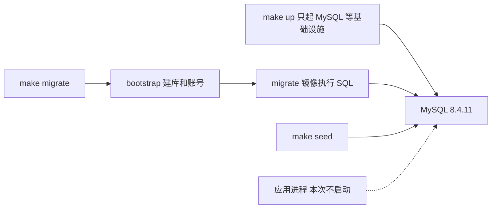
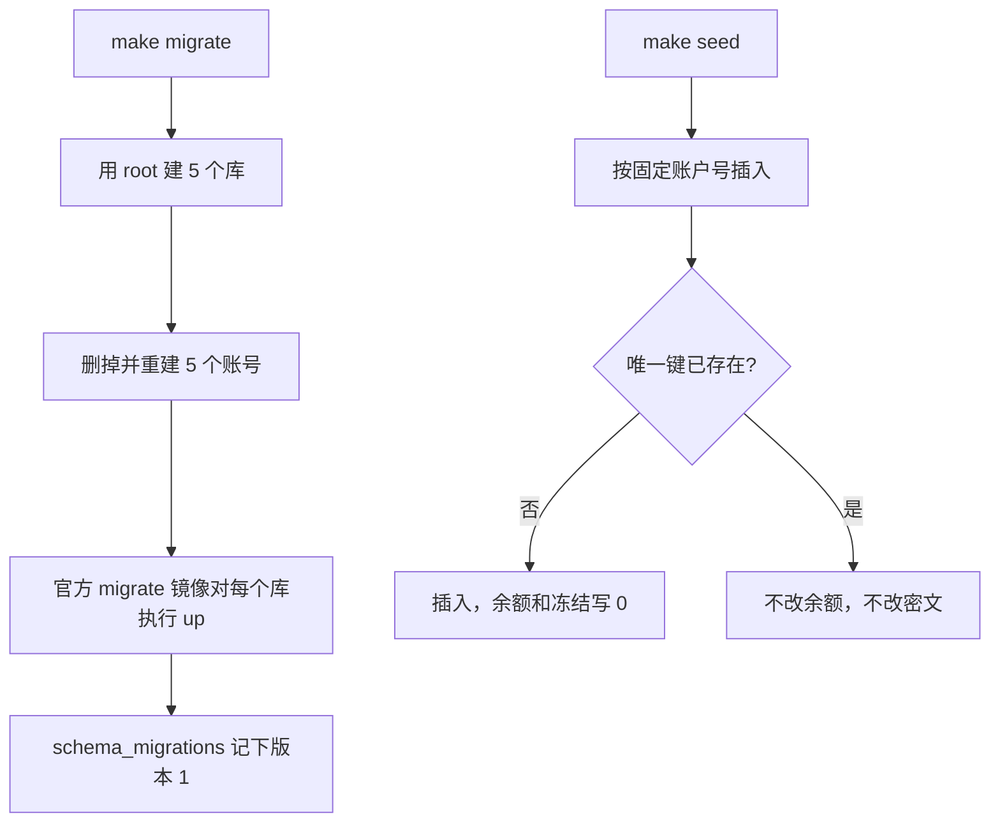

# BASE-03 数据库迁移与种子数据

| 项 | 内容 |
|---|---|
| 功能点 | BASE-03（P0，第 1 周） |
| 所属链路 | 基础设施 |
| 代码提交 | `28061d8` `[BASE-03] add migrations, db bootstrap and idempotent seed` |
| 分支 | `feat/BASE-03-migrate-seed` |
| 日期 | 2026-10-14 |
| 状态 | DONE |

## 一句话结论

空库上执行 `make migrate` 会建出 5 个库、21 张业务表；两个账户分片用同一份 SQL，比较脚本确认结构一致。`make seed` 连续两次，账户数停在分片 0 的 25、分片 1 的 26，商户停在 3，余额和分录都是 0。种子不直接写商户余额。可读性修订时又对了一次密文：两次种子后三个商户的 `SHA2(app_secret_cipher, 256)` 完全相同，密文没有被覆盖。

## 1. 背景

### 1.1 系统简介

pay-system 是一个用 Go 编写的小型支付后端，模拟商户收款、退款、商户间转账三条资金链路，重点在数据一致性和性能。系统由 5 个部分组成：gateway（对外 HTTP 入口，负责签名校验和限流；它自己没有数据库，核对签名后把请求转给 payment）、payment（支付单、退款单、转账单的状态管理和流程推进）、account（账户余额与记账，数据按商户分到 2 个数据库分片）、channel-mock（假装成微信、支付宝这种外部支付渠道，本仓库里这个假渠道叫 `mockpay`）、recon（对账，核对系统内外数据是否一致）。服务之间用 Kitex 做同步 RPC（Kitex 是一套 Go 的远程调用框架；RPC 就是一个进程直接调用另一个进程的函数），或通过 Kafka 消息异步通知。数据存在 MySQL 8.4。Redis 用来防重放：同一段随机串短时间内不能再用第二次，避免别人把截到的请求原样再发一次。所有金额用整数“分”表示，所有记账只追加不修改。当前已完成：工程骨架与构建、本地环境编排、数据库迁移与种子。应用进程仍是空的 `main`，还不能收款。

### 1.2 本功能点在系统中的位置

BASE-03 不处理支付请求。它在已经启动的 MySQL 上建库、建表、建账号，并写入演示用的平台账户和商户。后面的开户、记账、支付都假设这些表和零余额账户已经在。



实线是这次会跑的步骤。虚线是以后应用去连这些库。`make up` 仍然不启动应用，也不自动跑迁移。

### 1.3 为什么需要它

没有这份迁移，每个开发者手写建表，两个账户分片很容易建得不一样。支付入账时，分片 0 有“子账户号”这一列、分片 1 没有，同一条记账 SQL 会在其中一个分片失败。子账户号就是后面说的 `sub_no`：同一类平台账户拆成多行时，用它区分第几行。

没有种子，演示商户不存在。更危险的做法是种子直接把商户余额写成 10000 分（100.00 元），却不写分录。余额的定义是“贷方合计减借方合计”。没有分录时这个差必须是 0。账上却有 100.00 元，对账无法解释这 100.00 元从哪来。

## 2. 术语

| 术语 | 含义 |
|---|---|
| schema | MySQL 里的一个库。本项目用库来隔离服务，不是用多台机器。 |
| 分片 | 同一类表拆成两份，按商户号决定进哪一份。这里是 `pay_account_0` 和 `pay_account_1`。 |
| 分 | 金额单位。100 分 = 1.00 元。全程用整数，不用小数。 |
| 基点 | 费率单位。10000 个基点 = 100%。60 个基点 = 0.60%。 |
| 检查约束 | 数据库拒绝不满足条件的写入。名字以 `ck_` 开头。和“余额能不能为负”的关系见 `allow_overdraft`。 |
| 借方 / 贷方 | 复式记账的两个方向。一张凭证里两边金额合计必须相等。 |
| 账户 | 一行余额。商户结算账户表示平台欠商户的钱。 |
| 子账户 / `sub_no` | 同一类平台账户拆成的多行。`sub_no` 是第几行，从 0 编到 N−1。N 是配置 `PLATFORM_SUB_ACCOUNTS`，默认 8。 |
| 渠道应收 | 渠道已经代收、还没结算给平台的钱。渠道编码是 `mockpay`：channel-mock 假装的那一个外部渠道，不是真的微信或支付宝。 |
| 渠道编码 | 区分哪家渠道的短名字。现在只有 `mockpay`。 |
| 转账在途 | 跨分片转账时暂时挂账的平台账户。付款方分片先贷记，收款方分片再借记。 |
| 手续费收入 | 平台留下的手续费，也是一类平台账户。 |
| 余额方向 | `CREDIT`：贷方加、借方减。`DEBIT`：借记加、贷记减。商户结算、手续费、在途是 `CREDIT`。渠道应收是 `DEBIT`。 |
| `allow_overdraft` | 是否允许“余额减冻结”为负。商户结算账户是 0，不允许。平台账户是 1，允许。约束 `ck_account_available` 写的就是这条，不是“任何余额都不能为负”。 |
| 冻结单 | 先占住一笔钱、稍后再扣或释放的记录。表 `account_freeze`。这次只建表。 |
| 转账分支 | 转账在某一个分片上的结果行。表 `transfer_branch`。这次只建表。 |
| 渠道流水 | 平台和渠道之间一次支付或退款的交互记录。表 `channel_txn`。 |
| 本地消息 | 和业务写在同一个数据库事务里的待发消息，表名 `outbox`。重启后还能补发。 |
| 商户通知 | 平台通知商户“支付成功了”的重试记录。表 `merchant_notify`。 |
| 差错 | 对账时本地和渠道对不上的一行。表 `recon_diff`。 |
| 交易库 | 这里指 `pay_payment` 和两个账户分片。对账账号对它们只能读。 |
| 分录 | 记账的一条明细，只追加、不修改。 |
| 凭证 | 一次记账的头记录，下面挂至少 2 条分录。 |
| 行锁 | 更新某一行时，其他事务要等这行锁放开。 |
| 热点账户 | 几乎每笔交易都要改的那一行。这里是每个分片的渠道应收和手续费收入。 |
| 业务单号 `biz_no` | 这笔账对应的支付单号、退款单号或转账单号。以后选子账户用它。本功能点还不记账。 |
| 迁移 | 用有版本号的 SQL 文件建表或改表。已合并的文件不再改。 |
| up / down | up 把库迁到最新；down 按相反的 SQL 拆掉这次加上的表。 |
| `schema_migrations` | 迁移工具自己的表，记录版本和是否执行到一半。不是业务表。 |
| dirty | golang-migrate 在迁移失败时把版本标成脏，下次 up 会拒绝。本次没有故意制造失败。 |
| 幂等 | 同一操作做两次，结果和做一次一样。 |
| 唯一索引 | 禁止两行在这些列上取值相同。冲突时走“已存在”分支。 |
| 最小权限 | 每个程序只用自己的数据库账号。 |
| DSN | 连接串。演示值形如 `用户:口令@tcp(mysql:3306)/pay_payment?parseTime=true&loc=Asia%2FShanghai`。括号是地址写法，不是 shell 语法。 |
| 密文 | 商户签名密钥加密后的字节。明文只留在环境文件里。 |
| AES-256-GCM | 用 32 字节密钥的对称加密。附带校验标签，改 1 字节就解不开。 |
| nonce | 每次加密用的 12 字节随机数。同一明文两次加密，密文不同。 |
| profile | Compose 的可选分组。不点名就不启动。应用和迁移都在 `apps` 里。 |
| digest | 镜像内容的哈希。标签名可以被覆盖推送，digest 变了构建才会变。 |
| `timetzdata` | Go 的编译标签。把时区数据编进二进制。 |
| sonic | JSON 库，工程骨架锁在 `v1.15.4`。更旧版本在 Go 1.27 上会退回慢实现。业务代码还没引用它，所以用空导入留在 `go.mod`。 |

## 3. 技术讲解

### 3.1 要解决的问题

1. 五个库必须分开：账户两个分片、支付、对账、模拟渠道。服务不能随便写别人的表。
2. 两个账户分片的表、列、索引、检查约束必须一致。分片规则是商户号数字部分除以 2 的余数。`M100001` 进分片 1，`M100002` 进分片 0。
3. 已合并的迁移文件不能再改。变更只能加新文件。
4. 每个服务一个数据库账号，权限按库收紧。对账账号不能改支付库和账户库。
5. 种子可重复执行。平台账户按 `PLATFORM_SUB_ACCOUNTS`（默认 8）在每个分片各开一套子账户。三个演示商户只在所属分片有结算账户，余额必须是 0。
6. 商户余额只能来自分录。种子写非零余额会让“余额 = 贷方合计 − 借方合计”不成立。
7. 商户密钥要加密后写入，列不能改成可空。加密包还没做，密文格式必须先定死，以后的解密包能解开。
8. `make up` 仍然只启动基础设施。迁移和种子要单独执行。应用健康检查还没做，不能把应用拉进默认启动。

### 3.2 方案

先建库和账号，再按库执行同一套迁移文件，最后幂等插入种子。账户两个分片共用 `migrations/account/`，各执行一次，所以不会出现“分片 1 用复制表导致约束被改名”。



上图的判断发生在数据库唯一索引上，不是先查再插。

五个库：

| 库 | 谁用 | 这次建了什么 |
|---|---|---|
| `pay_account_0`、`pay_account_1` | 账户服务，各一个连接 | 各 5 张业务表：账户、凭证、分录、冻结单、转账分支 |
| `pay_payment` | 支付服务 | 商户、支付单、退款单、转账单、渠道流水、本地消息、商户通知，共 7 张 |
| `pay_recon` | 对账任务 | 批次、渠道账单、差错，共 3 张 |
| `pay_channel_mock` | 模拟渠道 | 1 张渠道自己的交易表，和平台数据隔开 |

每个库还会多一张工具表 `schema_migrations`。所以分片各 6 张表，支付 8 张，对账 4 张，模拟渠道 2 张。业务表仍是 21 张。

gateway 没有自己的库。它只收 HTTP、验签，再调用 payment。所以五个库里没有 gateway。

账号在迁移 SQL 之外创建。迁移工具要求目标库已经存在，它自己不会建库，也不该拿着 root 跑。bootstrap（`internal/bootstrap/bootstrap.go`）按顺序拼出一段 SQL：

1. 五个库各执行 `CREATE DATABASE IF NOT EXISTS`，再 `ALTER DATABASE` 把字符集改成 `utf8mb4` / `utf8mb4_bin`。
2. 五个账号依次执行三步：`DROP USER IF EXISTS '<账号>'@'%'`，`CREATE USER '<账号>'@'%' IDENTIFIED BY '<口令>'`，然后紧跟这个账号自己的 `GRANT`。

`GRANT` 语句摘要（`%` 表示允许从任意主机连接，本地演示环境如此）：

```sql
GRANT SELECT, INSERT, UPDATE, DELETE ON `pay_account_0`.* TO 'svc_account'@'%';
GRANT SELECT, INSERT, UPDATE, DELETE ON `pay_account_1`.* TO 'svc_account'@'%';
GRANT SELECT, INSERT, UPDATE, DELETE ON `pay_payment`.* TO 'svc_payment'@'%';
GRANT SELECT, INSERT, UPDATE, DELETE ON `pay_recon`.* TO 'svc_recon'@'%';
GRANT SELECT ON `pay_payment`.*   TO 'svc_recon'@'%';
GRANT SELECT ON `pay_account_0`.* TO 'svc_recon'@'%';
GRANT SELECT ON `pay_account_1`.* TO 'svc_recon'@'%';
GRANT SELECT, INSERT, UPDATE, DELETE ON `pay_channel_mock`.* TO 'svc_channel_mock'@'%';
-- migrator 对五个库各一条
GRANT ALL PRIVILEGES ON `pay_account_0`.* TO 'migrator'@'%';  -- 另外四个库同样写法
```

全部是库级授权（`库名.*`），没有表级和全局权限。首次执行时用户还不存在，`IF EXISTS` 让 `DROP` 不报错。

重复执行时权限怎么恢复：`DROP USER` 会连同这个账号的全部权限一起删掉，`CREATE USER` 建出的新账号没有任何权限，随后的 `GRANT` 只授上面列出的那几条。所以每次 `make migrate` 之后，权限都回到代码里写的样子：以前手工多授的会被清掉，被误删的会补回来。第二轮可读性修订时在 compose 上实测：第一次 `make migrate` 后，`SHOW GRANTS FOR 'svc_recon'@'%'` 返回 5 行：

```text
GRANT USAGE ON *.* TO `svc_recon`@`%`
GRANT SELECT ON `pay_account_0`.* TO `svc_recon`@`%`
GRANT SELECT ON `pay_account_1`.* TO `svc_recon`@`%`
GRANT SELECT ON `pay_payment`.* TO `svc_recon`@`%`
GRANT SELECT, INSERT, UPDATE, DELETE ON `pay_recon`.* TO `svc_recon`@`%`
```

`USAGE` 是 MySQL 给每个账号自动加的一行，意思是“能登录，没有任何权限”。随后用 root 手工执行 `GRANT INSERT ON pay_payment.* TO 'svc_recon'@'%'`，`pay_payment` 那一行变成 `SELECT, INSERT`。再跑第二次 `make migrate`，`SHOW GRANTS` 又回到上面 5 行，多授的 `INSERT` 不见了。

代码没有发 `KILL`。本次没有业务进程连着这些账号，所以没有实测旧连接会不会断，未验证。

bootstrap 把这些语句放在一次 `multiStatements` 执行里。MySQL 的建库、删用户会自动提交，中途失败不能整段回滚。恢复办法是再跑一次：建库有 `IF NOT EXISTS`，用户有 `DROP USER IF EXISTS`。中途失败本身没有注入，未验证。

| 账号 | 权限 |
|---|---|
| `svc_account` | `pay_account_0`、`pay_account_1` 可增删改查 |
| `svc_payment` | `pay_payment` 可增删改查 |
| `svc_recon` | `pay_recon` 可增删改查；支付库和两个账户库只能 `SELECT` |
| `svc_channel_mock` | `pay_channel_mock` 可增删改查 |
| `migrator` | 五个库的全部权限，只给迁移容器做建表、改表 |

平台账户为什么要拆子账户：每笔支付成功都要改“本分片的渠道应收”和“本分片的手续费收入”。如果每种只有 1 行，这个分片上的入账会抢同一把行锁。默认 N = 8，来自配置项 `PLATFORM_SUB_ACCOUNTS`（约定里的默认值，`deploy/.env.example` 写着 `PLATFORM_SUB_ACCOUNTS=8`）。种子在每个分片为三类平台账户各开 `sub_no` = 0 到 7，共 24 行：渠道应收（`owner_id` = `mockpay`，余额方向 `DEBIT`，允许透支）、手续费收入、转账在途（后两类是 `CREDIT`，也允许透支）。3 × 8 = 24。再加本分片的商户结算账户。

选哪一行不是本功能点做的。以后记账按 `crc32(biz_no) % PLATFORM_SUB_ACCOUNTS` 选子账户。crc32 是把任意字节算成一个整数的函数，这里只用来把单号均匀分到 0 到 N−1。`biz_no` 是业务单号，除数跟着配置走，不是写死 8。选行属于后面的记账（ACC-03）和热点子账户（OPT-03）。本功能点只把行开出来。

渠道应收是 `DEBIT`：借记增加这一行的 `balance`，贷记减少。对外看到的渠道应收，是两个分片、全部 `sub_no` 的 `balance` 列相加，不是再把借贷流水算一遍。

平台子账户允许为负（`allow_overdraft = 1`）。原因不在一张凭证内部：同一个 `biz_no` 只算出一个 `sub_no`，一张凭证的平台分录只落在这一行。原因在于“钱进来”和“钱出去”是两张凭证，单号不同，选中的子账户也就可能不同。需求的资金模型（§2.5.1、§2.5.2）没有单独写一句“为什么允许透支”，下面两点是从它的分录规则推出来的：

- 渠道应收：支付凭证用支付单号 `pay_no` 选子账户，借记让那一行增加。退款凭证用退款单号 `refund_no` 选子账户，贷记让那一行减少。例如支付 `P1` 选中子账户 3，余额 +10000；它的部分退款 `R1`（3000 分）选中子账户 5，这一行减 3000。子账户 5 如果之前没有收过钱，就变成 −3000。只看这两笔，全部子账户相加是 7000，和“收 10000、退 3000”一致。
- 转账在途：跨分片转账时，付款方分片贷记在途（+T），收款方分片借记在途（−T）。这笔钱在收款方分片的在途行上只有借记，对应的贷记在另一个分片。这一行起始是 0、期间没有别的转账从这个分片转出时，确认后就是 −T。这和子账户拆不拆无关，`PLATFORM_SUB_ACCOUNTS = 1` 时也一样。没有进行中的转账时，两个分片的在途合计回到 0。

技术决策 D19 的说法与此一致：平台账户允许透支，单个子账户为负不影响正确性，每一行仍各自满足“余额 = 借贷合计”。对外只看汇总。商户结算账户不拆行，`allow_overdraft = 0`，要做余额检查。本功能点插入时 `balance` 仍是 0，以上记账行为属于后面的 ACC 和 OPT-03 功能点，这里没有测。

演示商户：

| 商户 | 费率 | 分片 | 结算账户在哪 |
|---|---|---|---|
| `M100001` | 0 | 1（100001 除以 2 余 1） | 只在分片 1 |
| `M100002` | 60 个基点，即 0.60% | 0 | 只在分片 0 |
| `M100003` | 0 | 1 | 只在分片 1 |

分片 0 因此是 24 个平台账户 + 1 个商户 = 25。分片 1 是 24 + 2 = 26。商户表 3 行。这就是本次 `make seed` 打印的数字。

账户号必须每次算出来都一样，重复执行才能撞上同一行，而不是再开一个新账户。格式是 `AC` 加 19 位数字，总长 21。

平台账户：`AC` + 分片 1 位 + 类型 2 位 + 子账户 4 位 + 12 个 0。类型 01 是渠道应收，02 是手续费，03 是在途。分片 0、渠道应收、子账户 0 的号是 `AC0010000000000000000`。

商户账户：`AC` + `9` + 商户号数字部分补到 18 位。首位 9 和平台账户的 0、1 错开。`M100001` 是 `AC9000000000000100001`。

这段 SQL 在做插入。冲突时把账户号设成它自己，不出现 `balance =` 或 `frozen_amount =`，所以不会把后来记账写上的余额改回 0：

```sql
INSERT INTO account (
  account_no, owner_type, owner_id, account_type, currency, sub_no,
  balance_direction, balance, frozen_amount, allow_overdraft, status
) VALUES (?, ?, ?, ?, 'CNY', ?, ?, 0, 0, ?, 'ACTIVE')
ON DUPLICATE KEY UPDATE account_no = account_no
```

账户幂等靠两把唯一索引：`uk_account_no (account_no)`，以及 `uk_owner_account_type_sub (owner_type, owner_id, account_type, currency, sub_no)`。商户幂等靠 `uk_merchant_id (merchant_id)` 和 `uk_app_id (app_id)`。

商户插入是：

```sql
INSERT INTO merchant (
  merchant_id, merchant_name, app_id, app_secret_cipher, secret_version,
  notify_url, fee_rate_bp, status
) VALUES (?, ?, ?, ?, 1, '', ?, 'ACTIVE')
ON DUPLICATE KEY UPDATE merchant_id = merchant_id
```

冲突时不更新 `app_secret_cipher`。nonce 随机，如果冲突时重写密文，第二次种子会把密钥改掉。可读性修订时在 compose 上实测：第一次 seed 之后三个商户密文的 SHA-256 分别是 `047744dd…c39e`、`1db5703e…f82e`、`79647e0f…28c2`（各 61 字节）；第二次 seed 之后三个哈希逐字相同。61 = 1 字节版本 + 12 字节 nonce + 32 字节明文 + 16 字节标签。

字节数怎么量：`app_secret_cipher` 的列类型是 `VARBINARY(256)`（迁移 `migrations/payment/000001_init.up.sql`）。这是二进制串，没有文本字符集：`information_schema.COLUMNS` 里 `CHARACTER_SET_NAME` 和 `COLLATION_NAME` 都是 NULL，`CHARSET(app_secret_cipher)` 返回 `binary`。二进制串里一个“字符”就是一个字节，所以 `CHAR_LENGTH`（数字符）和 `LENGTH`（数字节）结果相同。第一轮用的是 `CHAR_LENGTH`，第二轮改用 `LENGTH()` 并把两者一起查：三个商户都是 `LENGTH = 61`、`CHAR_LENGTH = 61`。第二轮是新建的数据卷，nonce 重新随机，所以哈希和第一轮不同（如 `M100001` 为 `0e603fd1…b99f`）。这一轮两次 seed 之间三个哈希同样逐字相同。

密文算法是 AES-256-GCM。格式是以后的密钥加密包已经写明的规则，本功能点只用标准库实现，不交付那个包：

`版本 1 字节（取值 1） + 随机 nonce 12 字节 + 密文 + 16 字节校验标签`

主密钥来自 `SECRET_MASTER_KEY`，是 base64，解码后必须是 32 字节。明文格式的配置名是 `DEMO_APP_SECRET_FORMAT`，默认 `demo_secret_%s_0123456789ab`，`%s` 换成商户号。接口测试向量里的商户密钥原文是 `demo_secret_M100001_0123456789ab`，和这个格式代入 `M100001` 的结果相同。以后的解密包必须按这个格式解开。

时区：连接串里有 `loc=Asia/Shanghai`。Go 的 MySQL 驱动解析 `loc` 时调用 `time.LoadLocation`。运行镜像是锁定 digest 的 Alpine，没有时区数据时，这个调用返回 `unknown time zone Asia/Shanghai`。实现阶段在还没编入时区数据的 seed 容器里实际看到的错误就是 `seed: open account shard 0: unknown time zone Asia/Shanghai`。这次修订没有再构建一个去掉标签的镜像去复现。构建加 `-tags timetzdata`，把时区数据编进二进制，运行阶段不 `apk add`，避免装一个未锁定版本的包。

### 3.3 为什么这样做

| 方案 | 做法 | 优点 | 缺点 | 结论 |
|---|---|---|---|---|
| 采用：按服务拆库，账户分片共用一份迁移，各执行一次 | 迁移容器对两个分片 DSN 各跑同一目录 | 结构一致有文件保证；服务账号可以按库授权 | 多一次执行 | 采用 |
| 备选：一个库里放所有表 | 靠表名前缀区分 | 迁移简单 | 对账账号很难只读“支付相关的表”；模拟渠道不再像外部系统 | 不采用 |
| 备选：分片 1 用复制表 | 从分片 0 `CREATE TABLE ... LIKE` | 少写一份 SQL | MySQL 复制表时会把检查约束改名为 `<表名>_chk_1`。按约束名查错时两个分片对不上 | 不采用。本次查 `%_chk_%` 结果是 0，名字都以 `ck_` 开头 |
| 备选：种子把商户余额写成一个演示数 | 直接 `UPDATE balance` | 马上能演示退款 | 没有对应分录，借贷对不上 | 不采用 |
| 备选：等密钥加密包做完再写商户 | 列先改成可空，或本功能点去实现那个包 | 不重复加密代码 | 可空改变了表的含义；提前实现那个包等于把另一个功能点做进来 | 不采用。按已写明的密文格式自己加密 |
| 备选：运行镜像安装 `tzdata` | `apk add` | 连接串不用改 | 包版本没锁定，破坏按 digest 复现构建 | 不采用 |

### 3.4 正确性

种子会写账户行，所以要说明重复、并发、崩溃时钱不会被写乱。本次没有并发测试，也没有在中途杀进程。下面没测到的写明了。

| 场景 | 系统行为 | 最终状态 | 证明 |
|---|---|---|---|
| 同一份种子再执行一次 | 唯一键冲突后，更新子句不改余额、冻结和密文 | 两次都是分片 0 = 25、分片 1 = 26、商户 3。非零余额 0，分录 0。三个商户密文 SHA-256 前后相同 | `make seed` 两次；SHA-256 对比见 4.4；`TestBASE03SeedIdempotentAndShardPlacement` |
| 两个种子同时插入同一个商户 | 唯一索引只让一个插入成功，另一个走冲突分支 | 应只剩 1 行，余额仍是 0。没有并发测试，这是索引语义，不是实测 | 未验证 |
| 商户已提交、结算账户还没插入时进程退出 | 代码先在 `pay_payment` 提交商户，再在所属分片开结算账户，两步不在一个事务。再跑时商户冲突被忽略，账户按固定账户号补上 | 补跑后账户应在所属分片，余额 0。没有在两步之间杀进程 | 未验证 |
| 反过来：结算账户先插入、商户还没提交 | 代码不是这个顺序。每个商户都是先提交商户行，再开账户。平台账户更早，在所有商户之前按分片提交 | 不会出现“只有结算账户、没有商户行”这种由本程序主动写出的中间态。崩溃注入未做 | 未验证 |
| 迁移 SQL 执行到一半失败 | golang-migrate 把 `schema_migrations.dirty` 标成 1，下次 up 拒绝继续。这是该工具的行为，不是我们自己写的恢复逻辑。官方用法是先 `migrate force <版本号>` 把脏标记清掉（不跑 SQL），再决定 up 或 down。`force` 本次未验证 | 没有故意写坏 SQL。集成测试做的是完整 down 再 up | 失败路径未验证。down 后再 up 由 `TestBASE03MigrateShardsAndDownUp` 覆盖 |
| 已成功的 `make migrate` 再执行一次 | bootstrap 仍重建账号；迁移工具发现版本已是 1 | 本次实测：5 次 `no change`，退出码 0。表还在 | 见 4.4 |
| 对账账号写交易库 | 写语句在权限检查阶段被拒绝，不会执行 | 集成测试只断言两条 `INSERT`：`pay_payment.merchant` 和 `pay_account_0.account`，错误号须为 1142 或 1044。测试没有覆盖 `pay_account_1`，也没有发 `DELETE`。第二轮修订时在 compose 上用 `svc_recon` 手工补发：写 `pay_account_1.account` 的 `INSERT`、`pay_payment.merchant` 的 `DELETE`、`pay_payment` 里的 `CREATE TABLE`，全部返回 1142 | `TestBASE03ReconWriteDenied`；`pay_account_1` 和 `DELETE` 只有手工实测，见 4.4 |

两个错误号的含义：

- 1142（`ER_TABLEACCESS_DENIED_ERROR`）：表级拒绝。账号能进这个库，但对这张表没有这种操作的权限。消息形如 `INSERT command denied to user 'svc_recon'@... for table 'merchant'`。`svc_recon` 在 `pay_payment` 和两个账户库上有 `SELECT`，所以对这些库的 `INSERT`、`DELETE`、`CREATE` 都报 1142。
- 1044（`ER_DBACCESS_DENIED_ERROR`）：库级拒绝。账号对整个库一项权限都没有，又发了以库为对象的操作，例如 `USE` 这个库或连接时把它设成默认库。消息形如 `Access denied for user 'svc_recon'@'%' to database 'pay_channel_mock'`。

第二轮在 compose 上对照了一次：`svc_recon` 执行 `USE pay_channel_mock`、或用 `pay_channel_mock` 作默认库连接，都得到 1044；对同一个库里的 `mock_txn` 表发 `INSERT`，得到的是 1142。所以按现在的授权和测试里的两条 `INSERT`，实际只会出现 1142。测试也接受 1044，是一种宽松写法：两者都表示“被权限挡住、语句没有执行”，测试关心的是被拒绝，不关心拒绝发生在库级还是表级。例如以后把测试连接的默认库换成一个 `svc_recon` 没有任何权限的库，错误会在库级出现，变成 1044，结论不变。测试要排除的是其他错误，例如 1364（缺列默认值）或 1146（表不存在），它们说明语句已经越过权限检查。

为什么不能直接写余额，用一笔以后才会发生的支付说明。种子本身不算手续费。公式来自项目约定：`fee = (amount × rate_bp + 5000) / 10000`，加 5000 再整除是四舍五入到分。这里只用来举例。订单 10000 分（100.00 元），费率 60 个基点。代入后 `(10000 × 60 + 5000) / 10000 = 60` 分（0.60 元）。支付成功后，分录应该是：渠道应收借 10000，商户贷 9940，手续费贷 60。商户余额变成 9940 分。如果种子事先写成 10000 分，这笔支付再贷记 9940，余额变成 19940 分。分录只能解释 9940 分。19940 − 9940 = 10000，就是种子多写的那 100.00 元。所以种子插入时余额和冻结都写 0，并且不写任何分录。写报告时的查询：两个分片 `balance <> 0 OR frozen_amount <> 0` 的行数合计是 0，`ledger_entry` 合计是 0。

### 3.5 性能

不涉及。这次没有压测，也没有对比 `PLATFORM_SUB_ACCOUNTS=1` 和 `8` 的锁等待。子账户只是把行建出来，吞吐对比留给后面的性能功能点。

## 4. 已完成内容

### 4.1 改动清单

以下是提交 `28061d8` 的文件。本报告和索引不在该提交里。

| 文件 | 新增 / 修改 | 作用 |
|---|---|---|
| `migrations/account/000001_init.{up,down}.sql` | 新增 | 账户分片的 5 张表。两个分片各执行一次 |
| `migrations/payment/`、`migrations/recon/`、`migrations/channel_mock/` | 新增 | 另外三个库的初始表和对应的 down |
| `cmd/bootstrap`、`internal/bootstrap` | 新增 | 建库，按最小权限重建五个账号 |
| `cmd/seed`、`internal/seed` | 新增 | 幂等种子。冲突不改余额和密文 |
| `internal/dbmigrate`、`internal/dbschema` | 新增 | 测试里用 golang-migrate v4.20.1（与镜像 `migrate/migrate:v4.20.1` 同一版本）执行 SQL，并比较两个分片 |
| `deploy/migrate.sh`、`deploy/migrate/run.sh`、`deploy/seed.sh`、`deploy/load-env.sh` | 新增 | `make migrate` / `make seed`。环境文件按行导出，避免 DSN 里的括号被 shell 当成子命令 |
| `deploy/docker-compose.yml` | 修改 | 替换 migrate / seed 命令，增加 bootstrap。仍在 profile `apps`，`make up` 不启动 |
| `deploy/Dockerfile` | 修改 | 构建加 `-tags timetzdata`，运行阶段不装包 |
| `deploy/.env.example` | 修改 | 补对账、模拟渠道、迁移账号的口令，以及密钥明文格式 |
| `Makefile` | 修改 | `migrate`、`seed`、`seed-load`。`make migrate DIR=down` 回滚 |
| `scripts/compare-account-shards.sh` | 新增 | 比较两个账户分片的表、列、索引、检查约束 |
| `scripts/verify_lint_rules.sh`、`.golangci.yml` | 修改 | `service/`、`gateway/`、`job/`、`pkg/` 不能 import `internal/`。业务代码不该调用种子和建库，所以用 lint 拦住 |
| `base03_migrate_test.go`、`internal/seed/seed_test.go`、`internal/dbmigrate/acceptance_integration_test.go` | 新增 | 文件布局、账户号、密文格式、三条验收 |
| `docs/schema/schema_draft.sql` | 删除 | 设计稿拆完即删，迁移文件是唯一来源 |
| `docs/database.md` 等文档 | 修改 | 来源改为迁移文件，登记配置和口径澄清 |
| `tools/tools.go` | 新增 | 空导入 sonic。整理依赖时如果没有引用，锁定版本会被删掉；这行是为了保住工程骨架的锁定，不是种子逻辑 |

`make build` 仍然只产出 7 个业务程序：`gateway`、`payment`、`account`、`recon`、`channel-mock`、`merchant-demo`、`paycli`。bootstrap 和 seed 不在其中，需要时用 Dockerfile 构建。`internal/` 出现在这个功能点，是因为建库、种子、迁移测试都不是对外服务；lint 禁止 `service/`、`gateway/`、`job/`、`pkg/` 引用它，避免以后业务代码直接调用种子 SQL。

### 4.2 对外变化

| 类别 | 变化 |
|---|---|
| 接口 | 无 |
| 表结构 | 从设计稿落成迁移。5 个库、21 张业务表，外加每库一张 `schema_migrations`。没有改列的可空性。商户密钥列仍然非空 |
| 配置项 | 新增 `MYSQL_RECON_PASSWORD`、`MYSQL_CHANNEL_MOCK_PASSWORD`、`MYSQL_MIGRATOR_PASSWORD`、`DEMO_APP_SECRET_FORMAT`、`SEED_LOAD`。种子还读取已有的 `PLATFORM_SUB_ACCOUNTS`，默认 8，example 里本来就有，本功能点没有新发明这个变量。`MYSQL_HOST` 默认 `127.0.0.1`，故意不写进 example，避免编排把本机地址插进容器。`SEED_LOAD` 的含义见表下 |
| 错误码 | 无 |
| 指标 / 故障点 | 无 |

`SEED_LOAD` 是种子程序的开关，决定要不要额外创建压测商户：

- 取值：只有字符串 `1` 打开（`cmd/seed/main.go` 判断 `os.Getenv("SEED_LOAD") == "1"`）。不设、`0`、`true` 等其他值都是关闭。默认关闭，约定 §8 登记的默认值是 `0`，compose 里 seed 容器写的是 `${SEED_LOAD:-0}`。`deploy/.env.example` 里没有这一项。
- 关闭时：只建平台子账户和三个演示商户 `M100001`–`M100003`。
- 打开时：再加 100 个压测商户 `M200000`–`M200099`，费率 0，每个只在所属分片开一个零余额结算账户（两个分片各 50 个）。不写分录，不写余额。
- 与 `make seed-load` 的关系：`make seed-load` 就是 `SEED_LOAD=1` 加上 `make seed` 用的同一个脚本 `deploy/seed.sh`，不需要手动设这个变量。`make seed` 不设它。
- 注意：`deploy/seed.sh` 读环境文件时会把文件里的每一行重新 `export`。如果环境文件里写了 `SEED_LOAD=0`，会覆盖 `make seed-load` 设的 `1`。这一点是读代码得出的，没有实测。

第二轮修订时在 compose 上实测（在两次 `make seed` 之后）：`make seed-load` 连续两次，都打印 `accounts_shard_0=75 accounts_shard_1=76 merchants=103 load=true`。75 = 25 + 50，76 = 26 + 50。查库：`M2` 开头商户 100 个，从 `M200000` 到 `M200099`，费率非 0 的 0 个；两个分片的压测结算账户各 50 个；两个分片非零余额或非零冻结的行 0，分录 0。再执行 `SEED_LOAD=true make seed`，日志是 `load=false`，确认 `true` 不算打开。种子打印的是表里的总行数，所以这次仍显示 75 / 76 / 103：关闭开关不会删除已经建好的压测商户。

### 4.3 验收对照

运行环境：macOS Darwin arm64，Go 1.27.2，golangci-lint 2.14.0（该二进制用 Go 1.27.1 编译），Docker 服务端 29.4.0、客户端 29.8.2。写报告时在仓库根目录、分支 `feat/BASE-03-migrate-seed`、含提交 `28061d8` 上执行。

| 验收条目 | 测试函数 | 类型 | 结果 |
|---|---|---|---|
| 空库 `make migrate` 成功，两个账户分片结构一致，down 后再 up 成功 | `TestBASE03MigrateShardsAndDownUp` | 集成 | 通过。写报告时 `go test -race -tags integration -count=1 ./internal/dbmigrate/` 耗时 26.306 秒，包含本测试。compose 这次只做了 up，没有再做 down |
| `make seed` 连续两次，账户和商户数量不变，结算账户只在所属分片 | `TestBASE03SeedIdempotentAndShardPlacement` | 集成 | 通过。compose 上两次都打印分片 0 = 25、分片 1 = 26、商户 3 |
| 用 `svc_recon` 向 `pay_payment`、`pay_account_0` 写入被拒绝 | `TestBASE03ReconWriteDenied` | 集成 | 通过，包含在上面 26.306 秒的包里。测试先确认 `SELECT COUNT(*) FROM pay_payment.merchant` 能成功，再对 `pay_payment.merchant`、`pay_account_0.account` 各发一条 `INSERT`，断言错误号是 1142 或 1044（含义见 3.4）。测试不覆盖 `pay_account_1`；它和 `pay_account_0` 是同一条 `GRANT SELECT` 写法，第二轮修订时在 compose 上手工补测，返回 1142 |

同一次 `make test` 还跑了 `TestBASE03MigrationLayout`、`TestShardOf`、`TestAccountNo`、`TestSealLayoutAndRoundTrip`、`TestInsertSQLDoesNotRewriteBalance`，全部通过。它们不连数据库。

### 4.4 验证记录

| 命令 | 结果 |
|---|---|
| `gofmt -l .` | 无输出，随后命令继续，退出码 0 |
| `make lint` | `0 issues`，退出码 0 |
| `make test` | `ok github.com/yym108/pay-system 2.525s`；`internal/seed` 为 cached；退出码 0 |
| `make test-integration` | 退出码 0。根包 `ok ... 37.032s`。`internal/dbmigrate` 和 `internal/seed` 显示 `(cached)`，这次没有重跑容器 |
| `go test -race -tags integration -count=1 -timeout 8m ./internal/dbmigrate/` | 通过，26.306 秒。用来补上一条里被缓存跳过的验收测试 |
| `make up ENV_FILE=deploy/.env.example` 然后 `make migrate` | 成功。日志 5 次 `1/u init`，表示 5 个库各自把第 1 号迁移执行成功。`SELECT VERSION()` = `8.4.11` |
| 空库上第二次 `make migrate`（可读性修订时） | bootstrap 仍打印 `database users ready`。迁移容器 5 次 `no change`，退出码 0 |
| `make seed` 两次 | 两次都是 `accounts_shard_0=25 accounts_shard_1=26 merchants=3` |
| 两次 seed 之间对比密文（可读性修订时） | `SELECT merchant_id, SHA2(app_secret_cipher, 256), CHAR_LENGTH(app_secret_cipher) FROM pay_payment.merchant`。三个商户的哈希在第二次 seed 之后逐字相同，字节长度都是 61 |
| 第二轮：`make up-lite` 后两次 `make migrate`，中间手工多授一条权限 | 两次都打印 `database users ready`，退出码 0。第一次迁移输出 5 次 `1/u init` 和 1 次 `2/u merchant_fee_rate`（后者是之后 PAY-10 新增的支付库迁移，不属于本功能点），第二次 5 次 `no change`。`SHOW GRANTS FOR 'svc_recon'@'%'` 第一次后 5 行；root 手工 `GRANT INSERT ON pay_payment.*` 后变成 `SELECT, INSERT`；第二次 migrate 后回到原来 5 行。原文见 3.2 |
| 第二轮：`svc_recon` 手工写入 | `SELECT COUNT(*) FROM pay_payment.merchant` 成功。`INSERT` 到 `pay_payment.merchant`、`pay_account_0.account`、`pay_account_1.account`，`DELETE FROM pay_payment.merchant`，`CREATE TABLE pay_payment.x`，`INSERT` 到 `pay_channel_mock.mock_txn`：全部 `ERROR 1142`。`USE pay_channel_mock` 和以它为默认库连接：`ERROR 1044` |
| 第二轮：两次 `make seed` 与密文 | 两次都是 `accounts_shard_0=25 accounts_shard_1=26 merchants=3 load=false`。`SELECT merchant_id, SHA2(app_secret_cipher,256), LENGTH(app_secret_cipher), CHAR_LENGTH(app_secret_cipher) ...`：三行都是 61 / 61，两次 seed 前后哈希输出用 `cmp` 比较完全相同。列信息 `varbinary(256)`，字符集和排序规则为 NULL，`CHARSET()` 为 `binary` |
| 第二轮：`make seed-load` 两次、`SEED_LOAD=true make seed` 一次 | 结果见 4.2 表下 |
| 第二轮：`make down V=1 ENV_FILE=deploy/.env.example` | 退出码 0。`docker ps -a` 和 `docker volume ls` 按 `pay-system` 过滤无输出。`deploy/.env` 不存在 |
| `ENV_FILE=deploy/.env.example sh scripts/compare-account-shards.sh` | 输出 `pay_account_0 与 pay_account_1 结构一致` |
| 同一次库上的只读查询 | 非零余额行 0，分录 0。分片 0 的结算账户只有 `M100002`，分片 1 只有 `M100001` 和 `M100003`，余额和冻结都是 0 |
| 检查约束统计（可读性修订时） | 查询见下方。结果：分片各 22、支付 26、对账 7、模拟渠道 2。`ck_` 前缀 79 行，`%_chk_%` 为 0 |
| `make down V=1 ENV_FILE=deploy/.env.example` | 退出码 0。项目容器和数据卷过滤后无输出。`deploy/.env` 不存在。可读性修订后再执行一次，同样无残留 |
| `make cover` | 未运行。覆盖率门禁只要求金额、签名、发号、消息表这些核心包，本功能点不在其中 |

检查约束的预期来自迁移文件里 `CONSTRAINT ck_` 的条数：账户文件 22、支付 26、对账 7、模拟渠道 2，文件合计 57。账户文件对两个分片各执行一次，所以库里的物理条数是 22 × 2 + 26 + 7 + 2 = 79。查询是：

```sql
SELECT CONSTRAINT_SCHEMA, COUNT(*) AS checks_n
FROM information_schema.CHECK_CONSTRAINTS
WHERE CONSTRAINT_SCHEMA LIKE 'pay_%'
GROUP BY CONSTRAINT_SCHEMA;
SELECT COUNT(*) AS ck_prefix
FROM information_schema.CHECK_CONSTRAINTS
WHERE CONSTRAINT_SCHEMA LIKE 'pay_%' AND CONSTRAINT_NAME LIKE 'ck_%';
SELECT COUNT(*) AS chk_renamed
FROM information_schema.CHECK_CONSTRAINTS
WHERE CONSTRAINT_SCHEMA IN ('pay_account_0','pay_account_1')
  AND CONSTRAINT_NAME LIKE '%_chk_%';
```

`mysqladmin: [Warning] Using a password on the command line interface can be insecure` 来自 `deploy/migrate.sh` 和 `deploy/seed.sh` 里的 `mysqladmin ping -p...`，出现在 “mysqld is alive” 之前。后面手工 `mysql -p...` 查询也会打同样的警告。输出里没有具体口令。

官方 MySQL 镜像初始化时会先起一个临时服务器，日志也写 `ready for connections`，但端口是 0，随后关掉，再在 3306 上启动真正的服务器。测试如果只等第一句 ready，会连到正在退出的进程。所以集成测试等的是日志里的 `port: 3306`。

`down` 必须带 `-all`：migrate v4.20.1 的命令行在不带 `-all`、也不带步数时，会问 “Are you sure?”。非交互容器读不到确认，直接失败。脚本因此写的是 `down -all`。

### 4.5 同步的文档

- `docs/02-requirements.md`：状态改为 DONE。写明密钥按已公布的密文格式用标准库加密，不把列改成可空，也不把密钥包做进来。`make seed-load` 只建 100 个零余额商户。`make up` 仍不包含迁移。补了 `internal/` 和两个初始化命令的位置。
- `docs/03-conventions.md`：登记新的口令和密钥格式。
- `docs/database.md`：来源从设计稿改为迁移文件，并记下本次在 MySQL 8.4.11 上的执行结果。
- `docs/01-tech-decisions.md`：迁移已落地；时区数据用编译标签编进二进制，不在运行镜像装包。
- `docs/04-dev-plan.md`：勾选 BASE-03。
- `docs/interview-notes.md`：记下环境文件不能用 shell 的 `.` 来读（DSN 里的括号会被当成子命令）。临时服务器端口为 0、`down` 必须带 `-all` 的原因见 4.4。

## 5. 未完成与风险

- 压测入账脚本没有做。`make seed-load` 只创建 `M200000` 到 `M200099` 和零余额账户。真正入账要等支付链路，留给压测功能点。直接写余额仍然禁止。
- 密钥加密包没有做。种子密文的版本字节是 1。以后的包必须能解开，不能换格式。
- 默认 `make up` 仍不跑迁移，也不启动应用。一条命令拉起全部可用服务，还要等健康检查。
- 两个种子并发、种子两步之间杀进程、迁移 SQL 中途失败，本次都没有注入。并发和崩溃后的补跑依赖唯一索引和“再执行一次”，没有测试证明。
- bootstrap 每次 `DROP USER IF EXISTS` 再重建五个账号，代码不发 `KILL`。有没有在线连接被断开，未验证。中途失败也未注入。
- 对账账号写 `pay_account_1` 被拒绝、`DELETE` 被拒绝，集成测试没有断言，只在第二轮修订时手工实测过一次。以后改授权时，这两项没有自动化测试兜底。

## 6. 如何复现

前置：Go 1.27.2、golangci-lint 2.14.0、Docker 可用，且 `mysql:8.4.11` 与 `migrate/migrate:v4.20.1` 已在本地。仓库根目录，分支 `feat/BASE-03-migrate-seed`，含提交 `28061d8`。不要创建 `deploy/.env`。

```bash
gofmt -l .
make lint
make test
make test-integration
make up ENV_FILE=deploy/.env.example
make migrate ENV_FILE=deploy/.env.example
make migrate ENV_FILE=deploy/.env.example
make seed ENV_FILE=deploy/.env.example
make seed ENV_FILE=deploy/.env.example
ENV_FILE=deploy/.env.example sh scripts/compare-account-shards.sh
make down V=1 ENV_FILE=deploy/.env.example
```

预期：`gofmt` 无输出；lint 为 `0 issues`；第一次 migrate 有 5 次 `1/u init`，第二次是 5 次 `no change`；两次 seed 都打印分片 0 = 25、分片 1 = 26、商户 3；比较脚本打印“结构一致”；`down` 之后没有本项目容器，也没有 `deploy/.env`。

要看 down 再 up，在测试包里跑 `go test -race -tags integration -count=1 -timeout 8m ./internal/dbmigrate/`。那是一次性 MySQL 容器，不占用本机 3306。

## 7. 讲解要点

1. 问：为什么两个分片不各写一份 SQL？答：各写一份，改了一边忘了另一边，入账 SQL 会在一个分片失败。共用一份、各执行一次，再用比较脚本对列、索引、约束做差。
2. 问：种子为什么不能给商户 100 元？答：余额必须等于分录加减的结果。种子先写 10000 分，再来一笔 100.00 元、手续费 0.60 元的支付，商户再增加 9940 分，余额变成 19940。分录只能解释 9940。19940 − 9940 = 10000，就是种子多写的那笔。
3. 问：重复执行为什么不会把已经入账的余额改回 0？答：冲突时更新子句只把唯一键列写成自己，不给 `balance` 赋值。账户号是按分片、类型、子账户算出来的，所以两次会撞上同一行，而不是再插一行。

## 延伸阅读

- `docs/02-requirements.md` 的 BASE-03 与资金模型
- `docs/database.md` 的表清单和本次变更记录
- `docs/01-tech-decisions.md` 的迁移决策和镜像版本
- `docs/03-conventions.md` 的配置项

## 修订记录

| 日期 | 提交 | 修订内容 |
|---|---|---|
| 2026-10-14 | 代码 `28061d8`；报告尚未提交 | 初稿。验证数字来自写报告当天在该提交上的重新执行 |
| 2026-10-14 | 同上，只改报告 | 可读性自检修订。补术语、建库 SQL、子账户选择的归属、密文 SHA-256 实测、第二次 `make migrate` 的 `no change`、检查约束查询。没测过的标成未验证 |
| 2026-10-23 | 同上，只改报告；实测在分支 `fix/leftovers-base03-lint`（`339b262` 之上）的 compose 上执行 | 第二轮可读性修订。3.2 补 `GRANT` 摘要和重复执行恢复权限的实测；改正平台子账户允许为负的推理；3.4、4.3 按集成测试实际断言写清覆盖范围，补 1142 / 1044 的含义和手工实测；密文长度写明 `VARBINARY` 并改用 `LENGTH()` 实测；4.2 写明 `SEED_LOAD` 的取值和与 `make seed-load` 的关系 |
