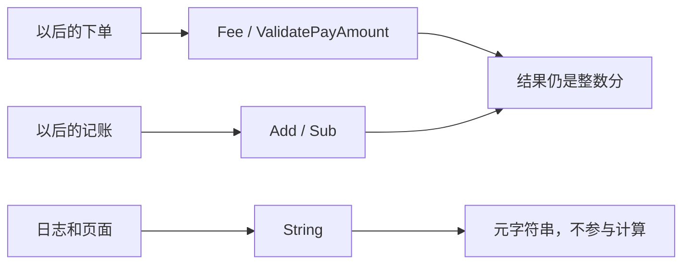

# BASE-04 金额工具

| 项 | 内容 |
|---|---|
| 功能点 | BASE-04（P0，第 1 周） |
| 所属链路 | 基础设施 |
| 代码提交 | `5df4729` `[BASE-04] add integer money amount` |
| 分支 | `feat/BASE-04-money` |
| 日期 | 2026-10-14 |
| 状态 | DONE |

## 一句话结论

金额只用 `int64` 分，加减在运算前挡住溢出，手续费用整数公式四舍五入到分。验收向量、`Add(MaxInt64, 1)` 和元格式字符串都有单元测试；`pkg/money` 语句覆盖率 100.0%。

## 1. 背景

### 1.1 系统简介

pay-system 是一个用 Go 编写的小型支付后端，模拟商户收款、退款、商户间转账三条资金链路，重点在数据一致性和性能。系统由 5 个部分组成：gateway（对外 HTTP 入口，负责签名校验和限流）、payment（支付单、退款单、转账单的状态管理和流程推进）、account（账户余额与记账，数据按商户分到 2 个数据库分片）、channel-mock（模拟微信、支付宝这类外部支付渠道）、recon（对账，核对系统内外数据是否一致）。服务之间用 Kitex RPC 同步调用，或通过 Kafka 消息异步通知；数据存在 MySQL 8.4，Redis 用于防重放。所有金额用整数“分”表示，所有记账只追加不修改。当前已完成：工程骨架、本地环境、迁移与种子、金额工具。应用进程仍是空的 `main`，还不能收款；这个包也还没有被服务调用。

### 1.2 本功能点在系统中的位置

`pkg/money` 是一个没有 IO 的库。它不读数据库，也不发请求。以后下单用它算手续费并检查金额范围，记账用它做余额加减，日志用它把分打印成元。



实线是以后的调用。这次只交付这四个运算。

### 1.3 为什么需要它

用小数存钱会丢分。`0.10` 元加 `0.20` 元在二进制浮点里常常不是刚好 `0.30`。一笔 10000 分（100.00 元）、费率 60 个基点（0.60%）的订单，手续费必须是 60 分（0.60 元），不能是 59 分或 61 分。

整数也会算错：`int64` 最大值再加 1，按回绕会变成负数。把这个负数写入余额，账户会凭空多出一笔反号的巨款。

## 2. 术语

| 术语 | 含义 |
|---|---|
| 分 | 金额的最小单位。100 分 = 1.00 元。10000 分 = 100.00 元。 |
| 分片 | 同一类账户数据拆成两份库，按商户决定进哪一份。本包不访问这两份库。 |
| 基点 `rateBP` | 费率单位。10000 基点 = 100%，60 基点 = 0.60%，1 基点 = 0.01%。 |
| 回绕 | 整数超出范围后从另一头再开始。最大值加 1 会变成最小值。 |
| `MaxInt64` / `MinInt64` | `int64` 的最大、最小值：9223372036854775807 和 -9223372036854775808。 |
| 四舍五入 | 这里指非负金额的 0.5 进位。正好一半就进到更大的那一分。 |
| 纯函数 | 同样的输入永远得到同样的输出，不改全局变量，也不访问外部系统。 |
| 普通 `error` | Go 的错误值。本包用 `errors.Is` 识别它。它不是对外接口上的数字错误码。 |
| Kitex / Kafka / Redis | 进程间同步调用、异步消息、防重放缓存。本包三者都不用。 |

## 3. 技术讲解

### 3.1 要解决的问题

1. 全链路金额是 `int64` 分，禁止 `float32` 和 `float64`。静态检查会拒绝这两个类型名出现在本包里。
2. `Add`、`Sub` 溢出必须返回错误。正溢出、负溢出、`MinInt64` 都要挡住，不能回绕。
3. 手续费公式是 `(amount × rateBP + 5000) / 10000`，整数除法。`rateBP` 只允许 0 到 10000。
4. 单笔支付、退款、转账是 1 到 10,000,000 分，即 0.01 元到 100,000.00 元，两端都合法。
5. “元”字符串只给日志和展示。计算不能走这条路。

### 3.2 方案

类型是 `type Amount int64`。溢出先比较边界再运算，所以比较本身也不会溢出。

`pkg/money/money.go` 里，`b > 0` 时和不能超过 `MaxInt64`；`b < 0` 时和不能低于 `MinInt64`。`b` 为负时，`MinInt64 - b` 仍放得进 `int64`（最极端是 `b` 等于 `MinInt64`，差为 0）。

```go
func Add(a, b Amount) (Amount, error) {
	if b > 0 && a > math.MaxInt64-b {
		return 0, ErrOverflow
	}
	if b < 0 && a < math.MinInt64-b {
		return 0, ErrOverflow
	}
	return a + b, nil
}
```

`Sub` 用同一思路。`b > 0` 时看会不会低于 `MinInt64`；`b < 0` 时看会不会高于 `MaxInt64`。`b` 为 `MinInt64` 时上界是 `MaxInt64 + b = -1`，这个加法不溢出。因此 `Sub(-1, MinInt64)` 得到 `MaxInt64`，是合法的；`Sub(0, MinInt64)` 会超出，返回错误。出错时结果固定为 0，调用方不会误用回绕后的值。

手续费先拒绝非法费率。费率为 0 时直接返回 0，负金额也一样，因为公式乘出来就是 0。费率不是 0 且金额为负时返回 `ErrNegativeAmount`：加 5000 再整除只对非负金额是 0.5 进位，负数上 Go 的除法是向 0 截断，不是四舍五入。

大额不直接做 `amount * rateBP`。`MaxInt64` 乘 2 已经放不进 `int64`。下面这段把它拆成“多少个 10000”和余数。费率不超过 10000 时，两部分以及它们的和都仍在 `int64` 里。

```go
rate := Amount(rateBP)
q := amount / feeBase
r := amount % feeBase
return q*rate + (r*rate+feeRoundHalf)/feeBase, nil
```

`feeBase` 是 10000，`feeRoundHalf` 是 5000。验收里的 10000 分（100.00 元）、60 基点：真值正好 60.0 分，加 5000 后整除仍是 60，不是 61。1 分、5000 基点是 0.5 分，进位成 1 分（0.01 元）。

`ValidatePayAmount` 只比较 1 和 10,000,000。`String` 用除以 100 得到元，余数是分，固定两位。`MinInt64` 不能取相反数，它的绝对值用 `uint64(1) << 63` 来格式化。

四个失败都是普通 `error`：`ErrOverflow`、`ErrRateOutOfRange`、`ErrNegativeAmount`、`ErrPayAmount`。费率错误和金额错误用 `fmt.Errorf` 带上具体数字，并用 `%w` 包住哨兵，`errors.Is` 仍能识别。不定义对外数字错误码，也不实现 `pkg/errno`。那是后面的错误码包要做的。

### 3.3 为什么这样做

| 方案 | 做法 | 优点 | 缺点 | 结论 |
|---|---|---|---|---|
| 采用：运算前比较边界；手续费按 10000 拆开 | 全是 `int64` | 溢出不会先发生；大额乘法不回绕 | 边界公式要单独证一遍 | 采用 |
| 备选：用 `float64` 元 | `math.Round` 到分 | 写法短 | 二进制小数不能精确表示每一分 | 不采用 |
| 备选：先相加，再看符号变了没有 | 利用回绕后的符号 | 代码短 | 回绕已经发生；`MinInt64` 取反本身就会溢出，符号判断容易写错 | 不采用 |
| 备选：全部改用 `big.Int` | 任意精度 | 不会溢出 | 支付金额最大 100,000.00 元，用不上；热路径更重 | 不采用。测试里用它当独立对照，实现里不用 |

### 3.4 正确性

不涉及重复请求、并发写入、进程崩溃和下游超时。本包是纯函数：没有数据库行，没有共享可变状态，也没有外部调用。算错只会返回错误或另一个整数，不会留下半笔账。

算术结果由测试固定：

| 场景 | 系统行为 | 最终状态 | 证明 |
|---|---|---|---|
| `Add(MaxInt64, 1)` | 返回 `ErrOverflow`，值为 0，不回绕成 `MinInt64` | 无存储 | `TestAddMaxInt64Overflow` |
| 负数与 `MinInt64` 的加减 | 该溢出的返回错误；放得下的得到精确结果 | 无存储 | `TestAddSubBoundaries` |
| 手续费向量，含费率为 0 | 见下表 | 无存储 | `TestFeeVectors` |
| 费率越界，或负金额且费率非 0；`MaxInt64` 乘大费率 | 越界返回对应错误；大额与 `big.Int` 对照一致 | 无存储 | `TestFeeRejectsAndLargeAmount` |
| 1 分和 -150 分的展示 | `"0.01"`、`"-1.50"` | 无存储 | `TestAmountStringYuan` |
| 0 分、10,000,001 分（100,000.01 元） | 拒绝；1 分和 10,000,000 分通过 | 无存储 | `TestValidatePayAmount` |

手续费验收值（都是分）：

| 调用 | 含义 | 结果 |
|---|---|---|
| `Fee(1, 60)` | 0.01 元 × 0.60%，不足半分 | 0 分 |
| `Fee(10000, 60)` | 100.00 元 × 0.60%，正好 0.60 元 | 60 分 |
| `Fee(8333, 60)` | 83.33 元 × 0.60% = 49.998 分，进到 0.50 元 | 50 分 |
| `Fee(1, 5000)` | 0.01 元 × 50% = 0.5 分，进位 | 1 分（0.01 元） |
| `Fee(10000000, 10000)` | 100,000.00 元 × 100% | 10,000,000 分 |
| `Fee(x, 0)` | 任意金额、费率 0 | 0 分 |

### 3.5 性能

不涉及。没有性能开关，也没有压测。这是几次整数比较和除法。

## 4. 已完成内容

### 4.1 改动清单

| 文件 | 新增 / 修改 | 作用 |
|---|---|---|
| `pkg/money/money.go` | 新增 | `Amount`、加减、手续费、范围校验、元格式 |
| `pkg/money/money_test.go` | 新增 | 验收向量和边界 |
| `docs/02-requirements.md` | 修改 | 状态改为 DONE；写明溢出和非法费率返回普通错误 |
| `docs/03-conventions.md` | 修改 | 费率越界、负金额且费率非 0 时 `Fee` 返回错误 |
| `docs/04-dev-plan.md` | 修改 | 只勾选 BASE-04 |
| `docs/interview-notes.md` | 修改 | 记下 60.0 分不会进成 61，以及 `MinInt64` 的边界比较 |

### 4.2 对外变化

| 类别 | 变化 |
|---|---|
| 接口 | 无 |
| 表结构 | 无 |
| 配置项 | 无 |
| 错误码 | 无。四个名字都是本包的普通 `error`，没有新的对外数字码 |
| 指标 / 故障点 | 无 |

### 4.3 验收对照

| 验收条目 | 测试函数 | 类型 | 结果 |
|---|---|---|---|
| `Fee(1, 60) = 0`；`Fee(10000, 60) = 60`；`Fee(8333, 60) = 50`；`Fee(1, 5000) = 1`；`Fee(10000000, 10000) = 10000000`；`Fee(x, 0) = 0` | `TestFeeVectors` | 单元 | 通过 |
| `Add(MaxInt64, 1)` 返回溢出错误 | `TestAddMaxInt64Overflow` | 单元 | 通过 |
| `Amount(1).String() = "0.01"`，`Amount(-150).String() = "-1.50"` | `TestAmountStringYuan` | 单元 | 通过 |

### 4.4 验证记录

2026-10-14，lead 在本机 macOS 上核验提交 `5df4729`。写报告时本机工具是 `go1.27.2 darwin/arm64`，golangci-lint `2.14.0`。

| 命令 | 结果 |
|---|---|
| `gofmt -l .` | 无输出 |
| `make lint`（`golangci-lint run ./...`） | 0 issues |
| `make test`（`go test -race ./...`） | 通过。根包约 2.3s；`pkg/money`、`internal/seed` 为 cached 通过 |
| `make test-integration` | 未验证。本包不访问 MySQL、Redis、Kafka。没有覆盖“金额列在库里的类型”，表结构这次没改 |
| `make gen` | 未跑。未改 IDL |
| `paycli` | 未跑。未改对外接口 |
| `make cover` | `Add`、`Sub`、`Fee`、`ValidatePayAmount`、`String` 都是 100.0%。全仓库 total 21.5%，因为其他包大多还没有语句覆盖；门槛只看 `pkg/money`，不低于 70% |

### 4.5 同步的文档

- 需求：BASE-04 标为 DONE，并写明溢出含负数和 `MinInt64`，非法费率、负金额、超范围支付金额都返回普通错误。
- 约定：`Fee` 在费率越界时返回错误；金额为负且费率不为 0 时返回错误；费率为 0 时结果为 0。版本记到 v2.4。
- 开发计划：第 1 周只勾了 BASE-04，同一行里的 ID、错误码、时钟、配置、日志仍未勾。
- 面试笔记：四舍五入的 60 与 61，以及为什么在相加前比较边界。

## 5. 未完成与风险

- 还没有服务调用这个包。下单要接 `Fee` 和 `ValidatePayAmount`，记账要接 `Add` / `Sub`。把这些普通错误映射成对外错误码，等错误码包和具体接口一起做。
- `String` 的结果不能再解析回去做运算。类型系统不阻止有人把 `"0.01"` 用浮点读回来。
- 全仓库覆盖率 21.5% 不是这个包的缺口。`pkg/money` 本身是 100.0%。

## 6. 如何复现

前置：Go 1.27.2、golangci-lint 2.14.0。不需要 Docker。仓库根目录，分支 `feat/BASE-04-money`，含提交 `5df4729`。

```bash
gofmt -l .
make lint
make test
make cover
go test -race -count=1 -run 'TestFeeVectors|TestAddMaxInt64Overflow|TestAmountStringYuan' ./pkg/money/
```

预期：`gofmt` 无输出；lint 为 `0 issues`；测试通过；`pkg/money` 的五个函数都是 `100.0%`。最后一条只跑三条验收测试，也会通过。

## 7. 讲解要点

1. 问：100.00 元、0.60% 为什么是 60 分不是 61 分？答：真值正好 60.0 分。加 5000 只在小数部分大于等于 0.5 时才会进位，整分不会被抬上去。
2. 问：为什么不先加再看有没有变成负数？答：回绕已经发生。`MinInt64` 还不能取相反数，事后看符号容易漏掉 `Sub(0, MinInt64)` 这种情况。
3. 问：为什么手续费拒绝负金额？答：加 5000 的进位只对非负金额成立。费率是 0 时乘积就是 0，所以仍然返回 0。

## 延伸阅读

- `docs/02-requirements.md` 的 BASE-04
- `docs/03-conventions.md` 的金额一节
- `pkg/money/money.go`

## 修订记录

| 日期 | 提交 | 修订内容 |
|---|---|---|
| 2026-10-14 | 代码 `5df4729`；报告尚未提交 | 初稿。验证数字来自 lead 当天在该提交上的核验 |
