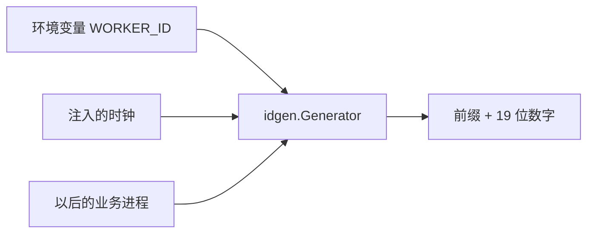

# BASE-05 ID 生成

| 项 | 内容 |
|---|---|
| 功能点 | BASE-05（P0，第 1 周） |
| 所属链路 | 基础设施 |
| 代码提交 | `795cc26` `[BASE-05] add snowflake id generator` |
| 分支 | `feat/BASE-05-idgen` |
| 日期 | 2026-10-14 |
| 状态 | DONE |

## 一句话结论

`pkg/idgen` 用雪花算法发业务单号：2 位前缀加 19 位数字，例如支付单 `PA` 开头、总长 21。同一进程里 64 个 goroutine 共生成 100 万个号，没有重复，每个 goroutine 内部严格变大。时钟回拨不超过 5ms 会等到追上；超过 5ms 返回普通错误，错误文本里没有 `10004`。

## 1. 背景

### 1.1 系统简介

pay-system 是一个用 Go 编写的小型支付后端，模拟商户收款、退款、商户间转账三条资金链路，重点在数据一致性和性能。系统由 5 个部分组成：gateway（对外 HTTP 入口，负责签名校验和限流）、payment（支付单、退款单、转账单的状态管理和流程推进）、account（账户余额与记账，数据按商户分到 2 个数据库分片）、channel-mock（模拟微信、支付宝这类外部支付渠道）、recon（对账，核对系统内外数据是否一致）。服务之间用 Kitex RPC 同步调用，或通过 Kafka 消息异步通知；数据存在 MySQL 8.4，Redis 用于防重放。所有金额用整数“分”表示，所有记账只追加不修改。当前已完成：工程骨架、本地环境、迁移与种子、ID 生成。应用进程仍是空的 `main`，还不能收款。金额工具不在本分支。

### 1.2 本功能点在系统中的位置

BASE-05 不处理支付请求。它只给以后的业务进程提供发号函数。单号以后会写进支付单、退款单、账户等表的唯一索引，本功能点还没有那些写入。



调用方传入 `context` 和前缀。生成器读自己的 worker 编号和当前时间，拼出单号。数据库、Redis、Kafka 都不参与。

### 1.3 为什么需要它

两个进程如果各自用随机数或各自从 1 开始数，可能发出同一个支付单号。唯一索引会拒掉其中一笔，或者更糟：对账时把两笔不同的款当成同一笔。单号还要能看出大概是什么时候、哪台机器发出的，方便排查。数据库自增主键做不到这两点：它每个库各自从 1 开始，而且对外暴露后能看出今天一共下了多少单。

## 2. 术语

| 术语 | 含义 |
|---|---|
| 雪花算法 | 把时间、机器编号、毫秒内序号拼进一个 64 位整数。同一台机器上大致按时间变大。 |
| 纪元 | 时间戳的起点。这里是 `2026-01-01T00:00:00+08:00`，不是 Unix 的 1970 年。 |
| worker ID | 发号进程的编号，0 到 1023。同一毫秒里靠它区分不同进程。 |
| 序列号 | 同一毫秒、同一 worker 内的计数，0 到 4095，共 4096 个。 |
| 单调钟 | 只往前走、不受对时影响的时钟，用来量耗时。墙上时钟才会被 NTP 往回拨。 |
| 墙上时钟 | 人看到的日期时间。操作系统对时可能把它往回拨几毫秒。 |
| 前缀 | 单号开头的 2 个大写字母，表示单据种类。`PA` 是支付单。 |
| goroutine | Go 里的并发执行单元。验收用 64 个同时发号。 |
| `context` | 调用方可取消的信号。等待下一毫秒或追平回拨时，取消必须能返回。 |
| `10004` | 已有错误码，表示依赖暂时不可用。本包不返回这个数字，以后的服务再映射。 |
| 分片 | 账户数据按商户拆进两个数据库。本功能点不访问它们。 |

## 3. 技术讲解

### 3.1 要解决的问题

1. 不同进程发出的号不能撞车。靠 worker ID 区分，不靠事后查库。
2. 同一个进程并发发号也不能撞车，并且单个调用方看到的号必须一个比一个大。趋势变大，以后插入唯一索引时写放大更小。
3. 同一毫秒最多 4096 个号。用尽后必须等到下一毫秒，不能把序号绕回 0 造成重复。
4. 墙上时钟回拨不超过 5ms 时等到追上，避免号变小；超过 5ms 时拒绝发号，让调用方以后返回 `10004`。
5. 时间早于纪元，或毫秒数放不进 41 位时，返回错误，不能绕回一个很小的数。
6. 前缀必须是已经登记的 11 个。未登记的不能发出去。
7. 等待不能把测试或请求挂死。`context` 取消后要返回，等待期间不能一直占着锁。

### 3.2 方案

一个号是 64 位整数，再格式化成十进制。最高位恒为 0，所以它始终是正的 `int64`，十进制最多 19 位。左边补 0 后，任何号的数字部分都是 19 位。

```text
位 63          62 …… 22              21 …… 12        11 …… 0
   0           纪元起的毫秒           worker          毫秒内序号
   1 位        41 位                  10 位           12 位
   恒为 0      约 69 年               0–1023          0–4095
```

纪元用固定的东八区偏移量写死，不读操作系统的时区文件。容器里没有 tzdata 也能得到同一个起点。

`NewNo` 在这个整数前面加上前缀。`PA` 加 19 位数字就是 21 个字符。`Parse` 把这 21 个字符拆回时间、worker ID 和序号，不阻塞。

发号前先把 `time.Time` 用 `Round(0)` 去掉单调钟，只比较墙上时间。Go 的 `time.Now()` 同时带着单调钟；如果直接用 `Before`，NTP 把墙上时间往回拨时，比较结果仍认为时间在前进，号会变小。

这段代码在决定回拨是等待还是失败。`rollbackMax` 是 5ms。先放锁，再判断缺口是否大于它。

```go
nowWall := wall(g.clock.Now())
if g.issued && nowWall.Before(g.lastWall) {
    gap := g.lastWall.Sub(nowWall)
    g.mu.Unlock()
    if gap > rollbackMax {
        return 0, ErrClockRollback
    }
    if err := sleepCtx(ctx, gap); err != nil {
        return 0, err
    }
}
```

恰好 5ms 会等待。大于 5ms 立即返回 `ErrClockRollback`，错误文本是 `idgen: clock rollback exceeds 5ms`，里面没有 `10004`。

同一毫秒的序号用到 4095 之后，同样先放锁，再观察注入的时钟，直到毫秒数加 1。等待用 `select` 盯着 `context`，取消时返回 `ctx` 的错误。早于纪元或毫秒放不进 41 位时返回 `ErrTimeRange`。

worker ID 不在库里自动分配。`WorkerIDFromEnv` 读取环境变量 `WORKER_ID`，缺失、不是整数或不在 0–1023 时返回 `ErrWorkerID`，进程不会在库里 `os.Exit`。docker-compose 给 6 个将来会跑业务的占位进程写了互不相同的字面量，避免它们共用一份 `WORKER_ID=1`：

| 进程 | worker ID |
|---|---|
| gateway | 1 |
| payment | 2 |
| account | 3 |
| recon | 4 |
| channel-mock | 5 |
| merchant-demo | 6 |

MySQL、Redis、Kafka、Prometheus、Jaeger，以及建库、迁移、种子这些一次性任务不发号，不分配。`deploy/.env.example` 里原来的 `WORKER_ID=1` 留着，给单进程在本机跑的时候用。本次没有改这个文件。

允许的前缀只有这 11 个：`PA` 支付单、`RF` 退款单、`TF` 转账单、`TX` 记账凭证、`FZ` 冻结单、`AC` 账户、`EV` 事件、`NT` 商户通知、`RB` 对账批次、`RD` 对账差错、`MC` 模拟渠道流水。别的字符串，包括小写 `pa`，直接拒绝。

时钟是本包自己的小接口，只有 `Now() time.Time`。生产实现调用 `time.Now()`。测试传入假时钟。这不是以后那个全项目共用的时钟包。

### 3.3 为什么这样做

| 方案 | 做法 | 优点 | 缺点 | 结论 |
|---|---|---|---|---|
| 采用：自研雪花，worker 用环境变量写死 | 64 位里放时间、机器、序号；单号再加 2 位前缀 | 不引入依赖；号大致按时间变大；能解析出时间和机器 | 机器编号要人工分配；时钟回拨要自己处理 | 采用 |
| 备选：随机 UUID | 128 位随机数当单号 | 几乎不会撞 | 不能看出时间；插入索引时写是随机的；更长 | 不采用。排查和索引顺序都更差 |
| 备选：数据库自增主键当业务单号 | 插入后用自增 ID | 库内唯一 | 每个库各自从 1 开始；对外能看出单量；发号前还没有号 | 不采用。自增只做表内物理主键 |
| 备选：用单调钟判断回拨 | `time.Time.Before` 直接比 | 代码短 | 墙上时钟往回跳时比较结果仍是“时间向前” | 不采用。回拨会漏掉 |
| 备选：本包直接返回数字 `10004` | 库函数带上 HTTP/RPC 错误码 | 调用方少写一行映射 | 库依赖还没做的错误码包，也把协议码写进基础库 | 不采用。只返回可用 `errors.Is` 识别的普通错误 |

### 3.4 正确性

不涉及资金正确性：本包不写余额、不落库、不调用别的服务。重复的业务请求以后靠商户自己的订单号防重，不靠雪花号。同一次业务如果调用两次 `NewNo`，会得到两个不同的号。

发号本身靠下面这些行为保证不重复、不回绕：

| 场景 | 系统行为 | 最终状态 | 证明 |
|---|---|---|---|
| 64 个 goroutine 同时要号，一共 100 万个 | 同一把锁里发号。同一毫秒 4096 个用尽后放锁，等到下一毫秒 | 100 万个号互不相同；每个 goroutine 内部严格变大；最高位是 0 | `TestMillionIDsUniqueAndMonotonic`。`make test` 带 `-race` 通过，该测试没有 build tag，不会被排除 |
| 注入的时钟回拨 3ms | 放锁后对着这只时钟等到追上上次的发号时间 | 发号成功，这次调用的耗时至少 3ms | `TestClockRollback` |
| 注入的时钟回拨 10ms | 发现缺口大于 5ms，立刻返回，不睡 10ms | 不发号。错误是 `ErrClockRollback`，文本不含 `10004` | `TestClockRollback` |
| 同一请求再调用一次 `NewNo` | 不涉及幂等。每次成功都是新号 | 两个号 | 不涉及。业务防重不是这个包的事 |
| 发号过程中进程崩溃 | 不涉及。号还没写进数据库，没有半截记录要补偿 | 无持久状态 | 不涉及 |
| 下游超时 | 不涉及。发号不调用别的进程 | 无 | 不涉及 |

回拨测试用的不是操作系统对时，而是一只测试时钟：下一次读数等于上次读数减去回拨量，之后跟着真实时间往前走。所以“耗时至少 3ms”量的是这次发号调用自己堵住的时间，不是测试里先 `Sleep` 再检查。

### 3.5 性能

不涉及。这不是带开关的性能优化，没有基线和优化后的对比。100 万发号包含在 `make test` 里并通过。lead 这次 `pkg/idgen` 显示为 cached，没有单独的耗时或 QPS，这里不补数字。

## 4. 已完成内容

### 4.1 改动清单

| 文件 | 新增 / 修改 | 作用 |
|---|---|---|
| `pkg/idgen/idgen.go` | 新增 | 雪花发号、解析、从环境变量读 worker ID |
| `pkg/idgen/idgen_test.go` | 新增 | 验收和规则的单元测试，与实现同包 |
| `pkg/idgen/compose_test.go` | 新增 | 不启动 Docker，逐行检查 compose 里的 worker ID |
| `deploy/docker-compose.yml` | 修改 | 6 个业务占位进程写死互不相同的 `WORKER_ID`。镜像、启动命令、profile 没改 |
| `docs/02-requirements.md` | 修改 | 写明 context、溢出不回绕、本包不返回数字码；状态改为 DONE |
| `docs/03-conventions.md` | 修改 | 登记 worker 分配，以及回拨错误以后映射成已有的 `10004`。版本 v2.4 |
| `docs/01-tech-decisions.md` | 修改 | 补充：比回拨用墙上时间，本包不依赖错误码包和共用时钟包 |
| `docs/04-dev-plan.md` | 修改 | 只勾选 BASE-05，同一周其余功能点仍未勾 |
| `docs/interview-notes.md` | 修改 | 记下单调钟和“3ms 等待不能量短” |
| `.opencode/skills/pay-feature-dev/SKILL.md` | 修改 | 一行：发号调用改成 `(*idgen.Generator).NewNo(ctx, prefix)`，并写明回拨错误由调用方映射为已有的 `10004` |

### 4.2 对外变化

| 类别 | 变化 |
|---|---|
| 接口 | 无。没有改 HTTP 或 RPC。 |
| 表结构 | 无。 |
| 配置项 | 没有新增环境变量。`WORKER_ID` 本来就要填。compose 里 6 个进程改成字面量 1 到 6。 |
| 错误码 | 无新码。回拨只返回 `ErrClockRollback`。 |
| 单号前缀 | 无新增。仍是上面 11 个。 |
| 指标 / 故障点 | 无。 |

### 4.3 验收对照

| 验收条目 | 测试函数 | 类型 | 结果 |
|---|---|---|---|
| 64 个 goroutine 共生成 100 万个 ID，无重复，单个 goroutine 内严格递增 | `TestMillionIDsUniqueAndMonotonic` | 单元 | 通过 |
| 注入回拨 3ms 的时钟，生成成功且耗时至少 3ms；回拨 10ms 返回错误 | `TestClockRollback` | 单元 | 通过 |
| `NewNo("PA")` 长度 21，`Parse` 出的时间与生成时间误差小于 1ms | `TestNewNoPALengthAndParseTime` | 单元 | 通过 |

### 4.4 验证记录

环境：2026-10-14，本机 macOS。`go version` 的输出是 `go version go1.27.2 darwin/arm64`。命令由 lead 执行。

| 命令 | 结果 |
|---|---|
| `gofmt -l .` | 无输出 |
| `make lint`（`golangci-lint run ./...`） | 0 issues |
| `make test`（`go test -race ./...`） | 通过。根包约 2.3s。`pkg/idgen` 和 `internal/seed` 为 cached 通过。100 万 ID 的测试在 `pkg/idgen`，没有 build tag 把它排除 |
| `make test-integration` | 未验证。本包不访问 MySQL、Redis、Kafka |
| `make gen` | 未验证。没有改 IDL |
| `paycli` | 未验证。没有改对外接口 |
| `make cover` | `pkg/idgen` 语句覆盖率 88.1%，不低于 70%。全仓库 total 31.3%，因为其他包大多还没有语句覆盖；门槛只看 `pkg/idgen` |

`pkg/idgen` 各函数覆盖率：`Now`、`New`、`WorkerIDFromEnv`、`parseWorkerID`、`compose`、`wall` 都是 100.0%；`NewNo` 90.0%；`Parse` 94.7%；`next` 93.8%；`waitUntilMillis` 62.5%；`sleepCtx` 75.0%。

### 4.5 同步的文档

- 需求：发号入口带 `context`；时间超出 41 位不回绕；本包不返回 `10004`。
- 约定：6 个进程的 worker 字面量；回拨错误以后映射成已有的 `10004`，不新增错误码。
- 技术决策和面试笔记：为什么去掉单调钟。
- 周计划：BASE-05 单独勾上。
- 编码技能里的一行调用约定，见 4.1。

## 5. 未完成与风险

- 空的 `main` 还没有调用 `WorkerIDFromEnv`。非法 worker 现在只返回错误，进程退出留给以后的启动装配。
- 还没有服务把 `ErrClockRollback` 映射成 `10004`。错误码包和共用时钟包都不是本功能点。
- `waitUntilMillis` 62.5%、`sleepCtx` 75.0%。包覆盖率仍是 88.1%。低的是等待循环里的个别分支，不是 100 万并发那条验收。
- 回拨测试注入的是假时钟，不是真的改操作系统时间。

## 6. 如何复现

不需要 Docker。在仓库根目录：

```bash
gofmt -l .
make lint
make test
make cover
```

预期：`gofmt` 无输出；lint 为 0 issues；`go test -race ./...` 通过，其中 `pkg/idgen` 会跑 100 万 ID 那条；`make cover` 里 `pkg/idgen` 的语句覆盖率是 88.1%。

只跑三条验收：

```bash
go test -race -count=1 -run 'TestMillionIDsUniqueAndMonotonic|TestClockRollback$|TestNewNoPALengthAndParseTime' ./pkg/idgen/
```

`$` 是为了不把名字更长的回拨边界测试混进这一条。预期该包 `ok`。

## 7. 讲解要点

1. 问：时钟回拨为什么不能直接用 `time.Time.Before`？答：`time.Now()` 带单调钟，墙上时间往回跳时 `Before` 仍可能认为时间在前进。发号前用 `Round(0)` 去掉单调钟，只比墙上时间。不超过 5ms 就等，超过 5ms 返回 `ErrClockRollback`。
2. 问：同一毫秒发太快会怎样？答：序号只有 12 位，0 到 4095。用尽后放锁，等到注入时钟进入下一毫秒。等待可以被 `context` 取消。不放锁的话，一个慢等待会挡住所有发号方，取消也进不来。
3. 问：为什么库不返回 `10004`？答：`10004` 是给商户的“暂时不可用”。基础库只返回普通错误，避免依赖还没写的错误码包，也避免把 HTTP 状态写进发号函数。

## 延伸阅读

- `pkg/idgen/idgen.go`：位运算、回拨和等待。
- `docs/03-conventions.md` §2：单号布局、11 个前缀、6 个进程的 worker ID。
- `docs/02-requirements.md` 里 BASE-05 那一节：规则和验收原文。
- `docs/01-tech-decisions.md` 的 D5：为什么自研雪花，而不是用自增主键当业务单号。

## 修订记录

| 日期 | 提交 | 修订内容 |
|---|---|---|
| 2026-10-14 | `795cc26` | 初稿。代码提交是 `[BASE-05] add snowflake id generator`。报告本身还没单独提交 |
