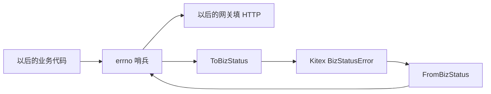

# BASE-06 错误码

| 项 | 内容 |
|---|---|
| 功能点 | BASE-06（P0，第 1 周） |
| 所属链路 | 基础设施 |
| 代码提交 | `d81c442` `[BASE-06] add errno codes and kitex conversion` |
| 分支 | `feat/BASE-06-errno` |
| 日期 | 2026-10-14 |
| 状态 | DONE |

## 一句话结论

`pkg/errno` 是全系统唯一的业务错误码表：26 个可用码，每个码有稳定英文消息和 HTTP 状态。`Error()` 只返回这句英文，数据库或网络的原始句子只能用 `Unwrap` 拿到。Kitex 服务端把 `40002` 放进真实的 `BizStatusError`，客户端用 `kerrors.FromBizStatusError` 还原成同一个码；测试没有启动网络服务。

## 1. 背景

### 1.1 系统简介

pay-system 是一个用 Go 编写的小型支付后端，模拟商户收款、退款、商户间转账三条资金链路，重点在数据一致性和性能。系统由 5 个部分组成：gateway（对外 HTTP 入口，负责签名校验和限流）、payment（支付单、退款单、转账单的状态管理和流程推进）、account（账户余额与记账，数据按商户分到 2 个数据库分片）、channel-mock（模拟微信、支付宝这类外部支付渠道）、recon（对账，核对系统内外数据是否一致）。服务之间用 Kitex RPC 同步调用，或通过 Kafka 消息异步通知；数据存在 MySQL 8.4，Redis 用于防重放。所有金额用整数“分”表示，所有记账只追加不修改。当前已完成：工程骨架、本地环境、迁移与种子、金额工具、ID 生成、错误码。这些都在本分支上。应用进程仍是空的 `main`，还不能收款；错误码库还没有被服务调用。

### 1.2 本功能点在系统中的位置

这个包不处理支付请求，也不连数据库。它只规定：失败时对商户说哪一个数字、哪一句英文、对应哪个 HTTP 状态；服务之间用 RPC 传递时，数字不能在路上变成另一句内部错误。



网关以后按码选择 HTTP 状态。account 把“余额不足”交给 payment 时走 Kitex，不走本包里的 HTTP 字段。

### 1.3 为什么需要它

假设数据库拨号失败，原始错误是 `dial tcp 10.0.0.8:3306: connection reset`。如果这句原文进了 HTTP 正文，商户就看到了内网地址。如果 payment 和 account 各自写死数字 `40002`，一边改了消息、另一边仍按旧句子判断，调用方会把“余额不足”当成未知故障再重试。错误码必须只有一处定义，对外句子必须固定，而且不能带上底层原文。

## 2. 术语

| 术语 | 含义 |
|---|---|
| 错误码 | 给调用方看的整数。`0` 成功，其他表示某一种失败。本包是唯一写这些数字的地方。 |
| 哨兵 | 包级变量，例如 `ErrInsufficientBalance`。业务代码比较它，不写数字 `40002`。 |
| `Msg` | 对外的稳定英文，例如 `insufficient balance`。不含 SQL、地址、密钥。 |
| `Error()` | Go 的错误文本。日志和 `fmt` 默认打印它。这里它等于 `Msg`。 |
| `Unwrap` | 取出被包在里面的底层错误。排查时显式调用，不会进对外句子。 |
| `errors.Is` | 沿 `Unwrap` 链看“是不是某一种错误”。本包按数字码相等，不要求是同一个指针。 |
| HTTP 状态 | 响应行上的 200、400、409 等。调用方仍以业务码为准。 |
| 网关 | 对外的 HTTP 入口。请求体超过 64KB 时，它在业务代码运行前就拒绝。 |
| Kitex | 服务之间的 RPC 框架。本包只用它的业务错误类型，不起服务。 |
| `BizStatusError` | Kitex 用来携带业务码和一句消息的错误。类型在 `github.com/cloudwego/kitex/pkg/kerrors`。 |
| 幂等 | 同一业务请求再来一次，不能重复扣款。本包不写这笔账，只定义“键相同但参数不同”这个码 `10006`。 |
| 分录 | 记账时追加的一条借或贷。本包不写分录。 |
| 分 | 金额的整数单位，100 分 = 1.00 元。本包不算金额。 |

## 3. 技术讲解

### 3.1 要解决的问题

1. 业务代码不能散落数字。改一个码只能改这个包。
2. 对外句子稳定、短、英文。成功是 `ok`，余额不足是 `insufficient balance`，内部错误是 `internal error`。
3. 包装了数据库或网络错误之后，`errors.Is` 仍能认出原来的码。底层句子不能出现在 `Msg` 或 `Error()` 里。
4. `nil` 是成功：码 `0`，消息 `ok`，HTTP 200。不能把它当成内部错误。
5. 不认识的非 nil 错误，以及没有登记的码，一律是 `10003`，对外只有 `internal error`。
6. 保留码 `30002` 不能变成一个可用错误。它曾经表示幂等冲突，那个含义已经改由 `10006` 承担。
7. `10001`（参数错误）在本包里的 HTTP 状态是 400。请求体超过 64KB 时网关返回 413，仍用 `10001`，不另造一个码。
8. 服务端把 errno 变成 Kitex 的 `BizStatusError`；客户端还原成同一个码，并且不用对端传来的句子替换本表的 `Msg`。

金额计算、分录追加、幂等写路径都不在这里。这是错误码库，没有余额，也没有数据库写入。

### 3.2 方案

每个码是一个结构体：`Code`、`Msg`、`HTTPStatus`。程序启动时登记进一张表，共 26 个，含成功码，不含 `30002`。`ByCode(30002)` 返回不存在。`All()` 返回一份拷贝，调用方改切片不会改登记表。

`Wrap` 先复制哨兵，再把原因放进未导出的 `cause`。复制是为了两个调用同时包装同一个哨兵时，不会互相改掉对方的原因，也不会改包级变量。

```go
// pkg/errno/errno.go：对外只留下 Msg；原因放在副本里。
func (e *Error) Error() string {
	if e == nil {
		return ""
	}
	return e.Msg
}

func Wrap(e *Error, cause error) *Error {
	if e == nil {
		return From(cause)
	}
	if cause == nil {
		return e
	}
	out := *e
	out.cause = cause
	return &out
}
```

`errors.Is` 调用 `Is`，只比较 `Code`。所以副本和哨兵能对上，即使指针不同。`fmt.Errorf("freeze: %w", wrapped)` 再包一层也仍然能对上，因为标准库会顺着 `Unwrap` 找。

`From(nil)` 返回成功哨兵 `OK`。这个值不是 `nil`，只供以后填写“成功响应”；不能把它当作失败返回，否则调用方会看到一个非空错误，文本却是 `ok`。其他已经是本包错误的，保留原码。剩下的非 nil 错误变成 `10003`，`Error()` 仍是 `internal error`，原错误留在 `Unwrap`。

Kitex 转换不启动服务器。服务端函数调用的就是框架提供的 `kerrors.NewBizStatusError`。客户端函数先调用 `kerrors.FromBizStatusError`，再按数字查本表。查到了就返回哨兵，对端那句消息丢掉。查不到，包括 `30002`，就变成 `10003`。成功码不放进 `BizStatusError`，避免把成功当成 RPC 失败。

```go
// pkg/errno/errno.go：线上只带本表的码和 Msg。还原时不采用对端句子。
func ToBizStatus(e *Error) kerrors.BizStatusErrorIface {
	if e == nil || e.Code == OK.Code {
		return nil
	}
	return kerrors.NewBizStatusError(e.Code, e.Msg)
}

func fromBizCode(code int32, cause error) *Error {
	if known, ok := byCode[code]; ok {
		return known
	}
	return Wrap(ErrInternal, cause)
}
```

直接依赖 `github.com/cloudwego/kitex v0.16.3`，只为这个类型。没有生成 IDL，也没有运行 kitex 命令。`github.com/bytedance/sonic` 仍锁定 v1.15.4；kitex 自带的 v1.15.0 在 Go 1.27 上会退回标准库 JSON，所以不能让 tidy 把它降下去。

已登记的码如下。名称是 Go 变量名，业务代码引用变量，测试才写数字对照。

| 码 | 变量 | HTTP | 对外消息 |
|---|---|---|---|
| 0 | `OK` | 200 | `ok` |
| 10001 | `ErrInvalidParam` | 400 | `invalid parameter` |
| 10002 | `ErrNotFound` | 404 | `not found` |
| 10003 | `ErrInternal` | 500 | `internal error` |
| 10004 | `ErrUnavailable` | 503 | `service unavailable` |
| 10005 | `ErrRateLimited` | 429 | `rate limited` |
| 10006 | `ErrIdempotentConflict` | 409 | `idempotent conflict` |
| 20001 | `ErrSignInvalid` | 401 | `invalid signature` |
| 20002 | `ErrTimestampExpired` | 401 | `timestamp expired` |
| 20003 | `ErrNonceReplayed` | 401 | `nonce replayed` |
| 20004 | `ErrMerchantInvalid` | 401 | `invalid merchant` |
| 20005 | `ErrAdminUnauthorized` | 401 | `admin unauthorized` |
| 30001 | `ErrOrderNotFound` | 404 | `order not found` |
| 30003 | `ErrOrderStatusConflict` | 409 | `order status conflict` |
| 30004 | `ErrOrderExpired` | 409 | `order expired` |
| 30005 | `ErrRefundExceeded` | 409 | `refund exceeded` |
| 30006 | `ErrChannelRejected` | 200 | `channel rejected` |
| 30007 | `ErrChannelUnsupported` | 400 | `unsupported channel` |
| 30008 | `ErrPayeeInvalid` | 400 | `invalid payee` |
| 40001 | `ErrAccountNotFound` | 404 | `account not found` |
| 40002 | `ErrInsufficientBalance` | 409 | `insufficient balance` |
| 40003 | `ErrUnbalancedEntries` | 400 | `unbalanced entries` |
| 40004 | `ErrFreezeStatusConflict` | 409 | `freeze status conflict` |
| 40005 | `ErrAccountInactive` | 409 | `account inactive` |
| 50001 | `ErrChannelSignInvalid` | 401 | `invalid channel signature` |
| 50002 | `ErrChannelAmountMismatch` | 400 | `channel amount mismatch` |

`30006` 的 HTTP 是 200：渠道已经明确拒绝，单据以后放在响应体里，HTTP 本身不是 4xx。本包只记下这个状态，不组装响应体。`10005` 的 `Retry-After` 头以后由网关填，本包没有这个字段。可重试与否也没有放进结构体，避免和上表的数字、HTTP 含义各写一套。

### 3.3 为什么这样做

| 方案 | 做法 | 优点 | 缺点 | 结论 |
|---|---|---|---|---|
| 采用：哨兵 + 稳定英文 + 真实 `BizStatusError` | 数字和句子只登记一次；`Error()` 不含原因；转换用 kitex v0.16.3 的类型 | 商户看不到内部句子；客户端还原的是同一个码 | 只打印 `Error()` 时看不到原因，要另调 `Unwrap` | 采用 |
| 备选：`Error()` 拼上底层句子 | `fmt.Errorf("%s: %w", msg, cause)` 那种文本 | 日志里一次看全 | `fmt` 和日志默认打印会把地址、SQL 带出去，也可能被抄进 HTTP | 不采用 |
| 备选：测试里自造一个假的业务错误接口 | 不依赖 kitex | 少一个依赖 | 证明不了 `kerrors.FromBizStatusError` 认得服务端返回值 | 不采用 |
| 备选：把 `30002` 定义成一个可用错误 | 保留旧数字 | 旧文档能对上变量名 | 幂等冲突已经是 `10006`。再提供一个码，调用方会 `errors.Is` 到废弃语义 | 不采用 |

MySQL 唯一键冲突（错误号 1062）将来要转成 `errno.ErrDuplicate`，再由业务决定是不是幂等成功。那个映射属于后面的数据库访问包，这里没有这个变量。

### 3.4 正确性

金额、分录、幂等写路径不涉及。本包不计算金额，不追加分录，也不把请求写入数据库。重复调用只会再读一次哨兵，不会第二次扣款。

| 场景 | 系统行为 | 最终状态 | 证明 |
|---|---|---|---|
| 同一哨兵被包装两次 | `Wrap` 复制结构体。哨兵自己的 `Unwrap` 仍是 nil | 没有持久化数据。哨兵仍是原来的 `40002` / `insufficient balance` | `TestWrapErrorsIs` |
| 两个调用并发包装 | 各自拿副本，不写哨兵字段。没有单独的双 goroutine 用例 | 包级表在启动后只读 | `make test` 的 `-race` 通过；本包测试使用 `t.Parallel` |
| 进程在任意步骤崩溃 | 不涉及。没有待提交的内存业务数据，也没有数据库 | 重启后仍是编译进程序的 26 个码 | 无崩溃测试 |
| 下游超时或拨号失败 | 不是本包错误的，变成 `10003`。对外文本是 `internal error`，不含 `rpc timeout` 或拨号句子。原因仍可用 `errors.Is` 找到 | 不把支付单改成成功或失败。本包不写订单 | `TestUnknownErrorIsInternal` |
| 对端 `BizStatusError` 码是 `40002`，句子里夹了内部文本 | 还原成本表的 `insufficient balance`，HTTP 409。不用对端句子 | 仍是哨兵 `ErrInsufficientBalance` | `TestKitexBizStatusRoundTrip` |
| 对端送来保留码 `30002` | 不当成可用错误，视为 `10003` | 登记表里没有 `30002` | `TestReserved30002NotUsable` |
| 错误值是 `nil` | 码 `0`，消息 `ok`，HTTP 200。`ToBizStatus` 返回 nil | 成功，不是 `10003` | `TestNilIsSuccess` |

### 3.5 性能

不涉及。没有压测。操作是一次内存查表和结构体复制，没有 IO。

## 4. 已完成内容

### 4.1 改动清单

| 文件 | 新增 / 修改 | 作用 |
|---|---|---|
| `pkg/errno/codes.go` | 新增 | 26 个哨兵；注释说明跳过 `30002` |
| `pkg/errno/errno.go` | 新增 | `Wrap`、`From`、`ToBizStatus`、`FromBizStatus` |
| `pkg/errno/errno_test.go` | 新增 | 同包单元测试 |
| `go.mod`、`go.sum` | 修改 | 直接依赖 kitex v0.16.3；sonic 仍是 v1.15.4 |
| `docs/02-requirements.md` | 修改 | 口径、消息表、状态 DONE |
| `docs/03-conventions.md` | 修改 | v2.6，错误码表增加对外消息列 |
| `docs/05-api.md` | 修改 | 文档 2.0.1，说明 `msg` 用这张表 |
| `docs/01-tech-decisions.md` | 修改 | 记录 kitex 依赖；1062 映射仍留给后续 |
| `docs/04-dev-plan.md` | 修改 | 只勾 BASE-06 |
| `docs/interview-notes.md` | 修改 | `Error()` 不带原因、不起 RPC 服务 |

### 4.2 对外变化

| 类别 | 变化 |
|---|---|
| 接口 | 没有新增字段，也没有改路径。响应里的 `msg` 约定为上表英文。成功示例本来就是 `ok`，`40002` 本来就是 `insufficient balance` |
| 表结构 | 无 |
| 配置项 | 无 |
| 错误码 | 没有新增数字，也没有改 HTTP 含义。补上了 26 个码的英文消息。`30002` 仍然保留、不可用 |
| 指标 / 故障点 | 无 |
| 依赖 | 新增直接依赖 kitex v0.16.3。sonic 仍是 v1.15.4 |

### 4.3 验收对照

| 验收条目 | 测试函数 | 类型 | 结果 |
|---|---|---|---|
| 包装后的错误经 `errors.Is` 能识别原错误码 | `TestWrapErrorsIs` | 单元 | 通过 |
| Kitex 服务端返回 `40002`，客户端还原为同一错误码 | `TestKitexBizStatusRoundTrip` | 单元 | 通过 |
| 未知错误变成 `10003`，对外没有底层句子 | `TestUnknownErrorIsInternal` | 单元 | 通过 |
| `nil` 是成功码 `0` | `TestNilIsSuccess` | 单元 | 通过 |
| 每个已定义码的数字、HTTP 状态、消息与表一致 | `TestDefinedCodesMatchConvention` | 单元 | 通过 |
| `30002` 不是可用错误 | `TestReserved30002NotUsable` | 单元 | 通过 |

`TestKitexBizStatusRoundTrip` 使用 `*kerrors.BizStatusError` 和 `kerrors.FromBizStatusError`。没有监听端口。

### 4.4 验证记录

lead 于 2026-10-14 在本机 macOS 核验。本机 `go version` 为 `go1.27.2 darwin/arm64`。

| 命令 | 结果 |
|---|---|
| `gofmt -l .` | 无输出 |
| `make lint` | 0 issues |
| `make test` | 通过。即 `go test -race ./...`。根包约 2.3s；`pkg/errno`、`pkg/idgen`、`pkg/money`、`internal/seed` 为 cached 通过 |
| `make test-integration` | 未跑。不访问数据库、Redis 或 Kafka |
| `make gen` | 未跑。未改 IDL，也没有生成代码目录需要比对 |
| `make cover` | `pkg/errno` 语句覆盖率 88.2%。本包不在核心包 70% 名单里，数字只作记录 |

`pkg/errno` 各函数：`ByCode`、`All`、`Wrap`、`ToBizStatus`、`FromBizStatus`、`fromBizCode` 为 100%；`From` 87.5%；`Is` 83.3%；`Error` 和 `Unwrap` 各 66.7%；`mustRegister` 71.4%。没盖住的是 nil 接收者上的保护分支，以及登记函数在空错误或重复码时的 panic。

### 4.5 同步的文档

- 需求：写明 nil、`10003`、`30002`、`10001` 的 HTTP 400，以及消息全表。
- 约定：升到 v2.6，错误码表增加对外消息列。数字、HTTP 语义、可重试含义没有改。
- 接口文档：2.0.1，`msg` 指向这张表。各接口路径的“最后修改”没改，因为字段没变。
- 技术决策：直接依赖 kitex v0.16.3；`ErrDuplicate` 仍留给数据库访问包。
- 周计划：只勾了 BASE-06。时钟、配置、日志仍未勾。

## 5. 未完成与风险

- 网关还没把这些码写成 HTTP 响应。请求体超过 64KB 返回 413 也还没实现，那是网关的事。
- 没有任何服务调用 `ToBizStatus`。真实的 RPC 客户端还会再包一层传输错误，本测试只包了 `fmt.Errorf("%w")`，没有走网络。
- 只打印 `err.Error()` 的日志看不到底层原因。这是故意的。排查要调用 `Unwrap`。
- `From(nil)` 返回的是非 nil 的成功值。若有人把它当作失败返回，调用方会收到文本 `ok` 的错误。
- MySQL 1062 与 `errno.ErrDuplicate` 留给后面的数据库访问功能，这里没有。
- `Error` / `Unwrap` 的 nil 分支和 `mustRegister` 的 panic 没有测试。包覆盖率 88.2%。

## 6. 如何复现

不需要 Docker。在仓库根目录：

```bash
gofmt -l .
make lint
make test
make cover
```

预期：`gofmt` 无输出；lint 为 0 issues；`go test -race ./...` 通过；`make cover` 里 `pkg/errno` 的语句覆盖率是 88.2%。

只跑两条验收：

```bash
go test -race -count=1 -run 'TestWrapErrorsIs|TestKitexBizStatusRoundTrip' ./pkg/errno/
```

全量 `make test` 已经跑过这个包。上面的命令只筛选这两条，预期该包为 `ok`。

## 7. 讲解要点

1. 问：为什么 `Error()` 不带原因？答：`fmt` 和日志默认打印 `Error()`。把拨号或 SQL 拼进去，就会出现在日志文本里，还可能被抄到给商户的 `msg`。原因只放在 `Unwrap`。
2. 问：怎么证明 Kitex 还原的是同一个码，又没起服务？答：服务端值就是 `kerrors.NewBizStatusError(40002, "insufficient balance")`。测试用 `kerrors.FromBizStatusError` 读出 `*kerrors.BizStatusError`，再按码查回 `ErrInsufficientBalance`。对端若写成别的句子，对外仍是 `insufficient balance`。
3. 问：`nil` 和 `30002` 为什么都不能变成 `10003` 以外的结果？答：`nil` 是成功码 `0`。`30002` 是废弃的幂等冲突码，不能再提供哨兵；对端若仍送来它，按未登记码处理，对外是 `internal error`。

## 延伸阅读

- `pkg/errno/errno.go`：包装、对外文本、Kitex 转换。
- `pkg/errno/codes.go`：26 个哨兵和跳过 `30002` 的注释。
- `docs/03-conventions.md` §5：错误码数字、HTTP、可重试含义、对外消息。
- `docs/02-requirements.md` 里 BASE-06 那一节：规则和验收原文。
- `docs/05-api.md` §2.3：HTTP 响应里的 `msg`。

## 修订记录

| 日期 | 提交 | 修订内容 |
|---|---|---|
| 2026-10-14 | `d81c442` | 初稿。代码提交是 `[BASE-06] add errno codes and kitex conversion`，完整 hash `d81c442ba956b82954e1592e5914a233caaa8bfe`。git 作者时间是 2026-10-15 00:13 +08。报告本身还没单独提交 |
