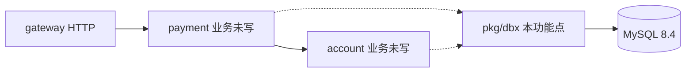
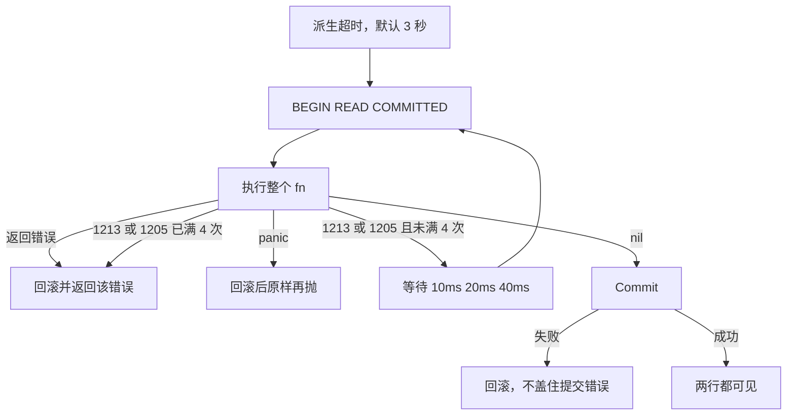

# BASE-08 数据库访问与事务

| 项 | 内容 |
|---|---|
| 功能点 | BASE-08（P0，第 1 周） |
| 所属链路 | 基础设施 |
| 代码提交 | `f535462` `[BASE-08] add transactional database helper` |
| 分支 | `feat/BASE-08-dbx` |
| 日期 | 2026-10-15 |
| 状态 | DONE |

完整 hash：`f535462492e8cf7476214c244780b20538491576`。作者时间 `2026-10-15 02:27:09 +0800`。

## 一句话结论

`pkg/dbx` 统一打开 MySQL、跑本地事务，并在死锁或锁等待时把整个回调重做。回调返回错误或 panic 时已插入的行不会留下；两个事务交叉锁行触发 MySQL 1213 后，重试提交的两行分别是 11 和 22，不是只写了一半的 99。唯一键冲突只被认成 1062，不变成业务错误码。

## 1. 背景

### 1.1 系统简介

pay-system 是一个用 Go 编写的小型支付后端，模拟商户收款、退款、商户间转账三条资金链路，重点在数据一致性和性能。系统由 5 个部分组成：gateway（对外 HTTP 入口，负责签名校验和限流）、payment（支付单、退款单、转账单的状态管理和流程推进）、account（账户余额与记账，数据按商户分到 2 个数据库分片）、channel-mock（模拟微信、支付宝这类外部支付渠道）、recon（对账，核对系统内外数据是否一致）。服务之间用 Kitex RPC 同步调用，或通过 Kafka 消息异步通知；数据存在 MySQL 8.4，Redis 用于防重放。所有金额用整数“分”表示，所有记账只追加不修改。当前已完成：工程骨架、本地环境、迁移与种子、金额、发号、错误码、时钟、配置、日志，以及事务辅助 `pkg/dbx`（打开连接、事务、死锁重试、1062/3819 识别）。账户和支付业务还没做。

### 1.2 本功能点在系统中的位置



虚线是以后的调用。payment 和 account 的记账代码还没写，它们以后通过 `Open` 拿连接、通过 `WithTx` 包住一个分片上的写入。本包在事务回调里不调用 RPC、HTTP 或消息队列。

### 1.3 为什么需要它

两行数据原来都是 0。事务 A 锁住 `id=1` 并把它改成 99，事务 B 锁住 `id=2`，然后双方都去锁对方那一行。MySQL 发现环，杀掉其中一个，错误号 1213，并回滚被杀掉的那整个事务。如果调用方不把整个函数重做，这次更新就停在失败；如果只重做第二条语句，99 已经随回滚消失，内存里却还以为第一行写过了。

另一类事故是回调里 `INSERT` 之后返回错误或 panic。事务不回滚的话，这行会留在库里，像已经入账。事务默认最多占 3 秒，避免一把锁一直不放。

## 2. 术语

| 术语 | 含义 |
|---|---|
| 分片 | 账户数据按商户拆进两个 MySQL 库。一个事务只许碰其中一个。 |
| 事务 | 一组 SQL 要么全部提交，要么全部撤销。撤销叫做回滚。 |
| 行锁 / `FOR UPDATE` | `SELECT ... FOR UPDATE` 把查到的行锁住，别的事务要改这行就得等。 |
| 死锁（1213） | 两个事务各锁一行，又都在等对方手里的那一行。MySQL 杀掉其中一个并回滚它。 |
| 锁等待超时（1205） | 等行锁超过数据库的等待时间，语句失败。本包和 1213 一样整段重试。 |
| READ COMMITTED | 隔离级别。事务读到的是别人已经提交的数据，不靠可重复读的间隙锁来保正确。 |
| 间隙锁 | 可重复读里锁住索引空隙、用来挡住别人插入的锁。本系统改用条件更新和唯一索引，所以会话固定成 READ COMMITTED，少制造这类锁。 |
| CAS | 比较后再更新：`UPDATE ... WHERE id=? AND status=?`。影响行数必须是 1，才说明状态没被别人改掉。 |
| 唯一索引 / 1062 | 同一列组合不能插两次。冲突时 MySQL 返回 1062。 |
| CHECK / 3819 | 列值必须满足约束，例如 `v >= 0`。MySQL 8.4 违反时返回 3819。 |
| 幂等 | 同一请求做两次，结果和只做一次相同。1062 以后可以由业务当成“已经写过”，本包不替它做这个决定。 |
| DSN | 驱动用的连接字符串，里面有地址、库名和超时。本文不写出带口令的例子。 |
| 占位符 | SQL 里的 `?`。参数单独传入，不把用户输入拼进 SQL 文本。 |
| panic | Go 的运行时崩溃。本包先回滚，再用原来的 panic 值重新抛出。 |

## 3. 技术讲解

### 3.1 要解决的问题

1. 每个服务打开 MySQL 时必须带上同一组超时和东八区时间，调用方写了别的值也要被盖掉。否则有的连接是可重复读，间隙锁变多，死锁变多。
2. 回调失败、panic、提交失败、超过时限，都不能留下已提交的半行。
3. 1213 和 1205 要重做整个回调，而不是只重做最后一条 SQL。含第一次最多 4 次。
4. 1062 和 3819 要能从错误链里认出来，但不能变成业务错误码。
5. CAS 的影响行数不是 1 就失败。这不是“余额不足”那种业务码。
6. 事务里不能去调别的服务。本包自己也不提供拼接 SQL 的函数。

### 3.2 方案

直接依赖 `github.com/jmoiron/sqlx v1.4.0`，MySQL 驱动仍是已经在用的 `github.com/go-sql-driver/mysql v1.10.1`。`Open` 先改 DSN，再设连接池，然后 `Ping`。不执行业务 SQL。

强制覆盖的参数：

| 参数 | 强制值 |
|---|---|
| `parseTime` | `true` |
| `loc` | `Asia/Shanghai` |
| `transaction_isolation` | `'READ-COMMITTED'`（单引号是值的一部分） |
| `timeout` | `1s`（拨号） |
| `readTimeout` | `3s` |
| `writeTimeout` | `3s` |

旧名字 `tx_isolation` 会删掉。驱动连接后按 map 执行 `SET`，顺序不固定，留着它可能把隔离级别改回去。

连接池写在 `Open` 的 `PoolConfig` 里，不新增环境变量。字段为 0 时用默认值：最大打开 50、最大空闲 10、一条连接最长存活 30 分钟。负数直接返回错误，不去拨号。

`WithTx` 用父 `context` 再派生一个超时，默认 3 秒，谁先到期用谁。1213 或 1205 时，三次重试前分别等 10ms、20ms、40ms。这 3 次是重试次数，加上第一次一共执行 4 次。等待用定时器，父上下文取消时立刻返回，不把死锁错误盖掉成别的句子之外的成功。

这段循环在决定要不要整段重做：

```go
// pkg/dbx/tx.go：默认总时长 3 秒；只有 1213 和 1205 进入下一次。
ctx, cancel := context.WithTimeout(ctx, txTimeout)
defer cancel()
for attempt := 1; attempt <= maxTxAttempts; attempt++ {
    if attempt > 1 {
        if waitErr := waitBackoff(ctx, retryBackoff[attempt-2]); waitErr != nil {
            return waitErr
        }
    }
    err = runOnce(ctx, db, fn)
    if err == nil || !isRetryable(err) {
        return err
    }
}
return err
```

一次尝试的提交和回滚在 `runOnce`。`BeginTxx` 的隔离级别也是 READ COMMITTED，和 DSN 一致。

```go
// pkg/dbx/tx.go：错误、panic、提交失败都回滚。回滚自己的错误不替换原错误或原 panic。
tx, err := db.BeginTxx(ctx, &sql.TxOptions{Isolation: sql.LevelReadCommitted})
if err != nil {
    return err
}
defer func() {
    if p := recover(); p != nil {
        _ = tx.Rollback()
        panic(p)
    }
    if err != nil {
        _ = tx.Rollback()
    }
}()
if err = fn(tx); err != nil {
    return err
}
return tx.Commit()
```

`IsDuplicate` 用 `errors.As` 在错误链上找 `*mysql.MySQLError`，号码是 1062。`IsCheckViolation` 是 3819。别的号码，包括把 `"Error 1062"` 写进普通字符串，都是 false。没有 `errno.ErrDuplicate`，也没有登记业务码 30002。30002 仍然是保留不用的号。业务以后自己决定这次 1062 算不算幂等成功。

`MustAffectOne` 只看 `RowsAffected()`。是 1 就成功；不是 1 就返回普通错误 `dbx: expected 1 row affected, got N`，文本里没有 SQL，也不映射成 40002。`RowsAffected` 自己失败时，原样返回那个错误。

```go
// pkg/dbx/dbx.go：CAS 的行数判断，不是业务码。
n, err := result.RowsAffected()
if err != nil {
    return err
}
if n != 1 {
    return fmt.Errorf("dbx: expected 1 row affected, got %d", n)
}
```



图里的“两行都可见”只描述死锁重试成功的那条路径。错误、panic 和超时路径上，插入的行最后查不到。

### 3.3 为什么这样做

| 方案 | 做法 | 优点 | 缺点 | 结论 |
|---|---|---|---|---|
| 采用：sqlx + `WithTx` | 手写带 `?` 的 SQL；死锁重做整个回调；1062 只识别不转码 | 锁、影响行数、重试次数都写在调用处附近 | 每个语句要自己写 | 采用 |
| 备选：ORM | 用对象保存，冲突再翻译成业务码 | 少写 SQL | 零值和钩子会悄悄改更新语句 | 不采用 |
| 备选：1062 变成 `errno.ErrDuplicate` 或 30002 | 数据库错误直接变成业务码 | 调用方少写一次判断 | 30002 已保留不用；是不是幂等成功要看业务，不能在底层定死 | 不采用 |
| 备选：只重试失败的那条 SQL | 1213 之后从第二条接着执行 | 少做一次前面的语句 | InnoDB 已回滚整个事务，内存里的“已经写过”是假的 | 不采用 |

### 3.4 正确性

本功能点不给账户记账，也没有金额字段。它保证的是事务边界：失败不留行，死锁重试不提交半成品。

| 场景 | 系统行为 | 最终状态 | 证明 |
|---|---|---|---|
| 同一唯一键插两次 | 第二次是 1062，`IsDuplicate` 为 true。本包不把它改成成功，也不插第二行 | 只有第一行。`v=-1` 的 CHECK 插入失败，号码 3819 | `TestDuplicateAndCheckViolation` |
| 两个事务交叉锁行 | `WithTx` 锁 `id=1` 并写成 99，对侧锁 `id=2`，再交叉 `FOR UPDATE`。牺牲者是 1213 时整段重做。对侧无论成败都回滚。最多 20 轮，直到回调执行至少 2 次且提交成功 | 两行是 11 和 22。不会留下 99 配上另一行仍是 0 | `TestWithTxDeadlockRetry`（0.06s） |
| 回调返回错误，或 panic | 先回滚。错误原样返回；panic 原样再抛，测试 recover 到原来的值 | `dbx_event` 行数是 0 | `TestWithTxErrorAndPanic`（6.31s） |
| 事务超过时限 | 测试把包内时限改成 150 毫秒，插入后空等 500 毫秒再返回 nil。提交赶不上，回滚错误不当成成功 | 插入过的那一行不在。默认时限仍是 3 秒，由不连库的单元测试断言 | `TestWithTxTimeoutRollsBack`（0.54s） |
| 进程在提交前被杀死 | 未验证杀进程。未提交事务会随连接断开被 MySQL 丢掉；上面三行覆盖的是错误、panic 和超时 | 未单独制造崩溃点 | 无 |
| 下游 RPC 超时 | 不涉及。事务回调里本包不调用 RPC、HTTP、MQ。3 秒是本地事务时限 | 无外部调用 | 不涉及 |

死锁那一轮里，MySQL 选谁当牺牲者不确定。对侧多更新几次，让它的回滚代价更大，`WithTx` 更容易被选中；若这一轮死的不是 `WithTx`，测试丢掉对侧并重做场景。回调第二次不能再等已经关掉的 channel，否则重试会卡住。

### 3.5 性能

不涉及。没有性能开关，也没有吞吐或延迟对比。0.06s、0.54s、6.31s 是正确性测试的耗时，其中 6.31s 含第一次拉起 MySQL 容器，不是压测结果。

## 4. 已完成内容

### 4.1 改动清单

| 文件 | 新增 / 修改 | 作用 |
|---|---|---|
| `pkg/dbx/dbx.go` | 新增 | `Open`、DSN 和连接池、1062/3819、`MustAffectOne` |
| `pkg/dbx/tx.go` | 新增 | `WithTx`：回滚、4 次执行、3 秒超时 |
| `pkg/dbx/dbx_test.go` | 新增 | 不连库：错误号、行数、默认 3 秒、池默认值、DSN 覆盖 |
| `pkg/dbx/dbx_integration_test.go` | 新增 | `//go:build integration`，随机库上的验收 |
| `go.mod` / `go.sum` | 修改 | 直接依赖 sqlx v1.4.0；mysql 仍是 v1.10.1 |
| `pkg/errno/errno.go` | 修改 | 只改注释：不定义 `ErrDuplicate` |
| `docs/02-requirements.md` | 修改 | BASE-08 标 DONE，写明重试、3 秒、不新增错误码 |
| `docs/03-conventions.md` | 修改 | 升到 v2.10，事务规则写成 4 次执行和 3 秒取消 |
| `docs/01-tech-decisions.md` | 修改 | D4 改为 `IsDuplicate`，并记下 sqlx 已进 `go.mod` |
| `docs/04-dev-plan.md` | 修改 | 勾上 BASE-08；BASE-11 仍未勾 |
| `docs/interview-notes.md` | 修改 | 隔离级别引号、死锁牺牲者、超时后的提交 |

### 4.2 对外变化

| 类别 | 变化 |
|---|---|
| 接口 | 无。没有 HTTP 或 RPC。 |
| 表结构 | 无。集成测试在自己的随机库里建表，结束删除，不改业务库。 |
| 配置项 | 无。连接池默认值在 `PoolConfig` 的 0 值里，不新增环境变量。 |
| 错误码 | 无新业务码。没有 `errno.ErrDuplicate`，没有 30002。1062/3819/1213/1205 只是 MySQL 号码。`MustAffectOne` 是普通 `error`。 |
| 指标 / 故障点 | 无。 |

### 4.3 验收对照

| 验收条目 | 测试函数 | 类型 | 结果 |
|---|---|---|---|
| `fn` 返回错误时数据未写入；`fn` panic 时回滚并重新抛出 | `TestWithTxErrorAndPanic` | 集成 | 通过，6.31s |
| 两个事务交叉加锁触发死锁，`WithTx` 重试后成功 | `TestWithTxDeadlockRetry` | 集成 | 通过，0.06s |
| 重复插入唯一键，`IsDuplicate` 为 true；CHECK 违反时 `IsCheckViolation` 为 true | `TestDuplicateAndCheckViolation` | 集成 | 通过，0.05s |
| 超过被改短的事务时限后回滚，插入的行不在 | `TestWithTxTimeoutRollsBack` | 集成 | 通过，0.54s。这是验收之外的附加测试 |

前三条是功能点验收。四次集成测试都在同一次 `go test -race -count=1 -tags integration -timeout 180s ./pkg/dbx/` 里，整包 `10.587s`。

### 4.4 验证记录

环境：`go version go1.27.2 darwin/arm64`。Docker 可用，本机已有镜像 `mysql:8.4.11`。没有使用 `TEST_MYSQL_DSN`，集成测试自己起容器。下面是 2026-10-15 的实际输出，不是估计。

| 命令 | 结果 |
|---|---|
| `gofmt -l .` | 无输出，退出码 0 |
| `make lint` | `0 issues.` |
| `make test` | 通过。根包 `ok github.com/yym108/pay-system 2.233s`。`pkg/dbx` 为 cached ok。其余既有包同样 cached ok，或没有测试文件 |
| `go test -race -count=1 -cover ./pkg/dbx/` | `ok github.com/yym108/pay-system/pkg/dbx 1.290s coverage: 56.8% of statements`。没有 integration 标签，这 56.8% 不含集成测试 |
| `make test-integration` | 通过。根包 `ok github.com/yym108/pay-system 39.313s`。这次 `pkg/dbx` 和 `internal/dbmigrate` 是 cached ok |
| `go test -race -count=1 -tags integration -timeout 180s ./pkg/dbx/` | 不走缓存。`ok github.com/yym108/pay-system/pkg/dbx 10.587s`。验收和超时回滚的分项耗时见 4.3 |
| `make gen` | 未运行。本功能点不改 IDL |
| `make cover` | 未运行。`pkg/dbx` 不在核心覆盖率名单里；上表那条只覆盖了不带 integration 标签的单元测试 |

### 4.5 同步的文档

- 需求把 BASE-08 标成 DONE，写明 4 次执行、10/20/40 毫秒、3 秒取消、不新增错误码。
- 约定升到 v2.10：1213/1205 含第一次最多 4 次，事务总时长默认 3 秒。
- 技术决策 D4：1062 只由 `IsDuplicate` 识别，不转换成 `errno.ErrDuplicate`；sqlx v1.4.0 已写入 `go.mod`。版本表里的版本号没有改。
- 周计划勾上 BASE-08，BASE-11 保持未勾。
- 面试笔记记下隔离级别的引号、死锁牺牲者按回滚代价挑选、超时之后的 `Commit` 不能当成成功。

## 5. 未完成与风险

- 56.8% 只统计不连库的单元测试。`WithTx` 的回滚和重试靠集成测试，不在这个百分比里。
- 1205 只在单元测试里用构造的 MySQL 错误断言“会重试”。没有在真实锁等待上打出 1205。1213 有真实死锁。
- 这次没走 `TEST_MYSQL_DSN`。代码会在那台 MySQL 上只建 `dbx_` 加随机后缀的库，并拒绝删业务库；账号如果不能建库，这条路径会失败。本次未验证。
- 没有注入“进程在 `Commit` 之前被杀死”。未提交事务依赖 MySQL 在断连时丢弃。
- 账户记账、支付单、退款单都还没用这个包。1062 要不要当成幂等成功，留给以后的业务功能点，不能在这里当成已经做完。

## 6. 如何复现

前置：Go 1.27.2、Docker、本地镜像 `mysql:8.4.11`。不要设置 `TEST_MYSQL_DSN`。在仓库根目录执行。集成测试会起容器，耗时和下面的记录不会逐秒相同。

```bash
gofmt -l .
make lint
make test
go test -race -count=1 -cover ./pkg/dbx/
make test-integration
go test -race -count=1 -tags integration -timeout 180s ./pkg/dbx/
```

2026-10-15 的对应结果：`gofmt` 无输出；lint 为 `0 issues.`；`make test` 根包 `2.233s`；覆盖率命令为 `1.290s`、`coverage: 56.8% of statements`（不含集成测试）；`make test-integration` 根包 `39.313s`；最后一条整包 `10.587s`，其中错误/panic `6.31s`、死锁重试 `0.06s`、唯一键和 CHECK `0.05s`、超时回滚 `0.54s`。

## 7. 讲解要点

1. 问：死锁为什么要重做整个函数？答：1213 时 InnoDB 回滚的是整个事务。只重做最后一条 SQL，前面的 99 已经没了，却可能按“写过了”继续，提交出一半的结果。测试要求重试后两行是 11 和 22。
2. 问：1062 为什么不做成业务错误？答：唯一键冲突有时是幂等成功，有时是真冲突。本包只回答“号码是不是 1062”。30002 保留不用，也不存在 `errno.ErrDuplicate`。
3. 问：3 秒从哪来？答：`WithTx` 用父上下文派生，默认 3 秒，先到期的那个取消事务。测试把这个变量改成 150 毫秒，避免真的睡 3 秒；不连库的测试仍断言默认值是 3 秒。

## 延伸阅读

- `docs/02-requirements.md` 里 BASE-08 那一节：规则和验收原文。
- `docs/03-conventions.md` §6.3：4 次执行和 3 秒取消。
- `docs/01-tech-decisions.md` D4：为什么用 sqlx，以及 1062 不转成业务码。
- `docs/interview-notes.md` 的 BASE-08：引号、牺牲者、超时后的提交。

## 修订记录

| 日期 | 提交 | 修订内容 |
|---|---|---|
| 2026-10-15 | `f535462` | 初稿。代码提交是 `[BASE-08] add transactional database helper`，完整 hash `f535462492e8cf7476214c244780b20538491576`，作者时间 2026-10-15 02:27:09 +0800。报告本身还没单独提交 |
