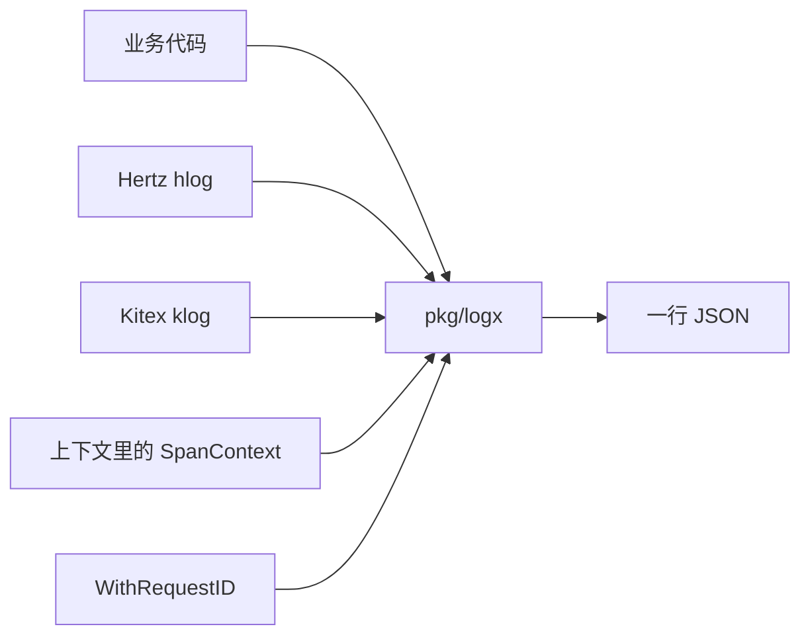

# BASE-10 日志与脱敏

| 项 | 内容 |
|---|---|
| 功能点 | BASE-10（P0，第 1 周） |
| 所属链路 | 基础设施 |
| 代码提交 | `5d83baf` `[BASE-10] add redacting slog logger` |
| 分支 | `feat/BASE-10-logx` |
| 日期 | 2026-10-15 |
| 状态 | DONE |

## 一句话结论

`pkg/logx` 把业务日志、Hertz 的 `hlog` 和 Kitex 的 `klog` 写进同一个 JSON `slog`。每条日志都带固定字段，密钥整段变成 `***`，卡号和手机号按位打星。验收三条单元测试通过；`pkg/logx` 覆盖率 74.8%。

## 1. 背景

### 1.1 系统简介

pay-system 是一个用 Go 编写的小型支付后端，模拟商户收款、退款、商户间转账三条资金链路，重点在数据一致性和性能。系统由 5 个部分组成：gateway（对外 HTTP 入口，负责签名校验和限流）、payment（支付单、退款单、转账单的状态管理和流程推进）、account（账户余额与记账，数据按商户分到 2 个数据库分片）、channel-mock（模拟微信、支付宝这类外部支付渠道）、recon（对账，核对系统内外数据是否一致）。服务之间用 Kitex RPC 同步调用，或通过 Kafka 消息异步通知；数据存在 MySQL 8.4，Redis 用于防重放。所有金额用整数“分”表示，所有记账只追加不修改。当前已完成：工程骨架、本地环境、迁移与种子、整数金额、雪花 ID、错误码、东八区时钟、环境变量配置、脱敏 JSON 日志。账户和支付业务还没做。

### 1.2 本功能点在系统中的位置

日志包不处理支付，也不监听端口。后面的 gateway、payment、account 把日志交给它；这次只把写日志的函数做好。



三个入口共用一个 handler。追踪号从上下文里已有的 span 读取，本包不创建、也不上报 span。配置启动时的脱敏在 `pkg/config`，按字段标签把密钥换成 `***`，不扫描卡号，也不调用本包。

### 1.3 为什么需要它

一条备注里如果原样打出卡号 `6222020200112233445`，日志文件里就是完整卡号。字段名叫 `app_secret` 或 `password` 时，密钥也会进同一行。没有统一的 `trace_id`，一次请求在 gateway 和 payment 的日志对不上。访问日志如果把 HTTP 正文记下来，正文里的卡号和密钥会再漏一次。

## 2. 术语

| 术语 | 含义 |
|---|---|
| slog | Go 标准库 `log/slog`。一条日志有级别、消息和键值，这里输出 JSON，一行一条。 |
| handler | slog 真正写字节的对象。本包的 handler 先补字段、脱敏，再交给 JSON handler。 |
| 脱敏 | 把敏感内容换成星号或 `***`，让日志里看不出原文。 |
| 卡号 | 这里按连续数字的位数处理，不是连银行校验。19 位例子保留前 6 后 4。 |
| trace / span | 一次请求的追踪号和其中一段调用的编号。来自 OpenTelemetry 的 API，本包只读、不导出。 |
| OpenTelemetry | 追踪的通用 API。`SpanContext` 里有 trace id 和 span id。 |
| Hertz / hlog | 以后 gateway 用的 HTTP 框架，以及它自带的日志接口。 |
| Kitex / klog | 服务之间 RPC 用的框架，以及它自带的日志接口。 |
| request id | 本包自己放进 `context` 的请求号，不是 trace id。 |

## 3. 技术讲解

### 3.1 要解决的问题

日志必须同时满足这些约束：

- 每条都有 `time`、`level`、`msg`、`service`、`trace_id`、`span_id`、`request_id`。后三个没有值时是空字符串，键仍在，避免有的行缺字段。
- 字段名不区分大小写，名字里包含片段就算命中，例如 `app_secret` 含 `secret`。
- 含 `secret`、`password`、`token`、`signature`、`master_key` 的字段，整个值换成 `***`。
- 含 `card_no` 或 `bank_card`：留前 6 后 4。含 `phone` 或 `mobile`：留前 3 后 4。含 `id_card`：留前 1 后 1。太短就整段 `***`，避免前后重叠把原文露出来。
- 字段名不敏感时，字符串里连续 13–19 位数字仍按卡号打，正好 11 位且以 `1` 开头按手机号打。11 位不是卡号。金额 `100` 这种更短的数字不动。
- `hlog` 和 `klog` 进同一个 slog。访问日志函数不能接收正文。

### 3.2 方案

`New(service, w)` 返回一个 JSON logger，`service` 写进每条日志。`SetDefault` 把它设成 `slog` 的默认 logger，并让 `hlog`、`klog` 的适配器持有同一个 logger 和同一个级别变量。`New` 不改全局 logger。`w` 为 nil 时写入丢弃。

写一条日志时，handler 先从上下文取 trace、span 和 request id，再把调用方字段脱敏，最后交给标准库 JSON handler。JSON handler 先写 `time`、`level`、`msg`，所以固定字段的顺序是：`time`、`level`、`msg`、`service`、`trace_id`、`span_id`、`request_id`，然后才是业务字段。

这段代码在补四个固定字段。`service` 来自创建 logger 时的参数；三个 id 没有就写成空字符串。

```go
traceID, spanID := traceIDs(ctx)
out := slog.NewRecord(r.Time, r.Level, r.Message, r.PC)
out.AddAttrs(
    slog.String("service", h.service),
    slog.String("trace_id", traceID),
    slog.String("span_id", spanID),
    slog.String("request_id", requestIDFrom(ctx)),
)
out.AddAttrs(redacted...)
```

`trace_id` 和 `span_id` 用 `go.opentelemetry.io/otel/trace` v1.47.0 的 `SpanContextFromContext`。有 trace id 才写入它的十六进制文本，否则是 `""`；span id 同样。`request_id` 只认 `WithRequestID` 放进上下文的字符串。调用方若在根上再传同名的 `service`、`trace_id`、`span_id`、`request_id`，这些键会被丢掉，避免盖住上面四个字段。根上这三个 id 不做数字扫描：span id 是 16 位十六进制，全是数字时会落进 13–19 位，若按卡号改写，同一次调用的日志就对不上。

时间用 `time.FixedZone("Asia/Shanghai", 8*60*60)`，再 `In` 到这个地点。不调用 `LoadLocation`，也不引入时区数据库。中国自 1991 年起没有夏令时，固定 +8 就是现在的民用时间。运行镜像没有时区数据时，按名字加载会失败。级别被格式化成 `INFO` 这种文字，不是数字。

字段名先转成小写再做包含判断。同时命中多条时，整段替换优先，然后才是卡号、手机号、证件号。所以名字里既有 `token` 又有 `card_no` 时，整段是 `***`。匹配的是 `card_no` 这一整段，不是单独的 `card`，因此 `id_card` 走证件号规则。长度按 Unicode 码点计：卡号短于 10、手机号短于 7、证件号短于 2，整段换成 `***`。19 位 `6222020200112233445` 去掉首 6 尾 4 还剩 9 位，输出 `622202*********3445`。

分组和 `error` 走同一套规则。名字属于整段替换时，在把值展开之前就换成 `***`，避免分组里的子字段漏出去。名字属于卡号、手机号或证件号、但值本身是分组时，整个分组换成 `***`。普通分组则逐个子字段再脱敏。`error` 先取 `Error()` 的文本再扫描。整数不扫描，所以金额字段里的 `100` 仍是 JSON 数字。

兜底扫描只认 ASCII 连续数字，打在字符串和已经转成字符串的 `error` 上，也打在 `msg` 上：

- 13–19 位：当卡号，留前 6 后 4。
- 正好 11 位且第一个字符是 `1`：当手机号，留前 3 后 4。
- 更短、12 位、长于 19 位，或中间被非数字断开：保持原样。

`Access` 不接收 body。它只往默认 logger 打一条 Info，消息是 `request handled`，字段是 `path`、`status`、`elapsed_ms`、`merchant_id`、`err_code`。`elapsed_ms` 是耗时的整毫秒，不足 1 毫秒为 0。要带上固定字段和脱敏，必须先 `SetDefault`。

`hlog` 和 `klog` 的适配器实现两边的日志接口，内部调用同一个 `slog.Logger`。默认级别是 Info。两边的级别常量都从 Trace 数到 Fatal，但数值和 slog 不同，适配器做了对应。任一边 `SetLevel` 改的是同一个级别变量。`SetOutput` 是空操作，输出端只能在 `New` 或 `SetDefault` 时确定。`Fatal` 先写一条日志，再 `os.Exit(1)`。本包不启动 HTTP 或 RPC。

### 3.3 为什么这样做

| 方案 | 做法 | 优点 | 缺点 | 结论 |
|---|---|---|---|---|
| 采用：标准库 slog，外加一个脱敏 handler | JSON、固定字段、按字段名和数字扫描 | 不另起一套日志库；三个入口格式相同 | 要自己接 hlog/klog 的级别 | 采用 |
| 备选：只按完整字段名相等来脱敏 | 只处理恰好叫 `card_no` 的键 | 规则短 | `app_secret`、`Bank_Card` 会漏 | 不采用 |
| 备选：hlog、klog 各写各的 | 不进 slog | 少一个适配器 | trace 和脱敏要做两遍，格式会分叉 | 不采用 |
| 备选：`LoadLocation("Asia/Shanghai")` | 用系统时区库 | 能处理历史上的夏令时 | 没有时区数据的镜像会失败；中国现行时间没有夏令时 | 不采用 |

### 3.4 正确性

| 场景 | 系统行为 | 最终状态 | 证明 |
|---|---|---|---|
| 同一请求重复到达 | 不涉及。本包不写数据库，同一条日志打两次只是多一行 JSON，没有账要防重。 | 无数据库状态 | 无 |
| 两个冲突请求并发写库 | 不涉及。不连接数据库，也没有余额或订单状态。 | 无 | 无 |
| 在某步之后进程崩溃 | 不涉及。没有事务。没写完的那一行不会留下半条业务记录。 | 无 | 无 |
| 下游调用超时 | 不涉及。脱敏和写日志不调用外部系统。 | 无 | 无 |

### 3.5 性能

不涉及。没有压测，也没有可开关的两条路径。

## 4. 已完成内容

### 4.1 改动清单

| 文件 | 新增 / 修改 | 作用 |
|---|---|---|
| `pkg/logx/logx.go` | 新增 | logger、固定字段、trace、request id、`Access` |
| `pkg/logx/redact.go` | 新增 | 字段名脱敏和数字兜底扫描 |
| `pkg/logx/adapter.go` | 新增 | `hlog`、`klog` 适配到同一个 slog |
| `pkg/logx/logx_test.go` | 新增 | 验收和规则测试 |
| `go.mod`、`go.sum` | 修改 | 直接依赖 hertz v0.10.6 和 otel trace v1.47.0 |
| `docs/02-requirements.md` | 修改 | BASE-10 标为 DONE，写明太短整段 `***`、trace 和 request id 的来源 |
| `docs/03-conventions.md` | 修改 | 约定升到 v2.9，§7.5 写明固定字段和脱敏规则 |
| `docs/01-tech-decisions.md` | 修改 | 记下实际新增的直接依赖 |
| `docs/04-dev-plan.md` | 修改 | 勾选 BASE-10 |
| `docs/interview-notes.md` | 修改 | 记下分组键和 span id 两处坑 |

### 4.2 对外变化

| 类别 | 变化 |
|---|---|
| 接口 | 无 HTTP/RPC 接口。新增 Go 函数 `New`、`SetDefault`、`WithRequestID`、`Access`。 |
| 表结构 | 无 |
| 配置项 | 无 |
| 错误码 | 无 |
| 指标 / 故障点 | 无 |

### 4.3 验收对照

| 验收条目 | 测试函数 | 类型 | 结果 |
|---|---|---|---|
| 字段名含 `secret` 的值整段为 `***`，原明文不出现 | `TestAppSecretRedacted` | 单元 | 通过 |
| `memo` 中的 `6222020200112233445` 输出为 `622202*********3445`，原来的 19 位不出现 | `TestMemoCardRedacted` | 单元 | 通过 |
| 上下文里带 trace 时，日志含对应 `trace_id` | `TestTraceIDFromContext` | 单元 | 通过 |

同一次 `make test` 还跑了固定空字段、request id、字段名规则、兜底扫描、分组和 `error`、适配器、`Access` 不写正文这些单元测试，包结果为通过。

### 4.4 验证记录

环境：`go version go1.27.2 darwin/arm64`。lead 于 2026-10-15 在本机执行。

| 命令 | 结果 |
|---|---|
| `gofmt -l .` | 无输出，退出码 0 |
| `make lint` | `0 issues.` |
| `make test` | 通过。根包 `ok github.com/yym108/pay-system 2.538s`。`pkg/logx` 以及既有的 cmd 包、`internal/seed`、`pkg/clock`、`pkg/config`、`pkg/errno`、`pkg/idgen`、`pkg/money` 为 cached ok。`cmd/bootstrap`、`cmd/seed`、若干 internal 包和 `tools` 没有测试文件。 |
| `go test -race -count=1 -cover ./pkg/logx/` | `ok github.com/yym108/pay-system/pkg/logx 1.387s coverage: 74.8% of statements` |
| `make test-integration` | 未运行。本功能点不访问数据库或消息队列。 |
| `make gen` | 未运行。没有改 IDL。 |
| `make cover` | 未运行。上面只有 `pkg/logx` 的包覆盖率，没有全仓库数字，也没有函数级数字。 |

### 4.5 同步的文档

- 需求：BASE-10 改为 DONE，补上太短整段 `***`、trace 来自 otel、request id 来自 `WithRequestID`。
- 约定：v2.9 的 §7.5 写出固定字段和脱敏规则，不是只写“见需求”。
- 技术决策：记下 hertz v0.10.6 和 otel trace v1.47.0，没有改版本表里的锁定版本。
- 开发计划：只勾 BASE-10。
- 面试笔记：分组键要在展开前脱敏；三个关联字段不能做数字扫描。

## 5. 未完成与风险

- 账户、支付业务还没做，gateway 也还没有调用 `Access`。本包只提供函数。
- `Fatal` 会 `os.Exit(1)`。测试没有调用它，否则测试进程会退出。
- 根上的 `trace_id`、`span_id`、`request_id` 按原值写入。若把卡号放进 request id，不会被兜底扫描。
- `hlog`、`klog` 的文本没有字段名，只有整段消息上的数字扫描。
- `SetDefault` 以及两边框架替换全局 logger 的函数不是并发安全的。测试不要并行改这一个全局 logger。
- `Access` 使用 `slog` 的默认 logger。没调用 `SetDefault` 时，没有本包的固定字段和脱敏。
- 集成测试、代码生成和全仓库覆盖率未跑。

## 6. 如何复现

在仓库根目录、含提交 `5d83baf` 的检出上执行。需要本机已有 Go 1.27.2，以及能跑 `make lint` 的 golangci-lint。不需要 Docker。

```bash
gofmt -l .
make lint
make test
go test -race -count=1 -cover ./pkg/logx/
```

lead 这次的结果：`gofmt` 无输出且退出码 0；`make lint` 打印 `0 issues.`；`make test` 通过，根包是 `ok github.com/yym108/pay-system 2.538s`；最后一条是 `ok github.com/yym108/pay-system/pkg/logx 1.387s coverage: 74.8% of statements`。缓存冷掉时耗时会不同，结果应仍为通过。

## 7. 讲解要点

- 问：为什么空的 trace 也要输出字段？答：键固定在，后面按字段检索时不会有的行有、有的行没有。值用空字符串，不用省略。
- 问：11 位数字为什么不当卡号？答：卡号规则只覆盖连续 13–19 位。正好 11 位且以 `1` 开头按手机号留前 3 后 4。`100` 更短，保持原样。
- 问：为什么不用 `LoadLocation`？答：没有时区数据的镜像会加载失败。当前民用时间是固定 +8，用 `FixedZone` 即可。

## 延伸阅读

- `docs/02-requirements.md` 中 BASE-10 一节
- `docs/03-conventions.md` §7.5
- `docs/01-tech-decisions.md` 的 D13 和 §2.1
- `pkg/logx/`

## 修订记录

| 日期 | 提交 | 修订内容 |
|---|---|---|
| 2026-10-15 | `5d83baf147eb1d7c6d361a4f1eed114bbd3085d7` | 初稿。提交信息 `[BASE-10] add redacting slog logger`，提交时间 2026-10-15 01:52:51 +0800 |
