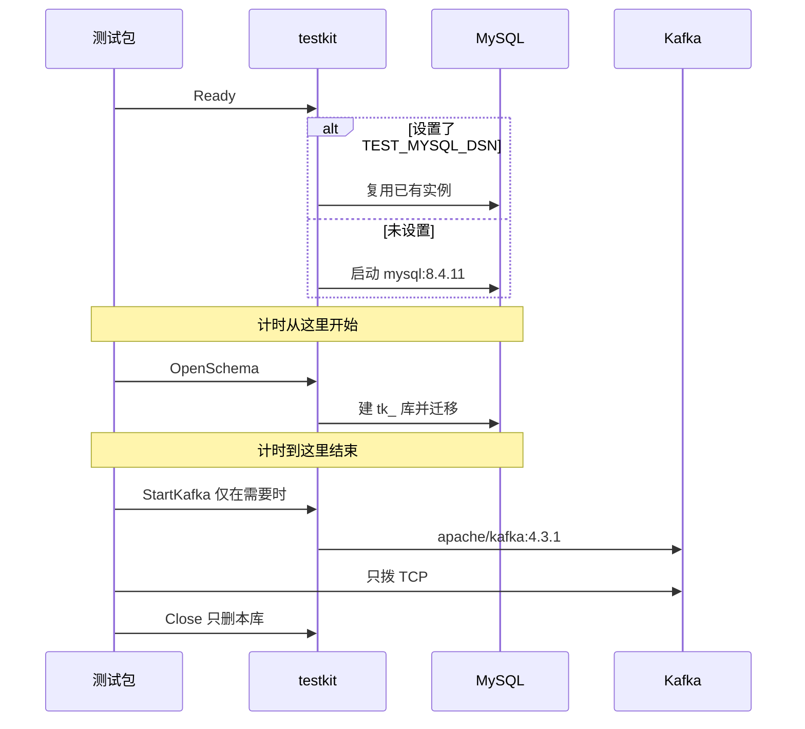

# BASE-11 集成测试基座

| 项 | 内容 |
|---|---|
| 功能点 | BASE-11（P0，第 1 周） |
| 所属链路 | 基础设施 |
| 代码提交 | `2abe147` `[BASE-11] add integration test harness` |
| 分支 | `feat/BASE-11-integration` |
| 日期 | 2026-10-15 |
| 状态 | DONE |

## 一句话结论

`internal/testkit` 给后续集成测试提供一台 MySQL、按次建库并迁移、一个按需启动的 Kafka 端口，以及假时钟和测试用商户、账户行。默认用 testcontainers 启动 `mysql:8.4.11`；环境变量 `TEST_MYSQL_DSN` 非空时复用已有实例，且该变量不写入 `deploy/.env.example`。每次 `OpenSchema` 新建名为 `tk_` 加 16 位十六进制的库，结束时只删除这个库。两个包同时跑时，各自只能看见自己插入的商户标记。复用模式下，MySQL 已经接受连接之后的建库加迁移耗时 339 毫秒，低于 2 秒。

## 1. 背景

### 1.1 系统简介

pay-system 是一个用 Go 编写的小型支付后端，模拟商户收款、退款、商户间转账三条资金链路，重点在数据一致性和性能。系统由 5 个部分组成：gateway（对外 HTTP 入口，负责签名校验和限流）、payment（支付单、退款单、转账单的状态管理和流程推进）、account（账户余额与记账，数据按商户分到 2 个数据库分片）、channel-mock（模拟微信、支付宝这类外部支付渠道）、recon（对账，核对系统内外数据是否一致）。服务之间用 Kitex RPC 同步调用，或通过 Kafka 消息异步通知；数据存在 MySQL 8.4，Redis 用于防重放。所有金额用整数“分”表示，所有记账只追加不修改。当前已完成：工程骨架与构建、本地环境编排、数据库迁移与种子数据、金额工具、ID 生成、错误码、时钟、配置、日志与脱敏、数据库访问与事务，以及集成测试基座（随机 schema、迁移、Kafka 端口助手、假时钟、测试商户和账户）。账户开户和记账业务还没做。

### 1.2 本功能点在系统中的位置

本功能点不在收款、退款、转账的请求链路上。生产服务不 import `internal/testkit`。调用方是带 `//go:build integration` 的测试。



图中的 MySQL 是测试实例。gateway、payment、account 的业务进程不经过这条路径。Kafka 容器不会跟着每个 MySQL 测试启动。

### 1.3 为什么需要它

两个测试包会由 `go test` 同时启动。如果它们共用一个固定库名，左侧插入商户标记 `tk-left`、右侧插入 `tk-right` 之后，左侧再数本表行数会得到 2，而不是 1；任一侧结束时删除这个库，另一侧正在用的表也会消失。本功能点让每个包（实现上是每一次 `OpenSchema`）使用自己的库。验收还要求：MySQL 已经接受连接之后，单个包建库并跑完调用方指定的迁移，耗时小于 2 秒。拉镜像和容器第一次启动不计入这 2 秒，否则计时混进了与建库无关的时间。

## 2. 术语

| 术语 | 含义 |
|---|---|
| 分 | 金额的最小单位。100 分等于 1.00 元。本功能点不计算金额。 |
| 分片 | 账户数据按商户拆到 2 个库。测试夹具不选择分片。 |
| 分录 | 记账追加的一行。本功能点不写分录。 |
| Kitex RPC | 服务之间的同步调用方式。本功能点不发 RPC。 |
| schema | MySQL 里的一个库。这里每次新建的库名是 `tk_` 加 16 位十六进制。 |
| testcontainers | 用 Docker 为测试启动容器的 Go 库。默认用它拉起 `mysql:8.4.11`。 |
| `TEST_MYSQL_DSN` | 只在 `internal/testkit` 读取的环境变量。非空表示复用已有 MySQL，不再启动容器。不进入服务配置，也不写入 `deploy/.env.example`。 |
| 迁移 | 按版本执行的建表 SQL，目录是 `migrations/<服务>`。服务名只能是 `account`、`payment`、`recon`、`channel_mock`。 |
| `dbx.Open` | 项目已有的打开 MySQL 连接池的函数。测试库的应用连接走它，从而使用与生产相同的连接参数和池设置。 |
| golang-migrate | 执行迁移文件的库。测试另组一条只给它用的 URL，因为该驱动要求 `multiStatements=true`，并会解码用户名和口令。应用连接不走这条 URL。 |
| KRaft | Kafka 自己选主的模式，不使用 ZooKeeper。助手只启动这一台 `apache/kafka:4.3.1`。 |
| 假时钟 | `clock.Fake`。测试注入一个时刻，再按调用拨快，不读机器时间。`NewClock` 只是构造它。 |
| CHECK | MySQL 拒绝不合法行的约束。例如商户主体不能搭配平台手续费收入账户类型。 |
| 参数化 SQL | 语句里用 `?` 占位，值另行传入。夹具插入用这种方式，而不是把值拼进 SQL 文本。 |
| 屏障 | 两个包各自写一个阶段文件，再等待对方写下同一阶段。用来证明两边的查询发生在同一时间段。 |
| 幂等 | 同一操作做一次和做多次，结果相同。本夹具插入不是幂等的：同一商户再插一次会返回唯一键错误。 |

## 3. 技术讲解

### 3.1 要解决的问题

1. 普通 `make test` 不能依赖 Docker。MySQL 和 Kafka 的源文件带 `//go:build integration`，只有 `make test-integration`（`go test -race -tags integration ./...`）会编译它们。
2. 默认镜像固定为 `mysql:8.4.11`。未设置 `TEST_MYSQL_DSN` 时由 testcontainers 启动，并等到日志出现 `port: 3306  MySQL Community Server` 且 3306 在监听、连接成功后，`Ready` 才返回。
3. 设置了 `TEST_MYSQL_DSN` 时直接连接该实例，模式记为 `reuse`，不启动容器，也不停止那台外部 MySQL。该变量不出现在 `deploy/.env.example`。
4. 并行的包不能看见对方的表，也不能删除对方或固定业务库。库名必须匹配 `^tk_[0-9a-f]{16}$`。`pay_account_0`、`pay_account_1`、`pay_payment`、`pay_recon`、`pay_channel_mock`、`mysql`、`information_schema`、`performance_schema`、`sys`、`tk_admin` 一律拒绝删除。
5. 2 秒的计时从 MySQL 已经接受连接开始，包含建库和迁移，不包含拉镜像和容器第一次启动。
6. Kafka 只在调用 `StartKafka` 时启动，镜像只用 `apache/kafka:4.3.1`。验收只要求 TCP 能连通，不生产、不消费业务消息。
7. 测试商户和测试账户是按现有表列做的参数化 `INSERT`，不是开户接口，也不写分录。
8. 失败文本不能打印连接串或口令。助手记住本进程见过的连接串和口令，输出前换成 `[redacted]`。容器日志使用空日志器，避免把环境变量打出来。

### 3.2 方案

一个测试进程用 `sync.Once` 只准备一台 MySQL。`Ready` 在这台 MySQL 接受连接后返回。调用方从返回之后再开始计时，计时区间就是 `OpenSchema`：生成库名、`CREATE DATABASE`（字符集 `utf8mb4`，排序规则 `utf8mb4_0900_ai_ci`）、用 golang-migrate 执行 `migrations/<服务>`、再用 `dbx.Open` 打开指向该库的连接池。`Schema.Close` 先关这个池，再 `DROP DATABASE` 这个库。进程结束时 `TestMain` 调用 `Shutdown`：关掉管理连接；只有本进程启动过容器时才停掉容器。

下面这段测试就是计时本身。`Ready` 在 `time.Now` 之前返回，所以拉镜像和第一次启动不在 `elapsed` 里。

```go
// internal/testkit/itest/left/left_test.go
start := time.Now()
schema, err := my.OpenSchema(ctx, "payment")
elapsed := time.Since(start)
t.Logf("BASE-11 startup_ms=%d mode=%s", elapsed.Milliseconds(), my.Mode())
if err != nil {
	t.Fatal(testkit.Redact(err))
}
t.Cleanup(func() { closeSchema(t, schema) })
if elapsed >= 2*time.Second {
	t.Fatalf("startup %d ms, want < 2000", elapsed.Milliseconds())
}
```

库名来自 8 字节随机数，编码后是 16 位十六进制：

```go
// internal/testkit/mysql.go
func newSchemaName() (string, error) {
	var buf [8]byte
	if _, err := rand.Read(buf[:]); err != nil {
		return "", err
	}
	name := "tk_" + hex.EncodeToString(buf[:])
	if !safeSchema(name) {
		return "", errors.New("testkit: generated schema name rejected")
	}
	return name, nil
}
```

并行验收在 `internal/testkit/itest/left` 和 `internal/testkit/itest/right`。两侧各自 `OpenSchema("payment")`，插入自己的商户标记（`tk-left` 或 `tk-right`），再用屏障汇合。屏障目录是系统临时目录下的 `pay-system-base11/<父进程 pid>`，上一次测试留下的文件不会被当成这一次的对端。阶段 `ready` 之后，每侧执行三条计数：自己的标记为 1，对方的标记为 0，全表为 1，并且 `SELECT DATABASE()` 等于本库名。阶段 `checked` 之后，清理函数才删除本库，避免一侧还在查询时另一侧已经删库。`go test` 以包为单位并行，这两个包会重叠。

Kafka 助手不随 MySQL 启动。它起一台没有 ZooKeeper 的 KRaft 单节点，副本因子为 1。对外端口映射出来之后，才把广告地址写成宿主机和映射端口，然后等待日志 `Kafka Server started`，再拨一次 TCP。`TestKafkaBrokerPortOpen` 对返回的 `Broker` 再拨一次 TCP，不发送业务消息。

```go
// internal/testkit/kafka.go
dialCtx, cancel := context.WithTimeout(ctx, 5*time.Second)
conn, dialErr := (&net.Dialer{}).DialContext(dialCtx, "tcp", broker)
cancel()
```

商户和账户夹具只做参数化插入。商户未填的名称是“测试商户”加商户号，`app_id` 是 `app_` 加小写商户号，密钥列写入字节 `fixture`（不是加密结果），状态默认 `ACTIVE`。账户未填方向时按类型补齐，以通过已有 CHECK：`MERCHANT_SETTLE` 为贷方、不可透支、归属商户；`CHANNEL_RECEIVABLE` 为借方、可透支、归属平台；`FEE_INCOME` 与 `TRANSIT` 为贷方、可透支、归属平台。调用方显式写了方向时，不再改写是否透支。

```go
// internal/testkit/fixture.go
_, err = db.ExecContext(ctx, `
	INSERT INTO merchant (
		merchant_id, merchant_name, app_id, app_secret_cipher, secret_version,
		notify_url, fee_rate_bp, status
	) VALUES (?, ?, ?, ?, ?, ?, ?, ?)`,
	prepared.MerchantID, prepared.MerchantName, prepared.AppID, prepared.SecretCipher,
	prepared.SecretVersion, prepared.NotifyURL, prepared.FeeRateBP, prepared.Status,
)
```

`NewClock` 返回已有的 `clock.Fake`，并把它设成调用方传入的时刻。它不修改 `pkg/clock`。

### 3.3 为什么这样做

| 方案 | 做法 | 优点 | 缺点 | 结论 |
|---|---|---|---|---|
| 采用：一台 MySQL 上每次新建 `tk_` 库 | 容器或复用实例二选一；迁移走现有 `dbmigrate.Up`；应用连接走 `dbx.Open` | 并行包互不可见；复用时不用重复拉镜像；删除范围被库名规则卡住 | 复用账号必须能建库和删库；进程若在 `Close` 前退出，复用实例上可能留下 `tk_` 库 | 采用 |
| 备选：所有包共用 `pay_payment` 这类固定库 | 测试开始清空表，结束再删库 | 库名好记 | 并行时会看见对方的行，删除会拆掉对方的表 | 不采用 |
| 备选：每个测试各起一个 MySQL 容器 | 不共享进程内的那一台 | 隔离更粗 | 每个测试都付容器启动时间；2 秒预算量的是已接受连接之后的建库和迁移 | 不采用 |
| 备选：换一套 Kafka 镜像或 Confluent 启动脚本 | 用另一套测试模块启动 Kafka | 少写启动脚本 | 镜像已锁定为 `apache/kafka:4.3.1`，该镜像不走 Confluent 的入口脚本 | 不采用 |

### 3.4 正确性

不涉及资金。本功能点不改余额、不写分录、不推进支付单。下表只说明测试库在并行和中断时怎样收场。

| 场景 | 系统行为 | 最终状态 | 证明 |
|---|---|---|---|
| 两个包同时插入不同商户标记 | 各用各的 `tk_` 库；`ready` 之后才计数，`checked` 之后才删库 | 本库自己的标记 1 行，对方 0 行，全表 1 行 | `TestParallelPackageDoesNotSeePeer`（left 与 right） |
| 同一商户插入两次 | 第二次返回唯一键错误，夹具不把重复请求改写成成功 | 仍然一行 | `TestInsertMerchantAndAccount` 用 `dbx.IsDuplicate` |
| 商户主体搭配 `FEE_INCOME` | MySQL 的 CHECK 拒绝该行 | 没有这行账户 | 同一测试用 `dbx.IsCheckViolation` |
| `OpenSchema` 在迁移或打开连接时失败 | 函数返回前删除刚建的库 | 不把半成品库交给调用方 | `OpenSchema` 里的 `schema.drop`；没有单独的失败注入测试 |
| 进程在 `Schema.Close` 之前被杀掉 | 容器模式依赖本进程的 `Shutdown` 停容器；复用模式不停止外部 MySQL | 复用实例上可能留下该 `tk_` 库 | 未做崩溃注入，见第 5 节 |
| 只启动 left 或只启动 right | 屏障等到该测试的 context 结束（4 分钟）后失败 | 不会把“对端还没来”当成隔离成功 | `Barrier` 返回 context 错误；本次验证是两个包一起跑 |

### 3.5 性能

不涉及。没有优化开关，也没有“关闭开关”的基线可以对比。验收只卡复用模式下的启动上限：已接受连接之后的建库加迁移小于 2 秒。本次复用实测是 339 毫秒，记在第 4.3 节。

## 4. 已完成内容

### 4.1 改动清单

代码提交 `2abe147` 包含下列文件。本报告是该提交之后另写的，不在这个提交里。

| 文件 | 新增 / 修改 | 作用 |
|---|---|---|
| `internal/testkit/doc.go` | 新增 | 说明本包只给测试用，以及两种 MySQL 模式 |
| `internal/testkit/mysql.go` | 新增 | `Ready`、`OpenSchema`、随机库、迁移、`dbx.Open`、只删除本库 |
| `internal/testkit/kafka.go` | 新增 | 按需启动 `apache/kafka:4.3.1` 并确认 TCP |
| `internal/testkit/fixture.go` | 新增 | 参数化插入测试商户和测试账户 |
| `internal/testkit/clock.go` | 新增 | `NewClock` 返回 `clock.Fake` |
| `internal/testkit/pair.go` | 新增 | 用父进程 pid 区分的跨包屏障 |
| `internal/testkit/redact.go` | 新增 | 失败文本去掉连接串和口令 |
| `internal/testkit/main_test.go` | 新增 | 集成测试结束时 `Shutdown` |
| `internal/testkit/clock_test.go` | 新增 | 假时钟保持注入时刻 |
| `internal/testkit/redact_test.go` | 新增 | 脱敏后的文本不再含连接串和口令 |
| `internal/testkit/fixture_test.go` | 新增 | 夹具、非法账户、服务名白名单 |
| `internal/testkit/kafka_test.go` | 新增 | 再拨一次 broker 的 TCP |
| `internal/testkit/itest/left/left_test.go` | 新增 | 启动计时与隔离 |
| `internal/testkit/itest/right/right_test.go` | 新增 | 同上，标记为 `tk-right` |
| `docs/02-requirements.md` | 修改 | BASE-11 标为 DONE，并写明随机库与计时起点 |
| `docs/03-conventions.md` | 修改 | 升到 v2.11，登记 `TEST_MYSQL_DSN` 只给测试 |
| `docs/01-tech-decisions.md` | 修改 | 写明测试容器使用已锁定的 Kafka 镜像，不改版本 |
| `docs/04-dev-plan.md` | 修改 | 勾选 BASE-11 |

`Makefile` 的 `test-integration` 目标没有改。`deploy/.env.example`、`pkg/clock`、生产表和 `pkg/dbx`、`internal/dbmigrate` 里原有的集成测试都没有改。后两者只删除自己的库，不会删掉 `tk_` 库。

### 4.2 对外变化

| 类别 | 变化 |
|---|---|
| 接口 | 无。没有新的 HTTP 或 RPC。商户和账户不是开户接口。 |
| 表结构 | 无。不改生产表。夹具只向测试库 `INSERT` 已有列。 |
| 配置项 | `TEST_MYSQL_DSN` 仅由 `internal/testkit` 读取。不进入配置结构体，不写入 `deploy/.env.example`。 |
| 错误码 | 无新的业务错误码。重复插入和 CHECK 失败沿用数据库错误，由已有的 `dbx.IsDuplicate`、`dbx.IsCheckViolation` 识别。 |
| 指标 / 故障点 | 无。测试日志只有 `startup_ms` 和 `mode`（`reuse` 或 `container`），不含地址和口令。 |

### 4.3 验收对照

| 验收条目 | 测试函数 | 类型 | 结果 |
|---|---|---|---|
| 两个集成测试包并行运行，互不影响 | `TestParallelPackageDoesNotSeePeer` | 集成 | 通过。容器模式下 left 该测试 0.23 秒，right 0.22 秒 |
| 复用模式下，单个包在 MySQL 已接受连接之后的建库加迁移小于 2 秒 | `TestSchemaStartupUnderTwoSeconds` | 集成 | 通过。left 日志 `startup_ms=339 mode=reuse`，该测试 0.47 秒 |
| Kafka 助手的端口可以连通，且不收发业务消息 | `TestKafkaBrokerPortOpen` | 集成 | 通过（包含在 `internal/testkit` 的 13.684 秒那次里，没有单独再拆时间） |
| 假时钟保持注入时刻 | `TestNewClockKeepsInjectedInstant` | 单元 | 通过（随 `make test`，该包为 cached ok） |
| 失败文本不留下连接串和口令 | `TestRedactHidesDSNAndPassword` | 单元 | 通过（同上） |
| 夹具行符合迁移列；非法账户被 CHECK 拒绝 | `TestInsertMerchantAndAccount` | 集成 | 通过（包含在 `internal/testkit` 的 13.684 秒那次里） |

容器模式下同一次 `-v` 日志还有：left `startup_ms=172 mode=container`，right `startup_ms=167 mode=container`。这是容器模式的计时，不是复用验收的 339 毫秒。

### 4.4 验证记录

环境：`go version go1.27.2 darwin/arm64`，Docker 29.4.0。数字来自 lead 在代码提交后的这次运行。复用模式用的是 lead 临时起的本机 MySQL，只给这次测试，测完已删除。下面不写连接串和口令。

| 命令 | 结果 |
|---|---|
| `gofmt -l .` | 无输出，退出码 0 |
| `make lint` | `0 issues.` |
| `make test` | 通过。根包 `ok github.com/yym108/pay-system 2.557s`。`internal/testkit` 为 cached ok |
| `go test -race -count=1 -tags integration -timeout 10m ./internal/testkit/ ./internal/testkit/itest/left/ ./internal/testkit/itest/right/` | 通过。`internal/testkit` 13.684 秒，left 10.568 秒，right 10.583 秒 |
| 同上三个包再加 `-v`，且没有 `TEST_MYSQL_DSN` | 通过，模式为 container。left：`startup_ms=172 mode=container`，`TestParallelPackageDoesNotSeePeer` 0.23 秒，整包 9.526 秒。right：`startup_ms=167 mode=container`，并行测试 0.22 秒，整包 9.509 秒 |
| 复用模式下 left 包 | `TestSchemaStartupUnderTwoSeconds` 日志 `startup_ms=339 mode=reuse`，该测试 0.47 秒，整包 `ok ... 1.929s` |
| `make test-integration` | 通过。根包 `ok github.com/yym108/pay-system 38.319s`。`internal/testkit`、left、right、`internal/dbmigrate`、`pkg/dbx` 这次是 cached ok |
| `make gen` | 未运行。本功能点不生成代码 |
| `make cover` | 未运行。没有全仓库覆盖率数字 |

### 4.5 同步的文档

- 需求里 BASE-11 改为 DONE，两条验收已勾选。2026-10-15 的口径写明：随机后缀的独立库、结束只删该库、`TEST_MYSQL_DSN` 复用已有实例、2 秒从 MySQL 已接受连接起算。
- 约定升到 v2.11。`TEST_MYSQL_DSN` 只给 `internal/testkit`，不进入 `deploy/.env.example`。
- 技术决策注明测试助手使用已锁定的 `apache/kafka:4.3.1`，镜像版本不变，也不为此加 Go 依赖。
- 开发计划勾选 BASE-11。
- 面试笔记没有改。这次没有单独留下需要记入的坑。

## 5. 未完成与风险

- 账户开户和记账还没做。夹具行不能代替开户，也不能当作余额已经正确。
- 复用模式这次只测了 left：339 毫秒，整包 1.929 秒。没有在设置 `TEST_MYSQL_DSN` 的情况下再跑整份 `make test-integration`。
- 复用账号必须能 `CREATE DATABASE` 和 `DROP DATABASE`。权限不够时测试失败，而不是静默改用容器。
- 只跑 left 或只跑 right 时，屏障会一直等到该测试 4 分钟的 context 结束。
- Kafka 只证明 TCP 能连上。它不证明客户端能完成 Kafka 协议上的生产或消费。
- 没有崩溃注入。进程若在 `Schema.Close` 之前退出，复用的 MySQL 上可能留下 `tk_` 库。容器模式在 `TestMain` 走到 `Shutdown` 时才会停掉本进程启动的容器。
- 脱敏只替换本进程已经交给助手记住的连接串和口令。没经过这条路径的秘密不会被盖住。
- `make gen` 和全仓库 `make cover` 未运行。

## 6. 如何复现

前置：本机已安装 Go 1.27.2 和 Docker，仓库在分支 `feat/BASE-11-integration`，代码为 `2abe147`。不要把连接串写进 `deploy/.env.example`，也不要写进日志。复用模式需要一台已经接受连接、并且允许建库和删库的 MySQL；把连接串只放在当次命令的环境里。

```bash
gofmt -l .
make lint
make test
go test -race -count=1 -tags integration -timeout 10m \
  ./internal/testkit/ ./internal/testkit/itest/left/ ./internal/testkit/itest/right/
go test -race -count=1 -tags integration -timeout 10m -v \
  ./internal/testkit/ ./internal/testkit/itest/left/ ./internal/testkit/itest/right/
make test-integration
```

未设置 `TEST_MYSQL_DSN` 时，`-v` 应出现 `mode=container`。本次记录是 left `startup_ms=172`、整包 9.526 秒，right `startup_ms=167`、整包 9.509 秒。

复用模式只给 left 包设置该环境变量后再跑：

```bash
TEST_MYSQL_DSN='<已有实例的连接串>' go test -race -count=1 -tags integration -timeout 10m -v \
  ./internal/testkit/itest/left/
```

预期能看到 `startup_ms=339 mode=reuse`，`TestSchemaStartupUnderTwoSeconds` 约 0.47 秒，整包约 1.929 秒，并且没有 `startup ... want < 2000` 的失败。测完删除临时实例。耗时会随机器变化；上面的毫秒数是 2026-10-15 这次记录，不是上限本身。上限仍是 2000 毫秒。

## 7. 讲解要点

1. 问：两个包为什么不会互相看见数据？答：每次 `OpenSchema` 用 `crypto/rand` 建一个 `tk_` 加 16 位十六进制的库，连接池只打开这个库。left 插入 `tk-left` 后，在双方都到达 `ready` 时计数，对方标记为 0、全表为 1。删除前库名还要再过一遍白名单，固定业务库对不上。
2. 问：2 秒从哪一秒开始？答：从 `Ready` 返回、MySQL 已经接受连接开始，到 `OpenSchema` 建库、迁移并 `dbx.Open` 结束。拉镜像和容器第一次启动在计时之前。复用模式这次是 339 毫秒。
3. 问：测试账户是不是已经开户？答：不是。它是一条参数化 `INSERT`，把缺省字段补到能通过 CHECK。没有开户服务，也没有分录。

## 延伸阅读

- 需求中的 BASE-11，以及 2026-10-15 关于随机库和计时起点的口径：`docs/02-requirements.md`
- `TEST_MYSQL_DSN` 只给测试、不进示例环境文件：`docs/03-conventions.md`（v2.11）
- Kafka 镜像版本保持 `apache/kafka:4.3.1`：`docs/01-tech-decisions.md`
- 开发计划中的 BASE-11：`docs/04-dev-plan.md`
- 代码提交完整哈希 `2abe147ab2f92e259a6ce09eedea94b184ccf335`，提交时间 2026-10-15 03:03:59 +0800，信息 `[BASE-11] add integration test harness`

## 修订记录

| 日期 | 提交 | 修订内容 |
|---|---|---|
| 2026-10-15 | `2abe147` | 首次出具。报告对应的代码提交是 `[BASE-11] add integration test harness`（完整哈希 `2abe147ab2f92e259a6ce09eedea94b184ccf335`，时间 2026-10-15 03:03:59 +0800）。本报告文件不在该提交内。 |
