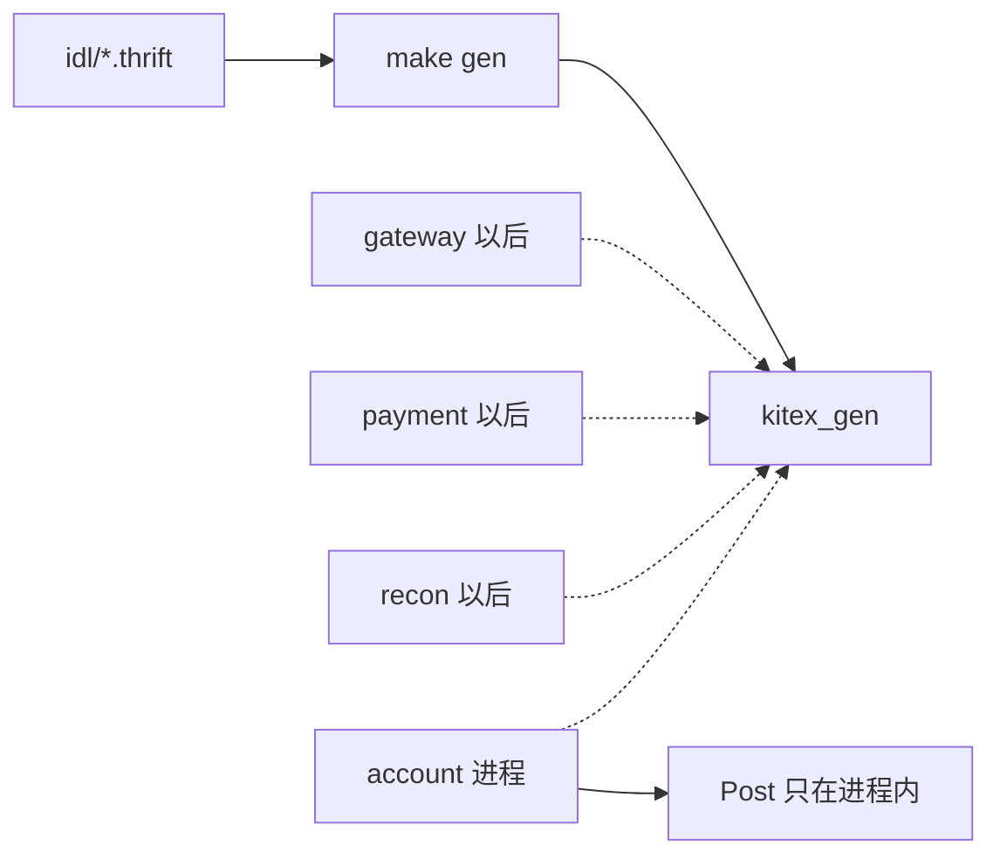

# BASE-12 IDL 与代码生成

| 项 | 内容 |
|---|---|
| 功能点 | BASE-12（P0，第 1 周） |
| 所属链路 | 基础设施 |
| 代码提交 | `6763c71` `[BASE-12] add thrift idl and kitex generation` |
| 分支 | `feat/BASE-12-idl` |
| 日期 | 2026-10-15 |
| 状态 | DONE |

## 一句话结论

内部 RPC 的契约写在四个 Thrift 文件里，由钉死的 Kitex v0.16.3 生成 Go 代码并入库。记账方法 `Post` 不在 RPC 中。lead 再次执行 `make gen` 后，`git diff --exit-code kitex_gen` 退出码为 0，diff 为空。根包单元测试 `TestBASE12IDLMethods` 锁住三张方法表，且没有 `Post`。这次没有进程监听端口。

## 1. 背景

### 1.1 系统简介

pay-system 是一个用 Go 编写的小型支付后端，模拟商户收款、退款、商户间转账三条资金链路，重点在数据一致性和性能。系统由 5 个部分组成：gateway（对外 HTTP 入口，负责签名校验和限流）、payment（支付单、退款单、转账单的状态管理和流程推进）、account（账户余额与记账，数据按商户分到 2 个数据库分片）、channel-mock（模拟微信、支付宝这类外部支付渠道）、recon（对账，核对系统内外数据是否一致）。服务之间用 Kitex RPC 同步调用，或通过 Kafka 消息异步通知；数据存在 MySQL 8.4，Redis 用于防重放。所有金额用整数“分”表示，所有记账只追加不修改。当前已完成：工程骨架、本地环境、迁移与种子、金额、ID、错误码、时钟、配置、日志、数据库访问、集成测试基座、IDL 与代码生成。分片路由和开户还没做。

### 1.2 本功能点在系统中的位置

本功能点不处理任何一笔收款、退款或转账。它只规定以后 gateway、payment、account、recon 互相调用时用的类型，并把这些类型生成进 `kitex_gen/`。没有任何服务在这次提交里监听端口。



实线是这次已经做完的生成。虚线是以后的调用方，本提交里还不存在。`Post` 画在 account 进程里面：它给冻结确认、同分片转账和入账消费使用，不经过网络。

### 1.3 为什么需要它

假设 payment 和 account 各写一份冻结请求。payment 把 10000 分（100.00 元）放在第 4 号字段，account 手写的结构却把第 4 号字段当成商户号。调用能编过，金额和商户号对不上，或者解码直接失败。两边若再各用一个不同版本的生成器，字段编号和可选字段的指针形状还会再漂一次。

另一条路是把记账 `Post` 做成 RPC。记账发生在 account 已经打开的数据库事务里，事务里不能再调用别的进程。一次 RPC 超时会把行锁一直占到事务超时，余额停在未知状态。所以 `Post` 留在 account 进程内，RPC 表里没有它。

生成结果必须进仓库。不入库的话，每个开发者本机生成一次，diff 里分不清是契约改了还是工具版本不同。检查就是：用同一条命令再生成，`kitex_gen` 的 diff 为空。

## 2. 术语

| 术语 | 含义 |
|---|---|
| 分 | 金额最小单位。10000 分等于 100.00 元。IDL 里金额是 `i64`，不用小数。 |
| 分片 | 账户按商户拆到 2 个库。本功能点不选择分片，只在请求字段里保留 `shard`。 |
| 分录 | 记账追加的一行。本功能点不写分录。 |
| Thrift | 一种接口定义语言。字段靠数字编号传输，不靠名字。 |
| IDL | 接口定义文件。这里是 `idl/*.thrift`。 |
| Kitex | 项目使用的 Go RPC 框架。生成器和运行时都钉在 v0.16.3。 |
| `kitex_gen` | 生成器写出的 Go 代码目录，提交进仓库，不手改。 |
| RPC | 进程之间的同步调用。gateway、payment、account、recon 之间以后走这里。 |
| `BizStatusError` | Kitex 用来携带业务码和一句消息的错误。它带不了业务对象。 |
| `biz_code` | 响应里的 `i32` 业务码。0 表示成功。只有必须连同单据返回的错误才用它。 |
| `Post` | account 进程内的记账方法。同一张凭证的多条分录在一个事务里写入。不是 RPC。 |
| 默认 requiredness | Thrift 字段不写 `required`、也不写 `optional`。本版把文档里的必填字段写成这种形式。 |
| `optional` | 字段可以不出现。文档写可省略、可空、二选一，或时间还没发生时使用。 |
| 状态字符串 | `ACTIVE`、`SUCCESS` 这类大写英文，与数据库里的取值相同。不用 Thrift 枚举，因为枚举在线上是数字。 |
| 幂等 | 同一操作做一次和做多次，结果相同。本功能点的“多次”指重复跑生成命令，生成目录不变。 |

## 3. 技术讲解

### 3.1 要解决的问题

1. 三个内部服务各有一份方法表，方法名和字段必须跟接口契约一致，不能多一个 `Post`，也不能少 `OpenAccount`。
2. 金额跨进程仍是整数分。10000 分（100.00 元）不能变成浮点 `100.00`。
3. 状态跨进程仍是数据库里的大写字符串，不能变成 0、1、2。
4. 第一版必填字段要出现在契约里，但不能写成永远不能放宽的 `required`。文档允许省略的字段必须是 `optional`。
5. 退款、转账有的错误必须连同一张已落成失败的单据一起返回。这种错误不能只用 `BizStatusError`。
6. 生成代码可重复。同一命令再跑，已入库的 `kitex_gen` 没有 diff。
7. 这次不启动服务，也不在日志里打出商户密钥。

### 3.2 方案

四个文件分工如下。`idl/base.thrift` 只有两个公共类型：时间是字符串，业务码是 `i32`。三个服务文件各自一个 service，方法只来自接口契约里的三张 RPC 表。

`base.thrift` 把时间和业务码固定成别名。生成后的 Go 是 `type Timestamp = string` 和 `type BizCode = int32`。时间的例子是 `2026-10-12T10:00:00.000+08:00`，带毫秒和 `+08:00`。账期 `bill_date` 仍是 `YYYY-MM-DD`，不用这个时间类型。

```thrift
namespace go base

typedef string Timestamp
typedef i32 BizCode
```

这段在定义两个别名。看 `Timestamp` 是 string、`BizCode` 是 i32，没有第三个公共字段。

`AccountService` 有 11 个方法：`OpenAccount`、`GetAccount`、`Freeze`、`ReleaseFreeze`、`ConfirmFreeze`、`TransferLocal`、`TransferInTry`、`TransferInConfirm`、`TransferInCancel`、`CheckBalance`、`Reverse`。`OpenAccount` 在表里，所以生成。文件头写明 `Post` 不是 RPC。服务块里没有名为 `Post` 的方法。

`PaymentService` 有 12 个方法：`CreatePayment`、`Pay`、`ClosePayment`、`QueryPayment`、`CreateRefund`、`QueryRefund`、`CreateTransfer`、`QueryTransfer`、`HandleChannelNotify`、`GetMerchantCredential`、`SyncChannelTxn`、`ReplayEvent`。

`ReconService` 只有 `RunBatch`。

字段规则：

- 文档写必填的，不写 `required`，也不写 `optional`，用默认 requiredness。
- 文档写可省略、可空、二选一，或时间尚未发生的，写 `optional`。
- 金额是 `i64`。接口里以 `amount` 结尾的名字保持原样，例如 `frozen_amount`、`fee_amount`。
- `Account.balance` 保持接口里的名字 `balance`，类型仍是 `i64`。它表示余额的分，不改名为 `balance_amount`。
- 状态是 `string`。账户是 `ACTIVE` / `FROZEN` / `CLOSED`，支付单是 `INIT` / `PAYING` / `SUCCESS` / `FAILED` / `CLOSED`。取值写在注释里，IDL 里没有枚举。

平台账户汇总时，`account_no` 是空串，字段仍在；`shard` 和 `sub_no` 可以不出现，所以这两个是 `optional`。确认冻结时转账的 `channel` 传空串，字段仍在，不是 `optional`。创建退款的 `pay_no` 与 `out_trade_no` 二选一，两个都是 `optional`。支付单的 `paid_at` 只有成功后才有，是 `optional`。

`CreateRefund` 和 `CreateTransfer` 的响应里带 `biz_code` 和单据。0 是成功。退款的 `40002`（余额不足）和 `30006`（渠道拒绝）走这个字段，并带上 `refund_order`。转账只有余额不足这一支走 `biz_code = 40002`，并带上 `transfer`。订单不存在这类不带单据的错误，以后仍用 `BizStatusError`。这次没有写网关，也没有把非 0 的 `biz_code` 映射成 HTTP。

```thrift
struct CreateRefundResponse {
    1: base.BizCode biz_code
    2: RefundOrder refund_order
}

struct CreateTransferResponse {
    1: base.BizCode biz_code
    2: Transfer transfer
}
```

这段在给两个响应定字段编号。看 `biz_code` 在 1 号，单据在 2 号。退款单据的字段名是 `refund_order`，转账单据的字段名是 `transfer`。

`GetMerchantCredential` 的响应有 `merchant_id`、`status`、`app_secret`、`secret_version`、`default_notify_url`。`app_secret` 是明文密钥。IDL 注释写明调用方不得写入日志。本提交没有服务进程，也没有日志语句去打印这个响应。

生成命令钉死为：

```makefile
go run github.com/cloudwego/kitex/tool/cmd/kitex@v0.16.3 -module github.com/yym108/pay-system -gen-path kitex_gen
```

`Makefile` 对 `idl/account.thrift`、`idl/payment.thrift`、`idl/recon.thrift` 各跑一次。不传 `-service`，因此不生成 `main` 和 `handler`，也不监听端口。`base.thrift` 没有 service，由另外两个文件的 `include` 带出来。生成器这条 `go run` 不写入 `go.mod`。

生成目录是 `kitex_gen/base`、`kitex_gen/account`（含 `accountservice` 的 client/server）、`kitex_gen/payment`、`kitex_gen/recon`。文件头是 thriftgo 0.4.5 或 Kitex v0.16.3，并写着 `DO NOT EDIT`。四个 `k-consts.go` 没有这行头，内容只有一个防未使用导入的变量；它们没有被手改。

生成代码 import 了 `github.com/cloudwego/gopkg/protocol/thrift`。`go mod tidy` 后直接依赖是 `github.com/cloudwego/gopkg v0.2.0`，与 Kitex v0.16.3 自己的 `go.mod` 要求的版本相同。`go list -m` 里 Kitex 仍是 v0.16.3，sonic 仍是 v1.15.4。

### 3.3 为什么这样做

| 方案 | 做法 | 优点 | 缺点 | 结论 |
|---|---|---|---|---|
| 采用：Thrift 文件加 Kitex v0.16.3 生成，结果入库 | 方法只列三张 RPC 表；必填用默认 requiredness；`make gen` 再跑，diff 必须为空 | 字段编号只有一处；工具版本写在命令里；重复生成能发现手改 | 生成文件多；要接受生成器带入的间接依赖 | 采用 |
| 备选：手写 `kitex_gen` | 按文档自己写结构和 client | 不引入生成器 | 本次生成物有两万行以上。手写会改错字段编号，也无法用“再生成 diff 为空”证明没人改过 | 不采用 |
| 备选：把 `Post` 放进 `AccountService` | 记账也走 RPC | 调用形状和冻结看起来一样 | 记账在数据库事务内。事务内禁止 RPC。超时会占着行锁，余额停在未知状态 | 不采用 |
| 备选：状态用 Thrift 枚举 | `ACTIVE = 1` 这种数字 | 写错字符串会在生成期被拒绝 | 线上传的是数字，数据库存的是 `ACTIVE`。两边对数字的约定一变，状态就对不上 | 不采用 |

`required` 关键字也没有用。一旦标成 `required`，缺字段就解码失败，以后也不能改成可省略。默认 requiredness 仍会写出该字段；读到缺字段时得到零值，而不是硬错误。以后新增字段必须是 `optional`，这次没有预留空编号。

### 3.4 正确性

不涉及。本功能点只生成接口类型，不改余额、不写分录。没有请求进入账户，也没有测试去插入或更新余额。

因此下面四类资金场景都没有系统行为，也没有最终余额可言：

| 场景 | 系统行为 | 最终状态 | 证明 |
|---|---|---|---|
| 同一请求重复到达 | 不涉及 | 不改余额、不写分录 | 无 |
| 两个冲突请求并发 | 不涉及 | 不改余额、不写分录 | 无 |
| 事务中途进程崩溃 | 不涉及 | 不改余额、不写分录 | 无 |
| 下游调用超时 | 不涉及 | 不改余额、不写分录 | 无 |

和本功能点相关的重复只有生成命令：再跑一次 `make gen`，`kitex_gen` 的 diff 为空。这证明生成结果稳定，不证明记账幂等。

### 3.5 性能

不涉及。没有压测，也没有对比开关。生成命令的耗时未记录。

## 4. 已完成内容

### 4.1 改动清单

提交 `6763c71` 共 33 个文件，24277 行插入，6 行删除。

| 文件 | 新增 / 修改 | 作用 |
|---|---|---|
| `idl/base.thrift` | 新增 | `Timestamp`、`BizCode` |
| `idl/account.thrift` | 新增 | `AccountService` 的 11 个方法，不含 `Post` |
| `idl/payment.thrift` | 新增 | `PaymentService` 的 12 个方法 |
| `idl/recon.thrift` | 新增 | `ReconService.RunBatch` |
| `kitex_gen/` | 新增 | 21 个生成出的 Go 文件，未手改 |
| `base12_idl_test.go` | 新增 | 根包 `TestBASE12IDLMethods` |
| `Makefile` | 修改 | `gen` 改为钉死的 kitex v0.16.3；不传 `-service` |
| `go.mod`、`go.sum` | 修改 | 直接依赖增加 `github.com/cloudwego/gopkg v0.2.0`；Kitex、sonic 版本不变 |
| `docs/02-requirements.md` | 修改 | BASE-12 标为 DONE，并记下文件名和检查命令 |
| `docs/04-dev-plan.md` | 修改 | 只勾 BASE-12 |
| `docs/01-tech-decisions.md` | 修改 | 记下生成命令钉死 v0.16.3，不改版本表里的版本号 |
| `docs/interview-notes.md` | 修改 | 记下默认 requiredness、`Post` 不进 RPC、`biz_code` |

### 4.2 对外变化

| 类别 | 变化 |
|---|---|
| 接口 | 无。接口文档没有改，也没有升版本。RPC 的类型现在有了 IDL，HTTP 路径和字段语义没有变。 |
| 表结构 | 无。 |
| 配置项 | 无。 |
| 错误码 | 无。没有新增错误码，约定文档没有升版本。 |
| 指标 / 故障点 | 无。没有新进程，也没有打点。 |

### 4.3 验收对照

| 验收条目 | 测试函数 | 类型 | 结果 |
|---|---|---|---|
| 三张 RPC 表里的每个方法都出现在对应 IDL 的 service 中，且没有 `Post` | `TestBASE12IDLMethods` | 单元 | 通过。它在根包，随 `make test` 一起跑 |
| `make gen && git diff --exit-code kitex_gen` 通过 | 不是 `go test`。lead 直接跑了这两条命令 | 命令 | 通过。diff 为空，退出码 0 |

`TestBASE12IDLMethods` 只读 `idl/account.thrift`、`idl/payment.thrift`、`idl/recon.thrift` 的 service 块，抽出方法名，和上表的名单做完全相等比较。多一个或少一个方法都会失败。它不检查字段类型，也不启动 RPC。

### 4.4 验证记录

lead 于 2026-10-15 在本机核验。`go version` 为 `go1.27.2 darwin/arm64`。

| 命令 | 结果 |
|---|---|
| `gofmt -l .` | 无输出，退出码 0 |
| `make lint` | `0 issues.` |
| `make test` | 通过。根包 `ok github.com/yym108/pay-system 2.455s`。`kitex_gen` 各包 `[no test files]`。其余包为 cached 或无测试文件 |
| `go build ./kitex_gen/...` | 退出码 0 |
| `make gen`，然后 `git diff --exit-code kitex_gen` | `make gen` 打印三行 `[INFO] Code Generation is Done!`。随后 diff 为空，退出码 0 |
| `go list -m` | `github.com/cloudwego/kitex v0.16.3`，`github.com/bytedance/sonic v1.15.4`，`github.com/cloudwego/gopkg v0.2.0` |
| `make test-integration` | 未运行。IDL 与生成代码不访问 MySQL、Redis、Kafka |
| `make cover` | 未运行。本功能点不在核心覆盖率包清单（`service/*/biz`、`pkg/money`、`pkg/sign`、`pkg/idgen`、`pkg/outbox`）里 |

没有覆盖率数字。没有集成测试结果。

### 4.5 同步的文档

- 需求：§3 中 BASE-12 为 DONE。变更记录增加 2026-10-15 一行：四个 IDL 文件名、`Post` 不在 RPC 里、检查命令是 `make gen && git diff --exit-code kitex_gen`。
- 开发计划：只勾了 BASE-12。
- 技术决策：生成命令钉死 Kitex v0.16.3。版本表里的版本号没有改。
- 面试笔记：补了默认 requiredness、状态用字符串、`Post` 不进 RPC、`biz_code` 的原因。
- 约定文档没有升版本。接口文档没有改。

## 5. 未完成与风险

- 没有服务实现，没有端口监听。account 的 RPC 进程留给后面的 ACC-11。支付、退款、转账的业务都还没做。分片路由和开户也还没做。
- `TestBASE12IDLMethods` 不检查字段是不是 `optional`，也不检查 `i64`。字段形状靠 IDL 本身，以及再生成后 diff 为空。
- `biz_code` 只有类型。没有任何测试构造一笔 10000 分的退款并断言返回 `40002`。网关还不会把非 0 的 `biz_code` 写成 HTTP。
- 文档没有写“省略”的字符串，例如对账批次的 `error_msg`、差错上的 `handler` 和 `handle_note`，在 IDL 里是普通 string。没有值时要发空串，不是把字段省掉。
- 间接依赖 `golang.org/x/sync v0.22.0` 被 Kitex 生成链拉入。版本表里的 v0.23.0 留给以后的业务 errgroup，本次没有提前升级。`gopkg.in/yaml.v3 v3.0.1` 作为间接依赖回来。
- 四个 `k-consts.go` 没有 “Code generated” 头。lint 为 `0 issues.`，这四个文件没有手改。
- 仓库没有 `.github` 工作流。本次不新建 CI。一致性检查就是 `make gen && git diff --exit-code kitex_gen`。

## 6. 如何复现

不需要 Docker。在仓库根目录、含提交 `6763c71` 的检出上执行。本机记录到的 Go 是 `go1.27.2 darwin/arm64`。

```bash
gofmt -l .
make lint
make test
go build ./kitex_gen/...
make gen
git diff --exit-code kitex_gen
go list -m github.com/cloudwego/kitex github.com/bytedance/sonic github.com/cloudwego/gopkg
```

已记录的结果：`gofmt -l .` 无输出且退出码 0；`make lint` 打印 `0 issues.`；`make test` 通过，根包一行是 `ok github.com/yym108/pay-system 2.455s`，`kitex_gen` 各包为 `[no test files]`；`go build ./kitex_gen/...` 退出码 0；`make gen` 打印三行 `[INFO] Code Generation is Done!`，接着的 diff 退出码 0 且为空；`go list -m` 三行分别是 Kitex v0.16.3、sonic v1.15.4、gopkg v0.2.0。

只跑方法名单：

```bash
go test -count=1 -run TestBASE12IDLMethods .
```

全量 `make test` 已经跑过根包。上面的命令只筛选这一条。新跑一次时秒数可以和 `2.455s` 不同，预期仍是该包 `ok`。

不要跑 `make test-integration` 来验证本功能点。它不访问 MySQL、Redis 或 Kafka。

## 7. 讲解要点

1. 问：为什么不把 `Post` 放进 RPC？答：`Post` 在 account 已经打开的数据库事务里记账。事务里不能再调用别的进程。RPC 超时会占着行锁，余额停在未知状态。冻结确认和转账在本进程里调用它。
2. 问：为什么退款余额不足不用 `BizStatusError`？答：`BizStatusError` 只有码和一句话，带不了已经写成失败的退款单。`CreateRefund` 正常返回，`biz_code` 放 `40002` 或 `30006`，2 号字段放 `refund_order`。0 是成功。不带单据的错误仍走 `BizStatusError`。
3. 问：怎么证明生成代码没被手改？答：命令钉死 `go run github.com/cloudwego/kitex/tool/cmd/kitex@v0.16.3`。lead 再跑 `make gen`，打印三行完成，然后 `git diff --exit-code kitex_gen` 退出码 0。生成器本身不在 `go.mod` 的直接依赖里。

## 延伸阅读

- `idl/base.thrift`、`idl/account.thrift`、`idl/payment.thrift`、`idl/recon.thrift`：契约原文。
- `Makefile` 的 `gen` 目标：钉死的生成命令。
- `base12_idl_test.go`：方法名单测试。
- `docs/05-api.md` §10：三张 RPC 方法表，以及 `CreateRefund`、`CreateTransfer` 的 `biz_code`。
- `docs/02-requirements.md` 里 BASE-12 那一节：规则和验收原文。
- `docs/01-tech-decisions.md` 的 D2：为什么用 Thrift，以及 2026-10-15 对生成命令的补充。

## 修订记录

| 日期 | 提交 | 修订内容 |
|---|---|---|
| 2026-10-15 | `6763c71` | 初稿。代码提交是 `[BASE-12] add thrift idl and kitex generation`，完整 hash `6763c71ff1cc3018721911c4e72207c83d04ae72`。git 作者时间是 2026-10-15 03:31:08 +0800。报告本身还没单独提交 |
