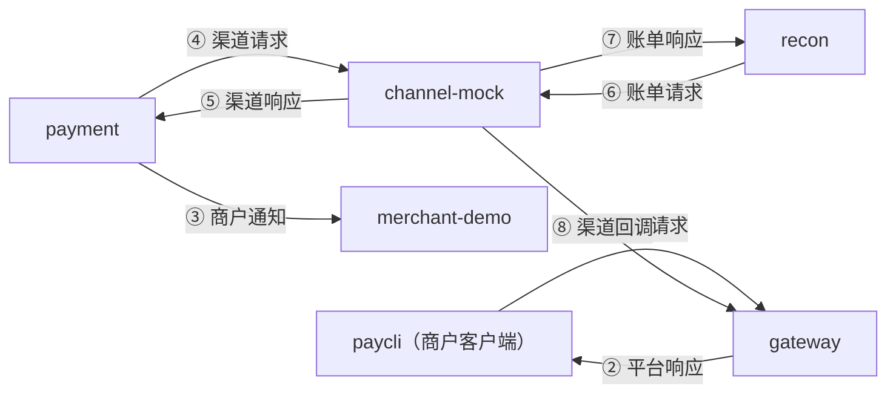

# BASE-13 签名库

| 项 | 内容 |
|---|---|
| 功能点 | BASE-13（P0，第 3 周） |
| 所属链路 | 基础设施 |
| 代码提交 | `46e1cc4` `[BASE-13] add request and channel signing`（完整 `46e1cc4cd34cd1a4ee24fe4b9a774f8dd1b4fc84`，2026-10-23 11:45:15 +0800） |
| 分支 | `feat/BASE-13-sign` |
| 日期 | 2026-10-23 |
| 状态 | DONE |

## 一句话结论

新增公共包 `pkg/sign`，实现系统里三种 HMAC-SHA256 签名的签名和验签两侧：商户请求、平台响应与商户通知、平台与模拟渠道之间的报文。接口文档给出的 4 条测试向量逐字通过。body 改 1 字节、查询串参数换顺序、时间戳改 1 秒都会验签失败。`pkg/sign` 语句覆盖率 100.0%。

## 1. 背景

### 1.1 系统简介

pay-system 是一个用 Go 编写的小型支付后端，模拟商户收款、退款、商户间转账三条资金链路，重点在数据一致性和性能。系统由 5 个部分组成：gateway（对外 HTTP 入口，负责签名校验和限流）、payment（支付单、退款单、转账单的状态管理和流程推进）、account（账户余额与记账，数据按商户分到 2 个数据库分片）、channel-mock（模拟微信、支付宝这类外部支付渠道）、recon（对账，核对系统内外数据是否一致）。服务之间用 Kitex RPC 同步调用，或通过 Kafka 消息异步通知；数据存在 MySQL 8.4，Redis 用于防重放。所有金额用整数“分”表示，所有记账只追加不修改。

当前已完成：工程骨架、本地环境、迁移与种子、金额、ID、错误码、时钟、配置、日志、数据库访问、集成测试基座、IDL，账户的分片路由、开户、查询、记账、冻结、解冻、确认扣款、两种转账分支、余额核对和 account RPC 服务，商户费率核对，以及本次的签名库。gateway、payment、recon、channel-mock、paycli、merchant-demo 都还没有实现，所以本包目前只被自己的测试调用。

### 1.2 本功能点在系统中的位置

系统里有 8 条要签名的跨进程 HTTP 报文，对应下图 8 个箭头。每条都是发送方调用本包签名，接收方调用本包验签。paycli 是项目自带的命令行商户客户端，merchant-demo 是演示用的商户通知接收服务。



| 报文 | 签名方（接入功能点） | 验签方（接入功能点） | 签名方式与密钥 |
|---|---|---|---|
| ① 商户调用平台 API | paycli（TL-01 规则 3） | gateway（GW-03） | 请求签名，商户密钥 `app_secret` |
| ② 平台 API 的响应 | gateway（GW-01 规则 3） | paycli（TL-01 规则 3） | 平台签名，`app_secret` |
| ③ 平台通知商户“支付 / 退款 / 转账有结果了” | payment（NTF-02 规则 2） | merchant-demo（TL-02 规则 1） | 平台签名，`app_secret` |
| ④ 支付受理、查单、关单、退款受理 | payment（PAY-03 支付受理，PAY-05、PAY-09 查单，PAY-06、PAY-07 关单，REF-02 退款受理） | channel-mock（CH-01~04） | 渠道签名，渠道密钥 |
| ⑤ ④ 的响应 | channel-mock（CH-01~04） | payment（同 ④ 各功能点） | 渠道签名，渠道密钥 |
| ⑥ 下载对账单 `GET /mockpay/v1/bills` | recon（REC-02） | channel-mock（CH-08） | 渠道签名，body 为空串 |
| ⑦ ⑥ 的响应 | channel-mock（CH-08） | recon（REC-02） | 渠道签名 |
| ⑧ 渠道通知平台“交易有结果了” | channel-mock（CH-05 规则 1） | gateway（GW-06 规则 1） | 渠道签名 |

出处：①② 见接口 §3.1、§3.3；③ 见 §3.4；④~⑧ 见 §3.5“平台与模拟渠道之间的请求、响应、回调都使用渠道密钥签名，双方都必须验签”，以及 CH 章开头“所有请求与回调使用 BASE-13 的渠道签名”。⑤⑦ 的验签由谁写，需求没有单列规则，表里按调用方推定。

两种回执不在表里，因为接收方只看 HTTP 状态码和 body，不验签：merchant-demo 对 ③ 的回执（成功时 200 `SUCCESS`，验签失败 401，NTF-02 规则 3、TL-02 规则 1）；gateway 对 ⑧ 的回执（纯文本 `SUCCESS` 或 `FAIL`，CH-05 规则 2、接口 §7）。接口 §3.5 说“响应”也要签名，按上下文指 ⑤⑦；⑧ 的回执是否也要签，文档没写明，本报告按不签处理。gateway 与 payment 之间是 Kitex RPC，不经过本包。

### 1.3 为什么需要它

不签名，任何人都能伪造资金结果。举例：攻击者知道网关的回调地址 `POST /callback/mockpay`，发一条“支付单 PA…001 已 SUCCESS”的回调，平台就会把一笔 10000 分（100.00 元）的订单当成已付款，资金进入商户结算账户，但渠道根本没收到钱。同理，伪造发给商户的“支付成功”通知会让商户发货。只有持有密钥的一方能算出正确的签名，验签失败的报文不能改变任何状态。

## 2. 术语

| 术语 | 含义 |
|---|---|
| 哈希 / SHA-256 | 把任意长度的字节压成 32 字节的摘要。改动输入 1 位，摘要就完全不同。没有密钥，谁都能算。 |
| HMAC-SHA256 | 带密钥的 SHA-256：`HMAC(key, msg)`。只有知道 `key` 的人能算出结果，也就能用它证明“消息是持有密钥的人发的，且没被改过”。结果是 32 字节。 |
| 共享密钥 | 双方事先都持有的同一个秘密。商户密钥叫 `app_secret`，渠道密钥配置在 `CHANNEL_MOCKPAY_KEY`。 |
| HTTPS / TLS | HTTPS 是跑在 TLS 加密通道上的 HTTP。TLS 加密传输内容，并让客户端确认服务器的身份。 |
| RequestURI | HTTP 请求行里的路径加原始查询串，如 `/v1/payments?out_trade_no=T20261009001`。 |
| 规范化 | 签名前把输入改写成统一形式，比如排序查询参数、方法转大写、去掉 JSON 空白。本包不做。 |
| canonical（拼接串） | 参与签名的字节串，由几个字段按固定顺序、用换行 `\n` 连接而成。签名方和验签方各自拼出同一串，再各算 HMAC。 |
| hex | 十六进制编码，本项目用小写，32 字节摘要编码成 64 个字符。 |
| base64 | 把字节编码成可打印字符。标准编码每 3 字节变 4 个字符，不足时用 `=` 填充；32 字节编码成 44 个字符。 |
| nonce | 请求方生成的一次性随机串（16–32 位字母数字），用来识别重复请求。 |
| 重放 | 攻击者截获一条合法报文，原样再发一次。签名仍然正确。 |
| 时序攻击 | 通过测量“比较用了多久”来逐字节猜出正确的签名。 |
| 哨兵错误 | 包里预先定义的固定 `error` 值，调用方用 `errors.Is` 识别。 |
| `20001` / `50001` / `10003` | 对外错误码：商户签名错误、渠道签名错误、平台内部错误。前两个返回 HTTP 401，`10003` 返回 500。 |
| `SUCCESS` / `FAIL` | gateway 回复渠道回调 ⑧ 的纯文本 body（接口 §7）。`SUCCESS`（HTTP 200）表示平台已收下，渠道停止重发；`FAIL` 表示没处理，伴随 401（渠道签名错误或时间戳过期）或 500（平台内部错误）。渠道对任何“不是 200 加 `SUCCESS`”的回执都会重发（CH-05 规则 2）。 |

## 3. 技术讲解

### 3.1 要解决的问题

本包要按接口文档逐字实现三种签名，并让 1.2 表里的 6 个进程共用同一份两侧实现。需求给 BASE-13 定了 8 条规则。前 4 条是需求原有的，5–8 条是本功能点在提交 `46e1cc4` 里补的：

| 规则 | 一句话 | 来源 |
|---|---|---|
| 1 | 实现三种签名，拼接方式以接口文档为准，逐字通过 4 条测试向量（接口 §3.7） | 接口 §3.1、§3.3–§3.5 |
| 2 | 只对原始字节签名，不排序参数、不改大小写、不重排 JSON；时间窗口和 nonce 不在本包 | 接口 §3.1、§3.2 |
| 3 | 验签用 `hmac.Equal` 常量时间比较 | 需求原有 |
| 4 | 签名、验签两侧函数都提供，各进程共用 | 需求原有。原文只列了网关、paycli、merchant-demo、channel-mock，按 1.2 的表，payment、recon 也要用 |
| 5 | 入参是传输中的原始值，nil body 与空 body 相同；本包不转大写、不解析时间戳、不查格式；提供 `FormatTimestamp` | 细化。“原始字节、空 body 为空串”接口 §3.1 已有，本包与调用方的分工是新增 |
| 6 | 方法、RequestURI、时间戳、nonce 含换行时，两侧都报错 | 新增，接口文档没有 |
| 7 | 只接受规范的标准 base64 签名；空密钥两侧都报错 | 新增。接口 §3.1 只要求签名方用带 `=` 的标准编码，没规定验签方要拒绝其他写法 |
| 8 | 错误是文本固定的哨兵，不含密钥、签名和拼接串；验签侧与签名侧映射到不同的对外错误码 | 新增。`20001`、`50001` 是已有错误码，`ErrEmptyKey` 和签名侧错误映射到 `10003` 是新增 |

规则 6、7 对按接口文档实现的发送方没有影响，但对不规范的发送方会变成拒绝，列在第 5 节的风险里。

### 3.2 方案

本包是纯函数：输入密钥和报文字段，输出签名字符串或验签错误。没有 IO，不读时钟，不访问 Redis。

**三种拼接串。** 签名统一是 `base64(HMAC-SHA256(密钥, canonical))`，区别只在 canonical：

| 签名 | canonical（每行之间是 `\n`） | 密钥 | 请求头 |
|---|---|---|---|
| ① 商户请求 | `METHOD` / `RequestURI`（路径加原始查询串）/ `X-Timestamp` / `X-Nonce` / `hex(sha256(body))` | `app_secret` | `X-App-Id`、`X-Timestamp`、`X-Nonce`、`X-Signature` |
| ②③ 平台响应、商户通知 | `X-Timestamp` / `X-Nonce` / `hex(sha256(body))` | `app_secret` | `X-Timestamp`、`X-Nonce`、`X-Signature` |
| ④~⑧ 渠道 | `X-Mock-Timestamp` / 原始 body | 渠道密钥 | `X-Mock-Timestamp`、`X-Mock-Signature` |

时间戳都是十进制 Unix 秒。无 body 时 body 按空串计算，`hex(sha256(""))` 是 `e3b0c442…b855`。

**一个完整向量（V1，下单请求）。** 密钥 `demo_secret_M100001_0123456789ab`，body 是 `{"out_trade_no":"T20261009001","amount":10000,"subject":"demo"}`（下单 10000 分，即 100.00 元）。canonical 共 5 行：

```text
POST
/v1/payments
1791500000
AbCdEf0123456789
c2e7954ac287ebcaff20ff9cdaf71f72e6cf4def6aec049a8b69a3c468e0a1e1
```

签名是 `hFYKid0+k7q9vCvqh/i6YnvoaAJYzf2niNuvSkMCwoQ=`。`1791500000` 对应 2026-10-09 06:53:20（东八区）。测试同时比对 canonical 和签名，两者都与文档逐字一致。V2（GET 查询、空 body）、V3（平台响应）、V4（渠道回调）也一样。

**为什么请求签名对 body 取摘要，渠道签名不取。** 安全性上两者等价：HMAC 本身能处理任意长度的输入，body 都放在最后一行，不会和前面的字段混淆。取摘要的好处是 canonical 定长、可读，商户在自己一侧排查签名不一致时，可以打印 5 行短串逐行对比，不必打印整个 body（商户请求的 body 最长 64KB，这是网关的请求体上限，超过返回 413，见需求 GW-01 规则 1、NFR-SEC-08 和接口 §2.1）。常见的云 API 签名也这样做。渠道签名模拟外部机构自己定的、更简单的协议，只有一个时间戳字段。两种形状都由接口文档定死，本包照做。

**API。** 每种签名一个输入结构体和一对函数，全部字段取传输中的原始值：

```go
// pkg/sign/sign.go：三对函数，验签通过返回 nil
func SignRequest(secret []byte, r Request) (string, error)
func VerifyRequest(secret []byte, r Request, signature string) error
func SignPlatform(secret []byte, m PlatformMessage) (string, error)   // 响应与通知共用
func VerifyPlatform(secret []byte, m PlatformMessage, signature string) error
func SignChannel(key []byte, m ChannelMessage) (string, error)
func VerifyChannel(key []byte, m ChannelMessage, signature string) error
func FormatTimestamp(t time.Time) string // 十进制 Unix 秒
```

验签按固定顺序检查：密钥非空 → 字段不含换行 → 签名格式合法 → 重算 HMAC → `hmac.Equal` 比较。下面是最后两步，`want` 是重算结果，`got` 是解码后的对方签名：

```go
// pkg/sign/sign.go，verify
got, err := decodeSignature(signature)
if err != nil {
	return err
}
if !hmac.Equal(want, got) {
	return ErrSignatureMismatch
}
return nil
```

**规则逐条解释。**

- 不做规范化（规则 2）。签名的意义是“签的就是执行的”。假如网关验签前先把查询串排序，`?amount=1&amount=100` 这种重复参数在规范化和业务解析时可能取到不同的值，签名覆盖的内容和真正执行的内容就分开了。另外，Go、Python、k6 的 JavaScript 必须写出完全相同的规范化规则，任何一点差别都会造成误判。只认原始字节，两端只需要对同一串字节达成一致。测试里把两个查询参数调换顺序，原签名验签失败。
- 常量时间比较（规则 3）。普通的逐字节比较遇到第一个不同字节就返回，耗时暴露了“前面猜对了几个字节”，攻击者可以一个字节一个字节地试出正确签名。`hmac.Equal` 不管哪里不同，都比较完全部字节。有一条测试扫描本包源码，要求调用 `hmac.Equal`，且没有 `bytes.Equal` 或对签名用 `==`；临时把它换成 `bytes.Equal` 时，这条测试会失败。
- 字段含换行一律拒绝（规则 6）。canonical 靠换行分隔字段，字段本身带换行时，两组不同的头会拼出同一串。以平台签名为例，下面两组的 canonical 都是 `1791500001\nZyXw\nVu9876543210\n<摘要>`：

  | | `X-Timestamp` | `X-Nonce` |
  |---|---|---|
  | 甲 | `1791500001\nZyXw` | `Vu9876543210` |
  | 乙 | `1791500001` | `ZyXw\nVu9876543210` |

  这样甲的签名可以原样用于乙，而防重放按 nonce 去重，两者的 nonce 不同，会被当成两条请求。

  按规范发出的 HTTP 报文碰不到这种情况：HTTP 头的值里不允许出现原始换行，商户请求的 nonce 格式（16–32 位字母数字）还会被 GW-04 检查。Hertz、`net/http` 遇到含换行的头具体怎么处理，本次未验证。能把换行带进签名函数的只有两类调用：一是不从 HTTP 头取值、自己拼字段的代码，如脚本或测试；二是用错了库，比如把已解码的路径 `URL.Path`（`%0A` 已经变成换行）当成 RequestURI 传入。规则 6 给这两类情况兜底：方法、RequestURI、时间戳、nonce 含换行时，签名、验签两侧都返回 `ErrInvalidField`。body 不受限，它在最后一行，而且请求和平台签名里还先取了摘要。
- 只接受规范的 base64（规则 7）。签名必须是 44 个字符的标准 base64，带 `=` 填充，填充位为 0，解码后正好 32 字节。宽松解码会让同一个 MAC 对应许多不同的字符串，比如缺填充、URL 安全字母表（`-_` 代替 `+/`）、末字符填充位不为 0、中间夹换行。各端实现宽松程度不同时，同一签名在 A 端能过、在 B 端不能过。Go 的 `Strict()` 解码仍会跳过换行，所以先卡长度 44，换行被跳过后有效字符变少，解码就会报错或长度不足。测试覆盖了 14 种非法写法，其中两种是合法 base64 但解码后是 31 字节和 33 字节，只有解码长度检查能挡住它们。
- 空密钥两侧都拒绝。用空密钥算 HMAC 在数学上可行，但谁都能算出同样的结果，等于没有签名。

**错误映射（规则 8）。** 验签侧的错误说明“对端签错了”，签名侧的错误和空密钥说明“本端坏了”，两者映射到不同的错误码。四个哨兵错误的文本固定，不含密钥、签名和拼接串。

| 出处 | 错误 | 含义 | 平台服务的处理 |
|---|---|---|---|
| 验签侧 | `ErrMalformedSignature`、`ErrSignatureMismatch`、`ErrInvalidField` | 对端的签名有问题 | 商户请求 ①：`20001`；渠道回调 ⑧：`50001`。都是 HTTP 401，对外不说明具体原因（约定 §5.3 第 4 条） |
| 任一侧 | `ErrEmptyKey` | 本端密钥没配好 | 按内部错误 `10003` 处理，打 ERROR 日志（不含密钥）。具体怎么“回”，看下表 |
| 签名侧 | 任何错误 | 本端内部故障 | 同上 |

`10003` 的处理取决于有没有一个请求在等回复：

| 场景 | 有待回复的请求吗 | 实际处理 | 依据 |
|---|---|---|---|
| gateway 签 ② 失败，或验 ① 时商户密钥为空 | 有，商户在等 | 返回 HTTP 500 / `10003`，响应不签名。`10003` 允许商户用原参数重试，幂等键保证不重复处理 | GW-01 规则 3、GW-03 规则 3、约定 §5.2 |
| gateway 验 ⑧ 时渠道密钥为空 | 有，渠道在等 | 返回 HTTP 500、body `FAIL`，不调用 payment | GW-06 规则 1 |
| channel-mock 签 ⑤⑦ 失败 | 有，平台在等 | 返回 HTTP 500 | BASE-13 规则 8、接口 §9.1 |
| payment 签 ③ 失败 | 没有，平台是发起方 | 本次不发送，`last_error` 记 `internal error`，按一次发送失败计入重试 | NTF-02 规则 2、4 |
| payment 签 ④、recon 签 ⑥ 失败 | 没有 | 需求未规定，见第 5 节 | — |
| channel-mock 签 ⑧ 失败 | 没有 | 需求未规定，见第 5 节 | — |

区分两侧是为了不误导排查。把“本端密钥为空”报成 `20001`，商户会以为自己的签名代码有错，运维也收不到内部错误告警。

“修好密钥后自动恢复”只在有重发机制、且在重发次数用完前修好时成立：

- 渠道回调 ⑧：渠道对任何不是“HTTP 200 加 `SUCCESS`”的回执都会重发，间隔 5、15、30、60 秒，最多发 5 次（CH-05 规则 2、接口 §9.7）。5 次后渠道不再发。
- 商户通知 ③：首次立即发，之后每 30 秒一次，共 5 次，仍失败置为 DEAD，不再自动发送（NTF-02 规则 4）。
- 商户请求 ①：由商户决定是否重试。

平台外的工具不走平台错误码：paycli 签名失败报错并以退出码 1 结束，验响应签名失败时报错（TL-01 规则 3、4）；merchant-demo 和 channel-mock 验签失败返回 401，本端故障返回 500。

**签名能防什么、不能防什么。** 签名证明“持有密钥的人发了这串字节”，所以能防伪造和篡改。它不能证明“是刚发的、只发了一次”：截获的合法请求原样重发，签名仍然正确。防重放由网关（GW-04）负责：时间戳与服务器时间相差超过 300 秒拒绝；nonce 用 Redis `SET gw:nonce:{app_id}:{nonce} 1 NX EX 600` 去重，10 分钟内重复拒绝；渠道回调只查时间窗口，因为回调处理本身是幂等的（重复处理结果不变）。这些检查要用时钟和 Redis，放在本包会让纯函数依赖外部状态，paycli 和 merchant-demo 也就没法直接复用。签名也不加密：没有 TLS 时，body 在网络上是明文（本地环境不启用 TLS，是已知限制）。密钥一旦泄露，签名就失去意义。

### 3.3 为什么这样做

| 方案 | 做法 | 优点 | 缺点 | 结论 |
|---|---|---|---|---|
| 采用：共享密钥 HMAC，逐报文签名 | 每条请求、响应、通知、回调各自签名 | 能识别是哪个商户；能证明内容没被改；回调和通知这种“对方主动打进来”的方向同样适用 | 要管理密钥；不防重放，需要配合时间窗口和 nonce | 采用 |
| 备选：只靠 HTTPS | 传输层加密 | 防窃听；配置简单 | 只验证服务器身份，不证明请求来自哪个商户；TLS 在代理处终止后，内容不再受保护；攻击者自己也能用 HTTPS 往回调地址发伪造报文；本地环境本来就不启用 TLS | 不采用。将来上 TLS 也是叠加在签名之上，不是替代 |
| 备选：非对称签名（RSA / Ed25519） | 私钥签、公钥验 | 验签方不持有能签名的秘密 | 每个商户都要管理密钥对，计算比 HMAC 重（本次未测）；接口文档已定为 HMAC，改算法属于不兼容变更 | 不采用 |
| 备选：验签前规范化 | 排序查询串、格式化 JSON 再签 | 对调用方宽容 | 签的内容和执行的内容可能不一致；多语言实现难以对齐 | 不采用 |

### 3.4 正确性

不涉及资金状态。本包不读写数据库，没有共享可变状态，也没有外部调用，所以不存在重复请求、并发冲突、崩溃恢复或下游超时的问题。需要证明的是：篡改任何一个签名字段都会被发现，合法签名一定能通过。

`pkg/sign/sign_test.go` 共 11 个顶层测试，其中 5 个用 `t.Run` 拆成子用例，子用例合计 45 个；11 加 45 就是 `-v` 输出里的 56 个 PASS。

| 测试 | 子用例 | 测什么 | 期望结果 |
|---|---|---|---|
| `TestVectors` | 4 | 接口 §3.7 的 V1–V4：比对 canonical 和签名，并用文档签名验签 | 与文档逐字一致，验签通过 |
| `TestNotifyAndEmptyBody` | 0 | 通知复用平台签名（V3 签名能验过）；空切片 body 与 nil 相同；渠道 GET 的 body 为空串 | 通过 |
| `TestVerifyRejectsTampering` | 16 | body 改 1 字节或末尾加 1 字节（请求、平台、渠道共 4 个）；查询串两个参数调换顺序；时间戳改 1 秒（三种各 1 个）；nonce 改变（请求、平台）；方法改变；路径改变；密钥不对（请求、通知、渠道）；拿平台签名冒充请求签名 | 全部 `ErrSignatureMismatch` |
| `TestNoNormalization` | 6 | 小写方法、尾斜杠、`%2F`、只多一个 `?`、JSON 多一个空格、时间戳带前导 0 | 签名都与原值不同，说明没有被规范化 |
| `TestVerifyMalformedSignature` | 12 | 12 个子用例：空串、16 字节 MAC、hex、填充位非 0、URL 安全字母表、签名重复两遍、多一个字符、缺填充、少一个字符、末尾空格、非 ASCII、中间夹换行。另有一段专门用例：合法 base64 但解码后是 31 或 33 字节，共 14 种写法 | 请求、平台、渠道三种验签都返回 `ErrMalformedSignature` |
| `TestEmptyKey` | 0 | 三种签名，`nil` 和空切片两种空密钥，签名、验签两侧 | `ErrEmptyKey`，签名结果为空串 |
| `TestFieldWithNewline` | 7 | 请求的方法、RequestURI、时间戳、nonce，平台的时间戳、nonce，渠道的时间戳含换行；body 含换行照常可用 | 两侧都返回 `ErrInvalidField` |
| `TestErrorsDoNotLeakSecrets` | 0 | 四种错误的文本里查找密钥、签名、nonce、路径 | 都找不到 |
| `TestFormatTimestamp` | 0 | 东八区与 UTC 的同一时刻格式化相同；用假时钟拨快 2 秒；用它生成 V1 的时间戳再签名 | `1791500000`、`1791500002`，签名与 V1 一致 |
| `TestHeaderNames` | 0 | 6 个请求头常量与接口文档的头名一致 | 通过 |
| `TestVerifyUsesHMACEqual` | 0 | 扫描本包非测试源码：调用了 `hmac.Equal`，没有 `bytes.Equal`，也没有用 `==` 比较签名 | 通过；临时换成 `bytes.Equal` 时失败 |

### 3.5 性能

验一次带 1KB body 的商户请求约 1.5–1.7 微秒，每次分配 808 字节、17 次。下单的目标是 1000 QPS（NFR-PERF-01），按 1.7 微秒算，每秒约占 1.7 毫秒 CPU，即单核的 0.17%。

环境：Apple M5，macOS，Go 1.27.2，2026-10-23。命令 `go test -run '^$' -bench BenchmarkVerifyRequest -benchmem -count=3 ./pkg/sign`，同一天跑了两轮：

| 指标 | 11:45 第一轮（3 次） | 12:01 第二轮（3 次） |
|---|---|---|
| 耗时 | 1496、1492、1498 ns/op | 1527、1703、1591 ns/op |
| 内存 | 808 B/op | 808 B/op |
| 分配次数 | 17 allocs/op | 17 allocs/op |

两轮代码相同，耗时差异的原因未排查（推测是机器负载）；内存和分配次数两轮一致。报告模板要求性能数据写“开关关闭”和“开关打开”两列，指的是 OPT 类优化功能点各自的环境变量开关（如批量记账的 `LEDGER_BATCH_ENABLED`），关闭即为基线。本包没有这类开关，所以只有实测值。

分配来源用内存 profile 看。12:01 重跑的命令和按分配次数排序的结果如下，临时文件放在 `$TMPDIR`，看完即删：

```bash
go test -run '^$' -bench BenchmarkVerifyRequest -benchmem \
  -memprofile "$TMPDIR/mem.out" -o "$TMPDIR/sign.test" ./pkg/sign
go tool pprof -sample_index=alloc_objects -top "$TMPDIR/sign.test" "$TMPDIR/mem.out"
```

| 函数 | 自身分配占比（flat%） | 含下游占比（cum%） |
|---|---|---|
| `io.WriteString`（把字符串写进哈希） | 34.70% | 34.70% |
| `hmac.New`（内部再建两个 SHA-256） | 21.93% | 36.15% |
| `sha256.New` | 14.22% | 14.22% |
| `sign.VerifyRequest` | 7.67% | 99.88% |
| `base64.(*Encoding).DecodeString` | 7.44% | 7.44% |
| `sha256.(*Digest).Sum` | 7.21% | 7.21% |
| `sign.writeBodyHash` | 6.70% | 6.70% |

profile 是抽样的，同一天 11:45 那次的 `io.WriteString` 是 37.13%，`hmac.New` cum 33.93%，排序不变。开 profile 时 benchmark 本身是 1820 ns/op，不作为耗时数据。是否优化留给 pprof 调优功能点 QA-03（其候选方向里写了“签名计算的内存分配”），按压测的 profile 再决定。

## 4. 已完成内容

### 4.1 改动清单

| 文件 | 新增 / 修改 | 作用 |
|---|---|---|
| `pkg/sign/sign.go` | 新增 | 三种签名的两侧函数、`FormatTimestamp`、6 个请求头常量、4 个哨兵错误 |
| `pkg/sign/sign_test.go` | 新增 | 向量、篡改、规范化、格式、空密钥、换行、泄露、源码扫描 11 个测试和 1 个 benchmark |
| `docs/02-requirements.md` | 修改 | BASE-13 改为 DONE；补规则 5–8；GW-01、GW-03、GW-06、NTF-02 各补一句本端签名故障的处理；变更记录 |
| `docs/05-api.md` | 修改 | 2.0.9：回调入口的网关渠道密钥为空属于内部错误，返回 500 / `FAIL` |
| `docs/06-flows.md` | 修改 | v2.9：网关请求管线、渠道回调入口、商户通知发送三张图补“本端签名故障 → 10003”出口 |
| `docs/04-dev-plan.md` | 修改 | 勾选 BASE-13，原来与 BASE-14 共用一行，拆成两行 |
| `docs/interview-notes.md` | 修改 | 换行歧义、`Strict()` 仍跳过换行、benchmark 数字 |

### 4.2 对外变化

| 类别 | 变化 |
|---|---|
| 接口 | 签名算法、请求头、测试向量都不变。接口文档 §7 补一句：网关渠道密钥为空时回调返回 500 / `FAIL`，不返回 401 |
| 表结构 | 无 |
| 配置项 | 无 |
| 错误码 | 无新增。四个哨兵是本包的普通 `error`，由调用方映射为已有的 `20001`、`50001`、`10003` |
| 指标 / 故障点 | 无 |

### 4.3 验收对照

| 验收条目 | 测试函数 | 类型 | 结果 |
|---|---|---|---|
| 接口文档 §3.7 的全部测试向量通过（V1–V4） | `TestVectors` | 单元 | 通过 |
| body 改动 1 字节、查询串参数顺序改变、时间戳改变，验签均失败 | `TestVerifyRejectsTampering` | 单元 | 通过 |

### 4.4 验证记录

2026-10-23，coder 在本机 macOS（Apple M5）上对提交 `46e1cc4` 重跑。工具版本：`go1.27.2 darwin/arm64`，golangci-lint 2.14.0。之后只改了报告，没改代码。

覆盖率门槛：需求 NFR-TEST-05 规定 `service/account`、`service/payment`、`pkg/dbx`、`pkg/outbox` 不低于 70%，`pkg` 下其余包不低于 80%，`pkg/sign` 属于后者，门槛 80%。开发流程把 `pkg/sign` 列为核心包，要求不低于 70%，两条取严，按 80%。实测 100.0%。

| 命令 | 结果 |
|---|---|
| `gofmt -l .` | 无输出 |
| `make lint`（`golangci-lint run --build-tags integration ./...`） | 0 issues |
| `make test`（`go test -race ./...`） | 退出码 0，24 个包 ok，无 FAIL |
| `go test -race -count=1 -cover ./pkg/sign` | 通过，coverage 100.0%；`-v` 下 11 个顶层测试连同子测试共 56 个 PASS、0 个 FAIL |
| `make cover` | `pkg/sign` 100.0%，每个函数 100.0%；全仓库 total 17.0%，门槛按包计算，不看 total |
| benchmark | 两轮各 3 次，见 3.5 |
| 内存 profile（`-memprofile` + `go tool pprof -sample_index=alloc_objects -top`） | 12:01 重跑，结果见 3.5；临时文件已删除 |
| `make test-integration` | 未运行。本包不访问 MySQL、Redis、Kafka |
| `make gen`、paycli | 未运行。未改 IDL；网关和 paycli 还没有实现 |

### 4.5 同步的文档

- 需求：BASE-13 写明入参取原样值、字段含换行拒绝、只接受规范 base64、错误按两侧映射；GW-01、GW-03、GW-06、NTF-02 各补一句本端签名故障按 `10003` 处理；变更记录两行。
- 接口：2.0.9，回调入口的内部错误包含网关渠道密钥为空。
- 流程图：v2.9，三张图补出口，已用 mermaid-cli 12.0.0 渲染校验。
- 开发计划、面试笔记：见 4.1。

## 5. 未完成与风险

- 还没有调用方。1.2 表里 8 条报文的签名方和验签方都要接入本包，并按 3.2 的表映射错误：gateway（GW-01、GW-03、GW-06），payment（NTF-02，PAY-03、PAY-05、PAY-06、PAY-07、PAY-09，REF-02），recon（REC-02），channel-mock（CH-01~05、CH-08），paycli（TL-01），merchant-demo（TL-02）。
- 需求未规定的处理，需要在对应功能点开工前补规则：
  - payment、recon 验 ⑤⑦ 失败时怎么办。商户一侧的同类情况，接口 §3.3 规定“视为结果未知并查询确认”，渠道一侧没有对应条文。
  - payment 签 ④、recon 签 ⑥ 失败时怎么办。请求没发出去，PAY-03 只规定了“超时、网络错误、5xx 视为结果未知”，不包括发不出去。
  - channel-mock 签 ⑧ 失败时怎么办。CH-05 只规定了平台回执不成功时的重发。
  - ⑧ 的回执是否要签名（见 1.2）。
- 防重放不在本包。GW-04 实现之前，截获的合法请求在网关上可以被重放。
- 请求方法按原样参与签名，本包不转大写。接口 §3.1 要求方法大写，由调用方保证传入实际发出的大写方法。
- 规则 6 是接口文档之外新增的：按规范发出的 HTTP 报文不会触发，只有自己拼字段的代码或误用库（如传入已解码的路径）时才会被拒，被拒是期望结果。
- 规则 7 是接口文档之外新增的：签名方如果输出缺填充、URL 安全字母表或带空白的 base64，HMAC 值即使正确也会验签失败，网关返回 `20001` 或 `50001`。接口 §3.1 已要求签名方用带 `=` 的标准编码，按文档实现的签名方不受影响；Python、k6 等其他语言的签名方是否都输出这种格式，本次未验证。

## 6. 如何复现

前置：Go 1.27.2、golangci-lint 2.14.0，不需要 Docker。仓库根目录，含提交 `46e1cc4`。

```bash
gofmt -l .
make lint
make test
go test -race -count=1 -cover ./pkg/sign
go test -race -count=1 -run 'TestVectors|TestVerifyRejectsTampering' -v ./pkg/sign
go test -run '^$' -bench BenchmarkVerifyRequest -benchmem -count=3 ./pkg/sign
go test -run '^$' -bench BenchmarkVerifyRequest -benchmem \
  -memprofile "$TMPDIR/mem.out" -o "$TMPDIR/sign.test" ./pkg/sign
go tool pprof -sample_index=alloc_objects -top "$TMPDIR/sign.test" "$TMPDIR/mem.out"
rm -f "$TMPDIR/mem.out" "$TMPDIR/sign.test"
```

预期：`gofmt` 无输出；lint 为 `0 issues`；测试通过；`pkg/sign` 覆盖率 `100.0%`；第五条只跑两条验收测试并通过；benchmark 的耗时随机器和负载不同，在 Apple M5 上约 1.5–1.7 µs/op，808 B/op、17 allocs/op 不变；pprof 列表前两位是 `io.WriteString` 和 `hmac.New`，占比随抽样小幅变化。

## 7. 讲解要点

1. 问：有了 HTTPS 为什么还要签名？答：HTTPS 只证明服务器是谁、保护传输这一跳，不证明请求来自哪个商户；攻击者也能用 HTTPS 向回调地址发伪造的“支付成功”。签名把报文内容和发送方的密钥绑在一起。
2. 问：签名正确的请求就一定可以执行吗？答：不一定。重放的请求签名也正确，要靠 300 秒时间窗口和 10 分钟 nonce 去重，再加上业务幂等键。
3. 问：为什么字段含换行要拒绝？答：拼接串靠换行分隔，`ts="1791500001\nZyXw"`、`nonce="Vu9876543210"` 和 `ts="1791500001"`、`nonce="ZyXw\nVu9876543210"` 拼出同一串，同一个签名能换一组头使用，nonce 去重也会被绕过。

## 延伸阅读

- `docs/05-api.md` §2.1（请求体上限）、§3（签名算法与测试向量）、§7（渠道回调入口）、§9（模拟渠道 API）
- `docs/02-requirements.md` BASE-13、GW-01、GW-03、GW-04、GW-06、NTF-02、PAY-03、PAY-05、REF-02、REC-02、CH-01、CH-05、CH-08、TL-01、TL-02、NFR-TEST-05
- `docs/03-conventions.md` §5.2、§5.3（错误码表与使用规则）
- `docs/06-flows.md` CF-01、CF-02、CF-21
- `pkg/sign/sign.go`

## 修订记录

| 日期 | 提交 | 修订内容 |
|---|---|---|
| 2026-10-23 | 与报告同提交 | 初稿。验证数字来自 coder 当天在 `46e1cc4` 上的重跑 |
| 2026-10-23 | 与报告同提交 | 可读性自检修订：1.2 改为 8 条报文的图和签名方 / 验签方 / 接入功能点对照表，补上 payment、recon，并与 3.1、第 5 节对齐；规则 8 按“有没有待回复的请求”拆开处理方式，写明渠道回调与商户通知重发的前提和出处；解释 `SUCCESS` / `FAIL`；补规则 1–8 摘要及新增来源，规则 6、7 列入风险；改正“HTTP 头不能带换行”的说法；64KB 标明出处；pprof 补复现命令并重跑，benchmark 重跑一轮，解释“开关”；改正覆盖率门槛为 NFR-TEST-05 的 80%；列出 11 个顶层测试及子用例数；“线上”改为“传输中的原始值”；需求未规定的处理列为待补 |
