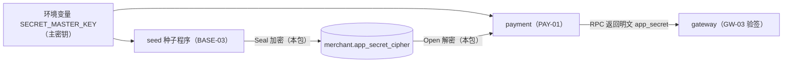

# BASE-14 密钥加密

| 项 | 内容 |
|---|---|
| 功能点 | BASE-14（P0，第 3 周） |
| 所属链路 | 基础设施 |
| 代码提交 | `20a5de7` `[BASE-14] add aes-gcm secretbox and reuse it in seed`（完整 `20a5de7c16154f251d4ca1b18f4ca643edefa842`，2026-10-23 16:41:58 +0800） |
| 分支 | `feat/BASE-14-secretbox` |
| 日期 | 2026-10-23 |
| 状态 | DONE |

## 一句话结论

新增公共包 `pkg/secretbox`，用 AES-256-GCM 加密和解密商户签名密钥，密文是 `版本(1 字节) + nonce(12 字节) + 密文 + 校验标签(16 字节)`。种子程序改用这个包，删掉了它自带的另一份加密代码，密文格式不变：删除之前用旧代码生成的密文，以及集成测试里种子真实入库的 3 个商户密文，新包都能解开。篡改密文任一字节都解不开，主密钥不是 32 字节时无法创建。`pkg/secretbox` 语句覆盖率 89.3%。

## 1. 背景

### 1.1 系统简介

pay-system 是一个用 Go 编写的小型支付后端，模拟商户收款、退款、商户间转账三条资金链路，重点在数据一致性和性能。系统由 5 个部分组成：gateway（对外 HTTP 入口，负责签名校验和限流）、payment（支付单、退款单、转账单的状态管理和流程推进）、account（账户余额与记账，数据按商户分到 2 个数据库分片）、channel-mock（模拟微信、支付宝这类外部支付渠道）、recon（对账，核对系统内外数据是否一致）。服务之间用 Kitex RPC 同步调用，或通过 Kafka 消息异步通知；数据存在 MySQL 8.4，Redis 用于防重放。所有金额用整数“分”表示，所有记账只追加不修改。

当前已完成：工程骨架、本地环境、迁移与种子、金额、ID、错误码、时钟、配置、日志、数据库访问、集成测试基座、IDL，账户的分片路由、开户、查询、记账、冻结、解冻、确认扣款、两种转账分支、余额核对和 account RPC 服务，商户费率核对，签名库，以及本次的密钥加密。gateway、payment 服务还没有实现，所以本包目前只被种子程序和测试调用。

### 1.2 本功能点在系统中的位置

商户密钥只以密文形式存在数据库 `pay_payment.merchant.app_secret_cipher` 列里。种子程序写入时加密，payment 读出时解密，两处都调用本包（下图标“本包”的两个箭头）。



| 使用方 | 用法 | 接入功能点 | 状态 |
|---|---|---|---|
| seed | 用演示明文生成商户密钥，`Seal` 后写入 | BASE-03（本次改为调用本包） | 已接入 |
| payment | `GetMerchantCredential(app_id)` 读密文，`Open` 后把明文返回给 gateway | PAY-01 | 未实现 |
| payment | 给商户发结果通知时要用 `app_secret` 签名 | NTF-02 | 未实现。需求没写明 payment 怎么拿到明文，推定也是本地 `Open` |

gateway 只通过 RPC 拿明文，不持有主密钥，也不调用本包。主密钥只配置给 payment 和 seed 两个进程。

### 1.3 为什么需要它

商户密钥是签名用的共享密钥：谁拿到了 `M100001` 的密钥，就能以 `M100001` 的名义发起退款、转账，也能伪造发给它的“支付成功”通知。如果数据库里存明文，一份数据库备份、一次误开的只读账号、一条打印了整行的调试日志，都会把所有商户的密钥泄露出去。加密之后，单拿到数据库内容没用，还要同时拿到只在 payment 和 seed 进程环境变量里的主密钥。

不能用哈希代替加密。签名用的是 HMAC（带密钥的摘要），验签方要用同一个密钥原文重新计算一遍，再与对方的签名比较。哈希不可逆，存了哈希就算不出 HMAC。所以平台必须能还原原文，只能用可逆的加密。

## 2. 术语

| 术语 | 含义 |
|---|---|
| 商户密钥 / `app_secret` | 平台和商户共享的签名密钥，演示值如 `demo_secret_M100001_0123456789ab`（32 字节）。 |
| HMAC | 带密钥的摘要算法。验签方必须持有密钥原文才能计算，所以密钥不能只存哈希。 |
| 主密钥 | 用来加密所有商户密钥的那把 32 字节密钥，来自环境变量 `SECRET_MASTER_KEY`，以 base64 编码配置。 |
| base64 | 把字节编码成可打印字符。标准编码每 3 字节变 4 个字符，不足时用 `=` 填充；32 字节编码成 44 个字符。 |
| AES-256 | 对称分组加密算法，加解密用同一把 32 字节（256 位）密钥。 |
| GCM | AES 的一种工作模式，同时做加密和认证：输出密文和 16 字节的校验标签（tag）。解密时先核对 tag，密文、nonce 改动任何一位都会核对失败，不会返回被篡改后的明文。 |
| nonce | 每次加密用的 12 字节一次性值。本包每次从操作系统的密码学随机源 `crypto/rand` 取。 |
| tag（校验标签） | GCM 根据密钥、nonce、密文和 AAD 算出的 16 字节值，用于发现篡改。 |
| AAD（附加认证数据） | 加密时额外参与 tag 计算、但不加密也不存进密文的数据，比如商户号。解密时必须提供同样的 AAD，否则核对失败。本包不用。 |
| 版本字节 | 密文第 1 个字节，标明密文格式。当前只有 `1`。 |
| 哨兵错误 | 包里预先定义的固定 `error` 值，调用方用 `errors.Is` 识别。 |
| `10003` | 平台对外错误码“内部错误”，HTTP 500，对外文本固定为 `internal error`。 |
| 种子 | `make seed` 执行的初始化程序（BASE-03），写入平台账户和 3 个演示商户。 |

## 3. 技术讲解

### 3.1 要解决的问题

| 约束 | 来源 |
|---|---|
| 商户密钥用 AES-256-GCM 加密存储，主密钥 32 字节、base64 编码，只来自环境变量 | 需求 BASE-14 规则 1，NFR-SEC-05 |
| 密文格式 `version(1B) + nonce(12B) + ciphertext + tag` | BASE-14 规则 1 |
| 每次加密使用随机 nonce | BASE-14 规则 2 |
| 解密失败返回错误，不输出密文或明文；日志、trace、错误信息不含密钥 | BASE-14 规则 3，NFR-SEC-05 |
| 必须能解开 BASE-03 种子已写入的密文，不得另起格式 | BASE-03 口径澄清：种子早于本功能点交付，当时就按上面的格式、版本字节 1、用标准库加密写入 |
| 密文要放得进 `VARBINARY(256)` 列 | 表结构 |

### 3.2 方案

本包只用 Go 标准库 `crypto/aes`、`crypto/cipher`、`crypto/rand`，没有 IO，不读时钟。启动时创建一个 `Box`，之后反复调用 `Seal` 和 `Open`。

```go
// pkg/secretbox/secretbox.go：入口
func New(key []byte) (*Box, error)              // 32 字节主密钥
func NewFromBase64(encoded string) (*Box, error) // SECRET_MASTER_KEY 原值
func (b *Box) Seal(plaintext []byte) ([]byte, error)
func (b *Box) Open(blob []byte) ([]byte, error)
```

`NewFromBase64` 只接受标准 base64（带 `=` 填充），与配置包 `pkg/config` 启动时的校验规则相同。缺填充、URL 安全字母表（`-_` 代替 `+/`）都会被拒绝。

**AES-GCM 做了什么。** 加密：用主密钥和 nonce 生成一串与明文等长的密钥流，与明文逐字节异或得到密文；再对密文算出 16 字节 tag。解密：先用同样的密钥和 nonce 重算 tag，与密文末尾的 tag 比较，不一致直接失败，一致才还原明文。所以 GCM 不只防偷看，也防篡改：数据库里的密文被改动 1 位，`Open` 就会失败，而不是返回一个错误的密钥。

**nonce 为什么必须随机且不能重复。** 同一主密钥下如果有两条密文用了同一个 nonce，它们的密钥流相同，攻击者把两条密文异或就得到两条明文的异或，还能推出 GCM 的认证子密钥，从此可以伪造能通过校验的密文。本包每次加密都从 `crypto/rand` 取 12 字节（96 位）随机数，不用计数器，也不让调用方传 nonce。NIST SP 800-38D 建议随机 nonce 时同一把密钥最多加密 2^32 次；本项目只有 3 个演示商户加 100 个压测商户，种子每执行一次给每个商户各加密一次（重复执行时已有商户的密文不覆盖，新生成的那份直接丢弃），加密次数远低于这个上限。

**一条真实密文逐段拆解。** 下面这条是 `internal/seed.Seal` 删除之前用它生成的，主密钥是 `deploy/.env.example` 里的演示值（`AAAA…AAA=`，即 32 个 0 字节），明文是 `demo_secret_M100001_0123456789ab`（32 字节）。它作为固定向量写在 `TestOpenLegacySeedCiphertext` 里，共 61 字节：

| 段 | 字节数 | 十六进制 |
|---|---|---|
| 版本 | 1 | `01` |
| nonce | 12 | `be5f5b4f4b854d72fdbfef63` |
| 密文 | 32（与明文等长） | `cc4f984cda9cee4d2be9d707076aef54c4517280ab3eec518743e85c7cd2c658` |
| tag | 16 | `4a0e42bed31d3b1c938367827882c173` |

1 + 12 + 32 + 16 = 61。BASE-03 在本地环境测得 3 个演示商户的 `LENGTH(app_secret_cipher)` 都是 61，与此一致。密文比明文固定多 1 + 12 + 16 = 29 字节（常量 `Overhead`）。列类型是 `VARBINARY(256)`，所以明文最长 256 − 29 = 227 字节。本包不检查明文长度，超长时由写库报错（本次没有实测超长写入）。空明文也能加密，密文 29 字节。

**加密和解密的代码。** `Seal` 先取随机 nonce，把版本和 nonce 放在输出开头，再把 GCM 输出的“密文 + tag”追加在后面；`Open` 按长度、版本、tag 的顺序检查，任何一步失败都返回 nil 和一个哨兵错误：

```go
// pkg/secretbox/secretbox.go
func (b *Box) Seal(plaintext []byte) ([]byte, error) {
	nonce := make([]byte, NonceSize)
	if _, err := rand.Read(nonce); err != nil {
		return nil, fmt.Errorf("secretbox: read nonce: %w", err)
	}
	out := make([]byte, 1+NonceSize, Overhead+len(plaintext))
	out[0] = Version
	copy(out[1:], nonce)
	return b.aead.Seal(out, nonce, plaintext, nil), nil // 最后的 nil 表示不用 AAD
}

func (b *Box) Open(blob []byte) ([]byte, error) {
	if len(blob) < Overhead {
		return nil, ErrMalformed
	}
	if blob[0] != Version {
		return nil, ErrUnknownVersion
	}
	plain, err := b.aead.Open(nil, blob[1:1+NonceSize], blob[1+NonceSize:], nil)
	if err != nil {
		return nil, ErrDecrypt
	}
	return plain, nil
}
```

**版本字节的作用和局限。** 版本字节给将来换格式留了路：例如以后的 v2 加上 AAD，`Open` 看第 1 个字节就知道该按哪种方式解。它的局限是不在 tag 的覆盖范围内，改了版本字节 GCM 发现不了。现在靠 `Open` 显式拒绝所有不是 `1` 的值：测试把第 1 个字节改成 0、2，或翻转其中任一位，都返回 `ErrUnknownVersion`。将来有了 v2，应把版本字节放进 AAD，这样改版本也会让 tag 核对失败，而不是依赖各版本的解析逻辑恰好互不兼容。

**为什么不用 AAD，以及风险。** 不用 AAD 时，tag 只绑定密文本身，不绑定“这是哪个商户的密文”。风险是密文互换：有 `pay_payment` 写权限但没有主密钥的人，可以把 `M100002` 行的密文复制到 `M100001` 行，`Open` 照样成功，`M100001` 的凭证就变成了 `M100002` 的密钥。这样 `M100001` 自己的请求全部验签失败；而持有 `M100002` 密钥的人可以冒充 `M100001`。把商户号作为 AAD 能挡住这种互换。本次不加的原因是：种子写入的密文没有 AAD，加上之后这些密文全部解不开，需要新版本号和回填。需求和表结构都没有规定 AAD，所以本次保持格式不变，并把方案记入技术决策：v2 用版本字节 `2`，AAD 取“版本字节 + 商户号”；回填时把 v1 解密后按 v2 重新加密；过渡期 `Open` 同时接受 1 和 2。建议与密钥轮换（P2，表里已有 `secret_version` 列）一起做。

**`Box` 要按密钥材料对待。** `New` 不保留调用方传入的 `key` 切片，但 `Box` 内部的 AES 轮密钥由主密钥展开而来，AES-256 轮密钥的前 32 字节就是主密钥本身。所以 `Box` 和主密钥一样敏感：不序列化，不用 `%#v` 或调试库深度打印；进程启动时创建一个，长期持有即可。`Box` 可被多个 goroutine 同时使用（`TestBoxConcurrentUse` 在 `-race` 下验证）。

**错误与调用方映射。** 5 个哨兵错误的文本都是固定的，以 `secretbox: ` 开头，不含主密钥、明文和密文。测试逐一检查错误文本不含明文，也不含密文的十六进制和 base64 形式。

| 错误 | 含义 |
|---|---|
| `ErrKeySize` | 主密钥不是 32 字节 |
| `ErrKeyEncoding` | 主密钥不是标准 base64 |
| `ErrMalformed` | 密文短于 29 字节 |
| `ErrUnknownVersion` | 版本字节不是 1 |
| `ErrDecrypt` | tag 核对失败：密文或 nonce 被改动、被截断，或主密钥不对 |

这些都是本端配置或数据故障，不是调用方的错。按场景处理：

| 场景 | 处理 | 依据 |
|---|---|---|
| payment 启动时主密钥非法 | `pkg/config` 启动时已校验“标准 base64、解码后 32 字节”，不合格进程以非 0 退出码退出，不会走到 `NewFromBase64` | BASE-09 |
| 种子主密钥长度不对 | `seed.Run` 在连接数据库之前返回 `seed: secretbox: master key must be 32 bytes`，命令以退出码 1 结束，不写任何行 | 本次改动，见下文 |
| payment 解密某商户密文失败（PAY-01） | 按内部错误 `10003` 处理，打 ERROR 日志，日志不含密文和明文 | BASE-14 说明；未识别错误一律转 `10003`（约定 §5.3） |
| gateway 收到 `GetMerchantCredential` 返回的 `10003` | 需求没有单列。GW-03 规则 2 只写了“payment 不可用 → 503 / `10004`”；按错误码表 `10003` 对应 HTTP 500 | 见第 5 节 |

**与 BASE-03 种子的兼容。** 种子比本包早交付，当时在 `internal/seed/secret.go` 里用标准库按同一格式自己实现了一份加密。本次的做法：

1. 删除旧实现之前，用旧的 `seed.Seal` 生成两条固定密文（上面的 61 字节那条和一条空明文的 29 字节密文），写进 `pkg/secretbox` 的测试。之后旧代码删了，“旧密文能解开”仍有独立证据，不是“自己加密、自己解密”。
2. 删除 `internal/seed/secret.go`，种子改用 `secretbox.New` 和 `Seal`，仓库里只剩一份加密实现。
3. 集成测试在 MySQL 8.4.11 容器里执行迁移和种子，从库里读出 3 个演示商户的密文，用 `pkg/secretbox` 解开，明文与演示格式一致。原来只解 `M100002` 一个，本次改为 3 个都解。
4. 已入库的密文不需要回填。

**行为变化：种子提前校验主密钥。** 以前主密钥长度不对时，种子先写完两个分片的平台账户，到写第一个商户时才失败，库里留下一半数据。现在 `seed.Run` 先校验主密钥，不合格时一个数据库都不连。`cmd/seed` 自己解码 base64，非法 base64 仍在那里报 `SECRET_MASTER_KEY is not base64`，本次没改。

### 3.3 为什么这样做

| 方案 | 做法 | 优点 | 缺点 | 结论 |
|---|---|---|---|---|
| 采用：AES-256-GCM，格式与种子一致，不用 AAD | 标准库实现，随机 nonce，版本字节 1 | 加密和防篡改一步完成；已入库密文直接可用；无第三方依赖 | 不绑定商户号，存在密文互换风险；版本字节不在 tag 覆盖内 | 采用。风险和 v2 方案见 3.2 |
| 备选：明文存储 | 列里直接放 `app_secret` | 最简单 | 数据库内容一旦外泄，所有商户密钥一起泄露；违反 NFR-SEC-05 | 不采用 |
| 备选：存哈希 | 只存 `sha256(app_secret)` | 不可逆，泄露也拿不到原文 | HMAC 验签要密钥原文，存哈希就无法验签 | 不采用 |
| 备选：AES-CBC 加 HMAC 自己组合 | 先加密再单独算 MAC | 也能防篡改 | 要自己处理填充、比较顺序、两把密钥，容易写错；格式与种子不同 | 不采用 |
| 备选：现在就加 AAD（商户号） | `Seal` / `Open` 传商户号 | 挡住密文互换 | 种子密文全部失效，需要新版本号加回填；需求未规定 | 暂不采用，留给 v2 |
| 备选：种子保留自己的实现 | 两份代码并存 | 不动种子 | 两份实现可能慢慢走样，格式一致只能靠人记 | 不采用 |

### 3.4 正确性

不涉及资金状态。本包不读写数据库，没有外部调用，`Box` 创建后只读，所以不存在重复请求、崩溃恢复、下游超时的问题。要证明的是：合法密文一定能解开且得到原文；篡改、截断、用错主密钥一定解不开，并且失败时不泄露内容；多个 goroutine 同时用同一个 `Box` 不出错。

| 场景 | 系统行为 | 结果 | 证明 |
|---|---|---|---|
| 篡改任一字节 | 61 字节密文逐字节、每字节分别翻转最低位和最高位，共 122 次 | 第 1 个字节（版本）报 `ErrUnknownVersion`，其余 60 个位置报 `ErrDecrypt`；全部返回 nil 明文 | `TestOpenTamperEveryByte` |
| 截断或加长 | 长度 0、1、13、28 字节，少最后 1 字节，多 1 字节 | 短于 29 字节报 `ErrMalformed`；29 字节以上但少 1 字节或多 1 字节报 `ErrDecrypt` | `TestOpenFailures` |
| 版本未知 | 版本字节改成 0 或 2 | `ErrUnknownVersion` | `TestOpenFailures` |
| 主密钥不对 | 用另一把 32 字节主密钥解密 | `ErrDecrypt` | `TestOpenFailures` |
| 失败时不泄露 | 检查错误文本 | 文本等于哨兵原文，不含明文、密文的 hex 和 base64 形式 | `TestOpenFailures`、`TestNewRejectsBadKey` |
| 并发 | 64 个 goroutine 共用一个 `Box`，各加解密 50 次，`-race` 运行 | 3200 次往返全部得到原文，无数据竞争报告 | `TestBoxConcurrentUse` |
| 旧密文 | 解开删除旧实现前生成的两条固定密文 | 得到原文 | `TestOpenLegacySeedCiphertext` |

`pkg/secretbox/secretbox_test.go` 共 9 个顶层测试，其中 2 个用 `t.Run` 拆成子用例（`TestSealOpenRoundTrip` 5 个、`TestOpenFailures` 10 个），合计 15 个；9 加 15 就是 `-v` 输出里的 24 个 PASS。

| 测试 | 子用例 | 测什么 |
|---|---|---|
| `TestSealOpenRoundTrip` | 5 | 演示密钥、空切片、nil、二进制、227 字节明文：两次加密结果不同、nonce 不同，版本为 1，长度为明文加 29，解密得到原文 |
| `TestSealNonceUnique` | 0 | 连续 1000 次加密的 nonce 两两不同 |
| `TestOpenTamperEveryByte` | 0 | 见上表 |
| `TestOpenFailures` | 10 | 见上表 |
| `TestNewRejectsBadKey` | 0 | 长度 0、1、16、24、31、33、64 字节，`New` 和 `NewFromBase64` 都报 `ErrKeySize`；乱码、缺填充、URL 安全字母表、多一个 `=` 报 `ErrKeyEncoding` |
| `TestNewFromBase64MatchesNew` | 0 | 两个入口解出同一把主密钥，能互相解密 |
| `TestOpenLegacySeedCiphertext` | 0 | 见上表 |
| `TestBoxConcurrentUse` | 0 | 见上表 |
| `TestSentinelTexts` | 0 | 5 个哨兵文本都以 `secretbox: ` 开头，互不相同 |

种子一侧新增 2 个单元测试：`TestMerchantSecretOpensWithSecretbox`（种子为 3 个商户号生成的密文版本为 1、长度为明文加 29，用另建的 `Box` 解开等于演示明文）、`TestRunRejectsBadMasterKeyBeforeDB`（0、31、33 字节主密钥在连库前返回 `ErrKeySize`，数据库地址故意填不可达的端口）。

### 3.5 性能

未测。本包没有 benchmark，本次报告阶段不改代码，所以没有补。调用频率取决于还没实现的 PAY-01（payment 解密）和 GW-08（gateway 缓存凭证 60 秒），等这两个功能点确定调用路径后，如需要再在压测中测量。

## 4. 已完成内容

### 4.1 改动清单

| 文件 | 新增 / 修改 | 作用 |
|---|---|---|
| `pkg/secretbox/secretbox.go` | 新增 | `New`、`NewFromBase64`、`Seal`、`Open`，常量 `Version`、`KeySize`、`NonceSize`、`TagSize`、`Overhead`，5 个哨兵错误 |
| `pkg/secretbox/secretbox_test.go` | 新增 | 9 个顶层测试，含旧密文固定向量 |
| `internal/seed/secret.go` | 删除 | 种子自带的加密实现 |
| `internal/seed/seed.go` | 修改 | 连库前用 `secretbox.New` 校验主密钥；新增 `merchantSecret` 加密商户密钥 |
| `internal/seed/seed_test.go` | 修改 | 删除测旧实现的 `TestSealLayoutAndRoundTrip`，新增 2 个测试 |
| `internal/dbmigrate/acceptance_integration_test.go` | 修改 | 用 `pkg/secretbox` 解开 3 个演示商户的入库密文 |
| `scripts/verify_lint_rules.sh` | 修改 | 违规样例原来引用已删除的 `seed.CipherVersion`，改为 `seed.DefaultPlatformSubAccounts`，否则这条 lint 检查会因编译失败而失效 |
| `docs/02-requirements.md` 等 6 份文档 | 修改 | 见 4.5 |

### 4.2 对外变化

| 类别 | 变化 |
|---|---|
| 接口 | 无 |
| 表结构 | 无 DDL。`merchant.app_secret_cipher` 的说明补上版本字节、无 AAD、明文最长 227 字节 |
| 配置项 | 无新增。`SECRET_MASTER_KEY` 的说明写明是标准 base64（带填充），与已有校验一致 |
| 错误码 | 无新增。5 个哨兵是本包的普通 `error`，平台服务映射为已有的 `10003` |
| 指标 / 故障点 | 无 |

### 4.3 验收对照

| 验收条目 | 测试函数 | 类型 | 结果 |
|---|---|---|---|
| 加密后解密得到原文；同一明文两次加密结果不同 | `TestSealOpenRoundTrip`、`TestSealNonceUnique` | 单元 | 通过 |
| 篡改任一字节，解密失败 | `TestOpenTamperEveryByte` | 单元 | 通过 |
| 主密钥长度不是 32 字节时初始化失败 | `TestNewRejectsBadKey`；种子侧 `TestRunRejectsBadMasterKeyBeforeDB` | 单元 | 通过 |
| 兼容：能解开 BASE-03 种子已写入的密文 | `TestOpenLegacySeedCiphertext`、`TestMerchantSecretOpensWithSecretbox`；`TestBASE03SeedIdempotentAndShardPlacement` | 单元；集成 | 通过 |

### 4.4 验证记录

2026-10-23，coder 在本机 macOS（Apple M5）上对提交 `20a5de7` 重跑，工作区干净。工具版本：`go1.27.2 darwin/arm64`，golangci-lint 2.14.0，Docker 29.8.2。之后只写了报告，没改代码。

覆盖率门槛：需求 NFR-TEST-05 规定 `pkg` 下除 `pkg/dbx`、`pkg/outbox` 以外的包不低于 80%，`pkg/secretbox` 门槛 80%。它不在开发流程列出的核心包（`pkg/money`、`pkg/sign`、`pkg/idgen`、`pkg/outbox` 等）里，没有更严的要求。实测 89.3%。`internal/seed` 不在 `pkg` 下，没有覆盖率门槛。

| 命令 | 结果 |
|---|---|
| `gofmt -l .` | 无输出 |
| `make lint`（`golangci-lint run --build-tags integration ./...`） | 0 issues |
| `make test`（`go test -race ./...`） | 退出码 0，25 个包 ok，无 FAIL |
| `go test -race -count=1 -v ./pkg/secretbox` | 9 个顶层测试连同子测试共 24 个 PASS、0 个 FAIL |
| `make cover` | 退出码 0。`pkg/secretbox` 89.3%：`Open`、`NewFromBase64` 100%，`Seal` 85.7%，`New` 77.8%。没覆盖到的是 `aes.NewCipher`、`cipher.NewGCM`、`rand.Read` 返回错误的分支：前两个在密钥长度已校验后不会出错，Go 1.24 起 `rand.Read` 不返回错误。`internal/seed` 单元测试 24.1%，写库路径只在集成测试里覆盖。全仓库 total 17.1%，门槛按包计算，不看 total |
| `go test -race -tags integration -count=1 -cover ./internal/seed ./internal/dbmigrate` | 两个包都 ok。`internal/seed` 73.0%，`internal/dbmigrate` 76.9%（testcontainers 启动 MySQL 8.4.11） |
| 同上加 `-v -run` 指定 3 个兼容测试 | `TestBASE03SeedIdempotentAndShardPlacement`、`TestMerchantSecretOpensWithSecretbox`、`TestRunRejectsBadMasterKeyBeforeDB` 都 PASS，确认集成测试真的执行了，没有被跳过 |
| `make test-integration`（全仓库） | 未运行。本功能点只影响 `internal/seed` 和 `internal/dbmigrate`，这两个包已单独跑过集成测试 |
| 解密本地环境 compose 库里的现有密文 | 未运行。需要读取 `deploy/.env` 里的主密钥，按要求不读；由固定向量和集成测试代替 |
| benchmark | 未运行，见 3.5 |

另外两项不是 coder 本次运行的，由 lead 转述：reviewer 审查时把旧的 `seed.Seal` / `Open` 编译进来，与新包做了新加密旧解密、旧加密新解密的双向交叉验证，都通过；lead 提交前跑了 gofmt、lint 和上面三个包的集成测试，都通过。

### 4.5 同步的文档

- 需求：BASE-14 改为 DONE，三条验收打勾；新增“说明”，写明入口函数、版本字节 1、不用 AAD、版本字节不受 tag 保护、`Box` 按密钥材料对待、5 个哨兵映射为 `10003`、明文最长 227 字节、种子改用本包；BASE-03 澄清补一句种子已改用本包；变更记录一行（含审查修正）。
- 表结构：`app_secret_cipher` 的说明补上版本字节和长度上限，回填说明改为“无需回填”，Change History 一行，校验脚本通过。
- 约定 v2.13：`SECRET_MASTER_KEY` 写明是标准 base64（带填充）。
- 技术决策 D11：只用标准库、版本字节 1、不用 AAD 的理由与 v2 方案。
- 开发计划：勾选 BASE-14。
- 面试笔记：先固定旧密文向量再删旧实现、AAD 的取舍、篡改测试按位置区分错误。

## 5. 未完成与风险

- 还没有正式的使用方。payment 解密留给 PAY-01：启动时用 `NewFromBase64(cfg.SecretMasterKey)` 创建一个 `Box`，`Open` 失败按 `10003` 处理，日志不带密文和明文。NTF-02 签商户通知时怎么拿到明文，需求没写明，开工前要补。
- gateway 收到 `GetMerchantCredential` 返回的 `10003` 时怎么回复商户，GW-03 规则 2 只写了“payment 不可用 → 503 / `10004`”，没有单列“payment 解密失败”。按错误码表应为 HTTP 500 / `10003`，需要在 GW-03 开工前确认。
- 密文互换风险（3.2）：没有 AAD，有 `pay_payment` 写权限的人可以互换两个商户的密文。v2 方案已记入技术决策，建议与密钥轮换（P2）一起做。
- 版本字节不受 tag 保护：现在靠 `Open` 显式拒绝非 1 的版本；引入 v2 时必须把版本字节放进 AAD。
- 明文最长 227 字节，本包不检查。演示密钥是 32 字节，现在不会超；如果以后允许商户自定义密钥，要在写库前检查长度。
- 性能未测（3.5）。

## 6. 如何复现

前置：Go 1.27.2、golangci-lint 2.14.0；集成测试需要 Docker（testcontainers 会拉起 `mysql:8.4.11`）。仓库根目录，含提交 `20a5de7`。

```bash
gofmt -l .
make lint
make test
go test -race -count=1 -v ./pkg/secretbox
make cover
go test -race -tags integration -count=1 -cover ./internal/seed ./internal/dbmigrate
go test -race -tags integration -count=1 -v \
  -run 'TestBASE03SeedIdempotentAndShardPlacement|TestMerchantSecretOpensWithSecretbox|TestRunRejectsBadMasterKeyBeforeDB' \
  ./internal/seed ./internal/dbmigrate
```

预期：`gofmt` 无输出；lint 为 `0 issues`；测试通过；`pkg/secretbox` 的 `-v` 输出 24 个 PASS，覆盖率 `89.3%`；集成测试两个包都 ok（`internal/seed` 73.0%、`internal/dbmigrate` 76.9%，耗时随机器不同）；最后一条输出 3 个 PASS。

## 7. 讲解要点

1. 问：商户密钥为什么不存哈希？答：HMAC 验签要用密钥原文重新计算，哈希不可逆，所以只能加密；用 GCM 同时防偷看和防篡改。
2. 问：GCM 的 nonce 重复了会怎样？答：同一密钥下两条密文用了同一 nonce，异或就得到两条明文的异或，还能推出认证子密钥并伪造密文。所以每次都从 `crypto/rand` 取 12 字节随机数。
3. 问：为什么不把商户号做 AAD？答：能防密文互换，但种子密文没有 AAD，加上后已有密文全部失效，需要新版本号加回填；先固定格式，v2 再把版本字节和商户号一起放进 AAD。

## 延伸阅读

- `docs/02-requirements.md` BASE-14、BASE-03（口径澄清）、PAY-01、GW-03、GW-08、NTF-02、NFR-SEC-05、NFR-TEST-05
- `docs/03-conventions.md` §5.2、§5.3（错误码表与使用规则）、§8（`SECRET_MASTER_KEY`）
- `docs/database.md` §4.6 `merchant`
- `docs/01-tech-decisions.md` D11
- NIST SP 800-38D（GCM 规范，nonce 与调用次数上限）
- `pkg/secretbox/secretbox.go`

## 修订记录

| 日期 | 提交 | 修订内容 |
|---|---|---|
| 2026-10-23 | 与报告同提交 | 初稿。验证数字来自 coder 当天在 `20a5de7` 上的重跑 |
