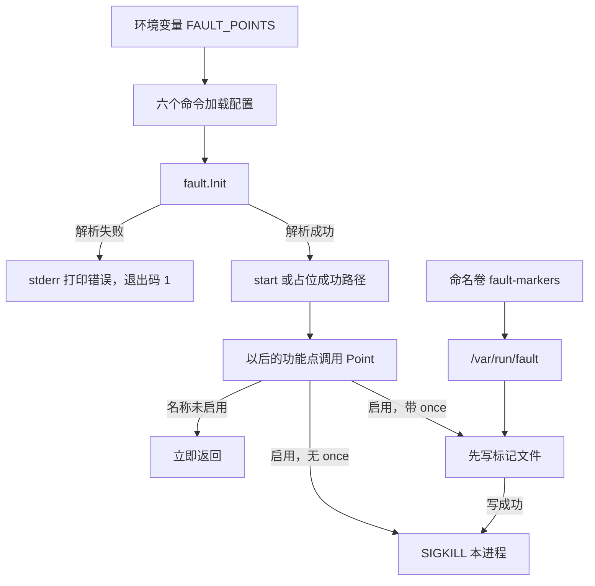
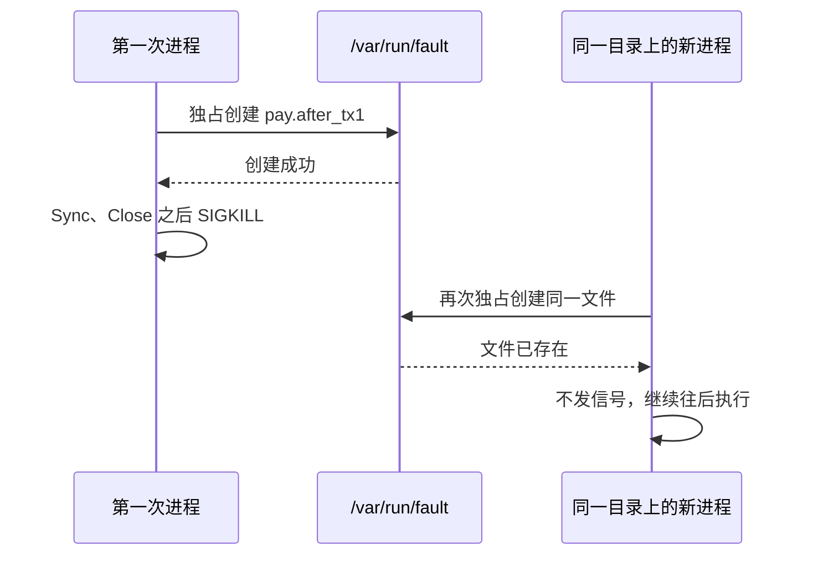

# BASE-15 故障注入点

| 项 | 内容 |
|---|---|
| 功能点 | BASE-15（P0，第 3 周） |
| 所属链路 | 基础设施 |
| 代码提交 | `9de0678` `[BASE-15] add fault points`（完整 `9de0678d62e4f18906b9e1c2e263a9b52faa2901`，2026-10-28 00:00:47 +0800） |
| 分支 | `feat/BASE-15-fault` |
| 日期 | 2026-10-28 |
| 状态 | DONE |

这次代码提交 20 个文件，903 行新增，22 行删除。本报告在该提交之后写，不在这 20 个文件里。

## 一句话结论

`pkg/fault` 按环境变量 `FAULT_POINTS` 决定要不要向本进程发 `SIGKILL`，用来模拟 `kill -9`。默认空，什么都不做。9 个登记名称可以启用；带 `:once` 的名称先在 `/var/run/fault` 写下同名标记文件，写成功再发信号，文件已在或写入失败则不发信号。未登记名称、空项、别的后缀、重复名称都会让 `Init` 失败，六个已解析该变量的命令因此以退出码 1 停在业务之前。`make test` 退出码 0。单独覆盖 `pkg/fault` 的语句覆盖率是 88.4%；`make cover` 的全仓库语句覆盖率是 24.8%。同一份函数表里 `killProcess` 是 0.0%，因为真正的 `SIGKILL` 发生在子进程里，覆盖率文件统计的是父进程。

## 1. 背景

### 1.1 系统简介

pay-system 是一个用 Go 编写的小型支付后端，模拟商户收款、退款、商户间转账三条资金链路，重点在数据一致性和性能。系统由 5 个部分组成：gateway（对外 HTTP 入口，负责签名校验和限流）、payment（支付单、退款单、转账单的状态管理和流程推进）、account（账户余额与记账，数据按商户分到 2 个数据库分片）、channel-mock（模拟微信、支付宝这类外部支付渠道）、recon（对账，核对系统内外数据是否一致）。服务之间用 Kitex RPC 同步调用，或通过 Kafka 消息异步通知；数据存在 MySQL 8.4，Redis 用于防重放。所有金额用整数“分”表示，所有记账只追加不修改。

当前已完成：工程骨架、本地环境、迁移与种子、公共库（金额、ID、错误码、时钟、配置、日志、数据库访问、集成测试基座、IDL、签名、密钥加密）、账户的分片路由、开户、查询、记账、冻结、解冻、确认扣款、两种转账分支、余额核对和 account RPC，商户费率核对，模拟渠道的受理、查单、关单、异步回调和确定性故障场景（M3），payment 的商户与密钥查询，以及本次的故障注入点。业务代码还没有调用 `Point`。gateway 的 HTTP 入口、支付下单、退款、转账、Kafka、对账任务和商户演示程序的业务还没做。

### 1.2 本功能点在系统中的位置

故障注入点是进程里的一个函数调用。以后某个功能点在指定步骤调用 `Point`，并且环境变量里启用了这个名称，当前进程立刻被 `SIGKILL` 结束。本次只提供这个函数、启动时的校验，以及 chaos 覆盖文件上的标记目录挂载。支付、回调、退款、转账的业务路径还没有调用它。



上图里“六个命令”是 payment、account、channel-mock、gateway、recon、merchant-demo。payment、account、channel-mock 在打印脱敏配置之后、调用 `start` 之前执行 `Init`，数据库连接在 `start` 里面打开。gateway、recon、merchant-demo 仍是占位程序：配置加载成功后先 `Init`，成功才走原来的成功出口，失败则退出码 1。paycli、seed、bootstrap 的配置结构体没有 `FAULT_POINTS`，本功能点不加。

### 1.3 为什么需要它

崩溃恢复要在“事务已经提交、下一步还没做完”的缝隙里把进程打死。`kill -9` 的效果是进程马上消失，不跑 `defer`，不返回错误。如果故障点只是返回一个错误，调用方还会继续收尾，演练看到的就不是崩溃。

名称必须事先登记，启动时就要拒绝拼错的名字。把 `pay.after_tx1` 写成 `pay.after_tx` 时，若进程仍进入业务，演练会以为崩溃发生过、恢复也测过，实际上 `Point` 一次都不会触发。本次对这个值的要求是：启动阶段非 0 退出，标准错误里带 `pay.after_tx`，`start` 不被调用。

`:once` 用来模拟“只崩一次，重启后要能继续”。标记若只放在内存里，进程一死标记就没了，下次启动又会在同一点被杀死，恢复代码永远跑不下去。所以发信号之前先把文件写到标记目录；文件名就是故障点名称，点保留，例如 `pay.after_tx1`。文件已经存在，或者这次没写成功，都不发信号。

## 2. 术语

| 术语 | 含义 |
|---|---|
| 故障注入点 | 业务步骤里的一个具名调用。启用后在该点把本进程杀掉，用来演练崩溃。 |
| `FAULT_POINTS` | 已有环境变量。逗号分隔要启用的故障点。默认空。本包不自己读环境变量，由配置加载后把字符串交给 `Init`。 |
| `SIGKILL` | 操作系统发给进程的杀死信号，相当于 `kill -9`。进程不能捕获它，也不会执行 `defer`。 |
| `kill -9` | 命令行上向进程发 `SIGKILL` 的写法。本包用同一种信号模拟它。 |
| `:once` | 写在名称后面的后缀，表示这个故障点只触发一次。恰好去掉一个这种后缀。 |
| 标记目录 | `:once` 写文件的目录。默认 `/var/run/fault`，是包内常量，不是配置项。 |
| 标记文件 | 目录里以故障点命名的文件。`pay.after_tx1:once` 对应的文件名是 `pay.after_tx1`。 |
| `Init` | `func Init(raw string, opts ...Option) error`。解析列表并替换本进程启用集合。失败时不改已有状态。 |
| `Point` | `func Point(ctx context.Context, name string)`。名称已启用才发信号。没调用过 `Init` 时与空配置相同。 |
| 登记名称 | 允许出现在 `FAULT_POINTS` 里的 9 个字符串，大小写敏感。 |
| CAS | 比较并交换：更新带旧状态条件，0 行表示别人已改过。本包不更新数据库。 |
| outbox | 事务内先记下“待发送事件”，事务外再发 Kafka，发完用 CAS 回写。名称 `outbox.after_send` 指发送确认之后、回写之前。 |
| TCC | Try、Confirm、Cancel 三段提交。跨分片转账用它。三个 `transfer.after_*` 名称落在这段流程的缝隙上。 |
| chaos 覆盖文件 | `deploy/docker-compose.chaos.yml`。和主编排文件合并后多出来的挂载。本次只挂标记目录。 |
| 命名卷 | Docker 管理的一块持久存储。容器重建后卷还在，所以重启后的进程仍看得到标记文件。 |
| profile `apps` | 主编排里 gateway、payment、account、recon、channel-mock、merchant-demo 的开关。日常 `make up` 不启动这组。 |

9 个登记名称和它们以后要插进去的位置：

| 故障点 | 以后由谁调用 | 调用点 |
|---|---|---|
| `pay.after_tx1` | PAY-03 | 支付事务 1 提交后、调用渠道前 |
| `callback.after_commit` | GW-06 | 回调事务提交后、返回响应前 |
| `outbox.after_send` | MQ-02 | Kafka 确认后、CAS 回写前 |
| `ledger.after_commit` | MQ-04 | 逐条入账提交后、offset 提交前 |
| `ledger.after_batch_commit` | OPT-02 | 批量入账某个分片组提交后、offset 提交前 |
| `refund.after_freeze` | REF-02 | 冻结成功后、把退款单置为 PROCESSING 前 |
| `transfer.after_try` | TRF-03 | 两个 Try 结束后、决策落盘前 |
| `transfer.after_decision` | TRF-03 | 决策落盘后、发起 Confirm 或 Cancel 前 |
| `transfer.after_payer_confirm` | TRF-03 | 串行模式下付款方 Confirm 之后、收款方 Confirm 之前 |

本次业务代码里还没有这些调用。

## 3. 技术讲解

### 3.1 要解决的问题

| 约束 | 原因 |
|---|---|
| 只对启用的登记名称发 `SIGKILL`，模拟 `kill -9` | 演练要的是进程消失，而不是一段可以恢复的 Go 错误 |
| 默认空配置什么都不做，不创建、不读取标记目录 | 生产和普通测试不挂这个目录，也不能因为空配置去建目录 |
| `:once` 先写标记再发信号；文件已存在或写入失败则不发信号 | 重启后要能走过该点；没留下标记就杀掉的话，每次重启都会再杀一次 |
| 未登记名称、空项、`:once` 以外的后缀、同一名称出现两次，`Init` 返回错误，错误文本能看出是哪一项；失败不改已有状态 | 拼写错误若被静默忽略，演练会假通过 |
| 六个命令在配置加载成功之后、进入业务之前调用 `Init`；失败退出码 1，不调用 `start`，不开数据库 | 非法配置不能连上库再退出 |
| 标记目录默认 `/var/run/fault`，不是新的配置项；测试可以用选项替换发信号函数和目录 | 演练路径和测试路径分开，单元测试不能真的结束测试进程 |
| 已取消的 `ctx` 不跳过已启用的信号；`ctx` 为 nil 不 panic | 调用方把取消和故障点混在一起时，启用的点仍然要杀死进程 |
| 不新增错误码、IDL、迁移、Go 模块、配置项 | 故障点是进程内开关，不进入对外协议和表结构 |

### 3.2 方案

配置包早已把 `FAULT_POINTS` 解析进 payment、account、channel-mock、gateway、recon、merchant-demo 的配置结构体，默认空字符串。本功能点在这六个命令里把该字符串交给 `fault.Init`。`pkg/fault` 内部不读取环境变量。

`Init` 先准备生产用的发信号函数和默认目录，再应用测试选项，然后解析。解析成功才在互斥锁里替换整个启用集合。解析失败直接返回，锁内状态保持原样。空字符串是清空：启用集合变成空 map，之后 `Point` 直接返回。

解析规则：按逗号切开，去掉每一项的首尾空白，再去掉恰好一个后缀 `:once`。剩下的字符串必须是上面 9 个名称之一。`:once:once` 去掉一次后仍带后缀，对不上登记名，算非法。空项的错误是 `fault: invalid point ""`，原文以 `""` 出现。`pay.after_tx1:twice` 的错误带该项原文 `pay.after_tx1:twice`。重复名称的错误是 `fault: duplicate point "<登记名>"`，登记名是去掉那一个 `:once` 之后的名字。`pay.after_tx1:once, callback.after_commit` 这种带空格的合法列表可以成功：前者只触发一次，后者每次调用都发信号。

`Point` 在锁里抄出该名称的模式、发信号函数和目录，出锁后再行动。未启用走默认分支，立即返回，不碰目录。启用且不带 `:once` 时，每次调用都发信号。启用且带 `:once` 时走 `signalOnce`：发信号函数为空则返回；否则先 `MkdirAll` 目录（权限 0755），再用 `O_CREATE|O_EXCL|O_WRONLY` 创建文件。创建成功并完成 `Sync` 和 `Close` 之后才发信号。文件已存在、创建失败、`Sync` 失败或 `Close` 失败，都不发信号；后两种还会删掉没写完的文件。空配置不会走到 `MkdirAll`。

生产发信号是下面这 3 行。测试通过 `WithKill` 换成计数函数；传入 nil 时仍用生产实现。`WithMarkerDir` 传入空字符串时仍用 `/var/run/fault`。

```go
// pkg/fault/fault.go：向本进程发 SIGKILL。覆盖率文件里的父进程不会执行到这里。
func killProcess() {
	_ = syscall.Kill(os.Getpid(), syscall.SIGKILL)
}
```

payment 的接入点在脱敏配置已经打印之后。account、channel-mock 的顺序相同。gateway、recon、merchant-demo 没有 `start`，`Init` 失败时同样写标准错误并返回 1，不会把“配置加载成功”当成退出码 0。

```go
// cmd/payment/main.go：配置加载并打印成功后、start 之前初始化。
if err = fault.Init(cfg.FaultPoints); err != nil {
	_, _ = fmt.Fprintf(stderr, "%s\n", err)
	return 1
}
```

`:once` 跨重启的顺序：



`deploy/docker-compose.chaos.yml` 给上述 6 个应用服务挂命名卷 `fault-markers` 到 `/var/run/fault`。文件头仍写 QA-01，全文没有 `FAULT_POINTS` 这串字符。不配置故障点取值，不写 kill。`make chaos` 仍是 QA-01 的占位（打印 `chaos 由 QA-01 实现` 后退出码 1），本次没有跑它。`make up` 不加载这个覆盖文件，也不会因此启动 profile `apps`。

### 3.3 为什么这样做

| 方案 | 做法 | 优点 | 缺点 | 结论 |
|---|---|---|---|---|
| 采用：进程内 `SIGKILL` 加标记文件 | 标准库 `syscall.Kill`；`:once` 用目录里的文件记住已经触发过 | 和 `kill -9` 一样不跑 `defer`；重启后标记还在；无新依赖 | 真信号会结束进程，单测必须替换发信号函数；父进程的覆盖率统计不到子进程里的 `killProcess` | 采用 |
| 备选：返回错误或取消 `ctx` | `Point` 返回 `error`，调用方中止后续步骤 | 单测容易写 | 进程还在，`defer`、事务回滚和收尾仍会执行，演练的不是崩溃 | 不采用 |
| 备选：引入故障注入框架 | 用外部库拦截函数 | 场景可以配得更细 | 多一个依赖；本项目只需要 9 个固定名称和一次 `SIGKILL` | 不采用 |
| 备选：把标记目录做成配置项 | 再增加环境变量 | 每个服务可以放到不同路径 | 演练和挂载要多对一个配置；需求规定目录固定，由 chaos 文件挂卷 | 不采用 |

### 3.4 正确性

本包不写余额、不写分录，没有资金不变量。要证明的是：该杀的时候进程消失，不该杀的时候不碰目录，非法配置进不了业务。

| 场景 | 系统行为 | 最终状态 | 证明 |
|---|---|---|---|
| 只启用 `pay.after_tx1`，对它和另一个登记名各调用一次 `Point` | 只有启用的名称发信号。未启用的名称不写文件。nil 和已取消的 `ctx` 仍发信号 | 信号次数按启用名称累计；标记目录不被这次非 `:once` 调用创建 | `TestPointSignalsOnlyEnabledName` |
| `pay.after_tx1:once`，同一临时目录上再次 `Init` 再调用 | 第一次先写出 `pay.after_tx1` 再发信号；第二次看到文件，不发信号 | 目录里仍有该文件；第二次信号次数为 0 | `TestPointOnceMarkerSurvivesReinit` |
| `FAULT_POINTS` 为空，对登记名调用 `Point` | 不发信号，不创建、不读取标记目录 | 把目录指到一个还不存在的临时路径，该路径仍不存在 | `TestPointEmptyConfigLeavesMarkerDirUntouched` |
| `pay.after_tx`、`pay.after_tx1,,callback.after_commit`、`pay.after_tx1:twice` | 三次 `Init` 都返回错误，错误文本带该项原文；空项显示为 `""` | 启用集合不被失败的 `Init` 换掉 | `TestInitValidatesPoints`、`TestInitErrorDoesNotReplaceEnabledSet` |
| `pay.after_tx1:once, callback.after_commit` | 解析成功 | 前者为一次，后者为每次都发信号 | `TestInitValidatesPoints` |
| 同一名称出现两次 | `Init` 返回错误，文本含该登记名 | 不替换已有状态 | `TestInitRejectsDuplicateName` |
| 子进程的 `FAULT_POINTS=pay.after_tx` | 启动阶段非 0 退出，标准错误含 `pay.after_tx` | “进入业务”的标记文件不存在 | `TestSubprocessUnknownPointExitsBeforeBusiness` |
| 子进程启用登记名并在 `Point` 使用真正的 `SIGKILL` | 父进程看到的错误文本含 `signal: killed` | `Point` 之后要写的文件不存在 | `TestSubprocessPointSIGKILLSkipsFollowingWrite` |
| 六个命令的 `FAULT_POINTS=pay.after_tx` | 退出码非 0，标准错误含 `pay.after_tx`，`start` 不被调用 | 不开数据库。空的 `FAULT_POINTS` 仍走原来的成功路径 | 下表六个 `Test*FaultPointsCheckedBeforeStart` |
| 两个请求并发改同一余额；下游 RPC 超时 | 不涉及。本包没有账户、没有 RPC | — | — |

写标记失败（目录被一个普通文件占住，或者 `Sync` / `Close` 失败）时不发信号。缺目录时的 `:once` 会先 `MkdirAll` 再写。这两条由 `TestPointOnceCreatesMissingDirAndSkipsSignalOnWriteError` 覆盖。9 个登记名都能解析，由 `TestInitAcceptsAllRegisteredNames` 覆盖。

### 3.5 性能

不涉及。本功能点没有吞吐、延迟或容量数据，也没有对照开关的基线。

## 4. 已完成内容

### 4.1 改动清单

提交 `9de0678` 的 20 个文件：

| 文件 | 新增 / 修改 | 作用 |
|---|---|---|
| `pkg/fault/fault.go` | 新增 | 解析、`Init`、`Point`、`:once` 标记和 `SIGKILL` |
| `pkg/fault/fault_test.go` | 新增 | 六条验收、重复名称、子进程 `SIGKILL` |
| `cmd/payment/main.go` | 修改 | 打印配置之后、`start` 之前 `Init` |
| `cmd/account/main.go` | 修改 | 同上 |
| `cmd/channel-mock/main.go` | 修改 | 同上 |
| `cmd/gateway/main.go` | 修改 | 配置加载成功后 `Init`，失败退出码 1 |
| `cmd/recon/main.go` | 修改 | 同上 |
| `cmd/merchant-demo/main.go` | 修改 | 同上 |
| `cmd/payment/main_test.go` | 修改 | `TestPaymentFaultPointsCheckedBeforeStart` |
| `cmd/account/main_test.go` | 修改 | `TestAccountFaultPointsCheckedBeforeStart` |
| `cmd/channel-mock/main_test.go` | 修改 | `TestChannelMockFaultPointsCheckedBeforeStart` |
| `cmd/gateway/main_test.go` | 修改 | `TestGatewayFaultPointsCheckedBeforeStart` |
| `cmd/recon/main_test.go` | 修改 | `TestReconFaultPointsCheckedBeforeStart` |
| `cmd/merchant-demo/main_test.go` | 修改 | `TestMerchantDemoFaultPointsCheckedBeforeStart` |
| `deploy/docker-compose.chaos.yml` | 修改 | 六个服务把 `fault-markers` 挂到 `/var/run/fault` |
| `docs/02-requirements.md` | 修改 | BASE-15 状态 DONE，六条验收勾选；变更记录日期 2026-10-27 |
| `docs/03-conventions.md` | 修改 | 升到 v2.19；重复名称失败，标记目录不是配置项 |
| `docs/06-flows.md` | 修改 | 升到 v2.19；写明 `pkg/fault` 已提供，图中故障点原句保留 |
| `docs/04-dev-plan.md` | 修改 | 第 3 周 BASE-15 勾选 |
| `docs/01-tech-decisions.md` | 修改 | §2.4 说明为何用进程内 `SIGKILL` 和标记文件 |

没有新的 Go 模块。

### 4.2 对外变化

| 类别 | 变化 |
|---|---|
| 接口 | 无。没有新的 IDL、RPC 或 HTTP |
| 表结构 | 无。没有迁移 |
| 配置项 | 无新增。`FAULT_POINTS` 本来就在六个服务的配置里。标记目录不是配置项 |
| 错误码 | 无。`Init` 的错误是普通 `error`，文本只含配置项原文，启动失败时退出码 1 |
| 指标 / 故障点 | 登记 9 个名称。业务代码还没有调用 `Point`，调用留给 PAY-03、GW-06 以及后面列出的功能点 |

paycli、seed、bootstrap 的配置结构体没有这个字段，本功能点不加。

### 4.3 验收对照

结果通过，因为 `make test` 退出码 0。

| 验收条目 | 测试函数 | 类型 | 结果 |
|---|---|---|---|
| 只对启用名称发信号 | `TestPointSignalsOnlyEnabledName` | 单元 | 通过 |
| `:once` 先写标记，同一目录再 `Init` 不再发信号 | `TestPointOnceMarkerSurvivesReinit` | 单元 | 通过 |
| 空配置不发信号、不创建目录 | `TestPointEmptyConfigLeavesMarkerDirUntouched` | 单元 | 通过 |
| 三种非法配置失败，带空格的合法列表成功 | `TestInitValidatesPoints` | 单元 | 通过 |
| 未登记名称的子进程非 0 退出且没进入业务 | `TestSubprocessUnknownPointExitsBeforeBusiness` | 子进程 | 通过 |
| 六个命令在 `start` 之前拒绝 `pay.after_tx` | `TestPaymentFaultPointsCheckedBeforeStart`、`TestAccountFaultPointsCheckedBeforeStart`、`TestChannelMockFaultPointsCheckedBeforeStart`、`TestGatewayFaultPointsCheckedBeforeStart`、`TestReconFaultPointsCheckedBeforeStart`、`TestMerchantDemoFaultPointsCheckedBeforeStart` | 单元 | 通过 |
| 子进程在 `Point` 被 `SIGKILL`，之后的文件不存在 | `TestSubprocessPointSIGKILLSkipsFollowingWrite` | 子进程 | 通过 |

重复名称另有 `TestInitRejectsDuplicateName`，同一次 `make test` 通过。

### 4.4 验证记录

环境：go1.27.2 darwin/arm64；golangci-lint 2.14.0，built with go1.27.1。

| 命令 | 结果 |
|---|---|
| `gofmt -l .` | 无输出，real 0.07s，退出码 0 |
| `make lint`（`golangci-lint run --build-tags integration ./...`） | `0 issues.`，real 1.68s，退出码 0 |
| `make test`（`go test -race ./...`） | 退出码 0，real 5.42s。根测试包 `ok github.com/yym108/pay-system 4.815s`。`pkg/fault` 是 `ok ... 1.234s`，不是 cached。六个命令包：account 1.309s，channel-mock 1.249s，gateway 1.189s，merchant-demo 1.203s，payment 1.353s，recon 1.203s。`cmd/paycli` 是 `(cached)` |
| `go test -race -count=1 -cover ./pkg/fault/` | real 1.73s，退出码 0。`ok github.com/yym108/pay-system/pkg/fault 1.434s coverage: 88.4% of statements` |
| `make test-integration` | 没有单独执行 |
| `make cover`（`go test -race -tags integration -coverprofile=coverage.out ./...`，再 `go tool cover -func`） | 已执行，退出码 0，real 45.06s。全仓库语句覆盖率 24.8%。`pkg/fault` 在这次输出里是 `1.468s`、88.4%。根测试包 `ok github.com/yym108/pay-system 44.252s coverage: [no statements]`。`pkg/idgen` 是 `(cached)` 且 88.1%。`service/channel_mock/biz` 是 `(cached)` 且 94.0%。`service/payment/biz` 是 18.769s、100.0% |

`make cover` 的 `pkg/fault` 函数表：

| 函数 | 语句覆盖率 |
|---|---|
| `WithKill` | 100.0% |
| `WithMarkerDir` | 100.0% |
| `Init` | 100.0% |
| `Point` | 100.0% |
| `parsePoints` | 100.0% |
| `classify` | 100.0% |
| `signalOnce` | 62.5% |
| `removeMarker` | 0.0% |
| `killProcess` | 0.0% |

`killProcess` 和 `removeMarker` 在这份 profile 里是 0.0%，因为真正的 `SIGKILL` 发生在子进程里，覆盖率文件统计的是父进程。子进程测试已经观察到错误文本含 `signal: killed`，并且 `Point` 之后的文件不存在。`pkg/fault` 的 88.4% 不是失败；这次没有单独的 70% 门禁打在这个包上。

`make cover` 本身带 `integration` 标签，需要 Docker 或 `TEST_MYSQL_DSN`。这次已执行并通过。它不等于单独执行过 `make test-integration`。

### 4.5 同步的文档

这些文档在提交 `9de0678` 里，编写日期仍是 2026-10-27。

- 需求：BASE-15 为 DONE，六条验收已勾选。变更记录写明实现了 `pkg/fault`，重复名称是初始化错误，标记写失败不发信号，空配置不碰标记目录；不改 9 个名称，不改资金，不新增错误码。
- 约定升到 v2.19：同一名称出现两次时初始化失败；标记目录不是配置项，默认 `/var/run/fault`。不新增配置项，不新增错误码。
- 流程升到 v2.19：BASE-15 已提供 `pkg/fault`，图中故障点标注保持原句；§4.10 登记表条号写为规则 6。没有改图，没有运行 mmdc，没有新的 SVG。
- 开发计划：第 3 周 BASE-15 一行勾选。
- 技术决策 §2.4：进程内 `SIGKILL` 加标记文件，测试替换发信号函数，不新增依赖。

## 5. 未完成与风险

- 业务代码还没有调用 `Point`。PAY-03 调用 `pay.after_tx1`，GW-06 调用 `callback.after_commit`，MQ-02、MQ-04、OPT-02、REF-02、TRF-03 分别调用其余名称。
- 故障点取值和演练场景属于 QA-01。`make chaos` 仍是占位，本次没有跑。
- `killProcess` 0.0%、`removeMarker` 0.0% 是父进程 profile 的结果。子进程里已经看到 `signal: killed`，以及 `Point` 之后的文件不存在。`signalOnce` 在同一张表里是 62.5%。
- paycli、seed、bootstrap 不解析 `FAULT_POINTS`，本次也不加。

## 6. 如何复现

环境：go1.27.2 darwin/arm64，golangci-lint 2.14.0（built with go1.27.1）。仓库根目录，含提交 `9de0678`。`make cover` 需要 Docker 或 `TEST_MYSQL_DSN`。不要单独执行 `make test-integration`；这次没有跑那个目标。

```bash
gofmt -l .
make lint
make test
go test -race -count=1 -cover ./pkg/fault/
make cover
```

这次的结果：

- `gofmt -l .`：无输出，real 0.07s，退出码 0。
- `make lint`：`0 issues.`，real 1.68s，退出码 0。
- `make test`：退出码 0，real 5.42s。根测试包 `ok github.com/yym108/pay-system 4.815s`。`pkg/fault` 为 `ok ... 1.234s`，不是 cached。account 1.309s，channel-mock 1.249s，gateway 1.189s，merchant-demo 1.203s，payment 1.353s，recon 1.203s。`cmd/paycli` 是 `(cached)`。
- `go test -race -count=1 -cover ./pkg/fault/`：real 1.73s，退出码 0，`ok github.com/yym108/pay-system/pkg/fault 1.434s coverage: 88.4% of statements`。
- `make cover`：退出码 0，real 45.06s。全仓库语句覆盖率 24.8%。`pkg/fault` 是 `1.468s`、88.4%。根测试包 `ok github.com/yym108/pay-system 44.252s coverage: [no statements]`。`pkg/idgen` 是 `(cached)` 且 88.1%。`service/channel_mock/biz` 是 `(cached)` 且 94.0%。`service/payment/biz` 是 18.769s、100.0%。函数表：`WithKill` 100.0%，`WithMarkerDir` 100.0%，`Init` 100.0%，`Point` 100.0%，`parsePoints` 100.0%，`classify` 100.0%，`signalOnce` 62.5%，`removeMarker` 0.0%，`killProcess` 0.0%。

## 7. 讲解要点

1. 问：为什么不让 `Point` 返回错误？答：演练要的是 `kill -9`。返回错误时进程还在，`defer` 和事务收尾仍会跑。生产实现是 `syscall.Kill(os.Getpid(), syscall.SIGKILL)`。
2. 问：`:once` 为什么要先写文件？答：内存标记随进程一起消失，重启后又会在同一点被杀死。文件写成功才发信号；文件已在或写入失败都不发信号。目录默认 `/var/run/fault`，chaos 覆盖文件用命名卷 `fault-markers` 把它留住。
3. 问：`pay.after_tx` 为什么要在启动时失败？答：它不在 9 个登记名里。若进程照常进入业务，演练会假通过。六个命令在 `start` 之前退出码 1，标准错误带该项原文，并且不开数据库。

## 延伸阅读

- `docs/02-requirements.md` 的 BASE-15（规则与验收；变更记录日期 2026-10-27）
- `docs/03-conventions.md` v2.19 的 §7.4 与 §8 `FAULT_POINTS`
- `docs/06-flows.md` v2.19 的 §4.10
- `docs/01-tech-decisions.md` 的 §2.4
- `docs/04-dev-plan.md` 第 3 周 BASE-15
- `pkg/fault/fault.go`
- `deploy/docker-compose.chaos.yml`

## 修订记录

| 日期 | 提交 | 修订内容 |
|---|---|---|
| 2026-10-28 | 本报告不在 `9de0678` 的 20 个文件里 | 初稿 |
