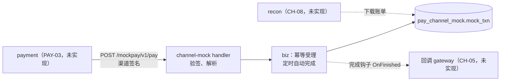
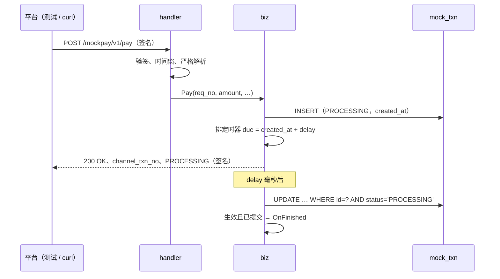

# CH-01 渠道支付受理与自动完成

| 项 | 内容 |
|---|---|
| 功能点 | CH-01（P0，第 3 周） |
| 所属链路 | 支付 |
| 代码提交 | `a3433af` `[CH-01] add mock channel pay acceptance and auto finish`（完整 `a3433affc388ef47fc4e3a02bd8d5cc2c5b0bbf2`，2026-10-23 23:10:50 +0800） |
| 分支 | `feat/CH-01-mock-pay` |
| 日期 | 2026-10-23 |
| 状态 | DONE |

这次代码提交 27 个文件，3898 行新增，43 行删除。本报告在该提交之后写，不包含在这 27 个文件里。

## 一句话结论

模拟渠道 channel-mock 现在能在 `:9080` 受理支付：`POST /mockpay/v1/pay` 验签、严格解析 JSON，按 `req_no` 幂等写入 `mock_txn`，再按 `req_no` 的 CRC-32 算出 200–1999 毫秒的延迟，到期用 CAS 把交易推进到 SUCCESS 或 FAILED，重启时扫描未完成的交易补上。真实 MySQL 上 50 个并发同号受理只落 1 行；30 笔自动完成与关单 SQL 并发，本次 4 轮每笔都只有一方生效；本机实测 NORMAL 受理到完成 1833 毫秒（算出的延迟 1832 毫秒），受理后立即停进程、重启后 2 笔都在启动当刻完成。

## 1. 背景

### 1.1 系统简介

pay-system 是一个用 Go 编写的小型支付后端，模拟商户收款、退款、商户间转账三条资金链路，重点在数据一致性和性能。系统由 5 个部分组成：gateway（对外 HTTP 入口，负责签名校验和限流）、payment（支付单、退款单、转账单的状态管理和流程推进）、account（账户余额与记账，数据按商户分到 2 个数据库分片）、channel-mock（模拟微信、支付宝这类外部支付渠道）、recon（对账，核对系统内外数据是否一致）。服务之间用 Kitex RPC 同步调用，或通过 Kafka 消息异步通知；数据存在 MySQL 8.4，Redis 用于防重放。所有金额用整数“分”表示，所有记账只追加不修改。

当前已完成：工程骨架、本地环境、迁移与种子、金额、ID、错误码、时钟、配置、日志、数据库访问、集成测试基座、IDL、签名库、密钥加密，账户的分片路由、开户、查询、记账、冻结、解冻、确认扣款、两种转账分支、余额核对和 account RPC 服务，商户费率核对，以及本次的模拟渠道支付受理与自动完成。channel-mock 的查单、关单、退款、回调、账单都还没做；gateway、payment、recon、paycli、merchant-demo 也还没有实现，所以受理接口目前只被测试和手工 `curl` 调用。

### 1.2 本功能点在系统中的位置

channel-mock 扮演外部支付机构：平台把支付请求发给它，它自己记一笔交易，过一会儿给出结果。它有自己的数据库 schema `pay_channel_mock`，只有它自己的账号 `svc_channel_mock` 能读写；payment 的账号只能读写 `pay_payment`（账号权限由 BASE-03 建立）。所以平台想知道渠道那边的情况，只能走 HTTP，和对接真实渠道一样。



实线是本次实现的部分：handler、biz 和 `mock_txn` 的读写。虚线是后续功能点：CH-05 用完成钩子给平台发回调，CH-08 按 `bill_date` 出账单。

### 1.3 为什么需要它

支付链路里最难的情况都发生在渠道那一侧：请求超时但渠道其实收了、渠道回调重复、关单和支付成功同时发生。没有一个行为确定的对手方，这些路径都没法测。

具体例子：平台给 `PA0000000000000000001` 发一笔 10000 分（100.00 元）的支付，3 秒没收到响应（PAY-03 的总超时），不知道渠道收没收下。平台自己不自动重发，但同一个 `req_no` 仍可能第二次到达渠道，例如网络层重传或人工重推。如果渠道不做幂等，第二次又建一笔交易，真实世界里就是用户被扣两次钱。如果渠道进程在交易完成前重启、把还没到点的任务丢了，这笔交易就永远停在“处理中”，平台的订单也一直卡在支付中。CH-01 保证：同一 `req_no` 只有一笔；进程不停机时，每笔在受理后 200–1999 毫秒内到点完成（NEVER_FINISH 场景故意不完成，等关单）；进程在到点前停掉的，下次启动时补上，已过点的在启动当刻完成，所以完成时间会晚于原定时刻，晚多少取决于停机多久（3.5 的实测停机约 10 秒，完成比受理晚约 9.5 秒）。

## 2. 术语

| 术语 | 含义 |
|---|---|
| 渠道 | 真正扣用户钱的外部支付机构，如微信支付、支付宝。本项目用 channel-mock 模拟 |
| 受理 | 渠道收下一笔支付请求、记下交易，但还没给出成功或失败。受理后状态是 `PROCESSING` |
| `req_no` | 平台发给渠道的请求号，就是平台支付单号 `pay_no`。平台用 `pkg/idgen` 生成，形如 `PA` + 19 位数字（如 `PA0000000000000000001`），这个格式由平台保证。渠道不检查格式，只要求非空、不超过 32 个字符、不含 U+FFFD，所以测试里的 `PA_REAL`、`PA_CONC` 这类短号也是合法的 `req_no`。渠道用它判断是不是同一笔 |
| `channel_txn_no` | 渠道给交易分配的流水号，由 `pkg/idgen` 生成，格式 `MC` + 19 位数字共 21 个字符，如 `MC0107255421001027584`。19 位数字是雪花编号：自 2026-01-01（东八区）起的毫秒数、10 位 worker ID（配置 `WORKER_ID`，0–1023，channel-mock 在 compose 里用 5）、12 位同毫秒序号拼成的整数，左补零 |
| `txn_type` | `mock_txn` 的交易类型，只有 `PAY`（支付）和 `REFUND`（退款）两个取值，由 CHECK 约束 `ck_mock_type` 限定。本次只写 `PAY`，`REFUND` 归 CH-04 |
| 幂等 | 同一个请求做一次和做多次，结果和数据都一样 |
| 唯一键、1062 | `mock_txn` 有两个唯一键：`uk_type_req_no(txn_type, req_no)` 保证同类型同 `req_no` 只能有一行；`uk_channel_txn_no(channel_txn_no)` 保证流水号不重复。主键 `id` 是自增，插入时不提供。插入违反任一唯一键时 MySQL 报错误号 1062（重复键） |
| 终态 | 不会再变的状态。渠道交易有 4 个状态：`PROCESSING`（处理中）、`SUCCESS`、`FAILED`、`CLOSED`（已关单），后三个是终态 |
| CAS | Compare-And-Swap，“比较后交换”。这里指带条件的更新：`UPDATE … WHERE id = ? AND status = 'PROCESSING'`，只有当前还是处理中才改，改了几行由数据库返回。两个人同时改，只有一个能改到 1 行 |
| 关单 | 平台通知渠道“这笔不要了”，渠道把处理中的交易置为 `CLOSED`。由 CH-03 实现，本次未实现 |
| 防悬挂 | 关单请求比支付请求先到渠道时，渠道插一条 `CLOSED` 记录占住这个 `req_no`，之后迟到的支付请求被拒绝，不会在平台已放弃后又扣款。这条记录由关单写入，关单请求只有 `req_no`、不带金额。`mock_txn.amount` 是 `BIGINT NOT NULL`、没有默认值、没有取值约束，所以关单必须写一个值，但写什么需求和接口文档都没规定，留给 CH-03 决定（CH-03 本次未实现） |
| 场景 | 渠道按支付金额末两位决定的确定性行为，如末两位 01 必定失败。用来让测试稳定地触发各种异常（CH-06） |
| 自动完成 | 受理后过一段固定延迟，渠道自己把交易推进到终态，模拟真实渠道“用户付完款” |
| due | 某笔交易应当完成的时刻，= `created_at` + 延迟 |
| CRC-32 | 一种 32 位校验和算法（IEEE 多项式，Go 的 `crc32.ChecksumIEEE`），同一输入永远得到同一个数 |
| 启动扫描 | 进程启动时、开始接收请求前，把表里所有 `PROCESSING` 的支付读出来重新排上定时任务 |
| 完成钩子 `OnFinished` | biz 留给后续功能点的函数，交易完成并提交后调用一次，CH-05 会在里面发回调 |
| 渠道签名 | HMAC-SHA256（一种带密钥的摘要），对 `时间戳 + "\n" + body` 计算后 Base64，放在 `X-Mock-Signature` 头里；时间戳放在 `X-Mock-Timestamp` 头里（BASE-13） |
| 时间窗 | 请求头里的时间戳与渠道本地时钟最多差 300 秒，超出视为过期请求 |
| U+FFFD | Unicode 的“替换字符”�。Go 的 `encoding/json` 遇到非法 UTF-8 字节或孤立代理时用它顶替 |
| 孤立代理 | JSON 字符串里像 `\udc00` 这样单独出现、配不成对的 UTF-16 代理码，不代表任何合法字符 |
| 结果不确定 | 写库时连接在提交后、返回前断开，调用方拿到错误，但数据库里其实已经生效 |
| `DATETIME(3)` | MySQL 带 3 位小数（毫秒）的日期时间类型。写入更多位时四舍五入，不是截断 |
| `bill_date` | 交易进入哪一天的渠道账单，供对账使用 |
| compose | 用 `docker compose` 在本机起 MySQL、Redis、Kafka 的本地环境 |

## 3. 技术讲解

### 3.1 要解决的问题

受理接口和自动完成要同时满足这些约束：

1. 同一 `req_no` 只能有一笔交易，重复和并发请求都返回首次的 `channel_txn_no`。所有写接口必须幂等，最终由数据库唯一索引兜底（需求 §2.5.3 资金不变量）；对渠道来说，平台超时后结果未知，同一号再次到达时不能多出一笔。
2. 每笔交易只能被推进一次。自动完成和关单可能同时发生，只能有一方生效，否则会出现“平台已关单、渠道却成功扣款”的不一致（状态只用 CAS 更新，约定 §6）。
3. 重启不丢交易。已受理的交易在重启后仍按原来的时刻完成，已经过点的立即完成。
4. 签名通过的 body 只能有一种解释。签名只证明字节没被改，不证明双方解析出的内容一样。
5. 异常时宁可报错，不能给出错误的成功或失败。写库报错不等于没写进去，要先确认再回答。
6. 行为确定：同一 `req_no` 的延迟固定，同一金额的场景固定，测试能预先算出结果。

### 3.2 方案

整体思路：handler 只管验签和解析，biz 先插入再处理冲突，插入成功的那个请求负责排一个进程内定时器；到点用 CAS 推进状态，提交后调用钩子。定时器只存在内存里，丢了就在下次启动时从表里重算。



图中“排定时器”只发生在插入成功的那次请求里；重复请求不会再排。

#### 3.2.1 接口与 HTTP 状态

请求和成功响应的例子（2026-10-23 本机实测）：

```text
POST /mockpay/v1/pay
X-Mock-Timestamp: <Unix 秒>
X-Mock-Signature: <Base64(HMAC-SHA256(key, 时间戳 + "\n" + body))>

{"req_no":"PA0000000000000000001","amount":10000,"subject":"t","notify_url":"http://127.0.0.1:9100/n"}

HTTP/1.1 200 OK
X-Mock-Timestamp: 1792768485
X-Mock-Signature: p7k8S8JgFSoxx287GsaLOS5LQk2vxhtH2HyihvUS3jQ=
{"result":"OK","channel_txn_no":"MC0107255421001027584","status":"PROCESSING"}
```

HTTP 状态按下表区分。先验签，签名过了再解析，所以签名错且 body 也错的请求得到 401。

| 状态 | 什么时候 | body | 签名 | 写库 |
|---|---|---|---|---|
| 200 | 处理完成，业务结果在 `result`：`OK` 或 `REJECTED` | JSON | 有，时间戳取渠道当前时间 | 新受理写 1 行；重复受理不写 |
| 400 | 签名正确但参数非法（见 3.2.2） | 空 | 无 | 不写 |
| 401 | 缺签名头、时间戳不是整数、签名不符、时间戳超出 ±300 秒 | 空 | 无 | 不写 |
| 500 | 渠道内部错误：取号失败、写库失败且无法确认、1062 却读不到同号的行（见 3.2.3）、本端密钥为空 | 空 | 无 | 可能已写，见 3.2.6 |

“取号”指受理时在插入之前调用 `pkg/idgen` 生成 `channel_txn_no`（格式见 §2）。它不访问数据库，只在以下情况失败：系统时钟比上次取号回退超过 5 毫秒（回退 5 毫秒以内会等时钟追上）；时钟早于 2026-01-01 或超出 41 位毫秒的范围；请求上下文在等待时被取消（同一毫秒内 4096 个序号用完、要等下一毫秒，或在等小幅回退追平时）。取号失败时还没写库。

400 是本次在 CH-01 中经用户确认的契约补充（接口文档 2.1.0）。原契约只有 200、401、500，签名正确但参数非法的请求无处安放：

- 返回 401 会让对方以为密钥配错了，而签名其实是对的。
- 返回 500 表示渠道自己出了故障，暗示稍后重试可能成功；但这类请求重试多少次都不会成功。
- 返回 200 + `REJECTED` 是一个签过名的确定业务结论，`status` 字段还要填“已有行的当前状态”，可这时根本没有行。

所以单独用 400 表示“请求内容不对，渠道没有受理”。平台一侧不需要为此加新分支：PAY-03 原本就把渠道的超时、网络错误、5xx 按“结果未知”处理（不改订单状态，由查单或回调得到最终结果）；本次在 PAY-03 规则 6 补了一句，其他非 200（含 400、401）也按结果未知处理。PAY-03 本身还没实现。

`REJECTED` 有两个原因：`ORDER_CLOSED`（该 `req_no` 已关单）和 `PARAM_CONFLICT`（同一 `req_no` 金额不同）。`REJECTED` 不带 `channel_txn_no`。

#### 3.2.2 严格解析与整秒时间窗

Go 标准库 `encoding/json` 对输入很宽容：同一个键出现两次取最后一个；字段名不分大小写，`Amount`、`REQ_NO` 甚至 `ſubject`（U+017F，大小写折叠后等于 `s`）都会被当成已知字段；非法 UTF-8 字节和孤立代理 `\udc00` 都被换成 U+FFFD，之后业务层的 `utf8.ValidString` 永远为真。

这在签名场景下有风险。例如 body 是 `{"req_no":"PA1","amount":10000,"amount":1,…}`：签名只证明这串字节没被改；平台若用“取第一个”的解析器理解为 10000 分，渠道用 `encoding/json` 理解为 1 分（末两位 01，还会走 FAIL 场景），双方对同一笔交易的金额看法不同。所以 `decodePay` 先检查整个 body 是合法 UTF-8，再用 `json.Decoder.Token` 逐个读顶层键，拒绝以下情况并返回 400：

- body 不是单个 JSON 对象，或对象后面还有非空白内容。
- 顶层键重复，按转义还原后比较（`"req\u005fno"` 与 `"req_no"` 相同）。未知字段（如 `"extra"`）本身是允许的，值的内容也不检查，只是在查重复时计入：`"extra"` 出现两次同样返回 400。
- 键名与已知字段只差大小写。
- 已知字段类型不符，如 `"amount":100.5`、`"amount":"100"`。
- 业务校验不过：`req_no` 为空、超过 32 个字符或含 U+FFFD；`amount < 1`；`subject` 为空；`notify_url` 为空、超过 512 个字符、含 U+FFFD 或不是 http / https 绝对地址。

除以上情况外，未知字段一律忽略，不影响受理；字段缺失或为 `null` 按空值处理，再走上面的业务校验。

`subject` 只要求非空。所以 `\udc00` 写在 `subject` 里会被受理（解码成 U+FFFD），写在 `req_no` 里返回 400。本机实测两种都与此一致。未知字段的值是嵌套对象时，里面的重复键不检查，见 §5。

时间窗按整秒比较：取本地时间的 Unix 秒，与请求头里的整数秒相减，差在 ±300 以内（含 300）就接受。早先的写法是 `Now().Sub(time.Unix(sec, 0))`，本地时间带小数秒。例如本地时刻是 1792768485.9 秒，请求时间戳是 1792768185，差正好 300 整秒，旧写法算出 300.9 秒而拒绝；现在算出 300，接受；1792768184（差 301）拒绝。

#### 3.2.3 幂等受理：先插入，冲突再读

做法是不先查，直接 `INSERT`，靠唯一键 `uk_type_req_no` 判断是不是重复。下面这段是 `Pay` 的后半段，看三条出路：插入成功、1062、其他错误。

`service/channel_mock/biz/pay.go`：

```go
id, err := s.store.Insert(ctx, t)
if err == nil {
	t.ID = id
	s.schedule(ctx, t) // 只有插入成功的这一次排定时器
	return PayResult{Result: ResultOK, ChannelTxnNo: no, Status: dal.StatusProcessing}, nil
}
if !dbx.IsDuplicate(err) {
	return s.recoverInsert(ctx, t, err) // 结果不确定，见 3.2.6
}
existing, ok, err := s.store.Get(ctx, dal.TxnTypePay, req.ReqNo)
if err != nil {
	return PayResult{}, err
}
if !ok {
	return PayResult{}, errDuplicateWithoutRow // 只会是 channel_txn_no 撞号，按 500 处理
}
return replay(existing, req.Amount), nil
```

为什么“1062 却读不到”只会是流水号撞号：插入时不提供 `id`，能报 1062 的只有两个唯一键（§2）。若撞的是 `uk_type_req_no`，同号的行一定在表里，代码里也没有删除 `mock_txn` 行的路径，按 `(PAY, req_no)` 一定读得到；读不到就只剩 `uk_channel_txn_no`，即本次生成的 `channel_txn_no` 与别的行重复。同一进程里 `idgen` 不会发出重复的号（同一毫秒内靠序号区分，序号用完就等下一毫秒）。要撞号，只能是两个进程用了同一个 `WORKER_ID` 写同一张表、且恰好在同一毫秒拿到同一序号，或者进程重启前后系统时钟往回调过，新进程又走到了旧进程用过的毫秒。这些是配置或环境问题，返回 500，调用方重试时会拿到新号。本次没有专门构造撞号的真实库测试。

已有行时按 `replay` 的顺序判断，CLOSED 放在金额比较之前：

```go
switch {
case t.Status == dal.StatusClosed:
	return PayResult{Result: ResultRejected, Reason: ReasonOrderClosed, Status: t.Status}
case t.Amount != amount:
	return PayResult{Result: ResultRejected, Reason: ReasonParamConflict, Status: t.Status}
default:
	return PayResult{Result: ResultOK, ChannelTxnNo: t.ChannelTxnNo, Status: t.Status}
}
```

CLOSED 优先的原因在防悬挂：关单先于支付到达时（CH-03），渠道插一条 `CLOSED` 记录占住 `req_no`。关单请求不带金额，这条记录的 `amount` 只能是 CH-03 自己填的值（§2），不是平台真正的支付金额。若先比金额，迟到的支付请求会因为“金额不同”拿到 `PARAM_CONFLICT`，平台会误以为是自己参数错了；先看 CLOSED，平台拿到的是确定的 `ORDER_CLOSED`，知道这笔已经关了。

CH-03 还没实现，所以真实库测试 `TestPayRejectsMySQL` 用 SQL 直接插一条 `CLOSED` 行来模拟：`req_no` 为 `PA_CLOSED`，`amount` 为 10000 分（100.00 元），场景 NORMAL。然后用 10000 分（与这行的 `amount` 相同）和 10001 分（不同）各受理一次，两次都是 `ORDER_CLOSED`，这行的状态、金额都没变，`finished_at` 仍为空。这证明的是“不论已有行的 `amount` 是多少，CLOSED 都先返回”，与 CH-03 将来往 `amount` 里填什么值无关。

本机实测（同一进程、同一 `req_no` 先后 3 次）：

| 请求 | 响应 |
|---|---|
| 10000 分（100.00 元），首次 | `OK`、`MC0107255421001027584`、`PROCESSING` |
| 10000 分，重复 | 与首次完全相同 |
| 10001 分（100.01 元） | `REJECTED`、`PARAM_CONFLICT`、`PROCESSING`，不带流水号 |

表里只有 1 行，金额仍是 10000。重复和冲突的两次 `INSERT` 虽然失败，仍消耗了自增值，所以下一笔新交易的 `id` 是 4 不是 2。这是“先插入”的正常代价，`id` 不要求连续。

先查后插被否决的原因：两个并发请求可能都查到“没有”，再都去插，最后仍要靠唯一键和 1062 兜底，等于多查一次还多一条分支。

#### 3.2.4 场景由金额末两位决定

受理时按 `amount % 100` 查表，把场景名写进 `mock_txn.scenario`：

| 末两位 | 场景 | 本次实现的影响（只涉及自动完成） |
|---|---|---|
| 01 | FAIL | 到期置 `FAILED`，不写 `bill_date` |
| 06 | BILL_MISSING | 到期置 `SUCCESS`，但不写 `bill_date`（故意不进账单） |
| 08 | NEVER_FINISH | 不排定时器，一直 `PROCESSING`，等关单 |
| 02、03、04、05、07、09 | DROP_NOTIFY、DUP_NOTIFY、SLOW、ACCEPT_TIMEOUT、BILL_AMOUNT_DIFF、CLOSE_RACE | 到期置 `SUCCESS` 并写 `bill_date`；回调、受理阻塞、账单差额、关单竞争等各自的行为由 CH-03、CH-05、CH-06、CH-08 实现 |
| 00、10–99 | NORMAL | 到期置 `SUCCESS` 并写 `bill_date` |

例子：10000 分（100.00 元）末两位 00，是 NORMAL；10001 分（100.01 元）是 FAIL；10008 分（100.08 元）是 NEVER_FINISH。表里出现未登记的场景值时按 NORMAL 处理。

#### 3.2.5 自动完成：固定延迟、进程内定时器

延迟公式是 `delay = MIN + crc32(req_no) % (MAX − MIN)` 毫秒，`MIN`、`MAX` 来自配置 `MOCK_DELAY_MIN_MS`、`MOCK_DELAY_MAX_MS`，默认 200 和 2000，所以取值是 200–1999 毫秒；`MAX ≤ MIN` 时取 `MIN`。

| `req_no` | `crc32` | `% 1800` | delay |
|---|---|---|---|
| `PA0000000000000000001` | 3908244432 | 1632 | 1832 毫秒 |
| `PA_REAL`（集成测试用） | 1101221095 | 895 | 1095 毫秒 |
| `PA0001` | 2181559125 | 525 | 725 毫秒 |

到期时刻 `due = created_at + delay`。`created_at` 由渠道用自己的时钟写入并截到毫秒，不用列默认值，这样测试注入的假时钟和库里的值一致。例子：本机实测 `PA0000000000000000001` 的 `created_at` 是 23:14:45.076，due 是 23:14:46.908，库里的 `finished_at` 是 23:14:46.909。

用 `req_no` 算延迟而不是随机数，是为了重启后能重算出同一个 due，不必另存一列；测试也能预先算出完成时刻。

每笔交易一个 `time.AfterFunc`（Go 标准库的一次性定时器，到点在新 goroutine 里执行函数）。到点执行 `finish`，用 CAS 推进：

`service/channel_mock/dal/txn.go`：

```sql
UPDATE mock_txn SET status = ?, finished_at = ?, bill_date = ?
WHERE id = ? AND status = 'PROCESSING'
```

`finish` 先取当前时间（截到毫秒）作为要写的 `finished_at`，再执行这条 UPDATE；UPDATE 和提交放在一个事务里，整次写库最多 3 秒（代码常量 `finishTimeout`，与项目事务的默认总时长一致），超时按写库报错处理。改到 1 行表示本次生效；0 行表示这笔已被关单或别处改走，什么也不覆盖。`mock_txn` 没有 version 列，`status = 'PROCESSING'` 就是比较条件，所以不需要迁移。写库报错时 1 秒后重试（`finishRetryDelay`），直到成功或进程退出。

CAS 怎么保证只有一方生效：自动完成和关单都是“`WHERE status = 'PROCESSING'` 的 UPDATE”。InnoDB 对同一行的两个 UPDATE 串行执行，第一个把状态改走并提交后，第二个再判断条件时状态已不是 `PROCESSING`，影响 0 行。

#### 3.2.6 报错不等于没写进去

写库报错有一种情况是“已经提交、只是没收到确认”：数据库提交了，连接在返回结果前断了，或者请求上下文恰好在那一刻被取消。如果把这类错误当作“没写”，会出两种问题。本次在两处处理。

插入不确定（`recoverInsert`）：`INSERT` 报 1062 以外的错误时，用不随请求取消的上下文、1 秒超时，按 `(PAY, req_no)` 再读一次。读到的行 `channel_txn_no` 等于本次生成的，说明就是这次写进去的，照常排定时器并返回 `OK`。读不到、读失败、或是别的请求写的行，返回 500。不这样做，这行会停在 `PROCESSING`：同一号之后再到达时会走 1062 分支拿到 `OK`，但 1062 分支不排定时器，交易要等下一次重启扫描才完成。

完成不确定：CAS 报错时，`finish` 记下这次尝试写的 `status` 和 `finished_at`，1 秒后重试。重试时 CAS 得 0 行有两种可能：上次其实已生效，或者被关单改走了。这时按 `id` 读回该行比较：

```go
func matchesAttempt(row dal.Txn, tried []dal.Finish) bool {
	for _, f := range tried {
		if row.Status == f.Status && row.FinishedAt.Equal(f.FinishedAt) {
			return true
		}
	}
	return false
}
```

一致就是上次生效了，用读回的行调用钩子；不一致（关单后 `status` 是 `CLOSED`、`finished_at` 为空）就不覆盖、不回调；读回也失败就不猜，1 秒后再来。`finished_at` 截到毫秒写入，同一笔的两次尝试隔了至少 1 秒，时间不会相同，所以能分辨是哪一次。

#### 3.2.7 启动扫描与退出

`cmd/channel-mock/main.go` 的启动顺序：打开连接池，建调度器，调用 `Recover`（30 秒超时），成功后才开始监听 `:9080`。`Recover` 按主键分页，每页 500 行：

```sql
SELECT … FROM mock_txn
WHERE id > ? AND txn_type = ? AND status = 'PROCESSING' ORDER BY id LIMIT ?
```

对每行按同一公式算 due，已过点的立即执行，NEVER_FINISH 跳过；返回值 `count` 是排上定时器的笔数，不含 NEVER_FINISH。

单实例下同一笔不会被排两次：`Recover` 在 `main` 里只调用一次，而且在开始监听之前跑完，这时还没有任何受理请求；之后每笔新交易只由“插入成功”或“插入不确定但确认是本次写入”两条互斥的路径之一排一次；写库失败的重试是在上一次执行结束后才排下一次。所以“同一笔被排了两次”只会出现在两种情况：多个实例共用一张表（一个实例重启扫描时，把另一个实例已排好的交易也排一次），或者以后有代码在进程运行中再次调用 `Recover`。即使发生，CAS 也只让其中一次生效（单元测试 `TestDuplicateScheduleFinishesOnce` 直接把同一笔排两次验证）。

HTTP 服务用 Hertz（字节跳动开源的 Go HTTP 框架，CloudWeGo 项目的一部分）。Hertz 默认的网络层 netpoll 是它自研的基于 epoll 的网络库，监听端口失败时直接 panic，`Spin`（启动并阻塞）遇到运行错误也只打日志不返回（这是 D23 记录的行为，本次没有重新验证 panic）。所以 `handler.Serve` 先用标准库的 `net.ListenConfig` 自己监听 `:9080`，监听失败就作为普通错误返回、进程以退出码 1 结束；监听成功后把这个 listener 交给 Hertz，并让 Hertz 改用基于 Go 标准库 `net` 的传输层 `standard`，再用 `SetCustomSignalWaiter` 把运行错误带出来。单元测试 `TestServeReturnsListenError` 先占住一个端口再启动，断言拿到的是错误而不是 panic。

退出时（SIGINT、SIGTERM）Hertz 先停止接请求（最多等 3 秒），然后 `sched.Stop()` 取消还没到点的定时器，并等正在写库的完成任务结束，最后才关闭连接池。被取消的定时器不落盘，留给下一次启动的扫描。

#### 3.2.8 完成钩子 `OnFinished`

`Options.OnFinished` 在 CAS 生效、事务提交之后调用一次，参数是完成后的行（含 `status`、`finished_at`、`bill_date`）。关单赢了的那笔不调用。它在定时器的 goroutine 里执行，不能长时间阻塞。钩子拿到的上下文来自排定时器时的上下文，用 `context.WithoutCancel` 去掉了取消和截止时间：

- 受理时排的交易：保留受理请求上下文里的值，不随请求结束而取消。本次 channel-mock 的 handler 没有往上下文里放请求 ID（`logx.WithRequestID`），所以目前日志里的 `request_id` 是空的；以后加上，钩子就能拿到。
- 启动扫描重排的交易：来自 `Recover` 的上下文，即 `context.Background()` 加 30 秒超时；去掉超时后是一个不带任何值、不会取消的上下文。

两种都没有截止时间，钩子做网络调用时要自己设超时。这样回调不会因为 3.2.5 的 3 秒写库超时（`finishTimeout`）到期而被中途取消，启动扫描的 30 秒超时也不会波及之后才到点的交易。

本次 `main` 没有设置钩子（为 `nil`），完成照常进行。CH-05 会在这里发回调；事务内不调用外部系统，所以回调只能放在提交之后。

#### 3.2.9 `bill_date` 与毫秒截断

`bill_date` 是 `finished_at` 在东八区（UTC+8，固定偏移，不依赖系统时区文件）的日期，只在 `SUCCESS` 且场景不是 BILL_MISSING 时写，`FAILED` 不写。

`finished_at` 和 `created_at` 都先截到毫秒再写。原因是 `DATETIME(3)` 写入时四舍五入：东八区 23:59:59.9996 写进库会变成次日 00:00:00.000，而应用按原值算出的 `bill_date` 还是当天，同一行两列对不上，这笔就进了错误日期的账单。先截断成 23:59:59.999，两列用同一个值，一定在同一天。单元测试 `TestBillDateUsesShanghaiAndMillis` 覆盖这个边界。

### 3.3 为什么这样做

自动完成用什么机制（技术决策 D23）：

| 方案 | 做法 | 优点 | 缺点 | 结论 |
|---|---|---|---|---|
| 采用：进程内定时器 + 启动扫描 | 每笔一个 `time.AfterFunc`；启动时从 `mock_txn` 重建 | 任务状态本来就在 `mock_txn` 里，不新增任何组件和表；延迟可重算，测试能预知完成时刻 | 只适合单实例；进程退出到下次启动之间交易停在 `PROCESSING`；启动扫描没有 `status` 索引 | 采用。channel-mock 是测试用的单实例对手方 |
| 备选：Kafka 延迟消息 | 受理时发一条消息，到点消费 | 多实例可分摊 | Kafka 没有原生的任意延迟；要多一个 topic 和消费者，还要处理消息和行状态不一致 | 不采用。为一个模拟组件引入的复杂度比它要模拟的行为还多 |
| 备选：数据库轮询 | 每隔 N 毫秒查 `status = 'PROCESSING'` 且到期的行 | 不怕进程重启 | 完成精度受轮询间隔限制；每次轮询都扫表，需要新加 `status` 或 due 索引，即要迁移 | 不采用。增加常驻负载和表结构变更 |
| 备选：Redis 有序集合当延迟队列 | 按 due 排序，到点取出 | 多实例共享 | 项目规定任何账务事实不得只存在于 Redis（技术决策文档的 Redis 使用边界）；要维护 Redis 和 `mock_txn` 两份状态 | 不采用 |

签名正确但参数非法返回什么，见 3.2.1：401、500、200 `REJECTED` 都会误导调用方，采用新增 400。

### 3.4 正确性

| 场景 | 系统行为 | 最终状态 | 证明 |
|---|---|---|---|
| 重复受理（同号同金额） | 第二次 `INSERT` 撞 1062，读已有行，返回首次的 `channel_txn_no` 和当前状态，不改行、不再排定时器 | 1 行，1 个定时器 | `TestPayIdempotentReturnsSameTxnNo`（单元，假存储）；`TestPayEndToEndMySQL`（集成）；本机 `curl` 两次响应相同（3.2.3） |
| 重复受理（同号不同金额、已关单） | 金额不同返回 `PARAM_CONFLICT`；已 `CLOSED` 不论金额返回 `ORDER_CLOSED` | 原行不变；`CLOSED` 行没有 `finished_at` | `TestPayAmountConflict`、`TestPayClosedRow`（单元）；`TestPayRejectsMySQL`（集成） |
| 并发受理 | 50 个 goroutine 同时用 `PA_CONC` 受理 10000 分。唯一键只让 1 个插入成功，其余 49 个 1062 后读已有行 | 1 行；50 个响应的流水号相同；只排了 1 个定时器 | `TestPayConcurrentSameReqNoMySQL`（集成）；`TestPayConcurrentSameReqNo`（单元） |
| 与关单并发 | 30 笔到期后，每笔同时起 2 个 goroutine：一个执行自动完成，一个执行关单形态的 SQL `UPDATE … SET status='CLOSED' WHERE id=? AND status='PROCESSING'` | 本次 4 轮（共 120 笔）：关单赢 8、12、11、6 笔，完成赢 22、18、19、24 笔。每笔只有一方生效；关单赢的没有 `finished_at`、钩子 0 次；完成赢的关单影响 0 行、钩子 1 次 | `TestFinishRacesWithCloseMySQL`（集成）；`TestFinishLosesCASToClose`（单元）。关单接口 CH-03 还没实现，测试直接执行它将使用的 SQL；CLOSE_RACE 场景“关单时变成功”不在本次 |
| 写库结果不确定：插入 | 假存储让 `INSERT` 写入后返回错误。再读到本次的行，排定时器并返回 `OK` | 1 行，按时完成 | `TestPayInsertErrorAfterCommitSchedules`（单元）。再读失败时返回 500，该行要等重启扫描才完成，这条后果没有单独测试，见 §5 |
| 写库结果不确定：完成 | 假存储让 CAS 生效后返回错误。重试得 0 行，按 id 读回与上次尝试一致 | 钩子只调用 1 次，带首次尝试的 `finished_at` | `TestFinishUncertainCommitCallsHookOnce`；读回不一致不回调 `TestFinishUncertainCommitThenChangedElsewhere`；读回失败继续重试 `TestFinishGetByIDErrorReschedules`；普通写库失败 1 秒后重试 `TestFinishRetriesOnStoreError`（都是单元、假存储）。没有在真实 MySQL 上注入“提交后断连” |
| 进程崩溃与重启 | 定时器丢失。下次启动在接请求前扫描 `PROCESSING`，按 `created_at + delay` 重排，过点的立即完成 | 实例 A 受理 4 笔：`PA_R_NORMAL` 10000 分（NORMAL）、`PA_R_FAIL` 10001 分（FAIL）、`PA_R_MISSING` 10006 分（BILL_MISSING）、`PA_R_NEVER` 10008 分（NEVER_FINISH），然后停止调度器，4 笔都还是 `PROCESSING`。测试再用 SQL 插 1 笔 `PA_R_OVERDUE`（NORMAL，`created_at` 为 1 小时前）。表里共 5 笔 `PROCESSING`。实例 B 的 `Recover` 返回 4（NORMAL、FAIL、BILL_MISSING、OVERDUE；NEVER_FINISH 不排、不计数）。OVERDUE 在启动后 500 毫秒内变 `SUCCESS`；NORMAL 变 `SUCCESS` 且有 `bill_date`，FAIL 变 `FAILED` 无 `bill_date`，BILL_MISSING 变 `SUCCESS` 无 `bill_date`，三笔都在各自 `created_at` 后 2.5 秒内；钩子 4 次；`PA_R_NEVER` 仍是 `PROCESSING`、无 `finished_at` | `TestRestartRecoversRealTimer`、`TestRecoverRebuildsDueMySQL`（集成）；本机 SIGTERM 后重启实测见 3.5。`kill -9` 未测；按设计推断结果相同，因为进程里除定时器外没有别的未落库状态 |
| 退出时正在写库 | `Stop` 取消未到点的定时器，等正在执行的完成任务结束后才关连接池 | 不会出现“写了一半连接池先关” | `TestTimerSchedulerStopWaitsForRunningTask`（单元） |
| 同一笔被排了两次 | 单实例的 `main` 里不会发生（3.2.7），只在多实例或运行中再次调用 `Recover` 时出现。第二次 CAS 得 0 行，且没有不确定的尝试，直接跳过 | 只完成 1 次，钩子 1 次 | `TestDuplicateScheduleFinishesOnce`（单元，直接把同一笔排两次） |
| 多实例 | 不支持，未测试。两个实例启动时都会扫描全部 `PROCESSING`，同一笔被两个进程各排一次；CAS 保证只完成一次，但会重复执行 UPDATE。受理幂等仍靠同一张表的唯一键 | 按设计推断：每笔仍只有一个终态 | 无。见 §5 |

### 3.5 性能

本次不做压测，下面是完成耗时的实测和启动扫描的限制。环境：Apple M5，macOS，Go 1.27.2；集成测试用 testcontainers 起的 MySQL 8.4.11；本机手测用 compose 的 MySQL，channel-mock 二进制直接跑在宿主机上（compose 里的 channel-mock 容器仍是占位，归 OPS-01）。

| 测量 | 算出的 delay | 实测 | 来源 |
|---|---|---|---|
| `PA_REAL`，从调用 `Pay` 前到轮询（每 20 毫秒）看到 `SUCCESS` | 1095 毫秒 | 1.120、1.125、1.130、1.112 秒（4 次） | `TestNormalCompletesWithinTwoSecondsRealTimer`，第 1 次来自 `-count=1` 全量运行，后 3 次来自 `-count=3` |
| 本机 `PA0000000000000000001`（NORMAL），库里 `finished_at − created_at` | 1832 毫秒 | 1833 毫秒 | 2026-10-23 23:14 compose 手测 |
| 本机 `PA0000000000000000002`（10001 分，FAIL） | 210 毫秒 | 212 毫秒，`FAILED`，`bill_date` 为 NULL | 同上 |
| 本机 `PA0000000000000000005`（NORMAL） | 1553 毫秒 | 1555 毫秒 | 同上 |
| 受理 2 笔后立即 SIGTERM，进程退出用时 | — | 30 毫秒 | 同上，23:15 |
| 约 10 秒后重启 | — | 日志 `mock txn schedule recovered` `count=2`（23:15:36.4857），2 笔的 `finished_at` 都是 23:15:36.485 | 同上 |

重启那组：两笔是 `PA0000000000000000019`（delay 899 毫秒，`created_at` 23:15:26.944）和 `PA0000000000000000039`（delay 1993 毫秒，23:15:26.965）。停进程时都还没到点，库里都是 `PROCESSING`；重启时 due 早已过去，扫描后立即完成。`finished_at − created_at` 因此是 9541 和 9520 毫秒，这是停机时间，不是延迟算错。

两组数字量的不是同一段时间，所以偏差大小不同：

- 本机手测的 `finished_at − created_at` 比 delay 多 1–2 毫秒。`created_at` 是受理时取的时间，定时器按它加 delay 到点；`finished_at` 是定时器触发后、执行 UPDATE 之前取的时间（3.2.5）。所以这 1–2 毫秒是定时器晚触发的时间加上两次截到毫秒的误差，不包含 UPDATE 和提交的耗时。
- 集成测试的耗时比 delay 多 25、30、35、17 毫秒（1.120156、1.125080、1.130200、1.111935 秒减 1.095 秒），即 17–35 毫秒。它从调用 `Pay` 之前开始计时，到轮询读到 `SUCCESS` 为止，所以除了定时器晚触发，还包含：取 `created_at` 之前的参数校验和取号（INSERT 在取 `created_at` 之后执行，与 delay 的等待重叠，不额外增加）、UPDATE 和提交，以及最多 20 毫秒的轮询间隔和那次读库。本次没有把这几部分分开测量。

启动扫描的限制：表上没有 `status` 索引，分页 SQL 沿主键从 `id > ?` 往后读、逐行判断 `status`。按这个查询形态推断，整次扫描大约读一遍表；表里只有很少的 `PROCESSING` 时，最后一页也要一直读到表尾。`Recover` 有 30 秒超时，超时则启动失败。本次表里只有几行，大表下的扫描耗时未测量。

## 4. 已完成内容

### 4.1 改动清单

| 文件 | 新增 / 修改 | 作用 |
|---|---|---|
| `service/channel_mock/scenario/scenario.go` | 新增 | 金额末两位到场景的映射，以及每个场景是否自动完成、是否失败、是否进账单 |
| `service/channel_mock/dal/txn.go` | 新增 | `mock_txn` 的 Insert、按 `req_no` 读、按 id 读、CAS 完成、分页列出 `PROCESSING` |
| `service/channel_mock/biz/pay.go` | 新增 | 参数校验、先插后读的幂等受理、插入不确定后再读 |
| `service/channel_mock/biz/finish.go` | 新增 | 延迟公式、CAS 完成与重试、完成不确定后读回、启动扫描、完成钩子 |
| `service/channel_mock/biz/scheduler.go` | 新增 | 进程内定时调度器，`Stop` 时取消未到点任务并等执行中的任务 |
| `service/channel_mock/handler/pay.go`、`server.go` | 新增 | 验签与整秒时间窗、严格 JSON 解析、HTTP 状态映射、响应签名；Hertz 服务先自己监听再交给标准库传输层 |
| `cmd/channel-mock/main.go` | 修改 | 加载配置、打开连接池、启动扫描后再监听 `:9080`，退出时先停调度再关连接池 |
| 上述各包的 `*_test.go`（9 个） | 新增 | 单元测试与带 `integration` 标签的真实库测试 |
| `go.mod`、`go.sum` | 修改 | 新增间接依赖 `github.com/fsnotify/fsnotify v1.5.4`（Hertz 引入） |
| `docs/` 下 7 个文档 | 修改 | 见 4.5 |

### 4.2 对外变化

| 类别 | 变化 |
|---|---|
| 接口 | `POST /mockpay/v1/pay` 开始可用，端口 `:9080`。接口文档升到 2.1.0：新增 HTTP 400（签名正确但参数非法，空 body、不签名、不受理）；写明 body 解析规则、时间窗 ±300 秒含边界按整秒比较、CLOSED 优先于金额判断、`REJECTED` 不带 `channel_txn_no`、写库结果不确定但行已提交时仍返回 `OK`。签名算法和已有字段不变 |
| 表结构 | 无 DDL。表结构文档补充 `mock_txn` 的读写方式说明：`created_at` 由应用写入，`status` 只用 CAS 推进，启动扫描走主键分页，两处新增的确认读 |
| 配置项 | 无新增。开始使用已有的 `CHANNEL_MOCKPAY_KEY`、`MOCK_DELAY_MIN_MS`、`MOCK_DELAY_MAX_MS`、`WORKER_ID`、`MYSQL_*` |
| 错误码 | 无新增。渠道用 `result` / `reason`，`PARAM_CONFLICT`、`ORDER_CLOSED` 是已有取值 |
| 单号前缀 | 无新增，使用已有的 `MC` |
| 指标 / 故障点 | 无 |

### 4.3 验收对照

需求里 CH-01 的验收只有 2 条，原文是：

1. 同一 `req_no` 重复受理返回同一 `channel_txn_no`。
2. NORMAL 场景 2 秒内变为 SUCCESS；重启 channel_mock 后未完成的交易仍会完成。

第 2 条用分号连着两件事，下表拆开写：“前半”指 NORMAL 2 秒内变 SUCCESS，“后半”指重启后仍会完成。

需求的“规则”有 5 条，报告正文多处引用，一句话摘要如下：

- 规则 1：验签失败 401；签名正确但参数非法 400（含严格解析的各项）；400、401、500 空 body、不签名、不写库；200 响应签名（3.2.1、3.2.2）。
- 规则 2：按 `(PAY, req_no)` 先插后读；已有行按 CLOSED、金额一致、金额不一致的顺序回答；插入报非 1062 错误时再读一次确认（3.2.3、3.2.6）。
- 规则 3：新交易 `PROCESSING`，场景由金额末两位决定，返回 `MC` 流水号，`created_at` 由渠道时钟写入并截到毫秒（3.2.4、3.2.5）。
- 规则 4：延迟公式与 due；按场景置终态；`finished_at` 截到毫秒、`bill_date` 取东八区日期；只用 CAS，写库失败 1 秒后重试，不确定时按 id 读回；提交后调用钩子（3.2.5、3.2.6、3.2.8、3.2.9）。
- 规则 5：进程内调度；启动时、接请求前按 id 分页扫描 `PROCESSING` 重建，已过期的立即完成（3.2.7）。

| 验收条目或规则 | 测试函数 | 类型 | 结果 |
|---|---|---|---|
| 验收 1：同一 `req_no` 重复受理返回同一 `channel_txn_no` | `TestPayIdempotentReturnsSameTxnNo` | 单元 | 通过 |
| 验收 1，并发 50 个 | `TestPayConcurrentSameReqNoMySQL` | 集成 | 通过：1 行、1 个定时器、流水号相同 |
| 验收 2 前半：NORMAL 场景 2 秒内变为 SUCCESS | `TestNormalFinishesWithinTwoSeconds` | 单元，假时钟 | 通过：到点前 1 毫秒仍 `PROCESSING`，到点后 `SUCCESS` |
| 验收 2 前半，真实库、真实定时器 | `TestNormalCompletesWithinTwoSecondsRealTimer` | 集成 | 通过：1.120 秒（delay 1.095 秒），`bill_date` 等于 `finished_at` 的东八区日期 |
| 验收 2 后半：重启 channel_mock 后未完成的交易仍会完成 | `TestRestartRecoversRealTimer` | 集成 | 通过：`Recover` 返回 4，钩子 4 次，NEVER_FINISH 保持 `PROCESSING`（明细见 3.4） |
| 验收 2 后半，按 `created_at + delay` 重建 due、分页 | `TestRecoverRebuildsDueMySQL`；`TestRecoverReschedulesProcessing`、`TestRecoverPaginates` | 集成；单元 | 通过 |
| 规则 1：401、400、500 空 body 不签名，200 签名 | `TestPayUnauthorized`、`TestPayBadRequest`、`TestPayRejectedFields`、`TestPayInternalErrors`（handler）、`TestPayOKIsSigned`、`TestPayV4VectorPassesSignature` | 单元 | 通过 |
| 规则 1：时间窗按整秒，±300 含边界 | `TestPayTimestampWindowWholeSeconds` | 单元 | 通过 |
| 规则 2：CLOSED 优先、金额冲突 | `TestPayClosedRow`、`TestPayAmountConflict`、`TestPayRejectsMySQL` | 单元、集成 | 通过 |
| 规则 2：插入不确定后再读 | `TestPayInsertErrorAfterCommitSchedules` | 单元 | 通过 |
| 规则 3：新交易字段 | `TestPayAcceptsNewTxn` | 单元 | 通过 |
| 规则 4：延迟公式、场景终态、CAS 与关单 | `TestDelay`、`TestScenarioOutcomes`、`TestFinishRacesWithCloseMySQL` | 单元、集成 | 通过 |
| 规则 4：完成不确定后读回、钩子上下文 | `TestFinishUncertainCommitCallsHookOnce`、`TestFinishUncertainCommitThenChangedElsewhere`、`TestFinishHookContextOutlivesFinish` | 单元 | 通过 |

全部测试的数目（来自本次 `-race -tags integration -count=1 -cover -v` 的输出，0 个 FAIL、0 个 SKIP）：

| 包 | 顶层测试 | 子测试 | 合计 PASS 行 | 其中只在 `integration` 标签下编译的顶层测试 |
|---|---|---|---|---|
| `service/channel_mock/biz` | 35 | 38 | 73 | 6 |
| `service/channel_mock/dal` | 5 | 0 | 5 | 5 |
| `service/channel_mock/handler` | 13 | 46 | 59 | 1（`TestPayEndToEndMySQL`） |
| `service/channel_mock/scenario` | 3 | 0 | 3 | 0 |
| `cmd/channel-mock` | 3 | 0 | 3 | 0 |
| 合计 | 59 | 84 | 143 | 12 |

所以不带标签的 `make test` 跑其中 47 个顶层测试，`dal` 包在那里显示 `no test files`。

### 4.4 验证记录

环境：2026-10-23，`go version go1.27.2 darwin/arm64`，`golangci-lint` 2.14.0，Apple M5，macOS。全部在 `a3433af` 上运行，工作区干净。

| 命令 | 结果 |
|---|---|
| `gofmt -l .` | 无输出 |
| `make lint`（`golangci-lint run --build-tags integration ./...`） | `0 issues.` |
| `make test`（`go test -race ./...`） | 退出码 0。28 个包 `ok`，14 个包 `no test files`，无 FAIL。channel_mock 相关包命中缓存（同一提交上已跑过） |
| `go test -race -tags integration -count=1 -cover -v ./service/channel_mock/... ./cmd/channel-mock/` | 退出码 0。覆盖率：biz 98.0%，dal 85.2%，handler 93.3%，scenario 100.0%，`cmd/channel-mock` 24.3%。日志：`NORMAL finished 1.120156s after accept (delay 1.095s)`，`close won 8, finish won 22` |
| `go test -tags integration -count=3 -run 'TestFinishRacesWithCloseMySQL\|TestNormalCompletesWithinTwoSecondsRealTimer' -v ./service/channel_mock/biz/` | 退出码 0。关单赢 / 完成赢：12 / 18、11 / 19、6 / 24；完成耗时 1.125、1.130、1.112 秒 |
| compose 手测（见 §6，23:14 首次，23:31 按 §6 命令整体重跑） | 结果见 3.2.3、3.5 和 §6 末尾。另外：顶层重复键、`Amount` 大小写变体、`req_no` 含 `\udc00`、body 含原始字节 `0xFF` 都返回 400 且 body 长度 0；签名错返回 401 且 body 长度 0；`subject` 含 `\udc00` 返回 200 受理（符合规则） |

`cmd/channel-mock` 覆盖率 24.3%，是因为 `serve` 要连真实库、监听端口，单元测试只覆盖了配置失败、启动不打印密钥和启动错误三条路径；启动顺序由上面的 compose 手测验证。

没有运行全仓库的 `make test-integration` 和 `make cover`：本功能点只改了 channel_mock 和 `cmd/channel-mock`，上表的集成命令已覆盖这些包。

### 4.5 同步的文档

- `docs/02-requirements.md`：CH-01 规则写成实现口径（400 的校验项、整秒时间窗、CLOSED 优先、插入不确定后再读、CRC-32 与 200–1999 毫秒、`created_at` 由渠道写、毫秒截断与东八区 `bill_date`、CAS 与完成不确定后读回、钩子语义、NEVER_FINISH 不调度、扫描在接请求前）；PAY-03 补“渠道其他非 200（含 400、401）也视为结果未知”；§3 状态 DONE；变更记录 2 行。
- `docs/05-api.md`：版本 2.1.0，§9.1 HTTP 状态，§9.2 字段约束和 body 解析规则。
- `docs/01-tech-decisions.md`：D23，自动完成用进程内定时器加启动扫描。
- `docs/06-flows.md`：v2.10，CF-22 补 400 出口、先插后读、CAS 与不确定写的分支。
- `docs/database.md`：`mock_txn` 说明与查询方式，无 DDL。
- `docs/04-dev-plan.md`：勾选 CH-01。
- `docs/interview-notes.md`：CH-01 一节。原先的“关单赢 11 笔、完成赢 19 笔”和“受理到完成 1363 毫秒、退出约 65 毫秒”是审查修复前代码上的数据，写报告时已换成在 `a3433af` 上重跑的数据：关单与完成并发 4 轮的分布（8 / 22、12 / 18、11 / 19、6 / 24），compose 手测的 1833 毫秒（重跑 1834）、退出 30 毫秒（重跑 33）、约 10 秒后重启扫描到 2 笔。

## 5. 未完成与风险

- 插入不确定后只再读 1 次。若这次读也失败，返回 500，而行可能已经提交：同一号再到达时会走 1062 分支拿到 `OK`，但这条分支不排定时器，交易要到下一次重启扫描才完成。这条路径没有单独测试。
- 完成钩子在极端情况下可能被调用两次：同一笔被排了两次（单实例的 `main` 里不会发生，只在多实例或运行中再次调用 `Recover` 时出现，见 3.2.7），两边的 CAS 都报“结果不确定”，且两次尝试恰好落在同一毫秒、状态相同，之后两边读回都会判定“是我那次生效的”。这是分析结论，未测试。CH-05 的回调本来就要求平台侧幂等（DUP_NOTIFY 场景会故意重复回调 10 次），影响有限。
- 只检查顶层重复键；嵌套在未知字段里的对象不检查重复键（未知字段整体忽略）。
- 只支持单实例。多实例会重复调度（CAS 防止重复完成），未测试。
- 启动扫描没有 `status` 索引，大表下耗时未测量；超过 30 秒启动失败。
- 进程内定时器在退出时丢弃，下次启动补上；停机期间交易停在 `PROCESSING`，重启后 `finished_at` 会比 due 晚（实测停机约 10 秒，`finished_at − created_at` 约 9.5 秒）。
- 后续功能点：CH-02 查单；CH-03 关单（含防悬挂 `CLOSED` 记录和 CLOSE_RACE）；CH-05 用 `OnFinished` 发回调；CH-06 其余场景（ACCEPT_TIMEOUT 受理阻塞 5 秒、SLOW 延迟回调等）；CH-08 账单；OPS-01 的容器镜像、健康检查和 SIGTERM 排空；PAY-03 平台侧调用。
- 时区数据：打开连接池时，`dbx.NormalizeDSN` 解析 DSN 里的 `loc=Asia/Shanghai`，驱动会调用 `time.LoadLocation`，需要时区数据。项目镜像的 `deploy/Dockerfile` 用 `go build -tags timetzdata` 把时区数据编进二进制（BASE-03 起的做法），运行镜像不装 tzdata。本次手测是在宿主机上用普通 `go build` 构建、直接运行，靠 macOS 自带的 `/usr/share/zoneinfo`。本次另做了一个对照：在没有 `/usr/share/zoneinfo` 的 `alpine:3.22.1` 容器里调用 `dbx.NormalizeDSN`，不带标签的构建报 `dbx: parse dsn: unknown time zone Asia/Shanghai`，带 `-tags timetzdata` 的构建返回 nil。注意 channel-mock 的 `main` 不把打开连接池的原因原样输出（错误里可能带地址和口令），只打印 `open channel_mock database failed` 并以退出码 1 结束。同一容器里直接跑不带标签的 channel-mock 二进制，看到的就是这一行；带标签的二进制在那里也打印同一行，因为容器里没有 MySQL 可连。所以只看 stderr 分不出是时区缺失还是连不上库，要靠上面的 `NormalizeDSN` 对照判断。channel-mock 用项目镜像实际在容器里运行还没做，归 OPS-01。

## 6. 如何复现

前置：Go 1.27.2，Docker 可用，`openssl`、`curl`、`python3`。在仓库根目录执行。

自动化测试：

```bash
gofmt -l .
make lint
make test
go test -race -tags integration -count=1 -cover -v ./service/channel_mock/... ./cmd/channel-mock/
go test -tags integration -count=3 -run 'TestFinishRacesWithCloseMySQL|TestNormalCompletesWithinTwoSecondsRealTimer' -v ./service/channel_mock/biz/
```

预期：`gofmt` 无输出；`make lint` 打印 `0 issues.`；`make test` 无 FAIL；集成命令 5 个包都是 `ok`，覆盖率与 4.4 相同（代码不变时应完全一致），`-v` 输出能按 4.3 数出 59 个顶层、84 个子测试；后两组日志里关单赢与完成赢之和每轮都是 30，具体分布每次不同；完成耗时在 1.095 秒到 2 秒之间。

延迟例子（与 3.2.5 的表一致）：

```bash
python3 -c "import zlib;[print(s,200+zlib.crc32(s.encode())%1800) for s in ['PA0000000000000000001','PA_REAL','PA0001']]"
```

compose 手测。报告 3.2.1、3.2.2、3.2.3、3.5、4.4 引用的每组手测数据都来自下面这串命令。首次手测是分几批手工执行的，⑨ ⑩ 在第一次查库之后才补发（它们不写库，不影响查库结果）；写完报告后又把这串命令整体重跑了一遍，结果见本节末尾。用示例环境文件，不需要 `deploy/.env`；用 zsh 或 bash 执行（第 9 条请求用了 `$'…'` 写原始字节 `0xFF`）。新建的库是空的，所以 `id` 会和下面的预期一致。

```bash
# 1. 起依赖、建库、构建并启动 channel-mock（跑在宿主机上，连 compose 的 MySQL）
make up-lite ENV_FILE=deploy/.env.example
make migrate ENV_FILE=deploy/.env.example
go build -o /tmp/ch01-mock ./cmd/channel-mock
. deploy/load-env.sh; load_env_file deploy/.env.example
export ENV_FILE=deploy/.env.example MYSQL_HOST=127.0.0.1 MYSQL_PORT=3306 WORKER_ID=5
start_mock() { /tmp/ch01-mock > "/tmp/ch01-run$1.log" 2>&1 & mock_pid=$!; sleep 1.5; }
start_mock 1

# 2. 发一笔签名请求；第二个参数为 badsig 时故意改坏签名。密钥从环境变量读取，不要打印。
send() {
  ts=$(date +%s)
  sig=$(printf '%s\n%s' "$ts" "$1" | openssl dgst -sha256 -hmac "$CHANNEL_MOCKPAY_KEY" -binary | base64)
  [ "$2" = badsig ] && sig="AAAA$sig"
  curl -s -i -H "X-Mock-Timestamp: $ts" -H "X-Mock-Signature: $sig" \
    -H 'Content-Type: application/json' --data-binary "$1" http://127.0.0.1:9080/mockpay/v1/pay; echo
}
U='"notify_url":"http://127.0.0.1:9100/n"'
send '{"req_no":"PA0000000000000000001","amount":10000,"subject":"t",'"$U"'}'            # ① NORMAL 首次
send '{"req_no":"PA0000000000000000001","amount":10000,"subject":"t",'"$U"'}'            # ② 重复，同 ①
send '{"req_no":"PA0000000000000000001","amount":10001,"subject":"t",'"$U"'}'            # ③ 金额冲突
send '{"req_no":"PA0000000000000000002","amount":10001,"subject":"t",'"$U"'}'            # ④ FAIL
send '{"req_no":"PA0000000000000000003","amount":10000,"amount":1,"subject":"t",'"$U"'}' # ⑤ 重复键
send '{"req_no":"PA0000000000000000004","Amount":10000,"subject":"t",'"$U"'}'            # ⑥ 大小写变体
send '{"req_no":"PA0000000000000000005","amount":10000,"subject":"\udc00",'"$U"'}'       # ⑦ subject 含孤立代理
send '{"req_no":"PA0000000000000000006","amount":10000,"subject":"t",'"$U"'}' badsig     # ⑧ 签名错
send $'{"req_no":"PA0000000000000000007","amount":10000,"subject":"\xff",'"$U"'}'        # ⑨ 原始字节 0xFF
send '{"req_no":"PA\udc00","amount":10000,"subject":"t",'"$U"'}'                          # ⑩ req_no 含孤立代理
sleep 3
q() { sh deploy/compose.sh exec -T mysql mysql -uroot -p"$MYSQL_ROOT_PASSWORD" -e "$1"; }
q "select id,req_no,amount,scenario,status,created_at,finished_at,
   timestampdiff(microsecond,created_at,finished_at)/1000 ms,bill_date
   from pay_channel_mock.mock_txn order by id"

# 3. 重启：受理两笔后立即 SIGTERM，记退出用时；约 10 秒后重启
send '{"req_no":"PA0000000000000000019","amount":10000,"subject":"t",'"$U"'}'
send '{"req_no":"PA0000000000000000039","amount":20000,"subject":"t",'"$U"'}'
t0=$(python3 -c 'import time;print(time.time())'); kill -TERM "$mock_pid"
while kill -0 "$mock_pid" 2>/dev/null; do sleep 0.005; done
python3 -c "import time;print('exit %.0f ms'%((time.time()-$t0)*1000))"
q "select id,req_no,status from pay_channel_mock.mock_txn where id > 5"
sleep 10
start_mock 2
grep 'mock txn schedule recovered' /tmp/ch01-run2.log
q "select id,req_no,status,created_at,finished_at from pay_channel_mock.mock_txn where id > 5"

# 4. 收尾
kill -TERM "$mock_pid"
make down V=1 ENV_FILE=deploy/.env.example
```

预期（时间戳、流水号、毫秒数每次不同）：

- ① ② 响应完全相同：200、同一 `channel_txn_no`、`PROCESSING`。③ 200、`REJECTED`、`PARAM_CONFLICT`、无流水号。④ ⑦ 200、`OK`。⑤ ⑥ ⑨ ⑩ `HTTP/1.1 400`、body 为空、没有 `X-Mock-Signature`。⑧ `HTTP/1.1 401`、body 为空。
- 第一次查库有 3 行：`id` 1 是 `PA0000000000000000001`（`SUCCESS`，`ms` 约 1832，有 `bill_date`），`id` 4 是 `PA0000000000000000002`（`FAILED`，`ms` 约 210，`bill_date` 为 NULL），`id` 5 是 `PA0000000000000000005`（`SUCCESS`，`ms` 约 1553）。`id` 2、3 被 ② ③ 失败的插入用掉了。
- 第 3 步停进程后两行都是 `PROCESSING`（`PA0000000000000000019` 的 delay 只有 899 毫秒，若机器慢、停进程前它已完成，这里会少一行）。重启日志里 `count` 是表中所有未完成、且场景不是 NEVER_FINISH 的 PAY 交易数，不只是这两笔；在这个新建的库里只有这两笔，所以是 `"count":2`。之后两行都是 `SUCCESS`，`finished_at` 约等于重启时刻。

整体重跑结果（2026-10-23 23:31，同一台机器，退出码 0，最后的 `make down` 已清掉容器和卷）：①–⑩ 的 HTTP 状态与上面的预期一一相符；查库 3 行，`ms` 分别是 1834、212、1555；SIGTERM 后退出用时 33 毫秒，两行仍是 `PROCESSING`；重启日志 `"count":2`，两行的 `finished_at` 都是 23:31:29.569，与日志时刻同一毫秒。与 3.5 的首次手测相比，只有 NORMAL 那笔多了 1 毫秒（1834 对 1833）、退出用时 33 对 30 毫秒。

## 7. 讲解要点

1. 问：为什么已关单要排在金额比较前面？答：关单先到时渠道插一条 `CLOSED` 记录防悬挂，关单请求不带金额，这条记录的 `amount` 只能是 CH-03 自己填的值，不是平台真正的支付金额。先比金额会给出 `PARAM_CONFLICT`，让平台以为是参数问题；先看 CLOSED 才能给出确定的“已关单”。
2. 问：自动完成和关单同时发生怎么办？答：两边都是 `WHERE id = ? AND status = 'PROCESSING'` 的 UPDATE，InnoDB 对同一行串行执行，后到的一方影响 0 行。30 笔并发的真实库测试本次 4 轮，每笔都只有一方生效，关单赢的那笔没有 `finished_at`，也不触发钩子。
3. 问：写库报错为什么还要再读？答：错误可能发生在提交之后。插入那边，不确认就会让一笔已受理的交易停到下次重启；完成那边，不确认就会把“其实已经完成”误当成“被关单”而漏发回调。确认的方法是比对只有本次才会写的值：插入比 `channel_txn_no`，完成比 `status` 加 `finished_at`。

## 延伸阅读

- `docs/02-requirements.md`：CH-01、CH-03、CH-06 小节，PAY-03 规则 6。
- `docs/05-api.md`：§0.2 的 2.1.0 行，§9.1、§9.2，§3.5 渠道签名。
- `docs/01-tech-decisions.md`：D23。
- `docs/06-flows.md`：CF-22。
- `docs/database.md`：`pay_channel_mock.mock_txn`。

## 修订记录

| 日期 | 提交 | 修订内容 |
|---|---|---|
| 2026-10-23 | 与报告同提交 | 初稿 |
| 2026-10-23 | 与报告同提交 | 可读性自检修订：改正 1.3 完成时间表述；术语补 `req_no` 校验范围、`channel_txn_no` 编号结构、`txn_type`、两个唯一键、防悬挂行的 `amount`；补取号失败条件、“1062 读不到”只会是撞号的推理、未知字段处理、PAY-03 规则 6 为本次补充；写清单实例不会重复排定时器、Hertz 与 netpoll、`finishTimeout`、钩子上下文来源、重启测试 5 行明细；重算 3.5 偏差为 17–35 毫秒并改正推理；4.3 列出验收原文与规则 1–5 摘要；§5 时区数据按容器对照实测重写；§6 改为覆盖全部手测数据的完整命令并整体重跑；同步更新 `docs/interview-notes.md` 中修复前的数据 |
