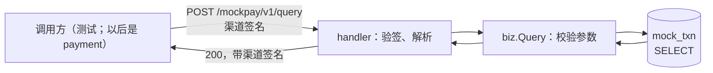
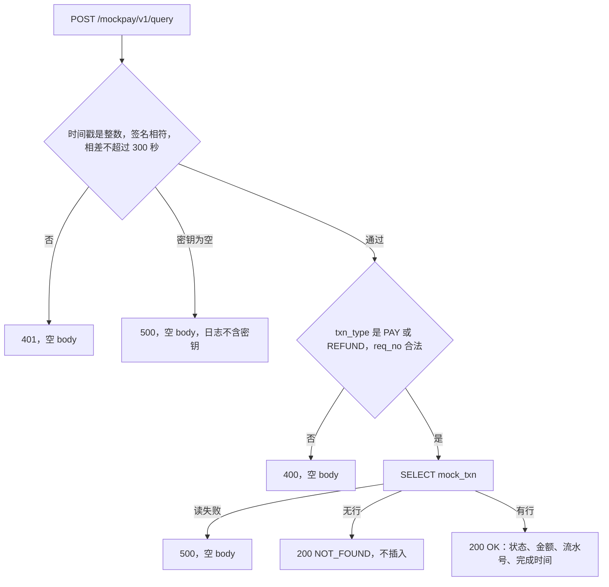

# CH-02 渠道查单

| 项 | 内容 |
|---|---|
| 功能点 | CH-02（P0，第 3 周） |
| 所属链路 | 支付 |
| 代码提交 | `6eec88d` `[CH-02] add mock channel query`（完整 `6eec88d4f9509cb85c70d844a8f6a74b2e3dd3b9`，2026-10-26 09:10:08 +0800） |
| 分支 | `feat/CH-02-query` |
| 日期 | 2026-10-26 |
| 状态 | DONE |

这次代码提交 15 个文件，1451 行新增，50 行删除。本报告在该提交之后写，不在这 15 个文件里。

## 一句话结论

模拟渠道 channel-mock 增加了 `POST /mockpay/v1/query`：按交易类型和请求号只读当前行，把状态、金额（整数分，含 0）、渠道流水号和完成时间返回给调用方。找不到行时返回 `{"result":"NOT_FOUND"}`，不插入新行。金额末两位是 02 的支付会自动完成成成功，查单仍返回成功，不因为“回调被丢掉”而隐瞒状态。本次核验里核心包 `service/channel_mock/biz` 覆盖率 98.2%，其中 `Query` 和 `validateQuery` 都是 100%。

## 1. 背景

### 1.1 系统简介

pay-system 是一个用 Go 编写的小型支付后端，模拟商户收款、退款、商户间转账三条资金链路，重点在数据一致性和性能。系统由 5 个部分组成：gateway（对外 HTTP 入口，负责签名校验和限流）、payment（支付单、退款单、转账单的状态管理和流程推进）、account（账户余额与记账，数据按商户分到 2 个数据库分片）、channel-mock（模拟微信、支付宝这类外部支付渠道）、recon（对账，核对系统内外数据是否一致）。服务之间用 Kitex RPC 同步调用，或通过 Kafka 消息异步通知；数据存在 MySQL 8.4，Redis 用于防重放。所有金额用整数“分”表示，所有记账只追加不修改。

当前已完成：工程骨架、本地环境、迁移与种子、金额、ID、错误码、时钟、配置、日志、数据库访问、集成测试基座、IDL、签名库、密钥加密，账户的分片路由、开户、查询、记账、冻结、解冻、确认扣款、两种转账分支、余额核对和 account RPC 服务，商户费率核对，模拟渠道的支付受理与自动完成，以及本次的渠道查单。渠道关单、退款受理、回调发送、账单都还没做；gateway、payment 的下单、recon、paycli、merchant-demo 也还没有业务实现。查单接口目前由测试调用。

### 1.2 本功能点在系统中的位置

channel-mock 扮演外部支付机构，数据在自己的库 `pay_channel_mock` 里，表是 `mock_txn`。平台以后想知道一笔渠道交易现在是什么状态，只能再发一次 HTTP，不能直接读这张表。本次负责的就是这一次只读查询。



上游是带着渠道签名的 HTTP 调用方。下游只有本库的一行读取。查单不调用 account，不改余额，不写分录，不发 HTTP，也不发 Kafka 消息。受理和自动完成是上一个功能点已经做好的；把完成结果主动推给平台（回调）还没做。

### 1.3 为什么需要它

渠道受理一笔支付之后，结果不一定能通知到平台。举一个已经由测试走通的例子：请求号 `PA_DROP`，金额 10002 分（100.02 元）。金额末两位 02 表示“回调会被丢掉”。自动完成仍然把这一行变成成功，完成时间写上，回调发送次数保持 0，因为真正发回调的功能还没做。如果没有查单，平台只能干等一个不会来的通知，订单会一直停在支付中。如果查单还按“回调场景”把成功藏起来，或者故意晚一点才回答，平台同样看不到已经成功的事实。

另一个例子：平台拿一个从没受理过的请求号来问。查单必须回答“没有这笔”，而且不能顺手插一行。插一行会占住这个请求号，后面真正的受理就会撞上已有记录。关单时为了防止“先关后付”而插入金额为 0 的占位行，是另一个功能点的事；查单只负责把这种行原样读出来，金额就是 0 分（0.00 元）。

## 2. 术语

| 术语 | 含义 |
|---|---|
| 渠道 | 真正向用户收款的外部机构。这里用 channel-mock 模拟 |
| 查单 | 按交易类型和请求号读取渠道里已经记下的那一行，返回当前状态。不创建、不修改 |
| `txn_type` | 交易类型。这张表只允许 `PAY`（支付）和 `REFUND`（退款）。同一请求号的支付和退款是两行 |
| `req_no` | 平台发给渠道的请求号。支付场景下通常是平台支付单号。渠道只要求非空、不超过 32 个字符、不含 U+FFFD |
| `channel_txn_no` | 渠道自己分配的流水号，受理时生成，形如 `MC` 加数字。查单把它原样返回，不重新生成 |
| `mock_txn` | 渠道交易表。一行是一笔支付或一笔退款。状态有处理中 `PROCESSING`、成功 `SUCCESS`、失败 `FAILED`、已关单 `CLOSED` |
| `finished_at` | 交易进入终态的时刻。处理中的正常行这一列是空的（SQL 的 NULL） |
| 金额“分” | 1 元 = 100 分。10002 分就是 100.02 元。代码里用 `money.Amount`，底层是 `int64`，不用小数 |
| 场景 | 按金额末两位决定的固定行为。末两位 01 自动完成时变成失败；02 表示回调会被丢掉，但完成结果仍是成功；04 表示回调要慢，查单不因此推迟 |
| 回调 | 渠道做完之后主动通知平台。本次不发送。表上的 `notify_sent_count` 是已发送次数，查单不去改它 |
| 完成钩子 `OnFinished` | 自动完成提交成功后调用一次的函数，留给以后发回调。查单不调用它 |
| 调度 | 受理成功后在内存里排一个定时任务，到点把交易做完。查单不新增任务 |
| 渠道签名 | 用共享密钥对“时间戳、换行、body”做 HMAC-SHA256，再 Base64。请求和 200 响应都带 `X-Mock-Timestamp`、`X-Mock-Signature` |
| 时间窗 | 请求时间戳和渠道时钟的整秒差不超过 300 秒。差 301 秒视为验签失败 |
| U+FFFD | Unicode 替换字符。非法 UTF-8 或孤立的 `\u` 代理经常会被解码成它。请求号里出现它就算非法 |
| `result` | 查单 body 里的结果，只有 `OK`（找到了）和 `NOT_FOUND`（没有这一行）。它不是平台错误码 |
| 平台错误码 `10002` | 账户等平台接口用来表示“找不到”的数字错误码。渠道 body 里的 `NOT_FOUND` 是另一个东西，HTTP 仍是 200 |
| CAS | 比较之后再更新：`UPDATE … WHERE id = ? AND status = 'PROCESSING'`。自动完成用它。查单没有 UPDATE |
| 分录 | 账户记账时追加的一条借贷记录。查单不写分录 |
| `DATETIME(3)` | MySQL 日期时间，小数只保留 3 位（毫秒）。写入更细的时间会被舍入 |

## 3. 技术讲解

### 3.1 要解决的问题

1. 调用方能读到渠道当前这一行的状态、金额和流水号。回调丢了或还没发，也不能改变这个答案。
2. 没有这一行时明确回答找不到，并且不插入。支付和退款按类型分开，不能用另一类型的行冒充。
3. 查单本身不推动交易：不改状态、不改金额、不排定时任务、不调用完成钩子。
4. 金额 0 分也要出现在成功响应里。以后关单会插入这种占位行，查单不能把它当成“没金额”丢掉。
5. 验签失败、参数非法、内部错误的 HTTP 状态与受理相同：401、400、500 的 body 为空、不签名、不写库。只有 200 带渠道签名。
6. 查单不碰账户余额和分录。

### 3.2 方案

handler 先验签、再严格解析 JSON，然后用 3 秒超时调用 `biz.Service.Query`。`Query` 检查参数，再按 `(txn_type, req_no)` 做一次 `SELECT`。有行就把列映射出去；无行返回一个全零结果，不插入。handler 看到全零就只写 `{"result":"NOT_FOUND"}`；看到有行就写状态、金额、流水号，完成时间仅在列非空时附上，然后签名。



时间戳不是十进制整数时直接 401，这一步在判断密钥是否为空之前。所以密钥为空但时间戳缺失，仍是 401。密钥为空且时间戳能解析成整数时，是 500。

`Query` 在读库之前先看 context 是否已经取消或超时，再校验参数。取消优先于参数错误：一个已经取消、同时参数也不合法的调用，返回的是取消，不是“参数非法”。

```go
// service/channel_mock/biz/query.go
// 只读。无行时返回零值，调用方据此写 NOT_FOUND，不插入。
func (s *Service) Query(ctx context.Context, req QueryRequest) (QueryResult, error) {
	if err := ctx.Err(); err != nil {
		return QueryResult{}, err
	}
	if err := validateQuery(req); err != nil {
		return QueryResult{}, err
	}
	row, ok, err := s.store.Get(ctx, req.TxnType, req.ReqNo)
	if err != nil {
		return QueryResult{}, err
	}
	if !ok {
		return QueryResult{}, nil
	}
	return QueryResult{
		Found: true, Status: row.Status, Amount: row.Amount,
		ChannelTxnNo: row.ChannelTxnNo, FinishedAt: row.FinishedAt,
	}, nil
}
```

读库的 SQL 只有这一句，参数化，没有 `UPDATE`：

```sql
SELECT ... FROM mock_txn WHERE txn_type = ? AND req_no = ?
```

找不到行时数据库返回“没有行”，函数把它变成 `ok = false`，错误是空。这和读库失败不是一回事：失败会带着错误返回，handler 回 500。

找到时的 JSON 字段顺序固定。金额用 `int64`，没有 `omitempty`，所以 0 会写成 `"amount":0`。`finished_at` 有 `omitempty`，空字符串就不出现。找不到时用另一个只有 `result` 的结构，避免把零金额和空状态一起编进去。

完成时间先换到东八区固定偏移（`+08:00`，不读系统时区库），再截断到毫秒，格式如 `2026-10-12T10:00:00.123+08:00`。截断发生在换时区之后，不足 1 毫秒的尾数不会进位。零值时间表示 SQL 的 NULL，响应里省略。省略看的是这一列空不空，不看状态名字：一行如果状态仍是 `PROCESSING` 但完成时间有值，响应仍带 `finished_at`。

两个具体响应：

- 10000 分（100.00 元）、处理中、完成时间为空：`{"result":"OK","status":"PROCESSING","amount":10000,"channel_txn_no":"MC1"}`
- 从未受理：`{"result":"NOT_FOUND"}`

200 的时间戳取注入的时钟，不取机器的当前时间。测试里把时钟固定后，响应头时间戳必须等于这个固定值，再用同一套 HMAC 验响应签名。

参数规则与受理相同。`txn_type` 只能是 `PAY` 或 `REFUND`，小写 `pay` 非法。`req_no` 非空、最多 32 个字符；32 个“单”字可以通过，33 个不行。JSON 必须是合法 UTF-8 的单个对象，对象后面只能有空白。顶层同一个键出现两次（包括未知键、包括用 `\u` 写成同一个名字）拒绝。已知字段名大小写不对（如 `REQ_NO`）拒绝。类型不对拒绝。其他未知字段忽略。缺字段和 `null` 先当成空字符串，再由上面的规则判为非法。

### 3.3 为什么这样做

| 方案 | 做法 | 优点 | 缺点 | 结论 |
|---|---|---|---|---|
| 采用：按主键对只读当前行 | 一次 `SELECT`，原样返回列 | 回调丢了也能看到成功；重复查不改数据 | 调用方要自己决定下一步 | 采用 |
| 备选：按场景决定要不要回答 | `DROP_NOTIFY` 假装还在处理，`SLOW` 推迟返回 | 看起来更像“回调还没到” | 查单和回调绑在一起，丢了回调的成功单永远查不回来 | 不采用。查单不读场景来藏状态 |
| 备选：找不到就插入占位行 | 插入 `CLOSED` 或金额 0 的行再返回 | 以后同一号不会被受理 | 那是关单的防悬挂，查单这样做会把“问过”变成“已经关单” | 不采用。无行只返回 `NOT_FOUND` |
| 备选：找不到和找到共用一个 JSON 结构 | 零值字段靠 `omitempty` 省略 | 少一个类型 | 金额 0 会被省略；空状态也可能漏进 `NOT_FOUND` | 不采用。两种 body 用两个结构 |

平台侧“查单之后决定关单或重提退款”是以后的补偿流程，出口包括关单和退款重提。那些动作不属于本次。控制流图因此单独画了渠道查单（文档里的 CF-38），没有改补偿流程那张图的分支。

### 3.4 正确性

查单不改余额、不写分录，也没有自己的写路径。下表按场景写系统行为和证据。没有对应测试的格子写未验证。

| 场景 | 系统行为 | 最终状态 | 证明 |
|---|---|---|---|
| 同一笔再查一次 | 每次都是 `SELECT`。一次查单前后，行的状态、金额、场景、完成时间、回调发送次数不变，`updated_at` 也不变 | 行与查单前相同。10002 分那笔仍是 `SUCCESS`，回调次数仍是 0 | 单次查单前后比较：`TestQueryDropNotifyMySQL`、`TestQueryProcessingMySQL`、`TestQueryFailMySQL`、`TestQueryAmountZeroMySQL`、`TestQuerySlowSuccessMySQL`。连续两次查单并断言两次响应相同：未验证，这些测试各只调用了一次 `Query` |
| 两个查单同时读同一行 | 两条 `SELECT`，没有 `UPDATE`，不存在“谁抢到写锁” | 预期两份结果都是当前行，行不变 | 未验证。没有同时启动两个 goroutine 查同一行的测试 |
| 查单进行到一半进程崩溃 | 查单没有 `INSERT` / `UPDATE`，崩溃不会留下改了一半的行，也不会多排一个定时任务 | 行保持查单前的值 | 中途杀进程：未验证。不插入由 `TestQueryNotFoundDoesNotInsert` 证明（行数 0、插入次数 0、不取新流水号）。不调度、不调用完成钩子由 `TestQueryDoesNotScheduleOrNotify` 证明 |
| 下游超时 | 查单不调用其他服务，不发 HTTP，不发消息。唯一的 IO 是读本库。handler 给这次业务调用包了 3 秒超时。调用进来时 context 已经取消或已经过期，就原样返回这个错误，不去读库。读库失败不当成参数错误，HTTP 500，空 body，不签名 | 行不变 | `TestQueryStoreErrorAndCanceled`：取消时读次数是 0，过期返回 `DeadlineExceeded`，读库错误仍是原来的存储错误。`TestQueryInternalErrors` 的读库失败子测试得到 HTTP 500。真实 MySQL 语句一直卡到 3 秒：未验证 |
| 余额和分录 | 代码路径不访问 account，不写分录，不改任何账户余额 | 余额和分录保持原样 | 未验证。测试没有调用余额核对，也没有读取账户表。本功能点不经过账户库 |

另外三件和“读到的是当前行”直接相关的事实，由测试盖住了：

- 10002 分（100.02 元）受理后自动完成，查单得到 `SUCCESS`、同一金额、同一 `channel_txn_no`、完成时间非空。见 `TestQueryDropNotifyMySQL` 和 HTTP 的 `TestQueryDropNotifyHTTP`。
- 10001 分（100.01 元）自动完成后查单是 `FAILED`，带完成时间，不是成功。见 `TestQueryFailAfterFinish`、`TestQueryFailMySQL`。
- 直接插入一行金额 0、状态 `CLOSED`，查单返回 0，不把这一行改掉。见 `TestQueryAmountZero`、`TestQueryAmountZeroMySQL`。关单接口本身本次没有实现。

### 3.5 性能

不涉及。本次核验没有测量查单延迟或吞吐，也没有性能开关。

## 4. 已完成内容

### 4.1 改动清单

| 文件 | 新增 / 修改 | 作用 |
|---|---|---|
| `service/channel_mock/biz/query.go` | 新增 | `Query`：校验、只读、无行返回零值 |
| `service/channel_mock/biz/query_test.go` | 新增 | 内存里的查单测试 |
| `service/channel_mock/biz/query_integration_test.go` | 新增 | MySQL 上的查单测试 |
| `service/channel_mock/handler/query.go` | 新增 | `POST /mockpay/v1/query`，签名响应和完成时间格式 |
| `service/channel_mock/handler/query_test.go` | 新增 | HTTP 状态、JSON、签名、日志 |
| `service/channel_mock/handler/query_integration_test.go` | 新增 | 受理完成后的 HTTP 查单 |
| `service/channel_mock/handler/pay.go` | 修改 | 注册查单路由；JSON 解码抽成共用函数；签名写入接受任意响应结构。受理成功时仍带 `status`，拒绝时仍不带空的流水号 |
| `service/channel_mock/handler/pay_test.go` | 修改 | 测试用的假渠道补上 `Query` |
| `service/channel_mock/biz/pay.go` | 修改 | 参数错误这个哨兵同时用于查单，错误字符串未改 |
| `service/channel_mock/dal/txn.go` | 修改 | 导出退款类型常量 `REFUND`。读方法原来就有，没有为查单加 `UPDATE` |
| `docs/02-requirements.md` | 修改 | 查单规则、2026-10-26 的澄清、状态 DONE、两条验收勾选 |
| `docs/04-dev-plan.md` | 修改 | 只把 CH-02 拆成单独一行并勾选 |
| `docs/05-api.md` | 修改 | 查单字段说明，版本 2.1.2 |
| `docs/06-flows.md` | 修改 | 渠道查单控制流 CF-38，版本 v2.12 |
| `docs/database.md` | 修改 | 写明查单按 `(txn_type, req_no)` 只读 |

`cmd/channel-mock/main.go` 未改。构造 handler 的参数仍然是业务服务、密钥和时钟。

### 4.2 对外变化

| 类别 | 变化 |
|---|---|
| 接口 | 新增 `POST /mockpay/v1/query`。入参 `txn_type`、`req_no`。找到时 `result=OK`，并带 `status`、`amount`、`channel_txn_no`，`finished_at` 仅在列非空时出现。找不到时 body 只有 `{"result":"NOT_FOUND"}`。未新增字段名、枚举、签名算法或错误码。文档版本 2.1.1 到 2.1.2，属于文字澄清 |
| 表结构 | 无。没有新迁移。`mock_txn` 的读法补了一句说明 |
| 配置项 | 无 |
| 错误码 | 无。渠道 `result=NOT_FOUND` 不是平台错误码 `10002` |
| 指标 / 故障点 | 无 |

### 4.3 验收对照

需求里的两条验收，加上实现时约定要覆盖的行为。下表的“通过”来自 4.4 里带 `-count=1` 的覆盖率命令：那两次真正执行了这些包里的测试。`make test` 和 `make test-integration` 里 channel-mock 相关包是缓存命中，本次没有重新打印每个测试函数。

| 验收条目 | 测试函数 | 类型 | 结果 |
|---|---|---|---|
| DROP_NOTIFY 场景下查单返回 SUCCESS | `TestQueryDropNotifyMySQL`、`TestQueryDropNotifyHTTP` | 集成 | 通过 |
| 未受理的 req_no 返回 `NOT_FOUND` | `TestQueryNotFoundDoesNotInsert`、`TestQueryNotFoundMySQL` | 单元、集成 | 通过 |
| 处理中返回 OK，省略空的完成时间 | `TestQueryProcessing`、`TestQueryProcessingMySQL`；`TestQuerySignedResponses` | 单元、集成 | 通过 |
| 金额末两位 01 完成后查单是 FAILED，带完成时间 | `TestQueryFailAfterFinish`、`TestQueryFailMySQL` | 单元、集成 | 通过 |
| 直接插入的 0 分原样返回 0 | `TestQueryAmountZero`、`TestQueryAmountZeroMySQL` | 单元、集成 | 通过 |
| 同一请求号的 PAY 与 REFUND 不串单 | `TestQueryPayAndRefundDoNotCross`、`TestQueryPayRefundIsolatedMySQL` | 单元、集成 | 通过 |
| 验签失败 401，参数非法 400，空密钥和读库失败 500；200 的签名能验过 | `TestQueryUnauthorized`、`TestQueryBadRequest`、`TestQueryInternalErrors`、`TestQuerySignedResponses`、`TestQueryIgnoresUnknownFields`、`TestQueryLogsWithoutSecrets` | 单元 | 通过 |
| 查单不调度、不调用完成钩子 | `TestQueryDoesNotScheduleOrNotify` | 单元 | 通过 |
| 场景是 SLOW 且已经成功时，查单仍返回 SUCCESS | `TestQuerySlowAlreadySuccess`、`TestQuerySlowSuccessMySQL` | 单元、集成 | 通过 |

金额例子：处理中用 10000 分（100.00 元）；失败用 10001 分（100.01 元）；回调丢掉仍成功用 10002 分（100.02 元）；慢回调但已经成功用 10004 分（100.04 元）；同一请求号上支付 10000 分、退款 3000 分（30.00 元）；只有支付的那笔 500 分（5.00 元），去查退款得到找不到；只有退款的那笔 700 分（7.00 元），去查支付得到找不到。

`TestQueryDropNotifyHTTP` 在受理时把自动完成延迟配成 0，然后在 2 秒内轮询到状态变成成功并且完成钩子被调用了 1 次，再发查单。轮询用的是带超时的等待，不是固定睡一段。查单之后行不变、`updated_at` 不变、钩子次数不变、待执行的定时任务数不变。响应金额按 JSON 原文比较，是整数 `10002`。完成时间要匹配 `2026-10-12T10:00:00.000+08:00` 这种三位毫秒、`+08:00` 的形式，并与库里的时刻用同一格式对上。

### 4.4 验证记录

环境：go1.27.2 darwin/arm64，golangci-lint 2.14.0。日期 2026-10-26。数字只来自这次核验。

| 命令 | 结果 |
|---|---|
| `gofmt -l .` | 无输出，real 0.07s |
| `make lint`（`golangci-lint run --build-tags integration ./...`） | `0 issues.`，real 2.18s |
| `make test`（`go test -race ./...`） | 退出码 0，real 6.47s。根包 `ok github.com/yym108/pay-system 5.754s`。`service/channel_mock/biz` 与 `handler` 为 cached |
| `make test-integration`（`go test -race -tags integration ./...`） | 退出码 0，real 46.33s。根包 `ok github.com/yym108/pay-system 45.716s`。`service/channel_mock/biz`、`dal`、`handler` 为 cached |
| `go test -race -count=1 -cover ./service/channel_mock/biz/ ./service/channel_mock/handler/ ./service/channel_mock/dal/` | real 2.95s。biz 1.603s、覆盖率 98.2%；handler 1.574s、94.8%；dal 0.0%（该命令不带 integration 标签，dal 没有不带标签的测试） |
| `go test -race -count=1 -tags integration -cover` 同上三个包 | real 18.37s。biz 16.631s、98.2%；handler 12.769s、94.8%；dal 12.801s、85.2% |
| `make cover` | real 5.77s。`go tool cover -func=coverage.out` 合计 18.6%。其中 `service/channel_mock/biz` 98.2%（`Query`、`validateQuery` 均为 100%），handler 94.8%，dal 0.0%（`make cover` 不带 integration 标签） |

`make test` 不带 integration 标签，所以 MySQL 测试不在其中。`make test-integration` 带了这个标签，channel-mock 的三个包是缓存命中。带 `-count=1` 的两次覆盖率命令重新执行了测试。全仓库合计 18.6% 把尚未实现业务的包和生成代码也算进去了，不能当成查单本身的覆盖率；查单所在的 biz 包是 98.2%，高于 70% 这条线。

`mmdc` 未安装。控制流 CF-38 只有 mermaid 源图，没有渲染 SVG。

### 4.5 同步的文档

- 需求：CH-02 的规则写成只读、找不到不插入、完成时间按列是否为空决定省略；变更记录有一条 2026-10-26 的澄清。状态改为 DONE，两条验收已勾。
- 开发计划：CH-02 单独一行并勾选。关单、回调和其余故障场景仍未勾。
- 接口文档：版本 2.1.2，变更记录和查单一节写了请求约束和两种响应。没有新错误码。
- 控制流：版本 v2.12，新增 CF-38。补偿流程那张图的分支未改，查单矩阵改指向 CF-38。
- 表结构：补了只读说明和一条无 DDL 的变更记录。

## 5. 未完成与风险

- 连续两次查单的响应是否逐字节相同，以及两个查单并发，都没有专门测试。见 3.4。
- 没有在查单中途杀进程，也没有让真实 MySQL 读卡住直到 3 秒超时。
- 余额和分录没有用账户核对来证明。查单代码不访问账户库。
- HTTP 集成把自动完成延迟配成 0，再用轮询等终态。这只影响该测试怎么等到“已经成功”，生产路径的延迟仍由受理功能点按请求号计算，本次没有改延迟公式。
- 退款受理、关单、回调发送都没做。`txn_type=REFUND` 现在只是按键去读；没有退款行就是 `NOT_FOUND`。金额 0 的行是测试直接插入的，用来确认查单会返回 0。
- CF-38 未渲染成 SVG。
- `make cover` 不含集成测试，因此 dal 在那次是 0.0%。带 integration 标签的覆盖率是 85.2%。

## 6. 如何复现

前置：Go 1.27.2，golangci-lint 2.14.0，在仓库根目录、分支 `feat/CH-02-query`、代码提交 `6eec88d` 上执行。集成测试需要可用的 Docker（本机是 OrbStack）；本次核验里 channel-mock 三个包是缓存命中，缓存失效时会自己拉起 MySQL。不要把连接串或口令写进命令回显。

```bash
gofmt -l .
make lint
make test
make test-integration
go test -race -count=1 -cover ./service/channel_mock/biz/ ./service/channel_mock/handler/ ./service/channel_mock/dal/
go test -race -count=1 -tags integration -cover ./service/channel_mock/biz/ ./service/channel_mock/handler/ ./service/channel_mock/dal/
make cover
```

预期与 4.4 的表一致：`gofmt -l .` 无输出；`make lint` 打印 `0 issues.`；`make test` 退出码 0；`make test-integration` 退出码 0；两次按包覆盖率分别是 biz 98.2%、handler 94.8%，dal 在不带标签时 0.0%、带标签时 85.2%；`make cover` 合计 18.6%，biz 里 `Query` 和 `validateQuery` 为 100%。

## 7. 讲解要点

1. 问：回调被丢掉之后，平台怎么知道已经成功？答：查单不看场景。10002 分（100.02 元）会完成成 `SUCCESS`，查单返回这个状态、同一金额和同一流水号。藏起状态或推迟回答会让丢了回调的成功单永远查不回来。
2. 问：找不到为什么不插一行？答：插行会占住请求号，后面的受理或关单会把“曾经来问过”当成“已经有交易”。找不到只返回 `{"result":"NOT_FOUND"}`，表里仍然没有这行。
3. 问：金额 0 会不会从 JSON 里消失？答：找到行时金额字段没有 `omitempty`，0 分写成 `"amount":0`。找不到用另一个只有 `result` 的结构，所以不会把 0 漏进 `NOT_FOUND`。

## 延伸阅读

- `docs/02-requirements.md`：CH-02 小节，以及 2026-10-26 的澄清记录。
- `docs/05-api.md`：版本 2.1.2 的变更记录，渠道查单那一节，渠道签名那一节。
- `docs/06-flows.md`：CF-38。补偿流程仍是以后的 PAY-05，不在本次。
- `docs/database.md`：`pay_channel_mock.mock_txn` 的查询方式。
- `docs/reports/CH-01-mock-pay.md`：受理、自动完成、场景末两位和渠道签名的来历。

## 修订记录

| 日期 | 提交 | 修订内容 |
|---|---|---|
| 2026-10-26 | 代码提交 `6eec88d`；本报告尚未进入该提交 | 初稿 |
