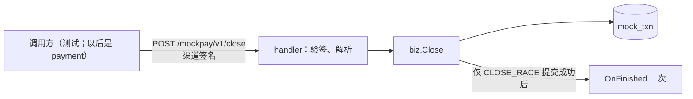
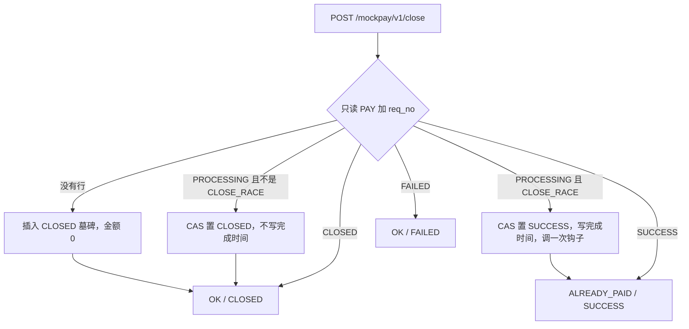

# CH-03 渠道关单

| 项 | 内容 |
|---|---|
| 功能点 | CH-03（P0，第 3 周） |
| 所属链路 | 支付 |
| 代码提交 | `ffbecce` `[CH-03] add mock channel close`（完整 `ffbecce41f41ae68955a1e9edc0246094b6b87cc`，2026-10-26 09:55:01 +0800） |
| 分支 | `feat/CH-03-close` |
| 日期 | 2026-10-26 |
| 状态 | DONE |

这次代码提交 16 个文件，1961 行新增，35 行删除。本报告在该提交之后写，不在这 16 个文件里。

## 一句话结论

模拟渠道 channel-mock 增加了 `POST /mockpay/v1/close`：只按支付类型和请求号处理一笔交易。还在处理中且不是“关单抢成功”时，用比较后更新把状态改成已关闭，不写完成时间，也不调用完成钩子。金额末两位是 09 时，这次关单把交易写成成功，提交后再调用一次完成钩子，并回答“已经付过”。找不到行时插入金额 0 分的已关闭占位行，同一请求号之后再来支付会被拒绝。本次核验里 `service/channel_mock/biz` 语句覆盖率 96.1%，不低于 70%；`Close`、`validateClose`、`closeAsClosed`、`confirmClose` 在 `make cover` 的函数表里是 100%。

## 1. 背景

### 1.1 系统简介

pay-system 是一个用 Go 编写的小型支付后端，模拟商户收款、退款、商户间转账三条资金链路，重点在数据一致性和性能。系统由 5 个部分组成：gateway（对外 HTTP 入口，负责签名校验和限流）、payment（支付单、退款单、转账单的状态管理和流程推进）、account（账户余额与记账，数据按商户分到 2 个数据库分片）、channel-mock（模拟微信、支付宝这类外部支付渠道）、recon（对账，核对系统内外数据是否一致）。服务之间用 Kitex RPC 同步调用，或通过 Kafka 消息异步通知；数据存在 MySQL 8.4，Redis 用于防重放。所有金额用整数“分”表示，所有记账只追加不修改。

当前已完成：工程骨架、本地环境、迁移与种子、金额、ID、错误码、时钟、配置、日志、数据库访问、集成测试基座、IDL、签名库、密钥加密，账户的分片路由、开户、查询、记账、冻结、解冻、确认扣款、同分片转账和收款方转账分支、余额核对和 account RPC 服务，商户费率核对，模拟渠道的支付受理与自动完成、渠道查单，以及本次的渠道关单。渠道退款受理、回调发送、账单都还没做；gateway、payment 的下单、recon、paycli、merchant-demo 也还没有业务实现。关单接口目前由测试调用。

### 1.2 本功能点在系统中的位置

channel-mock 扮演外部支付机构，交易记在自己的库 `pay_channel_mock`、表 `mock_txn` 里。平台以后要关一笔渠道支付，只能再发一次 HTTP，不能直接改这张表。本次负责的就是这一次关单。



上游是带着渠道签名的 HTTP 调用方。下游是本库的一行读取或一次写入。关单不调用 account，不改余额，不写分录，不 POST 回调地址，也不发 Kafka 消息。受理、自动完成和查单已经做好。把完成结果用 HTTP 推给平台仍是以后的回调发送。

### 1.3 为什么需要它

一笔 10000 分（100.00 元）的支付已经受理，状态是处理中，内存里还排着自动完成。用户这时要求关闭订单。如果渠道没有关单，定时器到期仍会把这一行写成成功，商户以为关掉了，钱却收进来了。普通关单把状态改成已关闭，完成时间保持空，完成钩子不调用。定时器之后再跑，更新条件已经不成立，行仍是已关闭，钩子也不会被这次完成调用。

另一笔是 10009 分（100.09 元）。金额末两位 09 表示“关单时这笔其实已经付成了”。关单必须把它写成成功并告诉调用方已经付过，而不是悄悄关掉。

还有一种顺序：关单先到，支付后到。请求号 `PA_NONE` 在渠道里还没有支付行。如果不占住这个号，后面的支付会正常受理。关单因此插入一行已关闭、金额 0 分（0.00 元）的记录。之后同一请求号再支付 1 分（0.01 元）或 10009 分（100.09 元），都返回已关闭，原行金额仍是 0。

## 2. 术语

| 术语 | 含义 |
|---|---|
| 渠道 | 真正向用户收款的外部机构。这里用 channel-mock 模拟 |
| 关单 | 按支付请求号结束或占住一笔渠道支付。成功响应的 HTTP 是 200，body 里用 `result` 和 `status` 说明结果 |
| `req_no` | 平台发给渠道的请求号。关单只要求它非空、不超过 32 个字符、不含 U+FFFD |
| `txn_type` | 交易类型。支付是 `PAY`，退款是 `REFUND`。关单只查 `(PAY, req_no)` |
| `mock_txn` | 渠道交易表。一行是一笔支付或一笔退款。状态有处理中 `PROCESSING`、成功 `SUCCESS`、失败 `FAILED`、已关闭 `CLOSED` |
| `channel_txn_no` | 渠道流水号，`MC` 前缀，由已有的发号器生成。关单的 200 响应不返回它 |
| 金额“分” | 1 元 = 100 分。10000 分是 100.00 元。代码类型是 `money.Amount`，底层 `int64` |
| 场景 | 由金额末两位决定的固定行为。末两位 09 是 `CLOSE_RACE`（关单抢成功）；08 是 `NEVER_FINISH`（受理时不调度，一直处理中，直到被关单） |
| `finished_at` | 进入成功或失败的时刻，可空。普通关单不写它。`CLOSE_RACE` 写成注入时钟截到毫秒的时间 |
| `bill_date` | 计入账单的日期，等于 `finished_at` 的东八区日期。普通关单和金额 0 的占位行都不写 |
| 防悬挂 / 墓碑 | 关单时请求号还不存在，先插入一行已关闭的支付，挡住之后才到的支付。金额固定 0 分 |
| CAS | 比较之后再更新：`UPDATE … WHERE id = ? AND status = 'PROCESSING'`。别的状态不会被盖掉 |
| 完成钩子 `OnFinished` | 交易确定写成终态之后调用的函数，留给以后发 HTTP 回调。本次只调用这个函数，不 POST，也不把 `notify_sent_count` 加 1 |
| `notify_sent_count` | 已经发送过的回调次数。关单不改它，保持 0 |
| 调度 | 受理成功后在内存里排的自动完成定时任务。关单不取消它，也不为关单新增一个 |
| 渠道签名 | 用共享密钥对“时间戳、换行、body”做 HMAC-SHA256，再 Base64。请求和 200 响应都带签名头。400、401、500 的 body 为空且不签名 |
| 时间窗 | 请求时间戳和渠道时钟的整秒差不超过 300 秒。超出视为验签失败 |
| U+FFFD | Unicode 替换字符。请求号里出现它就算非法 |
| `result` | 关单 body 里的结果，只有 `OK` 和 `ALREADY_PAID`。它不是平台数字错误码 |
| 1062 | MySQL 唯一键冲突的错误号。代码用 `dbx.IsDuplicate` 识别，再读已有行，不把它当成失败抛出去 |
| 分录 | 账户记账时追加的一条借贷记录。关单不写分录 |
| `DATETIME(3)` | MySQL 日期时间，只保留到毫秒 |

## 3. 技术讲解

### 3.1 要解决的问题

1. 调用方只给请求号，渠道只处理同号的支付行。同号退款行既不关闭，也不当成这笔支付已经存在。
2. 处理中且场景不是 `CLOSE_RACE`：状态变成已关闭，不写完成时间和账单日，不调用完成钩子。
3. 处理中且场景是 `CLOSE_RACE`：状态变成成功，完成时间和账单日与自动完成相同，提交成功后调用一次完成钩子，回答已经付过。
4. 已经是成功、已关闭、失败：不改行。成功回答已经付过；已关闭回答关闭；失败回答失败。失败也不调用钩子。
5. 没有支付行：插入已关闭占位行，金额 0 分。之后同一请求号的支付返回已关闭，不论金额。
6. 两个人同时关同一个号，最终只有一行，两次调用都得到一致答案。写入报错但行可能已经提交时，再读确认，不猜。
7. 已经排好的自动完成不取消。它稍后触发时不能把已关闭改回成功，也不能再调钩子。
8. 验签失败 401，密钥为空 500，参数非法 400，读写失败 500。这些响应 body 为空、不签名、不写库。只有 200 带渠道签名。
9. 关单不改账户余额，不写分录，不调用余额核对。

### 3.2 方案

handler 先验签，再按与受理相同的 JSON 规则解析。已知字段只有 `req_no`。然后用 3 秒超时调用 `biz.Service.Close`。业务先读 `(PAY, req_no)`。没有行就插入墓碑；有行就按状态走下面的图。200 的 body 只有 `result` 和 `status`，三个取值组合是 `OK`/`CLOSED`、`OK`/`FAILED`、`ALREADY_PAID`/`SUCCESS`。不返回 `channel_txn_no`、`reason`、`amount`。



普通关单不用“完成”那条 SQL，因为那条会写入 `finished_at`。它只用下面这一句，状态参数是 `CLOSED`：

```sql
UPDATE mock_txn SET status = ?
WHERE id = ? AND status = 'PROCESSING'
```

这段代码在做普通关单：先记下想写成的已关闭和原来的完成时间，再调用上面的更新。更新报错就进入确认再读；影响 0 行就按主键再读当前状态来回答，这次不调钩子；影响 1 行就直接返回已关闭。

```go
// service/channel_mock/biz/close.go
func (s *Service) closeAsClosed(ctx context.Context, row dal.Txn) (CloseResult, error) {
	attempt := closeAttempt{status: dal.StatusClosed, finishedAt: row.FinishedAt}
	applied, err := s.store.Close(ctx, row.ID)
	if err != nil {
		return s.confirmClose(ctx, row.ID, attempt, err)
	}
	if !applied {
		return s.answerAfterMiss(ctx, row.ID)
	}
	return closedResult(), nil
}
```

`CLOSE_RACE` 复用自动完成同一套收尾：`finishFor` 算出成功、完成时间（注入时钟截到毫秒）和东八区账单日，再调用 `dal.Finish`。`applied` 为 true 时，用内存里刚写出的值调用一次钩子，不额外再读。钩子拿到的 context 经过 `context.WithoutCancel`，调用方取消和 handler 那 3 秒截止时间都不会再取消它。`OnFinished` 为 nil 就跳过。事务里面不调用钩子。

找不到支付行时插入：`txn_type` 为 `PAY`，金额 0，状态 `CLOSED`，场景写成列默认 `NORMAL`，回调地址写成列默认空串，`created_at` 用 `biz.now()`，流水号用 `MC` 前缀。不写 `finished_at` 和 `bill_date`，不调度，不调钩子。请求里多出来的金额、回调地址被忽略，不能拿来填这行。

并发和不确定结果：

- 先读。没有行才插入。唯一键 1062 再按 `(PAY, req_no)` 读，按读到的当前状态回答，可能是别人刚插入的处理中、已关闭，或本次墓碑。
- 插入报的不是 1062：`context.WithoutCancel` 再加 1 秒去读。流水号和本次生成的相同，就按墓碑已写入返回 `OK` / `CLOSED`。读不到、读失败或是别的行，返回原来的插入错误，HTTP 500。
- 处理中的更新影响 0 行：按主键再读。成功则 `ALREADY_PAID`，已关闭则 `OK` / `CLOSED`，失败则 `OK` / `FAILED`。这次没有“写入结果不确定”时不调钩子，因为自动完成可能已经赢了，并会自己调钩子。
- 写入报错、结果不确定：记下这次想写的状态和完成时间，再用不受取消影响的 1 秒超时按主键读。普通关单读到已关闭且完成时间仍是写入前的值，视为已生效，不调钩子。`CLOSE_RACE` 只有状态是成功且完成时间与这次一致才调一次钩子。对不上就按读到的状态回答，不覆盖。读回失败返回原来的写错误，不猜。

200 的响应结构没有 `omitempty`，所以不会把空字段省掉，也不会把流水号带出去。时间戳取注入时钟。

```go
// service/channel_mock/handler/close.go
// 200 只有这两个字段。验签或参数失败走空 body，不进这里。
type closeResponse struct {
	Result string `json:"result"`
	Status string `json:"status"`
}
```

### 3.3 为什么这样做

| 方案 | 做法 | 优点 | 缺点 | 结论 |
|---|---|---|---|---|
| 采用：普通关单单独一条 CAS，`CLOSE_RACE` 才走完成 SQL | 已关闭不写完成时间；抢成功与自动完成同一套字段和钩子 | 关掉的单不会带上完成时间；抢成功的账单日和自动完成一致 | 两条更新路径 | 采用 |
| 备选：所有关单都调用 `dal.Finish` | 一条 SQL 同时写状态和 `finished_at` | 少一个方法 | 普通关单会把完成时间写成非空，和“只改状态”相反 | 不采用 |
| 备选：关单时取消已经排好的定时器 | 内存里删掉任务 | 定时器不会再跑 | 进程重启仍会扫到处理中的行；和“到期 CAS 得 0 行”这条保证重复 | 不采用。定时器留着，靠 CAS 失败 |
| 备选：这次就 POST `notify_url` | 关单成功后发 HTTP，并把发送次数加 1 | 平台马上收到通知 | 发回调、重试、丢回调是另一个功能点 | 不采用。只调用 `OnFinished` |

同号退款行不参与，是因为支付和退款用 `(txn_type, req_no)` 分开。把退款行当成支付已存在，就会不去插支付墓碑，后面的支付仍能受理。

### 3.4 正确性

关单不改余额、不写分录。下表是重复、并发、崩溃和超时。测试名都在本次提交的测试文件里。整次 `make test` 和 `make test-integration` 已通过，这些测试包含在其中。

| 场景 | 系统行为 | 最终状态 | 证明 |
|---|---|---|---|
| 同一请求再关一次 | 终态行不再更新。第二次返回值与第一次相同 | 金额、状态、流水号、完成时间、`notify_sent_count` 保持第一次之后的值 | `TestCloseRules` 对规则表每一行再关一次，只断言返回值相同。成功、已关闭、失败在 MySQL 上关一次后行和 `updated_at` 不变：`TestCloseRulesMySQL`。第二次调用之后再读行：单元测试没有做这一次额外读取 |
| 两个关单同时到达 | 恰好 2 个 goroutine。没有行时两个都得到 `OK` / `CLOSED`，表里 1 行。同一笔处理中也是两个都 `OK` / `CLOSED`，仍是 1 行已关闭 | 缺失号：金额 0、已关闭。处理中那笔：原金额、原流水号、已关闭、完成时间为空、发送次数 0 | `TestCloseConcurrent`、`TestCloseConcurrentMySQL`。这两次套件都带 `-race` |
| 写入之后、确认读取之前结果不明 | 记下想写的状态和完成时间再读。对得上按生效处理；对不上按读到的状态回答，不覆盖。确认读取失败则返回原来的写错误，不调钩子 | 内存假存储里可以分别得到已生效、被别人改走、以及读失败 | `TestCloseUncertainWrite`、`TestCloseInsertUncertainReread`、`TestCloseCASMissReread`、`TestCloseDuplicateThenReread`。真实进程在两步之间被杀掉：未验证 |
| 下游超时 | 关单不调用其他服务，不发 HTTP。handler 的业务调用有 3 秒上限。插入或状态写入结果不确定时，再读上限 1 秒，且不随请求取消。调用进来时 context 已取消，则原样返回，不发号、不插入 | 行保持调用前的样子 | `TestCloseCanceledContext`。真实 MySQL 一直卡到 3 秒或 1 秒：未验证 |
| 自动完成比关单晚 | 关单不删定时器。到期任务的 CAS 得 0 行 | 行保持已关闭，完成时间仍空，钩子次数不增加 | `TestCloseThenScheduledFinish`、`TestCloseThenScheduledFinishMySQL` |
| `CLOSE_RACE` 的钩子次数 | 关单赢：钩子恰好 1 次，看到成功和这次的完成时间。自动完成先写成成功：关单回答已经付过，钩子仍是那 1 次 | 成功行的完成时间和账单日不再被关单改掉 | `TestCloseRaceHookOnce`、`TestCloseRaceHookMySQL` |

规则表的六行由 `TestCloseRules` 和 `TestCloseRulesMySQL` 各覆盖一次：10000 分的处理中、10009 分的 `CLOSE_RACE`、先完成后的成功、直接插入的已关闭、10001 分完成后的失败、以及缺失请求号。普通关单不写完成时间和账单日，在库上由 `TestCloseCAS` 用 SQL 的 NULL 证明；对已经成功的行再执行这条关闭更新，影响行数是 0，成功状态和完成时间保持不变。

### 3.5 性能

不涉及。本次核验没有测量关单延迟或吞吐，也没有性能开关。

## 4. 已完成内容

### 4.1 改动清单

| 文件 | 新增 / 修改 | 作用 |
|---|---|---|
| `service/channel_mock/biz/close.go` | 新增 | 关单规则、墓碑插入、1062 与不确定再读、完成钩子 |
| `service/channel_mock/biz/close_test.go` | 新增 | 内存假存储上的规则、并发和再读 |
| `service/channel_mock/biz/close_integration_test.go` | 新增 | MySQL 上的规则、并发和到期任务 |
| `service/channel_mock/biz/pay.go` | 修改 | 存储接口增加 `Close`；包注释带上关单 |
| `service/channel_mock/biz/fakes_test.go` | 修改 | 内存存储实现关闭，以及插入、再读的失败开关 |
| `service/channel_mock/dal/txn.go` | 修改 | `Close` 的 CAS，不写 `finished_at`、`bill_date` |
| `service/channel_mock/dal/txn_integration_test.go` | 修改 | `TestCloseCAS` |
| `service/channel_mock/handler/close.go` | 新增 | `POST /mockpay/v1/close` |
| `service/channel_mock/handler/close_test.go` | 新增 | HTTP 状态、签名、日志 |
| `service/channel_mock/handler/pay.go` | 修改 | 注册关单路由；`Payer` 增加 `Close`。构造参数未增加 |
| `service/channel_mock/handler/pay_test.go` | 修改 | 测试用的假渠道实现 `Close` |
| `docs/02-requirements.md` | 修改 | 关单规则、2026-10-26 的澄清、状态 DONE、两条验收勾选 |
| `docs/04-dev-plan.md` | 修改 | 只把 CH-03 拆成单独一行并勾选 |
| `docs/05-api.md` | 修改 | 关单字段与三个 200 body，版本 2.1.3 |
| `docs/06-flows.md` | 修改 | CF-23 补上验签、参数和再读出口，版本 v2.13 |
| `docs/database.md` | 修改 | 关单写路径说明，无 DDL |

`cmd/channel-mock/main.go` 未改。它继续把 `*biz.Service` 传进 handler，服务已经实现 `Close`。

### 4.2 对外变化

| 类别 | 变化 |
|---|---|
| 接口 | `POST /mockpay/v1/close` 按本次口径写清：只关 `(PAY, req_no)`；200 只有 `result` 和 `status`，三个取值组合为 `OK`/`CLOSED`、`OK`/`FAILED`、`ALREADY_PAID`/`SUCCESS`。文档版本 2.1.3，属于文字澄清。未新增字段名、枚举或签名算法 |
| 表结构 | 无。没有新迁移。`mock_txn` 补了关单怎么写 |
| 配置项 | 无 |
| 错误码 | 无 |
| 指标 / 故障点 | 无。单号前缀仍是已有的 `MC`，没有新前缀 |

### 4.3 验收对照

需求里的两条验收，加上测试注释里约定要覆盖的行为。下表的“通过”来自整次 `make test` 与 `make test-integration`，这些测试包含在其中。带 `-count=1` 的两次覆盖率命令又执行了 `biz`、`handler`、`dal`。

| 验收条目 | 测试函数 | 类型 | 结果 |
|---|---|---|---|
| 表中每一行一个测试 | `TestCloseRules`、`TestCloseRulesMySQL` | 单元、集成 | 通过 |
| 对未知 `req_no` 关单后再受理，返回 `ORDER_CLOSED` | `TestCloseUnknownThenPay`、`TestCloseUnknownThenPayMySQL` | 单元、集成 | 通过 |
| 已排程的自动完成在关单之后跑到期任务，行保持 `CLOSED`，不写 `finished_at`，不再调钩子 | `TestCloseThenScheduledFinish`、`TestCloseThenScheduledFinishMySQL` | 单元、集成 | 通过 |
| `CLOSE_RACE` 关单调钩子恰好一次；自动完成先写成成功时关单不再增加钩子 | `TestCloseRaceHookOnce`、`TestCloseRaceHookMySQL` | 单元、集成 | 通过 |
| `NEVER_FINISH` 仍是处理中时可以关成 `CLOSED`，关单不新增调度 | `TestCloseNeverFinish`、`TestCloseNeverFinishMySQL` | 单元、集成 | 通过 |
| 两个并发关单：缺失请求号最终 1 行；同一笔处理中最终 1 行已关闭 | `TestCloseConcurrent`、`TestCloseConcurrentMySQL` | 单元、集成 | 通过 |
| 1062 后再读；插入的其他错误再读；CAS 得 0 行后再读 | `TestCloseDuplicateThenReread`、`TestCloseDuplicateWithoutRow`、`TestCloseInsertUncertainReread`、`TestCloseCASMissReread`、`TestCloseUncertainWrite` | 单元 | 通过 |
| 普通关单的 SQL 只把处理中改成已关闭，不写 `finished_at`、`bill_date` | `TestCloseCAS` | 集成 | 通过 |
| 验签失败 401；空 `req_no`、超长、U+FFFD、重复键、大小写、非对象返回 400；空密钥和写库错误 500；200 的签名能用 `pkg/sign` 验过，body 只有 `result` 和 `status` | `TestCloseUnauthorized`、`TestCloseBadRequest`、`TestCloseInternalErrors`、`TestCloseSignedResponses`、`TestCloseIgnoresUnknownFields`、`TestCloseLogsWithoutSecrets` | 单元 | 通过 |
| 关单不调用 account | `TestCloseDoesNotCallAccount` | 单元 | 通过 |
| 同号 `REFUND` 行不关，也不挡住支付墓碑 | `TestCloseIgnoresRefundAndReadError`、`TestCloseIgnoresRefundMySQL` | 单元、集成 | 通过 |

金额例子：普通处理中 10000 分（100.00 元）；失败完成后的行来自 10001 分（100.01 元）；`NEVER_FINISH` 是 10008 分（100.08 元）；`CLOSE_RACE` 是 10009 分（100.09 元）。未知号关单后再支付，用 1 分（0.01 元）和 10009 分各一次，两次都是 `REJECTED` / `ORDER_CLOSED`，墓碑金额仍是 0。查这行得到金额 0、状态已关闭、完成时间为空。

`NEVER_FINISH` 能被关掉，只说明处理中这一行适用于关单规则。故障场景里其余的失败、丢回调、重复回调还没做。

### 4.4 验证记录

环境：go1.27.2 darwin/arm64。golangci-lint 2.14.0，用 go1.27.1 编译。日期 2026-10-26。数字只来自这次核验。

| 命令 | 结果 |
|---|---|
| `gofmt -l .` | 无输出，real 0.08s |
| `make lint`（`golangci-lint run --build-tags integration ./...`） | `0 issues.`，real 1.72s |
| `make test`（`go test -race ./...`） | 退出码 0，real 6.64s。根测试包 5.844s |
| `make test-integration`（`go test -race -tags integration ./...`） | 退出码 0，real 46.38s。根测试包 45.740s |
| `go test -race -count=1 -cover ./service/channel_mock/biz/ ./service/channel_mock/handler/ ./service/channel_mock/dal/` | real 2.33s。biz 1.399s、覆盖率 96.1%；handler 1.377s、95.5%；dal 0.0%（该包没有不带 integration 标签的单元测试，命令仍退出码 0） |
| 同上，增加 `-tags integration` | real 17.68s。biz 16.663s、96.1%；handler 10.572s、95.5%；dal 11.609s、83.6% |
| `make cover` | 退出码 0，real 7.11s。全仓库语句覆盖率 19.2%。这份 profile 不带 integration 标签，所以 dal 的方法在这份 profile 里是 0%。biz 是 96.1%。函数表里 `Close`、`validateClose`、`closeAsClosed`、`confirmClose` 为 100% |

门禁看的是 biz 96.1%，不低于 70%。dal 的 83.6% 来自带 integration 标签的那次覆盖率命令。全仓库 19.2% 把尚未实现业务的包和生成代码也算进去了，这是预期现象，不是这次失败。

`mmdc` 不在 PATH。CF-23 只有 Mermaid 源图，没有渲染 SVG，也没有新增图文件。

### 4.5 同步的文档

- 需求：关单规则补上只认支付行、普通关单不写完成时间、`CLOSE_RACE` 才写完成时间并调用钩子、墓碑字段和再读。变更记录有一条 2026-10-26 的澄清。状态改为 DONE，两条验收已勾。
- 开发计划：CH-03 单独一行并勾选。下一行仍是「CH-05 回调；CH-06 的 FAIL、DROP_NOTIFY、DUP_NOTIFY、NEVER_FINISH」，没有勾。
- 接口文档：版本 2.1.3。写了只关支付、三个 200 body、墓碑字段，以及普通关单与 `CLOSE_RACE` 的差别。没有新错误码。
- 控制流：版本 v2.13。CF-23 补了验签 401、空密钥 500、参数 400、读写失败 500、CAS 得 0 行后再读、普通关单不写完成时间。六个业务结果未改，覆盖矩阵仍指向 CF-23。
- 表结构：补了关单写路径和一条无 DDL 的变更记录。

## 5. 未完成与风险

- `CLOSE_RACE` 的 `Finish` 返回错误，但事务其实已经提交，并且随后的确认读取也失败时，本次返回写错误（HTTP 500），并且不调用钩子。稍后再次关单会看到成功，按规则返回 `ALREADY_PAID`，且不再调钩子。原先排好的自动完成 CAS 得 0 行，也不调钩子。于是这一次进程内的完成钩子丢失。查单仍会返回成功，平台以后可以靠查单补上。成功路径在 `applied` 为 true 时立刻调钩子，不经过这次额外再读。不为这个缺口加后台重试。
- 真实进程在“写入已提交、确认读取尚未完成”之间被杀掉，以及真实 MySQL 卡住直到 3 秒或 1 秒，都没有专门测试。内存假存储覆盖了对应的错误返回。
- 关单不改余额、不写分录、不调用 `CheckBalance`、不 import account。`TestCloseDoesNotCallAccount` 检查的是源码和结构体字段，没有去账户库对余额。
- 渠道退款受理（CH-04）没做。HTTP 回调没做，所以 `notify_sent_count` 保持 0，`OnFinished` 只是进程内函数。
- 金额末两位 08 的 `NEVER_FINISH` 在处理中时可以被关成已关闭，这是 CH-03 的测试，不代表 CH-06 做完。仍未做的是「CH-05 回调；CH-06 的 FAIL、DROP_NOTIFY、DUP_NOTIFY、NEVER_FINISH」。
- 没有新增错误码、IDL 或迁移。
- CF-23 未渲染成 SVG。

## 6. 如何复现

前置：Go 1.27.2，golangci-lint 2.14.0，在仓库根目录、分支 `feat/CH-03-close`、代码提交 `ffbecce` 上执行。集成测试需要可用的 Docker（本机是 OrbStack）。不要把连接串或口令写进命令回显。

```bash
gofmt -l .
make lint
make test
make test-integration
go test -race -count=1 -cover ./service/channel_mock/biz/ ./service/channel_mock/handler/ ./service/channel_mock/dal/
go test -race -count=1 -tags integration -cover ./service/channel_mock/biz/ ./service/channel_mock/handler/ ./service/channel_mock/dal/
make cover
```

预期与 4.4 的表一致：`gofmt -l .` 无输出，real 0.08s；`make lint` 打印 `0 issues.`，real 1.72s；`make test` 退出码 0，real 6.64s，根测试包 5.844s；`make test-integration` 退出码 0，real 46.38s，根测试包 45.740s；不带标签的覆盖率命令 real 2.33s，biz 1.399s / 96.1%，handler 1.377s / 95.5%，dal 0.0%；带标签的覆盖率命令 real 17.68s，biz 16.663s / 96.1%，handler 10.572s / 95.5%，dal 11.609s / 83.6%；`make cover` 退出码 0，real 7.11s，全仓库 19.2%，biz 96.1%，其中 `Close`、`validateClose`、`closeAsClosed`、`confirmClose` 为 100%。

## 7. 讲解要点

1. 问：为什么普通关单不能用完成那条 SQL？答：完成 SQL 会写 `finished_at`。10000 分（100.00 元）关掉之后，状态是已关闭，完成时间必须仍是空，钩子也不调用。定时器晚到时 CAS 得 0 行，不能把已关闭改回成功。
2. 问：10009 分为什么返回已经付过？答：末两位 09 是关单抢成功。这次关单把行写成成功，写上截到毫秒的完成时间和东八区账单日，提交后调用一次 `OnFinished`。响应是 `ALREADY_PAID` / `SUCCESS`。不 POST 回调地址，发送次数保持 0。
3. 问：先关一个不存在的号，后面的支付为什么不能受理？答：先插入支付墓碑，金额 0 分，状态已关闭，场景 `NORMAL`，回调地址为空。之后 1 分和 10009 分的支付都返回 `ORDER_CLOSED`，墓碑金额仍是 0。同号退款行不参与这次查找。

## 延伸阅读

- `docs/02-requirements.md`：CH-03 小节，以及 2026-10-26 的澄清记录。
- `docs/05-api.md`：版本 2.1.3 的变更记录，渠道关单那一节。
- `docs/06-flows.md`：CF-23。版本 v2.13。
- `docs/database.md`：`pay_channel_mock.mock_txn` 的关单写路径。
- `docs/reports/CH-01-mock-pay.md`：受理、自动完成、场景末两位。
- `docs/reports/CH-02-query.md`：查单如何把金额 0、状态已关闭的行原样读出来。

## 修订记录

| 日期 | 提交 | 修订内容 |
|---|---|---|
| 2026-10-26 | 代码提交 `ffbecce`；本报告尚未进入该提交 | 初稿 |
