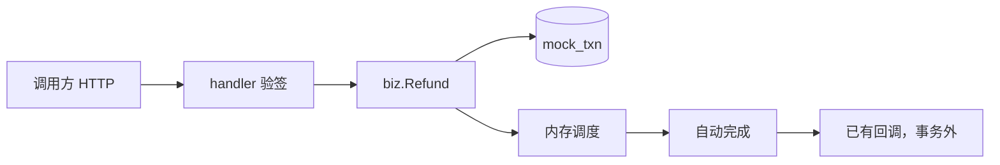
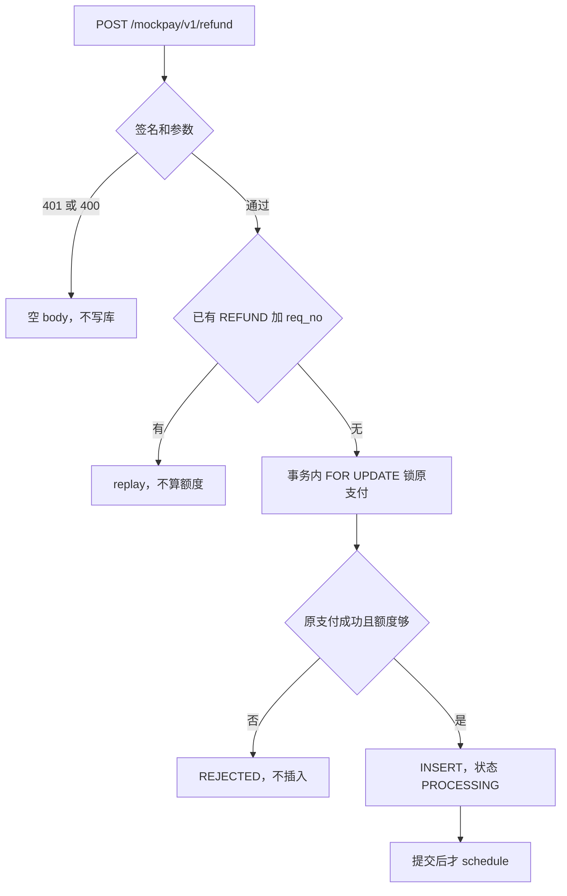

# CH-04 渠道退款受理

| 项 | 内容 |
|---|---|
| 功能点 | CH-04（P0，第 4 周） |
| 所属链路 | 支付（这是模拟渠道 channel-mock 的退款受理，不是平台退款单） |
| 代码提交 | `6d6f00b` `[CH-04] add mock channel refund`（完整 `6d6f00b879b0e5ebc57c8dde761c537538af1df0`，2026-11-03 08:37:59 +0800） |
| 分支 | `feat/CH-04-refund` |
| 日期 | 2026-11-03 |
| 状态 | DONE |

这次代码提交 16 个文件，952 行新增，49 行删除。本报告不在这 16 个文件里。

## 一句话结论

模拟渠道新增 `POST /mockpay/v1/refund`。同一退款请求号先返回已有结果，不再做额度校验。新单在一个事务里用 `FOR UPDATE` 锁住原支付行，再合计状态不是 `FAILED` 的退款；超额或原支付不是 `SUCCESS` 时拒绝且不插入。新插入成功后在事务外排自动完成。本次 `service/channel_mock/biz` 语句覆盖率 91.7%，不低于 70%。

## 1. 背景

这次只做模拟渠道自己的退款受理。平台退款单、商户余额和网关退款路由都还没有。

### 1.1 系统简介

pay-system 是一个用 Go 编写的小型支付后端，模拟商户收款、退款、商户间转账三条资金链路，重点在数据一致性和性能。系统由 5 个部分组成：gateway（对外 HTTP 入口，负责签名校验和限流）、payment（支付单、退款单、转账单的状态管理和流程推进）、account（账户余额与记账，数据按商户分到 2 个数据库分片）、channel-mock（模拟微信、支付宝这类外部支付渠道）、recon（对账，核对系统内外数据是否一致）。服务之间用 Kitex RPC 同步调用，或通过 Kafka 消息异步通知；数据存在 MySQL 8.4，Redis 用于防重放。所有金额用整数“分”表示，所有记账只追加不修改。

下文编号里，CH 是模拟渠道，PAY 是支付单，REF 是平台退款，TRF 是转账，GW 是网关，ACC 是账户。`txn_type` 是交易类型，支付为 `PAY`，退款为 `REFUND`。CH-06 的场景由金额末两位决定，受理时写进行里，之后不改。SLOW 表示完成后第一次回调再等 30 秒。ACCEPT_TIMEOUT 表示新插入成功的那一次支付受理要等到创建时间之后 5 秒才返回。10003 是已有的平台内部错误，对外文案是 `internal error`。payment 收到渠道回调时，`txn_type` 不是 `PAY` 就返回这个码，网关因此不会把退款回调推进成平台退款成功。outbox 是和业务写在同一事务里、提交后再发出的消息记录。IDL 是接口定义。pprof 是 Go 自带的性能剖析接口。paycli 是已经写好的命令行，这次没有用它调退款或转账。

当前已完成：工程骨架、本地环境、迁移与种子、金额、ID、错误码、时钟、配置、日志、数据库访问、集成测试基座、IDL、签名、密钥加密、故障注入点；账户分片、开户、查询、记账、冻结、解冻、确认扣款、同分片转账、收款方分支、余额核对、account RPC；商户费率；payment 的创建支付单、发起支付、结果推进、关单、查询；outbox 写入；模拟渠道的支付受理与自动完成、查单、关单、异步回调，以及 CH-06 已实现的场景（含 SLOW 首次回调在完成时间后 30 秒、ACCEPT_TIMEOUT 只挡住新插入成功的那一次受理 5 秒）；网关骨架、商户验签、支付与余额路由、渠道回调入口（PAY 已转到结果推进；`txn_type` 不是 PAY 时仍返回已有的 10003）；健康检查、pprof、paycli。本次是渠道侧退款受理。

仍未做：平台退款单（从 REF-01 起）、转账主链路、账单 CSV（CH-08）、网关的退款与转账路由（GW-09）、查单补偿（PAY-05）、超时关单（PAY-07）。第 4 周交付段落（A4、退款与转账主链路、TRF-03 并发、payment 覆盖率门槛的那次交付演示）这次没有跑。`BILL_MISSING` / `BILL_AMOUNT_DIFF` 的 CSV 仍是 CH-08。paycli 这个命令行已经有了，这次没有用它跑过退款或转账。

### 1.2 本功能点在系统中的位置

退款请求停在 channel-mock 的表 `mock_txn`。它不写账户余额，也不创建 payment 里的平台退款单。



上游是带着渠道签名的 HTTP 调用方，目前是测试。以后平台退款（REF-02）才会用 `req_no = refund_no`、`orig_req_no = pay_no` 来调这个地址。下游是本库的一行支付和若干行退款。查单仍走已经有的 `POST /mockpay/v1/query`，`txn_type` 填 `REFUND`。关单代码这次没改，仍然只处理支付行。

### 1.3 为什么需要它

原支付 10000 分（100.00 元）已经成功。两个调用方用不同的退款请求号，各退 10000 分。如果各自先查“还没退过”，再各自插入，两笔都会通过，同一笔支付被退两次，合计 20000 分（200.00 元）。

另一条错法出在重复提交。第一笔全额退款已经插入。同一请求号再提交 10000 分时，如果先把已有退款加进合计，这笔自己占掉的 10000 分会再被算一次，合计变成 20000 分，被误拒成超额。调用方重试必须拿到第一次的渠道流水号。

## 2. 术语

| 术语 | 含义 |
|---|---|
| 渠道 / channel-mock | 模拟外部支付机构的进程。平台不能直接改它的表，只能发 HTTP |
| 平台退款单 | payment 里的退款单据，负责冻结商户余额并推进状态。本次不建这张单 |
| 分 | 金额单位。1 元 = 100 分。10000 分是 100.00 元。类型是 `money.Amount`，底层 `int64`，不用浮点数 |
| 分片 | 账户按商户拆到 2 个 MySQL 库。本次退款不访问账户库 |
| 分录 | 账户记账追加的一条借贷。规则是只追加、不修改旧行。本次不写分录 |
| gateway | 商户和渠道回调进入平台的 HTTP 入口 |
| payment | 管支付单、退款单、转账单的服务 |
| account | 管余额和记账的服务 |
| recon | 对账服务。本次不生成对账文件 |
| Kitex | 服务之间的 RPC 框架。本次退款受理不发 RPC |
| Kafka | 异步消息。本次不发消息 |
| Redis | 用来挡住过期重放的请求。本次退款受理不用它 |
| outbox | 和业务写在同一个数据库事务里的待投递记录，提交后再发给 Kafka。本次不写 outbox |
| `mock_txn` | 渠道交易表。一行是一笔支付或一笔退款 |
| `txn_type` | 交易类型。支付是 `PAY`，退款是 `REFUND`。幂等键是这对类型加请求号，不是请求号单独一个 |
| `req_no` | 调用方给渠道的请求号。退款用它做幂等。长度 1 到 32 个字符 |
| `orig_req_no` | 退款指向的原支付请求号。支付行这一列是 SQL `NULL` |
| `channel_txn_no` | 渠道流水号。已有发号器按前缀 `MC` 生成。拒绝时响应里不带它 |
| 状态 | `PROCESSING` 处理中，`SUCCESS` 成功，`FAILED` 失败，`CLOSED` 已关闭。新退款插入时是处理中 |
| 幂等 | 同一个退款请求号再来，返回第一次的结果，不插第二行 |
| `replay` | 按已有行回答。已关闭优先于金额；金额不同拒绝；金额相同带回已有流水号和当前状态。不改行，不算额度 |
| 额度 | 这笔原支付上，状态不是 `FAILED` 的退款金额合计。加上本次金额后不能大于原支付金额 |
| `FOR UPDATE` | `SELECT` 时给查到的行加锁，别的事务要锁或改这一行就等到本次事务结束 |
| 事务 | 一组 SQL 一起提交或一起回滚。本项目用 `dbx.WithTx`：回调返回 `nil` 就提交，返回错误才回滚 |
| 1062 | MySQL 唯一键冲突的错误号。`dbx.IsDuplicate` 认得它 |
| `uk_type_req_no` | `mock_txn` 上 `(txn_type, req_no)` 的唯一索引。同一类型不能有两个相同请求号 |
| 场景 | 受理时按金额末两位写入的固定行为名，例如 `FAIL`、`DROP_NOTIFY`、`NORMAL`。支付的映射这次没改 |
| `bill_date` | 计入当日账单的日期，等于完成时间 `finished_at` 的东八区日期。本次只断言这一列，不生成 CSV |
| 东八区 | 固定偏移 `+08:00`，不读操作系统的时区库。账单日和完成时间用它对齐，避免跨天 |
| CAS | 比较之后再更新：`UPDATE … WHERE id = ? AND status = 'PROCESSING'`。状态已经变了就改不到。自动完成用它，退款插入本身不是 CAS |
| 调度 | 进程内存里的定时任务，到点把处理中的行推进到终态。进程退出就丢。事务里面不排它，也不发 HTTP |
| 渠道签名 | 用共享密钥对“时间戳、换行、原始 body”做 HMAC。验签失败是 HTTP 401。只有 HTTP 200 的响应签名 |
| 渠道原因字符串 | body 里的 `reason`，不是平台数字错误码。本次新的两个是 `ORIG_NOT_SUCCESS`、`REFUND_EXCEEDED` |
| `PARAM_CONFLICT` | 已有原因：同一请求号金额和第一次不一样 |
| `ORDER_CLOSED` | 已有原因：已有行的状态是 `CLOSED`。关单仍只查支付，不会把退款行改成关闭 |
| idgen | 已有发号器。退款在确认没有旧行之后调用它，前缀 `MC` |
| 注入时钟 | 业务时间来自传入的时钟，测试可以拨动。不用 `time.Now()` 决定 `created_at` |
| 回调 | 交易进入成功或失败后，向 `notify_url` 发的 HTTP。在自动完成提交之后，不在退款插入的事务里 |
| goroutine | Go 的并发执行单元。并发测试用两个 goroutine 同时退同一笔 |
| paycli | 已有的命令行客户端。这次没有用它调用退款或转账 |
| CSV | 逗号分隔的账单文件。下载账单是 CH-08，本次不生成 |
| pprof | Go 的性能剖析接口。健康检查和它都已经有了，和退款无关 |
| IDL | 接口定义。本次不改，所以没有重新生成代码 |

## 3. 技术讲解

### 3.1 要解决的问题

一笔渠道退款要同时满足下面几条。金额都是整数分。

1. 原支付必须已经成功。不存在、处理中、失败、已关闭都拒绝，原因 `ORIG_NOT_SUCCESS`，并且不插入退款行。否则一笔没收到的钱会被退掉。
2. 同一原支付下，状态不是 `FAILED` 的退款合计，加上本次金额，不能大于原支付金额。大于则 `REFUND_EXCEEDED`，不插入。相等允许。处理中、成功、已关闭都占额度，因为钱还占着或已经退成；只有失败不占，失败的那笔可以换请求号再退。
3. 同一个 `(REFUND, req_no)` 再来，直接返回已有结果，不再做第 2 条。否则全额退款重试会把自己算进合计。金额和第一次不同，返回 `PARAM_CONFLICT`，不改旧行。
4. 两个不同请求号同时各退满原支付时，只能有一笔插入。锁必须打在原支付行上，不能各查各的。
5. 拒绝发生在插入之前，库里没有退款行。插入一旦提交，行已经是处理中；这次 HTTP 超时也不能把已插入的行改成失败。
6. 退款场景只保留末两位 01 的失败和 02 的不回调。04、05、08 如果照支付的场景走，会分别变成慢回调、受理堵 5 秒、永远不完成。退款把它们收成普通完成。
7. 成功后的“进入当日账单”只要求行是退款、状态成功、`bill_date` 等于完成时间的东八区日期。不生成 CSV。

上面第 1 到第 4 条要一起成立：不超退，重复请求不插第二行，并发全额只插一行。做法是先按退款请求号返回已有结果，新单再在同一事务里锁原支付。平台数字错误码没有新增。

### 3.2 方案

先按退款请求号读已有行；没有行时，在一个事务里锁住原支付、合计未失败退款、通过才插入；提交成功后再排一个自动完成任务。事务里不发 HTTP。



图里的拒绝都发生在插入之前。`schedule` 在事务外面。退款不会走到支付那条“受理堵住 5 秒”的等待。

请求体只有四个字段：`req_no`、`orig_req_no`、`amount`、`notify_url`。没有商品说明 `subject`。金额是 int64 分，最小 1 分（0.01 元）。`req_no` 和 `orig_req_no` 必须非空、是合法 UTF-8、不含替换字符 U+FFFD、不超过 32 个字符。`notify_url` 必须是 http 或 https 的绝对地址，不超过 512 个字符。解析沿用支付受理那套：body 要是合法 UTF-8 的单个 JSON 对象，顶层键不能重复，已知字段的大小写写错算非法，未知字段忽略。非法参数返回已有的 `ErrInvalidRequest`，HTTP 400，body 空、不签名、不写库。坏签名仍是 HTTP 401，同样空 body、不签名、不写库。业务拒绝是 HTTP 200，body 是带渠道签名的 JSON，`result` 为 `REJECTED`。`channel_txn_no` 为空时被省略。`status` 这个 JSON 键一直在；新拒绝没有已有行，值是空串。重复请求如果命中已关闭或金额冲突，`status` 是已有行的当前状态。

下面这段先做幂等。已有行立刻 `replay`，后面的锁和合计都不会跑。

```25:36:service/channel_mock/biz/refund.go
func (s *Service) Refund(ctx context.Context, req RefundRequest) (PayResult, error) {
	if err := ctx.Err(); err != nil {
		return PayResult{}, err
	}
	if err := validateRefund(req); err != nil {
		return PayResult{}, err
	}
	if existing, ok, err := s.store.Get(ctx, dal.TxnTypeRefund, req.ReqNo); err != nil {
		return PayResult{}, err
	} else if ok {
		return replay(existing, req.Amount), nil
	}
```

没有行时，发号器发 `MC` 前缀的 `channel_txn_no`。`created_at` 取注入时钟，先截到毫秒再换到东八区。场景用 `scenario.ForRefund`。然后进入 `InsertRefund`。锁内的回调决定拒绝还是插入：原支付没找到或状态不是成功，返回 `ORIG_NOT_SUCCESS`；未失败合计加本次大于原金额，返回 `REFUND_EXCEEDED`；否则返回空串，表示可以插入。

```52:72:service/channel_mock/biz/refund.go
	id, reject, err := s.store.InsertRefund(ctx, t, func(pay dal.Txn, found bool, activeSum money.Amount) string {
		if !found || pay.Status != dal.StatusSuccess {
			return ReasonOrigNotSuccess
		}
		if activeSum+req.Amount > pay.Amount {
			return ReasonRefundExceeded
		}
		return ""
	})
	if err != nil {
		if dbx.IsDuplicate(err) {
			return s.recoverInsert(ctx, t, err)
		}
		return s.recoverInsert(ctx, t, err)
	}
	if reject != "" {
		return PayResult{Result: ResultRejected, Reason: reject}, nil
	}
	t.ID = id
	s.schedule(ctx, t)
	return PayResult{Result: ResultOK, ChannelTxnNo: no, Status: dal.StatusProcessing}, nil
```

两个 `err` 分支都调用 `recoverInsert`，写了两遍，行为相同。拒绝时只填 `result` 和 `reason`，不带流水号。插入成功后才 `schedule`。退款场景不会是 `ACCEPT_TIMEOUT`，所以这里不调用 `holdAccept`。`holdAccept` 是支付受理里“新插入成功后再等 5 秒”的函数，这次没改它的条件。

`InsertRefund` 用 `dbx.WithTx` 开事务。先锁原支付，再合计。`COALESCE(SUM(amount), 0)` 在没有退款行时得到 0，不会得到 SQL `NULL`。条件是 `txn_type = REFUND`、`orig_req_no` 等于这笔原支付、`status <> 'FAILED'`。

```304:322:service/channel_mock/dal/txn.go
	err := dbx.WithTx(ctx, d.db, func(tx *sqlx.Tx) error {
		var row txnRow
		qerr := tx.GetContext(ctx, &row, `SELECT `+txnColumns+` FROM mock_txn WHERE txn_type = ? AND req_no = ? FOR UPDATE`, TxnTypePay, t.OrigReqNo)
		found := true
		if errors.Is(qerr, sql.ErrNoRows) {
			found = false
		} else if qerr != nil {
			return fmt.Errorf("lock pay: %w", qerr)
		}
		var sum int64
		if found {
			if serr := tx.GetContext(ctx, &sum, `SELECT COALESCE(SUM(amount), 0) FROM mock_txn WHERE txn_type = ? AND orig_req_no = ? AND status <> ?`, TxnTypeRefund, t.OrigReqNo, StatusFailed); serr != nil {
				return fmt.Errorf("sum refunds: %w", serr)
			}
		}
		reject = look(row.txn(), found, money.Amount(sum))
		if reject != "" {
			return nil
		}
```

锁的是 `txn_type = PAY` 且 `req_no = orig_req_no` 的那一行，不是退款行。回调返回非空时，上面的 `return nil` 让事务提交，但后面的 `INSERT` 不会执行。没有支付行时也不做合计，回调看到 `found = false`，同样拒绝。通过之后的 `INSERT` 写 `txn_type = REFUND`、状态 `PROCESSING`、`orig_req_no` 和注入时钟的 `created_at`。

支付插入仍走原来的 `Insert`。`OrigReqNo` 为空时参数是 `nil`，MySQL 写入 `NULL`。支付受理不填这个字段，所以支付行的 `orig_req_no` 仍是 `NULL`。

```122:130:service/channel_mock/dal/txn.go
func (d *DB) Insert(ctx context.Context, t Txn) (uint64, error) {
	var orig any
	if t.OrigReqNo != "" {
		orig = t.OrigReqNo
	}
	res, err := d.db.ExecContext(ctx, `
INSERT INTO mock_txn (channel_txn_no, txn_type, req_no, orig_req_no, amount, status, scenario, notify_url, created_at)
VALUES (?, ?, ?, ?, ?, ?, ?, ?, ?)`,
		t.ChannelTxnNo, t.TxnType, t.ReqNo, orig, int64(t.Amount), t.Status, t.Scenario, t.NotifyURL, t.CreatedAt)
```

`orig_req_no` 列本来就在 `migrations/channel_mock/000001_init.up.sql`。这次不改迁移文件，也不执行迁移。

插入如果报错，包括 1062 和其他错误，都进 `recoverInsert`。它按本次的 `(txn_type, req_no)` 再读，不再写死 `PAY`。支付受理仍把自己的类型设成 `PAY`，所以支付那条路的再读对象没变。再读使用不随请求取消的上下文，上限 1 秒。只有读到的流水号等于本次生成的流水号，才按这次写入处理；行仍是 `PROCESSING` 时才在事务外 `schedule`。然后 `replay`，不再算额度。读不到、读失败，或行是别人的流水号，把原来的插入错误返回出去，HTTP 500，不猜成功。

```189:199:service/channel_mock/biz/pay.go
func (s *Service) recoverInsert(ctx context.Context, t dal.Txn, insertErr error) (PayResult, error) {
	readCtx, cancel := context.WithTimeout(context.WithoutCancel(ctx), rereadTimeout)
	defer cancel()
	row, ok, err := s.store.Get(readCtx, t.TxnType, t.ReqNo)
	if err != nil || !ok || row.ChannelTxnNo != t.ChannelTxnNo {
		return PayResult{}, insertErr
	}
	if row.Status == dal.StatusProcessing {
		s.schedule(ctx, row)
	}
	return replay(row, t.Amount), nil
```

不同请求号不会撞上同一条唯一键。并发全额时，后拿到锁的那笔是额度拒绝，不是 1062。同一个请求号如果两笔都通过了开头的 `Get`、又同时插入，唯一索引会让后一笔得到 1062。后一笔的流水号和已经插入的那笔不同，`recoverInsert` 不会把它当成已有结果，而是返回插入错误。再提交一次同一请求号，开头的 `Get` 会 `replay`。这次没有为“同一请求号并发插入”单列测试。

`ForRefund` 先调用一次 `ForPay`，只留下 `FAIL` 和 `DROP_NOTIFY`，其余一律 `NORMAL`。`ForPay` 本身没有改。末两位 01 仍是失败，02 仍是成功但不发回调。04 在支付里是 SLOW，05 是 ACCEPT_TIMEOUT，08 是 NEVER_FINISH；退款这三档都是 `NORMAL`。测试里的 01、02、04、05、08 各排 1 个任务：只有 `NEVER_FINISH` 不调度，而这五档都不是它。`FAIL` 会完成成 `FAILED`。`DROP_NOTIFY` 会完成成 `SUCCESS`，但不发 HTTP。另外三档按 `NORMAL` 完成成 `SUCCESS`。

```42:51:service/channel_mock/scenario/scenario.go
// ForRefund 只保留 FAIL 与 DROP_NOTIFY。其余末两位，包括 SLOW、ACCEPT_TIMEOUT、NEVER_FINISH，都是 NORMAL。
func ForRefund(amount int64) Scenario {
	s := ForPay(amount)
	switch s {
	case Fail, DropNotify:
		return s
	default:
		return Normal
	}
}
```

自动完成沿用已有规则：延迟是 `created_at` 加上由请求号算出的毫秒数。算法是 CRC-32，一种把字节算成整数的校验和，同一请求号每次得到同一个延迟。默认区间是 200 到 1999 毫秒。到期后用 CAS 把 `PROCESSING` 推进。`FAIL` 写成 `FAILED`，写 `finished_at`，不写 `bill_date`。`NORMAL` 和 `DROP_NOTIFY` 写成 `SUCCESS`，`bill_date` 是 `finished_at` 的东八区日期。完成提交之后才走已有回调。`DROP_NOTIFY` 不发 HTTP。`FAIL` 的回调 body 里 `status` 是 `FAILED`。这些完成和回调代码这次没有改规则，退款只是插入时写成会进入它们的场景名。

HTTP 层把退款挂在 `POST /mockpay/v1/refund`。进入业务前的超时是已有的 `requestTimeout`，3 秒。支付受理是另一常数，8 秒，因为支付的 ACCEPT_TIMEOUT 要等 5 秒。退款不走 8 秒。

```160:171:service/channel_mock/handler/pay.go
// serveRefund 处理一次退款受理并返回 HTTP 状态码。超时是 requestTimeout，不是受理的 8 秒。
func (h *Handler) serveRefund(ctx context.Context, c *app.RequestContext) int {
	body := c.Request.Body()
	if status := h.verify(ctx, c, body); status != http.StatusOK {
		return bare(c, status)
	}
	in, ok := decodeRefund(body)
	if !ok {
		return bare(c, http.StatusBadRequest)
	}
	callCtx, cancel := context.WithTimeout(ctx, requestTimeout)
	defer cancel()
```

单元测试的存储没有 MySQL。它用一把互斥锁包住查找原支付、合计和插入，和数据库那把行锁起同样的串行作用。拒绝时不调用插入。

```100:124:service/channel_mock/biz/fakes_test.go
func (m *memStore) InsertRefund(_ context.Context, t dal.Txn, look dal.RefundLook) (uint64, string, error) {
	m.mu.Lock()
	defer m.mu.Unlock()
	if m.insertErr != nil {
		return 0, "", m.insertErr
	}
	pay, found := m.rows[key(dal.TxnTypePay, t.OrigReqNo)]
	var payCopy dal.Txn
	if found {
		payCopy = *pay
	}
	var sum money.Amount
	if found {
		for _, r := range m.rows {
			if r.TxnType == dal.TxnTypeRefund && r.OrigReqNo == t.OrigReqNo && r.Status != dal.StatusFailed {
				sum += r.Amount
			}
		}
	}
	if reject := look(payCopy, found, sum); reject != "" {
		return 0, reject, nil
	}
	id, err := m.insertLocked(t)
	return id, "", err
}
```

关单仍然只按 `(PAY, req_no)` 查找。同号的退款行不关闭，也不当成那笔支付已经存在。这次没有改关单函数。

具体并发：原支付 10000 分（100.00 元），状态 `SUCCESS`。两个 goroutine 用 `refund-race-a` 和 `refund-race-b`，各退 10000 分。先拿到原支付行锁的那笔，在锁里看到合计 0，插入一行 10000 分的 `PROCESSING` 退款，然后提交并放锁。另一笔一直等到这把锁。它在锁内合计，看到已经有 10000 分，10000 + 10000 大于 10000，返回 `REFUND_EXCEEDED`，不插入。库里只有一笔退款。

具体幂等：第一笔全额退款已经插入，流水号是发号器给的那个 `MC` 号。同一 `req_no` 再提交 10000 分（100.00 元）。开头的 `Get(REFUND, req_no)` 找到这行，`replay` 返回同一个 `channel_txn_no`，状态仍是这行当前状态。如果这时再做额度校验，合计会把这 10000 分算进去，再加上本次 10000 分，变成 `REFUND_EXCEEDED`。所以必须先查，再决定要不要校验额度。

部分退款的数字：原支付 10000 分。先退 6000 分（60.00 元）得到 `OK`。再退 5000 分（50.00 元），合计 11000 分，第二笔 `REFUND_EXCEEDED`，库里只有第一笔。另一笔原支付同样 10000 分，先退 6000 分再退 4000 分（40.00 元），合计正好 10000，两笔都 `OK`。比较用的是大于，不是大于等于，所以相等允许。

### 3.3 为什么这样做

锁打在原支付行上，是因为两笔退款没有共同的退款主键。不锁支付行，两笔可以同时读到合计 0。

| 方案 | 做法 | 优点 | 缺点 | 结论 |
|---|---|---|---|---|
| 采用：先按 `(REFUND, req_no)` 返回已有结果；新单在同一事务里 `FOR UPDATE` 锁原支付，再合计状态不是 `FAILED` 的退款 | 重复请求不进额度。新单串行看同一行支付 | 全额重试拿回原流水号；并发全额只有一笔插入 | 退款插入要等原支付行的锁 | 采用 |
| 备选：不锁原支付，两笔各自先查合计再插入 | 读到合计 0 就插入 | 少一次行锁 | 两笔 10000 分的全额都会通过，合计 20000 分（200.00 元） | 不采用 |
| 备选：已有 `req_no` 也再算额度 | 每次都把未失败退款加起来 | 看起来每次都检查超额 | 全额退款再提交时，合计把自己算进去，变成 `REFUND_EXCEEDED` | 不采用 |
| 备选：退款沿用支付的全部末两位 | 04 仍是慢回调，05 仍堵 5 秒，08 仍不完成 | 和支付共用一张场景表 | 退款受理被 5 秒挡住，或成功后退款永远停在处理中 | 不采用。只保留 01 和 02 |

### 3.4 正确性

重复请求不插第二行；并发全额只插一行；拒绝不留退款行；超时不把已插入的行改成失败。崩溃后再调度只覆盖支付，不覆盖这次新插入的退款。

| 场景 | 系统行为 | 最终状态 | 证明 |
|---|---|---|---|
| 同一请求重复到达 | 第一笔全额插入。同一 `req_no` 再提交相同金额：`Get` 命中，`replay` 返回同一个 `channel_txn_no`，不算额度。金额改成另一个数：`PARAM_CONFLICT`，不改行 | 仍然只有原来那一行退款 | `TestRefundIdempotentSkipsQuota`、`TestRefundIdempotentMySQL`、`TestRefundAmountConflict` |
| 两个冲突请求并发 | 原支付 10000 分（100.00 元）。两个 goroutine、两个请求号、各退 10000 分。先拿到原支付锁的插入；后拿到锁的看到合计已经 10000，拒绝且不插入 | 恰好一笔 `OK`，一笔 `REFUND_EXCEEDED`，库里一笔退款 | `TestRefundConcurrentFullAmount`（内存锁）。没有同名的 MySQL 双请求测试 |
| 拒绝发生在插入之前进程就停 | 回调返回拒绝原因后事务函数返回 `nil`，提交的是没有 `INSERT` 的事务 | 没有退款行 | `TestRefundRejectsOrigNotSuccess`、`TestRefundQuota`、`TestRefundRejectMySQL` 都断言拒绝后行数。没有单独的“拒绝途中杀进程”测试 |
| 插入提交之后、`schedule` 之前进程退出 | 行已经是 `PROCESSING`。内存任务丢失。已有启动扫描 `Recover` 只列出 `txn_type = PAY` 且处理中的行，不列退款。本次没有新增崩溃恢复任务，也没有改 `Recover` | 退款停在 `PROCESSING`，启动扫描不会把它重新排上 | 没有“提交后杀进程再启动”的测试。依据是 `Recover` 的查询类型写死为 `PAY` |
| 受理上下文超时 | 这是渠道自己受理，不是平台去调外部系统。退款 HTTP 上下文上限 3 秒。超时不把已插入的退款改成 `FAILED`。若插入已提交，行保持处理中；调用方应再查，不能把超时当成退款失败 | 已插入的行不会因为这次超时被写成失败 | `TestRefundContextUsesThreeSecondLimit` 只证明上限是 3 秒而不是 8 秒。上下文取消、发号失败、`Get` 失败没有单独的测试数字 |

原支付不存在、处理中、失败、已关闭，退款金额取测试里的 100 分（1.00 元），都是 `ORIG_NOT_SUCCESS`，退款行数是 0。末两位 10001 分（100.01 元）完成后 `bill_date` 为空，回调 body 的 `status` 是 `FAILED`，`notify_sent_count` 为 1。10002 分（100.02 元）完成后有 `bill_date`，HTTP 0 次。普通成功退款查 `Query(REFUND, req_no)` 能查到；用同一个 `req_no` 去 `Query(PAY, …)` 不存在，因为类型不同，键不同。

### 3.5 性能

不涉及。这次没有压测数字，也没有开关对比。第 4 周交付段落这次没有跑。

## 4. 已完成内容

### 4.1 改动清单

| 文件 | 新增 / 修改 | 作用 |
|---|---|---|
| `service/channel_mock/biz/refund.go` | 新增 | `Refund`：先查已有退款，再在锁内判断原支付和额度 |
| `service/channel_mock/biz/refund_test.go` | 新增 | 未成功、额度、幂等、金额冲突、场景折叠、并发全额 |
| `service/channel_mock/biz/refund_integration_test.go` | 新增 | MySQL 上的拒绝、幂等、账单日、失败与不回调 |
| `service/channel_mock/biz/pay.go` | 修改 | 增加两个原因字符串和 `Store.InsertRefund`。`recoverInsert` 按本次 `txn_type` 再读。支付受理仍传入 `PAY` |
| `service/channel_mock/biz/fakes_test.go` | 修改 | 内存假实现在同一把互斥锁里查找、合计、插入 |
| `service/channel_mock/dal/txn.go` | 修改 | 读出 `orig_req_no`。支付插入空值写 `NULL`。新增 `InsertRefund` |
| `service/channel_mock/handler/pay.go` | 修改 | 路由 `POST /mockpay/v1/refund`，超时 3 秒 |
| `service/channel_mock/handler/pay_test.go` | 修改 | 断言退款上下文按 3 秒上限 |
| `service/channel_mock/handler/refund_integration_test.go` | 新增 | 签名正确的退款 POST 返回 200，行保持处理中 |
| `service/channel_mock/scenario/scenario.go` | 修改 | 新增 `ForRefund`。`ForPay` 未改 |
| `docs/02-requirements.md` | 修改 | CH-04 标为完成，补上先返回已有结果和锁原支付 |
| `docs/04-dev-plan.md` | 修改 | 只勾第 4 周里同时写着 CH-06 其余场景和 CH-04 的那一行 |
| `docs/05-api.md` | 修改 | §9.5 写明重复请求号先返回已有结果，额度与插入在同一事务 |
| `docs/06-flows.md` | 修改 | 再读改为按本次类型和请求号；图下注明锁原支付。不新画 SVG |
| `docs/database.md` | 修改 | 查询说明补上 `FOR UPDATE` 和合计。未执行迁移 |
| `docs/interview-notes.md` | 修改 | 记下锁必须在原支付行，以及同一请求号不能再算额度 |

### 4.2 对外变化

| 类别 | 变化 |
|---|---|
| 接口 | 新增 `POST /mockpay/v1/refund`。查询仍是 `POST /mockpay/v1/query`，`txn_type` 为 `REFUND`。不新增字段，不改 IDL |
| 表结构 | 无。不新增迁移。`orig_req_no` 列原来就在。支付插入仍写 `NULL`。退款插入写入原支付请求号 |
| 配置项 | 无。自动完成延迟默认值没改 |
| 错误码 | 无新的平台错误码。渠道原因字符串新增 `ORIG_NOT_SUCCESS`、`REFUND_EXCEEDED`。`PARAM_CONFLICT` 和 `ORDER_CLOSED` 是原有字符串。流水号前缀仍是 `MC` |
| 指标 / 故障点 | 无 |

`make gen` 未运行。`mmdc` 未运行，没有新 SVG。

### 4.3 验收对照

下面每一行的结果都是通过。`make test` 和 `make test-integration` 的退出码都是 0。

| 验收条目 | 测试函数 | 类型 | 结果 |
|---|---|---|---|
| 原支付不存在、`PROCESSING`、`FAILED`、`CLOSED` 都是 `ORIG_NOT_SUCCESS`，且不插入退款行 | `TestRefundRejectsOrigNotSuccess` | 单元 | 通过 |
| 10000 分（100.00 元）成功后先退 6000 分（60.00 元）再退 5000 分（50.00 元），第二笔 `REFUND_EXCEEDED`，只有第一笔；另一笔原支付 6000 分加 4000 分（40.00 元）都 `OK` | `TestRefundQuota` | 单元 | 通过 |
| 全额后再用同一 `req_no` 提交，返回同一个 `channel_txn_no`，不是 `REFUND_EXCEEDED` | `TestRefundIdempotentSkipsQuota` | 单元 | 通过 |
| 同一 `req_no` 金额不一致是 `PARAM_CONFLICT` | `TestRefundAmountConflict` | 单元 | 通过 |
| 末两位 01 是 `FAIL`、02 是 `DROP_NOTIFY`，04、05、08 都是 `NORMAL`，且各排 1 个调度任务 | `TestRefundScenarioCollapses` | 单元 | 通过 |
| 两个 goroutine 不同 `req_no` 同时全额退，恰好一笔 `OK`、一笔 `REFUND_EXCEEDED` | `TestRefundConcurrentFullAmount` | 单元 | 通过 |
| MySQL：未成功与超额都拒绝且不插入 | `TestRefundRejectMySQL` | 集成 | 通过 |
| MySQL：全额后再提交返回已有流水号 | `TestRefundIdempotentMySQL` | 集成 | 通过 |
| MySQL：`NORMAL` 完成后 `txn_type` 为 `REFUND`、状态 `SUCCESS`、`bill_date` 等于 `finished_at` 的东八区日期；`Query(REFUND)` 查到，`Query(PAY, 同一个 req_no)` 不存在 | `TestRefundBillDateMySQL` | 集成 | 通过 |
| MySQL：`FAIL` 完成后 `bill_date` 为空，回调 body 的 `status` 是 `FAILED`，`notify_sent_count` 为 1；`DROP_NOTIFY` 有 `bill_date` 且 HTTP 0 次 | `TestRefundFailAndDropMySQL` | 集成 | 通过 |
| 签名正确的退款 POST 返回 HTTP 200，`result` 是 `OK`，行是 `REFUND` 且 `PROCESSING`（延迟被钉成 60000 毫秒，所以这次请求里不会自动完成） | `TestRefundHTTPMySQL` | 集成 | 通过 |
| 退款 HTTP 上下文剩余时间按 3 秒上限，不是 8 秒 | `TestRefundContextUsesThreeSecondLimit` | 单元 | 通过 |

### 4.4 验证记录

2026-11-03，日志 `/tmp/ch04-verify.log`，08:34:36 +0800 到 08:36:53 +0800。

环境：go1.27.2 darwin/arm64；golangci-lint 2.14.0，built with go1.27.1 from 114493f on 2026-09-24T10:54:53Z。全部退出码 0。

| 命令 | 结果 |
|---|---|
| `gofmt -l .` | 无输出。real 0.08s，user 0.31s，sys 0.06s |
| `make lint` | `0 issues.` real 3.20s，user 6.61s，sys 10.23s |
| `make test` | real 9.14s，user 10.34s，sys 8.47s。根包 8.269s；`service/channel_mock/biz` 1.690s；handler 1.617s；scenario 1.457s；`cmd/channel-mock` 1.561s；payment biz 为 cached |
| `make test-integration` | real 62.77s，user 22.21s，sys 14.67s。根包 58.526s；channel_mock biz 26.170s；dal 19.100s；handler 19.144s；scenario 1.464s；payment biz 58.377s |
| `make cover` | real 62.15s，user 24.85s，sys 19.98s。total 31.2%（含 kitex_gen，不是门槛）。`service/channel_mock/biz` 22.956s / 91.7%（门槛内，不低于 70%）。dal 16.433s / 45.4%（dal 不在 70% 门槛里）。handler 16.486s / 93.3%（不在门槛里）。scenario 1.459s / 75.0%。payment biz 56.301s / 86.1%。gateway cached 76.2%（不在门槛里） |

同一次 `make cover` 的函数表：`Refund` 74.1%，`validateRefund` 33.3%，`recoverInsert` 100.0%，`Pay` 95.7%，`holdAccept` 81.8%，`Query` 100.0%，`Handle` 100.0%，`shouldNotify` 100.0%，`again` 100.0%，`scheduleAttempt` 100.0%，`servePay` 100.0%，`handleRefund` 100.0%，`decodeRefund` 100.0%，`serveRefund` 66.7%。

`InsertRefund` 在函数表里是 0.0%，`ForRefund` 也是 0.0%。原因：`go test -coverprofile` 只统计当前被测包自己的测试。MySQL 退款测试在 `service/channel_mock/biz`，调用的是 `dal.InsertRefund`；场景折叠的单元测试也在 biz，调用的是 `scenario.ForRefund`。这些测试随 `make test` 和 `make test-integration` 退出码 0 跑过，但不会加进 dal 包或 scenario 包自己的函数百分比。

`make gen` 未运行。`mmdc` 未运行，没有新 SVG。

### 4.5 同步的文档

这些文件已经在代码提交 `6d6f00b` 里。本报告只描述它们，不再改它们。

- `docs/02-requirements.md`：版本仍是 v3.0。§3 CH-04 改为 DONE。三条验收已勾。补了一句：先按 `(REFUND, req_no)` 返回已有结果；新单在同一事务里 `FOR UPDATE` 锁原支付，再合计 status 不是 `FAILED` 的退款。场景只有 01 `FAIL` 和 02 `DROP_NOTIFY`，其余 `NORMAL`。当日账单只断言 `bill_date`，CSV 仍是 CH-08。§8.2 有 2026-11-03 一行。更早的变更记录没有改写。
- `docs/04-dev-plan.md`：只勾了第 4 周里同时写着 CH-06 其余场景和 CH-04 的那一行。REF-01、PAY-05、PAY-07、TRF、GW-09 仍未勾。交付段落没有改成已完成。
- `docs/05-api.md`：文档版本 3.3.5，最后修改 2026-11-03。§0.2 增加 3.3.5。§9.5 写明重复 `req_no` 先返回已有结果，额度校验和插入在同一事务、先锁原支付行。不新增字段。
- `docs/06-flows.md`：版本 v2.30，2026-11-03。CF-22 再读改为按本次 `txn_type` 与 `req_no`。图下注明退款在同一事务里锁原支付行。不重画整张图，不跑 `mmdc`，不新增 SVG。
- `docs/database.md`：查询说明补上 `FOR UPDATE` 和合计。变更记录 2026-11-03，“无（仅文档）”，“未执行迁移”。支付 `INSERT` 的 `orig_req_no` 仍是 `NULL`。
- `docs/interview-notes.md`：新增“CH-04 渠道退款”，说明锁必须打在原支付行，以及同一 `req_no` 不能再做额度校验。

## 5. 未完成与风险

- 平台退款单、冻结、渠道提交、回调把平台退款推进到 `SUCCESS`，都还没做（REF-01、REF-02、REF-03）。payment 的渠道回调在 `txn_type` 不是 `PAY` 时仍返回已有的 10003。网关不会把退款回调推进成平台退款成功。
- 账单 CSV 不做。`BILL_MISSING` 和 `BILL_AMOUNT_DIFF` 的文件仍是 CH-08。
- 第 4 周交付段落这次没有跑，包括 A4、退款与转账主链路、TRF-03 并发，以及 payment 覆盖率门槛的那次交付演示。paycli 没有跑过退款或转账。
- `validateRefund` 函数覆盖率 33.3%。非法参数的各分支没有逐条单测。非法请求仍走与支付受理相同的 HTTP 400。`serveRefund` 66.7%。
- `Refund` 74.1%。上下文已取消、发号失败、`Get` 失败这几条返回路径没有单独的测试数字可引用。
- 两个不同请求号的并发全额，证明在内存假实现上。没有同名的 MySQL 双请求测试。MySQL 路径靠 `InsertRefund` 对原支付行的 `FOR UPDATE`。
- 插入提交之后、调度之前进程退出：行是 `PROCESSING`，但 `Recover` 只扫描支付的处理中行。本次没有新增崩溃恢复任务。这样停住的退款不会被现有启动扫描重新排上。
- 拒绝时 `look` 返回非空，事务回调返回 `nil`，于是空事务提交而不是回滚。效果是不插入。`dal.RefundLook` 的注释写了“回滚”，和实现不一致。这是注释，行为以代码和测试为准：拒绝不插入。
- `Refund` 里两个 `err` 分支都调用 `recoverInsert`，重复但行为相同。1062 不会在流水号不同时直接 `replay`；同一请求号要再提交一次，才由开头的 `Get` 返回已有结果。

## 6. 如何复现

在仓库根目录执行。集成测试和覆盖率需要 Docker，或者测试基座已经准备好的 MySQL。不要把连接串写进命令。

```bash
gofmt -l .
make lint
make test
make test-integration
make cover
```

预期：每条命令退出码都是 0。`gofmt -l .` 无输出。`make lint` 打印 `0 issues.`。`make cover` 里 `service/channel_mock/biz` 的语句覆盖率是 91.7%，不低于 70%。total 31.2% 含生成代码，不是门槛。耗时和其余包的覆盖率以第 4.4 节那次记录为准。`make gen` 和 `mmdc` 这次都未运行。

## 7. 讲解要点

1. 为什么锁原支付行？两笔退款没有同一行可锁。不锁原支付时，两笔 10000 分（100.00 元）的全额都会读到合计 0 并插入。锁住原支付后，后一笔在锁里看见合计已经是 10000，拒绝且不插入。
2. 为什么幂等在额度之前？全额退款已经占满 10000 分。同一请求号再提交时，如果先合计，会把自己再加一次，变成 `REFUND_EXCEEDED`。先按 `(REFUND, req_no)` 返回已有流水号，就不再合计。
3. 为什么 04、05、08 收成 `NORMAL`？这三档在支付里分别是慢回调、受理等 5 秒、永远不完成。退款只保留末两位 01 的失败和 02 的不回调，其余都按普通自动完成排 1 个任务。`ForPay` 不改，支付的 04、05、08 仍是原来的场景。

## 延伸阅读

- `docs/02-requirements.md` 里 CH-04 那一节：先返回已有结果，再锁原支付合计未失败退款。
- `docs/05-api.md` §9.5：退款受理的四个请求字段和两个新的原因字符串。
- `docs/06-flows.md` 的 CF-22：图下注明退款在同一事务里锁原支付。图本身这次没有重画。
- `docs/database.md` 的 `mock_txn`：`orig_req_no` 可空，支付插入仍是 `NULL`。
- `service/channel_mock/biz/refund.go`、`service/channel_mock/dal/txn.go` 的 `InsertRefund`、`service/channel_mock/scenario/scenario.go` 的 `ForRefund`。

## 修订记录

| 日期 | 提交 | 修订内容 |
|---|---|---|
| 2026-11-03 | 代码提交 `6d6f00b`；本报告不在该提交里 | 首版 |
