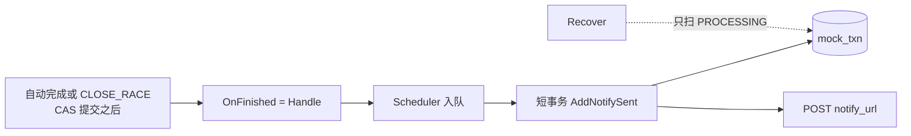
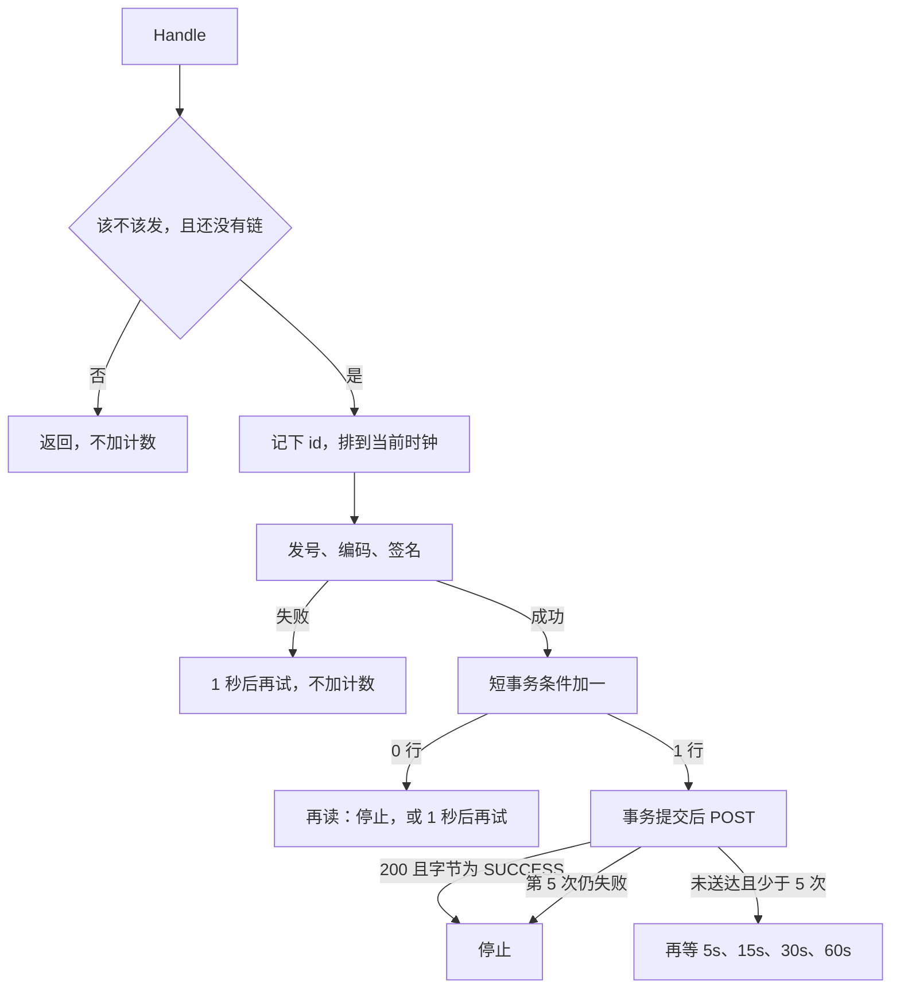

# CH-05 渠道异步回调

| 项 | 内容 |
|---|---|
| 功能点 | CH-05（P0，第 3 周） |
| 所属链路 | 支付 |
| 代码提交 | `9ef8bff` `[CH-05] add channel notify`（完整 `9ef8bffd422b05bfcf6b714ae96aa22f32a0794e`，2026-10-26 16:45:40 +0800） |
| 分支 | `feat/CH-05-notify` |
| 日期 | 2026-10-26 |
| 状态 | DONE |

这次代码提交 15 个文件，1390 行新增，31 行删除。本报告在该提交之后写，不在这 15 个文件里。

## 一句话结论

模拟渠道 channel-mock 在一笔交易变成成功或失败之后，向受理时留下的地址发带渠道签名的 HTTP。`Handle` 只把第一次发送排进内存调度，真正的 POST 发生在短事务把 `notify_sent_count` 条件加一并且提交之后。对方必须回 HTTP 200，并且 body 字节恰好是 `SUCCESS`，才算送达。连第一次最多 5 次，失败后再等 5 秒、15 秒、30 秒、60 秒。本次核验里 `service/channel_mock/biz` 语句覆盖率 94.4%，不低于 70%。`make cover` 的函数表里 `NewNotifier`、`refuseRedirect`、`Handle`、`shouldNotify`、`again`、`terminalStatus`、`logErr` 是 100%；`attempt` 96.3%，`prepare` 90.9%，`post` 95.7%。

## 1. 背景

### 1.1 系统简介

pay-system 是一个用 Go 编写的小型支付后端，模拟商户收款、退款、商户间转账三条资金链路，重点在数据一致性和性能。系统由 5 个部分组成：gateway（对外 HTTP 入口，负责签名校验和限流）、payment（支付单、退款单、转账单的状态管理和流程推进）、account（账户余额与记账，数据按商户分到 2 个数据库分片）、channel-mock（模拟微信、支付宝这类外部支付渠道）、recon（对账，核对系统内外数据是否一致）。服务之间用 Kitex RPC 同步调用，或通过 Kafka 消息异步通知；数据存在 MySQL 8.4，Redis 用于防重放。所有金额用整数“分”表示，所有记账只追加不修改。

当前已完成：工程骨架、本地环境、迁移与种子、金额、ID、错误码、时钟、配置、日志、数据库访问、集成测试基座、IDL、签名库、密钥加密，账户的分片路由、开户、查询、记账、冻结、解冻、确认扣款、同分片转账和收款方转账分支、余额核对和 account RPC 服务，商户费率核对，模拟渠道的支付受理与自动完成、渠道查单、渠道关单，以及本次的渠道异步回调。仍未做：渠道退款受理、CH-06 的特殊场景、账单，以及 gateway、payment 下单、recon、paycli、merchant-demo 的业务实现。平台侧接收这笔回调的入口还没做，本次核验用测试里的 HTTP 服务充当平台。

### 1.2 本功能点在系统中的位置

channel-mock 扮演外部支付机构。交易记在自己的库 `pay_channel_mock`、表 `mock_txn` 里。受理时调用方留下一个 `notify_url`。交易确定写成成功或失败、并且事务已经提交之后，进程内的完成钩子被调用。本次负责的就是这个钩子后面的发送：入队、加计数、再 POST 到那个地址。



上游是已经提交的终态行，以及进程入口接上的完成钩子。下游是同一张表上的发送次数，再加上对 `notify_url` 的一次 HTTP。不改余额，不写分录，不调用 `CheckBalance`，也不发 Kafka。查单仍然只读，用来在回调丢失时补偿。`Recover` 只按处理中的行重建自动完成，不扫描已经终态、但回调还没发完的行。

### 1.3 为什么需要它

一笔 10000 分（100.00 元）的支付，场景是普通成功。自动完成把行写成 `SUCCESS` 之后，平台如果收不到通知，就只能自己来查。渠道需要把结果推过去，并且在平台暂时失败时再试几次。

平台前两次回 HTTP 500，body 是 `NO`。渠道每次都已经把发送次数加 1，再按 5 秒、15 秒重试。第三次平台回 HTTP 200，body 字节恰好是 `SUCCESS`。渠道停止。此时 `notify_sent_count = 3`，状态仍是 `SUCCESS`，金额仍是 10000 分。三次 body 里的 `notify_id` 各不相同，前缀都是 `CN`，长度都是 21，并且都不写入表。

如果把 POST 放进完成事务里，一次慢响应会拖住写库；事务回滚时，对方可能已经收到了请求。所以计数用单独的短事务先提交，HTTP 放在提交之后。进程若在下一次重试触发前退出，内存里的等待就没了，这一次没发出去的重试不会在重启时被扫回来。平台仍靠查单看到成功。

## 2. 术语

| 术语 | 含义 |
|---|---|
| 渠道 | 向用户收款的外部机构。这里用 channel-mock 模拟 |
| `notify_url` | 受理时留下的回调地址。渠道把终态结果 POST 到这里 |
| `mock_txn` | 渠道交易表。一行是一笔支付或退款。状态有处理中 `PROCESSING`、成功 `SUCCESS`、失败 `FAILED`、已关闭 `CLOSED` |
| 金额“分” | 1 元 = 100 分。10000 分是 100.00 元。回调 body 里的 `amount` 是 JSON 数字，类型 `int64` |
| 场景 | 由金额末两位决定的固定行为。本次会发普通回调的是 `NORMAL`、`FAIL`、`ACCEPT_TIMEOUT`、`BILL_MISSING`、`BILL_AMOUNT_DIFF`、`CLOSE_RACE`，以及未登记的值。`DROP_NOTIFY` 不发。`DUP_NOTIFY` 和 `SLOW` 的特殊发送留给 CH-06，现在也不走普通重试 |
| `finished_at` | 进入成功或失败的时刻。为零就不发回调。写进 body 前先截到毫秒，再标东八区 |
| `notify_sent_count` | 已经发出的回调次数，从 0 起。发出 HTTP 之前按当前值条件加一。发号失败、空密钥、更新失败不加 |
| CAS | 比较之后再更新。这里的条件是 `WHERE id = ? AND notify_sent_count = ?`，对得上才加一。不改状态 |
| 完成钩子 `OnFinished` | 交易确定写成终态并且事务提交之后调用的函数。进程入口把它接成通知器的 `Handle` |
| `Handle` | 通知器的入口。只入队，不 POST |
| `Scheduler` | 进程内调度器。到点执行下一次尝试。任务不落盘 |
| 短事务 | `AddNotifySent` 自己开的一次 `dbx.WithTx`。提交成功后，调用方才 POST |
| `notify_id` | 这一次发送的单号。前缀 `CN`，再加 19 位，共 21 个字符。每次发送不同。不落库，只出现在 body |
| 渠道签名 | 已有的 `pkg/sign.SignChannel`。待签内容是时间戳、一个换行、原始 body。请求头是 `X-Mock-Timestamp` 和 `X-Mock-Signature` |
| 送达 | HTTP 200，并且读到的 body 字节恰好是 `SUCCESS`。`success`、带引号、带尾部换行都不算 |
| 进程内标记 | `map[uint64]struct{}`。一条发送链开始时记下这笔 `id`，之后不删。用来挡住钩子被调用两次 |
| `Recover` | 进程启动时按主键分页扫描 `PROCESSING`，重建自动完成。不扫描已终态行上没发完的回调 |
| 查单 | 按请求号只读一行。回调丢了之后，平台仍用查单知道结果 |
| 分录 | 账户记账时追加的一条借贷记录。本次不写 |
| `CheckBalance` | 账户余额核对。本次不调用 |
| idgen | 已有的发号器。回调只用前缀 `CN`。发号失败这次不加计数 |
| `NEVER_FINISH` | 金额末两位 08。一直处理中，本来就不调用完成钩子，因此也不会进本次发送 |
| `CLOSE_RACE` | 金额末两位 09。关单把行写成成功并调用同一个钩子。钩子仍然只入队 |

## 3. 技术讲解

### 3.1 要解决的问题

1. 只对 `SUCCESS` 和 `FAILED` 发 HTTP。场景是 `NORMAL`、`FAIL`、`ACCEPT_TIMEOUT`、`BILL_MISSING`、`BILL_AMOUNT_DIFF`、`CLOSE_RACE`，以及未登记的值。`FAIL` 的 body 里 `status` 是 `FAILED`，这是普通终态回调。
2. `DROP_NOTIFY` 不发、不加计数。`DUP_NOTIFY`（并发多次再按秒重发）和 `SLOW`（延迟 30 秒再发）的特殊发送没做，这两种现在也不走普通重试。`NEVER_FINISH` 不调用钩子。
3. `notify_url` 为空、`finished_at` 为零、计数已经达到 5，都不入队。
4. `Handle` 只入队。`Service.Pay`、`Close`、`finish` 不直接发 HTTP。HTTP 不放进调用方的事务，也不放进 `dbx.WithTx` 的回调。
5. 每次确定要发之前，短事务执行 `notify_sent_count = notify_sent_count + 1 WHERE id = ? AND notify_sent_count = ?`。影响 1 行才在事务外 POST。
6. 送达只认 HTTP 200 且 body 字节恰好是 `SUCCESS`。连第一次最多 5 次。已经发出 1、2、3、4 次仍失败时，分别再等 5 秒、15 秒、30 秒、60 秒。第 5 次失败后停止。
7. 单次超时 5 秒。不跟随重定向。响应体最多读 1024 字节。超时、连接失败、非 200、body 不符、读失败、超长都算这一次已经发送。
8. `notify_id` 前缀 `CN`，不落库。签名用已有渠道 HMAC，不改签名算法的短示例。
9. 空密钥或发号失败不加计数，1 秒后再试同一次，可能一直重试到进程退出。更新报错同样不加，也不算进 5 次。
10. 同一 `id` 的进程内标记在这条发送链开始后不删，挡住钩子被调用两次。进程活着时，每开始一条链就留一条记录。进程退出后未发出的重试丢失。`Recover` 不扫描已终态行。查单仍是补偿。
11. 不改余额，不写分录，不调用 `CheckBalance`。不新增错误码、迁移、IDL。不取消已有的自动完成定时器，不改查单和关单的返回。

### 3.2 方案

通知器 `Notifier` 和完成、关单用的存储分开。它只依赖 `AddNotifySent` 和 `GetByID`。`dal.DB` 实现了这个小接口。完成钩子在 `cmd/channel-mock` 里、`biz.New` 之后、`Recover` 之前接上。`CLOSE_RACE` 走同一个钩子，同样只入队。

这段代码在做接线：钩子换成 `Handle`，后面的 `Recover` 仍只重建处理中的自动完成。

```go
// cmd/channel-mock/main.go
store := dal.New(db)
svc := biz.New(store, ids, clk, sched, biz.Options{
	DelayMinMS: cfg.MockDelayMinMS,
	DelayMaxMS: cfg.MockDelayMaxMS,
})
svc.SetOnFinished(biz.NewNotifier(store, ids, clk, sched, []byte(cfg.ChannelMockpayKey)).Handle)
```

`Handle` 先看要不要发。要发，并且这个 `id` 还没有链，就把 `id` 放进进程内 map，再按注入时钟把第一次尝试排到“现在”（延迟 0）。函数随后返回。第一次 POST 和后来的重试都由 `Scheduler` 执行。

```go
// service/channel_mock/biz/notify.go
func (n *Notifier) Handle(ctx context.Context, row dal.Txn) {
	if !shouldNotify(row) {
		return
	}
	n.mu.Lock()
	if _, ok := n.chains[row.ID]; ok {
		n.mu.Unlock()
		return
	}
	n.chains[row.ID] = struct{}{}
	n.mu.Unlock()
	n.again(ctx, row, row.NotifySentCount, 0)
}
```

到点之后先准备，再占计数，最后才 POST。准备包括：用前缀 `CN` 发号、按固定字段顺序编码 JSON、用注入时钟的 Unix 秒做渠道签名。密钥在 `NewNotifier` 里被复制。编码关闭 HTML 转义，并去掉 `encoding/json` 多写的那一个换行。字段顺序是 `notify_id`、`txn_type`、`req_no`、`channel_txn_no`、`amount`、`status`、`finished_at`，都没有 `omitempty`。`finished_at` 用东八区，先 `Truncate(time.Millisecond)`，布局 `2006-01-02T15:04:05.000Z07:00`。

10000 分、请求号 `A<B&C`、完成时间 2026-10-23 10:00:00.1235（东八区）发出去的 body 是下面这一串，尖括号和 `&` 保持原样，时间是 `.123` 而不是进位后的 `.124`。`notify_id` 每次不同：

```json
{"notify_id":"CN…","txn_type":"PAY","req_no":"A<B&C","channel_txn_no":"MC1","amount":10000,"status":"SUCCESS","finished_at":"2026-10-23T10:00:00.123+08:00"}
```

同一笔如果状态是 `FAILED`，完成时刻取 UTC 的 2026-10-22 16:00:00.1235，body 里的 `status` 是 `FAILED`，`finished_at` 是 `2026-10-23T00:00:00.123+08:00`。金额仍是 10000 分。

发号、编码或签名失败：打 ERROR 日志，1 秒后再排同一次，期望计数不变。日志里的错误文本来自内部错误，例如空密钥时的 `sign: empty key`。不记录密钥、签名、URL 查询里的口令、DSN。连接错误如果包着 `*url.Error`，先剥掉带完整 URL 的那一层再写日志。

准备成功后才做条件更新。这段 SQL 在单独的短事务里执行，影响行数是 1 才算占到这次发送。它不改 `status`，也不写其他列。

```sql
UPDATE mock_txn SET notify_sent_count = notify_sent_count + 1
WHERE id = ? AND notify_sent_count = ?
```

影响 1 行：事务已经提交，然后 `post` 用标准库 `Client` 发 POST。`Client.Timeout` 和请求上下文都是 5 秒。`CheckRedirect` 返回 `http.ErrUseLastResponse`，所以 3xx 不会再去请求 `Location`。`Content-Type` 是 `application/json; charset=utf-8`。响应体最多读 1024 字节再多 1 字节用来发现超长。状态码不是 200，或字节不是 `SUCCESS`，都算未送达。

未送达且已经发出的次数还不到 5：按 5 秒、15 秒、30 秒、60 秒再排，下一次期望计数是刚刚写进库的值。第 5 次仍未送达就不再排。送达则打一条 Info，字段只有 `channel_txn_no` 和 `notify_sent_count`，调度器里不再留下一次。

影响 0 行：这一轮不 POST。再用最多 1 秒的读超时按主键看当前行。行不在、计数已经大于等于 5、或者状态不再是 `SUCCESS` / `FAILED`，就停止，不改状态。仍是终态且计数还小于 5，则 1 秒后再试，期望计数改成刚读到的值，这一轮仍然不发 HTTP。再读本身失败，也是 1 秒后按原来的期望计数重试。更新语句报错时同样不发，1 秒后按原计数重试，不把这次算进 5 次。



进程内标记只在“决定要开始一条链”时写入，跳过的场景不会写入。写入之后这段代码没有删除它。进程还活着时，每开始一条链就留一条记录。两个 goroutine 同时对同一个 `id` 调用 `Handle`，调度器里只有一个任务。送达之后再调用一次，也不会再排、再发。

间隔和“现在”都来自注入的 `clock.Clock`。`biz` 里这次回调不调用 `time.Now`，测试也不调用 `time.Sleep`，而是把假时钟往前拨，再执行已到期的任务。

### 3.3 为什么这样做

| 方案 | 做法 | 优点 | 缺点 | 结论 |
|---|---|---|---|---|
| 采用：`Handle` 只入队；短事务先加计数；HTTP 在提交之后；进程内标记不删除；`Recover` 不扫终态行 | 钩子立刻返回。次数先落库。重试只活在本进程 | 慢 HTTP 不占着完成事务。钩子被调两次不会把次数打双。重启逻辑保持原来的处理中扫描 | 进程退出后没发出的重试丢失。标记会随活着的链积累 | 采用 |
| 备选：在完成事务或调用方事务里 POST | 写终态和发 HTTP 绑在一起 | 少一次事务 | 对方可能已经收到，事务却回滚；慢响应拖住写库 | 不采用 |
| 备选：`Recover` 扫描已终态、次数未满的行，把重试补回来 | 重启后还能接着发 | 少丢通知 | 和“未发出的重试丢失、查单做补偿”相反，也会把不该发的终态行重新扫进来 | 不采用 |
| 备选：送达后删掉进程内标记 | 内存里少一条记录 | map 不会只增不减 | 钩子若再被调用一次，会再开一条链，次数可能被打双 | 不采用 |
| 备选：现在就做 `DUP_NOTIFY` 的并发重发和 `SLOW` 的 30 秒延迟 | 把 CH-06 的两种特殊发送一并做掉 | 场景表一次对齐 | 超出本次范围；这两种若套上普通 5 次重试，就和“现在不发”相反 | 不采用。留给 CH-06 |

### 3.4 正确性

回调不改余额、不写分录。下表是重复、并发、崩溃和超时。测试名都在本次提交的测试文件里。整次 `make test` 和 `make test-integration` 已通过，这些测试包含在其中。

| 场景 | 系统行为 | 最终状态 | 证明 |
|---|---|---|---|
| 平台前 2 次返回 500，第 3 次 body 为 `SUCCESS` | `Handle` 时还没有 HTTP。三次发送的到期点依次是现在、+5 秒、再 +15 秒。每次 `notify_id` 不同，签名能用渠道密钥验过 | 计数 3，调度器空。再拨 1 分钟也不会有第 4 次。MySQL 上状态仍是 `SUCCESS`，金额仍是 10000 分 | `TestNotifyRetriesUntilThirdSuccess`、`TestNotifyRetriesUntilThirdSuccessMySQL` |
| 第一次就送达 | 发 1 次后不再排 | 计数 1 | `TestNotifyStopsOnFirstSuccess` |
| 连续 5 次都不是 `SUCCESS` | 等待依次是 0、5 秒、15 秒、30 秒、60 秒 | 计数 5，调度器空。再拨 1 分钟次数仍是 5 | `TestNotifyStopsAfterFiveFailures` |
| 同一 `id` 的钩子到了两次 | 两个 goroutine 同时 `Handle`，只有 1 个任务。送达后再 `Handle` 一次，不再排 | 计数 1，只有 1 次 HTTP | `TestNotifyDuplicateHandleDoesNotDouble` |
| 条件更新影响 0 行 | 不发 HTTP。再读到已关闭，或计数已经是 5，就停止 | 没有新的 POST，也没有下一次任务 | `TestNotifyClaimMissDoesNotSend` |
| 更新报错 | 不发 HTTP，1 秒后按原计数再排 | 计数仍是 0 | `TestNotifyUpdateErrorDoesNotSend` |
| 在下一次重试触发前进程退出 | 调度任务只在内存里。`Recover` 只扫 `PROCESSING` | 还没发出的那次重试丢失。已提交的计数留在行上。查单仍能读到终态 | 机制见 `TimerScheduler` 的说明和 `Recover` 的扫描条件。没有一个测试去杀掉进程 |
| 下游超时、连接失败、读失败 | 请求上下文带超时。连不上、或读 body 失败，都算已经发送，5 秒后再试 | 计数 1，下一次到期是现在加 5 秒 | `TestNotifyRequestHasDeadline`、`TestNotifyConnFailCountsAsSent`、`TestNotifyReadErrorCountsAsSent` |
| HTTP 和事务的先后 | `Handle` 返回时还没有 POST，也还没加计数。MySQL 上，调用方事务里看计数仍是 0、请求数仍是 0；真正 POST 时，另一条连接已经能读到计数 1 | 计数 1，状态仍是 `SUCCESS` | `TestNotifyHTTPOutsideCallerAndUpdate`、`TestNotifyHTTPNotInsideCallerTxMySQL` |

另外几条和场景、报文有关的测试也在同一次套件里：`TestNotifyBodyIsFixedOrder`、`TestNotifyFailBodyIsFailed`、`TestNotifySkipsWithoutSending`、`TestNotifySendsOrdinaryScenarios`、`TestNotifyEmptyKeyDoesNotSend`、`TestNotifyIDGenFailureDoesNotSend`、`TestNotifyAckMustBeExact`、`TestNotifyRedirectIsNotDelivered`、`TestOrdinaryCloseDoesNotNotify`、`TestCloseRaceNotifyIsQueued`。前缀登记由 `TestPrefixTable` 覆盖，登记表里包含 `CN`。

普通关单的例子仍是请求号 `PA_CLOSE`、10000 分。关单返回关闭，完成时间为空，发送次数保持 0，测试服务器收不到 POST。原先排好的自动完成到期后，CAS 得 0 行，仍然不发。`CLOSE_RACE` 的例子是请求号 `PA_RACE`、10009 分（100.09 元）。关单返回已经付过，函数返回前没有 POST；调度器立刻执行那一个到期任务后，计数变成 1。

### 3.5 性能

不涉及。本次核验没有测量回调延迟或吞吐，也没有性能开关。

## 4. 已完成内容

### 4.1 改动清单

| 文件 | 新增 / 修改 | 作用 |
|---|---|---|
| `service/channel_mock/biz/notify.go` | 新增 | 入队、准备、条件计数、事务外 POST、重试和日志 |
| `service/channel_mock/biz/notify_test.go` | 新增 | 假存储和假时钟上的发送、跳过、重试、报文 |
| `service/channel_mock/biz/notify_integration_test.go` | 新增 | MySQL 上的三次重试，以及 HTTP 不在调用方事务里 |
| `service/channel_mock/biz/pay.go` | 修改 | 包注释带上回调；增加 `SetOnFinished` |
| `service/channel_mock/biz/scheduler.go` | 修改 | 说明回调重试不由 `Recover` 从终态行重建 |
| `service/channel_mock/dal/txn.go` | 修改 | `AddNotifySent` |
| `cmd/channel-mock/main.go` | 修改 | `New` 之后、`Recover` 之前接上 `Handle` |
| `pkg/idgen/idgen.go` | 修改 | 前缀表增加 `CN` |
| `pkg/idgen/idgen_test.go` | 修改 | `TestPrefixTable` 的登记列表带上 `CN` |
| `docs/02-requirements.md` | 修改 | CH-05 规则、状态 DONE、验收勾选 |
| `docs/03-conventions.md` | 修改 | 前缀 `CN` 不落库 |
| `docs/04-dev-plan.md` | 修改 | 只勾选 CH-05 |
| `docs/05-api.md` | 修改 | 回调 body 与送达规则，版本 2.1.4 |
| `docs/06-flows.md` | 修改 | CF-24 图下补文字，版本 v2.14 |
| `docs/database.md` | 修改 | `notify_sent_count` 的条件加一，无 DDL |

channel-mock 的 HTTP handler 没有新路由。回调是渠道主动 POST 到受理时保存的 `notify_url`。

### 4.2 对外变化

| 类别 | 变化 |
|---|---|
| 接口 | 渠道回调的文字写清了：字段顺序、紧凑 JSON、不转义 HTML、`finished_at` 的东八区毫秒、送达条件、5 次与四段间隔、5 秒超时、不跟随重定向、最多 1024 字节。文档版本 2.1.4。签名算法的短示例未改。没有新的平台错误码，也没有新的入站路由 |
| 表结构 | 无迁移。`notify_sent_count` 仍是原来的列。写出方式是条件加一，不改 `status` |
| 配置项 | 无。签名密钥仍用已有的渠道密钥 |
| 错误码 | 无 |
| 指标 / 故障点 | 无。新单号前缀是 `CN`，不落库，只出现在回调 body 的 `notify_id` |

### 4.3 验收对照

需求里的验收只有一条。下表的“通过”来自整次 `make test` 与 `make test-integration`，这些测试包含在其中。带 `-count=1` 的两次覆盖率命令又执行了 `biz`、`handler`、`dal`。

| 验收条目 | 测试函数 | 类型 | 结果 |
|---|---|---|---|
| 平台前 2 次返回 500，第 3 次成功，渠道停止重试，`notify_sent_count = 3`。 | `TestNotifyRetriesUntilThirdSuccess`、`TestNotifyRetriesUntilThirdSuccessMySQL` | 单元、集成 | 通过 |
| 第一次送达就停止；连续失败停在 5 次 | `TestNotifyStopsOnFirstSuccess`、`TestNotifyStopsAfterFiveFailures` | 单元 | 通过 |
| body 顺序固定且不转义 HTML；`FAIL` 的 `status` 是 `FAILED` | `TestNotifyBodyIsFixedOrder`、`TestNotifyFailBodyIsFailed` | 单元 | 通过 |
| `DROP_NOTIFY`、`DUP_NOTIFY`、`SLOW`、空地址、完成时间为零、非终态、计数已是 5：不发 | `TestNotifySkipsWithoutSending` | 单元 | 通过 |
| `NORMAL`、未登记值、`ACCEPT_TIMEOUT`、`BILL_MISSING`、`BILL_AMOUNT_DIFF`、`CLOSE_RACE` 会发 | `TestNotifySendsOrdinaryScenarios` | 单元 | 通过 |
| 空密钥或发号失败不加计数，1 秒后再排 | `TestNotifyEmptyKeyDoesNotSend`、`TestNotifyIDGenFailureDoesNotSend` | 单元 | 通过 |
| 条件更新得 0 行或更新报错时不发 HTTP | `TestNotifyClaimMissDoesNotSend`、`TestNotifyUpdateErrorDoesNotSend` | 单元 | 通过 |
| 同一 `id` 的第二次 `Handle` 不把次数打双 | `TestNotifyDuplicateHandleDoesNotDouble` | 单元 | 通过 |
| 大小写、引号、换行、HTTP 500、超过 1024 字节都不算送达；3xx 不跟随 | `TestNotifyAckMustBeExact`、`TestNotifyRedirectIsNotDelivered` | 单元 | 通过 |
| 连接失败、读失败算已发送；请求带上下文超时 | `TestNotifyConnFailCountsAsSent`、`TestNotifyReadErrorCountsAsSent`、`TestNotifyRequestHasDeadline` | 单元 | 通过 |
| HTTP 不在 `Handle` 里，也不在调用方事务里 | `TestNotifyHTTPOutsideCallerAndUpdate`、`TestNotifyHTTPNotInsideCallerTxMySQL` | 单元、集成 | 通过 |
| 普通关单不发；`CLOSE_RACE` 只入队，返回前不 POST | `TestOrdinaryCloseDoesNotNotify`、`TestCloseRaceNotifyIsQueued` | 单元 | 通过 |
| 前缀 `CN` 已登记 | `TestPrefixTable` | 单元 | 通过 |

### 4.4 验证记录

环境：go1.27.2 darwin/arm64。golangci-lint 2.14.0，用 go1.27.1 编译。日期 2026-10-26。数字只来自本次核验。

| 命令 | 结果 |
|---|---|
| `gofmt -l .` | 无输出，real 0.04s |
| `make lint`（`golangci-lint run --build-tags integration ./...`） | `0 issues.`，real 0.99s |
| `make test`（`go test -race ./...`） | 退出码 0，real 4.49s。根测试包 `ok github.com/yym108/pay-system 3.957s`。这次输出里不少包是 `(cached)`，其中包含 `service/channel_mock/biz`。不把 cached 改写成新测到的秒数 |
| `make test-integration`（`go test -race -tags integration ./...`） | 退出码 0，real 35.49s。根测试包 `ok github.com/yym108/pay-system 35.047s`。`service/channel_mock/biz`、`dal`、`handler` 在这次输出里也是 `(cached)` |
| `go test -race -count=1 -cover ./service/channel_mock/biz/ ./service/channel_mock/handler/ ./service/channel_mock/dal/` | real 2.09s。biz 1.408s、覆盖率 94.4%；handler 1.321s、95.5%；dal 0.0%（该包没有不带 integration 标签的单元测试，命令仍退出码 0） |
| 同上，增加 `-tags integration` | real 14.60s。biz 13.659s、94.4%；handler 9.585s、95.5%；dal 10.023s、70.0% |
| `make cover`（`go test -race -coverprofile=coverage.out ./...`，再 `go tool cover -func`） | 已执行，退出码 0，real 4.65s。全仓库语句覆盖率 19.6%。这份 profile 不带 integration 标签，dal 方法在里面是 0%（含 `AddNotifySent`）。同一次输出里 `pkg/idgen` 是 `(cached)` 且 88.1% |

门禁看的是 biz 94.4%，不低于 70%。dal 的 70.0% 来自带 integration 标签的那次覆盖率命令。全仓库 19.6% 把尚未实现业务的包和生成代码也算进去了，这是预期，不是这次失败。函数表里 `NewNotifier`、`refuseRedirect`、`Handle`、`shouldNotify`、`again`、`terminalStatus`、`logErr` 为 100%；`attempt` 96.3%，`prepare` 90.9%，`post` 95.7%。

没有渲染 SVG，也没有生成图文件。正文里的图是 Mermaid 源图。

### 4.5 同步的文档

- 需求：写明哪些场景发普通回调，`DROP_NOTIFY` 不发，`DUP_NOTIFY` 与 `SLOW` 的特殊发送仍不做也不套普通重试。送达、次数、间隔、短事务、`CN`、进程内标记和重启丢失都写进规则。状态改为 DONE，验收已勾。变更记录有一条 2026-10-26 的澄清。
- 约定：版本 v2.14。前缀 `CN` 是渠道回调发送号，不落库，只出现在 body 的 `notify_id`。总长仍是前缀加 19 位。不新增错误码。
- 开发计划：CH-05 已勾选。紧接着未勾选的仍是「CH-06 的 FAIL、DROP_NOTIFY、DUP_NOTIFY、NEVER_FINISH」。第 4 周那一行「CH-06 其余场景：SLOW、ACCEPT_TIMEOUT、BILL_MISSING、BILL_AMOUNT_DIFF（标记部分）、CLOSE_RACE；CH-04 渠道退款」也未勾选。
- 接口文档：版本 2.1.4。§9.7 写了字段顺序、示例 `notify_id` 形如 `CN0000000123456789012`、恰好 `SUCCESS`、不跟随重定向、1024 字节、5 秒、四段间隔，以及进程内重试会丢、查单补偿。不新增平台错误码。§3.7 的 V4 未改。
- 控制流：版本 v2.14。CF-24 的图本身没改。图下写明「其他」和 `DROP_NOTIFY` 已按本次实现；`SLOW` 与 `DUP_NOTIFY` 的特殊发送仍未实现，这两种现在不发普通回调。
- 表结构：补了条件加一的写路径。变更记录是「无（仅文档）」，未执行迁移。

## 5. 未完成与风险

- 进程退出后，还排着、还没发出的重试丢失。`Recover` 不扫描已终态行。计数如果已经在短事务里提交，而 POST 或下一次定时还没发生，这次名额已经用掉，重启也不会把这次补发。查单仍是补偿。没有测试去杀掉进程。
- 同一 `id` 的进程内标记在发送链开始后不删。进程活着时，每开始一条链就留一条记录。不发送的场景不会占标记。
- 空密钥或发号失败不加计数，每 1 秒再排同一次，代码自己不会停，可能一直重试到进程退出。空密钥测试跑了两次，计数都是 0，第三次仍排着。
- 条件更新得 0 行、但行仍是终态且计数小于 5 时，代码会按读到的计数在 1 秒后再试，这一轮不发 HTTP。再读失败同样 1 秒后再试。现有的 `TestNotifyClaimMissDoesNotSend` 只覆盖再读到已关闭、以及计数已经是 5 这两种停止。行已经不存在时也会停止。再读失败和编码失败没有单独的测试函数。
- `FAIL` 现在会发一条普通回调，body 的 `status` 是 `FAILED`。这不是 CH-06 做完。`DROP_NOTIFY` 不发。`DUP_NOTIFY` 和 `SLOW` 的特殊发送没做，这两种现在也不走普通重试。`NEVER_FINISH` 不调用钩子。开发计划里未勾选的仍是「CH-06 的 FAIL、DROP_NOTIFY、DUP_NOTIFY、NEVER_FINISH」。
- 渠道退款受理没做。账单没做。`ACCEPT_TIMEOUT`、`BILL_MISSING`、`BILL_AMOUNT_DIFF`、`CLOSE_RACE` 在本次会发普通回调；受理接口阻塞、账单内容、关单抢成功本身的其他规则不在这次重做。
- 不改余额，不写分录，不调用 `CheckBalance`。没有一个测试去账户库对余额。
- 不新增错误码、迁移、IDL。
- 没有渲染 SVG，也没有生成图文件。

## 6. 如何复现

前置：Go 1.27.2，golangci-lint 2.14.0，在仓库根目录、分支 `feat/CH-05-notify`、代码提交 `9ef8bff` 上执行。集成测试按仓库既有方式连接测试库。不要把连接串或口令写进命令回显。

```bash
gofmt -l .
make lint
make test
make test-integration
go test -race -count=1 -cover ./service/channel_mock/biz/ ./service/channel_mock/handler/ ./service/channel_mock/dal/
go test -race -count=1 -tags integration -cover ./service/channel_mock/biz/ ./service/channel_mock/handler/ ./service/channel_mock/dal/
make cover
```

预期与 4.4 的表一致：`gofmt -l .` 无输出，real 0.04s；`make lint` 打印 `0 issues.`，real 0.99s；`make test` 退出码 0，real 4.49s，根测试包 `ok github.com/yym108/pay-system 3.957s`，不少包是 `(cached)`，其中包含 `service/channel_mock/biz`；`make test-integration` 退出码 0，real 35.49s，根测试包 `ok github.com/yym108/pay-system 35.047s`，`service/channel_mock/biz`、`dal`、`handler` 也是 `(cached)`；不带标签的覆盖率命令 real 2.09s，biz 1.408s / 94.4%，handler 1.321s / 95.5%，dal 0.0%；带标签的覆盖率命令 real 14.60s，biz 13.659s / 94.4%，handler 9.585s / 95.5%，dal 10.023s / 70.0%；`make cover` 已执行，退出码 0，real 4.65s，全仓库 19.6%，biz 94.4%，`pkg/idgen` 为 `(cached)` 且 88.1%。biz 函数表里 `NewNotifier`、`refuseRedirect`、`Handle`、`shouldNotify`、`again`、`terminalStatus`、`logErr` 为 100%，`attempt` 96.3%，`prepare` 90.9%，`post` 95.7%。

## 7. 讲解要点

1. 问：为什么 `Handle` 不直接 POST？答：钩子跑在调度用的 goroutine 里，完成事务也已经结束。`Handle` 只把第一次发送排到注入时钟的“现在”，然后返回。10000 分那笔在 `Handle` 返回时请求数是 0。POST 发生在 `AddNotifySent` 的短事务提交之后。
2. 问：平台前两次 500、第三次成功，库里是什么？答：三次都先把 `notify_sent_count` 条件加一。间隔是 5 秒和 15 秒。第三次 HTTP 200 且 body 字节恰好是 `SUCCESS`，渠道停止。计数是 3，状态仍是 `SUCCESS`，金额仍是 10000 分（100.00 元）。`success`、`"SUCCESS"`、`SUCCESS` 后面加换行都不算送达。
3. 问：进程重启后为什么可能收不到下一次重试？答：重试任务不落盘。`Recover` 只扫描 `PROCESSING` 来重建自动完成，不扫描已终态行。没发出的重试丢失。同一 `id` 的进程内标记也不落库。平台用查单读到终态作为补偿。

## 延伸阅读

- `docs/02-requirements.md`：CH-05 小节，以及 2026-10-26 的澄清记录。
- `docs/05-api.md`：版本 2.1.4 的变更记录，§9.7。
- `docs/06-flows.md`：CF-24。版本 v2.14。
- `docs/database.md`：`pay_channel_mock.mock_txn` 的 `notify_sent_count` 写路径。
- `docs/03-conventions.md`：§2.2 的前缀 `CN`。版本 v2.14。
- `docs/04-dev-plan.md`：第 3 周里已勾选的 CH-05，以及下一行未勾选的 CH-06。
- `docs/reports/CH-01-mock-pay.md`：受理、自动完成、场景末两位、完成钩子的调用点。
- `docs/reports/CH-03-close.md`：普通关单不调钩子，`CLOSE_RACE` 在提交后调一次钩子。

## 修订记录

| 日期 | 提交 | 修订内容 |
|---|---|---|
| 2026-10-26 | 代码提交 `9ef8bff`；本报告尚未进入该提交 | 初稿 |
