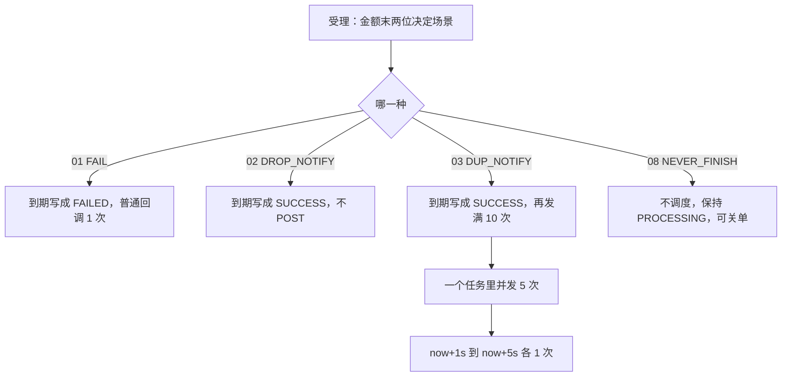
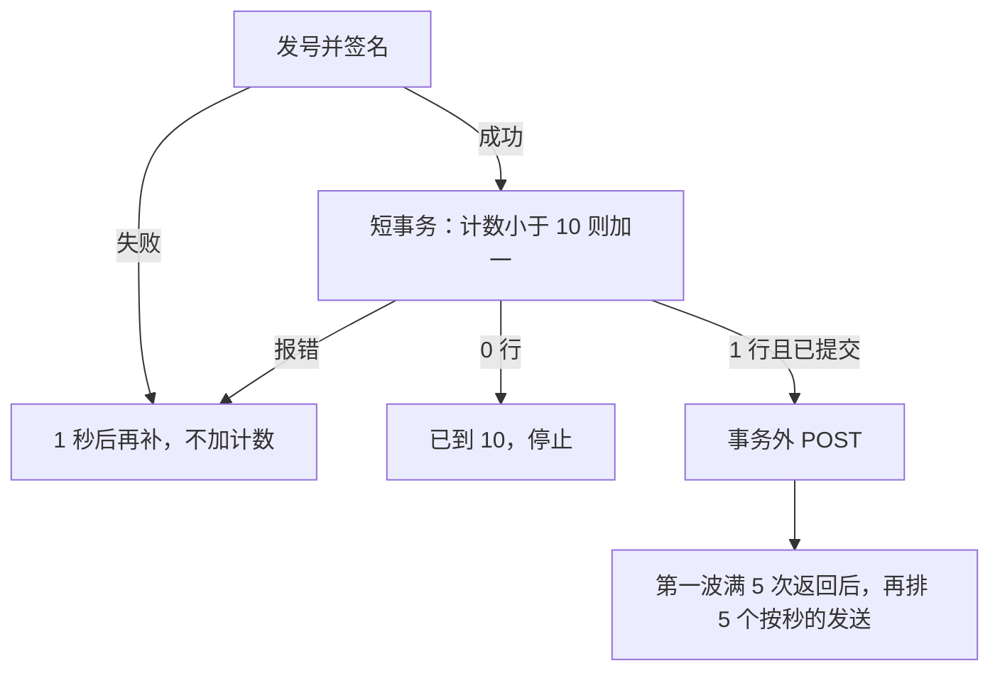

# CH-06 确定性故障场景（M3）

| 项 | 内容 |
|---|---|
| 功能点 | CH-06（P0，第 3 周的 M3 切片；M4 仍开放） |
| 所属链路 | 支付 |
| 代码提交 | `86049ab` `[CH-06] add fail drop dup never scenarios`（完整 `86049abf41614b28d76ceacedac2019dd8ed8fc8`，2026-10-27 16:20:01 +0800） |
| 分支 | `feat/CH-06-scenarios` |
| 日期 | 2026-10-27 |
| 状态 | DOING。还差 M4：SLOW 的 30 秒延迟、ACCEPT_TIMEOUT 的受理阻塞 5 秒、BILL_MISSING / BILL_AMOUNT_DIFF 的账单内容。CLOSE_RACE 本切片不重做（关单抢成功已在 CH-03）。第 4 周计划行未勾 |

这次代码提交 12 个文件，670 行新增，31 行删除。本报告在该提交之后写，不在这 12 个文件里。

## 一句话结论

M3 做了四个由支付金额末两位触发的渠道场景。10001 分（100.01 元）的 FAIL 仍走已有普通回调，平台回 HTTP 200 且 body 字节恰好是 `SUCCESS` 时只发 1 次，body 里的 `status` 是 `FAILED`，`bill_date` 为空。10002 分（100.02 元）的 DROP_NOTIFY 写成成功但不发 HTTP。10003 分（100.03 元）的 DUP_NOTIFY 是新行为：一个调度任务里并发 POST 5 次，这 5 次都返回后再按注入时钟每秒 1 次再发 5 次，共 10 次，对方一直回 `SUCCESS` 也不停。10008 分（100.08 元）的 NEVER_FINISH 不调度、保持处理中、不发 HTTP，关单后变成已关闭且完成时间仍空。证据是下面的集成测试和单元测试；`make test` 与 `make test-integration` 退出码都是 0。`service/channel_mock/biz` 语句覆盖率 94.0%，不低于 70%。整项仍是 DOING，M4 没有当成通过。

## 1. 背景

### 1.1 系统简介

pay-system 是一个用 Go 编写的小型支付后端，模拟商户收款、退款、商户间转账三条资金链路，重点在数据一致性和性能。系统由 5 个部分组成：gateway（对外 HTTP 入口，负责签名校验和限流）、payment（支付单、退款单、转账单的状态管理和流程推进）、account（账户余额与记账，数据按商户分到 2 个数据库分片）、channel-mock（模拟微信、支付宝这类外部支付渠道）、recon（对账，核对系统内外数据是否一致）。服务之间用 Kitex RPC 同步调用，或通过 Kafka 消息异步通知；数据存在 MySQL 8.4，Redis 用于防重放。所有金额用整数“分”表示，所有记账只追加不修改。

当前已完成：工程骨架、本地环境、迁移与种子、金额、ID、错误码、时钟、配置、日志、数据库访问、集成测试基座、IDL、签名库、密钥加密，账户的分片路由、开户、查询、记账、冻结、解冻、确认扣款、同分片转账和收款方转账分支、余额核对和 account RPC 服务，商户费率核对，模拟渠道的支付受理与自动完成、渠道查单、渠道关单、渠道异步回调，以及本次 CH-06 的 M3 四场景。仍未做：渠道退款受理、CH-06 的 M4（SLOW 的 30 秒延迟、ACCEPT_TIMEOUT 的受理阻塞、BILL_MISSING / BILL_AMOUNT_DIFF 的账单内容）、账单下载、以及 gateway、payment 下单、recon、paycli、merchant-demo 的业务实现。平台侧接收回调的入口还没做，本次核验用测试里的 HTTP 服务充当平台。

### 1.2 本功能点在系统中的位置

channel-mock 扮演外部支付机构。交易记在自己的库 `pay_channel_mock`、表 `mock_txn` 里。受理时按金额末两位写下场景名。自动完成把行写成成功或失败并提交之后，进程内的完成钩子调用通知器的 `Handle`。本次只改这条链路上四个场景的完成与回调；不改余额，不写分录，不调用 `CheckBalance`，也不发 Kafka。



上游是受理和已有的自动完成、关单。下游仍是同一张表上的 `notify_sent_count`，以及发往 `notify_url` 的 HTTP。查单仍然只读。`Recover` 只扫描处理中的行来重建自动完成，不扫描已经终态、但回调还没发完的行。

### 1.3 为什么需要它

测试要能靠金额末两位，稳定复现渠道的几种坏行为，而不是靠随机。

一笔 10001 分（100.01 元）应失败。平台收到的回调 body 里 `status` 必须是 `FAILED`。平台回 HTTP 200 且 body 字节恰好是 `SUCCESS` 之后，如果再发第 2 次，平台会把一次失败通知当成还要重试。所以 FAIL 继续用已有的普通回调：计数停在 1，`bill_date` 留空。

一笔 10002 分（100.02 元）应成功，但通知被丢掉。行上是 `SUCCESS`，`bill_date` 是完成时刻的东八区日历日，HTTP 次数和 `notify_sent_count` 都是 0。如果误发一次，丢通知的用例就失效。

一笔 10003 分（100.03 元）要模拟渠道重复通知。只发 1 次，或对方回 `SUCCESS` 就停，都测不出“重复”。所以要先同时打出 5 个在途请求，再每秒 1 次补到 10 次，不论对方回什么。

一笔 10008 分（100.08 元）永远不自动完成。把时钟往前拨 1 小时，它仍是 `PROCESSING`，没有完成任务，也没有 HTTP。之后可以关成 `CLOSED`，完成时间仍空，HTTP 仍是 0。如果它被自动完成，关单和“一直处理中”的用例都会变掉。

## 2. 术语

| 术语 | 含义 |
|---|---|
| 渠道 | 向用户收款的外部机构。这里用 channel-mock 模拟 |
| 金额“分” | 1 元 = 100 分。10001 分是 100.01 元。回调 body 里的 `amount` 是 JSON 数字，类型 `int64` |
| 场景 | 支付金额末两位决定的固定行为，受理时写入 `mock_txn.scenario`。00 和 10–99 是 `NORMAL`。01 到 09 依次是 `FAIL`、`DROP_NOTIFY`、`DUP_NOTIFY`、`SLOW`、`ACCEPT_TIMEOUT`、`BILL_MISSING`、`BILL_AMOUNT_DIFF`、`NEVER_FINISH`、`CLOSE_RACE` |
| `mock_txn` | 渠道交易表。一行是一笔支付或退款。状态有处理中 `PROCESSING`、成功 `SUCCESS`、失败 `FAILED`、已关闭 `CLOSED` |
| `notify_url` | 受理时留下的回调地址。该发的时候 POST 到这里 |
| `finished_at` | 进入成功或失败的时刻。为零就不发回调。普通关单不写它 |
| `bill_date` | 账单日，格式 `2006-01-02`。成功且该进账单时，取 `finished_at` 换到东八区固定偏移（UTC+8，不依赖时区数据库）后的日历日。本切片只断言这一列有或空，不产生 CSV |
| `notify_sent_count` | 已经占到名额并发出 HTTP 的次数，从 0 起。发号失败、空密钥、更新失败不加 |
| CAS | 比较之后再更新。普通回调的条件是 `WHERE id = ? AND notify_sent_count = ?`。DUP 的条件是 `WHERE id = ? AND notify_sent_count < 10`。两种都不改 `status` |
| 完成钩子 `OnFinished` | 交易确定写成终态并且事务提交之后调用的函数。进程入口把它接成通知器的 `Handle` |
| `Handle` | 通知器入口。只入队，不 POST |
| `Scheduler` | 进程内调度器。到点执行任务。任务不落盘 |
| 短事务 | `AddNotifySent` 或 `AddDupNotifySent` 自己开的一次 `dbx.WithTx`。提交成功后，调用方才 POST |
| `notify_id` | 这一次发送的单号。前缀 `CN`，再加 19 位，共 21 个字符。每次不同。不落库，只出现在 body |
| 渠道签名 | 已有的 `pkg/sign.SignChannel`。待签内容是时间戳、一个换行、原始 body。请求头是 `X-Mock-Timestamp` 和 `X-Mock-Signature` |
| 送达 | 普通回调才用：HTTP 200，并且读到的 body 字节恰好是 `SUCCESS`。DUP 不看这个结果，发满 10 次才停 |
| 进程内标记 | `map[uint64]struct{}`。一条发送链开始时记下这笔 `id`，之后不删。用来挡住钩子被调用两次 |
| errgroup | `golang.org/x/sync/errgroup` 里的一组 goroutine。这里用普通 `Group`，等 5 个都返回。不用 `WithContext`，所以一个失败不会取消另外四个 |
| `Recover` | 进程启动时按主键分页扫描 `PROCESSING`，重建自动完成。不扫描已终态行上没发完的回调 |
| 查单 | 按请求号只读一行。回调丢了之后，平台仍用查单知道结果 |
| 分录 | 账户记账时追加的一条借贷记录。本次不写 |
| `CheckBalance` | 账户余额核对。本次不调用，也不 import account |
| idgen | 已有的发号器。回调只用前缀 `CN`。发号失败这次不加计数 |
| M3 / M4 | 第 3 周做 01、02、03、08。第 4 周还留着 SLOW、ACCEPT_TIMEOUT、BILL_MISSING、BILL_AMOUNT_DIFF、CLOSE_RACE。本报告只覆盖 M3 |

## 3. 技术讲解

### 3.1 要解决的问题

1. FAIL（末两位 01）自动完成写成 `FAILED`，`bill_date` 为空。回调仍是已有普通路径：body 的 `status` 是 `FAILED`。平台回 HTTP 200 且 body 字节恰好是 `SUCCESS` 时 `notify_sent_count = 1`，不再发第 2 次。不另写一套重试。
2. DROP_NOTIFY（末两位 02）自动完成写成 `SUCCESS`，`bill_date` 为 `finished_at` 的东八区日期。HTTP 0 次，计数 0。
3. DUP_NOTIFY（末两位 03）进入 `SUCCESS` 后发满 10 次。`Handle` 只入队。同一 `id` 已有进程内发送链则直接返回。一个调度任务里用 errgroup 同时 POST 5 次。这 5 次都已返回之后（不论 200、500、连接失败、body 是不是 `SUCCESS`），按注入时钟排在 now+1s、now+2s、now+3s、now+4s、now+5s，再各 1 次。不走 5 秒、15 秒、30 秒、60 秒。对方一直回 `SUCCESS` 也要发满。满 10 次停止。不改 `status`、`finished_at`、`bill_date`。
4. 每一次 DUP 发送先发号和签名。失败则这次不占计数，1 秒后再补这一次，不在调用栈上自旋。成功后用单独短事务占名额，事务提交后才 POST。占名额 SQL 是 `notify_sent_count = notify_sent_count + 1 WHERE id = ? AND notify_sent_count < 10`。影响 1 行才 POST。影响 0 行说明已经到 10，不再发。更新报错则不 POST，1 秒后只补这一次。
5. 普通回调仍是 `WHERE notify_sent_count = ?`，最多 5 次，间隔仍是 5 秒、15 秒、30 秒、60 秒。FAIL 走这条。
6. HTTP 单次超时 5 秒，不跟随重定向，响应体最多读 1024 字节。日志不含密钥、签名、带口令的 URL。
7. NEVER_FINISH（末两位 08）受理后不调度，保持 `PROCESSING`，不发 HTTP，`bill_date` 为空。关单后是 `CLOSED`，`finished_at` 仍空，HTTP 仍是 0。
8. SLOW（末两位 04）仍然不发、不加计数。不实现 30 秒延迟。
9. 延迟只用注入的 `clock.Clock` 和已有 `Scheduler`。`biz` 不调用 `time.Now`。测试用 `manualSched.RunDue` 和 `clock.Fake`，不用 `time.Sleep`。
10. 不调用 `CheckBalance`，不 import account。不新增错误码、IDL、迁移。总表依赖写成 CH-01、CH-02、CH-03、CH-05。CH-04 仍是退款受理，本切片不实现。需求里 CH-06 保持 DOING。

### 3.2 方案

四个场景里，只有 DUP_NOTIFY 新写了发送。FAIL 复用普通回调。DROP_NOTIFY 和 SLOW 在 `shouldNotify` 里直接返回，不入队。NEVER_FINISH 在受理时就不排自动完成，完成钩子不会被调用。

`Handle` 先看该不该发。该发，并且这个 `id` 还没有链，就把 `id` 放进进程内 map。场景是 DUP 时，把第一波排到注入时钟的“现在”，函数随后返回。其他场景仍按普通回调，延迟 0 排一次尝试。

```go
// service/channel_mock/biz/notify.go
func (n *Notifier) Handle(ctx context.Context, row dal.Txn) {
	if !shouldNotify(row) {
		return
	}
	n.mu.Lock()
	if _, ok := n.chains[row.ID]; ok {
		n.mu.Unlock()
		return
	}
	n.chains[row.ID] = struct{}{}
	n.mu.Unlock()
	if scenario.Scenario(row.Scenario) == scenario.DupNotify {
		n.sched.Schedule(n.clk.Now(), func() { n.dupWave(ctx, row) })
		return
	}
	n.again(ctx, row, row.NotifySentCount, 0)
}
```

`shouldNotify` 要求状态是 `SUCCESS` 或 `FAILED`，`notify_url` 非空，`finished_at` 非零。`DROP_NOTIFY` 和 `SLOW` 返回假。`DUP_NOTIFY` 在计数小于 10 时返回真。其余场景在计数小于 5 时返回真。

第一波是一个调度任务里的 5 个 goroutine。用普通 errgroup，不用会取消兄弟的 `WithContext`。每个 goroutine 自己接住 panic，记下 `channel_txn_no` 和 panic 文本，再把这一次排到 1 秒后，`wave` 仍为真，这样它以后若真的 POST 返回，仍能算进“第一波满 5 次”。`Wait` 的错误被丢掉，因为 `dupSend` 总是返回 nil。

```go
// service/channel_mock/biz/notify.go
func (n *Notifier) dupWave(ctx context.Context, row dal.Txn) {
	var g errgroup.Group
	for range dupWaveSize {
		g.Go(func() error {
			defer func() {
				if p := recover(); p != nil {
					slog.ErrorContext(ctx, "channel notify dup panicked",
						slog.String("channel_txn_no", row.ChannelTxnNo),
						slog.String("panic", fmt.Sprint(p)))
					n.scheduleDupRetry(ctx, row, true)
				}
			}()
			n.dupSend(ctx, row, true)
			return nil
		})
	}
	_ = g.Wait()
}
```

`dupSend` 先走和普通回调相同的准备：前缀 `CN` 发号、固定字段顺序编码 JSON、用注入时钟做渠道签名。失败就打 ERROR，1 秒后再排同一次，计数不变，函数返回，不在当前栈上循环。准备成功后才占名额。这段 SQL 在单独的短事务里执行，影响 1 行才算占到。它不改 `status`，也不写 `finished_at`、`bill_date`。

```sql
UPDATE mock_txn SET notify_sent_count = notify_sent_count + 1
WHERE id = ? AND notify_sent_count < ?
```

5 个并发不能共用同一个期望值。若仍用 `notify_sent_count = 0`，五个里只有一个能改到行，另外四个影响 0 行，测试就看不到 5 个请求同时在途。条件改成小于 10 之后，从 0 加到 5 都能各自占到一行。MySQL 的行锁把五次加一串起来，锁在短事务提交时放开，POST 在事务外，所以挡住 HTTP 不会占着行锁。

影响 0 行：已经到 10，这次不 POST，也不再排。更新报错：不 POST，1 秒后只补这一次。影响 1 行：事务已提交，然后 `post`。`Client.Timeout` 和请求上下文都是 5 秒。`CheckRedirect` 返回 `http.ErrUseLastResponse`。响应体最多读 1024 字节再多 1 字节用来发现超长。这些和普通回调相同。

POST 返回之后，不论错误与否，只要这是第一波，就给这笔 `id` 的“已返回次数”加一。加到 5，并且后 5 次还没排过，就把后 5 次的到期点在 `Schedule` 当时就算好：当前时钟加 1 秒、2 秒、3 秒、4 秒、5 秒。后 5 次调用同一个 `dupSend`，但 `wave` 为假，所以它们不再排第三波。后 5 次同样先占名额再 POST，不看平台响应，也不取 5 秒、15 秒、30 秒、60 秒。

测试用的 `manualSched.RunDue` 先挑出当前已到期的任务，再执行。执行过程中新排上的任务留到下一轮。所以第一波跑完时，后 5 次已经在队列里，但时钟不往前拨，再 `RunDue` 一次得到 0，不会出现第 6 次。把假时钟拨 5 秒再 `RunDue`，这 5 个都到期，正好到 10 次。

普通路径的 SQL 没有改：

```sql
UPDATE mock_txn SET notify_sent_count = notify_sent_count + 1
WHERE id = ? AND notify_sent_count = ?
```

FAIL 走这条。10001 分那笔在自动完成之后状态是 `FAILED`，`bill_date` 为空，计数仍是 0，此时还没有 HTTP。下一次 `RunDue` 才 POST。body 含 `"status":"FAILED"` 和 `"amount":10001`。平台回的字节是 `SUCCESS`，计数变成 1，调度器空。再拨 1 分钟，没有第 2 次。

DROP_NOTIFY 的 10002 分写成 `SUCCESS`。`bill_date` 等于 `finished_at` 换到东八区后的 `2006-01-02`。集成测试的假时钟从 2026-10-23 10:00:00.123456789（东八区）开始，自动完成延迟在 200 到 2000 毫秒，所以这一天仍是 2026-10-23。测试比较的是行上完成时间换算出来的日期，不是写死字符串。HTTP 和计数都是 0，再拨 1 分钟仍是 0。

NEVER_FINISH 的 10008 分受理后调度器长度是 0。拨 1 小时再 `RunDue`，执行个数是 0，HTTP 是 0，状态仍是 `PROCESSING`，`finished_at` 为零，`bill_date` 为空，计数为 0。关单返回关闭。再拨 1 小时，HTTP 仍是 0。状态是 `CLOSED`，完成时间和账单日在库里仍是 NULL。

SLOW 和 DROP_NOTIFY 留在 `TestNotifySkipsWithoutSending` 里，断言不入队、不加普通计数。DUP 已从“当成不发送”的用例里拿掉。

`go.mod` 里 `golang.org/x/sync v0.22.0` 从间接依赖改成直接依赖，版本不变，没有升到 v0.23.0。`go.sum` 不变。`pay.go` 只改了包注释，写上 M3 故障场景。



### 3.3 为什么这样做

| 方案 | 做法 | 优点 | 缺点 | 结论 |
|---|---|---|---|---|
| 采用：DUP 单独用 `notify_sent_count < 10`；第一波一个任务里并发 5 次；后 5 次按注入时钟每秒 1 次；不看平台响应 | 普通回调的期望值相等和最多 5 次不动。FAIL 继续走普通回调 | 5 个并发都能占到名额。重复通知不会被 `SUCCESS` 提前停掉。慢 HTTP 不占完成事务 | 进程退出后没发出的重试丢失。空密钥会每秒再试到进程退出 | 采用 |
| 备选：5 次并发仍用 `notify_sent_count = 0` | 和普通回调共用一条 SQL | 少一个方法 | 五个里只有一个能更新成功，另外四个不 POST，测不到 5 路同时在途 | 不采用 |
| 备选：对方回 `SUCCESS` 就停，或套 5 秒、15 秒、30 秒、60 秒 | 把 DUP 当成普通回调 | 少写分支 | 10003 分发不满 10 次，重复通知的用例不成立 | 不采用 |
| 备选：在 `Handle` 里直接 POST，或用 `time.Sleep` 等 1 秒 | 少一个调度任务 | 调用栈上看起来直 | 钩子被堵住；测试无法靠拨时钟决定第 6 次何时出现 | 不采用 |
| 备选：这次做 SLOW 的 30 秒延迟、受理阻塞和账单差额 | 把 M4 一并做掉 | 场景表一次对齐 | 超出本切片。SLOW 若开始发送，就和“现在不发、不加计数”相反 | 不采用。留在 M4 |

### 3.4 正确性

这四个场景不改余额、不写分录。下表的“通过”来自整次 `make test` 与 `make test-integration`，退出码都是 0。M4 的验收框没有勾，不写进这张表。

| 场景 | 系统行为 | 最终状态 | 证明 |
|---|---|---|---|
| FAIL：10001 分（100.01 元），平台回 HTTP 200 且字节为 `SUCCESS` | 自动完成时还没有 HTTP。状态先变成 `FAILED`，`bill_date` 为空，计数 0。下一次到期才 POST。body 含 `"status":"FAILED"` 和 `"amount":10001`。再拨 1 分钟不再发 | 计数 1，状态仍是 `FAILED`，`bill_date` 仍空 | `TestScenarioFailNotifyOnceMySQL` |
| DROP_NOTIFY：10002 分（100.02 元） | 到期写成 `SUCCESS`。`bill_date` 等于 `finished_at` 的东八区日历日。不入队 | HTTP 0，计数 0。再拨 1 分钟仍是 0 | `TestScenarioDropNotifyNoHTTPMySQL` |
| DUP：10003 分（100.03 元），平台一直 `SUCCESS` | 完成钩子返回前 HTTP 仍是 0，队列里 1 个任务。同一 `id` 再 `Handle` 一次，仍是 1 个任务。第一波 5 个请求同时被挡住，凑齐才放行。计数先到 5。时钟不拨，没有第 6 次。拨 5 秒后正好再发 5 次。10 个 `notify_id` 各不相同，都能用渠道密钥验过。普通计数方法的调用次数是 0，DUP 占名额 10 次 | 计数 10，状态仍是完成时的 `SUCCESS`，`finished_at` 与 `bill_date` 不变。再拨 1 分钟仍是 10 | `TestScenarioDupNotifyTenMySQL`、`TestDupNotifyOverlapsThenTenOnSuccess` |
| DUP：平台一直 HTTP 500 | 第一波仍是 5 路同时在途。不走 5 秒、15 秒、30 秒、60 秒。后 5 次仍排在 now+1s 到 now+5s | 计数 10。再拨 1 分钟仍是 10 | `TestDupNotifyTenOnHTTP500` |
| DUP：空密钥 | 第一波 5 次都在签名失败时返回。不 POST，不加计数。5 个再试都排在 1 秒后。当前时钟再 `RunDue` 得到 0，不在栈上自旋。日志有 `sign: empty key` 和 ERROR，没有密钥、没有 `X-Mock-Signature` | 计数 0 | `TestDupNotifyEmptyKeyDoesNotCount` |
| DUP：更新报错 | 5 次占名额都失败。不 POST。5 个再试都在 1 秒后 | 计数 0 | `TestDupNotifyClaimFailureDoesNotSend` 的 update error |
| DUP：已经到上限 | 占名额影响 0 行。不 POST，也不再排 | 计数不变，队列空 | `TestDupNotifyClaimFailureDoesNotSend` 的 already full |
| NEVER_FINISH：10008 分（100.08 元） | 受理后队列长度 0。拨 1 小时仍是 `PROCESSING`，无任务，HTTP 0，`bill_date` 空。关单得到 `CLOSED` | `finished_at` 仍空，账单日仍空，HTTP 仍是 0，计数 0 | `TestScenarioNeverFinishStaysProcessingMySQL` |
| DROP 与 SLOW 仍不发送 | 不入队，不加计数。DUP 不再放进这组 | 调度长度 0，计数不变 | `TestNotifySkipsWithoutSending` |
| 在下一次发送触发前进程退出 | 调度任务只在内存里。`Recover` 只扫 `PROCESSING` | 还没发出的那次重试丢失。已提交的计数留在行上。查单仍能读到终态 | 机制见调度器不落盘，以及 `Recover` 的扫描条件。没有一个测试去杀掉进程 |
| 下游超时或连接失败 | 与普通回调相同的 5 秒超时、不跟随重定向、最多 1024 字节。DUP 把这次 POST 的返回算进第一波，不改用 5/15/30/60 秒 | 名额已经在 POST 前加过。后 5 次仍按秒排 | `TestDupNotifyTenOnHTTP500` 覆盖了非 200。超时本身沿用 CH-05 的客户端设置，本切片没有单独再写一个超时测试 |

### 3.5 性能

不涉及。本次核验没有测量回调延迟或吞吐，也没有性能开关。

## 4. 已完成内容

### 4.1 改动清单

| 文件 | 新增 / 修改 | 作用 |
|---|---|---|
| `service/channel_mock/biz/notify.go` | 修改 | DUP 的入队、第一波 5 路、按秒再发 5 次、小于 10 的占名额。普通回调仍在 |
| `service/channel_mock/biz/notify_test.go` | 修改 | DUP 的并发、10 次、空密钥、占名额失败。DROP 与 SLOW 仍断言不发送 |
| `service/channel_mock/biz/notify_integration_test.go` | 修改 | 四个场景的 MySQL 集成测试 |
| `service/channel_mock/biz/pay.go` | 修改 | 只改包注释，写上 M3 故障场景 |
| `service/channel_mock/dal/txn.go` | 修改 | 新增 `AddDupNotifySent`。`AddNotifySent` 的 SQL 不变 |
| `go.mod` | 修改 | `golang.org/x/sync v0.22.0` 改为直接依赖。`go.sum` 不变，没有升到 v0.23.0 |
| `docs/01-tech-decisions.md` | 修改 | 记下这个直接依赖和版本 |
| `docs/02-requirements.md` | 修改 | 依赖、DOING、M3/M4 拆开、DUP 的 10 次、CH-05 那句改为 DUP 由 CH-06 发送 |
| `docs/04-dev-plan.md` | 修改 | 只勾 M3 那一行 |
| `docs/05-api.md` | 修改 | 版本 2.1.5，§9.7 写 DUP |
| `docs/06-flows.md` | 修改 | 版本 v2.15，CF-24 图下改文字 |
| `docs/database.md` | 修改 | DUP 的小于 10 条件。无迁移 |

channel-mock 的 HTTP handler 没有新路由。回调仍是渠道主动 POST 到受理时保存的 `notify_url`。

### 4.2 对外变化

| 类别 | 变化 |
|---|---|
| 接口 | 文档版本 2.1.5。§9.7 写明 DUP_NOTIFY 发满 10 次，不因 HTTP 200 且 body 为 `SUCCESS` 停止，不走普通回调的 5 次和 5 秒、15 秒、30 秒、60 秒。普通回调不变。不新增平台错误码。§3.7 的 V4 不变 |
| 表结构 | 无 DDL，无迁移。`notify_sent_count` 仍是原来的列。DUP 的写条件是小于 10 时加一 |
| 配置项 | 无。签名密钥仍用已有的渠道密钥 |
| 错误码 | 无 |
| 指标 / 故障点 | 无新错误码、无新单号前缀。`notify_id` 仍是 `CN`，不落库。SLOW、ACCEPT_TIMEOUT、BILL_MISSING、BILL_AMOUNT_DIFF、CLOSE_RACE 的 M4 行为这次没改实现 |

### 4.3 验收对照

下表只列本切片勾过的 M3。结果都是通过，因为 `make test` 与 `make test-integration` 的退出码是 0。M4 验收框未勾，不写成通过。

| 验收条目 | 测试函数 | 类型 | 结果 |
|---|---|---|---|
| FAIL：`FAILED`、`bill_date` 空、平台 `SUCCESS` 时计数 1 且无第 2 次、body status 为 `FAILED` | `TestScenarioFailNotifyOnceMySQL` | 集成 | 通过 |
| DROP_NOTIFY：`SUCCESS`、`bill_date` 为 `finished_at` 东八区日期、HTTP 0、计数 0 | `TestScenarioDropNotifyNoHTTPMySQL` | 集成 | 通过 |
| DUP_NOTIFY：第一波 5 次同时在途，之后每秒 1 次再 5 次，共 10 次，不因 `SUCCESS` 停止 | `TestScenarioDupNotifyTenMySQL`、`TestDupNotifyOverlapsThenTenOnSuccess` | 集成、单元 | 通过 |
| DUP：HTTP 500 也是 10 次，不走 5/15/30/60 秒 | `TestDupNotifyTenOnHTTP500` | 单元 | 通过 |
| DUP：空密钥不加计数、不发 HTTP、1 秒后再补，不自旋 | `TestDupNotifyEmptyKeyDoesNotCount` | 单元 | 通过 |
| DUP：更新报错不 POST；已经到上限不再发 | `TestDupNotifyClaimFailureDoesNotSend` | 单元 | 通过 |
| NEVER_FINISH：推进时钟后仍 `PROCESSING`、无任务、HTTP 0、`bill_date` 空；关单后 `CLOSED` 且 `finished_at` 空、HTTP 仍 0 | `TestScenarioNeverFinishStaysProcessingMySQL` | 集成 | 通过 |
| DROP 与 SLOW 仍不发送（DUP 不再被当成跳过） | `TestNotifySkipsWithoutSending` | 单元 | 通过 |

### 4.4 验证记录

环境：go1.27.2 darwin/arm64。golangci-lint 2.14.0，built with go1.27.1。日期 2026-10-27。数字只来自本次核验。

| 命令 | 结果 |
|---|---|
| `gofmt -l .` | 无输出，real 0.08s，退出码 0 |
| `make lint`（`golangci-lint run --build-tags integration ./...`） | `0 issues.`，real 2.20s，退出码 0 |
| `make test`（`go test -race ./...`） | 退出码 0，real 7.11s。根测试包 `ok github.com/yym108/pay-system 6.153s`。`service/channel_mock/biz` 与 `handler` 是 `(cached)`。`service/channel_mock/dal` 是 `? [no test files]`。不把 cached 改写成新测到的秒数 |
| `make test-integration`（`go test -race -tags integration ./...`） | 退出码 0，real 46.81s。根测试包 `ok github.com/yym108/pay-system 46.189s`。`service/channel_mock/biz`、`dal`、`handler` 都是 `(cached)` |
| `go test -race -count=1 -cover ./service/channel_mock/biz/ ./service/channel_mock/handler/ ./service/channel_mock/dal/` | real 2.76s，退出码 0。biz 1.739s、覆盖率 94.0%；handler 1.640s、95.5%；dal 那一行是 `coverage: 0.0% of statements`，没有单独的包耗时（该包没有不带 integration 标签的测试） |
| `go test -race -count=1 -tags integration -cover ./service/channel_mock/biz/ ./service/channel_mock/handler/ ./service/channel_mock/dal/` | real 20.09s，退出码 0。biz 18.210s、94.0%；handler 12.704s、95.5%；dal 12.758s、60.2% |
| `make cover`（`go test -race -coverprofile=coverage.out ./...`，再 `go tool cover -func`） | 已执行，退出码 0，real 7.17s。全仓库语句覆盖率 19.9%。`service/channel_mock/biz` 在这次输出里是 `(cached)` 且 94.0%。`pkg/idgen` 是 `(cached)` 且 88.1%。这份 profile 不带 integration 标签，dal 方法都是 0.0%，含 `AddNotifySent` 和 `AddDupNotifySent` |

biz 94.0% 不低于 70%。门禁看的是 biz。dal 自己的带标签覆盖率是 60.2%，因为 `AddDupNotifySent` 由 biz 的集成测试调用，dal 包自己的测试没有直接打到这个新方法；`make cover` 的函数表里它是 0.0%。这不是门禁失败。全仓库 19.9% 把尚未实现业务的包和生成代码也算进去了。

`make cover` 函数表里 `notify.go` 的这些函数是：`NewNotifier` 100.0%，`refuseRedirect` 100.0%，`Handle` 100.0%，`shouldNotify` 100.0%，`dupWave` 80.0%，`dupSend` 100.0%，`scheduleDupRetry` 66.7%，`noteWavePost` 86.7%，`scheduleDupTail` 100.0%，`again` 100.0%，`attempt` 96.3%，`prepare` 90.9%，`post` 95.7%，`terminalStatus` 100.0%，`logErr` 100.0%。

没有渲染 SVG，也没有生成图文件。当前环境没有 mmdc。正文里的图是 Mermaid 源图。

### 4.5 同步的文档

- 需求：总表依赖改为 CH-01、CH-02、CH-03、CH-05。这是文字澄清，对齐已有的「M3 完成 01、02、03、08，其余在 M4」。CH-04 仍负责退款受理，不在本切片。§3 保持 DOING，不标 DONE。验收拆成已勾的 M3 和未勾的 M4。DUP 的 10 次和“本切片只断言 `bill_date`、不产生 CSV”写进规则。CH-05 里“DUP 现在不发”改成 DUP 由 CH-06 按 10 次发送，SLOW 仍不发。变更记录有一条 2026-10-27。
- 开发计划：只勾了「CH-06 的 FAIL、DROP_NOTIFY、DUP_NOTIFY、NEVER_FINISH」。第 4 周那一行「CH-06 其余场景：SLOW、ACCEPT_TIMEOUT、BILL_MISSING、BILL_AMOUNT_DIFF（标记部分）、CLOSE_RACE；CH-04 渠道退款」未勾。
- 接口文档：版本 2.1.5。版本头、§0.2、§1 模拟渠道回调的最后修改，以及 §9.7。不新增错误码，不改 V4。
- 控制流：版本 v2.15。CF-24 的图节点没改。图下改为 DUP_NOTIFY 已按「并发 5 次，之后每秒 1 次再 5 次，不论响应」实现；SLOW 仍未实现，现在不发。没有 mmdc，未渲染 SVG，也不新增 SVG。变更记录有一行。
- 表结构：补了 DUP 的 `notify_sent_count < 10`。变更记录写无迁移。
- 技术决策：§2.1 记下 `golang.org/x/sync v0.22.0` 改为直接依赖，版本未抬到 v0.23.0。

## 5. 未完成与风险

- M4 未做，验收框未勾，本项状态保持 DOING。还差：SLOW 的 30 秒延迟（现在仍不发、不加计数）、ACCEPT_TIMEOUT 的受理阻塞 5 秒、BILL_MISSING / BILL_AMOUNT_DIFF 的账单内容。CLOSE_RACE 本切片不重做，关单抢成功已在 CH-03。第 4 周计划行未勾。
- 账单下载是 CH-08。本切片只断言行上的 `bill_date` 有或空，不产生 CSV。
- 渠道退款受理是 CH-04，本切片不实现，这四个支付场景也不调用退款。
- 进程退出后，内存里还没发出的重试丢失。`Recover` 不扫描已终态行。计数如果已经在短事务里提交，而 POST 或下一次定时还没发生，这次名额已经用掉，重启也不会把这次补发。查单仍是补偿。没有测试去杀掉进程。
- 空密钥或发号失败不加计数，每 1 秒再试这一次，代码自己不会停，直到进程退出。空密钥测试跑完第一波后，计数是 0，5 个再试排在 1 秒后。
- 同一 `id` 的进程内发送链标记在开始后不删除。进程活着时，每开始一条链就留一条记录。不发送的场景不会占这个标记。
- CLOSE_RACE 若 `Finish` 在 CAS 提交后报错，并且确认读也失败，这次不调用钩子。这是 CH-03 已有的窗口，本切片不修。
- 不改余额，不写分录，不调用 `CheckBalance`。没有一个测试去账户库对余额。
- 不新增错误码、IDL、迁移。
- 没有渲染 SVG，也没有生成图文件。

## 6. 如何复现

前置：Go 1.27.2，golangci-lint 2.14.0（built with go1.27.1），在仓库根目录、分支 `feat/CH-06-scenarios`、代码提交 `86049ab` 上执行。集成测试按仓库既有方式连接测试库。不要把连接串或口令写进命令回显。

```bash
gofmt -l .
make lint
make test
make test-integration
go test -race -count=1 -cover ./service/channel_mock/biz/ ./service/channel_mock/handler/ ./service/channel_mock/dal/
go test -race -count=1 -tags integration -cover ./service/channel_mock/biz/ ./service/channel_mock/handler/ ./service/channel_mock/dal/
make cover
```

预期与 4.4 的表一致：`gofmt -l .` 无输出，real 0.08s，退出码 0；`make lint` 打印 `0 issues.`，real 2.20s，退出码 0；`make test` 退出码 0，real 7.11s，根测试包 `ok github.com/yym108/pay-system 6.153s`，`service/channel_mock/biz` 与 `handler` 是 `(cached)`，`service/channel_mock/dal` 是 `? [no test files]`；`make test-integration` 退出码 0，real 46.81s，根测试包 `ok github.com/yym108/pay-system 46.189s`，`service/channel_mock/biz`、`dal`、`handler` 都是 `(cached)`；不带标签的覆盖率命令 real 2.76s，退出码 0，biz 1.739s / 94.0%，handler 1.640s / 95.5%，dal 那一行是 `coverage: 0.0% of statements`，没有单独的包耗时；带标签的覆盖率命令 real 20.09s，退出码 0，biz 18.210s / 94.0%，handler 12.704s / 95.5%，dal 12.758s / 60.2%；`make cover` 已执行，退出码 0，real 7.17s，全仓库 19.9%，`service/channel_mock/biz` 是 `(cached)` 且 94.0%，`pkg/idgen` 是 `(cached)` 且 88.1%。`notify.go` 函数表：`NewNotifier` 100.0%，`refuseRedirect` 100.0%，`Handle` 100.0%，`shouldNotify` 100.0%，`dupWave` 80.0%，`dupSend` 100.0%，`scheduleDupRetry` 66.7%，`noteWavePost` 86.7%，`scheduleDupTail` 100.0%，`again` 100.0%，`attempt` 96.3%，`prepare` 90.9%，`post` 95.7%，`terminalStatus` 100.0%，`logErr` 100.0%。biz 94.0% 不低于 70%。dal 带标签的 60.2% 不是门禁失败。

## 7. 讲解要点

1. 问：10003 分（100.03 元）为什么能同时打出 5 个请求？答：第一波是一个调度任务里的 errgroup，5 个 goroutine 各发一次。占名额用 `notify_sent_count < 10`，五个从 0 起都能加成功。若仍用期望值相等，五个都拿着 0，只有一个能更新，另外四个不 POST。测试把前 5 个请求挡住，直到 5 个都到达再一起放行。
2. 问：平台一直回 `SUCCESS`，为什么还是 10 次？答：DUP 不把 HTTP 200 且字节为 `SUCCESS` 当成停止条件，也不走 5 秒、15 秒、30 秒、60 秒。第一波 5 次都返回后，再排 now+1 秒到 now+5 秒。计数到 10 才停。10001 分的 FAIL 才是普通回调：对方确认后停在 1 次。
3. 问：10008 分（100.08 元）关单之后回调会不会补发？答：不会。它受理时就不排自动完成，完成钩子不会被调用。关成 `CLOSED` 时不写 `finished_at`，通知器看到的也不是成功或失败，所以 HTTP 保持 0。

## 延伸阅读

- `docs/02-requirements.md`：CH-06 小节，以及 2026-10-27 的澄清记录。CH-05 里 DUP 改为由 CH-06 发送。
- `docs/05-api.md`：版本 2.1.5 的变更记录，§9.7。
- `docs/06-flows.md`：CF-24。版本 v2.15。图节点未改。
- `docs/database.md`：`pay_channel_mock.mock_txn` 的 `notify_sent_count`。DUP 为小于 10，无迁移。
- `docs/04-dev-plan.md`：第 3 周已勾的 M3 四场景，第 4 周未勾的其余场景。
- `docs/01-tech-decisions.md`：§2.1 里 `golang.org/x/sync v0.22.0` 改为直接依赖。
- `docs/reports/CH-01-mock-pay.md`：受理、自动完成、金额末两位、完成钩子的调用点。
- `docs/reports/CH-03-close.md`：普通关单不写完成时间，CLOSE_RACE 在提交后调钩子。
- `docs/reports/CH-05-notify.md`：普通回调的 5 次、四段间隔、短事务和 `CN`。

## 修订记录

| 日期 | 提交 | 修订内容 |
|---|---|---|
| 2026-10-27 | 代码提交 `86049ab`；本报告尚未进入该提交 | 初稿。只覆盖 M3。状态保持 DOING |
