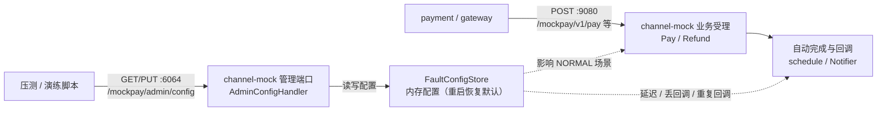
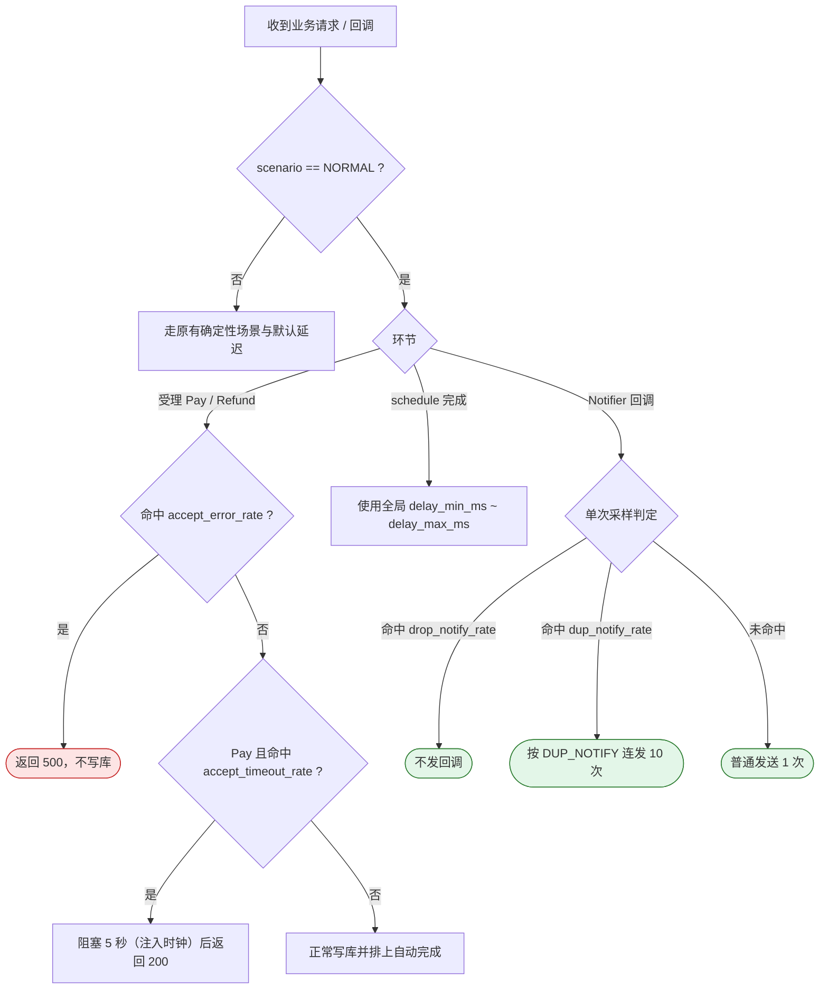

# CH-07 全局故障配置

| 项 | 内容 |
|---|---|
| 功能点 | CH-07（P0，第 6 周） |
| 所属链路 | 支付 |
| 代码提交 | `e23311f` `[CH-07] add global fault config` |
| 分支 | `feat/CH-07-global-fault-config` |
| 日期 | 2026-11-14 |
| 状态 | DONE（单元与编译验证通过；`make lint`、`go test -race` 与集成测试受环境限制未运行，见 §4.4） |

## 一句话结论

在模拟外部支付渠道（`channel-mock`）的管理端口（`:6064`）上实现了全局故障配置接口 `GET / PUT /mockpay/admin/config`，支持在运行时动态调整 `NORMAL` 场景交易的自动完成延迟、丢回调/重复回调概率与受理错误/超时概率；单元测试（覆盖率 90.2% / 91.2%）及全量单测全部通过，集成测试 `TestCH07DropNotifyRateOneCompensatedByQuery` 编译通过待在带 MySQL 的环境运行。

## 1. 背景

### 1.1 系统简介

> pay-system 是一个用 Go 编写的小型支付后端，模拟商户收款、退款、商户间转账三条资金链路，重点在数据一致性和性能。系统由 5 个部分组成：gateway（对外 HTTP 入口，负责签名校验和限流）、payment（支付单、退款单、转账单的状态管理和流程推进）、account（账户余额与记账，数据按商户分到 2 个数据库分片）、channel-mock（模拟微信、支付宝这类外部支付渠道）、recon（对账，核对系统内外数据是否一致）。服务之间用 Kitex RPC 同步调用，或通过 Kafka 消息异步通知；数据存在 MySQL 8.4，Redis 用于防重放。所有金额用整数“分”表示，所有记账只追加不修改。当前已完成：工程骨架、账户与记账、支付/退款/转账三条核心链路、异步通知、网关安全、可观测性与耗时埋点，进入第 6 周对账与压测准备阶段。

### 1.2 本功能点在系统中的位置

CH-07 位于模拟渠道 `channel-mock` 内部，只对管理端口（`:6064`）开放配置读写，并作用于业务端口（`:9080`）的正常交易流程：



上游是压测工具或故障演练脚本（通过管理端口 `:6064` 调参）以及 `payment` 服务（通过业务端口 `:9080` 发起支付、退款和接收回调）；下游影响 `channel-mock` 对 `NORMAL` 交易的受理响应、自动完成时机及回调发送方式。

### 1.3 为什么需要它

在基线压测和故障演练中，需要以**全量正常流量**模拟外部渠道在不同网络条件与异常比例下的表现，而不改变商户下单金额或重启服务。

此前 `channel-mock` 虽然支持通过金额末两位触发确定性故障场景（例如金额 `10001` 分即 100.01 元触发失败、`10003` 分触发不回调），但存在两个限制：
1. 无法把大量压测订单（例如 100 个商户的 `10000` 分即 100.00 元正常订单）统一设置成 `50ms–200ms` 的渠道处理延迟，也无法在运行时把正常订单的丢回调概率调成 `1.0` 来验证平台查单补偿任务在大量丢回调时的表现。
2. 渠道默认延迟范围来自启动环境变量 `MOCK_DELAY_MIN_MS` / `MOCK_DELAY_MAX_MS`，每次调整都要重启容器，无法在演练中途动态注入或恢复故障。

## 2. 术语

| 术语 | 含义 |
|---|---|
| `channel-mock` | 本项目的模拟外部支付渠道服务，业务端口 `:9080` 提供下单/查单/关单/退款接口，管理端口 `:6064` 提供健康检查、指标和本功能点的配置接口。 |
| `NORMAL` 场景 | 模拟渠道的默认正常场景：支付或退款金额末两位为 `00`（如 `10000` 分即 100.00 元）且未命中特定故障尾数时，渠道受理后自动完成为成功并发送一次回调。 |
| 局部更新（Patch） | `PUT` 请求只提交需要修改的 JSON 字段（例如只传 `{"drop_notify_rate": 1}`），未传字段保持当前值不变。 |
| 查单补偿 | 渠道回调丢失或延迟时，`payment` 服务后台定时任务主动调用渠道查单接口拉取终态并推进支付单完成的兜底机制。 |
| `DUP_NOTIFY` 模式 | 渠道回调重复发送模式：进入终态后先并发发送 5 次回调，之后每秒发送 1 次再发 5 次（共 10 次），无论平台是否返回 `SUCCESS`。 |

## 3. 技术讲解

### 3.1 要解决的问题

本功能点需要满足以下约束：
1. **端口隔离**：管理接口 `/mockpay/admin/config` 只能挂在管理端口（`:6064`），业务端口（`:9080`）不得暴露，避免压测或业务流量误触配置接口。
2. **仅作用于 `NORMAL` 场景**：通过金额尾数指定的确定性故障场景（如 `FAIL`、`DROP_NOTIFY`、`DUP_NOTIFY`、`SLOW`、`ACCEPT_TIMEOUT`）行为保持不变，避免破坏已有演练和验收测试的确定性。
3. **局部更新与严格校验**：`PUT` 支持局部或全量 JSON 更新；延迟范围必须满足 `0 <= delay_min_ms <= delay_max_ms`，四个概率值必须在 `[0, 1]` 区间；非法 JSON、未知字段、重复字段、`null` 字段或类型错误统一返回 `400`，非 `GET`/`PUT` 返回 `405`。
4. **并发安全与无持久化**：配置仅保存在内存中，服务重启即恢复为环境变量默认值；高并发下读配置和更新配置无数据竞争。

### 3.2 方案

整体思路是在 `channel-mock` 的 `biz` 层维护一个带读写锁的内存配置容器 `FaultConfigStore`，在服务装配时把同一份指针分别注入业务受理 `Service`、回调发送器 `Notifier` 和管理端口 HTTP 处理器 `AdminConfigHandler`。



#### 关键结构与实现摘录

1. **配置存储与校验**（`service/channel_mock/biz/fault_config.go`）：`FaultConfigStore` 使用 `sync.RWMutex` 保护当前配置 `FaultConfig`，`Update` 先基于当前配置复制出 `next`，逐个应用非 `nil` 的指针字段并通过 `validateFaultConfig` 校验全部约束后才替换，校验失败不会污染已有配置。

```go
// service/channel_mock/biz/fault_config.go
func (s *FaultConfigStore) Update(patch FaultConfigPatch) (FaultConfig, error) {
	s.mu.Lock()
	defer s.mu.Unlock()
	next := s.cfg
	if patch.DelayMinMS != nil {
		next.DelayMinMS = *patch.DelayMinMS
	}
	// ... 其余 5 个字段同上
	if err := validateFaultConfig(next); err != nil {
		return FaultConfig{}, err
	}
	s.cfg = next
	return next, nil
}
```

2. **回调概率互斥采样**（`service/channel_mock/biz/fault_config.go`）：`decideNotifyMode` 只做一次随机数采样，先判断是否命中 `drop_notify_rate`，未命中再判断是否落入 `[drop_notify_rate, drop_notify_rate + dup_notify_rate)` 区间触发 `notifyDup`，保证单笔回调不会既被丢弃又被重复发送。

3. **严格 JSON 解码**（`service/channel_mock/handler/admin_config.go`）：`decodeFaultConfigPatch` 使用 `json.Decoder` 逐个读取 JSON 对象键，拒绝重复键、未知键、`null` 值及尾部多余数据，从而实现“局部更新 + 严格参数校验”。

4. **管理端口扩展**（`pkg/server/server.go`）：为 `pkg/server.Server` 新增 `Handle(pattern string, h http.Handler)` 方法，使 `cmd/channel-mock/main.go` 可以在管理端口 `:6064` 注册 `/mockpay/admin/config`，同时不影响原有的 `/healthz`、`/readyz`、`/metrics` 和 `/debug/pprof/`。

### 3.3 为什么这样做

| 方案 | 做法 | 优点 | 缺点 | 结论 |
|---|---|---|---|---|
| 采用：内存 `FaultConfigStore` + 管理端口专有路由 | 配置保存在进程内存中，由 `pkg/server` 管理端口暴露 `GET/PUT` | 实现简单、无数据库读写开销、重启天然恢复默认值、与业务端口物理隔离 | 多实例部署时需逐实例调用（当前压测单实例 `channel-mock`） | 采用 |
| 备选：配置持久化到 MySQL 表 | 建配置表并通过 `PUT` 写入数据库，业务请求查表或轮询刷新 | 多实例天然共享配置 | 违背“重启后恢复默认值”需求；每次受理/回调增加 DB 查询或缓存失效复杂度 | 不采用 |
| 备选：使用标准 `json.Unmarshal` 直接解析结构体 | 直接 `json.Unmarshal(body, &cfg)` | 代码少 | 无法区分“字段未传（保持原值）”与“传了 0 / null”，也无法拒绝重复键 | 不采用 |

### 3.4 正确性

本功能点属于模拟渠道测试/压测配置，不涉及平台资金账务表写入与账户余额变更（资金类正确性校验“不涉及”），但仍对其自身边界与并发行为进行了验证：
- **并发读写安全**：`FaultConfigStore` 使用 `sync.RWMutex` 保护配置快照，`TestFaultConfigConcurrentAccess` 模拟 8 个 goroutine 并发执行配置更新、读取和 `Pay` 调用。
- **参数原子性**：`Update` 在锁内校验完整配置，任一字段非法（负数延迟、`min > max`、概率越界、`NaN`/`Inf`、`null`、重复字段）均整体拒绝并保持原配置不变（`TestFaultConfigDefaultsUpdateAndReset`、`TestAdminConfigValidation`）。
- **丢回调兜底**：当 `drop_notify_rate=1` 时，`NORMAL` 交易不会产生重复或漏单的脏状态，全部正常终态落库，平台 `payment` 通过查单补偿推进至 `SUCCESS`（`TestNotifierGlobalDropNotifyRate`、`TestCH07DropNotifyRateOneCompensatedByQuery`）。

### 3.5 性能

不涉及（本功能点为压测前置控制能力，基线压测数据将在后续 QA-02 功能点中采集与报告）。

## 4. 已完成内容

### 4.1 改动清单

| 文件 | 新增 / 修改 | 作用 |
|---|---|---|
| `service/channel_mock/biz/fault_config.go` | 新增 | 内存全局故障配置存储、校验与概率采样 |
| `service/channel_mock/biz/fault_config_test.go` | 新增 | 配置默认值、校验、延迟、丢回调、重复回调、受理错误/超时及并发单测 |
| `service/channel_mock/handler/admin_config.go` | 新增 | `GET/PUT /mockpay/admin/config` HTTP 处理器与严格 JSON 解析 |
| `service/channel_mock/handler/admin_config_test.go` | 新增 | 管理接口读写、参数/方法校验及业务端口 404 隔离测试 |
| `pkg/server/server.go` | 修改 | 管理端口 `Server` 新增 `Handle` / `HandleFunc` 路由注册 |
| `pkg/server/server_test.go` | 修改 | 新增管理端口自定义路由测试 `TestServerCustomHandle` |
| `cmd/channel-mock/main.go` | 修改 | 注入 `FaultConfigStore` 到 `Notifier` 并挂载管理端口路由 |
| `service/channel_mock/biz/pay.go` | 修改 | 为 `NORMAL` 场景接入受理错误率与受理 5 秒超时概率 |
| `service/channel_mock/biz/refund.go` | 修改 | 为 `NORMAL` 场景接入退款受理错误率 |
| `service/channel_mock/biz/finish.go` | 修改 | 为 `NORMAL` 场景接入动态完成延迟范围 |
| `service/channel_mock/biz/notify.go` | 修改 | 为 `NORMAL` 场景接入丢回调概率与重复回调概率 |
| `service/payment/biz/query_compensate_integration_test.go` | 修改 | 新增验收集成测试 `TestCH07DropNotifyRateOneCompensatedByQuery` |
| `docs/02-requirements.md` | 修改 | §3 CH-07 状态改为 `DONE`，§4 验收条目勾选 `[x]` |
| `docs/04-dev-plan.md` | 修改 | 第 6 周计划勾选 `CH-07` |
| `docs/05-api.md` | 修改 | 更新至 `3.6.1`，对齐 §9.8 管理接口字段与行为说明 |

### 4.2 对外变化

| 类别 | 变化 |
|---|---|
| 接口 | 管理端口 `:6064` 新增 `GET /mockpay/admin/config` 与 `PUT /mockpay/admin/config`（业务端口 `:9080` 不提供），支持局部/全量 JSON 更新，非法入参返回 `400`，非 GET/PUT 返回 `405` |
| 表结构 | 无 |
| 配置项 | 无新增环境变量；初始延迟默认读取已有 `MOCK_DELAY_MIN_MS` / `MOCK_DELAY_MAX_MS` |
| 错误码 | 无（管理接口使用标准 HTTP 状态码 200/400/405） |
| 指标 / 故障点 | 无 |

### 4.3 验收对照

| 验收条目 | 测试函数 | 类型 | 结果 |
|---|---|---|---|
| 丢回调概率设为 1 时，所有 NORMAL 交易都不回调，平台通过查单全部完成 | `service/channel_mock/biz.TestNotifierGlobalDropNotifyRate` | 单元测试 | 通过 |
| 丢回调概率设为 1 时，所有 NORMAL 交易都不回调，平台通过查单全部完成 | `service/payment/biz.TestCH07DropNotifyRateOneCompensatedByQuery` | 集成测试 | 编译通过；未运行（无可用 Docker/MySQL） |
| 规则补充：管理接口读写、局部更新、400/405 校验、业务端口 404 | `service/channel_mock/handler.TestAdminConfigGetAndPut`、`TestAdminConfigValidation`、`TestAdminConfigOnlyOnAdminPort` | 单元测试 | 通过 |
| 规则补充：延迟范围、重复回调、受理错误/超时、重启恢复默认、并发安全 | `service/channel_mock/biz.TestFaultConfigDefaultsUpdateAndReset`、`TestServiceGlobalDelayRangeForNormal`、`TestNotifierGlobalDupNotifyRate`、`TestServiceGlobalAcceptErrorAndTimeoutRate`、`TestFaultConfigConcurrentAccess` | 单元测试 | 通过 |

### 4.4 验证记录

运行环境：Linux（容器内核 39-bit VMA），Go `go1.24`，无 `golangci-lint`，无运行中的 Docker/MySQL 实例。

| 命令 | 结果 |
|---|---|
| `gofmt -l .` | 通过（无输出，exit 0） |
| `go vet -tags integration ./...` | 通过（无告警，exit 0） |
| `make lint` | 未验证：当前环境未安装 `golangci-lint`（已以 `go vet -tags integration ./...` 替代基础静态检查） |
| `make test`（`go test -race ./...`） | 未验证：容器内核 VMA 为 39 位，TSan 报错 `FATAL: ThreadSanitizer: unsupported VMA range (Found 39 - Supported 48)` |
| `go test ./...`（不带 `-race`） | 通过（全仓非集成单元测试全部通过） |
| `go test -count=1 -cover ./pkg/server/... ./service/channel_mock/... ./cmd/channel-mock/...` | 通过：`pkg/server` 89.1%、`service/channel_mock/biz` 90.2%、`service/channel_mock/handler` 91.2%、`service/channel_mock/scenario` 75.0%、`cmd/channel-mock` 11.1% |
| `make test-integration` | 未验证：环境未配置 `TEST_MYSQL_DSN` 且 Docker 未运行/无权限；已运行 `go test -tags integration -c -o /tmp/payment_biz_int.test ./service/payment/biz` 验证集成测试编译通过 |
| `make cover` | 未验证：同 `make test-integration` 与 `-race` 环境限制 |

### 4.5 同步的文档

- `docs/02-requirements.md`：将 §3 总表 CH-07 状态更新为 `DONE`，勾选 §4 CH-07 验收条目。
- `docs/04-dev-plan.md`：第 6 周计划将 CH-07 拆分为独立条目并勾选为已完成。
- `docs/05-api.md`：文档版本升至 `3.6.1`，补充 §0.2 变更记录、§1 总览及 §9.8 管理端口 `GET/PUT /mockpay/admin/config` 局部更新、400/405 校验等说明。

## 5. 未完成与风险

- 当前环境受限，需在具备 `golangci-lint`、支持 TSan 的 48-bit VMA 内核以及 Docker/MySQL 8.4.11 的环境中补跑 `make lint`、`make test`（`-race`）和 `make test-integration`（重点执行 `TestCH07DropNotifyRateOneCompensatedByQuery`）。
- 留给后续功能点的工作：`QA-02`（基线压测与报告）将直接使用 CH-07 的 `PUT /mockpay/admin/config` 设置 `delay_min_ms=50, delay_max_ms=200` 跑基线压测。

## 6. 如何复现

前置条件：Go 1.24+，若运行集成测试需启动 Docker 或提供 MySQL 8.4.11 实例并设置 `TEST_MYSQL_DSN`。

```bash
# 1. 格式与静态检查
gofmt -l .
make lint

# 2. 运行 CH-07 单元测试与覆盖率（含竞态检测）
go test -race -count=1 -cover ./pkg/server/... ./service/channel_mock/...

# 3. 运行 CH-07 验收集成测试（需 Docker 或 TEST_MYSQL_DSN）
go test -race -tags integration -v -run TestCH07DropNotifyRateOneCompensatedByQuery ./service/payment/biz/...
```

## 延伸阅读

- `docs/02-requirements.md` §4 CH-07（需求规格与验收标准）
- `docs/05-api.md` §9.8（模拟渠道管理接口契约）
- `docs/06-flows.md` CF-24（渠道回调发送控制流图）

## 修订记录

| 日期 | 提交 | 修订内容 |
|---|---|---|
| 2026-11-14 | `e23311f` | 初版报告，记录 CH-07 全局故障配置实现与验证情况 |
