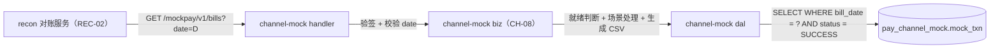
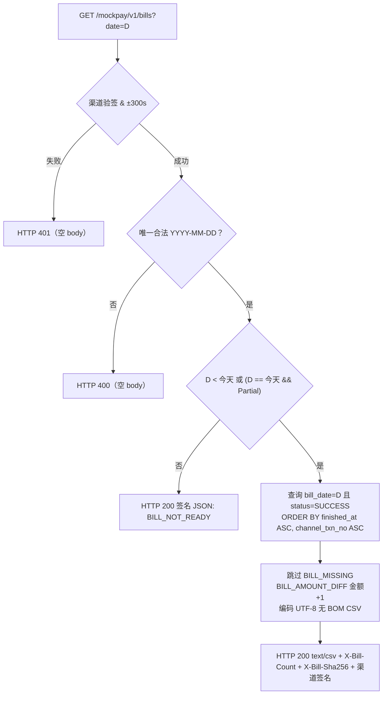

# CH-08 账单下载

| 项 | 内容 |
|---|---|
| 功能点 | CH-08（P0，第 6 周） |
| 所属链路 | 支付（对账外部输入） |
| 代码提交 | `26a725a` `[CH-08] add bill download` |
| 分支 | `feat/CH-08-bill-download` |
| 日期 | 2026-11-15 |
| 状态 | DONE |

## 一句话结论

在模拟渠道 `channel-mock` 实现了按日下载对账单接口 `GET /mockpay/v1/bills?date=YYYY-MM-DD`，按东八区日期导出所有成功支付与退款交易的确定性 CSV，并附带 `X-Bill-Sha256`、`X-Bill-Count` 与渠道签名头；单元测试、HTTP 测试与基于 MySQL 8.4 的端到端集成测试均已通过。

## 1. 背景

### 1.1 系统简介

> pay-system 是一个用 Go 编写的小型支付后端，模拟商户收款、退款、商户间转账三条资金链路，重点在数据一致性和性能。系统由 5 个部分组成：gateway（对外 HTTP 入口，负责签名校验和限流）、payment（支付单、退款单、转账单的状态管理和流程推进）、account（账户余额与记账，数据按商户分到 2 个数据库分片）、channel-mock（模拟微信、支付宝这类外部支付渠道）、recon（对账，核对系统内外数据是否一致）。服务之间用 Kitex RPC 同步调用，或通过 Kafka 消息异步通知；数据存在 MySQL 8.4，Redis 用于防重放。所有金额用整数“分”表示，所有记账只追加不修改。当前已完成：基础设施（骨架、编排、迁移、工具库、签名、加密、故障注入）、账务与三条资金主链路、异步消费与商户通知、网关安全与限流、可观测性以及模拟渠道受理/查单/关单/退款/回调/全局故障配置。

### 1.2 本功能点在系统中的位置



上游调用方是平台对账服务 `recon`（将在 REC-02 中实现），本功能点负责模拟渠道侧按日导出对账单的全部逻辑（`handler`、`biz`、`dal`）。

### 1.3 为什么需要它

支付系统与外部渠道各自维护交易流水，网络抖动、回调丢失或渠道侧异常都可能导致两边状态或金额不一致。例如某天平台记录了 10000 分（100.00 元）支付成功，渠道实际记了 10001 分，或者渠道少记了一笔交易。如果没有每日对账单下载接口，`recon` 就无法拿到渠道侧的全量成功交易清单来核对长款、短款和金额差错；同时，为了能在本地自动化验证对账差错识别，渠道账单还必须忠实反映预先约定的故障场景（`BILL_MISSING` 漏单、`BILL_AMOUNT_DIFF` 金额多 1 分）。

## 2. 术语

| 术语 | 含义 |
|---|---|
| 对账单（Bill） | 支付渠道按日出具的成功交易明细文件（CSV 格式），用于平台对账服务逐笔比对 |
| `bill_date` | 交易计入渠道账单的东八区日期（`YYYY-MM-DD`），仅在支付或退款到达 `SUCCESS` 时写入 |
| `BILL_NOT_READY` | 渠道返回的业务结果码，表示目标日期的账单尚未出账（当天默认未出账，未来日期永不出账） |
| `MOCK_ALLOW_PARTIAL_BILL` | 渠道进程环境变量开关，设为 `true` 时允许下载当天的部分账单，仅用于测试与演练 |
| `BILL_MISSING` | 模拟渠道故障场景之一（支付金额末两位为 `06`），交易本身 `SUCCESS`，但故意不写入 `bill_date`，从而不在账单中出现 |
| `BILL_AMOUNT_DIFF` | 模拟渠道故障场景之一（支付金额末两位为 `07`），交易本身 `SUCCESS`，但在输出账单 CSV 时金额加 1 分 |

## 3. 技术讲解

### 3.1 要解决的问题

1. **防重放与完整性校验**：账单接口属于平台与渠道之间的外部 HTTP 通信，请求与 200 响应（包括 `BILL_NOT_READY` 和 CSV 文件）都必须使用渠道 HMAC-SHA256 签名并校验 ±300 秒时间窗；CSV 响应需携带 `X-Bill-Count`（数据行数）和 `X-Bill-Sha256`（文件内容小写十六进制 SHA-256），以便对账服务校验文件未截断或损坏。
2. **出账日期控制**：当天交易尚未日终清算，默认不能下载当天或未来日期的账单，需返回 `BILL_NOT_READY`；仅当 `MOCK_ALLOW_PARTIAL_BILL=true` 时允许下载当天的账单，未来日期仍拒绝。
3. **确定性与幂等下载**：同一天的账单在交易数据不变的情况下，多次下载得到的字节流必须完全一致，因此数据库查询和 CSV 生成不能有不确定的排序或时间戳格式差异。
4. **故障场景还原**：`BILL_MISSING` 场景交易不得出现在账单中；`BILL_AMOUNT_DIFF` 场景交易在账单中的金额必须比 `mock_txn.amount` 多 1 分。

### 3.2 方案

整体采用三层职责划分：`handler` 负责验签、解析唯一 `date` 查询参数、写入 CSV 与签名响应头；`biz` 负责日期合法性校验、基于注入时钟的东八区就绪判断、场景过滤与金额调整、CSV 编码与 SHA-256 摘要计算；`dal` 负责按 `bill_date` 索引只读查询已成功交易并固定排序。



关键数据访问 SQL（`service/channel_mock/dal/txn.go`）：利用 `mock_txn` 表上已有的 `idx_bill_date` 索引过滤目标日期，并按 `(finished_at, channel_txn_no)` 升序保证跨次下载排序完全确定（`channel_txn_no` 具有唯一索引）。

```go
// service/channel_mock/dal/txn.go
func (d *DB) ListBillTxns(ctx context.Context, billDate string) ([]Txn, error) {
	var rows []txnRow
	err := d.db.SelectContext(ctx, &rows, `
SELECT `+txnColumns+` FROM mock_txn
WHERE bill_date = ? AND status = ?
ORDER BY finished_at ASC, channel_txn_no ASC`, billDate, StatusSuccess)
	if err != nil {
		return nil, fmt.Errorf("list bill mock_txn: %w", err)
	}
```

业务层就绪判断与 CSV 生成（`service/channel_mock/biz/bill.go`）：通过注入时钟获取东八区当前日期，先截断 `finished_at` 到毫秒并格式化为 `+08:00` 偏移的 RFC3339 字符串，再用标准库 `encoding/csv` 写入（默认 `\n` 换行、无 BOM）。

```go
// service/channel_mock/biz/bill.go
	today := s.clk.Now().In(shanghai).Format(billDateLayout)
	if date > today || (date == today && !s.opts.AllowPartialBill) {
		return BillResult{Ready: false}, nil
	}
	rows, err := s.store.ListBillTxns(ctx, date)
```

### 3.3 为什么这样做

| 方案 | 做法 | 优点 | 缺点 | 结论 |
|---|---|---|---|---|
| 采用：按需实时查询 `mock_txn` 生成确定性 CSV | 查询 `idx_bill_date` 索引，按 `(finished_at, channel_txn_no)` 排序并在内存中生成 CSV 与 SHA-256 | 无需引入额外账单文件存储与定时生成任务；与 `MOCK_ALLOW_PARTIAL_BILL`、后续 `CH-09` 账单注入天然兼容 | 单日交易量极大时内存占用随行数线性增长（本模拟渠道数据量小，可接受） | 采用 |
| 备选：定时任务提前生成静态 CSV 落盘 | 每日凌晨扫描生成文件，下载接口直接读取文件 | 下载时无需查库 | 与当天部分账单开关及 `CH-09` 动态注入账单记录冲突，需额外维护文件失效逻辑 | 不采用，复杂且不利于测试注入 |

### 3.4 正确性

本功能点为只读查询接口，不涉及资金状态流转或账户余额修改；并发下载同一天的账单只执行只读 `SELECT`，互不干扰。

| 场景 | 系统行为 | 最终状态 | 证明 |
|---|---|---|---|
| 同一日期账单多次下载 | 只读查询按 `(finished_at, channel_txn_no)` 确定性排序，输出字节与 `X-Bill-Sha256` 完全一致 | 数据库无写入变化 | `TestDownloadBillCSVAndScenarios`、`TestBillDownloadEndToEndMySQL` |
| 缺少或重复 `date` 参数、日期格式非法（如 `2026-02-30`） | 拒绝请求并返回 HTTP 400（空 body、不签名） | 数据库无查询与写入 | `TestDownloadBillValidationAndReadiness`、`TestBillDownloadHTTP` |
| `BILL_MISSING` 与 `BILL_AMOUNT_DIFF` 场景 | `BILL_MISSING` 因 `bill_date IS NULL` 且业务层过滤而不出现；`BILL_AMOUNT_DIFF` 输出金额为原金额 + 1 分 | `mock_txn` 原记录不变 | `TestListBillTxns`、`TestDownloadBillCSVAndScenarios`、`TestBillDownloadEndToEndMySQL` |

### 3.5 性能

不涉及（非性能优化类功能点，未采集压测数据）。

## 4. 已完成内容

### 4.1 改动清单

| 文件 | 新增 / 修改 | 作用 |
|---|---|---|
| `service/channel_mock/biz/bill.go` | 新增 | 实现 `DownloadBill` 日期校验、就绪判断、场景处理、CSV 编码与 SHA-256 计算 |
| `service/channel_mock/biz/bill_test.go` | 新增 | `biz` 账单下载单元测试 |
| `service/channel_mock/handler/bill.go` | 新增 | 实现 `GET /mockpay/v1/bills` HTTP 处理与响应头/签名写入 |
| `service/channel_mock/handler/bill_test.go` | 新增 | `handler` 账单下载单元测试 |
| `service/channel_mock/dal/bill_integration_test.go` | 新增 | `dal.ListBillTxns` MySQL 集成测试 |
| `service/channel_mock/handler/bill_integration_test.go` | 新增 | 账单下载端到端 MySQL 集成测试 |
| `service/channel_mock/dal/txn.go` | 修改 | 新增 `DB.ListBillTxns` 方法 |
| `service/channel_mock/biz/pay.go` | 修改 | `Store` 接口新增 `ListBillTxns`，`Options` 新增 `AllowPartialBill` |
| `service/channel_mock/biz/fakes_test.go` | 修改 | 内存假存储 `memStore` 实现 `ListBillTxns` |
| `service/channel_mock/handler/pay.go` | 修改 | 新增 `BillPath`、`Payer.DownloadBill`，注册 `GET /mockpay/v1/bills` |
| `service/channel_mock/handler/pay_test.go` | 修改 | `fakePayer` 实现 `DownloadBill` |
| `cmd/channel-mock/main.go` | 修改 | 传入 `cfg.MockAllowPartialBill` 到 `biz.Options` |

### 4.2 对外变化

| 类别 | 变化 |
|---|---|
| 接口 | 开放 `GET /mockpay/v1/bills?date=YYYY-MM-DD`，支持渠道验签、`text/csv` 导出及 `BILL_NOT_READY` 响应 |
| 表结构 | 无（复用 `mock_txn.idx_bill_date`） |
| 配置项 | 无新增（沿用已登记的 `MOCK_ALLOW_PARTIAL_BILL`，接入到 `biz.Options`） |
| 错误码 | 无 |
| 指标 / 故障点 | 无 |

### 4.3 验收对照

| 验收条目 | 测试函数 | 类型 | 结果 |
|---|---|---|---|
| 账单行数与 `X-Bill-Count` 一致，内容哈希与 `X-Bill-Sha256` 一致 | `TestDownloadBillCSVAndScenarios`、`TestBillDownloadHTTP`、`TestBillDownloadEndToEndMySQL` | 单元 + 集成 | 通过 |
| `BILL_MISSING` 交易不在账单中，`BILL_AMOUNT_DIFF` 交易金额 +1 | `TestListBillTxns`、`TestDownloadBillCSVAndScenarios`、`TestBillDownloadEndToEndMySQL` | 单元 + 集成 | 通过 |

### 4.4 验证记录

| 命令 | 结果 |
|---|---|
| `gofmt -l .` | 通过，无未格式化文件 |
| `PATH="$PATH:$(go env GOPATH)/bin" make lint` | 通过，`0 issues.` |
| `make test` | 通过，全仓库单元测试（`-race`）全部通过 |
| `go test -race -tags integration -cover ./service/channel_mock/... ./cmd/channel-mock/...` | 通过；覆盖率：`biz` `89.3%`，`handler` `91.3%`，`scenario` `75.0%`，`dal` `47.8%`，`cmd/channel-mock` `15.0%` |
| 其余服务全量 `make test-integration` | 未运行（本次只改动 `channel_mock` 与 `cmd/channel-mock`） |

### 4.5 同步的文档

- `docs/02-requirements.md`：§3 总表 `CH-08` 状态改为 `DONE`，§4.3 `CH-08` 两条验收勾选 `[x]`。
- `docs/04-dev-plan.md`：第 6 周拆出 `- [x] CH-08 账单下载` 与 `- [ ] CH-09 账单注入`。
- `docs/database.md`：§4.16 `mock_txn` 查询模式补充 CH-08 账单只读查询说明。

## 5. 未完成与风险

- 账单注入（`CH-09`）与对账服务侧下载导入（`REC-02`）将在后续功能点实现，届时将与本接口联动联调。
- 本次未运行 `channel_mock` 之外其他服务的集成测试，对账模块尚未接入该接口。

## 6. 如何复现

前置条件：Go 1.24+、Docker（供 testcontainers 启动 MySQL 8.4.11）。

```bash
# 1. 运行全仓库单元测试
make test

# 2. 运行 channel_mock 集成测试并查看覆盖率
go test -race -tags integration -cover ./service/channel_mock/... ./cmd/channel-mock/...
```

预期输出：`service/channel_mock/biz`、`dal`、`handler`、`scenario` 与 `cmd/channel-mock` 全部 `ok`。

## 延伸阅读

- `docs/02-requirements.md` §4.3 `CH-08`
- `docs/05-api.md` §3.5、§9.6
- `docs/06-flows.md` CF-25
- `docs/database.md` §4.16

## 修订记录

| 日期 | 提交 | 修订内容 |
|---|---|---|
| 2026-11-15 | `26a725a` | 初版，对应 CH-08 账单下载完成交付 |
