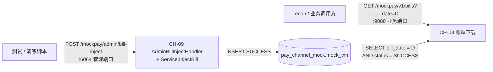
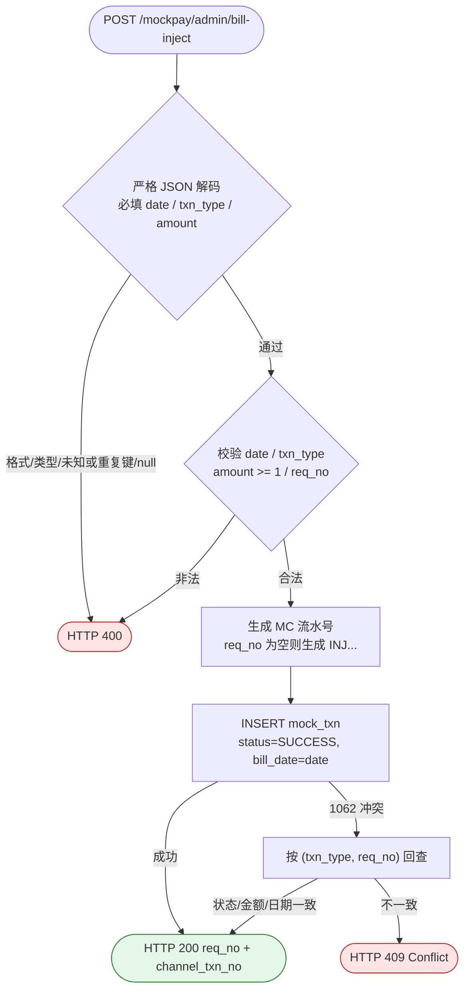

# CH-09 账单注入

| 项 | 内容 |
|---|---|
| 功能点 | CH-09（P0，第 6 周） |
| 所属链路 | 支付（对账演练与模拟渠道支撑） |
| 代码提交 | `721b4d6` `[CH-09] add bill inject` |
| 分支 | `feat/CH-09-bill-inject` |
| 日期 | 2026-11-15 |
| 状态 | DONE |

## 一句话结论

在模拟渠道服务 `channel-mock` 的管理端口（`:6064`）实现了 `POST /mockpay/admin/bill-inject` 接口：参数校验通过后直接向 `mock_txn` 表写入一条 `status = 'SUCCESS'` 且 `bill_date = date` 的记录，`req_no` 默认生成平台不存在的 `INJ...` 单号。单元与 MySQL 集成测试均已通过，注入的 `PAY` 与 `REFUND` 记录在下载对应日期账单时准确出现在 CSV 中。

## 1. 背景

### 1.1 系统简介

> pay-system 是一个用 Go 编写的小型支付后端，模拟商户收款、退款、商户间转账三条资金链路，重点在数据一致性和性能。系统由 5 个部分组成：gateway（对外 HTTP 入口，负责签名校验和限流）、payment（支付单、退款单、转账单的状态管理和流程推进）、account（账户余额与记账，数据按商户分到 2 个数据库分片）、channel-mock（模拟微信、支付宝这类外部支付渠道）、recon（对账，核对系统内外数据是否一致）。服务之间用 Kitex RPC 同步调用，或通过 Kafka 消息异步通知；数据存在 MySQL 8.4，Redis 用于防重放。所有金额用整数“分”表示，所有记账只追加不修改。当前已完成：工程骨架、账户分片与全部账户操作、模拟渠道全套业务接口与管理端口配置/账单下载、支付与退款完整链路、同分片与跨分片转账链路、Kafka 异步投递与消费、商户通知、网关安全与限流、可观测性埋点与分阶段耗时基线。

### 1.2 本功能点在系统中的位置



上游调用方是测试或演练脚本（通过仅对本机开放的管理端口 `:6064` 调用），下游直接写入 `pay_channel_mock.mock_txn` 表；随后 `recon`（对账服务）或业务方通过 `CH-08` 账单下载接口拉取指定日期 CSV 账单时，就能读出注入的交易记录。

### 1.3 为什么需要它

对账系统需要验证“渠道有记录、平台无记录”的长款差错（`LOCAL_MISSING`）能否被正确识别。正常走业务端口 `/mockpay/v1/pay` 或 `/mockpay/v1/refund` 下单时，请求会先经过平台侧生成订单号（如 `PA...` / `RF...`），并在平台库留下记录；如果测试只为了构造“平台完全没有这笔单，但渠道账单里有 10500 分（105.00 元）”的场景，直接操作数据库既容易漏掉必填字段或破坏时间/状态格式，也不便在自动化脚本中触发。因此需要管理端口提供受控的账单注入接口。

## 2. 术语

| 术语 | 含义 |
|---|---|
| `channel-mock` | 模拟外部支付渠道的服务，业务端口 `:9080` 对外提供支付、查单、关单、退款、下载账单；管理端口 `:6064` 仅用于运维和故障/账单注入。 |
| `mock_txn` | `pay_channel_mock` 库中的渠道交易表，记录每笔支付（`PAY`）和退款（`REFUND`）的流水号、状态、金额、完成时间和账单日期。 |
| 长款（`LOCAL_MISSING`） | 外部渠道账单中存在某笔成功交易，但平台本地支付单或退款单表中找不到对应记录的对账差错。 |
| `bill_date` | `mock_txn` 中表示该笔成功交易计入哪一天对账单的东八区日期（`YYYY-MM-DD`）。 |
| `req_no` | 平台侧传入渠道的请求号（支付为 `pay_no`，退款为 `refund_no`），在 `mock_txn` 上与 `txn_type` 组成唯一键 `uk_type_req_no`。 |

## 3. 技术讲解

### 3.1 要解决的问题

1. **端口隔离**：账单注入属于测试与演练能力，只能暴露在管理端口 `:6064`，业务端口 `:9080` 不得提供该路由（返回 404）。
2. **数据格式合法且可被账单下载识别**：注入行必须满足 `mock_txn` 约束（`txn_type` 为 `PAY`/`REFUND`，`amount >= 1` 分，`status = 'SUCCESS'`，`bill_date = date`），并且 `finished_at` 不能为 NULL 或零值，否则 `CH-08` 导出 CSV 时会输出异常时间戳。
3. **默认单号不与平台冲突**：未传 `req_no` 时自动生成平台不存在的单号，且长度不超过 `req_no` 列宽（32 字符）。
4. **重复请求与冲突可区分**：指定 `req_no` 重复发送完全相同的注入请求时幂等返回已有结果；同 `(txn_type, req_no)` 下金额或账单日期不同时明确返回冲突，不覆盖已有记录。

### 3.2 方案

整体分为三层：`AdminBillInjectHandler` 负责管理端口 HTTP 方法限制（仅 `POST`）与严格 JSON 解析；`Service.InjectBill` 负责参数校验、生成 `MC` 前缀渠道流水号与默认 `INJ` 前缀请求号，并构造 `SUCCESS` 记录；`dal.DB.Insert` 写入 `mock_txn`（含 `finished_at` 与 `bill_date`）。



关键实现片段如下：

1. **DAL 层支持写入完成时间与账单日期**（`service/channel_mock/dal/txn.go`）：`Insert` 在 `FinishedAt` 非零、 `BillDate` 非空时写入对应列，现有 `Pay` / `Close` 传零值时仍写入 `NULL`，保持向后兼容。

```go
	var finishedAt any
	if !t.FinishedAt.IsZero() {
		finishedAt = t.FinishedAt
	}
	var billDate any
	if t.BillDate != "" {
		billDate = t.BillDate
	}
	res, err := d.db.ExecContext(ctx, `
INSERT INTO mock_txn (channel_txn_no, txn_type, req_no, orig_req_no, amount, status, scenario, notify_url, finished_at, bill_date, created_at)
VALUES (?, ?, ?, ?, ?, ?, ?, ?, ?, ?, ?)`,
		t.ChannelTxnNo, t.TxnType, t.ReqNo, orig, int64(t.Amount), t.Status, t.Scenario, t.NotifyURL, finishedAt, billDate, t.CreatedAt)
```

2. **Biz 层生成默认单号、构造终态记录与处理 1062**（`service/channel_mock/biz/bill.go`）：`finishedAt` 取 `date` 当天东八区 `00:00:00.000+08:00`，默认 `req_no` 复用 `idgen` 发出的 `MC` 号段替换前缀为 `INJ`（共 22 字符，≤ 32 字符限制，且不新增 `idgen` 全局前缀）。

```go
	reqNo := req.ReqNo
	if reqNo == "" {
		idNo, err := s.ids.NewNo(ctx, channelTxnPrefix)
		if err != nil {
			return BillInjectResult{}, fmt.Errorf("new injected req_no: %w", err)
		}
		reqNo = "INJ" + idNo[len(channelTxnPrefix):]
	}

	finishedAt, err := time.ParseInLocation(billDateLayout, req.Date, shanghai)
```

3. **Handler 层严格 JSON 校验与状态码映射**（`service/channel_mock/handler/admin_bill_inject.go`）：复用管理接口严格令牌流解码，拒绝未知字段、重复键、`null`、尾部多余内容及缺少必填字段的请求，并将 `ErrInvalidRequest` 映射为 400、`ErrConflict` 映射为 409。

### 3.3 为什么这样做

| 方案 | 做法 | 优点 | 缺点 | 结论 |
|---|---|---|---|---|
| 采用：复用 `dal.DB.Insert` + 管理端口独立 `Handler` | 扩展 `Insert` 支持 `finished_at` / `bill_date` 写入，管理端口 `:6064` 挂载 `AdminBillInjectHandler` | 不改表结构、不改业务端口路由、默认 `INJ` 单号不污染 `idgen` 业务前缀表 | `Insert` 需多传两个可空字段 | 采用 |
| 备选：为 `req_no` 在 `pkg/idgen` 新增 `IJ` 前缀，或直接调业务 `/mockpay/v1/pay` | 注册全局新前缀或走受理后加速完成 | 前缀语义更直观 | 需修改全局发号器配置和约定文档，且受理路径仍会走调度器与回调逻辑，不适合直接构造长款 | 不采用 |

### 3.4 正确性

本功能点属于模拟渠道管理端测试注入接口，不涉及平台账务或余额变更，但对 `mock_txn` 的幂等与唯一性有明确约束：

| 场景 | 系统行为 | 最终状态 | 证明 |
|---|---|---|---|
| 同一请求重复到达（相同 `txn_type`、`req_no`、`amount`、`date`） | `INSERT` 触发 `1062` 唯一键冲突后按 `(txn_type, req_no)` 回查，校验状态为 `SUCCESS` 且金额、日期一致，幂等返回已有 `channel_txn_no` | 数据库保留原行，不重复写入 | `TestInjectBillAndAppearsInDownloadBill` |
| 两个冲突请求并发（相同 `txn_type` + `req_no`，但 `amount` 或 `date` 不同） | 先到达者写入成功；后到达者触发 `1062` 回查发现参数不一致，返回 `ErrConflict`（HTTP 409） | 数据库仅保留先写入的一行，不被覆盖 | `TestInjectBillAndAppearsInDownloadBill`、`TestAdminBillInjectValidationAndPortIsolation` |
| 写入过程中或写入后进程崩溃 | `Insert` 为单条 SQL 自动提交，无中间态 `PROCESSING`；崩溃前未提交则无记录，已提交则已是完整 `SUCCESS` 行 | 无悬挂中间态 | —（单条 SQL 原子性） |
| 访问业务端口 `:9080` | 业务端口未注册 `/mockpay/admin/bill-inject`，直接返回 404 | 无写入 | `TestAdminBillInjectValidationAndPortIsolation` |

### 3.5 性能

不涉及。本功能点为测试与演练使用的低频管理接口，非压测链路。

## 4. 已完成内容

### 4.1 改动清单

| 文件 | 新增 / 修改 | 作用 |
|---|---|---|
| `service/channel_mock/dal/txn.go` | 修改 | 扩展 `Insert` 支持写入非零 `FinishedAt` 与 `BillDate` |
| `service/channel_mock/biz/bill.go` | 修改 | 新增 `ErrConflict`、`BillInjectRequest`、`BillInjectResult` 与 `InjectBill` |
| `service/channel_mock/handler/admin_bill_inject.go` | 新增 | 实现管理端口 `POST /mockpay/admin/bill-inject` HTTP 处理器 |
| `cmd/channel-mock/main.go` | 修改 | 在管理端口 `:6064` 挂载 `AdminBillInjectHandler` |
| `service/channel_mock/biz/bill_test.go` | 修改 | 新增 `CH-09` 业务层单元测试 |
| `service/channel_mock/handler/admin_bill_inject_test.go` | 新增 | 新增管理端口 handler 单元测试与端口隔离测试 |
| `service/channel_mock/handler/bill_integration_test.go` | 修改 | 新增 `TestBillInjectEndToEndMySQL` MySQL 端到端集成测试 |

### 4.2 对外变化

| 类别 | 变化 |
|---|---|
| 接口 | 管理端口 `:6064` 新增 `POST /mockpay/admin/bill-inject`，入参 `date`、`txn_type`、`amount`、可选 `req_no`，响应 `{"req_no":"...","channel_txn_no":"MC..."}`；业务端口 `:9080` 不提供 |
| 表结构 | 无 |
| 配置项 | 无 |
| 错误码 | 无（HTTP 层使用标准 200 / 400 / 405 / 409 / 500） |
| 指标 / 故障点 | 无 |

### 4.3 验收对照

| 验收条目 | 测试函数 | 类型 | 结果 |
|---|---|---|---|
| 注入后该记录出现在对应日期账单中（默认单号、指定单号、`PAY`/`REFUND`、幂等与冲突） | `TestInjectBillAndAppearsInDownloadBill` | 单元测试 | 通过 |
| 账单注入入参校验（日期、类型、金额、`req_no` 长度与 UTF-8） | `TestInjectBillValidation` | 单元测试 | 通过 |
| 管理接口 HTTP 正常注入、可选 `req_no` 透传 | `TestAdminBillInjectHandler` | 单元测试 | 通过 |
| 管理接口严格 JSON 校验（400）、冲突（409）、错误（500）、方法限制（405）与业务端口隔离（404） | `TestAdminBillInjectValidationAndPortIsolation` | 单元测试 | 通过 |
| 端到端 MySQL 注入 `PAY` / `REFUND` 后通过 `GET /mockpay/v1/bills` 下载验证 | `TestBillInjectEndToEndMySQL` | 集成测试 | 通过 |

### 4.4 验证记录

| 命令 | 结果 |
|---|---|
| `gofmt -l .` | 通过（无输出） |
| `PATH="$PATH:$(go env GOPATH)/bin" make lint` | 通过（`golangci-lint run --build-tags integration ./...`，`0 issues.`） |
| `make test` | 通过（`go test -race ./...` 全部包 PASS） |
| `go test -race -tags integration -cover ./service/channel_mock/... ./cmd/channel-mock/...` | 通过（`biz` 88.8%、`dal` 48.6%、`handler` 90.5%、`scenario` 75.0%、`cmd/channel-mock` 14.8%） |
| `make test-integration`（全仓库） | 未单独运行全仓库，本次聚焦运行了 `channel_mock` 与 `cmd/channel-mock` 集成测试 |

### 4.5 同步的文档

- `docs/02-requirements.md`：§3 将 `CH-09` 状态更新为 `DONE`，§4 勾选 `CH-09` 验收条目。
- `docs/04-dev-plan.md`：勾选 `- [x] CH-09 账单注入`。
- `docs/05-api.md`：版本更新至 `3.6.2`（2026-11-15），更新 §0.2 变更记录、§1 总览日期及 §9.8 `POST /mockpay/admin/bill-inject` 状态码说明并移除“尚未实现”标注。

## 5. 未完成与风险

- 后续对账比对功能点 `REC-03` 将直接调用本接口构造渠道长款，当前已通过端到端 MySQL 账单下载测试验证其 CSV 输出格式与 `X-Bill-Count` / `X-Bill-Sha256` 一致性。

## 6. 如何复现

前置条件：Go 1.24+、本地 Docker Desktop（用于 `testcontainers` 拉起 MySQL 8.4.11）。

```bash
# 1. 运行模拟渠道单元测试
go test -race ./service/channel_mock/... ./cmd/channel-mock/...

# 2. 运行含 MySQL 集成测试与覆盖率统计
go test -race -tags integration -cover ./service/channel_mock/... ./cmd/channel-mock/...

# 3. 格式与静态检查
gofmt -l .
PATH="$PATH:$(go env GOPATH)/bin" make lint
```

## 7. 讲解要点

- **为什么账单注入直接插 `SUCCESS` 而不走支付受理流程？**
  - 支付受理会生成 `PROCESSING` 记录并进入定时自动完成和异步回调队列，且用于构造长款时平台侧并不存在对应的订单与通知地址；直接写入终态 `SUCCESS` 并指定 `bill_date`，能精确、无副作用地出现在目标日期的对账单中。
- **如果传入的 `req_no` 已存在怎么处理？**
  - 依赖 `mock_txn` 的 `uk_type_req_no` 唯一键：1062 冲突后按 `(txn_type, req_no)` 回查已有行，若状态、金额、账单日期完全一致则幂等返回 200 和已有 `channel_txn_no`，否则返回 409 Conflict，绝不覆盖已有交易。

## 延伸阅读

- 需求基线：`docs/02-requirements.md` §4 `CH-09`
- 接口定义：`docs/05-api.md` §9.8
- 表结构：`docs/database.md` §4.16 `mock_txn`
- 控制流图：`docs/06-flows.md` CF-25

## 修订记录

| 日期 | 提交 | 修订内容 |
|---|---|---|
| 2026-11-15 | `721b4d6` | 初版报告 |
