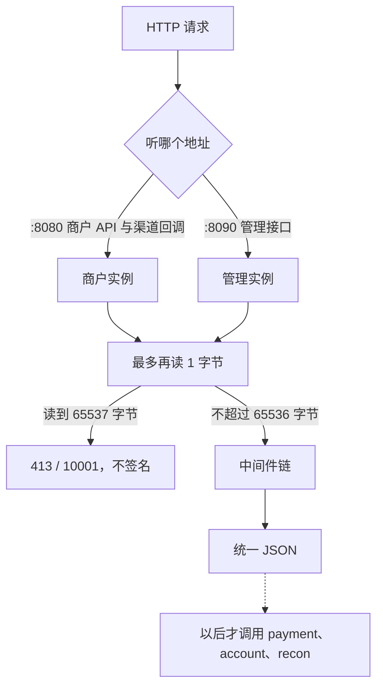

# GW-01 网关骨架

| 项 | 内容 |
|---|---|
| 功能点 | GW-01（P0，第 3 周） |
| 所属链路 | 基础设施 |
| 代码提交 | `97b776d` `[GW-01] add gateway skeleton`（完整 `97b776d311e4e2e1037bc73a2dbb08b53a6dcea3`） |
| 分支 | `feat/GW-01-gateway-skeleton` |
| 日期 | 2026-11-01 |
| 状态 | DONE |

本报告写在上面这次代码提交之后，不在那次提交的文件里。报告撰写时尚未提交。

## 一句话结论

网关进程里有两个 HTTP 服务：`:8080` 给商户 API 和以后的渠道回调，`:8090` 给管理接口。请求体超过 65536 字节得到 HTTP 413、错误码 `10001`、文案 `invalid parameter`，并且不签名；handler 发生 panic 得到 HTTP 500、错误码 `10003`、文案 `internal error`，进程继续处理下一个请求。证据是 `TestGW01BodyLimit`、`TestGW01PanicReturnsInternalAndStaysUp`、`TestGW01PayCLIVerifiesPlatformSignature`。

## 1. 背景

### 1.1 系统简介

pay-system 是一个用 Go 编写的小型支付后端，模拟商户收款、退款、商户间转账三条资金链路，重点在数据一致性和性能。系统由 5 个部分组成：gateway（对外 HTTP 入口，负责签名校验和限流）、payment（支付单、退款单、转账单的状态管理和流程推进）、account（账户余额与记账，数据按商户分到 2 个数据库分片）、channel-mock（模拟微信、支付宝这类外部支付渠道）、recon（对账，核对系统内外数据是否一致）。服务之间用 Kitex RPC 同步调用，或通过 Kafka 消息异步通知；数据存在 MySQL 8.4，Redis 用于防重放。所有金额用整数“分”表示，所有记账只追加不修改。当前已完成：工程骨架、账户记账与转账、模拟渠道、支付单创建与发起、支付结果推进、商户关单、支付查询、outbox 写入、健康检查、管理端口 pprof、命令行客户端，以及本功能点的网关骨架。验签、限流、支付路由和渠道回调还没有。

### 1.2 本功能点在系统中的位置

商户或管理员的 HTTP 请求先进入网关，再由网关以后去调用 payment、account、recon。本功能点只把网关的两个 HTTP 入口和统一 JSON 立起来，不把任何路径接到那些 RPC。



图里的实线是现在就有的路径。虚线是以后的支付路由和渠道回调，这次没有任何 HTTP 路由走过去。`:6060` 是健康检查端口，这次不听。

### 1.3 为什么需要它

没有这层入口时，调用方要自己对着 payment 的 RPC 端口说话，错误样子不统一。一个 10MB 的请求体如果被整段读进内存，恶意客户端可以用少量连接把进程撑满。handler 里一句 panic 若把进程打退出，后面的正常查询也会一起断。客户端自己带的 `X-Request-Id` 如果被原样信任，日志里的编号就可以伪造。这些都要在还没有支付路由的时候先定下来。

## 2. 术语

| 术语 | 含义 |
|---|---|
| 分 | 金额的最小单位。1 元 = 100 分。本功能点不计算金额。 |
| gateway | 对外的 HTTP 进程。商户、管理员和以后的渠道回调都先到这里。 |
| Hertz | 本项目使用的 HTTP 框架。一个 `Hertz` 值是一个监听地址上的 HTTP 服务。 |
| Kitex | 本项目使用的 RPC 框架。gateway 以后用它调用 payment、account、recon。 |
| outbox | 和业务写在同一个数据库事务里的待发送事件表。事务提交后再异步投递。本功能点不写这张表。 |
| 错误码 | JSON 里的 `code`。`10001` 的文案是 `invalid parameter`，`10002` 是 `not found`，`10003` 是 `internal error`。HTTP 状态可以和错误码的默认状态不同，例如 `10001` 在这里用 413 而不是 400。 |
| `request_id` | 服务端为这一次请求生成的 32 位小写十六进制。响应头 `X-Request-Id` 和 JSON 里的 `request_id` 是同一个值。 |
| 平台签名 | 网关用商户密钥对实际写出的响应 body 计算的签名，放在 `X-Timestamp`、`X-Nonce`、`X-Signature`。商户用同一算法验证。 |
| nonce | 签名里的一次性随机串。这里是 16 位 `[A-Za-z0-9]`。本功能点不检查客户端 nonce 是否重复。 |
| TTHeader | Kitex 的一种传输头。业务错误要靠它旁边的 meta handler 传回去，否则调用方会把业务失败看成空的成功。 |
| 脱敏 | 打印配置时把密钥换成看不出原文的形式。访问日志不写 body、签名、Token、密钥。 |
| 故障点 | 环境变量 `FAULT_POINTS` 里的测试用失败开关。空字符串合法；出现没登记的名字时进程退出码为 1，而且还没开始监听。 |
| apps profile | 本地编排里启动应用容器的那一组。它仍是占位，容器进程退出码为 1。这次没有改编排文件。 |
| span | 一次请求在追踪系统里的一段记录。这里只创建 span，不把记录送到外部收集器。 |
| per-call option | 单次 RPC 调用单独带的超时。客户端对象上的默认超时仍是 1 秒，更长的超时要在真正调用时再配。 |
| IDL | 描述 RPC 方法的接口文件。工具按它生成调用代码。这次没有改 IDL。 |
| kitex_gen | 由 IDL 生成的大段 RPC 代码。全仓库覆盖率把它算进去，所以 29.9% 不是质量门槛。 |
| pprof | Go 自带的性能采样页面。它已经挂在各服务自己的管理端口上。这次的网关不听那个端口。 |

## 3. 技术讲解

### 3.1 要解决的问题

1. 商户流量和管理流量分开听。管理接口以后不带平台签名，不能和商户 API 混在一个“签不签名”的开关里靠路径猜测。
2. 请求体上限是 65536 字节。多 1 字节就拒绝，并且不能把剩下的 body 继续读进内存。
3. 所有响应都是 JSON：`code`、`msg`、`request_id`、`data`。`data` 没有内容时是 `{}`，不是 JSON 的 `null`。
4. handler panic 不能退出进程，也不能把 panic 的文本回给客户端。
5. `request_id` 只能由服务端生成。客户端传来的 `X-Request-Id` 必须忽略。
6. 还没实现的验签、限流、时间窗口、nonce 防重必须先占住中间件位置，但不能访问 Redis，也不能真的验签或限流。
7. 响应签名只签已经标记为“验签通过”的商户响应。管理端口永远不签。签失败不能把密钥写进日志。
8. 三个 Kitex 客户端现在就要建好，但不重试，也没有任何 HTTP 路由去调用它们。

### 3.2 方案

同一进程里建两个 Hertz 实例。商户实例听 `:8080`，管理实例听 `:8090`。地址不写成 `127.0.0.1`，这样容器网卡上的其他服务也能连进来，而不是只能连本机回环。健康检查用的 `:6060` 这次不听，编排文件也没改，apps profile 仍是占位且退出码为 1。

监听用标准库的 `net.ListenConfig`，再交给 Hertz 的标准库传输层。监听失败把错误返回给调用方，不在传输层里 panic。Hertz 自己不注册操作系统信号；`main` 把 SIGINT、SIGTERM 转成 context 取消，服务跟着退出。

请求体用流式读取，上限函数看 `64 * 1024`，也就是 65536。流式模式下，超过上限的 body 仍会进入中间件，框架不会抢先写一行纯文本。中间件用 `LimitReader` 最多读 65537 字节：

```go
// service/gateway/response.go 里的 readCapped。
// max 是 65536，limit 是 65537。err 是函数的返回值。读满就返回。
limit := max + 1
tmp := make([]byte, limit)
limited := io.LimitReader(r, int64(limit))
n := 0
for n < limit {
    var nn int
    nn, err = limited.Read(tmp[n:])
    n += nn
    if n == limit {
        return nil, true, nil
    }
    if err == io.EOF {
        return tmp[:n], false, nil
    }
    if err != nil {
        return nil, false, err
    }
}
```

读到 65537 字节时，中间件写 HTTP 413、错误码 `10001`、文案 `invalid parameter`，`data` 为 `{}`，不签名，然后关闭这条连接并停止。它不把已经读到的超限内容和后面没读的内容放进业务 handler。不超过 65536 字节时，这些字节放回请求，后面的 handler 还能按 body 读到。恰好 65536 字节是放行的。

中间件顺序固定。四个占位只把自己的名字记下来并调用下一层：

```text
bodyLimit
  recovery
    requestID
      trace
        accessLog
          timeWindow    占位，只记名字
            verifySign  占位，只记名字
              rateLimit 占位，只记名字
                nonce   占位，只记名字
                  platformSign
                    handler，或未知路径
```

`bodyLimit` 不把自己算进这条名字链，因为它在所有业务中间件之前，超限时根本不会往下走。生产注册函数不注册 `/v1/balance`。未知路径走到链的末尾，返回 HTTP 404、错误码 `10002`、文案 `not found`，`data` 为 `{}`，不签名。

panic 被 `recovery` 接住。响应是 HTTP 500、错误码 `10003`、文案 `internal error`，带服务端生成的 `request_id`。日志只写固定句子 `panic recovered`，不写 panic 值。响应不签名。同一个进程接着处理后面的请求。

`request_id` 用 `crypto/rand` 读 16 字节，再编码成 32 位小写十六进制。请求头里同名的 `X-Request-Id` 不参与生成。响应头和 JSON 使用这一个值。413 发生在生成编号的中间件之前，所以拒绝函数自己补一个编号。未知路径同样在写出 404 之前补上，避免 body 里的 `request_id` 是空的。

追踪只打开一个名为 `gateway` 的 span，不安装导出器，也不读外部地址。没有收集器时，这个 span 不会把数据送出去。

访问日志在 handler 返回之后写一条 `request handled`，字段只有 `path`、`status`、`elapsed_ms`、`merchant_id`、`err_code`。`merchant_id` 固定是空字符串，因为验签还没把商户号放进请求。日志不包含 body、签名、Token、密钥。写日志用的是这个端口自己的 logger；进程启动时已经换成脱敏 JSON logger，所以生产路径仍走那一个输出。

平台签名调用 `pkg/sign.SignPlatform`，签的是已经写进响应的那一段 body，不是重新序列化之前的结构体。只有请求被标成已验签，并且当前不是管理端口时才签。密钥为空、nonce 生成失败或签名函数返回错误时，响应改写成 HTTP 500、错误码 `10003`，去掉签名头，ERROR 日志只有固定句子 `platform signature failed`，不写密钥。管理端口即使测试把请求标成已验签也不签。生产注册没有会打上已验签标记的路由。命令行验收是在测试里临时加上 `GET /v1/balance`，这个路由不在生产注册里。

三个 Kitex 客户端放在 gateway 自己的包里，不使用会重试的 account 客户端。连接超时 100 毫秒。客户端对象上的调用超时是 1 秒。更长的值由函数按方法名给出，要在真正调用时配成这一次调用的 option：`Pay`、`ClosePayment`、`CreateRefund` 是 5 秒，`CreateTransfer` 是 3 秒，`RunBatch`、`CheckBalance` 是 120 秒，其他方法是 1 秒。这次没有 HTTP 路由去调用它们，所以没有地方配那些 per-call option。地址写死为 `payment:8881`、`account:8882`、`recon:8883`。传输用 TTHeader，并挂上 `ClientTTHeaderHandler`。`NewClients` 只构造客户端，对端没启动时也不拨号，因此对端不在线不会让启动失败。

`cmd/gateway` 先加载配置，再检查故障点，然后把脱敏后的配置打到标准输出，之后才监听。传入的 context 已经取消时，监听函数直接返回，不绑定端口。原来的成功测试用这种已取消的 context，所以不会占住 `:8080` 然后一直不退出。监听失败把错误交回去，进程退出码为 1，不 panic。一个端口失败会取消另一个端口的 context。

### 3.3 为什么这样做

| 方案 | 做法 | 优点 | 缺点 | 结论 |
|---|---|---|---|---|
| 采用：流式 body，中间件最多读 65537 字节 | `WithStreamBody(true)` 加上 `WithMaxRequestBodySize(64*1024)`，超限时请求仍进入中间件 | 能写出统一 JSON 413，并且停止继续读 | 要自己判断第 65537 字节 | 采用 |
| 备选：框架默认的非流式读取 | 不打开流式 body，让框架处理过大的 body | 少写一段读取代码 | 框架在中间件之前写纯文本 `Request Entity Too Large`，调用方看不到 `code` / `msg` / `request_id` | 不采用。统一响应做不到 |
| 备选：把三个客户端放进会重试的 account 客户端包 | 复用已有的拨号和重试 | 少一个构造函数 | 网关调用被自动重试。支付、关单这类操作不能在网关层悄悄再打一次 | 不采用。网关不重试 |
| 备选：只听 `127.0.0.1:8080` | 端口只绑回环 | 本机以外连不上 | 同一台机器上的其他容器也连不上容器里的网关 | 不采用。生产地址是 `:8080` 和 `:8090` |

### 3.4 正确性

不涉及资金。本功能点不改余额、不写订单、不发 outbox。一次请求不会插入账户流水，也不会更新支付单，所以没有“重复记账”或“余额被扣成负数”的最终数据。

进程崩溃和下游超时在本功能点的范围：没有业务写路径。进程在写出 JSON 之前或之后退出，都不会留下半笔账或半条待发送事件。客户端建连失败留到以后的路由；`NewClients` 在对端没启动时也不拨号。`cmd/gateway` 的双端口监听没有在测试里真正绑定 `:8080` / `:8090`。测试要么用已取消的 context 在绑定前返回，要么让测试服务听系统分配的 `:0`，再用 `127.0.0.1` 加那个临时端口去访问。因此“两个端口同时占用宿主机 8080 和 8090”这次没有被执行到。

下面这些 HTTP 行为有测试。它们不改数据库。

| 场景 | 系统行为 | 最终状态 | 证明 |
|---|---|---|---|
| 同一个进程里先 panic，再发正常请求 | 第一次 HTTP 500、`10003`、`internal error`，响应带 `request_id`，body 和日志都没有 panic 文本，不签名 | 进程仍在，第二次请求得到 HTTP 200 | `TestGW01PanicReturnsInternalAndStaysUp` |
| POST 恰好 65536 字节，再 POST 65537 字节 | 第一笔 handler 读到 65536 字节并返回 200。第二笔 HTTP 413、`10001`，不签名，handler 看不到这笔 | 没有订单或余额变化 | `TestGW01BodyLimit`、`TestReadCappedStopsAtExtraByte` |
| 客户端带上自己的 `X-Request-Id` | 响应头和 body 都是服务端的 32 位小写十六进制，等于客户端传入值的情况被断言排除 | 无共享状态 | `TestRequestIDIgnoresClientAndMatchesHeader` |
| 生产注册上访问 `/v1/balance` | HTTP 404、`10002`、`not found`，`data` 为 `{}`，不签名，`request_id` 与响应头一致 | 没有这条生产路由 | `TestUnknownPath` |
| 两个端口同时收到已标记验签的请求 | 商户端口签名能用同一密钥验过；管理端口没有签名头 | 无数据库写入 | `TestPlatformSignAndAdminNeverSigns` |
| 密钥为空，或生成 nonce 失败 | 改成 HTTP 500、`10003`，不签名，日志里没有那串密钥 | 无数据库写入 | `TestSignFailureOmitsSecret` |
| 对端 RPC 进程没启动 | `NewClients` 返回客户端，不拨号 | 进程不因为对端不在而失败 | `TestNewClientsWithoutPeer` |
| 下游调用超时 | 本功能点没有发起调用。超时表只检查函数返回值和客户端选项里没有重试 | 无调用、无写入 | `TestRPCTimeoutTable`、`TestClientAddrsAndNoRetry` |

### 3.5 性能

不涉及。这次没有压测，也没有性能开关。

## 4. 已完成内容

### 4.1 改动清单

| 文件 | 新增 / 修改 | 作用 |
|---|---|---|
| `service/gateway/server.go` | 新增 | 两个地址、监听、Hertz 引擎、中间件注册、阻塞运行 |
| `service/gateway/middleware.go` | 新增 | 请求体上限、panic、编号、追踪、访问日志、四个占位、响应签名、404 |
| `service/gateway/response.go` | 新增 | 统一 JSON、请求号、签名 nonce、限长读取 |
| `service/gateway/rpc.go` | 新增 | 三个不重试的 Kitex 客户端和按方法的超时 |
| `service/gateway/server_test.go` | 新增 | 请求体、panic、404、签名、中间件顺序、访问日志 |
| `service/gateway/rpc_test.go` | 新增 | 超时表、地址、无重试、对端不在时仍能构造 |
| `cmd/gateway/main.go` | 修改 | 配置和故障点通过并打印脱敏配置后才听两个端口 |
| `cmd/gateway/main_test.go` | 修改 | 成功路径传入已取消的 context，避免绑定 `:8080` |
| `cmd/paycli/gw01_test.go` | 新增 | 测试里临时加余额路由，命令行验平台签名 |
| `docs/02-requirements.md` | 修改 | GW-01 标为 DONE，变更记录补一行 |
| `docs/04-dev-plan.md` | 修改 | 只勾选 GW-01 |
| `docs/05-api.md` | 修改 | 版本 3.3.0 到 3.3.1 |
| `docs/interview-notes.md` | 修改 | 记下端口、占位中间件和调用超时的用法 |

### 4.2 对外变化

| 类别 | 变化 |
|---|---|
| 接口 | 生产注册没有新增商户路由，也没有 `/v1/balance`。接口说明从 3.3.0 调到 3.3.1，只写明两件事：`request_id` 由服务端生成 32 位小写十六进制，并忽略客户端的 `X-Request-Id`；未知路径是 HTTP 404、错误码 `10002`、文案 `not found`、`data` 为 `{}`、不签名。全局约定是另一份写编码和资金规则的文档，这次没有改它，版本仍是 v2.24。需求文档版本仍是 v3.0。 |
| 表结构 | 无 |
| 配置项 | 无新环境变量 |
| 错误码 | 无新错误码。413 使用已有的 `10001`，404 使用已有的 `10002`，panic 和签名失败使用已有的 `10003` |
| 指标 / 故障点 | 无新指标，无新故障点。空的 `FAULT_POINTS` 仍可启动；未登记的名字仍在监听前以退出码 1 结束 |

### 4.3 验收对照

| 验收条目 | 测试函数 | 类型 | 结果 |
|---|---|---|---|
| 请求体超过 65536 字节被拒绝；恰好 65536 字节放行，handler 能读到 body | `TestGW01BodyLimit` | 单元 | 通过 |
| 超限读取在第 65537 字节停止，不再往后读 | `TestReadCappedStopsAtExtraByte` | 单元 | 通过 |
| handler panic 返回 500 / `10003` / `internal error`，不泄露 panic 文本，不签名，进程继续服务 | `TestGW01PanicReturnsInternalAndStaysUp` | 单元 | 通过 |
| 命令行对测试里临时加上的余额路由验平台签名，退出码 0 | `TestGW01PayCLIVerifiesPlatformSignature` | 单元 | 通过 |
| 中间件顺序含四个只占位的名字，最后是 handler | `TestMiddlewareOrder` | 单元 | 通过 |
| 忽略客户端 `X-Request-Id`，响应头与 body 一致 | `TestRequestIDIgnoresClientAndMatchesHeader` | 单元 | 通过 |
| 未知路径 404 / `10002`，不签名，生产注册没有 `/v1/balance` | `TestUnknownPath` | 单元 | 通过 |
| 已验签的商户响应可验签；管理端口不签 | `TestPlatformSignAndAdminNeverSigns` | 单元 | 通过 |
| 签名失败或密钥为空时 500 / `10003`，日志没有密钥 | `TestSignFailureOmitsSecret` | 单元 | 通过 |
| 访问日志有空的 `merchant_id`，没有 body、签名、Token | `TestAccessLogSkipsSensitiveFields` | 单元 | 通过 |
| 方法超时、地址、选项里没有重试 | `TestRPCTimeoutTable`、`TestClientAddrsAndNoRetry` | 单元 | 通过 |
| 对端未启动时构造客户端仍成功 | `TestNewClientsWithoutPeer` | 单元 | 通过 |
| 配置失败或未知故障点在监听前退出码为 1，输出不含密钥；空故障点不是初始化错误 | `cmd/gateway` 里原有的 `run` 测试，传入已取消的 context | 单元 | 通过 |

### 4.4 验证记录

环境：go1.27.2 darwin/arm64。golangci-lint 2.14.0，built with go1.27.1 from 114493f on 2026-09-24T10:54:53Z。

| 命令 | 结果 |
|---|---|
| `gofmt -l .` | 无文件名，退出码 0，real 0.05s |
| `make lint` | `0 issues.`，退出码 0，real 1.18s |
| `make test` | 退出码 0，real 5.31s。root `ok github.com/yym108/pay-system 4.797s`。`cmd/gateway` 1.536s。`cmd/paycli` 1.560s。`service/gateway` 1.490s。其余包命中缓存 |
| `make test-integration` | 退出码 0，real 36.56s。root `ok ... 36.111s`。`cmd/gateway` 1.532s。`cmd/paycli` 1.563s。`service/gateway` 1.653s。payment 的 biz 与 handler 为缓存 |
| `make cover` | 退出码 0，real 37.23s。`go tool cover -func` 的 total 是 29.9%（含 kitex_gen，不是门槛）。`service/gateway` 1.701s / 78.3%，不在 70% 门槛里。门槛只看 `service/*/biz`、`pkg/money`、`pkg/sign`、`pkg/idgen`、`pkg/outbox`：account biz 缓存 91.1%，payment biz 缓存 86.1%，pkg/money 缓存 100.0%，pkg/sign 缓存 100.0%，pkg/idgen 缓存 88.1%，pkg/outbox 缓存 95.0%。`cmd/gateway` 1.576s / 26.2%。`cmd/paycli` 1.590s / 79.5%，不在门槛。`pkg/server` 缓存 84.4%，只作参考 |
| `make gen` | 未运行。没有改 IDL |
| mmdc | 未运行。没有改流程图 |

同一次 `make cover` 的函数覆盖率：`main` 0.0%（测试调用 `run`），`run` 69.2%，`serve` 7.7%，`Serve` 0.0%（测试走 `Listen` + `NewEngine` + `Spin`），`bodyLimit` 53.8%，`requestID` 58.3%，`platformSign` 89.5%，`RPCTimeout` 100%，`NewClients` 70.0%，`dialOptions` 100%，`NewEngine` 100%，`Listen` 80.0%，`Spin` 70.0%。

`serve` 只有 7.7%、`Serve` 是 0.0%，因为测试没有真正绑定 `:8080` 和 `:8090`。`main` 是 0.0%，因为测试直接调用 `run`。`bodyLimit` 53.8%、`requestID` 58.3%，读 body 失败和生成编号失败这两条分支没有单独的测试。

### 4.5 同步的文档

- 需求仍是 v3.0。GW-01 从待办改为完成，三条验收已勾上。2026-11-01 的变更记录写在表的最后，紧跟命令行客户端那一行。
- 开发计划只勾了 GW-01，后面的路由和验签仍未勾。
- 接口文档从 3.3.0 升到 3.3.1，只澄清服务端生成 `request_id`，以及未知路径返回 404 / `10002`。
- 约定版本仍是 v2.24，这次没有改约定。
- 面试笔记记下：进程听 `:8080` 和 `:8090`，这次不听 `:6060`，编排未改；四个中间件只占位；客户端默认超时 1 秒，更长的超时要等真正调用时再用。

## 5. 未完成与风险

验签、限流、支付路由和渠道回调都还没有。时间窗口、验签、限流、nonce 四个中间件只记录自己的名字并调用下一层，不访问 Redis。

`cmd/gateway` 同时听 `:8080` 和 `:8090` 的那条路径没有在测试里占用这两个固定端口。端口已被占用时的失败，只由 `Listen` 返回错误来保证，没有一次测试去撞已经打开的 8080。一个端口失败后取消另一个端口，代码里有这次取消，本次覆盖率没有把它跑到。

三个 Kitex 客户端没有被任何 HTTP 路由调用。连接被拒绝、调用超时、以及按方法套用 5 秒、3 秒、120 秒，都要等支付路由、退款转账路由和渠道回调接上以后才发生。

## 6. 如何复现

前置：本机已安装 go1.27.2 和 golangci-lint 2.14.0，当前目录是仓库根。`gofmt -l .`、`make lint`、`make test` 不连接数据库。`make test-integration` 和 `make cover` 在本次记录里，payment 的 biz 与 handler 来自缓存。缓存不在时，那些包会按自己的集成测试去启动数据库；本次没有把那次缓存命中写成一次全新的数据库演练。

```bash
gofmt -l .
make lint
make test
make test-integration
make cover
```

本次在 go1.27.2 darwin/arm64 上的记录就是 4.4 的表：五条命令退出码都是 0。`gofmt -l .` 不打印文件名。`make lint` 打印 `0 issues.`。`make cover` 之后用 `go tool cover -func` 看到的 total 是 29.9%。耗时也以 4.4 那次测量为准。

只看网关三条验收时，可以跑：

```bash
go test -race -count=1 -timeout 60s \
  -run 'TestGW01PanicReturnsInternalAndStaysUp|TestGW01BodyLimit|TestGW01PayCLIVerifiesPlatformSignature' \
  ./service/gateway/ ./cmd/paycli/
```

`TestGW01PayCLIVerifiesPlatformSignature` 在 `./cmd/paycli/`。前两个在 `./service/gateway/`。

## 7. 讲解要点

1. 问：为什么不让 HTTP 框架自己拒绝大请求？答：不打开流式 body 时，框架在中间件之前写纯文本 `Request Entity Too Large`。打开流式 body 并设置 65536 字节上限后，请求才会进入中间件，从而写成带 `10001` 的 JSON，并且用 `LimitReader` 在第 65537 字节停住。
2. 问：管理端口为什么单独一个实例？答：平台签名看的是“这个实例是不是管理端口”加上“这个请求有没有被标成已验签”。管理实例即使被标成已验签也不签名。生产注册里还没有任何路由会打上已验签标记。
3. 问：客户端默认 1 秒，为什么表里又有 120 秒？答：`WithRPCTimeout` 写在客户端上的是 1 秒。`RPCTimeout(method)` 只是一张表。真正调用时才把表里的值配成这一次的 option。本功能点没有这种调用。

## 延伸阅读

- `docs/02-requirements.md` 里 GW-01 那一节，以及 2026-11-01 的变更记录最后一行。
- `docs/05-api.md` 3.3.1 里关于 `request_id` 和未知路径的句子。
- `docs/interview-notes.md` 的 GW-01 小节。
- `service/gateway/server.go`、`service/gateway/middleware.go`、`service/gateway/rpc.go`。

## 修订记录

| 日期 | 提交 | 修订内容 |
|---|---|---|
| 2026-11-01 | `97b776d` | 代码提交 `[GW-01] add gateway skeleton`。本报告撰写时尚未提交。 |
