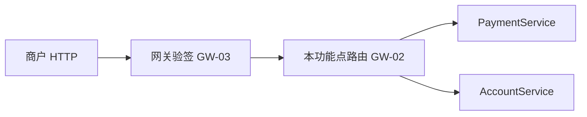
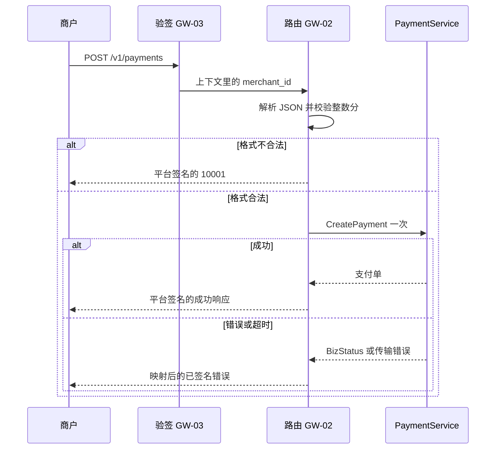

# GW-02 支付与余额路由

只读这一份就能看懂这次改了什么。正文里的行为、边界和证据不依赖别的文档。

| 项 | 内容 |
| --- | --- |
| 功能点 | GW-02（P0，第 3 周） |
| 所属链路 | 基础设施 |
| 代码提交 | `5103705` `[GW-02] add payment routes`（完整 `51037059f1469987256878584b599a3a14c03017`） |
| 分支 | `feat/GW-02-payment-routes` |
| 日期 | 2026-11-01 |
| 状态 | DONE |

本报告写在上面这次代码提交之后，不在那次提交的文件里。报告撰写时尚未提交。

## 一句话结论

商户端口现在把创建、发起、关闭、查询支付单和查询余额转到已有的 RPC。merchant_id（商户号）只取验签结果。金额用 JSON 整数校验，小数、字符串、0、超过 10000000 分都是已有的 10001，且不调用 RPC。余额只回五个字段，available_amount 原样透传。证据是本报告 4.3 的测试和 4.4 的命令，全部退出码 0。

## 1. 背景

这次补的是商户 HTTP 到已有 RPC 的协议转换，网关仍然不记账。

### 1.1 系统简介

pay-system 是一个用 Go 编写的小型支付后端，模拟商户收款、退款、商户间转账三条资金链路，重点在数据一致性和性能。系统由 5 个部分组成：gateway（对外 HTTP 入口，负责签名校验和限流）、payment（支付单、退款单、转账单的状态管理和流程推进）、account（账户余额与记账，数据按商户分到 2 个数据库分片）、channel-mock（模拟微信、支付宝这类外部支付渠道）、recon（对账，核对系统内外数据是否一致）。服务之间用 Kitex RPC 同步调用，或通过 Kafka 消息异步通知；数据存在 MySQL 8.4，Redis 用于防重放。所有金额用整数“分”表示，所有记账只追加不修改。当前已完成：工程骨架、账户分片与记账、渠道模拟、支付单的创建、发起、结果推进、关单和查询、outbox 写入、健康检查、pprof、paycli、网关骨架、商户验签，以及本次的支付与余额 HTTP 路由。渠道回调入口还没有。

账户分片是把账户按键拆开存放，避免所有余额写在同一处。渠道模拟是单独的 channel-mock 进程，不访问真实的微信或支付宝。支付单是一笔支付订单。结果推进是 payment 服务根据渠道结果把支付单推向成功或失败，不在网关里做。outbox 是和业务写在同一个事务里的待投递事件，事务提交后再异步送出。健康检查是进程是否就绪的 HTTP 探针。pprof 是 Go 自带的性能剖析接口。paycli 是本仓库的命令行客户端。网关骨架是更早的 HTTP 进程和平台签名。商户验签是 GW-03：用商户密钥检查请求签名，通过后把商户号放进请求上下文。这些都不是本次新写的记账规则。

### 1.2 位置

本功能点站在验签之后、支付服务和账户服务之前，只做协议转换。



商户请求先经过 GW-03 的验签。验签通过后，才进到本功能点注册的路由。创建、发起、关闭、查询支付单调用 PaymentService。查询余额调用 AccountService。退款和转账路由是 GW-09。渠道回调是 GW-06。本功能点不写数据库、不算手续费、不改余额。

### 1.3 为什么需要

网关必须在调用 RPC 之前挡住两种会记错账的输入：别人的商户号，以及不是整数分的金额。

商户在 body 里写 merchant_id=M999，验签得到的是 M100001。若网关采用 body 里的商户号，订单会记到别人名下。M999 是攻击者随便写的商户号。M100001 是验签上下文里的商户号。RPC 是网关调用内部服务的一次远程调用，这里指已经存在的 CreatePayment、Pay、ClosePayment、QueryPayment、GetAccount。

另一个场景：amount 写成 100.5 或字符串 "100"。100.5 是想表示 100.5 分，也就是 1.005 元，不是合法的整数分。字符串 "100" 看起来像 100 分（1.00 元），但它不是 JSON 数字。若用浮点解析，100.5 分这种值会进 RPC。网关在调用前拒绝，返回已有的参数错误 10001，创建支付单的 RPC 次数为 0。

## 2. 术语

下面这些词在本报告里只表示这里写的含义。

| 词 | 含义 |
| --- | --- |
| 分 | 金额的最小单位，类型是 int64。1 元 = 100 分。0.01 元 = 1 分。100000.00 元 = 10000000 分。100000.01 元 = 10000001 分。 |
| merchant_id | 商户号。本功能点只使用验签写入上下文的值。测试里验签得到的是 M100001。body 或 query 里的同名字段忽略。 |
| 验签 | GW-03 用商户密钥检查请求签名。通过后把商户号写入上下文。没通过的请求进不了本功能点的路由。 |
| 平台签名 | 网关对实际写出的响应 body 计算的签名，放在响应头 `X-Timestamp`、`X-Nonce`、`X-Signature`。验签通过后用这一次查到的 `app_secret` 计算，不是另一把独立密钥。商户用同一把 `app_secret` 验证。路由处理函数不再次标记已验签。未签名就被拒绝的响应不签名。 |
| 支付单 | 一笔支付订单。路径里的 pay_no 是平台支付单号。out_trade_no 是商户自己的订单号。 |
| 结算账户 | 商户用来收款的账户。余额查询固定向账户服务要 owner_type=MERCHANT、owner_id=验签商户号、account_type=MERCHANT_SETTLE。 |
| available_amount | 账户服务给出的可用余额，单位分。网关原样放进 JSON，不用 balance 减 frozen_amount 重算。 |
| balance | 账户账面余额，单位分。网关原样拷贝。 |
| frozen_amount | 账户冻结金额，单位分。网关原样拷贝。 |
| BizStatusError | Kitex 用来携带业务码的错误类型。网关用 kerrors.FromBizStatusError 识别它，不用 errno.From。文案和 HTTP 状态用本地登记的，不用对端返回的文案。 |
| 10001 | 已有的参数错误。金额、字段、body、查询键不合法时使用，并且不调用 RPC。 |
| 10002 | 已有的未找到。验签通过但路径不存在时，HTTP 404，错误码 10002，data 为 {}。 |
| 10003 | 已有错误码。验签没写入商户号、RPC 客户端是 nil、成功响应是 nil、Pay 或 Close 的业务码未登记、或者订单是 nil 时使用。命中路由但客户端是 nil 时，data 为 {}，响应已签名。 |
| 10004 | 已有的下游失败。传输错误、超时、context.Canceled、context.DeadlineExceeded 都映射成它。这些都不是 BizStatusError。不重试。 |
| 10006 | 已有的幂等冲突一类错误。判断留在 payment。网关不保存幂等结果，也不新增这个错误码。 |
| 20001 | 已有的验签失败。未签名请求在进路由之前返回，响应不带平台签名。 |
| 30001 | 已有业务码。它以 BizStatusError 到达且 RPC 响应是 nil 时，data 为 {}。 |
| 30003 | 已有的关单冲突。Close 返回该码、该码已登记、且订单不是 nil 时，HTTP 409，data 带上这张订单。 |
| 30006 | 已有业务码。测试里 Pay 返回该码和一张 FAILED 订单时，HTTP 200，data 带上这张订单。网关不把订单改成别的状态。 |
| 30007 | 已有的未知渠道错误。网关不预拒不认识的 channel，交给 payment 返回 30007。 |
| CAS | 比较并交换。支付单状态由 payment 用 CAS 更新。网关不改支付单状态。 |
| 幂等 | 同一个业务键重复提交得到同一笔业务，而不是再记一笔。创建支付单的幂等在 payment，不在网关。 |
| RPC | 网关对内部服务的一次调用。本功能点不新写服务，只调用已有的五个方法。 |

## 3. 技术讲解

商户端口上新注册六条路由，把 HTTP 转成已有 RPC，并在调用前做格式校验。

### 3.1 约束

约束都在格式和错误映射上。业务规则、幂等和支付单状态的 CAS 仍然留在 payment 或 account。

只注册商户端口（admin=false）。六条路由是：

| 方法 | 路径 | 作用 |
| --- | --- | --- |
| POST | /v1/payments | 创建支付单 |
| POST | /v1/payments/:pay_no/pay | 发起支付 |
| POST | /v1/payments/:pay_no/close | 关闭支付单 |
| GET | /v1/payments | 按商户订单号查询 |
| GET | /v1/payments/:pay_no | 按平台支付单号查询 |
| GET | /v1/balance | 查询结算账户余额 |

静态的 GET /v1/payments 注册在带参数的路由之前，避免被 :pay_no 吃掉。不注册退款、转账、回调、管理路由。

merchant_id 只来自验签后的 MerchantID(c)。c 是当前 HTTP 请求。body 和 query 里的同名字段忽略。验签没写入商户号则返回 10003，不调用 RPC。

金额是 int64 分。JSON 用 Decoder.UseNumber，先按正则 `^(0|[1-9][0-9]*)$` 检查，再 ParseInt。字符串、小数、科学计数法都是 10001。不使用浮点。创建时 amount 必填，范围是 1 到 10000000 分，含两个端点，也就是 0.01 元到 100000.00 元。0 分和 10000001 分（100000.01 元）都是 10001。

创建请求的其余字段：

- out_trade_no 必填，长度 1 到 64 字节，字符只能是 [A-Za-z0-9_-]。
- subject 必填，长度 1 到 128 个 Unicode 字符，不 trim。前后空白也算在长度里。
- currency 缺省则指针是 nil，payment 自己默认 CNY。字段出现且不是精确的 CNY 时返回 10001，空串也算出现且不合法。
- notify_url 缺省则指针是 nil。字段出现时，包括空串，字节长度必须不超过 512，且 scheme 必须是 http 或 https，否则 10001。网关不检查主机白名单，白名单在 payment。
- expire_minutes 缺省则指针是 nil。字段出现时必须是 1 到 120 的 JSON 整数，含端点。
- 空 body 或非对象是 10001。未知字段忽略。encoding/json 对重复键保留最后一个，网关不加自定义解析器。

发起支付：pay_no 取路径，不 trim。body 必须是对象。channel 必填且非空。不在网关预拒未知渠道，交给 payment 返回 30007。忽略 body 里的 merchant_id 和 pay_no，避免用 body 替换路径和验签结果。

关闭：没有 body。非空 body 是 10001，包括 `{}` 和只有空白的 body。

查询有两条路由。路径形式如果 query 里的 out_trade_no 非空，则 pay_no 和 out_trade_no 两个键都有，返回 10001，不调用 RPC。集合形式必须恰好有 out_trade_no。空字符串当缺省。不 trim。只有空白的值算有值。%20 解码成空格，也算有值。查询串用 RequestURI 解析，不用框架的 Query 帮助方法，避免框架把空格和加号的处理与这里的规则弄混。查询没有 body；非空 body 是 10001。只把其中一个可选指针传给 QueryPayment，另一个保持 nil。

余额调用 GetAccount。owner_type 是 MERCHANT，owner_id 是验签商户号，account_type 是 MERCHANT_SETTLE。忽略 query 里的 merchant_id。响应 data 只有 account_no、currency、balance、frozen_amount、available_amount。三个金额原样拷贝，不重算。测试夹具里 balance 是 100 分（1.00 元），frozen_amount 是 40 分（0.40 元），available_amount 是 7 分（0.07 元）。100 减 40 等于 60，但响应里的 available_amount 仍是 7。非空 body 是 10001。

每次 RPC 用已有的 RPCTimeout，再加上 callopt.WithRPCTimeout。时长是：CreatePayment 1 秒，Pay 5 秒，ClosePayment 5 秒，QueryPayment 1 秒，GetAccount 1 秒。不重试。不新写 RPCTimeout 的分支。客户端是窄接口，用 WithPaymentAPI 和 WithAccountAPI 注入。生产进程的 serve 把 clients.Payment 和 clients.Account 传给 NewMerchant，同时保留已有的凭证查询。context 已经取消时，仍在 NewClients 之前返回，不会为了这次路由去建连接。

错误映射：

- RPC 的 err 不是 nil 时，用 kerrors.FromBizStatusError，不用 errno.From。
- 认得出的 BizStatusError 用本地登记的文案和 HTTP 状态，不用对端文案。
- 不是 BizStatus 的错误，包括传输失败、超时、context.Canceled、context.DeadlineExceeded，都是 10004。
- 调用成功但响应是 nil，是 10003。
- Pay 和 Close：err 为 nil，且 biz_code 为 0，且订单不是 nil，才是成功。biz_code 不是 0，该码已经登记，且订单不是 nil，就用该码，data 带订单。30006 是 HTTP 200。30003 是 HTTP 409。未登记，或者订单是 nil，则 10003，不带订单。
- 30001 以 BizStatusError 到达，响应是 nil，data 为 {}。
- 验签通过后的响应，包括这些错误，由已有的平台签名中间件签名。路由里不再 MarkVerified。
- 不记录 body、密钥、app_secret。

幂等和 10006 留在 payment。支付单状态的 CAS 留在 payment。网关一次请求一次 RPC，没有网关事务。超时保持 10004，调用次数为 1，不改成业务失败。业务失败会让商户以为订单已经被拒绝或已经成功；超时只说明这一次调用没有得到可映射的业务结果。

不新增错误码，不改表，不改 IDL，不改全局约定版本。接口文档升到 3.3.3，只是状态说明，属于 PATCH。字段和错误码的含义没有改。

### 3.2 方案

创建请求先验签，再解析；校验失败就返回已经平台签名的 10001，通过才调用一次 CreatePayment，然后把结果映射成成功或已有错误码。发起、关闭、查询和余额是同一形状：格式不对就不调用，格式对了就恰好一次 RPC。



解析时不读 body 里的 merchant_id。`parseCreate` 返回的请求只填商户订单号、金额、主题和三个可选指针，不填 MerchantId。创建处理函数在解析成功后，把验签得到的商户号写进请求，再按已有的 `RPCTimeout("CreatePayment")` 调用一次。下面两段是 `service/gateway/route.go` 的原文。

```go
	return &payment.CreatePaymentRequest{
		OutTradeNo:    out,
		Amount:        amount,
		Currency:      currency,
		Subject:       subject,
		NotifyUrl:     notifyURL,
		ExpireMinutes: expire,
	}, nil
```

```go
	req, bad := parseCreate(body)
	if bad != nil {
		h.writeRoute(c, bad, nil)
		return
	}
	req.MerchantId = mid
	if h.payment == nil {
		h.writeRoute(c, errno.ErrInternal, nil)
		return
	}
	order, err := h.payment.CreatePayment(ctx, req, callopt.WithRPCTimeout(RPCTimeout("CreatePayment")))
```

余额响应只拷贝五个字段。`GetAccount` 返回的就是账户对象。`ownerMerchant` 和 `accountSettle` 分别是 `MERCHANT` 和 `MERCHANT_SETTLE`。超时是 `RPCTimeout("GetAccount")`，也就是已有的默认 1 秒。query 里的另一个商户号不会写进 OwnerId。`available_amount` 用账户对象上的原值，不按 balance 减 frozen_amount 重算。

```go
	got, err := h.account.GetAccount(ctx, &account.GetAccountRequest{
		OwnerType:   ownerMerchant,
		OwnerId:     mid,
		AccountType: accountSettle,
	}, callopt.WithRPCTimeout(RPCTimeout("GetAccount")))
	if err != nil {
		h.writeRoute(c, mapRouteErr(err), nil)
		return
	}
	if got == nil {
		h.writeRoute(c, errno.ErrInternal, nil)
		return
	}
	WriteOK(c, balanceView{
		AccountNo:       got.AccountNo,
		Currency:        got.Currency,
		Balance:         got.Balance,
		FrozenAmount:    got.FrozenAmount,
		AvailableAmount: got.AvailableAmount,
	})
```

### 3.3 为什么这样做

网关只校验格式并透传，业务规则留在 payment 和 account，避免两套规则以后对不上。

| 选择 | 决定 | 原因 |
| --- | --- | --- |
| 采用 | 网关只校验格式并透传，业务规则留在 payment / account | 手续费、渠道是否存在、支付单能不能关、可用余额怎么算，都已经有服务负责。网关再算一遍就会出现两个答案。 |
| 备选 | 用浮点解析金额。不采用 | 100.5 这类小数会变成不精确的分，可能进到 CreatePayment。整数正则加 ParseInt 会在网关直接返回 10001。 |
| 备选 | 网关相信 body 里的 merchant_id。不采用 | 伪造商户号会把订单记到别人名下。验签得到 M100001 时，body 里的 M999 必须忽略。 |
| 备选 | 网关重算 available_amount = balance − frozen_amount。不采用 | 账户服务已经给出 7 分（0.07 元）。用 100 分减 40 分会得到 60 分（0.60 元），和账上不一致。 |

### 3.4 正确性

本功能点不记账，所以没有「网关自己把余额改成多少」。下表每一行都是已经写进测试的行为。最终状态指网关这一侧留下什么，不是 payment 数据库里的行。

| 场景 | 系统行为 | 最终状态 | 证明 |
| --- | --- | --- | --- |
| 金额 100.5、字符串 100、0、10000001 | 签名的 10001，创建 RPC 次数 0 | 不创建订单 | TestGW02AmountRejected |
| body 伪造 merchant_id | RPC 的 MerchantId 是验签的 M100001；currency、notify_url、expire_minutes 指针为 nil | 不采用伪造商户 | TestGW02ForgedMerchantIgnored |
| 余额 query 带另一个 merchant_id | owner MERCHANT / M100001 / MERCHANT_SETTLE；JSON 恰好五个键；available_amount 为 7 | 不重算 | TestGW02BalanceIgnoresQueryMerchant |
| subject 129 个字符、ftp 的 notify_url、currency USD、expire 121 | 10001，创建次数 0 | 不调用 | TestGW02CreateFieldLimits |
| 关闭 body 为 {} | 10001，关闭次数 0 | 不调用 | TestGW02CloseRejectsBody |
| 查询同时给 pay_no 和 out_trade_no | 10001 | 不调用 | TestGW02QueryRejectsBothKeys |
| Pay 返回 biz_code 30006 和 FAILED 订单 | HTTP 200、码 30006、带订单、平台签名。RPC 的 PayNo 是路径，channel 是请求里的，merchant 来自上下文 | 不在网关改状态 | TestGW02PayChannelRejected |
| Close 返回 biz_code 30003 和 SUCCESS 订单 | HTTP 409、码 30003、带订单、平台签名 | 不在网关改状态 | TestGW02CloseStatusConflict |
| RPC 超时 | 10004，创建次数恰好 1 | 不重试 | TestGW02TransportOnce |
| 命中路由但客户端是 nil | 10003，data {}，已签名 | 不调用 | TestGW02NilClient |
| 先按路径查再按 out_trade_no 查 | 查询次数 2；最后一次 OutTradeNo 有值且 PayNo 指针 nil | 只传一个键 | TestGW02QueryOneKey |
| 未签名 GET /v1/balance | 20001，未签名；账户客户端和凭证查询都是 0 次 | 不进路由 | TestGW03UnsignedBalance |
| 验签通过但路径不存在 POST /v1/gw03-unknown | 404 / 10002 / data {} / 平台签名 | 不调用支付 | TestGW03UnknownPathStill404 |
| 公开向量 V1 打到 POST /v1/payments，测试不注入支付客户端 | 验签通过后路由存在，客户端 nil，所以是 10003 而不是 404。向量本身没改 | 不创建 10000 分（100.00 元）的订单 | TestGW03V1UnknownPathSigned |
| paycli 对假网关做余额 | 生产注册的余额路由配了返回 available_amount 0 的假账户；命令行仍能验证平台签名。以前测试里多注册的那条余额路由已删掉，避免盖住生产路由 | 不写订单 | TestGW01PayCLIVerifiesPlatformSignature |

金额那一行里，0 是 0 分（0 元），10000001 是 10000001 分（100000.01 元）。余额那一行里，7 是 7 分（0.07 元）。夹具同时给出 balance 100 分（1.00 元）和 frozen_amount 40 分（0.40 元），响应仍写 7，不是 60 分（0.60 元）。

同一请求重复到达：网关不保存幂等结果。两次合法创建会两次调用 CreatePayment。是否返回同一张单由 payment 的唯一键决定，本功能点的测试不覆盖那条数据库路径。两个请求并发：网关无共享账本，各调用一次 RPC。进程在 RPC 返回前崩溃：网关无本地写入；支付单是否留下由 payment 决定，本功能点没有崩溃注入测试。下游超时：见上表，一次 10004。

### 3.5 性能

不涉及。这次没有压测数字。

路由对一次请求做格式校验和至多一次 RPC，没有批量扫描，没有额外缓存，也没有在网关落盘。不能从功能测试的耗时推出吞吐。

## 4. 已完成内容

代码和四份文档状态在提交 `5103705` 里。本报告不在那次提交的文件里。

### 4.1 改动清单

改动集中在商户路由、测试接线和进程注入，文档只改状态说明。

| 路径 | 变更 | 内容 |
| --- | --- | --- |
| service/gateway/route.go | 新增 | 六条路由、参数校验、RPC 映射 |
| service/gateway/route_test.go | 新增 | 上表的 GW-02 测试 |
| service/gateway/server.go | 修改 | Handler 增加两个客户端字段；商户端口在平台签名之后、NoRoute 之前注册路由 |
| service/gateway/auth_test.go | 修改 | 未签名余额不再另注册路由；未知 /v1 路径仍是 404；V1 打到真实创建路由且无客户端时为 10003 |
| cmd/gateway/main.go | 修改 | 商户 Handler 注入 Payment 和 Account 客户端 |
| cmd/paycli/gw01_test.go | 修改 | 去掉多余的余额路由，注入假账户客户端 |
| docs/02-requirements.md | 修改 | GW-02 改为 DONE，三条验收勾上，§8.2 记 2026-11-01 |
| docs/04-dev-plan.md | 修改 | 勾选 GW-02。GW-06 仍未勾。交付段落未改成已完成 |
| docs/05-api.md | 修改 | 版本 3.3.3；§4.4 写明网关已提供两条查询路由；§1 创建和余额的最后修改日期为 2026-11-01 |
| docs/interview-notes.md | 修改 | 增加 GW-02 三行笔记 |

### 4.2 对外变化

商户能调用的 HTTP 从「验签之后还没有这些路由」变成「文档里已有的支付和余额接口现在有了网关入口」。字段没有变。

| 面 | 变化 |
| --- | --- |
| 接口 | 文档 3.3.3。字段和错误码不变。网关现已提供 §4.1–§4.4 与 §4.7 |
| 表结构 | 无 |
| 配置项 | 无 |
| 错误码 | 无新增 |
| 指标 / 故障点 | 无 |
| IDL | 无 |
| 全局约定 | 版本不变 |

§4.1 到 §4.4 是创建、发起、关闭、查询。§4.7 是余额。两条查询路由都已经挂上：按 pay_no 的路径，和按 out_trade_no 的集合路径。

### 4.3 验收对照

需求里的三条验收都有对上的单元测试，结果都是通过。其余 GW-02 测试也是单元测试，通过，验收列写的是该测试实际断言的行为。

| 验收 | 测试 | 类型 | 结果 |
| --- | --- | --- | --- |
| 需求验收：JSON 小数 100.5、字符串 "100"、0 分（0 元）、10000001 分（100000.01 元）都返回已平台签名的 10001，CreatePayment 次数为 0 | TestGW02AmountRejected | 单元 | 通过 |
| 需求验收：body 里的商户号被忽略；RPC 的 MerchantId 是验签的 M100001；currency、notify_url、expire_minutes 指针为 nil | TestGW02ForgedMerchantIgnored | 单元 | 通过 |
| 需求验收：余额 query 里的另一个商户号被忽略；owner 是 MERCHANT / M100001 / MERCHANT_SETTLE；JSON 恰好五个键；available_amount 是 7 分（0.07 元），不是 60 分 | TestGW02BalanceIgnoresQueryMerchant | 单元 | 通过 |
| subject 为 129 个 Unicode 字符、notify_url 的 scheme 为 ftp、currency 为 USD、expire_minutes 为 121 时，都返回 10001，创建次数为 0 | TestGW02CreateFieldLimits | 单元 | 通过 |
| 关闭的 body 为 {} 时返回 10001，ClosePayment 次数为 0 | TestGW02CloseRejectsBody | 单元 | 通过 |
| 查询同时带路径 pay_no 和 query out_trade_no 时返回 10001，不调用 QueryPayment | TestGW02QueryRejectsBothKeys | 单元 | 通过 |
| Pay 返回 biz_code 30006 和 FAILED 订单时，HTTP 200、错误码 30006、data 带订单、响应有平台签名；RPC 的 PayNo 是路径，channel 是请求里的，merchant 来自上下文 | TestGW02PayChannelRejected | 单元 | 通过 |
| Close 返回 biz_code 30003 和 SUCCESS 订单时，HTTP 409、错误码 30003、data 带订单、响应有平台签名；网关不改这张单的状态 | TestGW02CloseStatusConflict | 单元 | 通过 |
| RPC 超时时返回 10004，CreatePayment 调用次数恰好为 1，不把超时改成业务失败 | TestGW02TransportOnce | 单元 | 通过 |
| 路由已经命中但支付或账户客户端是 nil 时，返回 10003，data 为 {}，响应已签名，不发起 RPC | TestGW02NilClient | 单元 | 通过 |
| 先按路径查询再按 out_trade_no 查询，QueryPayment 次数为 2；最后一次 OutTradeNo 有值，PayNo 指针为 nil | TestGW02QueryOneKey | 单元 | 通过 |

4.3 不把 GW-03 和 GW-01 的回归测试算进需求验收。它们的行为已经写在 3.4 的后四行，用来证明新路由没有盖住验签失败、未知路径和 paycli 的平台签名。

### 4.4 验证记录

本次在本机跑过的五条检查都是退出码 0。环境：go1.27.2 darwin/arm64。golangci-lint 2.14.0，用 go1.27.1 构建，提交 `114493f`，构建时间 2026-09-24T10:54:53Z。日期 2026-11-01。

| 命令 | 结果 |
| --- | --- |
| gofmt -l . | 无文件名。real 0.06s，user 0.20s，sys 0.04s。退出码 0 |
| make lint | `0 issues.`。real 1.06s，user 1.06s，sys 3.70s。退出码 0 |
| make test | real 5.26s，user 3.91s，sys 4.87s。退出码 0。根包 `ok github.com/yym108/pay-system 4.765s`。这次运行里 cmd/gateway、cmd/paycli、service/gateway 显示 cached |
| make test-integration | real 36.35s，user 5.15s，sys 6.53s。退出码 0。根包 `ok github.com/yym108/pay-system 35.916s`。cmd/gateway、cmd/paycli、service/gateway、payment 的 biz 与 handler 均为 cached |
| make cover | real 37.38s，user 7.06s，sys 9.00s。退出码 0。全仓 total 30.7%（含 kitex_gen，不是 70% 门槛）。service/gateway 为 cached、75.9%（不在 70% 门槛里）。cmd/gateway cached、25.6%。cmd/paycli cached、79.2%。门槛包均为 cached：account biz 91.1%，payment biz 86.1%，pkg/money 100.0%，pkg/sign 100.0%，pkg/idgen 88.1%，pkg/outbox 95.0%。pkg/server 84.4% 只作参考 |
| make gen | 未运行。没有改 IDL |
| mmdc | 未运行。没有改流程图 |

make test 和 make test-integration 里标成 cached 的包，本次输出没有单独的秒数，这里不补。缓存不在时，那些包会按自己的集成测试去启动数据库。本次记录没有把缓存命中写成一次全新的数据库演练。

同一次 make cover 的函数覆盖率：

| 函数 | 覆盖率 |
| --- | --- |
| WithPaymentAPI | 100.0% |
| WithAccountAPI | 100.0% |
| registerV1 | 87.5% |
| createPayment | 75.0% |
| payPayment | 48.1% |
| closePayment | 54.5% |
| queryByPayNo | 100.0% |
| queryByOutTradeNo | 66.7% |
| queryPayment | 44.4% |
| getBalance | 44.4% |
| writeRoute | 66.7% |
| writeBizOrder | 36.4% |
| mapRouteErr | 42.9% |
| route.go 的 rejectBody | 83.3% |
| parseCreate | 88.0% |
| parseChannel | 71.4% |
| decodeObject | 72.7% |
| optionalCNY | 83.3% |
| optionalNotify | 83.3% |
| optionalExpire | 71.4% |
| jsonIntIn | 100.0% |
| jsonString | 66.7% |
| httpURL | 75.0% |
| queryArg | 66.7% |
| verifySign | 95.0% |
| platformSign | 90.9% |
| serve | 7.4% |
| Serve | 0.0% |
| bodyLimit | 53.8% |
| main | 0.0% |
| run | 69.2% |

serve 和 Serve 低，是因为成功路径的测试传入已经取消的 context，在绑定端口之前返回。这次没有用真实监听证明 :8080 和 :8090。

### 4.5 同步的文档

四份文档随代码一起改了状态，没有改字段契约，也没有改流程图。

`docs/02-requirements.md` 把 GW-02 改为 DONE，三条验收勾上，§8.2 记下 2026-11-01。需求版本仍是 v3.0。

`docs/04-dev-plan.md` 勾选了 GW-02。GW-06 仍未勾。交付段落没有改成已完成。

`docs/05-api.md` 升到 3.3.3，只是状态说明（PATCH）。§4.4 写明网关已提供两条查询路由。§1 里创建和余额的最后修改日期为 2026-11-01。

`docs/interview-notes.md` 增加了 GW-02 三行笔记。

约定没有升版本。流程图没有改，所以没有跑 mmdc。

## 5. 未完成与风险

渠道回调、退款转账、时间窗口和限流都还没做。本功能点没有把开发计划里的端到端交付句标成完成。

- 渠道回调入口是 GW-06，还没做。开发计划里的交付句（paycli create → pay → query，订单 SUCCESS，channel_txn 一致，outbox 一条 payment.succeeded）要等 GW-06，而且真实网关走通是 GW-09。本功能点没有把那句标成完成。
- 时间窗口和 nonce 重放是 GW-04。限流是 GW-05。退款和转账路由是 GW-09。
- encoding/json 对重复键保留最后一个。网关不检查 notify_url 的主机白名单。未知 channel 会转发给 payment，由 payment 返回 30007。
- expire_minutes 在已经限制为 1–120 之后转成 int32，该行有 gosec G115 的 nolint 说明。1 到 120 放得进 int32，所以这里不是放宽了金额范围。
- 访问日志的 merchant_id 仍是空字符串。网关进程仍不监听 :6060。
- writeBizOrder 36.4%、mapRouteErr 42.9%、getBalance 44.4%、queryPayment 44.4%、payPayment 48.1%：未登记 biz_code、nil 订单、读 body 失败等分支没有全部被测试打到。
- 本功能点的测试使用假 RPC，不连接 MySQL。支付单幂等、手续费冻结、余额扣减不在这次证明里。

## 6. 如何复现

在仓库根执行下面的命令，就可以复现 4.4。前置：本机已安装 go1.27.2 和 golangci-lint 2.14.0，当前目录是仓库根。gofmt、make lint、make test 不连接数据库。make test-integration 和 make cover 在本次记录里，payment 的 biz 与 handler 来自缓存。缓存不在时那些包会按自己的集成测试去启动数据库；本次记录没有把缓存命中写成一次全新的数据库演练。

```bash
gofmt -l .
make lint
make test
make test-integration
make cover
```

本次记录就是 4.4：前五条退出码 0；gofmt 不打印文件名；make lint 打印 `0 issues.`；make cover 的全仓 total 是 30.7%。make gen 和 mmdc 未运行。

只看本功能点测试：

```bash
go test -race -count=1 ./service/gateway/ ./cmd/paycli/ -run 'GW02|GW03V1UnknownPathSigned|GW03UnknownPathStill404|GW03UnsignedBalance|GW01PayCLIVerifiesPlatformSignature'
```

这条命令本次没有单独计时。4.4 的退出码来自前面的 make 目标。

## 7. 讲解要点

讲这一功能点时，用下面三件事就够说明网关为什么不碰业务规则。

金额拒绝浮点和字符串。请求里的 100.5 不是整数分，字符串 "100" 也不是 JSON 数字。网关用 UseNumber、正则 `^(0|[1-9][0-9]*)$` 和 ParseInt，不走浮点。不合法就返回 10001，CreatePayment 一次都不调用。0 分（0 元）和 10000001 分（100000.01 元）同样拒绝。合法范围是 1 分到 10000000 分，也就是 0.01 元到 100000.00 元。

available_amount 不重算。夹具给出 balance 100 分（1.00 元）、frozen_amount 40 分（0.40 元）、available_amount 7 分（0.07 元）。100 减 40 等于 60 分（0.60 元）。网关若自己相减，就会和账户服务已经给出的 7 分不一致。响应只回五个字段，三个金额原样拷贝。query 里写另一个 merchant_id 也不改变 owner，owner 仍是验签得到的 M100001。

超时是一次 10004，而不是改成业务失败。业务失败表示 payment 已经给出可登记的结果，例如 30006 或 30003，网关会带上订单。超时、取消和传输错误没有这种结果。网关保持 10004，CreatePayment 的调用次数恰好是 1，不重试，也不把超时写成订单失败。进程在响应回来之前崩溃时，网关没有本地账可回滚；支付单是否留下由 payment 决定。

## 延伸阅读

想对原文时看这些路径。行为、金额单位和测试证据已经写在上面，不需要用这些文件代替本报告。

- `docs/02-requirements.md` 的 GW-02 一节和 2026-11-01 变更记录
- `docs/05-api.md` 3.3.3 的 §4.1–§4.4 与 §4.7
- `docs/interview-notes.md` 的 GW-02 小节
- `service/gateway/route.go`
- `service/gateway/server.go`
- `cmd/gateway/main.go`

## 修订记录

| 日期 | 提交 | 说明 |
| --- | --- | --- |
| 2026-11-01 | `5103705` | 代码提交 `[GW-02] add payment routes`。本报告撰写时尚未提交。 |
