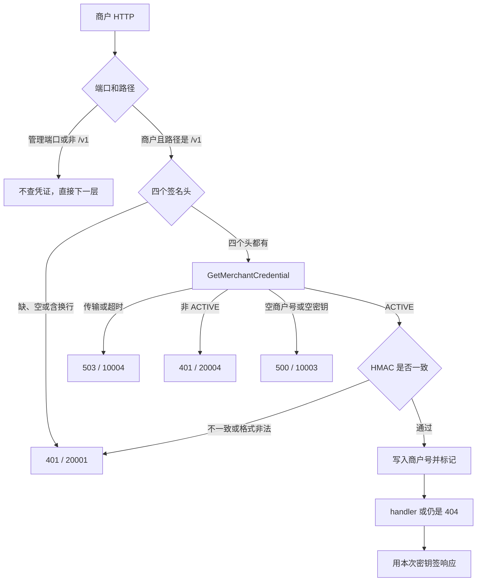

# GW-03 商户验签

| 项 | 内容 |
|---|---|
| 功能点 | GW-03（P0，第 3 周） |
| 所属链路 | 基础设施 |
| 代码提交 | `86379b2` `[GW-03] add merchant signature`（完整 `86379b23e78106051698b036f449646d2049e279`） |
| 分支 | `feat/GW-03-merchant-sign` |
| 日期 | 2026-11-01 |
| 状态 | DONE |

本报告写在上面这次代码提交之后，不在那次提交的文件里。报告撰写时尚未提交。

## 一句话结论

商户端口上，路径恰好是 `/v1` 或以 `/v1/` 开头的请求，现在会用商户自己的密钥验四个签名头。缺头或签名不对返回已有的 HTTP 401、错误码 `20001`、文案 `invalid signature`，到不了路由；四个头齐全且验签通过、路径仍然不存在时，仍是 HTTP 404、错误码 `10002`，并且这个 404 带平台签名。证据是 `TestGW03UnsignedBalance`、`TestGW03V1UnknownPathSigned`、`TestGW03ValidSignature`。

## 1. 背景

### 1.1 系统简介

pay-system 是一个用 Go 编写的小型支付后端，模拟商户收款、退款、商户间转账三条资金链路，重点在数据一致性和性能。系统由 5 个部分组成：gateway（对外 HTTP 入口，负责签名校验和限流）、payment（支付单、退款单、转账单的状态管理和流程推进）、account（账户余额与记账，数据按商户分到 2 个数据库分片）、channel-mock（模拟微信、支付宝这类外部支付渠道）、recon（对账，核对系统内外数据是否一致）。服务之间用 Kitex RPC 同步调用，或通过 Kafka 消息异步通知；数据存在 MySQL 8.4，Redis 用于防重放。所有金额用整数“分”表示，所有记账只追加不修改。当前已完成：工程骨架、账户记账与转账、模拟渠道、支付单创建与发起、支付结果推进、商户关单、支付查询、outbox 写入、健康检查、管理端口 pprof、命令行客户端、网关骨架，以及本功能点的商户验签。支付与余额的 HTTP 路由、渠道回调入口还没有。

### 1.2 本功能点在系统中的位置

外部 HTTP 先到网关。网关有两个监听：`:8080` 给商户 API 和以后的渠道回调，`:8090` 给管理接口。本功能点只在商户端口、并且路径属于 `/v1` 时，向 payment 查询商户凭证并验签。它不创建支付单，不改余额，也不接收渠道回调。



实线都是现在的行为。`:6060` 是健康检查端口，这次仍不听。支付路由和渠道回调还没注册，所以验签通过之后，未知的 `/v1/...` 会落到 404，这个 404 已经带平台签名。

### 1.3 为什么需要它

商户下单时，body 里会带金额。公开测试向量里的 `amount` 是 10000 分（100.00 元）。如果网关不验签，任何人都可以向 `/v1/payments` 提交这一段 JSON，冒充商户 `app_m100001`。签名不对时，请求必须停在验签，不能进入后面的支付路由。反过来，四个头都对、只是路径还没注册时，调用方要能确认这是网关自己写的 404，而不是中间人换成的“找不到”。所以这种 404 要用刚查到的商户密钥签名。本功能点仍不创建这笔 10000 分的订单，向量只用来验签。

## 2. 术语

| 术语 | 含义 |
|---|---|
| 分 | 金额的最小单位。1 元 = 100 分。10000 分是 100.00 元。本功能点不记账。 |
| gateway | 对外 HTTP 进程。商户请求和管理请求分两个端口进入。 |
| 商户端口 | 监听 `:8080` 的那一个 HTTP 服务，以后也接收渠道回调。 |
| 管理端口 | 监听 `:8090` 的那一个 HTTP 服务。它不验商户签名，响应也不签名。 |
| `app_id` | 商户应用编号，放在请求头 `X-App-Id`。它不是密钥。日志可以记它。 |
| 凭证 | payment 按 `app_id` 返回的一组数据：商户号 `merchant_id`、状态、以及 `app_secret`。 |
| `app_secret` | 这个商户的 HMAC 密钥。验请求、签响应都用它。日志不记它。 |
| HMAC | 用密钥和报文算出的消息认证码。对不上就说明报文或密钥不对。算法在已有的 `pkg/sign` 里，这次不重写。 |
| 平台签名 | 网关对实际写出的响应 body 计算的签名，放在响应头 `X-Timestamp`、`X-Nonce`、`X-Signature`。商户用同一个 `app_secret` 验证。 |
| nonce | 签名里的一次性随机串。请求头 `X-Nonce` 原样参与验签。本功能点不检查它是否用过。 |
| RequestURI | 路径加上原始查询串，例如 `/v1/gw03-probe?x=1`。查询串改一个字符，签名就应该失败。 |
| 错误码 | JSON 里的 `code`。本功能点只用已有的码：`20001` 文案 `invalid signature`（HTTP 401），`20004` 文案 `invalid merchant`（HTTP 401），`10004` 文案 `service unavailable`（HTTP 503），`10003` 文案 `internal error`（HTTP 500），`10002` 文案 `not found`（HTTP 404）。 |
| Kitex | 服务之间的 RPC 框架。网关用它调用 payment 的 `GetMerchantCredential`。 |
| 业务码 | RPC 返回里明确带上的 `code`。传输失败、超时没有业务码。 |
| `ACTIVE` | 商户状态必须与这六个字节完全相同才继续验签。`DISABLED`、空字符串、小写 `active` 都拒绝。 |
| `MarkVerified` | 把当前请求标成“商户验签已通过”。后面的响应签名只处理打过这个标记的商户响应。 |
| `MerchantID` | 从当前请求读出验签写入的商户号。没写过或为空时，第二个返回值是 false。 |
| `WithSignSecret` | 进程启动时配的一把响应密钥。只有这次请求没有查出凭证、又被标成已验签时才用它。 |
| `RPCTimeout` | 按方法名取出这一次 RPC 的超时。`GetMerchantCredential` 没有单独配置，因此是默认的 1 秒。 |
| trim | 去掉字符串两端的空格。本功能点不对四个头做 trim。 |
| CR / LF | 回车 `\r` 和换行 `\n`。头的值里出现它们，按签名非法处理，并且日志不写这个原始值。 |
| Hertz | 本项目的 HTTP 框架。中间件按固定顺序包住 handler。 |
| IDL | 描述 RPC 方法的接口文件。这次没有改它，也没有重新生成代码。 |
| kitex_gen | 由 IDL 生成的大段 RPC 代码。全仓库覆盖率把它算进去，所以 30.3% 不是 70% 门槛。 |
| outbox | 和业务写在同一个数据库事务里的待发送事件表。本功能点不写这张表。 |

## 3. 技术讲解

### 3.1 要解决的问题

1. 只有商户端口上的 `/v1` 需要验签。路径必须恰好是 `/v1`，或者以 `/v1/` 开头。`/v1foo` 和 `/v10` 不是 `/v1`。管理端口即使装了查询器也不查。`/order` 这类非 `/v1` 路径继续往下走，不要求签名。
2. 四个头 `X-App-Id`、`X-Timestamp`、`X-Nonce`、`X-Signature` 缺一个，或者值是空字符串，就返回 `20001`。不查凭证，不进入 handler，响应不签名。只含空格的值算存在，按原字节去查。
3. 任一头含 CR 或 LF，在发起 RPC 之前返回 `20001`。日志不能出现这段原始头。
4. 每一次 `/v1` 请求都调用 payment 的 `GetMerchantCredential`。不缓存，不重试。调用超时 1 秒。
5. 传输失败、超时、以及其他没有业务码的错误，返回 `10004`。对端业务码 `20004` 返回 `20004`。其他业务码返回 `10003`，不用对端带来的说明文字。响应是空时也是 `10003`。
6. 状态不是精确的 `ACTIVE` 时返回 `20004`，并且发生在 HMAC 比较之前。`merchant_id` 为空返回 `10003`。两种情况都不进入 handler。
7. 验签使用已有的 `VerifyRequest`：HTTP 方法保持原样，RequestURI 含原始查询串，时间戳和 nonce 用头里的原样，body 用已经读入的请求体。签名不一致、格式非法、字段含换行都是 `20001`。密钥为空是 `10003`。
8. 通过之后把商户号放进请求，打上已验签标记，再用这次查到的 `app_secret` 签响应。没有查过凭证、由 handler 自己标记的请求，仍用进程内的 `WithSignSecret`。两把密钥都空，则 `500` / `10003`，不签名。管理端口永不签名。
9. 不检查时间戳是否在 ±300 秒内，不检查 nonce 是否重放，不限流。这些分别留给后面的功能点。

### 3.2 方案

中间件顺序不变：先限制 body，再恢复 panic、生成 `request_id`、开追踪、写访问日志，然后是仍只占位的时间窗口，接着才是验签，再是仍只占位的限流和 nonce，最后在 handler 写完 body 之后做平台签名。验签失败就写出错误 JSON 并中止，不再调用下一层。

这段代码先判断要不要验，再拒绝空头和换行。`v1Path` 用的是路径，查询串不参与这个判断。

```go
func (h *Handler) verifySign(ctx context.Context, c *app.RequestContext) {
	appendName(c, nameVerifySign)
	if h.admin || !v1Path(string(c.Request.URI().Path())) {
		c.Next(ctx)
		return
	}
	appID := string(c.GetHeader(sign.HeaderAppID))
	ts := string(c.GetHeader(sign.HeaderTimestamp))
	nonce := string(c.GetHeader(sign.HeaderNonce))
	signature := string(c.GetHeader(sign.HeaderSignature))
	if appID == "" || ts == "" || nonce == "" || signature == "" {
		h.failVerify(ctx, c, appID, errno.ErrSignInvalid)
		return
	}
	if headerHasCRLF(appID, ts, nonce, signature) {
		h.failVerify(ctx, c, appID, errno.ErrSignInvalid)
		return
	}
```

查到凭证之后，先看状态和商户号，再调用已有的验签函数。通过后写入商户号，并复制一份密钥供这次响应使用。

```go
	if cred.Status != merchantStatusActive {
		h.failVerify(ctx, c, appID, errno.ErrMerchantInvalid)
		return
	}
	if cred.MerchantID == "" {
		h.failVerify(ctx, c, appID, errno.ErrInternal)
		return
	}
	body, err := c.Body()
	if err != nil {
		h.failVerify(ctx, c, appID, errno.ErrInternal)
		return
	}
	err = sign.VerifyRequest(cred.Secret, sign.Request{
		Method:     string(c.Method()),
		RequestURI: string(c.Request.URI().RequestURI()),
		Timestamp:  ts,
		Nonce:      nonce,
		Body:       body,
	}, signature)
	if err != nil {
		h.failVerify(ctx, c, appID, verifyErrno(err))
		return
	}
	c.Set(merchantIDKey, cred.MerchantID)
	c.Set(signSecretKey, append([]byte(nil), cred.Secret...))
	MarkVerified(c)
	h.logVerify(ctx, c, appID, errno.OK)
	c.Next(ctx)
```

生产环境的查询每次都打一次 RPC。超时用 `RPCTimeout("GetMerchantCredential")`，这个名字走默认分支，是 1 秒。密钥用 `append` 复制，避免和 RPC 响应共用同一段内存。

```go
	resp, err := p.cli.GetMerchantCredential(ctx, &payment.GetMerchantCredentialRequest{AppId: appID},
		callopt.WithRPCTimeout(RPCTimeout("GetMerchantCredential")))
	if err != nil {
		return Credential{}, mapCredentialErr(err)
	}
	if resp == nil {
		return Credential{}, errno.ErrInternal
	}
	return Credential{
		MerchantID: resp.MerchantId,
		Status:     resp.Status,
		Secret:     append([]byte(nil), resp.AppSecret...),
	}, nil
```

没有业务码的错误变成 `10004`。业务码正好是 `20004` 时保持 `20004`。其余业务码变成 `10003`。

```go
func mapCredentialErr(err error) error {
	biz, ok := kerrors.FromBizStatusError(err)
	if !ok || biz == nil {
		return errno.ErrUnavailable
	}
	if biz.BizStatusCode() == errno.ErrMerchantInvalid.Code {
		return errno.ErrMerchantInvalid
	}
	return errno.ErrInternal
}
```

响应签名先看这次请求上有没有密钥。有就用它；没有才用进程内的 `WithSignSecret`。两把都空就签失败。

```go
	secret := h.secret
	if got, ok := requestSignSecret(c); ok {
		secret = got
	}
	body := append([]byte(nil), c.Response.Body()...)
	if len(secret) == 0 {
		h.failSign(ctx, c)
		return
	}
```

进程启动时，已经取消的 context 仍在创建客户端之前返回，测试因此不会去绑 `:8080` 和 `:8090`。context 还有效时，只给商户服务装上 `NewPaymentLookup`，管理服务不装。

日志只有 `app_id` 和十进制字符串形式的 `err_code`。`10003` 用错误级别，句子是 `merchant credential unusable`。其他结果用信息级别，句子是 `merchant verify finished`。字段名里没有 `signature`，也没有 `secret`。`app_id` 含 CR 或 LF 时，这一项整段不写。访问日志里的 `merchant_id` 这次仍写空字符串。

公开测试向量 V1：密钥 `demo_secret_M100001_0123456789ab`，`POST /v1/payments`，时间戳 `1791500000`，nonce `AbCdEf0123456789`，body `{"out_trade_no":"T20261009001","amount":10000,"subject":"demo"}`，签名 `hFYKid0+k7q9vCvqh/i6YnvoaAJYzf2niNuvSkMCwoQ=`。`X-App-Id` 不在签名字符串里，测试用 `app_m100001`。验签通过后，因为生产注册没有这条路由，响应是 404 / `10002` / `not found` / `data` 为 `{}`，平台签名可以用上面这把密钥验证。

### 3.3 为什么这样做

| 方案 | 做法 | 优点 | 缺点 | 结论 |
|---|---|---|---|---|
| 采用：每次 RPC，验签前先看状态 | 商户端口的 `/v1` 每次调用 `GetMerchantCredential`，状态不是 `ACTIVE` 就返回 `20004`，通过后用这次的密钥签响应 | 停用立即生效；404 也能证明是网关写的；传输失败和内部错误分开 | 每个 `/v1` 请求都有一次 RPC | 采用 |
| 备选：网关进程内缓存凭证 | 查到后放进内存，短时间不再查 | 少一次 RPC | 商户刚被停用或刚换密钥时，旧凭证仍能通过。缓存是后面的 GW-08 | 这次不采用 |
| 备选：全进程共用一把密钥先验签 | 不查 payment，用启动时的 `WithSignSecret` 验所有请求 | 没有 RPC | 每个商户的 `app_secret` 不同。这把进程内密钥只留给“没查凭证、但 handler 自己标记已验签”的测试路由 | 不采用 |
| 备选：传输失败也返回 `10003` | 把超时、连接失败和内部错误合成一个码 | 调用方只处理一种失败 | `10004` 表示下游不可用，调用方可以再试；`10003` 表示网关这边的数据或程序有问题。合成之后两种处置混在一起 | 不采用 |

时间戳是否过期、nonce 是否重放，这次故意不看。公开向量的时间戳是 `1791500000`。若这里就套用 ±300 秒，向量会因为测试机的当前时间被拒绝，而那项检查属于 GW-04。

### 3.4 正确性

本功能点不写余额、不写订单，所以没有“同一笔记账重复提交、两笔记账并发超扣、记账写到一半进程崩溃”这几类资金场景。验签自己的重复、超时和拒绝如下。

| 场景 | 系统行为 | 最终状态 | 证明 |
|---|---|---|---|
| 同一个 `app_id` 连续来两次，查询都返回不可用 | 每次都调用查询，每次都是 HTTP 503、`10004`。没有把失败记下来下次直接返回 | 网关内存里没有凭证缓存；不写数据库 | `TestGW03LookupUnavailableNotCached` |
| 两个请求同时打到同一进程 | 没有共享的凭证 map，后一个请求不会读到前一个请求留下的密钥 | 各自查、各自验。没有单独的双 goroutine 抢缓存测试，因为没有那块缓存 | 代码里查询器不保存结果 |
| 进程在 RPC 中途崩溃 | 这次 HTTP 请求消失。网关没有插入订单或分录 | 没有半笔 10000 分的订单可留下。没有测试在 RPC 中途杀掉进程 | 本功能点没有订单写入 |
| payment 超时、取消、拨号失败或 RPC 超时 | 映射成 `10004`，不用对端说明文字。下一次请求会再查 | 不缓存这次失败 | `TestPaymentLookupMapsErrors` |
| 四个头缺一或空字符串 | `20001`，不查凭证，不进 handler，响应不签名 | 无状态变化 | `TestGW03MissingHeader` |
| `X-App-Id` 的值是三个空格 | 原样交给查询；查询返回未知商户时响应 `20004` | 无状态变化 | `TestGW03BlankAppIDNotTrimmed` |
| 头里含换行 | RPC 之前返回 `20001`，日志没有这段原始值 | 无状态变化 | `TestGW03HeaderCRLF` |
| 签名错误 | `20001`，不进 handler。日志有 `app_id`，没有密钥和签名值 | 无状态变化 | `TestGW03BadSignature` |
| 未知 `app_id` | `20004`，不进 handler | 无状态变化 | `TestGW03UnknownAppID` |
| 状态是 `DISABLED`，签名也是错的 | 在 HMAC 之前返回 `20004`，所以不是 `20001` | 无状态变化 | `TestGW03DisabledBeforeVerify` |
| 状态是空、`active` 或 `FROZEN` | 都是 `20004` | 无状态变化 | `TestGW03StatusNotActive` |
| `ACTIVE` 但密钥为空 | `10003`，错误日志只有 `app_id` 和 `err_code` | 无状态变化 | `TestGW03EmptySecret` |
| `ACTIVE` 但商户号为空，签名也是错的 | 在验签之前返回 `10003`，商户号不会写进请求 | 无状态变化 | `TestGW03EmptyMerchantID` |
| 签名正确，路径是测试加上的 `/v1/gw03-probe?x=1` | handler 读到的商户号与凭证一致。响应能用商户密钥验证，不能用另一把进程内密钥验证。查询串改成 `x=2` 后失败 | 只存在于这一次请求的上下文里 | `TestGW03ValidSignature` |
| V1 向量打到未注册的 `POST /v1/payments` | 验签通过，然后 404 / `10002`，平台签名可用该密钥验证 | 不创建 10000 分的订单 | `TestGW03V1UnknownPathSigned` |
| 未签名的 `GET /v1/balance` | `20001`，不进路由，不签名，不查凭证 | 无状态变化 | `TestGW03UnsignedBalance`、`TestUnknownPath` |
| 管理端口收到未签名的 `/v1/...` | 404，不签名，查询次数是 0 | 无状态变化 | `TestGW03AdminSkipsLookup` |
| 商户端口的 `/order` | 仍按原中间件顺序走到 handler，不查凭证 | 无状态变化 | `TestGW03NonV1OrderSkipsLookup`、`TestMiddlewareOrder` |
| 商户端口没装查询器，路径却是 `/v1` | `10003`，不进 handler | 无状态变化 | `TestGW03NilLookup` |
| 时间戳很老、nonce 重复使用 | 只要 HMAC 通过就放行。本功能点不看 ±300 秒，也不看重放 | 无 Redis 写入 | `TestGW03NoTimestampOrNonceCheck` |
| 业务码、传输错误、空响应、密钥复制 | `20004` 保持；其他业务码变 `10003`；无业务码变 `10004`；改副本不影响原响应；连续两次都会调用 | 无缓存 | `TestPaymentLookupMapsErrors`、`TestPaymentLookupCopiesCredential` |
| 命令行请求测试里的 `GET /v1/balance` | 查询器返回 `ACTIVE` 和与命令行相同的密钥，handler 只写成功 JSON。命令行能验证平台签名 | 不写订单 | `TestGW01PayCLIVerifiesPlatformSignature` |

### 3.5 性能

不涉及。这次没有压测。每个商户 `/v1` 请求固定一次 RPC 和一次 HMAC，凭证缓存留给 GW-08。

## 4. 已完成内容

### 4.1 改动清单

| 文件 | 新增 / 修改 | 作用 |
|---|---|---|
| `service/gateway/lookup.go` | 新增 | 凭证结构、查询接口、payment 适配器 |
| `service/gateway/lookup_test.go` | 新增 | 错误映射、密钥复制、不缓存 |
| `service/gateway/auth_test.go` | 新增 | 商户验签的验收用例，查询器是假的，不拨号 |
| `service/gateway/middleware.go` | 修改 | `verifySign` 按上面的顺序验签；响应签名优先用本次密钥 |
| `service/gateway/response.go` | 修改 | 导出 `MerchantID`；密钥只留在未导出的请求键里 |
| `service/gateway/server.go` | 修改 | 商户服务可以装上查询器 |
| `service/gateway/server_test.go` | 修改 | 未签名的 `GET /v1/balance` 改为期望 `20001` |
| `cmd/gateway/main.go` | 修改 | 商户服务装 `NewPaymentLookup`；管理服务不装 |
| `cmd/paycli/gw01_test.go` | 修改 | `/v1/balance` 使用 `ACTIVE` 的假查询器，密钥与命令行一致 |
| `docs/02-requirements.md` | 修改 | GW-03 标为完成，补上 2026-11-01 的说明 |
| `docs/03-conventions.md` | 修改 | 日志字段登记 `app_id` |
| `docs/04-dev-plan.md` | 修改 | 只勾 GW-03 |
| `docs/05-api.md` | 修改 | 写明未签名 `/v1` 与验签后的 404 |
| `docs/interview-notes.md` | 修改 | 记下验签范围和未签名余额路径的变化 |

### 4.2 对外变化

| 类别 | 变化 |
|---|---|
| 接口 | 未签名或验签失败的商户 `/v1` 在进路由前返回已有的 `20001`，响应不签名。四个头齐全且验签通过、路径仍不存在时，仍是 HTTP 404、`10002`、`not found`、`data` 为 `{}`，该 404 带平台签名。管理端口和非 `/v1` 的未知路径仍是不签名的 404。没有新增字段，没有新增路由。接口文档版本从 3.3.1 调到 3.3.2。 |
| 表结构 | 无 |
| 配置项 | 无新环境变量。编排文件未改。`:6060` 这次仍不听 |
| 错误码 | 无新错误码。`20001`、`20004`、`10002`、`10003`、`10004` 都是原有的 |
| 指标 / 故障点 | 无新指标，无新故障点 |

### 4.3 验收对照

| 验收条目 | 测试函数 | 类型 | 结果 |
|---|---|---|---|
| 四个头各自缺失或空字符串时返回 `20001`，不查凭证，不进 handler | `TestGW03MissingHeader` | 单元 | 通过 |
| 只含空白的 `X-App-Id` 不 trim，按原字节查询，查询给出未知商户时返回 `20004` | `TestGW03BlankAppIDNotTrimmed` | 单元 | 通过 |
| 头含 CR 或 LF 时返回 `20001`，不查凭证，日志不含原始头 | `TestGW03HeaderCRLF` | 单元 | 通过 |
| 错误签名返回 `20001`，不进 handler，日志有 `app_id`，没有密钥和签名值 | `TestGW03BadSignature` | 单元 | 通过 |
| 未知 `app_id` 返回 `20004`，不进 handler | `TestGW03UnknownAppID` | 单元 | 通过 |
| `DISABLED` 在验签之前返回 `20004` | `TestGW03DisabledBeforeVerify` | 单元 | 通过 |
| 空状态、小写 `active`、`FROZEN` 都返回 `20004` | `TestGW03StatusNotActive` | 单元 | 通过 |
| 查询传输失败返回 `10004`，下一次请求会再查 | `TestGW03LookupUnavailableNotCached` | 单元 | 通过 |
| `ACTIVE` 且密钥为空时返回 `10003`，不进 handler | `TestGW03EmptySecret` | 单元 | 通过 |
| `ACTIVE` 且商户号为空时返回 `10003`，不进 handler | `TestGW03EmptyMerchantID` | 单元 | 通过 |
| 正确签名后 handler 看到商户号；改查询串失败；响应用本次密钥而不是进程内另一把密钥 | `TestGW03ValidSignature` | 单元 | 通过 |
| V1 向量验签通过后得到带平台签名的 404 | `TestGW03V1UnknownPathSigned` | 单元 | 通过 |
| 未签名的 `GET /v1/balance` 返回 `20001` | `TestGW03UnsignedBalance` | 单元 | 通过 |
| 生产注册上未签名的 `GET /v1/balance` 同样是 `20001`，不查凭证 | `TestUnknownPath` | 单元 | 通过 |
| 管理端口不调用查询，404 不签名 | `TestGW03AdminSkipsLookup` | 单元 | 通过 |
| 非 `/v1` 的 `/order` 不查凭证 | `TestGW03NonV1OrderSkipsLookup` | 单元 | 通过 |
| 中间件顺序仍包含占位的时间窗口、限流、nonce，最后是 handler | `TestMiddlewareOrder` | 单元 | 通过 |
| `/v1foo` 和 `/v10` 不验签；恰好 `/v1` 和 `/v1/` 缺头时是 `20001` | `TestGW03PathBoundary` | 单元 | 通过 |
| 商户端口没装查询器时 `/v1` 返回 `10003` | `TestGW03NilLookup` | 单元 | 通过 |
| 不检查时间窗，也不检查 nonce 重放 | `TestGW03NoTimestampOrNonceCheck` | 单元 | 通过 |
| 业务码与传输错误的映射，空响应为 `10003`，超时是默认 1 秒 | `TestPaymentLookupMapsErrors` | 单元 | 通过 |
| 密钥是副本，连续两次调用都会打到客户端，`app_id` 原样传递 | `TestPaymentLookupCopiesCredential` | 单元 | 通过 |
| 命令行对装了假查询器的 `/v1/balance` 仍能验证平台签名 | `TestGW01PayCLIVerifiesPlatformSignature` | 单元 | 通过 |

### 4.4 验证记录

环境：go1.27.2 darwin/arm64。golangci-lint 2.14.0，用 go1.27.1 构建，提交 `114493f`，构建时间 2026-09-24T10:54:53Z。日期 2026-11-01。

| 命令 | 结果 |
|---|---|
| `gofmt -l .` | 无文件名。real 0.05s。退出码 0 |
| `make lint` | `0 issues.`。real 1.64s。退出码 0 |
| `make test` | real 5.78s。退出码 0。根包 `ok github.com/yym108/pay-system 5.321s`。这次运行里 `cmd/gateway`、`cmd/paycli`、`service/gateway` 显示 cached |
| `make test-integration` | real 37.04s。退出码 0。根包 `ok github.com/yym108/pay-system 36.596s`。`cmd/gateway` 1.613s，`cmd/paycli` 1.622s，`service/gateway` 2.055s。payment 的 biz 与 handler 为 cached |
| `make cover` | real 37.89s。退出码 0。全仓 total 30.3%（含 kitex_gen，不是 70% 门槛）。`service/gateway` 2.444s、82.2%（不在 70% 门槛里）。`cmd/gateway` 1.578s、25.6%。`cmd/paycli` 1.592s、79.5%（不在门槛里）。门槛包均为 cached：account biz 91.1%，payment biz 86.1%，pkg/money 100.0%，pkg/sign 100.0%，pkg/idgen 88.1%，pkg/outbox 95.0%。pkg/server 84.4% 只作参考 |
| `make gen` | 未运行。没有改 IDL |
| mmdc | 未运行。没有改流程图 |

同一次 `make cover` 的函数覆盖率：`verifySign` 95.0%，`Lookup` 100%，`mapCredentialErr` 100%，`platformSign` 90.9%，`serve` 7.4%，`Serve` 0.0%，`bodyLimit` 53.8%，`main` 0.0%，`run` 69.2%。`serve` 和 `Serve` 低，是因为成功路径的测试传入已经取消的 context，在绑定 `:8080`、`:8090` 之前就返回。这次没有用真实监听来证明这两个端口已经开着。

### 4.5 同步的文档

- 需求文档版本仍是 v3.0。GW-03 改为完成，两条验收已勾上。2026-11-01 的变更记录写在 GW-01 那一行后面：商户 `/v1` 缺头或验签失败返回已有的 `20001`；验签通过后路径仍不存在则 404 / `10002` 且带平台签名；管理端口与非 `/v1` 不验签；每次查询、不缓存、超时 1 秒、不重试；非 `ACTIVE` 为 `20004`；空密钥与空商户号为 `10003`。
- 开发计划把原来 GW-03、GW-02、GW-06 写在一起的那一项拆开，只勾了 GW-03。支付路由和渠道回调仍未勾。
- 接口文档改为 3.3.2，最后修改 2026-11-01。未签名的商户 `/v1` 与验签后的 404 写进说明。各接口自己的“最后修改”栏没有改。
- 全局约定改为 v2.25。日志字段名单加入 `app_id`。`app_id` 不是密钥，脱敏仍看 `secret`、`password`、`token`、`signature`、`master_key` 这些片段。
- 面试笔记在网关骨架和商户密钥两节之间加上商户验签：只验商户 `/v1`；时间窗口和 nonce 仍是后面的工作；未签名的 `/v1/balance` 从以前的 404 改为已有的 `20001`。
- 流程图文档这次没有改。

## 5. 未完成与风险

时间窗口、nonce 的格式和重放检查是 GW-04。限流是 GW-05。支付与余额的 HTTP 路由是 GW-02。渠道回调入口是 GW-06。凭证缓存是 GW-08。在那些功能点完成之前，过期时间戳和重复 nonce 只要 HMAC 对得上就会通过，网关也不会把请求转到创建支付单。

纯空白请求头的用例是进程内直接调用 `verifySign`。Go 的 HTTP 客户端会丢掉值只有空格的头，用它发请求会把这个头看成缺失，从而得到 `20001`，测不到“按原字节查询”。网关代码本身不 trim。测试会先确认框架读回的值仍是三个空格，再调用验签。

本功能点不改余额，不写订单。V1 里的 10000 分只出现在被签名的 JSON 里。

访问日志的 `merchant_id` 仍是空字符串。验签已经把商户号放进请求上下文，访问日志还没有读它。

`serve` 7.4%、`Serve` 0.0% 只覆盖了“context 已取消、绑定端口之前返回”。端口被占用、一个端口失败后取消另一个端口，这次没有用真实的 `:8080`、`:8090` 跑过。

## 6. 如何复现

前置：本机已安装 go1.27.2 和 golangci-lint 2.14.0，当前目录是仓库根。`gofmt -l .`、`make lint`、`make test` 不连接数据库。`make test-integration` 和 `make cover` 在本次记录里，payment 的 biz 与 handler 来自缓存。缓存不在时，那些包会按自己的集成测试去启动数据库；本次记录没有把那次缓存命中写成一次全新的数据库演练。

```bash
gofmt -l .
make lint
make test
make test-integration
make cover
```

本次记录就是 4.4 的表：前五条命令退出码都是 0。`gofmt -l .` 不打印文件名。`make lint` 打印 `0 issues.`。`make cover` 的全仓 total 是 30.3%。`make gen` 和 mmdc 未运行。

只看本功能点列出的单元测试时，可以跑：

```bash
go test -race -count=1 ./service/gateway/ ./cmd/paycli/ \
  -run 'GW03|UnknownPath|MiddlewareOrder|PaymentLookup|GW01PayCLI'
```

`TestGW01PayCLIVerifiesPlatformSignature` 在 `./cmd/paycli/`。其余列出的函数在 `./service/gateway/`。

## 7. 讲解要点

1. 问：payment 超时为什么是 `10004`，空密钥却是 `10003`？答：超时表示这一次没拿到凭证，调用方可以再试，所以用 `service unavailable`。空密钥表示数据已经回来了，但这边无法验签，属于内部数据问题，用 `internal error`，并且打错误日志，日志里只有 `app_id` 和 `err_code`。
2. 问：路径不存在为什么有时不签名、有时签名？答：未签名的 `GET /v1/balance` 在验签层就返回 `20001`，响应不签名。四个头都通过之后才发现没有路由，这时请求已经标记为已验签，404 要用刚查到的 `app_secret` 签名。管理端口和 `/order` 这类非 `/v1` 路径不验签，它们的 404 仍不签名。
3. 问：为什么不在网关里缓存凭证？答：停用和换密钥要在下一次请求生效。缓存会让旧密钥继续可用，那是 GW-08 的范围。这次每次 `/v1` 都调用 `GetMerchantCredential`，超时 1 秒，不重试。

## 延伸阅读

- `docs/02-requirements.md` 的 GW-03 一节，以及 2026-11-01 的变更记录。
- `docs/05-api.md` 版本 3.3.2 里关于未签名 `/v1` 和验签后 404 的说明，以及 §3.7 的向量 V1。
- `docs/03-conventions.md` v2.25 的日志字段 `app_id`。
- `docs/interview-notes.md` 的 GW-03 小节。
- `service/gateway/middleware.go`、`service/gateway/lookup.go`、`service/gateway/response.go`、`cmd/gateway/main.go`。

## 修订记录

| 日期 | 提交 | 修订内容 |
|---|---|---|
| 2026-11-01 | `86379b2` | 代码提交 `[GW-03] add merchant signature`。本报告撰写时尚未提交。 |
