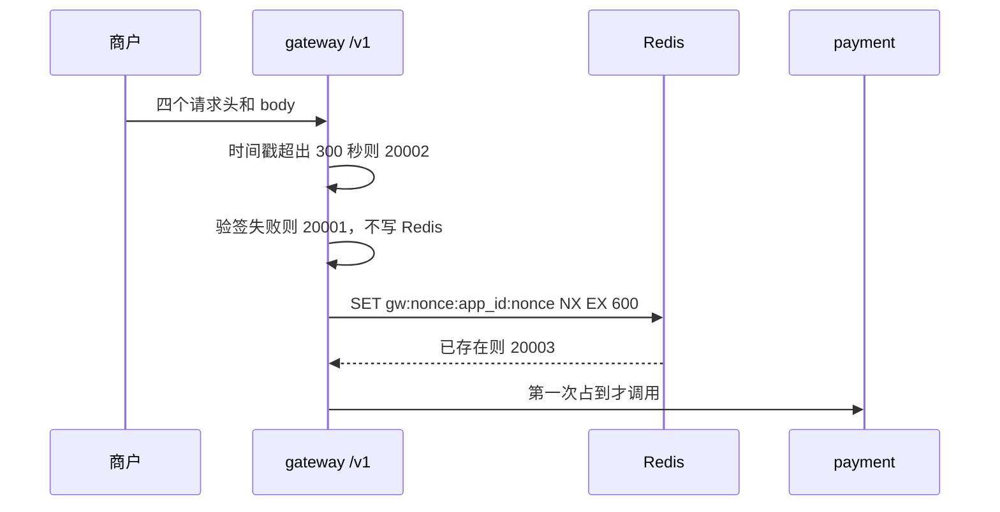

# GW-04 时间窗口与 nonce 防重放

| 项 | 内容 |
|---|---|
| 功能点 | GW-04（P0，第 5 周） |
| 所属链路 | 基础设施 |
| 代码提交 | `70ae1da` `[GW-04] add timestamp and nonce` |
| 分支 | `feat/GW-04-timestamp-nonce` |
| 日期 | 2026-11-11 |
| 状态 | DONE |

## 一句话结论

商户打到 gateway `:8080` 的 `/v1` 请求，先用注入时钟核对 `X-Timestamp` 是否落在前后 300 秒里，验签通过后再用 Redis 把 `app_id` 加 nonce 占住 600 秒。超窗是 `20002`，重复 nonce 是 `20003`，Redis 不可用是 `503` / `10004`。渠道回调不走这两步。证据是 `TestGW04Window`、`TestGW04NonceReplay`、`TestGW04NonceUnavailable`、`TestGW04RedisNonce`、`TestGW04CallbackWithoutNonce`，以及 `/tmp/gw04-verify-r3.log`（2026-11-11 12:15:45 开始，12:17:12 写完，3749 行，脚本退出码 0）。日志写完后没有再改代码。

## 1. 背景

### 1.1 系统简介

pay-system 是一个用 Go 编写的小型支付后端，模拟商户收款、退款、商户间转账三条资金链路，重点在数据一致性和性能。系统由 5 个部分组成：gateway（对外 HTTP 入口，负责签名校验和限流）、payment（支付单、退款单、转账单的状态管理和流程推进）、account（账户余额与记账，数据按商户分到 2 个数据库分片）、channel-mock（模拟微信、支付宝这类外部支付渠道）、recon（对账，核对系统内外数据是否一致）。服务之间用 Kitex（本仓库选用的 RPC 框架）同步调用，或通过 Kafka 消息异步通知；数据存在 MySQL 8.4。Redis 给网关记住「这个请求头里的随机串已经用过」。所有金额用整数「分」表示，100 分等于 1.00 元。所有记账只追加不修改。当前已完成：工程骨架、账户与三条链路的订单和入账、Kafka 投递与消费、商户通知的生成和发送、商户验签，以及本功能点的时间窗口和 nonce。

### 1.2 本功能点在系统中的位置

商户调用支付、退款、转账、余额这些 `/v1` 接口时，请求先进入 gateway。验签是上一功能点做的：用商户密钥核对签名。本功能点在验签前面挡住过期时间戳，在验签后面挡住把同一份请求原样再发一次。渠道回调是 `POST /callback/mockpay`，不进这两步。管理端口 `:8090` 也不进。gateway 自己的存活和依赖检查在管理端口 `:6060`。



图里的「四个请求头」是 `X-App-Id`、`X-Timestamp`、`X-Nonce`、`X-Signature`。`app_id` 是 `X-App-Id` 的原文，不是商户号。

### 1.3 为什么需要它

签名只能证明「这串字节是用密钥算出来的」。攻击者截到一份 10 秒前的合法请求，可以原样再 POST 一次。如果不看时间，旧请求永远有效。如果只看时间、不记住随机串，300 秒内同一份请求可以发很多次，创建订单的接口就会靠幂等键去挡，查询以外的写接口多承担一次无效调用。本功能点让超过 300 秒的请求直接 401，300 秒内的同一随机串只能成功占用一次。

## 2. 术语

| 术语 | 含义 |
|---|---|
| 时间窗口 | `X-Timestamp` 是十进制 Unix 秒。和 gateway 注入时钟的 Unix 秒相比，差的绝对值大于 300 就拒绝。恰好 300 仍通过。 |
| nonce | 请求头 `X-Nonce`。这里要求 16 到 32 位，每位是 `A-Z`、`a-z` 或 `0-9`。验签通过后按 `app_id` 记住 600 秒。 |
| 验签 | 用商户密钥核对 `X-Signature`。失败是 `20001`，本功能点不在失败时写 Redis。 |
| Redis | 内存键值库。本功能点只往里放防重放的键，不放余额、订单或密钥。 |
| NX | Redis `SET` 的参数：键不存在才写入。已存在就表示这个 nonce 用过了。 |
| EX 600 | 同一条 `SET` 里给键 600 秒过期。不能先写入再另发一条过期命令。 |
| fail-closed | Redis 超时或连不上时拒绝商户请求，而不是当成「没重放过」放行。对应 HTTP 503、业务码 `10004`。 |
| 平台签名 | 验签已经成功的响应，gateway 用商户密钥给响应体签名。验签之前就拒绝的响应不签名。 |
| 注入时钟 | 生产用真实时钟，测试用可拨动的假时钟。比较的是 Unix 秒，不用小数。 |
| `/readyz` | 管理端口上的依赖检查。任一项失败，HTTP 503，正文是 `unavailable`。 |
| `/healthz` | 进程还活着就是 HTTP 200，正文 `ok`。Redis 挂了它仍然是 200。 |

## 3. 技术讲解

### 3.1 要解决的问题

1. 时间戳超前或落后超过 300 秒必须在验签之前拒绝，避免先去查商户。
2. nonce 格式不对是 `20001`，也不查商户、不写 Redis。
3. 验签失败不占用 nonce，攻击者不能用一份坏签名把合法 nonce 占掉。
4. 同一 `app_id` 下 600 秒内同一 nonce 第二次是 `20003`。另一个 `app_id` 可以用同一个 nonce 字符串。
5. Redis 不可用时商户 `/v1` 是 503 / `10004`，并给进程内计数加 1。渠道回调照常。
6. gateway 的 `/readyz` 检查 Redis，单项上限 1 秒。`/healthz` 不看 Redis。

### 3.2 方案

中间件顺序不变：请求体上限、Recovery、RequestID、Trace、AccessLog、时间窗口、验签、限流占位、nonce、响应签名、handler。限流这一步仍然直接放行，留给下一个功能点。

时间窗口只看商户 `/v1`。管理端口和 `/callback/mockpay` 直接进入下一步。四个头有任何一个是空的，这里不拒绝，后面的验签仍返回 `20001`。四个头都有内容时：

- nonce 不是 16 到 32 位字母数字：`20001`，不查商户，不写 Redis，不签名。
- 时间戳不是十进制整数：`20001`，同样不查、不写、不签名。
- 和注入时钟的 Unix 秒相差大于 300：`20002`，不查、不写、不签名。301 和 -301 拒绝，299 和恰好 ±300 继续。

验签通过之后，nonce 中间件执行一条命令：

```text
SET gw:nonce:{app_id}:{nonce} 1 NX EX 600
```

花括号表示把请求头里的值代进去，键里没有花括号字符。例如 app_id 是 `app_m100001`、nonce 是 `AbCdEf0123456789` 时，键是 `gw:nonce:app_m100001:AbCdEf0123456789`。这条命令的上下文超时是 50 毫秒，不重试。第一次返回 OK 就继续进 handler。键已存在返回 `20003`。命令报错、超时或客户端没装上，返回 `503` / `10004`，进程内计数 `pay_nonce_unavailable_total` 加 1。这个计数还没有 HTTP 的 `/metrics`，那是后面的指标功能点。`20003` 不加计数。

`20003` 和这条路径上的 `10004` 发生在验签成功之后。gateway 先写出错误 JSON，再给这个正文做平台签名，然后停住，业务 handler 不执行。`20002` 和格式类 `20001` 在验签之前，响应不签名。

gateway 进程没有 MySQL。管理端口 `:6060` 打开「可以没有数据库」的开关，只注册 Redis 的 Ping，单项超时 1 秒。开关默认关闭：payment 和 account 仍然是没有数据库检查就 503。一项额外检查都没有时，即使打开开关也是 503。Redis 地址来自已有的 `REDIS_ADDR`，默认 `redis:6379`。客户端是懒连接，启动时连不上也不退出，否则回调会一起起不来。

### 3.3 为什么这样做

| 方案 | 做法 | 优点 | 缺点 | 结论 |
|---|---|---|---|---|
| 采用：验签前只查时间和格式，验签后一条 `SET NX EX` | 坏签名不写 Redis；过期时间和占用在同一条命令 | 攻击者占不走合法 nonce；进程死在两条命令之间也不会留下永不过期的键 | Redis 挂了商户接口全部拒绝 | 采用 |
| 备选：验签失败也写入 nonce | 任何到过网关的 nonce 都算用过 | 实现更少分支 | 攻击者用坏签名就能让合法重试变成 `20003` | 不采用 |
| 备选：先 `SETNX` 再单独 `EXPIRE` | 两条命令 | 客户端 API 更常见 | 死在两条命令之间，键永远不过期 | 不采用 |
| 备选：Redis 挂了仍放行 | 只在 Redis 正常时防重放 | 可用性更高 | 截获的请求在故障期间可以重放 | 不采用 |

### 3.4 正确性

本功能点不改余额、不写记账凭证。下表说的是请求是否进入业务 handler，以及 Redis 里有没有这个键。

| 场景 | 系统行为 | 最终状态 | 证明 |
|---|---|---|---|
| 时间戳超前或落后 301 秒 | `20002`，不查商户，不写 Redis，不签名 | 键不存在，handler 未调用 | `TestGW04Window` |
| 相差 299 秒或恰好 300 秒 | 继续验签；签名正确且 nonce 第一次出现则进入 handler | 键被占住 | `TestGW04Window` |
| 同一 app_id 的同一 nonce 再来 | `20003`，带平台签名，handler 不执行 | 键仍是第一次留下的 | `TestGW04NonceReplay` |
| 先发坏签名，再用同一 nonce 发合法签名 | 坏签名是 `20001` 且不写 Redis；合法请求通过 | 键在合法请求时才出现 | `TestGW04NonceReplay` |
| 两个 app_id 用同一个 nonce 字符串 | 各自第一条都通过 | 两个键 | `TestGW04NonceReplay`、`TestGW04RedisNonce` |
| 存储返回错误 | `503` / `10004`，计数加 1，响应有平台签名，handler 不执行 | 没有新的成功占用 | `TestGW04NonceUnavailable` |
| Redis 容器停掉 | 商户请求 `10004`；`/readyz` 503 正文 `unavailable`；`/healthz` 200 正文 `ok` | 回调不经过这里 | `TestGW04RedisNonce` |
| 存储一直报错时的渠道回调 | `POST /callback/mockpay` 仍调用 payment 的回调处理，nonce 存储调用次数是 0 | 不写 `gw:nonce:*` | `TestGW04CallbackWithoutNonce` |

进程在 `SET` 成功之后、handler 写完之前崩溃：键已经占住 600 秒，商户用同一 nonce 重试会得到 `20003`，必须换 nonce 重签。这是防重放的代价，不是漏放。Redis 在 `SET` 发出后、应答丢失时，商户看到的是 `10004`，键可能已经写上；商户按接口约定换新 nonce 重试。

### 3.5 性能

不涉及对比开关。本功能点没有「打开/关闭某条优化路径」的配置。Redis 这一次 `SET` 的上下文超时是 50 毫秒。`/readyz` 的 Ping 上限是 1 秒，没有把 50 毫秒写进客户端的全局超时。

## 4. 已完成内容

### 4.1 改动清单

| 文件 | 新增 / 修改 | 作用 |
|---|---|---|
| `service/gateway/nonce.go` | 新增 | 时间差、内存存储、Redis `SET NX EX`、Ping、进程内计数 |
| `service/gateway/middleware.go` | 修改 | 时间窗口和 nonce；验签后的错误响应仍签名 |
| `service/gateway/server.go` | 修改 | 装上 nonce 存储；注释改为时间窗口和 nonce 已实现，限流仍是占位 |
| `cmd/gateway/main.go` | 修改 | 用 `REDIS_ADDR` 打开 Redis，`:6060` 只检查 Redis |
| `pkg/server/server.go` | 修改 | 默认关闭的 `AllowNoDB`。只有 gateway 打开 |
| `service/gateway/nonce_test.go` | 新增 | 验收 1、2、3 的进程内部分和验收 4 |
| `service/gateway/nonce_integration_test.go` | 新增 | 真实 Redis 8.10.2 的 TTL 和停容器 |
| 若干已有测试 | 修改 | `/v1` 成功路径装上内存存储；过期时间戳改为断言 `20002` |

### 4.2 对外变化

| 类别 | 变化 |
|---|---|
| 接口 | 行为与接口文档 §3.2 已有句子一致：超过 300 秒是 `20002`，验签后重复 nonce 是 `20003`，Redis 不可用是 `10004`。这次没有改接口文档的句子，也没有抬版本。 |
| 表结构 | 无。 |
| 配置项 | 无新名字。沿用 `REDIS_ADDR`，默认 `redis:6379`。 |
| 错误码 | 无新码。用已有的 `20001`、`20002`、`20003`、`10004`。 |
| 指标 / 故障点 | 进程内计数，名字是需求里已有的 `pay_nonce_unavailable_total`，没有标签，没有 `/metrics`。没有新的故障点名字。 |

### 4.3 验收对照

| 验收条目 | 测试函数 | 类型 | 结果 |
|---|---|---|---|
| 时间戳超前或落后 301 秒返回 `20002`，299 秒通过。恰好 ±300 秒也通过 | `TestGW04Window` | 单元 | 通过 |
| 同一 nonce 第二次返回 `20003`；签名错误不占用，之后合法请求仍可用 | `TestGW04NonceReplay` | 单元 | 通过 |
| 存储失败时商户接口 503 / `10004`，`/readyz` 503 | `TestGW04NonceUnavailable`、`TestReadyAllowNoDB` | 单元 | 通过 |
| Redis 上第一次 SET 成功，TTL 在 1 到 600 秒；停容器后商户 `10004`，`/readyz` 503，`/healthz` 200 | `TestGW04RedisNonce` | 集成 | 通过 |
| Redis 不可用时渠道回调仍进入已有回调处理，且不调用 nonce 存储 | `TestGW04CallbackWithoutNonce` | 单元 | 通过 |

验收原文里的「推进订单」指渠道回调仍能调用 payment、不因 Redis 被拦住。本功能点的测试用假的 payment 客户端记录这次调用，没有再插入一张支付单。支付单状态变化仍由已完成的回调功能点负责。

### 4.4 验证记录

环境：本机 macOS，Go 测试带 `-race`。正式日志只认 `/tmp/gw04-verify-r3.log`。日志在代码提交之前写完，期间没有再改 Go 文件。

| 命令 | 结果 |
|---|---|
| `gofmt -l .` | 无输出，退出码 0 |
| `make lint` | `0 issues.`，退出码 0 |
| `make test` | 退出码 0。根包 `6.019s`。gateway 与 cmd/gateway 为缓存通过 |
| `make test-integration` | 退出码 0。根包 `37.776s`，`test/gw09` `21.915s`。gateway 为缓存通过 |
| `make cover` | 退出码 0。语句合计 39.5%（含生成代码，不是门槛）。gateway `4.387s` / 72.4%（不在 70% 门槛里）。payment 的 biz 缓存 84.8%，account 的 biz 缓存 90.8%，channel-mock 的 biz 缓存 91.7%，金额包 100%，签名包 100%，单号包 88.1%，待投递事件包 89.3%。门槛是这些包各自不低于 70% |

脚本删掉了仓库里的 `coverage.out`，日志末尾是 `no_coverage_out`。

### 4.5 同步的文档

- 需求 §3 总表 GW-04 改为 DONE，四条验收打勾。需求版本仍是 v3.0。没有改规则正文。
- 流程图 v2.52 改为 v2.53，只在商户请求那张图下面加了一句「已按此图实现，限流仍是占位」。图中节点没改，没有新的图片文件。
- 面试笔记追加了 GW-04：没有数据库时的就绪检查、一条 `SET` 必须带过期、验签失败不占 nonce。
- 约定、接口文档、表结构文档没有改。开发计划第 5 周里「时间窗口与限流」那一行还没打勾，因为限流还没做。

## 5. 未完成与风险

- 商户限流仍是占位。计划里和本功能点同一行的限流做完之后才打勾。
- 进程内的 `pay_nonce_unavailable_total` 还不能从 `/metrics` 抓取。
- 多实例时每个 gateway 各自写 Redis。键带 `app_id` 和 nonce，所以重放保护是跨实例的。限流不是，那是下一个功能点。
- 渠道回调「推进订单」没有在本功能点里重跑一整张支付单。测试证明回调不读 nonce 存储，并且仍调用 payment 的回调入口。
- 同一次代码上，更早的一次覆盖率命令里，已有的 panic 测试收到过 HTTP 401、正文 `auth required`。单独再跑 gateway 的覆盖率通过了。上面表格引用的是通过的那次日志。

## 6. 如何复现

前置：Docker 可用，能拉取 `redis:8.10.2`。在仓库根目录：

```bash
gofmt -l .
make lint
make test
make test-integration
make cover
rm -f coverage.out
```

预期：`gofmt` 无输出；lint 打印 `0 issues.`；三条 `make` 退出码都是 0；`service/gateway` 覆盖率约 72%；门槛内的 biz 与金额、签名、单号、待投递事件包都不低于 70%。只跑本功能点时：

```bash
go test -race -count=1 -run 'TestGW04' ./service/gateway/
go test -race -tags integration -count=1 -run TestGW04RedisNonce ./service/gateway/
```

## 7. 讲解要点

1. 为什么坏签名不占 nonce？占了的话，别人不用密钥就能让你的下一次合法重试变成 `20003`。
2. 为什么过期时间必须和占用在同一条命令里？拆开的话，进程死在中间，这个 nonce 会永远占着。
3. 为什么 Redis 挂了要拒绝，而不是放行？放行等于故障期间没有防重放。回调不读 Redis，所以渠道仍能通知支付结果。

## 延伸阅读

- `docs/02-requirements.md` 里 GW-04 那一节
- `docs/05-api.md` §3.2
- `docs/06-flows.md` 的商户请求管线 CF-01
- `docs/01-tech-decisions.md` 的 Redis 使用边界，以及 `github.com/redis/go-redis/v9` v9.23.0

## 修订记录

| 日期 | 提交 | 修订内容 |
|---|---|---|
| 2026-11-11 | 待提交 | 初稿 |
