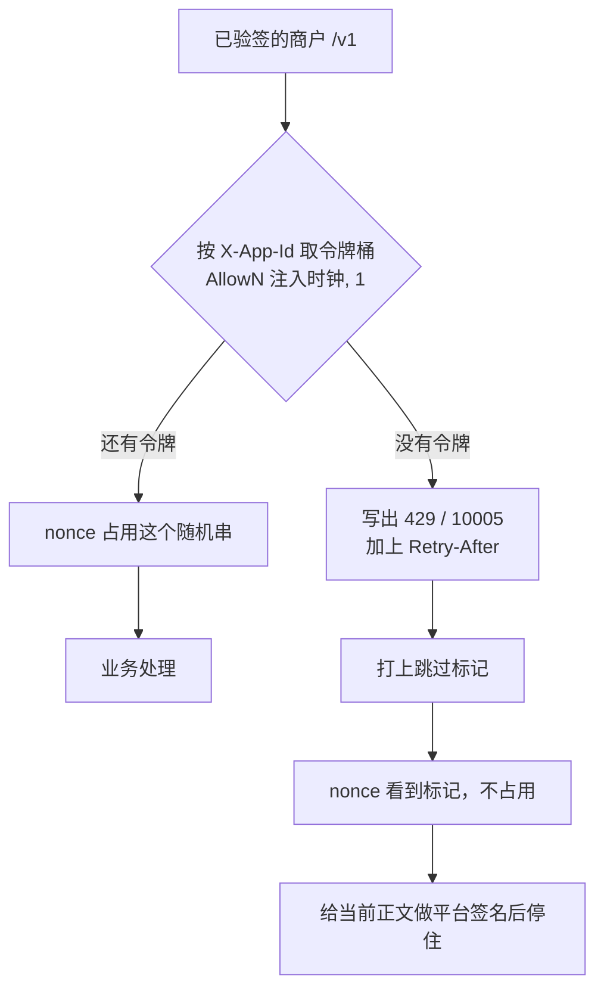

# GW-05 商户限流（进程内）

| 项 | 内容 |
|---|---|
| 功能点 | GW-05（P0，第 5 周） |
| 所属链路 | 基础设施 |
| 代码提交 | `c00ea8e` `[GW-05] add rate limit` |
| 分支 | `feat/GW-05-rate-limit` |
| 日期 | 2026-11-11 |
| 状态 | DONE |

## 一句话结论

商户打到 gateway（对外 HTTP 入口）`:8080`、并且已经验签（用商户密钥核对过签名）通过的 `/v1` 请求，在占用 nonce（防重放随机串）之前，按请求头 `X-App-Id` 的原文做进程内令牌桶：桶里预先放着固定枚数的令牌，放行一次拿走一枚。默认每秒 100 枚、桶容量 200 枚。同一时刻连续 300 个请求里，恰好 200 个进入业务处理并占用 nonce，100 个是 HTTP 429、业务码 `10005`（文案 `rate limited`），响应头 `Retry-After` 为 `1`，不占用 nonce。证据是 `TestGW05DefaultBurst`、`TestGW05OtherAppUnaffected`、`TestGW05OverrideBurst`、`TestGW05CallbackSkipsRateLimit`，以及 `/tmp/gw05-verify.log`（2026-11-11 12:40:35 开始，12:47:28 写完，3767 行，脚本退出码 0）。日志写完后没有再改代码。

## 1. 背景

限流只决定已验签的商户 `/v1` 能不能继续往下走，不改余额，也不写数据库。

### 1.1 系统简介

pay-system 是一个用 Go 编写的小型支付后端，模拟商户收款、退款、商户间转账三条资金链路，重点在数据一致性和性能。系统由 5 个部分组成：gateway（对外 HTTP 入口，负责签名校验和限流）、payment（支付单、退款单、转账单的状态管理和流程推进）、account（账户余额与记账，数据按商户分到 2 个数据库分片）、channel-mock（模拟微信、支付宝这类外部支付渠道）、recon（对账，核对系统内外数据是否一致）。服务之间用 Kitex（本仓库选用的 RPC 框架）同步调用，或通过 Kafka 消息异步通知；数据存在 MySQL 8.4。Redis 给网关记住「这个请求头里的随机串已经用过」，本功能点的限流不访问 Redis。所有金额用整数「分」表示，100 分等于 1.00 元。所有记账只追加不修改。当前已完成：工程骨架、账户与三条链路的订单和入账、Kafka 投递与消费、商户通知的生成和发送、商户验签，以及时间窗口（时间戳与时钟相差超过 300 秒则拒绝）、nonce 和本功能点的进程内商户限流。

### 1.2 本功能点在系统中的位置

本功能点夹在验签和 nonce 之间：只处理商户端口上已经验签的 `/v1`。前面的时间窗口和验签决定请求有没有资格被计数；后面的 nonce 才占用防重放名额；再后面才是业务处理。



通过的那条会进入业务处理，成功响应也由后面的平台签名函数签名；上图只画限流的两条出口，没有把成功路径的签名再画一遍。商户请求从 `:8080` 进来。验签用的是上一功能点查到的商户密钥。渠道回调 `POST /callback/mockpay` 也在 `:8080`，但路径不是 `/v1`，不进这张图。管理端口是 `:8090`，也不进。gateway 自己的存活检查在 `:6060`，本功能点不改它。时间窗口是更前面的一步：请求头里的时间戳和注入时钟相差超过 300 秒就拒绝，本次不改它。

### 1.3 为什么需要它

不做这一步的话，验签通过的请求会无上限地去占用 nonce，并进入业务处理。验签只能证明这份请求是密钥持有者发出的。一个 `app_id` 仍可以在很短时间里发出远超过业务需要的合法请求。默认桶在同一时刻只放行 200 个：连续 300 个已验签请求里，后 100 个不再去占用 nonce，也不进入业务处理。如果不做这一步，这 300 个都会去记 nonce，并且调用后面的支付或账户逻辑。

限流放在验签之后，是为了不让别人用伪造的 `X-App-Id` 把真实调用方的桶耗掉。放在 nonce 之前，是为了被拒绝的请求不去碰 Redis，而且同一个随机串以后还能再用。

## 2. 术语

下面每个词都按这一张表的意思使用。

| 术语 | 含义 |
|---|---|
| gateway | 对外的 HTTP 入口。商户接口和渠道回调在 `:8080`，管理接口在 `:8090`。 |
| payment | 管支付单、退款单、转账单的服务。限流通过之后才会调用它。 |
| account | 管账户余额和记账的服务。数据按商户分到 2 个数据库。限流不调用它。 |
| 分片 | 账户数据拆在 2 个 MySQL 库里。本功能点不选库、不写库。 |
| channel-mock | 模拟外部支付渠道的进程。它回调 gateway，不走商户限流。 |
| recon | 对账，核对系统内外数据是否一致。本功能点不参与。 |
| Kitex | 本仓库选用的 RPC 框架。服务之间的同步调用用它。限流这一步不发出 RPC。 |
| `kitex_gen` | 由接口定义生成出来的代码。整仓语句覆盖率把它们算进去，那一个合计不是门禁。 |
| Kafka | 异步消息。限流不生产、不消费消息。 |
| MySQL | 关系库，版本 8.4。限流不连接它。 |
| Redis | 内存键值库。nonce 用它记住用过的随机串。限流不读、不写 Redis。 |
| 分 | 金额的整数单位。100 分等于 1.00 元。本功能点不出现金额。 |
| 记账 | 给账户追加一笔不修改的余额变动。限流不记账。 |
| 时间窗口 | 请求头 `X-Timestamp` 里的秒级时间戳，和网关用来比较的时钟相差的绝对值。大于 300 秒就在验签之前拒绝。恰好 300 秒仍通过。本功能点不改这一步。 |
| 令牌桶 | 一个最多装「突发」枚令牌的桶。按「速率」往里补，满了就不再加。每个放行的请求拿走 1 枚。新建时桶是满的。`golang.org/x/time/rate` 的 `Limiter` 就是这个桶，`NewLimiter(速率, 突发)` 创建一个满桶。 |
| 速率 | 每秒补充的令牌数。默认 100，大约每 10 毫秒补 1 枚。 |
| 突发 | 桶的容量。时钟停住时，连续能通过的请求数等于这个容量。默认 200。 |
| `app_id` | 请求头 `X-App-Id` 的原文。分桶和覆盖都用这串字符，不用商户号。 |
| 商户号 | 验签之后查到的商户标识，例如 `M100001`。两个不同的 `app_id` 可以查到同一个商户号，桶仍然是两个。 |
| 验签 | 用商户密钥核对请求签名。没通过的请求不建桶、不拒绝于限流。 |
| `/v1` | 路径恰好是 `/v1`，或以 `/v1/` 开头。只有这类已验签请求才限流。 |
| nonce | 请求头 `X-Nonce` 里的随机串。限流通过之后才按 `app_id` 占用；超限不占用。 |
| 注入时钟 | 生产用真实时钟，测试用可停住的假时钟。限流把这个时刻传进判定函数。 |
| `AllowN` | `rate.Limiter` 的方法。`AllowN(时刻, 1)` 按传入的时刻决定能不能拿走 1 枚令牌。不用 `Allow()`，因为 `Allow()` 读的是真实时间。 |
| HTTP 429 | 请求过多。本功能点超限时的 HTTP 状态。 |
| `10005` | 已有业务码，文案固定为 `rate limited`。这次没有新错误码。 |
| `Retry-After` | 响应头，告诉调用方至少再等几秒。不足 1 秒写成 `1`。 |
| `ReserveN` | 在令牌桶上预约 1 枚未来的令牌，用来算还要等多久。 |
| `CancelAt` | 立刻取消刚才的预约。被拒绝的请求因此不占后面的令牌。 |
| 跳过标记 | 请求上的标记。错误 JSON 已经写好之后设上它：nonce 不再占用，平台签名签完当前正文就停住。 |
| 平台签名 | gateway 用商户密钥给响应正文签名。429 发生在验签成功之后，所以带这个签名。 |
| 中间件 | 业务处理之前按固定顺序执行的函数。顺序是：请求体上限、接住运行崩溃并返回 500、请求号、追踪、访问日志、时间窗口、验签、限流、nonce、平台签名，然后才是业务处理。 |
| `sync.Map` | Go 标准库里可以并发读写的映射。令牌桶按 `app_id` 放在里面。`LoadOrStore` 的意思是：没有这个键就把新桶放进去，已经有了就用原来的那个。 |
| `rateAllow` | 测试可替换的判定函数。生产是空的，空了就走真令牌桶。 |
| 渠道回调 | `POST /callback/mockpay`。不是 `/v1`，不建桶、不因限流被拒绝。 |
| 管理端口 | `:8090`。上面的请求不建桶、不因限流被拒绝。 |
| `/metrics` | 抓取指标的 HTTP 路径。现在仍不暴露限流次数。 |
| OPS-03 | 以后把进程内计数暴露到 `/metrics` 的功能点。本功能点不做。 |
| GW-07 | 以后给管理接口做鉴权的功能点。本功能点不做。 |
| DOC-01 | 以后写仓库说明的功能点。多实例那句话现在不在仓库根的说明里。 |
| Docker | 本机上的容器环境。整仓集成测试用它启动 MySQL、Redis 等依赖。本功能点的四个测试本身不启动容器。 |

## 3. 技术讲解

用进程内令牌桶按 `X-App-Id` 计数。超限写 429 之后继续往下走，但不占用 nonce，也不进入业务处理。

### 3.1 要解决的问题

要挡住的是验签已经通过、还没占用 nonce 的超额请求。

1. 只有商户端口上、路径是 `/v1`、并且已经验签的请求才计数。未验签、管理端口、其他路径都不建桶。伪造的 `X-App-Id` 在验签失败时还没有桶，不能把别人的配额耗掉。
2. 默认每秒 100 枚、突发 200 枚。时钟停在同一时刻时，连续请求没有时间补令牌，所以通过数等于突发，不是等于速率。
3. 覆盖格式是 `app_id:速率:突发`，键是 `X-App-Id` 原文。`M100001:1000:2000` 只说明格式长什么样，不表示按商户号 `M100001` 去找桶。
4. 超限返回 HTTP 429、业务码 `10005`、文案 `rate limited`，并带 `Retry-After`。被拒绝的请求不占用 nonce，同一个随机串以后还能用。
5. 不做全局限流，也不做 Redis 上的分布式限流。开了多份 gateway 时，实际能通过的数量是一份的配额乘以份数。
6. 安装函数收到的速率或突发不是正数时，退回每秒 100、突发 200，不把「没设置」当成全部拒绝。配置解析看到非正数则进程起不来，不会静默改写。

### 3.2 方案

判定用 `AllowN(注入时钟, 1)`。超限先写出 JSON 和 `Retry-After`，再带着跳过标记进入下一步。

生产环境的 `rateAllow` 是空的，走真令牌桶。`X-App-Id` 第一次出现时，按该键的配额创建一个满桶，放进 `sync.Map`。以后同一个键取出同一个桶。默认配额是每秒 100、突发 200。`WithRateLimit` 是安装配额的函数：它可以换默认值，并放进一张按 `app_id` 原文索引的覆盖表。进程启动时，gateway 把已经存在的 `RATE_LIMIT_DEFAULT` 和 `RATE_LIMIT_OVERRIDES` 交给它。这两个名字不是这次新加的。

下面这段在生产路径上决定放行还是拒绝。它从请求头取出 `X-App-Id`，`now` 来自注入时钟。有令牌就进入下一步，没有就拒绝。`Allow()` 不能用：它读真实时间，假时钟停住时，连发的请求仍会按墙上的时间把令牌补回来，突发 200 就数不准。

```go
appID := string(c.GetHeader(sign.HeaderAppID))
now := h.clk.Now()
lim := h.bucket(appID)
if lim.AllowN(now, 1) {
    c.Next(ctx)
    return
}
h.rejectLimited(ctx, c, appID, retryAfterSeconds(lim, now))
```

拒绝时先写统一 JSON：`code` 是 `10005`，`msg` 是 `rate limited`，HTTP 状态是 429。然后设置 `Retry-After`。等待秒数用 `ReserveN` 在同一个时刻上预约 1 枚，看出距离下一枚还要等多久，再 `CancelAt` 把预约取消。取消之后，这次拒绝不占用后面的令牌。不足 1 秒写成 `1`；算出来是 0 也写成 `1`。默认速率 100 枚/秒时，突发刚刚打满的下一枚大约还要 10 毫秒，所以测试看到的头是 `1`。

JSON 写好之后设置跳过标记，并继续进入下一步，而不是立刻中断。nonce 看到标记就不执行占用。平台签名给当前这份错误正文签名，然后停住。业务处理函数不执行。因此 429 带平台签名，并且同一个 nonce 以后还能用。

测试可以把 `rateAllow` 换成「一律拒绝」，用来证明某条路径根本没进入限流函数。回调测试就是这样：`POST /callback/mockpay` 在这个函数会被一律拒绝时，仍然返回正文 `SUCCESS`，限流函数的调用次数是 0，nonce 存储的调用次数也是 0。紧接着的一条 `/v1` 才会被拒绝，并且仍然不占用 nonce。

未验签、管理端口、非 `/v1` 在取桶之前就进入下一步。它们不建桶，也不返回 429。

`WithRateLimit` 收到的速率或突发不是正数时，退回 100 和 200。覆盖项里 `app_id` 为空，或速率、突发不是正数的，这一项不放进覆盖表。环境变量解析本身不接受这种非正数，进程会起不来；跳过和退回只防安装函数被直接传入坏数据。测试覆盖不是读环境变量，而是把 `app_m100001:1000:250` 交给 `WithRateLimit`，默认配额传的是空值，因此安装函数把它退回 100:200，再套上这条覆盖。时钟停住时不补令牌，所以 300 次里通过的是突发 250，不是速率 1000。

### 3.3 为什么这样做

不把桶放到 Redis，也不按商户号分桶。假时钟下必须把时刻传进 `AllowN`。

| 方案 | 做法 | 优点 | 缺点 | 结论 |
|---|---|---|---|---|
| 采用：验签后、nonce 前的进程内令牌桶，键是 `X-App-Id` | `AllowN(注入时钟, 1)`；拒绝后 `ReserveN` 再 `CancelAt`；跳过标记让 nonce 不占用 | 伪造的 `app_id` 耗不掉别人的桶；拒绝不打 Redis；假时钟能数准突发 | 多份 gateway 各自计数，总配额随份数变大；进程一重启桶就空了 | 采用 |
| 备选：用 Redis 做全局限流 | 所有实例共一个桶 | 多实例不会把配额乘上去 | Redis 故障要么把商户接口全拒绝，要么限流失效；和「限流不依赖 Redis」相反 | 不采用 |
| 备选：按商户号分桶 | 覆盖示例 `M100001:1000:2000` 真去对商户号 | 同一商户的多个 `app_id` 共用配额 | 验收要证明的是请求头不同就不共用；测试里两个 `app_id` 查到的是同一个商户号 | 不采用 |
| 备选：调用 `Allow()` | 不传时刻 | 调用更短 | 假时钟停住时仍按墙上时间补令牌，300 次连发数不准突发 | 不采用 |
| 备选：超限时直接中断，或顺便占用 nonce | 不再进入后面的函数 | 少一个标记 | 429 签不上平台签名；占用 nonce 会让同一份请求在 `Retry-After` 之后不能原样重试，还会多一次 Redis | 不采用 |

### 3.4 正确性

这不是资金功能。限流不写数据库，也不改余额。下表说的是令牌、nonce 有没有被占，以及业务处理有没有执行。

| 场景 | 系统行为 | 最终状态 | 证明 |
|---|---|---|---|
| 同一请求重复到达 | 时钟不前进时，突发打满后的再一次是 429。`AllowN` 返回不允许，不扣令牌。算 `Retry-After` 的 `ReserveN` 马上 `CancelAt`，也不占后面的令牌。nonce 不占用，所以同一个随机串以后还能用。限流不写数据库。 | 内存里的令牌数和拒绝前一样。没有新的 nonce 占用。没有数据库行。 | `TestGW05DefaultBurst` 断言被拒绝的那 100 次存储调用次数不变。没有把被拒的那个 nonce 再发一次并成功的测试。 |
| 两个冲突请求并发 | 没有并发压测。两个请求的先后是测试循环里的顺序：`app_m100001` 先通过 200 个，第 201 个被拒绝；随后请求头 `app_m100002` 仍是 HTTP 200。两个 `app_id` 查到的商户号都是 `M100001`，证明按 `app_id` 分桶，不是两个商户的余额。 | 两个桶各自计数。不写数据库。 | `TestGW05OtherAppUnaffected` |
| 在第 N 步之后进程崩溃 | 桶只在进程内存里。崩溃或重启之后桶清空，下一笔从满的突发重新计数。限流没有半截的数据库行要恢复。没有专门的崩溃测试。 | 新进程的映射里没有旧桶。 | 无专门测试。依据是桶只放在内存映射里，没有则放入、已有则沿用，不写数据库。 |
| 下游调用超时 | 限流不调用 payment，不访问 Redis 或 MySQL。Redis 故障不影响限流。超限在 nonce 之前停住，不占用 nonce，业务处理不执行。已经拿走的那一枚令牌不会因为后面的服务调用超时而退回；这次没有这种超时测试。 | 超限时数据库无变化。 | `TestGW05CallbackSkipsRateLimit` 证明回调不进入限流函数。它不覆盖服务调用超时。 |

### 3.5 性能

不涉及开关对比。没有一条「打开之后改变吞吐」的配置。验收是注入时钟的单进程测试，不是多进程压测。每秒 100、突发 200 是配额，不是这次测出来的吞吐。脚本没有打印墙钟耗时。

## 4. 已完成内容

验签之后的进程内限流已经接上。需求里的两条验收都有测试。gofmt、lint、单元测试、集成测试和覆盖率的退出码都是 0。

### 4.1 改动清单

新增的判定、建桶和 `Retry-After` 在 `service/gateway/ratelimit.go`。中间件只负责何时调用它们。

| 文件 | 新增 / 修改 | 作用 |
|---|---|---|
| `service/gateway/ratelimit.go` | 新增 | 默认 100:200、覆盖表、`sync.Map` 按需建桶、`Retry-After` |
| `service/gateway/ratelimit_test.go` | 新增 | 默认突发、另一个 `app_id`、覆盖突发 250、回调不进限流 |
| `service/gateway/middleware.go` | 修改 | 已验签 `/v1` 用 `AllowN`；超限写 429 后设跳过标记；nonce 看到标记不占用 |
| `service/gateway/server.go` | 修改 | 桶和空的 `rateAllow` 放在处理器上；注释改为限流已实现 |
| `cmd/gateway/main.go` | 修改 | 把已有的默认配额和覆盖交给 `WithRateLimit` |
| `go.mod`、`go.sum` | 修改 | 新增直接依赖 `golang.org/x/time` v0.16.0。提交前的 `go.mod` 和 `go.sum` 都没有这个模块。`go.sum` 写入这一版的两条校验行 |

### 4.2 对外变化

没有新的错误码、环境变量、表、接口定义或迁移。

| 类别 | 变化 |
|---|---|
| 接口 | 行为与原来的说明一致：验签通过后、nonce 之前，按 `app_id` 做进程内令牌桶；超限是 HTTP 429、业务码 `10005`，并带 `Retry-After`。这次没有改接口说明的句子，也没有抬版本。 |
| 表结构 | 无。 |
| 配置项 | 无新名字。沿用 `RATE_LIMIT_DEFAULT`（默认 `100:200`）和 `RATE_LIMIT_OVERRIDES`。覆盖键是 `X-App-Id` 原文。 |
| 错误码 | 无新码。用已有的 `10005`，文案 `rate limited`。 |
| 指标 / 故障点 | 无。不新增限流计数，也没有新的故障点名字。 |

### 4.3 验收对照

两条验收都在单进程、假时钟停住的测试里通过。补充的两行不是验收原文，用来钉住覆盖项和回调。

| 验收条目 | 测试函数 | 类型 | 结果 |
|---|---|---|---|
| 默认配额（100 req/s、突发 200）下，单商户在注入时钟的同一时刻连续发出 300 个请求：恰好 200 个通过，其余 100 个返回 429 / `10005` 且带 `Retry-After` 头 | `TestGW05DefaultBurst` | 单元 | 通过。200 个 HTTP 200 进入业务处理并占用 nonce；100 个 `Retry-After` 为 `1`，不调用 nonce，不进入业务处理 |
| 一个商户被限流不影响另一个商户 | `TestGW05OtherAppUnaffected` | 单元 | 通过。`app_m100001` 打满 200 后第 201 个被拒绝；`app_m100002` 仍是 HTTP 200。两个请求头查到的都是商户号 `M100001`，分桶按 `app_id`，不是两个商户的余额 |
| 覆盖项 `app_m100001:1000:250` 经 `WithRateLimit` 注入后，300 次里 250 次通过，其余为 429 且不占用 nonce | `TestGW05OverrideBurst` | 单元 | 通过 |
| 限流函数被换成一律拒绝时，`POST /callback/mockpay` 仍返回 `SUCCESS`，不调用限流函数，不占用 nonce；随后一条 `/v1` 被拒绝且不占用 nonce | `TestGW05CallbackSkipsRateLimit` | 单元 | 通过 |

### 4.4 验证记录

这次验证的退出码都是 0。环境：go1.27.2 darwin/arm64，golangci-lint 2.14.0（built with go1.27.1 from 114493f on 2026-09-24T10:54:53Z）。唯一正式日志是 `/tmp/gw05-verify.log`，开始 Wed Nov 11 12:40:35 CST 2026，结束 Wed Nov 11 12:47:28 CST 2026，3767 行。日志早于代码提交 `c00ea8e`（2026-11-11 12:48:06 +0800）。提交前没有再改代码。脚本没有打印墙钟的 `real` 秒数，下表只记日志里的退出码和 `ok` 行上的包耗时。`gofmt_exit`、`lint_exit`、`test_exit`、`integration_exit`、`cover_exit` 都是 0，`script_exit:0`。

| 命令 | 结果 |
|---|---|
| `gofmt -l .` | 无文件名，`gofmt_exit:0` |
| `make lint` | `0 issues.`，`lint_exit:0` |
| `make test` | `test_exit:0`。根包 `ok github.com/yym108/pay-system 6.920s`；`cmd/gateway` `1.606s`；`service/gateway` `2.658s` |
| `make test-integration` | `integration_exit:0`。根包 `68.157s`；`service/gateway` `4.731s`；`service/payment/biz` `142.583s`；`service/account/biz` `85.866s`；`pkg/outbox` `188.983s` |
| `make cover` | `cover_exit:0`。`total: (statements) 39.6%`。这个合计含 `kitex_gen`（由接口定义生成的代码），不是门禁 |

门禁是下列包各自不低于 70%，这次都高于 70%：`pkg/money` 缓存 100.0%，`pkg/sign` 缓存 100.0%，`pkg/idgen` `7.544s` / 88.1%，`pkg/outbox` `195.609s` / 88.9%，`pkg/dbx` 缓存 89.5%，`service/account/biz` `96.133s` / 90.8%，`service/channel_mock/biz` `31.774s` / 91.7%，`service/payment/biz` `157.512s` / 84.7%。

不在这道门禁里的相关包：`service/gateway` `6.885s` / 72.9%，`pkg/server` 缓存 84.6%，`cmd/gateway` `1.728s` / 26.8%，`pkg/config` 缓存 85.6%。

同一次覆盖率里，本功能点的函数是：`rateLimit` 88.9%，`defaultLimitSpec` 100%，`limitSpecOrDefault` 66.7%，`WithRateLimit` 80%，`limitOverrides` 75%，`bucket` 84.6%，`retryAfterSeconds` 83.3%，`formatRetryAfter` 75%。脚本删掉 `coverage.out` 之后，日志有 `no_coverage_out`。

### 4.5 同步的文档

规则条文没有改，所以需求版本仍是 v3.0，变更记录没有新行。流程图只改了图下的一句话。

- 需求总表里本功能点改为 DONE，两条验收已勾上。版本仍是 v3.0。变更记录没有新增行。
- 开发计划第 5 周里「时间窗口与 nonce、商户限流」那一行已勾上。同一周里链路追踪、指标和分阶段耗时那一行仍未勾。
- 流程图从 v2.53 改为 v2.54。商户请求那张图下面去掉「限流仍是占位」，加上「限流已按此图实现」。图的节点没改。没跑画图命令，没有新的图片文件。多实例那一句原来就在这张图下面：不做全局限流和 Redis 分布式限流；网关多实例时实际配额为单实例配额 × 实例数。
- 面试笔记追加了两句：判定用 `AllowN` 不用 `Allow()`；超限写出 429 后带着跳过标记继续，nonce 不占用。
- 约定和接口文档的版本这次没升。技术决策表里原来就有 `golang.org/x/time` v0.16.0 这一行，这次没改那份文档。

## 5. 未完成与风险

多实例会把配额乘以实例数。这句话写在流程图里，没有多进程测试，也还没有对外的限流指标。

- 仓库根没有说明文件。多实例那句话在商户请求流程图下面，不在仓库说明里。仓库说明留给 DOC-01，这次不新建。
- 没有多实例同时计数的测试。验收是注入时钟的单进程测试，不是多进程压测。两份 gateway 同时跑时，实际配额是单份配额乘以 2，这一点没有用两个进程测过。
- `/metrics` 仍不暴露限流次数。那是 OPS-03。
- 管理接口鉴权仍是 GW-07。本功能点只是管理端口不进入限流。
- 被拒绝的同一个 nonce 以后还能用，依据是拒绝路径不调用占用。测试断言的是调用次数不变，没有再把那个 nonce 重发并得到 HTTP 200。
- 进程重启后桶清空，没有专门的崩溃测试。

## 6. 如何复现

按日志里的同一串命令可以复现退出码 0。在仓库根目录执行。需要本机 Go 和 lint 二进制。集成测试会启动容器，需要本机 Docker（跑 MySQL、Redis 等依赖的容器环境）可用。脚本本身没有打印墙钟秒数。

```bash
gofmt -l .
make lint
make test
make test-integration
make cover
rm -f coverage.out
```

预期：`gofmt` 不打印文件名；lint 打印 `0 issues.`；三条 `make` 的退出码都是 0；语句合计约 39.6%，这个数字不是门禁；门禁包都不低于 70%；`service/gateway` 约 72.9%。只跑本功能点的四个测试：

```bash
go test -race -count=1 -run 'TestGW05' ./service/gateway/
```

预期：包通过。正式日志跑的是整仓 `go test -race ./...`，没有单独打印这四个名字；包退出码为 0，这四个测试在其中。

## 7. 讲解要点

讲这个功能点只要抓住判定时刻、拒绝后的走向，以及为什么桶不放进 Redis。

1. 为什么不用 `Allow()`？它读真实时间。假时钟停在同一时刻连发 300 次时，桶会按墙上时间把令牌补回来，突发就不是 200。`AllowN` 用注入的时刻，停住的时钟不会补令牌。
2. 为什么 429 还要继续往下走？验签已经成功，响应要带平台签名。先写好错误 JSON，设跳过标记，nonce 看到标记就不占用，签名函数签完当前正文就停住。业务处理不执行，同一个 nonce 以后还能用。
3. 为什么不用 Redis 做全局限流？限流不该在 Redis 故障时把商户接口一起拒绝或一起放行。代价是每份 gateway 各有一桶，N 份进程的实际配额大约是单份的 N 倍。验收没有跑多进程。

## 延伸阅读

- `docs/02-requirements.md` 里 GW-05 那一节
- `docs/05-api.md` 里对 `10005` 的说明
- `docs/06-flows.md` 的商户请求管线 CF-01
- `docs/03-conventions.md` 里 `10005` 那一行，以及 `RATE_LIMIT_DEFAULT`、`RATE_LIMIT_OVERRIDES`
- `docs/01-tech-decisions.md` 里 `golang.org/x/time` v0.16.0 那一行
- `docs/04-dev-plan.md` 第 5 周

## 修订记录

| 日期 | 提交 | 修订内容 |
|---|---|---|
| 2026-11-11 | 待提交 | 初稿 |
