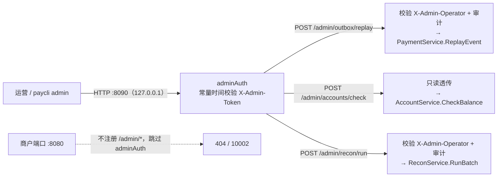

# GW-07 管理接口（重放、核对、触发对账）

| 项 | 内容 |
|---|---|
| 功能点 | GW-07（P0，第 6 周） |
| 所属链路 | 基础设施 |
| 代码提交 | `a04acff` `[GW-07] add admin auth, audit log, check and recon endpoints` |
| 分支 | `feat/GW-07-admin-api` |
| 日期 | 2026-11-16 |
| 状态 | DONE |

## 一句话结论

完成了网关管理端口（`:8090`）的完整鉴权、操作审计与三类管理路由接入：所有管理请求先经 `X-Admin-Token` 常量时间校验，写操作（事件重放、触发对账）强制校验 `X-Admin-Operator` 并落盘结构化审计日志，只读余额核对无需操作人头；`service/gateway` 单元与 Kitex TTHeader 集成测试全部通过，语句覆盖率 75.2%。

## 1. 背景

### 1.1 系统简介

> pay-system 是一个用 Go 编写的小型支付后端，模拟商户收款、退款、商户间转账三条资金链路，重点在数据一致性和性能。系统由 5 个部分组成：gateway（对外 HTTP 入口，负责签名校验和限流）、payment（支付单、退款单、转账单的状态管理和流程推进）、account（账户余额与记账，数据按商户分到 2 个数据库分片）、channel-mock（模拟微信、支付宝这类外部支付渠道）、recon（对账，核对系统内外数据是否一致）。服务之间用 Kitex RPC 同步调用，或通过 Kafka 消息异步通知；数据存在 MySQL 8.4，Redis 用于防重放。所有金额用整数“分”表示，所有记账只追加不修改。当前已完成：工程骨架、账户与记账服务、三条资金链路、模拟渠道、对账全流程、监控埋点以及网关商户端口。

### 1.2 本功能点在系统中的位置



上游是运营人员通过本地 `paycli admin` 命令或 HTTP 客户端向网关管理端口（`127.0.0.1:8090`）发起请求；本功能点负责管理端口的 Token 鉴权、写操作人校验、审计日志以及将三个管理接口路由到下游 `payment`、`account`、`recon` 的 Kitex RPC。

### 1.3 为什么需要它

此前事件重放接口 `POST /admin/outbox/replay` 已为联调提前注册在 `:8090`，但没有校验管理令牌与操作人，也缺少余额核对与触发对账的 HTTP 入口。如果不做鉴权与端口隔离，一旦本机进程可被未授权访问，任何人都能触发重放或重跑对账；同时缺少 `X-Admin-Operator` 与审计日志时，出问题后无法追溯“谁在什么时候对哪笔单据执行了重放或对账”。

## 2. 术语

| 术语 | 含义 |
|---|---|
| `gateway` | 对外 HTTP 入口服务，分两个端口监听：`:8080` 提供商户 API 与渠道回调，`:8090` 提供管理 API（容器在宿主机仅绑定 `127.0.0.1:8090`）。 |
| `X-Admin-Token` | 管理接口鉴权请求头，需与环境变量 `ADMIN_TOKEN`（至少 32 字符）一致。 |
| `X-Admin-Operator` | 管理写操作的操作人标识请求头，长度 1–64 字符且不含换行，用于审计追踪。 |
| 常量时间比较 | 使用 `crypto/subtle.ConstantTimeCompare` 逐字节比较两个切片，避免因提前返回而泄露前缀匹配长度（防时序侧信道）。 |
| `outbox` | 本地消息表，业务库事务提交时把待发送事件写入该表，由后台投递器异步发往 Kafka。 |
| `CheckBalance` | 账户服务提供的只读余额核对 RPC，在两个分片上分别开启一致性快照校验账实平衡、冻结金额与在途守恒。 |
| `RunBatch` | 对账服务提供的执行对账 RPC，按 `(channel, bill_date)` 触发或接管对账批次并返回统计与差错列表。 |

## 3. 技术讲解

### 3.1 要解决的问题

1. **端口隔离**：管理接口只能挂在 `:8090`，业务端口 `:8080` 不注册管理路由也不运行管理鉴权中间件，宿主机映射仅绑定 `127.0.0.1`。
2. **静态令牌鉴权（fail-closed）**：`:8090` 上所有请求必须携带与 `ADMIN_TOKEN` 一致的 `X-Admin-Token`，使用常量时间比较；未配置 `ADMIN_TOKEN` 或校验失败统一返回 HTTP 401 / 业务码 `20005`（`ADMIN_UNAUTHORIZED`），不进入下游 RPC。
3. **写操作审计**：事件重放（`POST /admin/outbox/replay`）与触发对账（`POST /admin/recon/run`）属于写操作，必须携带合法 `X-Admin-Operator`（缺失或非法返回 `10001`），调用下游 RPC 后记录一条包含 `operator`、`path`、`params`、`result`、`err_code` 的结构化日志。只读的余额核对（`POST /admin/accounts/check`）不要求操作人头，也不写审计日志。
4. **响应字段兜底**：`RunBatch` 在 IDL 中将 `manual_total` 和 `manual_diffs` 定义为 `optional`；网关在序列化响应时需保证缺失或 `nil` 时输出 `manual_total = 0`、`manual_diffs = []`、`diffs = []`，`CheckBalance` 的 `failures` 为 `nil` 时输出 `[]`。

### 3.2 方案

在 `service/gateway/server.go` 中仅当 `h.admin == true` 时挂载 `h.adminAuth` 中间件，位于 `accessLog` 之后、路由处理之前，保证被拒绝的 401 请求也能获得 `request_id`、链路追踪与访问日志，同时不影响商户端口的 8 层中间件顺序。

下面这段代码来自 `service/gateway/admin.go`，展示了管理端口的 Token 常量时间校验与 fail-closed 逻辑：

```go
func (h *Handler) adminAuth(ctx context.Context, c *app.RequestContext) {
	appendName(c, nameAdminAuth)
	if !h.admin {
		c.Next(ctx)
		return
	}
	got := string(c.GetHeader(headerAdminToken))
	if len(h.adminToken) == 0 || subtle.ConstantTimeCompare([]byte(got), h.adminToken) != 1 {
		h.log().WarnContext(logx.WithRequestID(ctx, requestID(c)), "admin token rejected")
		writeErrno(c, errno.ErrAdminUnauthorized.HTTPStatus, errno.ErrAdminUnauthorized, requestID(c))
		c.Abort()
		return
	}
	c.Next(ctx)
}
```

写操作入口在解析请求体前先通过 `requireAdminOperator` 校验 `X-Admin-Operator`（非空白、不含 `\r\n`、按 rune 计不超过 64 字符），调用 RPC 返回后通过 `writeAdminAudit` 记录一条 `msg = "admin write audited"` 的 JSON 日志。

下面这段代码来自 `service/gateway/admin.go`，展示了 `POST /admin/recon/run` 的操作人校验、120 秒 RPC 超时调用与响应缺省值填充：

```go
	params := fmt.Sprintf("channel=%s bill_date=%s force=%v", req.Channel, req.BillDate, req.GetForce())
	resp, err := h.recon.RunBatch(ctx, req, callopt.WithRPCTimeout(RPCTimeout("RunBatch")))
	if err != nil {
		mapped := mapRouteErr(err)
		h.writeAdminAudit(ctx, c, operator, "/admin/recon/run", params, mapped)
		h.writeRoute(c, mapped, nil)
		return
	}
	h.writeAdminAudit(ctx, c, operator, "/admin/recon/run", params, nil)
	// ... 缺省将 nil 切片置空数组，ManualTotal 默认 0
	WriteOK(c, runBatchView{
		Batch: resp.Batch, Diffs: diffs,
		ManualTotal: resp.GetManualTotal(), ManualDiffs: manualDiffs,
	})
```

### 3.3 为什么这样做

| 方案 | 做法 | 优点 | 缺点 | 结论 |
|---|---|---|---|---|
| 采用：独立端口 `:8090` + `adminAuth` 中间件 + 结构化审计日志 | 仅在 `NewAdmin` 挂载 `adminAuth`，`cmd/gateway` 注入 `ADMIN_TOKEN` 与三个 RPC 客户端 | 业务端口 `:8080` 零侵入；中间件链完整保留 `request_id` 与访问日志；与 `paycli admin` 现有请求头完全对齐 | 无细粒度 RBAC 权限分级（本地演示简化方案） | 采用 |
| 备选：复用商户端口 `:8080` 按路径前缀 `/admin/` 区分鉴权 | 在同一 Hertz 实例按路径分流 | 少监听一个端口 | 容易因路由或中间件误配将管理接口暴露到公网端口，违反端口隔离约束 | 不采用，安全边界不清晰 |
| 备选：审计日志单独落库 | 在网关新增数据库表写操作记录 | 可 SQL 查询历史记录 | 引入网关对 MySQL 的直连依赖，违背网关无状态设计 | 不采用，结构化 `slog` 日志已满足需求 |

### 3.4 正确性

本功能点属于网关接入与鉴权层，不直接操作资金账户或数据库表（所有资金与状态变更由下游 RPC 的幂等与 CAS 机制保证）。异常边界验证如下：

- **未配置 `ADMIN_TOKEN`（fail-closed）**：`len(h.adminToken) == 0` 直接返回 401 / `20005`，不调用任何 RPC（`TestGW07AdminTokenAuth`）。
- **Token 错误或缺失**：返回 401 / `20005`，且日志中不输出 `ADMIN_TOKEN` 原文（`TestGW07AdminTokenAuth`）。
- **写操作缺少或非法 `X-Admin-Operator`**：在调用 RPC 之前即返回 400 / `10001`，不触发下游状态变更也不写审计日志（`TestGW07WriteRequiresOperator`）。
- **下游业务错误透传**：通过 Kitex TTHeader 传回的 `BizStatusError`（如 `10002`、`30003`、`40001`、`10001`）由 `mapRouteErr` 映射为对应 HTTP 状态码与业务码（`TestGW07AdminRPCRoundTripIntegration`、`TestGW07CheckAndReconValidationAndErrors`）。

### 3.5 性能

不涉及（管理接口低频人工运维使用，无吞吐或延迟优化目标）。

## 4. 已完成内容

### 4.1 改动清单

| 文件 | 新增 / 修改 | 作用 |
|---|---|---|
| `service/gateway/admin.go` | 新增 | `adminAuth` 中间件、`requireAdminOperator`、`writeAdminAudit` 及 `checkAccounts` / `runRecon` 处理函数 |
| `service/gateway/admin_test.go` | 新增 | GW-07 单元测试（鉴权、操作人校验、三接口成功与审计日志、参数校验与错误映射） |
| `service/gateway/admin_integration_test.go` | 新增 | `integration` 标签集成测试，通过真实 Kitex TTHeader RPC 验证三接口往返与审计日志 |
| `service/gateway/server.go` | 修改 | `Handler` 增加 `adminToken`、`checkBalance`、`recon`；在 `h.admin` 分支挂载 `adminAuth` |
| `service/gateway/admin_replay.go` | 修改 | 注册 `/admin/accounts/check` 与 `/admin/recon/run`；为重放接口加上操作人校验与审计日志 |
| `cmd/gateway/main.go` | 修改 | 将 `cfg.AdminToken`、`clients.Account`、`clients.Recon` 注入 `gateway.NewAdmin` |
| `service/gateway/admin_replay_test.go`、`auth_test.go`、`server_test.go` | 修改 | 适配管理端口 Token 与操作人头校验 |

### 4.2 对外变化

| 类别 | 变化 |
|---|---|
| 接口 | `:8090` 启用 `X-Admin-Token` 校验；新增 `POST /admin/accounts/check` 与 `POST /admin/recon/run`；`POST /admin/outbox/replay` 与 `POST /admin/recon/run` 强制要求 `X-Admin-Operator` 并写审计日志 |
| 表结构 | 无 |
| 配置项 | 无新增（复用既有必填项 `ADMIN_TOKEN`） |
| 错误码 | 无新增（使用既有 `20005`、`10001`、`10002`、`30003`、`40001`） |
| 指标 / 故障点 | 无 |

### 4.3 验收对照

| 验收条目 | 测试函数 | 类型 | 结果 |
|---|---|---|---|
| 无 Token、错误 Token 返回 401 | `TestGW07AdminTokenAuth` | 单元 | 通过 |
| 写操作缺少 `X-Admin-Operator` 返回 `10001` | `TestGW07WriteRequiresOperator` | 单元 | 通过 |
| 三个接口各调用一次成功；每次写操作产生一条审计日志 | `TestGW07ThreeEndpointsAndAuditLog`、`TestGW07AdminRPCRoundTripIntegration` | 单元 + 集成 | 通过 |

### 4.4 验证记录

| 命令 | 结果 |
|---|---|
| `gofmt -l .` | 无输出（全部通过） |
| `PATH="$PATH:$(go env GOPATH)/bin" make lint` | `golangci-lint run --build-tags integration ./...` 输出 `0 issues.` |
| `make test` | `go test -race ./...` 全仓库单元测试通过 |
| `go test -race -tags integration -cover ./service/gateway/... ./cmd/gateway/...` | 通过：`service/gateway` 覆盖率 `75.2%`、`cmd/gateway` 覆盖率 `24.4%` |

### 4.5 同步的文档

- `docs/02-requirements.md`：更新 §3 `GW-07` 状态为 `DONE`，勾选 §4 验收条目并补充实现说明，在 §8.2 登记变更。
- `docs/04-dev-plan.md`：勾选 `GW-07`。
- `docs/05-api.md`：文档版本升级至 `3.6.4`，更新 §0.2、§1、§8.1、§8.3，移除 MQ-05 时期暂不校验令牌和操作人的临时说明。

## 5. 未完成与风险

- 尚未在完整 Docker Compose 集群中用 `paycli admin` 手工联调走一遍三接口；已由 `TestGW07AdminRPCRoundTripIntegration` 验证真实 Kitex TTHeader RPC 往返，且 `cmd/paycli` 单元测试全部通过。
- 需求规则 5 中“在 README 中说明生产环境的替代鉴权方案”随 `DOC-01` 创建 `README.md` 时一并补充。

## 6. 如何复现

```bash
# 1. 运行全量单元测试（含竞态检测）
make test

# 2. 运行网关单元测试与 Kitex TTHeader 集成测试并查看覆盖率
go test -race -tags integration -cover ./service/gateway/... ./cmd/gateway/...
```

## 7. 讲解要点

- **管理接口为什么单独监听 `:8090` 而不是和 `:8080` 共用端口？**
  业务端口 `:8080` 面向公网商户和渠道回调，中间件链走商户 HMAC 签名和令牌桶限流；管理接口 `:8090` 在容器编排中宿主机仅绑定 `127.0.0.1`，走静态 `X-Admin-Token` 常量时间比较，物理端口隔离能避免配置失误把管理面暴露给外部流量。
- **为什么余额核对不要求 `X-Admin-Operator` 而重放和对账要求？**
  `POST /admin/accounts/check` 是纯只读一致性快照查询，不会改变任何业务或批处理状态；重放与触发对账会修改 `outbox` 或 `recon_batch` 状态，因此必须有操作人标识并写审计日志以便事后追溯。

## 延伸阅读

- `docs/02-requirements.md` §4 `GW-07`
- `docs/05-api.md` §3.6、§8
- `docs/06-flows.md` `SL-08`、`CF-03`

## 修订记录

| 日期 | 提交 | 修订内容 |
|---|---|---|
| 2026-11-16 | `a04acff` | 初版报告 |
