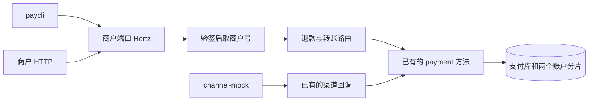

# GW-09 商户 API 路由（退款与转账）

只读这一份就能看懂这次改了什么。正文里的行为、边界和证据不依赖别的文档。

| 项 | 内容 |
|---|---|
| 功能点 | GW-09（P0，第 4 周） |
| 所属链路 | 基础设施（退款与转账的商户 HTTP 入口） |
| 代码提交 | `1dbe5b0` `[GW-09] add refund and transfer merchant routes`（完整 `1dbe5b0ee0708d634c5db5717fb917815a0a5814`，2026-11-08 19:53:59 +0800） |
| 分支 | `feat/GW-09-merchant-routes` |
| 日期 | 2026-11-08 |
| 状态 | DONE |

本报告写在上面这次代码提交之后，不在那次提交的 9 个文件里。报告单独提交。

## 一句话结论

商户端口现在能创建和查询退款、转账：四组动作对应六条 HTTP 路径，商户号和转账付款方只取验签结果，非法金额和非法收款商户号在进 RPC 之前返回已有的 `10001`。证据是三个测试：两个假 RPC 的单元测试，以及 `TestGW09PaycliFlow` 用编译出的 paycli 走完下单到跨分片转账。官方五步验证的退出码都是 0。

## 1. 背景

这次补的是商户 HTTP 到已有退款、转账 RPC 的协议转换。网关仍然不记账，也不新造错误码。

### 1.1 系统简介

> pay-system 是一个用 Go 编写的小型支付后端，模拟商户收款、退款、商户间转账三条资金链路，重点在数据一致性和性能。系统由 5 个部分组成：gateway（对外 HTTP 入口，负责签名校验和限流）、payment（支付单、退款单、转账单的状态管理和流程推进）、account（账户余额与记账，数据按商户分到 2 个数据库分片）、channel-mock（模拟微信、支付宝这类外部支付渠道）、recon（对账，核对系统内外数据是否一致）。服务之间用 Kitex RPC 同步调用，或通过 Kafka 消息异步通知；数据存在 MySQL 8.4，Redis 用于防重放。所有金额用整数“分”表示，所有记账只追加不修改。当前已完成：支付、退款、转账主链路已经能在 payment 里跑通，商户网关现在能创建和查询退款、转账；支付成功后的商户入账消费还没有接上。

这段里的词，后面还会用到，这里先对齐：

gateway 是商户和渠道打进来的 HTTP 进程，HTTP 框架是 Hertz。签名校验是用商户密钥核对请求是不是本人发出的。限流是限制某个商户的请求速率，本功能点不实现它。payment 管支付单、退款单、转账单的状态。account 管余额。分片是把账户按商户拆进 2 个数据库，避免所有余额写在同一处。channel-mock 假装微信或支付宝，不访问真实渠道。recon 是以后的对账。Kitex RPC 是服务之间的一次同步远程调用。Kafka 是异步消息。Redis 防重放是挡住同一条签名被再放一次，本功能点不接 Redis。分是金额的最小单位，1 元 = 100 分。记账只追加是说账本只加新行，不改旧行。入账消费是支付成功之后，另有消费者把钱记进商户余额；那个消费者还没接上。

### 1.2 本功能点在系统中的位置

本功能点站在验签之后、已有的 payment 方法之前，只做参数形状和调用转发。



生产时，商户 HTTP 先进网关，网关再用 Kitex 调 payment。验收 3 不起 Kitex：测试适配器在同一进程里直接调已经导出的 payment handler。渠道仍然走 HTTP，打到进程内的 channel-mock；渠道完成后回调网关已有的 `POST /callback/mockpay`。管理端口不注册这几条路由。

### 1.3 为什么需要它

没有这几条路由，商户无法用 HTTP 退款或转账。更具体的事故是：请求体可以伪造付款方，金额也可以不是整数分。

商户验签得到的是 `M100001`。请求体里另写 `merchant_id` 为 `M999999`。如果网关采用请求体，500 分（5.00 元）会从 `M999999` 扣出，而签名证明的是 `M100001`。本功能点丢掉请求体里的商户号，假 RPC 收到的付款方是 `M100001`。

金额再举一个。`amount` 写成 JSON 小数 `100.5`。100.5 分是 1.005 元，不是整数分。字符串 `"100"` 看起来像 100 分（1.00 元），但它不是 JSON 数字。这两种，再加上 0 分（0 元）和 10000001 分（100000.01 元），都在网关返回已有的参数错误 `10001`，RPC 次数为 0。

## 2. 术语

下面这些词在本报告里只表示这里写的含义。

| 术语 | 含义 |
|---|---|
| 分 | 金额的最小单位，类型是 int64。1 元 = 100 分。1 分 = 0.01 元。10000 分 = 100.00 元。10000000 分 = 100000.00 元。10000001 分 = 100000.01 元。 |
| gateway | 对外 HTTP 入口。商户端口注册 `/v1` 路由。管理端口不注册本功能点的路由。 |
| Hertz | gateway 使用的 HTTP 框架。路由形如 `POST /v1/refunds`。 |
| 验签 | 用商户密钥检查请求签名。通过后把商户号放进请求上下文。没通过的请求进不了本功能点的处理函数。 |
| nonce | 一次性随机串。设计上用来挡住同一条已签名请求被再放一次。本功能点的 nonce 中间件不检查它，直接放行。 |
| `merchant_id` | 商户号。本功能点只使用验签写入的值。请求体里的同名字段不读。单元测试里验签得到的是 `M100001`。 |
| 平台签名 | 网关对实际写出的响应正文计算的签名，放在响应头里。商户用同一把密钥核对。paycli 自己做这一步。 |
| payment | 支付单、退款单、转账单的状态服务。本功能点调用它已有的四个方法，不改这些方法的服务端超时。 |
| Kitex | 服务之间的 RPC 框架。生产路径用它的客户端。验收 3 不启动 Kitex 进程。 |
| `callopt` | 单次 RPC 调用附带的选项。这里用来给这一次调用单独设超时。 |
| RPC | 一次远程调用。网关不重试：失败就返回，不会自动再打一次。 |
| account | 账户与记账。数据按商户分到 2 个数据库分片。 |
| 分片 | 商户号必须是 `M` 加恰好 6 位数字。分片号是这 6 位数字对 2 取模。`M100001`、`M100003` 在分片 1，`M100002` 在分片 0。 |
| 分录 | 账本上的一行。只追加，不修改。一笔记账里借方合计必须等于贷方合计，这叫平衡记账。 |
| 冻结 | 把可用余额先占住，避免同一笔钱被花两次。退款和跨分片转账都会冻结。解冻要等以后的入账消费，本功能点不做。 |
| 入账消费 | 支付成功后，由消息消费者把商户应收记进余额。代号是以后的 MQ-04。M4 还没有它，所以支付 SUCCESS 不会给商户加余额。 |
| LOCAL | 付款方和收款方在同一个分片时的转账方式：一笔本地转账做完。 |
| TCC | 跨分片转账的两阶段协调：先 Try（尝试占住两边），再 Confirm（确认）或 Cancel（取消）。本功能点不实现 TCC，只把请求交给已有的创建转账。 |
| CAS | 比较并交换。状态更新带上“当前必须仍是某状态”，避免两个人同时改同一行。网关不改订单状态，CAS 在 payment 和 account 里。 |
| 幂等 | 同一个业务键再提交一次，得到原来那一笔，而不是再记一笔。网关不保存幂等结果。退款单号、转账单号的防重在 payment。 |
| paycli | 本仓库的命令行客户端。它自己签名，也自己验平台响应签名。退出码 0 表示这一步成功。 |
| channel-mock | 模拟外部支付渠道的 HTTP 服务。验收 3 把它跑在测试进程里，自动完成延迟钉在 50 毫秒。 |
| `biz_code` | payment 创建退款、创建转账的 RPC 响应字段。0 表示这一次业务成功。它不是 HTTP JSON 里的字段名。 |
| `code` | HTTP JSON 信封里的业务码字段，旁边还有 `msg`、`request_id`、`data`。成功是 0，正文是 `ok`，HTTP 状态 200。 |
| `10001` | 已有的参数错误。HTTP 400，正文 `invalid parameter`。金额、单号、收款商户号不合法时使用，并且不调用 RPC。 |
| `10003` | 已有的内部错误。HTTP 500，正文 `internal error`。没装支付客户端、验签没写入商户号、成功响应却没有单据时使用。 |
| `10004` | 已有的下游不可用。HTTP 503，正文 `service unavailable`。传输失败、超时都映射成它，只映射这一次，不重试。 |
| `30001` | 已有的订单不存在。HTTP 404。查询时别人的单和不存在是同一个码，调用方看不出单是否存在。 |
| `30006` | 已有的渠道拒绝。HTTP 200。创建退款时 payment 把它放在 RPC 的 `biz_code` 里并带上退款单；网关把它抄进 HTTP 的 `code`，`data` 仍是这张单。 |
| `40002` | 已有的余额不足。HTTP 409，正文 `insufficient balance`。创建退款或创建转账时同样放进 HTTP 的 `code`，并带上那张单。 |
| `expect_quiescent` | 余额核对的一个开关。为 false 时，允许账上还有未结束的冻结。验收 3 用 false，因为退款冻结可能还在。 |
| CheckBalance | 对两个分片做全量余额核对：分录是否平衡、余额是否能由分录解释。 |
| Unicode 字符 | 按码点计数，不是按字节。一个汉字算 1。`remark` 最多 128 个，`reason` 最多 255 个。 |
| outbox | 和业务写在同一个数据库事务里的待投递事件，提交后再异步送出。本功能点不写 outbox。 |

## 3. 技术讲解

商户端口在已有的支付和余额路由旁边，接上退款和转账的创建与查询。中间件链不新造。

### 3.1 要解决的问题

约束都在“谁有权发起”和“什么形状才能离开网关”。记账、状态机和幂等仍留在 payment 与 account。

1. 付款方只能是验签商户。请求体里的 `merchant_id` 不读。否则别人的签名可以指挥另一家商户付钱。
2. 金额必须是 JSON 整数，范围 1 到 10000000 分，含两端，也就是 0.01 元到 100000.00 元。小数、字符串、0、10000001 不能进 RPC。
3. 商户退款单号、商户转账单号是 1 到 64 位，字符只允许 `[A-Za-z0-9_-]`。收款商户号是 `M` 加恰好 6 位数字。
4. 网关对一次调用只等一段有限时间，并且不重试。超时不能被改写成“业务失败、请商户再付一笔”。
5. 带单据的业务码（`40002`、`30006`）必须连同那张单返回。丢掉单据，商户看不到是哪一笔余额不足或被渠道拒绝。
6. 网关自己不写数据库。重复请求会不会记两笔，由 payment 已有的幂等决定，不在网关再做一份。

### 3.2 方案

请求先走过商户端口上已有的中间件链，再进本功能点的处理函数。链的顺序是：请求体上限、接住处理函数里的 panic（避免整进程退出）、请求号、链路追踪、访问日志、时间窗口占位、验签、限流占位、nonce 占位、平台响应签名，然后才是路由函数。nonce 是一次性随机串，用来挡住同一条已签名请求被再放一次。时间窗口、限流、nonce 这三步现在只把名字记下来并调用下一步，不访问 Redis，不限流，也不检查 nonce。验签通过后，处理函数用 `MerchantID` 读取商户号。

六个 HTTP 路径对应四个已有 RPC：

| HTTP | RPC | 网关这一次调用的等待上限 |
|---|---|---|
| `POST /v1/refunds` | `CreateRefund` | 5 秒 |
| `GET /v1/refunds/{refund_no}` | `QueryRefund` | 1 秒（没单独列出的方法都是 1 秒） |
| `GET /v1/refunds?out_refund_no=` | `QueryRefund` | 1 秒 |
| `POST /v1/transfers` | `CreateTransfer` | 3 秒 |
| `GET /v1/transfers/{transfer_no}` | `QueryTransfer` | 1 秒 |
| `GET /v1/transfers?out_transfer_no=` | `QueryTransfer` | 1 秒 |

静态的 `GET /v1/refunds` 和 `GET /v1/transfers` 注册在带路径参数的路由之前，避免查询串形式被 `/{refund_no}` 吃掉。网关不重试。payment 服务端的处理上限这次没改：`CreateRefund` 仍是 5 秒，`CreateTransfer` 仍是 2 秒。转账因此是服务端的 2 秒先到期；网关最多再等到自己的 3 秒，然后把传输失败映射成一次 `10004`。

创建转账时，解析函数不读 `merchant_id`。不认识的 JSON 字段留在 map 里，后面不会取出来。下面只摘 `service/gateway/route.go` 里拒绝收款商户号和金额的几行；商户转账单号、`remark`、`notify_url` 在同一函数的前面和后面。

```go
payee, ok := jsonString(obj["payee_merchant_id"])
if !ok || !payeeMerchantPattern.MatchString(payee) {
    return nil, errno.ErrInvalidParam
}
amount, ok := jsonIntIn(obj["amount"], minPaymentAmount, maxPaymentAmount)
if !ok {
    return nil, errno.ErrInvalidParam
}
```

调用前，`createTransfer` 用验签商户覆盖付款方，并且只等这一次 3 秒，没有重试循环：

```go
req.MerchantId = mid
resp, err := h.payment.CreateTransfer(ctx, req, callopt.WithRPCTimeout(RPCTimeout("CreateTransfer")))
```

`payeeMerchantPattern` 是 `^M[0-9]{6}$`。`M12345` 只有 5 位数字，`X100002` 不是 `M` 开头，都是 `10001`。金额用 `Decoder.UseNumber` 保留原始数字文本，再用正则 `^(0|[1-9][0-9]*)$` 和 `ParseInt`。`100.5`、`"100"`、科学计数法匹配不上这个正则。`0` 和 `10000001` 匹配得上，但落在 1 到 10000000 之外。不使用浮点数。

其余字段：

- `out_refund_no`、`out_transfer_no` 必填，1–64 位 `[A-Za-z0-9_-]`。
- 创建退款时 `pay_no` 和 `out_trade_no` 必须恰好提供一个。两个都有、两个都没有、空串，都是 `10001`。空串和 JSON `null` 算没提供，不 trim。`out_trade_no` 若提供，字符集与商户退款单号相同。`pay_no` 在网关只要求是非空字符串，是否存在由 payment 判断。
- `payee_merchant_id` 只出现在转账。
- `remark` 按 Unicode 字符最多 128。没传、JSON `null`、空串都当成没传，交给 RPC 的是空指针。
- `reason` 按 Unicode 字符最多 255。没传或 JSON `null` 是空指针。空串会原样传下去，不当成没传。
- 转账的 `notify_url` 若出现，最长 512 字节，scheme 只能是 `http` 或 `https`。网关不查主机白名单。缺省则是空指针。
- JSON 对象里不认识的字段忽略。类型不对、空 body、不是对象，都是 `10001`。
- 查询必须恰好一个键。路径形式如果再带另一个查询串，或查询串形式缺了那个键、又多了另一个键，都是 `10001`，不调用 RPC。查询不允许 body，连 `{}` 也是 `10001`。

成功时 RPC 的 `biz_code` 为 0。网关把单据本身放进 HTTP 的 `data`，不再包一层创建响应。HTTP 信封是 `code` 为 0、`msg` 为 `ok`。查询成功同样如此，查询 RPC 本身没有 `biz_code` 字段。

`40002` 和 `30006` 这类“码和单据一起回来”的结果，由 `writeBizResult` 写成 HTTP 的 `code`，`data` 仍是那张 kitex 单据。`40002` 的 HTTP 状态是 409，`30006` 的 HTTP 状态是 200。码未登记，或单据是空的，改成 `10003`，且不把空单据写出去。传输错误不是业务码，`mapRouteErr` 把它收成一次 `10004`。处理函数里支付客户端是 nil 时，直接 `10003`，不发起调用。

查询失败（例如 `30001`）走 `BizStatusError`。网关按已登记的码写 HTTP 信封，`data` 是空对象 `{}`。别人的退款单、别人的转账单和不存在，在 payment 里已经是同一个 `30001`，网关不再区分。

没有新错误码，没有新表，没有新 IDL，没有新环境变量。

### 3.3 为什么这样做

验收要证明的是路由和参数，不是再做一套 RPC 框架。现有网关测试也没有另起 Kitex，所以这次沿用同一做法。

| 方案 | 做法 | 优点 | 缺点 | 结论 |
|---|---|---|---|---|
| 采用：进程内适配器 | 测试把已导出的 payment handler 装进网关的 `paymentAPI`。渠道 HTTP 打到进程内 channel-mock，回调进已有的 `POST /callback/mockpay`。paycli 是 `go build` 出来的二进制 | 和现有网关测试一样，失败点集中在路由、签名和业务结果 | 测不到真实的 Kitex 网络超时和跨进程序列化 | 采用 |
| 备选：再起一套 Kitex | 验收 3 另起 payment 的 RPC 服务，网关用真客户端去调 | 调用栈更接近生产 | 现有网关测试没有这么做。多一个进程之后，端口、注册和超时会和“路由对不对”混在一起 | 不采用 |

另一处取舍是超时不跟服务端改齐。网关调用 `CreateTransfer` 等 3 秒，payment 服务端仍是 2 秒。先到期的是服务端。网关不把这个等待改成 2 秒，也不把服务端改成 3 秒，避免一次功能点同时改两条链路上的超时语义。

### 3.4 正确性

网关不写余额，所以“最终数据库状态”只在验收 3 里出现。那次结束时两个分片 `CheckBalance` 通过，`expect_quiescent` 为 false。

| 场景 | 系统行为 | 最终状态 | 证明 |
|---|---|---|---|
| 非法金额或非法收款商户号 | 四个非法 `amount` 对退款和转账都返回签过名的 `10001`。`M12345`、`X100002` 同样。假 RPC 的调用次数是 0 | 不写库 | `TestGW09AmountAndPayeeRejected` |
| 请求体伪造付款方 | body 里 `merchant_id` 是 `M999999`，金额 500 分（5.00 元），收款方 `M100002`。假 RPC 收到的付款方是验签商户 `M100001`。HTTP `code` 为 0，响应有平台签名 | 假 RPC 不写库 | `TestGW09ForgedPayerIgnored` |
| 同一请求再来一次 | 网关不记住上次结果，合法请求会再调用一次 RPC。会不会记成两笔，由 payment 已有的幂等决定 | 本次没有对同一商户单号打两次 | 无。不能把验收 3 的单次成功当成幂等证明 |
| 两个冲突请求同时到达 | 本次没有并发打同一退款或同一转账 | 未验证 | 无 |
| 调用过程中网关进程退出 | 网关自己没有写到一半的账。payment 可能已经落单。空闲退出时，Hertz 的 `ExitWaitTime` 使用已有的 10 秒上限，用来排空在途请求 | 网关无本地账 | 验收 3 在清理时最多等 12 秒看进程是否退出。这不是崩溃注入 |
| 下游超时或传输失败 | 不是业务码的错误映射成一次 `10004`。客户端选项里没有重试 | 不把超时改写成另一笔业务失败 | 映射在已有的 `mapRouteErr`。GW-09 的单测没有再造一次超时 |
| 没装支付客户端 | 路由已经命中，但客户端是 nil，返回 `10003`，不调用 | 不写库 | 代码路径在创建和查询里都有。GW-09 单测没有把客户端设成 nil |
| paycli 整条链路 | 下单 1000 分（10.00 元）→ 支付 → 查询到 SUCCESS → 退款 100 分（1.00 元）→ 查询退款 → 同分片转 200 分（2.00 元）→ 跨分片转 300 分（3.00 元）→ 查询转账。每一步进程退出码 0，paycli 自己验平台签名。支付变成 SUCCESS 之后才退款 | 两个分片核对通过；退款冻结允许还在 | `TestGW09PaycliFlow` |

验收 3 的金额和分片是固定的，不是随机的：

1. 夹具用平衡记账给 `M100001` 记入 10000 分（100.00 元）：渠道应收借记 10000 分，商户结算账户贷记 10000 分。这是 account 的 `Post`，不是一条 `UPDATE` 改余额。
2. paycli 下单 1000 分（10.00 元），再支付。渠道自动完成的最小延迟和最大延迟都设成 50 毫秒。轮询到支付单 `SUCCESS` 之后才退款。支付 SUCCESS 不会再给商户加 10000 分，因为没有入账消费者。
3. 退款 100 分（1.00 元），再按退款单号查询。
4. `M100001` 转 `M100003` 200 分（2.00 元）。两边都在分片 1，结果 `mode` 是 `LOCAL`，状态 `SUCCESS`，付款方仍是 `M100001`。
5. `M100001` 转 `M100002` 300 分（3.00 元）。收款方在分片 0，结果 `mode` 是 `TCC`，状态 `SUCCESS`，付款方仍是 `M100001`。
6. 对两个分片做一次 `CheckBalance`。`expect_quiescent` 为 false：退款冻结可能还占着，解冻要等以后的入账消费。核对结果是通过。测试不打印、也不断言每个账户的最终余额数字，所以这里不写“还剩多少分”。

夹具还给三个商户各写了一档费率 60（按万分之一计，也就是 0.60%），否则已有的下单会因为没有费率而失败。本功能点不改手续费算法。装配支付用的渠道客户端必须发生在网关 `Spin` 开始接受连接之前，这样 `-race` 能看到测试协程的写入早于服务协程的读取。

### 3.5 性能

不涉及。这次没有压测，也没有开关对比。4.4 里的秒数是测试和覆盖率命令的耗时，不是接口吞吐。

## 4. 已完成内容

### 4.1 改动清单

| 文件 | 新增 / 修改 | 作用 |
|---|---|---|
| `service/gateway/route.go` | 修改 | 注册六条路径；解析退款和转账；用验签商户覆盖付款方；按方法设置调用超时；把 `biz_code` 写成 HTTP `code` |
| `service/gateway/gw09_test.go` | 新增 | 验收 1、验收 2 的假 RPC 单元测试。原有假支付对象补上四个新方法，旧测试才能继续编译 |
| `service/gateway/server.go` | 修改 | 只改了一句注释：商户端口现在也注册退款和转账。中间件顺序没变 |
| `test/gw09/flow_integration_test.go` | 新增 | 验收 3。`//go:build integration`。编译 paycli，经进程内网关走完整流程 |
| `docs/02-requirements.md` | 修改 | GW-09 改为 DONE，三条验收勾上，补了实现说明和变更记录 |
| `docs/05-api.md` | 修改 | 文档版本 3.3.14。写明四组路由已由网关提供。字段和错误码没变 |
| `docs/06-flows.md` | 修改 | 版本 v2.45。查询图下面的一句话改成路由已实现。图的节点没改，没有新 SVG |
| `docs/04-dev-plan.md` | 修改 | 勾选 GW-09。第 4 周交付那段原文没改成“演示已完成” |
| `docs/interview-notes.md` | 修改 | 增加 GW-09 四条笔记：付款方来源、超时、不起 Kitex、余额用平衡记账 |

### 4.2 对外变化

| 类别 | 变化 |
|---|---|
| 接口 | 商户端口新增六条路径，映射到已有的 `CreateRefund`、`QueryRefund`、`CreateTransfer`、`QueryTransfer`。没有新字段，没有新 IDL |
| 表结构 | 无 |
| 配置项 | 无。没有新环境变量 |
| 错误码 | 无。继续使用已有的 `10001`、`10003`、`10004`、`30001`、`30006`、`40002` 等 |
| 指标 / 故障点 | 无 |

### 4.3 验收对照

| 验收条目 | 测试函数 | 类型 | 结果 |
|---|---|---|---|
| 创建退款和创建转账时，`amount` 为 `100.5`、`"100"`、`0`、`10000001` 都返回签过名的 `10001`，且不调用 RPC。转账的 `payee_merchant_id` 为 `M12345`、`X100002` 同样是签过名的 `10001`，RPC 次数为 0 | `TestGW09AmountAndPayeeRejected` | 单元，假 RPC | 通过。它包含在 4.4 的 `make test` 里 |
| 转账请求体伪造付款方 `merchant_id`=`M999999`。假 RPC 收到的付款方是验签商户 `M100001`。HTTP `code` 为 0，响应有平台签名 | `TestGW09ForgedPayerIgnored` | 单元，假 RPC | 通过。同一次 `make test` |
| paycli 经网关完成：下单 → 支付 → 查询到 SUCCESS → 退款 → 查询退款 → 同分片转账（`M100001` 转 `M100003`，LOCAL，200 分）→ 跨分片转账（`M100001` 转 `M100002`，TCC，300 分）→ 查询转账。每一步退出码 0，paycli 自己验平台响应签名。支付 SUCCESS 之后才退款 | `TestGW09PaycliFlow` | 集成，`//go:build integration`，包 `test/gw09` | 通过。它包含在 4.4 的 `make test-integration` 里，该包 22.179 秒 |

### 4.4 验证记录

数字只来自 2026-11-08 19:49:32 +0800 到 19:53:05 +0800 这一次。五步退出码都是 0。环境：macOS 27.0.1，Darwin arm64，内核 27.0.0（主机 yymdeMacBook-Air，xnu-13432.1.9），`go1.27.2 darwin/arm64`。golangci-lint 2.14.0，用 go1.27.1 从 `114493f` 在 2026-09-24T10:54:53Z 编译。`docker info` 成功。`coverage.out` 跑完已删除。

| 命令 | 结果 |
|---|---|
| `gofmt -l .` | 无输出。real 0.06，user 0.26，sys 0.05。退出码 0 |
| `make lint` | `0 issues.`。real 0.94，user 1.09，sys 2.94。退出码 0 |
| `make test` | 退出码 0。real 5.76，user 5.70，sys 4.89。根包 5.243 秒。`service/gateway` 2.255 秒。`cmd/gateway` 1.542 秒。`cmd/paycli` 1.563 秒 |
| `make test-integration` | 退出码 0。real 103.95，user 15.32，sys 12.18。根包 37.894 秒。`service/payment/biz` 101.217 秒。`service/gateway` 2.301 秒。`test/gw09` 22.179 秒 |
| `make cover` | 退出码 0。real 101.86，user 18.53，sys 14.74。全库语句 35.5%（含 `kitex_gen` 生成代码，不是 70% 门槛）。`service/payment/biz` 97.860 秒 / 85.0%。`service/account/biz` 缓存 / 91.1%。`service/channel_mock/biz` 缓存 / 91.7%。`pkg/money` 缓存 / 100.0%。`pkg/sign` 缓存 / 100.0%。`pkg/idgen` 缓存 / 88.1%。`pkg/outbox` 缓存 / 95.0%。`service/gateway` 2.308 秒 / 68.9%，不在 70% 门槛里，这个数字不是失败线。`cmd/gateway` 这次是 1.571 秒 / 25.6%（输出没有标缓存）。`cmd/paycli` 1.601 秒 / 79.5%。`test/gw09` 23.192 秒，覆盖率 `[no statements]`：覆盖率按包统计，这个包没有自己的生产语句 |
| `make gen` | 未跑。没有新 IDL |
| mmdc | 未跑。没有新 SVG |

同一次 `make cover` 的函数表，只统计 `service/gateway` 自己的测试，不算 `test/gw09` 对网关的调用。Go 默认按“正在测试的那个包”记覆盖率。`test/gw09` 里的 paycli 确实打过创建和查询，但那些执行记在另一个包上，不会加进下面的百分比。

| 函数 | 覆盖率 | 怎么读 |
|---|---|---|
| `createRefund` | 33.3% | 包内测试只走到四次非法金额的拒绝。paycli 的成功创建不在这 33.3% 里 |
| `createTransfer` | 58.3% | 含非法金额、非法收款商户号，以及伪造付款方那次成功调用。paycli 的两次转账不在这 58.3% 里 |
| `parseCreateRefund` | 46.4% | 包内测试没覆盖超长 `reason`、两个单号一起传等分支 |
| `parseCreateTransfer` | 78.9% | 金额、收款商户号和成功解析走过。超长 `remark` 没走 |
| `writeBizResult` | 63.6% | 与支付路由共用。GW-09 单测没有造 `40002` 或 `30006` |
| `optionalBounded` | 20.0% | 超长文本、非字符串、空串这几支大多没进包内测试 |
| `optionalID` | 75.0% | 四次非法退款都带了 `pay_no`、没有 `out_trade_no`，所以“有值”和“没传”都走过 |
| `queryRefund` | 0.0% | 包内测试没调用。验收 3 的 paycli 用退款单号查询过，这次执行记在 `test/gw09`，所以这里是 0，不是没查过 |
| `queryRefundByNo` | 0.0% | 同上。paycli 走的是 `GET /v1/refunds/{refund_no}` |
| `queryRefundByOutNo` | 0.0% | 包内测试没调用，验收 3 也没有走 `?out_refund_no=`。0 只说明这份表没计入别的包；这条查询串路径本身这次没有请求 |
| `queryTransfer` | 0.0% | 包内测试没调用。验收 3 的 paycli 按转账单号查询过两笔，执行记在 `test/gw09`，所以这里是 0，不是没查过 |
| `queryTransferByNo` | 0.0% | 同上。paycli 走的是 `GET /v1/transfers/{transfer_no}` |
| `queryTransferByOutNo` | 0.0% | 包内测试没调用，验收 3 也没有走 `?out_transfer_no=`。和按单号查询不是同一条 URL |

### 4.5 同步的文档

这些文档在代码提交 `1dbe5b0` 里已经改过。本报告不再改它们。

- 需求：§3 中 GW-09 改为 DONE；三条验收勾上；实现说明写明验签商户、5 秒 / 3 秒 / 1 秒、不重试、验收 3 用 account 夹具因为没有入账消费；变更记录加了 2026-11-08 一行。需求版本仍是 v3.0。
- 接口：版本升到 3.3.14。总览里四组路由的最后修改改为 2026-11-08。查询退款、查询转账的说明从“尚未提供”改成“已由 GW-09 提供”。不新增字段，不改错误码，不改 IDL。
- 流程图：v2.45。控制流图 CF-01 下面的退款查询和转账查询改成网关路由已实现。节点没改。未跑 mmdc，没有新 SVG。
- 开发计划：GW-09 那一项勾上。第 4 周交付段没有改写成“演示已完成”。
- 面试笔记：记下付款方只取验签结果、调用超时、验收 3 不起 Kitex、余额来自平衡记账且 `expect_quiescent` 为 false。

## 5. 未完成与风险

管理端口、时间窗口、nonce、限流、商户通知、入账消费都不在本功能点。开发计划第 4 周交付段没有改写成“演示已完成”。

- 管理端口上的重放、核对、对账触发仍是以后的 GW-07。本功能点的路由只挂在商户端口。
- 时间窗口和 nonce 防重放仍是以后的 GW-04。限流仍是以后的 GW-05。这三步中间件现在直接放行。
- 商户异步通知还没做。转账 `notify_url` 只在网关检查长度和 scheme，不检查主机是谁。
- 支付成功后的商户入账消费还没接上。验收 3 的 10000 分（100.00 元）是测试夹具用平衡记账放进去的。生产上如果没有这笔预先入账，退款冻结和转账会碰到已有的余额不足，而不是网关新发明的错误。
- 查询六个函数的包内覆盖率是 0.0%。原因在 4.4：验收 3 打过按单号查询，但覆盖率没记到 `service/gateway`。按 `out_refund_no`、`out_transfer_no` 的查询串形式，这次连验收 3 也没打。
- `createRefund` 的 33.3% 不含 paycli 的成功创建。`optionalBounded` 只有 20.0%，超长 `remark`、超长 `reason` 没有包内测试。
- `40002`、`30006` 的写出逻辑与支付路由共用 `writeBizResult`（63.6%）。GW-09 自己的测试没有返回这两种码，所以不能说“这次看见了余额不足的 HTTP 正文”。
- 网关空闲退出等待最多 10 秒。验收 3 的清理最多再等 12 秒，超时就判失败。这 10 秒不是业务调用超时。
- 同一商户单号的重复提交、两笔并发冲突、调用中途进程崩溃，这次都没有专门测试。

## 6. 如何复现

前置：本机是上面的 Go 和 golangci-lint，Docker 已启动（官方记录里 `docker info` 成功），当前目录是仓库根。集成测试会拉起数据库容器。不要用别的日志里的秒数替换下面的预期。

```bash
gofmt -l .
make lint
make test
make test-integration
make cover
go test -race -count=1 -tags integration -timeout 180s ./test/gw09/
```

预期：

- `gofmt -l .` 不打印文件名。官方记录 real 0.06，user 0.26，sys 0.05，退出码 0。
- `make lint` 打印 `0 issues.`。官方记录 real 0.94，user 1.09，sys 2.94，退出码 0。
- `make test` 退出码 0。官方记录 real 5.76，user 5.70，sys 4.89；根包 5.243 秒；`service/gateway` 2.255 秒。
- `make test-integration` 退出码 0。官方记录 real 103.95；`test/gw09` 22.179 秒；`service/payment/biz` 101.217 秒。
- `make cover` 退出码 0。官方记录 real 101.86；全库语句 35.5%；`service/gateway` 68.9%；`service/payment/biz` 85.0%。跑完后的 `coverage.out` 已删除，复现时 `make cover` 会再生成它。
- 最后一条只跑验收 3 所在的包。官方五步没有把它从整库命令里拆开单跑，所以这里不写一个新的 real。它在 `make test-integration` 里已经以退出码 0、22.179 秒通过。单独再跑时预期仍是退出码 0。

`make gen` 和 mmdc 不在复现命令里。官方记录没有跑它们。

## 7. 讲解要点

1. 问：请求体里的商户号为什么不能用？答：验签证明的是 `M100001`。body 里的 `M999999` 没有这把签名。网关在调用前把付款方写成上下文里的商户号，解析函数根本不读 body 的 `merchant_id`。`TestGW09ForgedPayerIgnored` 看的是假 RPC 收到的字段，不是 HTTP 回显。
2. 问：为什么验收不另起 Kitex？答：要证明的是 HTTP 路由、签名和参数。现有网关测试把 handler 直接装进接口。另起一套服务会把注册和端口问题混进同一条失败。
3. 问：支付已经 SUCCESS，为什么退款用的钱不是这笔支付？答：入账消费者还没接上，SUCCESS 不会给商户加余额。测试先用平衡记账放入 10000 分（100.00 元）。结束时 `expect_quiescent` 为 false，是因为退款冻结可能还占着，不是因为核对失败。

## 延伸阅读

- `docs/02-requirements.md` 中 GW-09 一节：路由、参数和三条验收的原文。
- `docs/05-api.md` §4.5、§4.6、§4.8、§4.9：创建和查询的字段。版本 3.3.14。
- `docs/06-flows.md` 的 CF-01：查询控制流。v2.45 只改了图下说明。
- `docs/04-dev-plan.md` 第 4 周：GW-09 已勾，交付段原文未改成演示完成。
- `service/gateway/route.go`：解析、超时和 `writeBizResult`。
- `test/gw09/flow_integration_test.go`：paycli 流程、50 毫秒渠道延迟、平衡记账和 `CheckBalance`。

## 修订记录

| 日期 | 提交 | 修订内容 |
|---|---|---|
| 2026-11-08 | 代码 `1dbe5b0`；报告单独提交 | 首版 |
