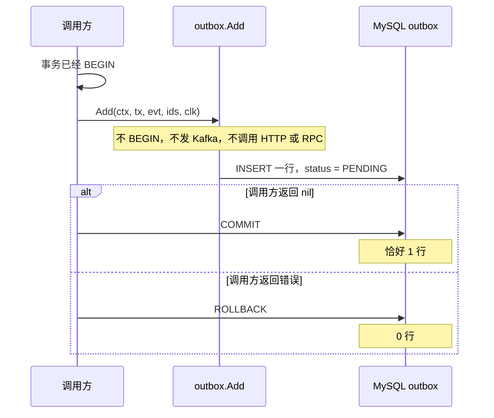
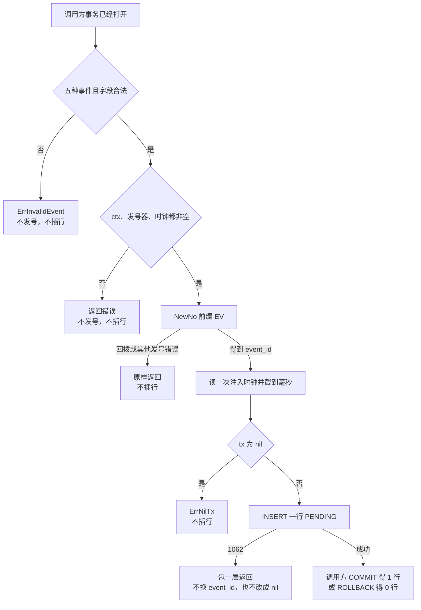

# MQ-01 outbox 写入

| 项 | 内容 |
|---|---|
| 功能点 | MQ-01（P0，第 3 周） |
| 所属链路 | 支付 |
| 代码提交 | `917c870` `[MQ-01] add outbox write`（完整 `917c87071170c3172c7cb7335086d31d2a1b3ae4`，2026-10-28 03:26:27 +0800） |
| 分支 | `feat/MQ-01-outbox` |
| 日期 | 2026-11-01 |
| 状态 | DONE |

本报告写在上面这次代码提交之后，不在那 9 个文件里。报告日期是 2026-11-01。代码提交时间仍是 2026-10-28。

## 一句话结论

`pkg/outbox.Add` 只在调用方已经打开的事务里插入一行 `outbox`。它自己不 `BEGIN`、不 `COMMIT`、不 `ROLLBACK`，也不发 Kafka、不调用 HTTP 或 RPC。业务事务回滚后表里是 0 行（`TestAddRollbackNoRow`），提交后恰好 1 行（`TestAddCommitOneRow`）。支付例子是 10000 分（100.00 元），手续费 60 分（0.60 元），JSON 里这两个数都是整数。

## 1. 背景

### 1.1 系统简介

pay-system 是一个用 Go 编写的小型支付后端，模拟商户收款、退款、商户间转账三条资金链路，重点在数据一致性和性能。系统由 5 个部分组成：gateway（对外 HTTP 入口，负责签名校验和限流）、payment（支付单、退款单、转账单的状态管理和流程推进）、account（账户余额与记账，数据按商户分到 2 个数据库分片）、channel-mock（模拟微信、支付宝这类外部支付渠道）、recon（对账，核对系统内外数据是否一致）。服务之间用 Kitex RPC 同步调用，或通过 Kafka 消息异步通知；数据存在 MySQL 8.4，Redis 用于防重放。所有金额用整数“分”表示，所有记账只追加不修改。当前已完成：工程骨架、账户、模拟渠道（CH-06 只完成 FAIL、DROP_NOTIFY、DUP_NOTIFY、NEVER_FINISH）、商户凭证与费率、故障注入、创建支付单、发起支付，以及本次 outbox 写入。查单、关单、网关路由、投递器都还没做。

上面这段里还没展开的词：Kitex 是本项目的 Go RPC 框架，RPC 是一个进程同步调用另一个进程里的函数。签名校验用商户密钥确认请求没有被改过；限流限制单位时间内的调用次数。这两件事都在 gateway。查单是再问渠道这笔结果。关单是把未支付的单关掉。网关路由是商户 HTTP 进到 payment。这三件本次都不做。Kafka 是异步消息队列，本次不连接它，只把将来要发的 topic 写进表。分片是把账户数据按商户拆进 2 个库。1 元 = 100 分，金额全程用整数。记账只追加，是指账本只插入新行，不回头改旧行。本报告里的入账和记账是同一件事：账户服务按金额写分录。分录是账本上追加的一条记录。本次 `Add` 不写分录。Redis 防重放是系统别处的能力，不拦这次 `Add`。P0 是必须先做的优先级。第 3 周是开发计划里支付主链路这一段。

CH-06 是模拟渠道上的确定性故障，目前只做了四种：`FAIL`（渠道直接失败）、`DROP_NOTIFY`（丢掉回调）、`DUP_NOTIFY`（重复回调）、`NEVER_FINISH`（渠道一直不结束）。这里的回调是渠道把结果通知回来。它不是传给 `WithTx` 的函数。本次 outbox 写入不做渠道回调。故障注入是代码里预先留的挂钩，测试可以在某一步观察或打断进程。本次不新增挂钩，也不调用已有挂钩。

创建支付单已经能插入状态为 `INIT` 的支付单。发起支付已经能把 `INIT` 改成 `PAYING` 并留下渠道流水。渠道流水是发给渠道的那条 `channel_txn`。两步都不写 `outbox`。本次提供写入函数，还没有从 `Pay` 或 `ApplyPayResult` 调用它。`ApplyPayResult` 是以后把渠道结果写回订单的函数，本次是空的。支付成功时写 `payment.succeeded` 是以后的 PAY-04。把行领出来发给 Kafka 是以后的 MQ-02。

### 1.2 本功能点在系统中的位置

本次只做一行插入。调用方必须自己打开事务。设计上，以后会在同一个事务里先改订单再 `Add`；那一步本次没有做，也没有测试。测试没有插入支付单。account、gateway、channel-mock、recon 都不参与。没有业务服务调用 `Add`。



图上的投递没有画出。提交之后，这一行先停在 `PENDING`。以后的 MQ-02 才按这个状态去领取并发送。本次的测试用 `dbx.WithTx` 包住插入：传给 `WithTx` 的函数返回 nil 就提交，返回错误就回滚。渠道回调是另一件事，本次不做。

### 1.3 为什么需要它

商户 `M100001` 有一笔 10000 分（100.00 元）的支付，手续费 60 分（0.60 元）。订单最终会变成成功，账户服务要按这个金额给商户入账。入账就是记账：账户服务按金额写分录。本次 `Add` 不写分录。入账消息如果和订单提交脱节，会出两种错。

1. 事务还没提交就把“支付成功”发到 Kafka。随后事务回滚：库里没有这笔成功，下游已经按消息去记账。10000 分记在一笔并不存在的成功上。
2. 先提交订单，再单独发 Kafka。进程停在这两步中间：订单已经成功，消息没有发出，账户永远看不到这 10000 分。没有一行可重试的记录。

采用的做法是：同一事务插入 `outbox`。设计上，调用方以后会在同一个事务里先改订单再 `Add`，提交后订单和这一行一起可见，回滚后两样都没有。那一步本次没有做，也没有测试。测试没有插入支付单。`TestAddCommitOneRow` 的事务里只有 `Add`。`TestAddRollbackNoRow` 的标记行也是 `outbox` 的一行，用来证明 `Add` 没有自己提交。发送留给提交之后的投递器。本次只做插入，不实现投递器。

## 2. 术语

按正文第一次出现的顺序。

| 术语 | 含义 |
|---|---|
| outbox | 本地消息表，表名就是 `outbox`。业务数据和待发消息放在同一个数据库事务里。本次只插入，不发送。 |
| 事务 | 几条 SQL 一起成功或一起撤销。`BEGIN` 开始，`COMMIT` 提交，`ROLLBACK` 撤销。`Add` 三件都不做。 |
| `dbx.WithTx` | 已有的事务入口。传给它的函数返回 nil 就提交，返回错误就回滚。测试用它包住 `Add`。 |
| 渠道回调 | 渠道把结果通知回来。不是传给 `WithTx` 的函数。本次 outbox 写入不做这件事。 |
| 查单 | 再问渠道这笔结果。本次不做。 |
| 关单 | 把未支付的单关掉。本次不做。 |
| 网关路由 | 商户 HTTP 进到 payment。本次不做。 |
| Kafka | 异步消息队列。`topic` 是消息类别。本次只把 topic 写进列，不连接 Kafka。 |
| 记账 / 入账 | 同一件事：账户服务按金额写分录。分录是账本上追加的一条记录。本次 `Add` 不写分录。 |
| 投递器 | 以后的 MQ-02。它才去领取 `PENDING` 行并发送。本次没有这个循环，本包不领取。 |
| 渠道流水 | 发给渠道的那条 `channel_txn`。发起支付已经会留下它。本次不写。 |
| `ApplyPayResult` | 以后把渠道结果写回订单的函数。本次是空的，也不从这里调用 `Add`。 |
| `PENDING` | 已写入、还没被投递器领走。本次只写这个状态。 |
| `SENT` | 以后的投递器已经发出。本包不写。 |
| `DEAD` | 重试用尽后不再发。本包不写。 |
| CHECK 约束 | 表上已有的检查。`status` 只能是 `PENDING`、`SENT`、`DEAD`。本次没有迁移。 |
| `event_id` | 事件号。前缀 `EV` 加 19 位数字，总长 21。列上有唯一索引 `uk_event_id`。每次成功的 `Add` 都新发一个。 |
| `EV` | 事件号前缀，发号器里已经登记。本次不新增前缀。 |
| 发号器 | `pkg/idgen` 的 `Generator`。`NewNo(ctx, "EV")` 返回上面的事件号。同一毫秒内用序列号区分。不回收已经发出的号。 |
| 时钟回拨 | 注入时钟比这个发号器上次见到的时间倒退超过 5 毫秒。发号器返回 `idgen.ErrClockRollback`。`Add` 原样把这个错误交出去，不插行，也不换成数字码 `10004`。 |
| `10004` | 已有的“时钟回拨”业务码。映射留给以后的调用方。本包不返回这个数字。 |
| topic | 将来 Kafka 上的类别名，例如 `pay.payment.succeeded`。 |
| `msg_key` | 分区键，写进列，本次不真正分区。同一键以后会进同一分区。 |
| `biz_no` | 以后按业务单号把这一行再投一次时用的查找键（以后的 MQ-05）。支付和转账用自己的单号，退款用 `refund_no`。它不是 Redis 防重放。 |
| MQ-05 | 以后按业务单号再投一次的功能点。本次不实现。 |
| `pay_no` | 平台支付单号。 |
| `out_trade_no` | 商户自己的订单号。例子 `T20261012001`。 |
| `out_refund_no` | 商户侧退款单号。 |
| `out_transfer_no` | 商户侧转账单号。 |
| `fail_code` | 失败原因码，由调用方传入。 |
| `channel` | 渠道名，例如 `mockpay`。 |
| 分区 | Kafka 把一个 topic 拆成几段。同一 `msg_key` 进同一段，段内按到达顺序读。退款的键用原支付单号，是为了同一笔支付的退款以后落在同一段。本次不发送，所以现在还没有这个顺序。 |
| 信封 | `payload` 列里的 JSON。含 `event_id`、`event_type`、`version`、`occurred_at`、`trace_context`、`data`。 |
| `version` | 信封格式版本，当前数字 1。以后加字段时消费端忽略不认识的字段；不兼容才升这个数字。本次没有消费端。 |
| 分 | 金额最小单位。100 分 = 1.00 元。类型 `money.Amount` 是 `int64`。JSON 里是整数，不是浮点。 |
| 注入时钟 | 业务代码不调用 `time.Now()`。时间来自参数 `clock.Clock`。测试用可拨动的假时钟。 |
| `paid_at` | 调用方传入的支付完成时间。`Add` 不把它改成自己的时钟。退款成功用 `succeeded_at`，转账用 `finished_at`，同样由调用方传入。 |
| OpenTelemetry | 分布式追踪库。一次调用的一段叫 span。 |
| `traceparent` | W3C 追踪头。有效 span 时 `trace_context` 是 `{"traceparent":"00-<32位trace hex>-<16位span hex>-<2位flags hex>"}`。采样标志是 `01`，未采样是 `00`。没有其他字段。无有效 span 时 `trace_context` 是 `{}`。 |
| `1062` | MySQL 的重复键错误号。同一个 `event_id` 被插入第二次时出现。`insert` 用 `fmt.Errorf("outbox: insert: %w", err)` 包了一层。调用方用 `dbx.IsDuplicate` 或 `errors.Is` 仍能认出它。函数不换 `event_id`，也不把错误改成 nil。 |
| 唯一索引 | MySQL 不允许该列出现第二个相同值。`uk_event_id` 只约束 `event_id`。 |
| `retry_count` | 发送失败次数。本次写 0。 |
| `next_retry_at` | 下次可以投递的时刻。本次写成这次注入时钟，是为了以后的投递器能立刻领到“`next_retry_at` 小于等于现在”的行。写成 NULL 就领不到。本包不领取。 |
| `last_error` | 上次发送错误。本次写 NULL。 |
| `sent_at` | 发送成功的时刻。本次写 NULL。 |
| 幂等 | 本包不做业务幂等。每次成功的 `Add` 都新发一个 `event_id`。同一笔支付调用两次 `Add`，会得到两行，两行的 `event_id` 不同。撞号只发生在同一个 `event_id` 被插入第二次。`TestInsertDuplicateReturnsError` 是 `prepare` 一次、`insert` 两次，不是两次 `Add`。 |
| 覆盖率 | 测试执行到的语句占该包语句的比例。看 `pkg/outbox` 这个包，不低于 70%。 |
| `cached` | Go 复用了已有测试结果，没有重跑那个包。 |
| `integration` | 构建标签。带上它才编译连 MySQL 的测试文件。 |
| testcontainers | 测试用的容器启动库。`TEST_MYSQL_DSN` 为空时用它启动 MySQL 8.4.11。 |
| PAY-04 | 以后的功能点：支付成功时调用 `Add` 写 `payment.succeeded`。 |
| MQ-02 | 以后的功能点：领取、发送 Kafka、回写发送结果。投递超时也在那里。 |
| CF-18 | 流程图里 outbox 写入那一张。 |
| IDL | 接口定义。本次不改。 |
| errno | 已登记错误码表。本次不新增。 |
| `kitex_gen` | 由 IDL 生成的代码。不参与覆盖率判据。 |
| 墙钟 | 命令从开始到结束的真实耗时。 |
| `mmdc` | 把流程图渲染成 SVG 的工具。本次没装，所以没有 SVG。 |
| P0 | 必须先做。 |

## 3. 技术讲解

### 3.1 要解决的问题

插入一行待发消息，要同时满足这些约束：

1. 插入必须发生在调用方已经打开的事务里。函数自己不开始、不提交、不回滚。这样业务回滚时，这一行也消失。
2. 事务提交之前不能发 Kafka，也不能调用 HTTP 或 RPC。否则回滚之后，下游会按并不存在的成功去记账。
3. 只接受五种事件。缺字段、未知类型、金额不是正整数分、手续费为负、转账状态和类型不符，都在发号之前返回错误，不插行。
4. 金额在 JSON 里是整数分。手续费可以为 0，不能为负。
5. `occurred_at`、`next_retry_at`、`created_at`、`updated_at` 用同一次注入时钟，在 `Add` 里读取，不能改成提交成功后再读。`paid_at` 等业务时间保持调用方传入的值。
6. 事件号只用已登记的前缀 `EV`。时钟回拨原样返回，不插行，不映射成新的错误码。本包不做业务幂等：每次成功的 `Add` 都新发一个 `event_id`。
7. 同一个 `event_id` 被插入第二次时，错误被 `fmt.Errorf("outbox: insert: %w", err)` 包了一层，调用方用 `dbx.IsDuplicate` 或 `errors.Is` 仍能认出 `1062`。函数不换 `event_id`，也不把错误改成 nil。这不是两次 `Add`。
8. 新行是 `PENDING`，`retry_count` 为 0，`last_error` 和 `sent_at` 为 NULL。`SENT` 和 `DEAD` 本包都不写。

### 3.2 方案

调用方先 `BEGIN`。`Add` 先检查事件，再发号，再读一次时钟，然后 `INSERT`。调用方再 `COMMIT` 或 `ROLLBACK`。



这段代码在做入口顺序：先 `prepare`，事务为空时在插入前返回。看 `tx == nil` 这一支。

```go
func Add(ctx context.Context, tx *sqlx.Tx, evt Event, ids *idgen.Generator, clk clock.Clock) error {
	row, err := prepare(ctx, evt, ids, clk)
	if err != nil {
		return err
	}
	if tx == nil {
		return ErrNilTx
	}
	return insert(ctx, tx, row)
}
```

`prepare` 里的顺序是：先 `route`。事件不合法就返回 `ErrInvalidEvent`，此时还没发号。然后才看 `ctx`、发号器、时钟是不是空。这三项有空的，返回包内依赖错误，仍不发号。再调用 `ids.NewNo(ctx, "EV")`。发号失败，包括 `idgen.ErrClockRollback`，原样返回。

已取消的上下文：`NewNo` 在发号前看到 `ctx.Err()`，返回 `context.Canceled`，不返回数字。`TestAddNilDependency` 断言这个错误是 `context.Canceled`，并且不是 `ErrNilTx`。空发号器、空时钟返回的不是 `ErrNilTx`（包内依赖错误）。这三种都发生在 `INSERT` 之前。

合法事件但 `tx == nil` 时，发号已经完成，然后 `Add` 返回 `ErrNilTx`，不执行 `INSERT`。发号器不回收这个号，下一次 `Add` 会得到另一个号。需求只要求不插行。`TestAddNilTx` 只断言错误是 `ErrNilTx`，不连库。

发号成功后只读一次时钟。读的是参数里的 `clk`，不是 `time.Now()`。先截到毫秒，再放进固定东八区。运行镜像没有时区数据库；中国自 1991 年起没有夏令时，固定 +8 与当前民用时间一致。实现用 `time.FixedZone("Asia/Shanghai", 8*60*60)`，不调用 `time.LoadLocation`。

```go
at := clk.Now().Truncate(time.Millisecond).In(shanghai)
```

同一次 `at` 写进四处：信封里的 `occurred_at`，以及列 `next_retry_at`、`created_at`、`updated_at`。读取发生在 `INSERT` 之前，也就是调用方提交之前。不能改成提交成功后再读：回滚的那次调用没有“提交后”的时刻，而 `occurred_at` 又已经放进要插入的 JSON。接口 §11.3 仍写“业务事务提交时间”，需求写的是 `Add` 时的注入时钟。两句指的是同一次读取：插入发生在调用方提交之前，所以这个时间就是这次事务里的时间，不是 `COMMIT` 之后再读的时钟。这不是两套时间。`paid_at`、`succeeded_at`、`finished_at` 另走格式化，用调用方传入的时间，只做同样的截毫秒和固定 +8，不换成 `at`。

`next_retry_at` 写成这次时钟，是为了以后的投递器能立刻领到“`next_retry_at` 小于等于现在”的行。写成 NULL 就领不到。本包不领取。

测试把注入时钟放在 `2026-10-12T10:00:01.300+08:00`，把 `paid_at` 放在 `2026-10-12T10:00:03.300+08:00`。两者相差 2 秒，用来证明业务时间没有被 `Add` 的时钟盖掉。

五种事件的路由如下。金额列是测试里的具体数字。`pay_no` 是平台支付单号。`out_trade_no` 是商户自己的订单号，下面 JSON 里的 `T20261012001` 就是商户订单号。

| event_type | topic | msg_key | biz_no | 测试里的金额 |
|---|---|---|---|---|
| `payment.succeeded` | `pay.payment.succeeded` | `pay_no` | `pay_no` | 10000 分（100.00 元），手续费 60 分（0.60 元） |
| `refund.succeeded` | `pay.refund.succeeded` | 原支付单 `pay_no` | `refund_no` | 3000 分（30.00 元），没有手续费字段 |
| `refund.failed` | `pay.refund.failed` | 原支付单 `pay_no` | `refund_no` | 3000 分（30.00 元）。测试的 `fail_code` 是 `CHANNEL_FAILED` |
| `transfer.succeeded` | `pay.transfer.succeeded` | `transfer_no` | `transfer_no` | 800 分（8.00 元）。`status` 必须是 `SUCCESS` |
| `transfer.failed` | `pay.transfer.failed` | `transfer_no` | `transfer_no` | 800 分（8.00 元）。`status` 必须是 `FAILED`。测试的 `fail_code` 是 `INSUFFICIENT_BALANCE` |

退款的 `msg_key` 不是 `refund_no`。分区键用原支付单，退款单号只放 `biz_no`。`biz_no` 是以后的 MQ-05 按业务单号把这一行再投一次时用的查找键。它不是 Redis 防重放。Redis 防重放不拦这次 `Add`。转账成功写成 `FAILED`，或转账失败写成 `SUCCESS`，都是 `ErrInvalidEvent`，不发号。`status` 空串同样拒绝。`channel` 是渠道名，测试里是 `mockpay`；`mode` 只要求非空，测试里是 `LOCAL`。本包不核对渠道名是不是 `mockpay`，也不核对 `mode` 是不是某一种已登记的转账模式。

支付成功的 `data` 在测试里被断言成下面的形状。`event_id` 由发号器生成，测试只检查它匹配 `^EV[0-9]{19}$`，并带前缀 `EV`。`version` 是信封格式版本，当前数字 1。以后加字段时消费端忽略不认识的字段；不兼容才升这个数字。本次没有消费端。没有有效 span 时 `trace_context` 是 `{}`。

```json
{
  "event_id": "EV 加 19 位数字",
  "event_type": "payment.succeeded",
  "version": 1,
  "occurred_at": "2026-10-12T10:00:01.300+08:00",
  "trace_context": {},
  "data": {
    "pay_no": "PA0000000123456789012",
    "merchant_id": "M100001",
    "out_trade_no": "T20261012001",
    "channel": "mockpay",
    "amount": 10000,
    "fee_amount": 60,
    "paid_at": "2026-10-12T10:00:03.300+08:00"
  }
}
```

`amount` 和 `fee_amount` 的 Go 类型是 `int64`。测试用 `json.Number` 读回来，要求文本里没有小数点。手续费为 0 时仍写出整数 `0`，不省略这个字段（`TestFeeAmountZeroIsInteger`）。负的手续费、金额 0、金额为负，都返回 `ErrInvalidEvent`。

另外四种事件的 data 是：`refund.succeeded` 为 `refund_no`、`pay_no`、`merchant_id`、`out_refund_no`、`channel`、`amount`、`succeeded_at`；`refund.failed` 为 `refund_no`、`pay_no`、`merchant_id`、`out_refund_no`、`amount`、`fail_code`；`transfer.succeeded` 为 `transfer_no`、`out_transfer_no`、`merchant_id`、`payee_merchant_id`、`amount`、`mode`、`status`（必须是 `SUCCESS`）、`finished_at`；`transfer.failed` 与成功那条相同，再加 `fail_code`，`status` 必须是 `FAILED`。`out_refund_no`、`out_transfer_no` 是商户侧单号。`fail_code` 是失败原因码，由调用方传入。`channel` 是渠道名，例如 `mockpay`。

`trace_context` 从 `ctx` 取 span。trace id 和 span id 都有效时，`trace_context` 是 `{"traceparent":"00-<32位trace hex>-<16位span hex>-<2位flags hex>"}`，没有其他字段。测试用的 trace id 是 `0af7651916cd43dd8448eb211c80319c`，span id 是 `b7ad6b7169203331`。采样标志是 `01`，未采样是 `00`。只有 trace id、没有 span id，以及根本没有 span，都是 `{}`。

插入使用参数化 SQL，显式写入时间列，不靠数据库的“当前时间”默认值。`last_error` 和 `sent_at` 传入 NULL。`1062` 被 `fmt.Errorf("outbox: insert: %w", err)` 包了一层。调用方用 `dbx.IsDuplicate` 或 `errors.Is` 仍能认出它。函数不换 `event_id`，也不把错误改成 nil。注释写的原因是：换一个新号会变成另一条事件。

```go
res, err := tx.ExecContext(ctx, insertSQL,
    row.eventID, row.eventType, row.topic, row.msgKey, row.bizNo, string(row.payload),
    statusPending, 0, row.at, nil, nil, row.at, row.at,
)
if err != nil {
    return fmt.Errorf("outbox: insert: %w", err)
}
if err := dbx.MustAffectOne(res); err != nil {
    return fmt.Errorf("outbox: insert: %w", err)
}
```

`dbx.MustAffectOne` 要求影响行数正好是 1。这一支失败时返回普通错误，不映射业务码。测试没有走到这一支。

表是已有的 `outbox`，本次没有迁移。列包括 `event_id`（唯一）、`event_type`、`topic`、`msg_key`、`biz_no`、`payload`（JSON）、`status`、`retry_count`、`next_retry_at`、`last_error`、`sent_at`、`created_at`、`updated_at`。`PENDING`、`SENT`、`DEAD` 是表上已有的 CHECK 约束。本次只写 `PENDING`：已写入、还没被投递器领走。`SENT` 表示以后的投递器已经发出。`DEAD` 表示重试用尽后不再发。本包两种都不写。

缺字段的测试先成功发一个 `EV`，再把假时钟拨回 1 小时，然后用非法事件调用 `Add`。回拨超过 5 毫秒时，如果代码真的去发号，错误会是 `idgen.ErrClockRollback`。实际得到的是 `ErrInvalidEvent`，并且不是 `ErrNilTx`。所以非法事件停在发号之前。覆盖的情况包括空单号、金额 0、金额为负、手续费为负、零值时间、转账状态不符、未知类型、空类型，以及大小写不同的 `Payment.Succeeded`。

时钟回拨的测试把时钟拨回 10 毫秒，用合法支付事件调用 `Add`。错误是 `idgen.ErrClockRollback`，不是 `ErrNilTx`，也不是 `ErrInvalidEvent`，文本里没有 `10004`。发号失败发生在插入之前，所以不会插行。这个测试不连 MySQL。

本包没有日志调用，因此不会打印整份 `payload`。没有单独的测试去抓日志输出。

### 3.3 为什么这样做

| 方案 | 做法 | 优点 | 缺点 | 结论 |
|---|---|---|---|---|
| 采用：同一事务插入，提交后再发送 | `Add` 只 `INSERT`。调用方提交之后，以后的投递器才发 Kafka | 回滚时下游看不到这行。提交后行还在，进程停掉也可以再投 | 本次还没有投递器，行会停在 `PENDING` | 采用 |
| 备选：事务里直接发 Kafka | 订单改成功的同时发“支付成功” | 少一张表 | 消息可能先于提交到达。回滚后，下游按并不存在的 10000 分成功去记账。事务还要空等 Kafka | 不采用 |
| 备选：提交成功后再发，不写表 | `COMMIT` 之后立刻发 Kafka | 回滚时确实没有消息 | 提交和发送之间进程停掉，成功订单没有可重试的行 | 不采用 |

同一个 `event_id` 再插入时不换号。错误被包了一层，不改成 nil。调用方用 `dbx.IsDuplicate` 或 `errors.Is` 仍能认出 `1062`。换一个新号会变成另一条事件。本包不做业务幂等：两次各自成功的 `Add` 本来就会是两行。

### 3.4 正确性

本功能点不改账户余额，不写分录。记账仍是账户服务按金额写分录，本次 `Add` 不做。正确性看的是：这一行是否和调用方事务一起出现或一起消失，以及同一个 `event_id` 再插入时会不会换成新号。本包不做业务幂等。测试没有插入支付单。`COUNT(*)` 数的是这次测试自己新建的 schema 里整张 `outbox`。这个 schema 开始时是空的，所以 0 和 1 就是这次测试留下的行数，不是生产库的全表。

| 场景 | 系统行为 | 最终状态 | 证明 |
|---|---|---|---|
| 同一个 `event_id` 再写入一次 | `prepare` 一次、`insert` 两次，不是两次 `Add`。第二次的错误被包了一层，`dbx.IsDuplicate` 或 `errors.Is` 仍能认出 MySQL `1062`。函数不重新 `NewNo`，也不把错误改成 nil | 测试看完错误后让事务提交。这一张测试表的 `COUNT(*)` 为 1，`event_id` 仍是第一次那个。若调用方把这个错误从 `WithTx` 返回，事务会回滚；测试为了看行，自己把错误收掉了 | `TestInsertDuplicateReturnsError` |
| 业务事务回滚 | 同一事务先插入标记行 `EV0000000000000000001`，再 `Add`，然后返回错误 `mq-01 rollback`。传给 `WithTx` 的函数返回错误就回滚。标记行也是 `outbox` 的一行，不是支付单，用来证明 `Add` 没有自己提交 | 这一张测试表的 `COUNT(*)` 为 0。标记行和 `Add` 的行都不在。测试没有插入支付单 | `TestAddRollbackNoRow` |
| 业务事务提交 | 传给 `WithTx` 的函数里只有 `Add`，返回 nil 后提交。事务里没有支付单 | 这一张测试表的 `COUNT(*)` 为 1。状态 `PENDING`，`retry_count` 为 0，`last_error` 与 `sent_at` 为 NULL。topic 是 `pay.payment.succeeded`，`msg_key` 和 `biz_no` 都是这笔 `pay_no`。三个时间列等于注入时钟 `2026-10-12T10:00:01.300+08:00`。金额 10000 分，手续费 60 分 | `TestAddCommitOneRow` |
| 进程在提交前崩溃 | 本功能点没有故障点。测试没有杀掉进程 | 真实杀进程未运行。能证明的只是 `TestAddRollbackNoRow` 回滚后这一张测试表的 `COUNT(*)` 为 0 | `TestAddRollbackNoRow` |
| 下游调用超时 | 不涉及。`Add` 不调用 Kafka、HTTP 或 RPC，没有下游超时可测。投递超时是 MQ-02 | 库里的行只由调用方提交或回滚决定 | 无对应测试 |
| 两个请求并发调用 `Add` | 没有并发测试。同一个 `event_id` 的第二次插入按撞号那一格返回 `1062`。两次各自成功的 `Add` 会是两行 | 并发结果未验证 | 无 |

### 3.5 性能

不涉及。本次没有性能开关，也没有压测数据。压测命令未运行。

## 4. 已完成内容

### 4.1 改动清单

这些文件都在代码提交 `917c870` 里，共 9 个文件，+1168 / −15 行。

| 文件 | 新增 / 修改 | 作用 |
|---|---|---|
| `pkg/outbox/outbox.go` | 新增 | `Add`、五种事件的路由、信封、参数化 `INSERT` |
| `pkg/outbox/outbox_test.go` | 新增 | 不连库的路由、金额、追踪、缺字段、空事务、时钟回拨 |
| `pkg/outbox/outbox_integration_test.go` | 新增 | 连 MySQL 的提交 1 行、回滚 0 行、`1062`。构建标签 `integration` |
| `.golangci.yml` | 修改 | `time.Now` 的禁止范围加上 `pkg/outbox` |
| `docs/02-requirements.md` | 修改 | MQ-01 的写入规则，状态 DONE，验收勾选 |
| `docs/03-conventions.md` | 修改 | 版本 v2.22。只加 `pkg/outbox` 禁止 `time.Now` |
| `docs/04-dev-plan.md` | 修改 | 只勾选 MQ-01 |
| `docs/05-api.md` | 修改 | 文档版本 3.1.4。不改字段 |
| `docs/06-flows.md` | 修改 | 版本 v2.22。只改 CF-18 的 `Add` 节点。CF-18 是流程图里 outbox 写入那一张 |

### 4.2 对外变化

| 类别 | 变化 |
|---|---|
| 接口 | 无字段变化。版本记到 3.1.4，说明 MQ-01 已按信封写入。不改商户 HTTP。IDL 是接口定义，本次不改 |
| 表结构 | 无。沿用已有的 `outbox`。`PENDING`、`SENT`、`DEAD` 是表上已有的 CHECK 约束。没有新表、新列、新索引，本次没有迁移 |
| 配置项 | 无 |
| 错误码 | 无。errno 是已登记错误码表，本次不新增。包内错误是 `ErrNilTx`、`ErrInvalidEvent`，以及依赖为空时的包内错误。时钟回拨仍是 `idgen.ErrClockRollback`，不映射成 `10004` |
| 单号前缀 | 无。使用已登记的 `EV` |
| 指标 / 故障点 | 无。不新增指标，不新增故障点，也不调用已有故障点 |

### 4.3 验收对照

需求里的验收条目是一句：业务事务回滚时 outbox 无记录；提交时恰好 1 条。下面第一、二行就是这一条。其余行是同一功能点里已经写进测试的规则，假渠道和 Kafka 都没有启动。`COUNT(*)` 数的是这次测试自己新建的 schema 里整张 `outbox`。这个 schema 开始时是空的，所以 0 和 1 就是这次测试留下的行数，不是生产库的全表。测试没有插入支付单。

| 验收条目 | 测试函数 | 类型 | 结果 |
|---|---|---|---|
| 业务事务提交时 outbox 恰好 1 条 | `TestAddCommitOneRow` | 集成 | 通过。事务里只有 `Add`。这一张测试表的 `COUNT(*)` 为 1。状态 `PENDING`，重试次数 0，`last_error` 与 `sent_at` 为空。金额 10000 分，手续费 60 分。三个时间列等于注入时钟 |
| 业务事务回滚时 outbox 无记录 | `TestAddRollbackNoRow` | 集成 | 通过。标记行也是 `outbox` 的一行，不是支付单。返回错误后这一张测试表的 `COUNT(*)` 为 0 |
| 同一个 `event_id` 再插入：包一层返回 `1062`，不换号，也不把错误改成 nil。不是两次 `Add` | `TestInsertDuplicateReturnsError` | 集成 | 通过。`prepare` 一次、`insert` 两次。提交后这一张测试表仍是 1 行，号码不变 |
| 五种事件的 topic、`msg_key`、`biz_no` 和整数金额 | `TestEventRouting` | 单元 | 通过。支付 10000 与 60，退款 3000，转账 800。无 span 时 `trace_context` 为 `{}` |
| 手续费 0 仍以整数写入 | `TestFeeAmountZeroIsInteger` | 单元 | 通过。JSON 数字是 `0` |
| 没有有效 span 时 `trace_context` 为 `{}` | `TestAddNoSpanTraceContextEmpty` | 单元 | 通过。背景上下文，以及只有 trace id、没有 span id，都是空对象 |
| 有效 span 写成 W3C `traceparent` | `TestAddSpanWritesTraceparent` | 单元 | 通过。采样结尾是 `-01`，不采样结尾是 `-00`。集成提交那条使用采样，值与这对十六进制一致 |
| `tx == nil` 且事件合法时先发号再返回 `ErrNilTx`，不插行。发号器不回收这个号 | `TestAddNilTx` | 单元 | 通过。不连库。下一次 `Add` 会得到另一个号。需求只要求不插行 |
| 缺字段或未知类型在发号前返回 `ErrInvalidEvent` | `TestAddMissingFieldDoesNotInsert` | 单元 | 通过。时钟已拨回 1 小时，错误仍不是时钟回拨 |
| 时钟回拨原样返回，不映射成 `10004` | `TestAddClockRollbackDoesNotInsert` | 单元 | 通过。拨回 10 毫秒。错误是 `idgen.ErrClockRollback` |
| 空发号器、空时钟、已取消的上下文都发生在 `INSERT` 之前，且不是 `ErrNilTx` | `TestAddNilDependency` | 单元 | 通过。空发号器、空时钟返回包内依赖错误。已取消时 `NewNo` 在发号前看到 `ctx.Err()`，返回 `context.Canceled`，不返回数字 |

### 4.4 验证记录

环境 `go1.27.2 darwin/arm64`。`golangci-lint` 2.14.0，该二进制用 go1.27.1 编译。下面的数字是本次给出的结果，没有为写报告重跑来替换。格式、检查和测试命令的退出码都是 0。墙钟是命令从开始到结束的真实耗时。`kitex_gen` 是由 IDL 生成的代码，不参与覆盖率判据。

| 命令 | 结果 |
|---|---|
| `gofmt -l .` | 无输出。墙钟 0.05s。退出码 0 |
| `make lint` | `0 issues.` 墙钟 1.07s。退出码 0。该目标是 `golangci-lint run --build-tags integration ./...` |
| `make test` | 退出码 0。墙钟 4.66s。根包 `ok ... 4.167s`。这次 `pkg/outbox` 显示 cached。该目标是 `go test -race ./...`，不含 `integration` 标签 |
| `go test -race -count=1 -cover ./pkg/outbox/` | 通过。包 `1.455s`，覆盖率 90.0%（不含 integration）。墙钟 2.00s |
| `make test-integration` | 退出码 0。墙钟 35.86s。根包 `ok ... 35.416s`。`pkg/outbox` `10.879s`。该目标是 `go test -race -tags integration ./...` |
| `go test -race -count=1 -tags integration -cover ./pkg/outbox/` | 通过。包 `9.047s`，覆盖率 95.0%。墙钟 9.71s |
| `make cover` | 退出码 0。墙钟 36.29s。全仓 total 26.1%（含 kitex_gen，不作为判据）。`pkg/outbox` `9.901s`，覆盖率 95.0%。该目标是 `go test -race -tags integration -coverprofile=coverage.out ./...` |

`make cover` 的函数覆盖率：`Add` 100%，`prepare` 92.3%，`route` 100%，`routePayment` 100%，`routeRefundSucceeded` 100%，`routeRefundFailed` 100%，`refundIdentity` 100%，`routeTransferSucceeded` 100%，`routeTransferFailed` 100%，`transferIdentity` 100%，`nonEmpty` 100%，`positiveAmount` 100%，`nonZero` 100%，`invalid` 100%，`marshalEnvelope` 71.4%，`traceContext` 77.8%，`formatTime` 100%，`insert` 83.3%。

`insert` 的 83.3% 是因为 `MustAffectOne` 失败那一支没有被测试走到。包覆盖率高于 70%。两份覆盖率不是同一次：不含集成标签是 90.0%，带集成标签以及 `make cover` 是 95.0%。不带 `integration` 标签时，单元测试在 `INSERT` 之前返回，不会执行 `insert`。

`make gen` 未运行。IDL 是接口定义，本次不改。`mmdc` 是把流程图渲染成 SVG 的工具。本次没装，所以没有 SVG。`mmdc` 未运行。只读审查没有必须修改的问题。上面这张表以外的命令未运行。

### 4.5 同步的文档

这些文档都在代码提交 `917c870` 里。

- 需求：MQ-01 为 DONE。写明 `Add` 只在已打开的事务里插入，五种事件的 topic、`msg_key`、`biz_no` 和 data 字段，`occurred_at` 取 `Add` 时的注入时钟且不能改成提交后再读，无有效 span 时 `trace_context` 为 `{}`。验收那一条已勾选。变更记录有 2026-10-28 这一行。不新增错误码。不改金额怎么计算、也不改谁该记哪一笔账。
- 约定：版本 v2.22，2026-10-28。只加了 `pkg/outbox` 禁止 `time.Now`，时间只取调用方注入的时钟。不新增错误码、前缀或配置项。
- 开发计划：只勾选 MQ-01。
- 接口：版本 3.1.4，2026-10-28。不改字段，不新增错误码。变更说明是 MQ-01 已按 §11.3 写入。
- 流程图：版本 v2.22，2026-10-28。CF-18 是流程图里 outbox 写入那一张。只改了它的 `Add` 节点：不自己 `BEGIN`，`occurred_at` 与 `next_retry_at` 取 `Add` 时的注入时钟并截到毫秒，无有效 span 时 `trace_context` 为 `{}`。投递器那一半不改。`mmdc` 本次没装，未运行，没有 SVG。

## 5. 未完成与风险

- 没有任何业务服务调用 `Add`。`Pay` 和 `ApplyPayResult` 本次都不写 `outbox`。支付成功写 `payment.succeeded` 是 PAY-04。退款和转账的业务事务也还没接上。查单、关单、网关路由都还没做。
- 行提交后停在 `PENDING`。领取、发送、Kafka、发送超时和回写都是 MQ-02。本次没有投递循环，所以这行不会自己变成 `SENT`。
- 本功能点没有故障点。真实杀进程未运行。能证明的只是 `TestAddRollbackNoRow` 回滚后这一张测试表的 `COUNT(*)` 为 0。
- 接口 §11.3 仍写“业务事务提交时间”，需求写的是 `Add` 时的注入时钟。两句指的是同一次读取：插入发生在调用方提交之前，所以这个时间就是这次事务里的时间，不是 `COMMIT` 之后再读的时钟。代码按需求实现。3.1.4 没有改接口那一格。这不是两套时间。
- `tx == nil` 且事件合法时先发号再返回 `ErrNilTx`，不插行。发号器不回收这个号，下一次 `Add` 会得到另一个号。需求只要求不插行。
- `insert` 里 `MustAffectOne` 失败的那一支没有测试走到，函数覆盖率 83.3%。`marshalEnvelope` 是 71.4%，`traceContext` 是 77.8%，两处的错误返回没有测试走到。带集成标签的包覆盖率仍是 95.0%，高于 70%。
- 没有并发测试。同一个 `event_id` 的第二次插入按撞号返回 `1062`。两次各自成功的 `Add` 会是两行。并发结果未验证。
- 流程图只改了源文件。`mmdc` 是把流程图渲染成 SVG 的工具。本次没装，未运行，没有 SVG。

## 6. 如何复现

在仓库根目录、分支 `feat/MQ-01-outbox`、提交 `917c87071170c3172c7cb7335086d31d2a1b3ae4` 上执行。环境是 `go1.27.2 darwin/arm64`。不需要手填库地址。`TEST_MYSQL_DSN` 为空时，集成测试用 testcontainers 启动 MySQL 8.4.11；该变量非空时连那台已有实例，不再起容器。下面这些命令已经跑过，退出码是 0。本次没有为写报告重跑。

```bash
gofmt -l .
make lint
make test
go test -race -count=1 -cover ./pkg/outbox/
make test-integration
go test -race -count=1 -tags integration -cover ./pkg/outbox/
make cover
```

预期与第 4.4 节的表一致：`gofmt` 无输出；`make lint` 打印 `0 issues.`；测试命令通过。不含集成标签时 `pkg/outbox` 覆盖率 90.0%。带集成标签时 95.0%。`make cover` 的全仓 total 是 26.1%，含 `kitex_gen`，不作为判据；`pkg/outbox` 是 95.0%，不低于 70%。`make test` 那次该包显示 cached。`make gen` 未运行。`mmdc` 未运行。

## 7. 讲解要点

1. 为什么不在事务里直接发消息？10000 分的“支付成功”如果在 `COMMIT` 之前就到了下游，随后回滚，账户会按一笔并不存在的成功去记账。记账就是写分录。本次 `Add` 不写分录，只插入行。发送要等调用方提交之后，由以后的 MQ-02 来做。
2. 怎么证明回滚没有留下行？`TestAddRollbackNoRow` 在同一个事务里先插一条标记行，再调用 `Add`，然后返回错误。标记行也是 `outbox` 的一行，不是支付单。回滚后这一张测试表的 `COUNT(*)` 是 0。`TestAddCommitOneRow` 的事务里只有 `Add`，返回 nil 后计数是 1。schema 开始时是空的，所以 0 和 1 不是生产库的全表。测试没有插入支付单。
3. 撞号为什么不换一个 `event_id`？本包不做业务幂等。两次各自成功的 `Add` 会是两行，两行的 `event_id` 不同。撞号只发生在同一个 `event_id` 被插入第二次。`TestInsertDuplicateReturnsError` 是 `prepare` 一次、`insert` 两次，不是两次 `Add`。错误被包了一层，不改成 nil，库里仍是原来的那一个号。

## 延伸阅读

- `docs/02-requirements.md`：MQ-01 的规则和验收条目。
- `docs/05-api.md`：§11.3 信封与 §11.4 的 data 字段。版本 3.1.4。`occurred_at` 一格仍写“业务事务提交时间”，与需求里 `Add` 时的注入时钟是同一次读取，不是两套时间。
- `docs/03-conventions.md`：§4 第 6 条，`pkg/outbox` 禁止 `time.Now`。版本 v2.22。前缀 `EV` 在 §2.2。
- `docs/06-flows.md`：CF-18 是 outbox 写入那一张，本次只改了 `Add` 节点。版本 v2.22。`mmdc` 没装，SVG 未渲染。
- `docs/04-dev-plan.md`：第 3 周里 MQ-01 已勾选。
- `docs/database.md`：§4.11 `outbox` 的列与 `uk_event_id`。本次没有改这份文档。
- `pkg/outbox/outbox.go`：本节引用的实现。
- `pkg/idgen`：`NewNo` 与 `ErrClockRollback`。`pkg/clock`：注入时钟。`pkg/dbx`：`WithTx`、`IsDuplicate`、`MustAffectOne`。

## 修订记录

| 日期 | 提交 | 修订内容 |
|---|---|---|
| 2026-11-01 | 报告尚未提交 | 首版。对应代码提交 `917c870` `[MQ-01] add outbox write`（2026-10-28 03:26:27 +0800） |
| 2026-11-01 | 报告尚未提交 | 可读性：本包不做业务幂等，两次成功的 `Add` 是两行；`1062` 是包一层而不是原样返回；`biz_no` 是以后按单号再投的查找键，不是 Redis 防重放；测试没有插入支付单，`COUNT(*)` 只数测试新建的空 schema；接口里的“业务事务提交时间”与 `Add` 的时钟是同一次读取 |
