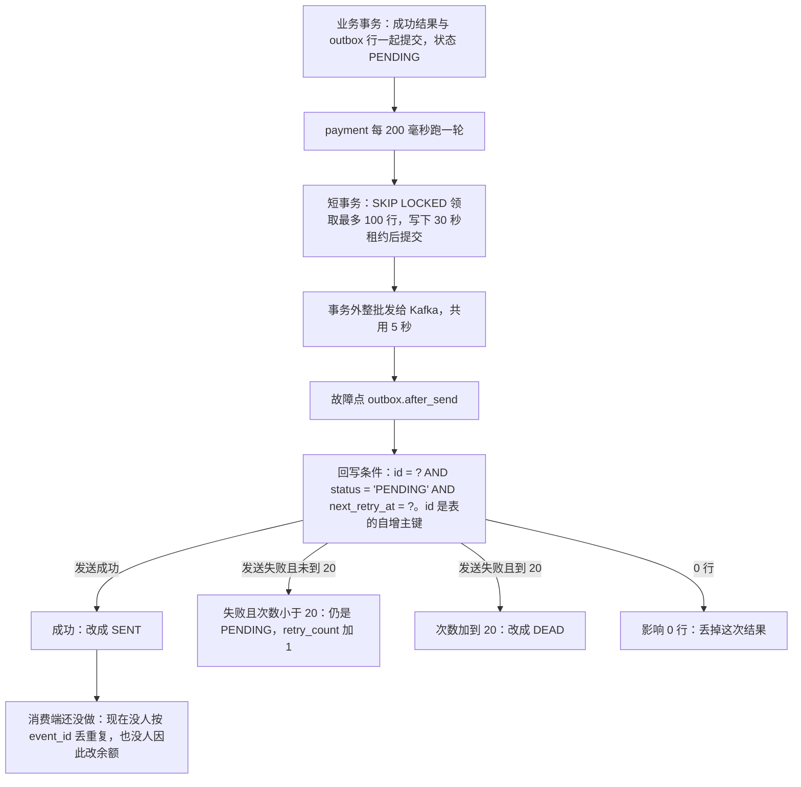

# MQ-02 outbox 投递器

| 项 | 内容 |
|---|---|
| 功能点 | MQ-02（P0，第 5 周） |
| 所属链路 | 基础设施 |
| 代码提交 | `3df960e` `[MQ-02] add outbox dispatcher`（完整 `3df960ea336681536c1af0313c20e5ad302ecaf6`，2026-11-10 11:36:38 +0800） |
| 分支 | `feat/MQ-02-outbox-dispatcher` |
| 日期 | 2026-11-10 |
| 状态 | DONE |

本报告写在上面这次代码提交之后，不在那次提交的文件里。报告自己的提交还没有，修订记录里写「待提交」。

P0 是必须先做的优先级。第 5 周的计划仍把三件事写在同一行：本功能点、account 收到消息后改余额，以及把失败次数用尽、投递器不再发送的行重新发出去。后两件还没做，所以这次没有改那一行。本功能点完成不等于这一周完成。

## 一句话结论

payment 每 200 毫秒把待发送表 `outbox` 里已经到期的行发到 Kafka，也就是进程之间的消息队列。领取在一个很快提交的数据库事务里完成：最多锁 100 行，别人已经锁住的行直接跳过；把 `next_retry_at`（下次可以再领这行的时刻）改成现在加 30 秒，这 30 秒称为租约，提交后行锁放开。发送在事务外面，这一批共用一次 5 秒超时。发送函数返回之后、改数据库之前，会经过故障点 `outbox.after_send`：环境变量 `FAULT_POINTS` 里写上这个名字才启用，空着时这个调用立刻返回。回写逐行使用条件 `id = ? AND status = 'PENDING' AND next_retry_at = ?`。`id` 是这张表的自增主键，用来指定这一行；`status` 必须仍是待发送 `PENDING`；`next_retry_at` 必须仍是领取时写下的那个租约时刻。成功改成已发送 `SENT`。失败把重试次数 `retry_count` 加 1，下次等待 2 的这个新次数次方秒，最多 5 分钟；次数加到 20 就改成不再投递 `DEAD`。更新时一条都没改到，表示租约过期后另一个实例已经领走，这次发送结果丢掉。

证据是 4.4 里本功能点记录的那一次验证（日志 `/tmp/mq02-verify.log`）。Kafka 停 2 分钟的测试，在容器停止后的这 2 分钟里不再调用 `RunBatch`，避免失败次数把退避打满。它证明的是行保持 `PENDING`、本进程内存里的待发送 gauge（`pay_outbox_pending`）大于 0，同一个容器重新启动后再投递到合计 0。两个投递器并发处理 10000 条时，测试的假时钟不往前走，所以 30 秒租约不会在测试中途到期；每个 `event_id` 在 Kafka 里恰好 1 次，库内全部 `SENT` 且 `retry_count` 仍是 0。这个测试没有证明“回写慢过 30 秒时仍然恰好 1 次”。那种情况会再发一次，由以后的消费端按 `event_id` 丢掉重复。那个消费端还没做，所以现在没有人丢弃，也没有人因此改余额。连续失败 20 次后状态为 `DEAD`。本功能点不改账户余额。

## 1. 背景

### 1.1 系统简介

pay-system 是一个用 Go 编写的小型支付后端，模拟商户收款、退款、商户间转账三条资金链路，重点在数据一致性和性能。系统由 5 个部分组成：gateway（对外 HTTP 入口，负责签名校验和限流）、payment（支付单、退款单、转账单的状态管理和流程推进）、account（账户余额与记账，数据按商户分到 2 个数据库分片）、channel-mock（模拟微信、支付宝这类外部支付渠道）、recon（对账，核对系统内外数据是否一致）。服务之间用 Kitex RPC 同步调用，或通过 Kafka 消息异步通知；数据存在 MySQL 8.4，Redis 用于防重放。所有金额用整数“分”表示，所有记账只追加不修改。当前已完成：账户、支付、退款、转账、网关商户路由、Kafka 的发送和接收框架，以及本报告这件事：payment 把待发送行发到 Kafka。还没有做的是两件：account 收到消息后改商户余额，以及把失败次数用尽的行重新发出去。

上面这段里还没展开的词：Kitex 是本项目的 Go RPC 框架，RPC 是一个进程同步调用另一个进程里的函数。签名校验用密钥确认报文没有被改过；限流限制单位时间内的调用次数。分片是把账户数据按商户拆进 2 个库。那两个库只放余额和凭证。凭证是记一笔账的单据。1 元 = 100 分，金额全程用整数。一笔 100.00 元的收款在系统里是 10000 分（100.00 元）。记账只追加，是指账本只插入新行，不回头改旧行。

Kafka 是进程之间传递消息的队列。一条消息有 topic（类别名，例如一笔支付成功会用它自己的 topic）。broker 是 Kafka 服务器地址。本功能点只往队列里写消息，不在这里读消息。

`outbox` 是 MySQL 里的一张表，在 payment 这一个库里，不分片。account 的两个库只放余额和凭证，不放这张表。业务把“支付已经成功”写进业务表时，在同一个数据库事务里再插入一行“待发送记录”。事务一起提交，这行就一定在；事务回滚，这行也不在。投递器是 payment 进程里的一个循环，负责把这些行发到 Kafka。account 进程不跑这个循环。收到消息以后改余额还没做。本功能点不入账。

### 1.2 本功能点在系统中的位置

业务事务已经把一行写成 `PENDING`（待发送）。payment 每 200 毫秒领走到期的行，事务外发给 Kafka，再把行改成 `SENT`（已发送）、保持 `PENDING` 并推迟重试，或改成 `DEAD`（不再由本投递器发送）。发出去的消息带 `event_type` 和 `msg_key`。`event_type` 是事件种类的字符串，例如 `payment.succeeded`。`msg_key` 是 Kafka 消息的 key：支付事件和退款事件用原支付单号，转账事件用转账单号，用来把同一张单的消息送到同一个分区。分区是 topic 下面的一段队列，同一条 key 会进同一段。

payment 和 account 的管理端口都有 `/readyz`。Kafka 连不上时它返回 503，正文是 `unavailable`，不含地址。`/healthz` 只表示进程还活着，Kafka 停了也是 200，正文是 `ok`。本功能点没有改这两个路径。account 不跑投递循环。后面的 `pay_outbox_pending` 和 `pay_outbox_dead` 不在这两个路径的响应里，也不在任何别的 HTTP 响应里。



图里的“短事务”是指：数据库事务在发给 Kafka 之前就提交。行锁随提交释放，不会盖住后面的网络等待。`SKIP LOCKED` 的意思是：要锁的行如果已经被别的事务锁住，这条查询跳过它，不等待。回写条件是 `id = ? AND status = 'PENDING' AND next_retry_at = ?`。`id` 是 `outbox` 的自增主键，数据库插入时自动加 1，用来指定这一行，它不是状态。10000 分（100.00 元）的支付成功如果已经写进 `outbox`，图中从 `BIZ` 到 `SENT` 只负责把这条记录搬到 Kafka。本功能点不入账，账户余额仍是原来的数。

### 1.3 为什么需要它

假设商户有一笔收款 10000 分（100.00 元），支付单已经成功，同一事务里的 `outbox` 行也在，状态是 `PENDING`。没有投递器的话，这行会一直留在 MySQL 里，Kafka 上看不到它，后面“收到消息再改余额”也不会开始。这一步只负责把记录发出去，账户余额保持原值。

如果把“发给 Kafka”放进领取用的那个事务里，行锁要一直拿到 Kafka 回答为止。一批最多 100 行，整批等待上限是 5 秒，而本项目每个数据库事务的上限是 3 秒。事务可能在 Kafka 已经收下消息之后回滚，下一轮会再发一次。发送期间别的实例也会堵在这些行锁上。

所以领取和发送分开。领取只做两件事：选中到期行，把 `next_retry_at` 写成现在加 30 秒，然后提交。拿 30 秒去比 5 秒加 3 秒，这个比较只覆盖一次领取事务（上限 3 秒）加一次整批发送（上限 5 秒）。回写是每行一个短事务，最多 100 个。需求没有再给这 100 个单独的时间上限。如果它们慢到超过租约，另一实例会领走并再发一次，晚到的回写影响 0 行。别的实例要求 `next_retry_at` 已经到期才选这行，所以租约没到期时选不中。Kafka 已经返回、回写还没发生时进程停了，这行仍是 `PENDING`，租约到期后会被再领一次、再发一次。多出来的那一次，以后的消费端会按 `event_id` 丢掉。那个消费端还没做，所以现在没有人丢弃，也没有人因此改余额。本功能点不入账。一笔 10000 分（100.00 元）不会在这里被写进账本。

## 2. 术语

按正文第一次出现的顺序。

| 术语 | 含义 |
|---|---|
| P0 | 必须先做的优先级。 |
| 分 | 金额的最小单位。1 元 = 100 分。10000 分（100.00 元）是一笔收款的例子。本功能点不解析、不修改金额。 |
| gateway | 对外 HTTP 入口，做签名校验和限流。 |
| payment | 管支付单、退款单、转账单，也是本投递器所在的进程。 |
| account | 管账户余额和记账。它的两个库只放余额和凭证，不放 `outbox`。本功能点里它不跑投递循环。 |
| 分片 | 账户数据按商户拆进 2 个库。`outbox` 在 payment 这一个库里，不分片。 |
| 凭证 | 记一笔账的单据，放在 account 的库里。本功能点不写凭证。 |
| `/readyz` | payment 和 account 管理端口上的就绪检查。Kafka 连不上时返回 503，正文是 `unavailable`，不含地址。本功能点没有改这个路径。 |
| `/healthz` | 管理端口上的存活检查。只表示进程还活着，正文是 `ok`。Kafka 停了也是 200。本功能点没有改这个路径。 |
| channel-mock | 模拟外部支付渠道的进程。 |
| recon | 对账进程，核对系统内外数据。 |
| Kitex / RPC | Kitex 是本项目的 Go RPC 框架。RPC 是一个进程同步调用另一个进程里的函数。 |
| Kafka | 进程之间的消息队列。本功能点用已有的 franz-go v1.22.1 客户端写入。 |
| topic | 消息类别名。指标按 topic 分开计数。 |
| broker | Kafka 服务器地址。沿用已有配置，本次不新增配置项。 |
| MySQL 8.4 | 业务数据和 `outbox` 所在的数据库。 |
| Redis | 系统别处用来防重放。防重放是拒绝把同一份已处理请求再执行一遍。本功能点不连接 Redis。 |
| 记账只追加 | 账本只插入新行，不回头改旧行。本功能点不写账本。 |
| outbox | 和业务写在同一事务里的待发送表，在 payment 这一个库里，不分片。一行对应以后的一条 Kafka 消息。 |
| `id` | `outbox` 的自增主键。数据库插入时自动加 1，用来指定这一行。回写条件里的 `id = ?` 比的是这个号码，不是状态。 |
| 事务 | 一组数据库读写，要么全部提交，要么全部回滚。 |
| 投递器 | `Dispatcher`。领取 `outbox` 行、在事务外发送、再按租约回写。 |
| `PENDING` | 待发送。领取条件只看这个状态。 |
| `SENT` | 已发送。成功回写设成这个状态，本投递器不再领取。 |
| `DEAD` | 失败次数加到 20 后的状态。本投递器不再领取。把这种行改回待发送再发出去还没做。 |
| `event_id` | 事件编号，形式是 `EV` 加 19 位数字，例如 `EV0000000000000000001`。以后的消费端用它识别重复消息。那个消费端还没做，所以现在没有人按它丢弃重复。 |
| `event_type` | 事件种类的字符串，例如 `payment.succeeded`。 |
| `msg_key` | Kafka 消息的 key。支付和退款事件用原支付单号，转账事件用转账单号，用来把同一张单的消息送到同一个分区。 |
| 租约 | 领取时把 `next_retry_at` 写成现在加 30 秒。在这个时刻之前，别的轮次认为这行还没到期。 |
| `next_retry_at` | 下次可以领取的时刻，也存放这次租约的到期时刻。 |
| `retry_count` | 已经失败的次数。成功回写不改它。 |
| `FOR UPDATE SKIP LOCKED` | `SELECT` 时锁住选中的行；已经被别的事务锁住的行直接跳过，不等待。 |
| 行锁 | 事务持有某一行时，别的事务不能再锁同一行。本功能点在发送前就提交，所以发送期间没有这把锁。 |
| CAS | 比较后再更新。回写条件是 `id = ? AND status = 'PENDING' AND next_retry_at = ?`。`id` 是自增主键。对不上就影响 0 行。 |
| 影响 0 行 | `UPDATE` 没有改到任何行。这里表示租约已经不是这次写下的值，本次发送结果作废。 |
| 故障点 | 名字是 `outbox.after_send`。环境变量 `FAULT_POINTS` 里写上这个名字才启用。空着时 `Point` 立即返回。启用后，发送返回、回写开始之前，本进程收到 SIGKILL（立刻结束进程的信号）。本功能点的测试没有真的打开它来杀进程。 |
| `pay_outbox_pending` | 本进程内存里的待发送条数，按 topic 分开。不在任何 HTTP 响应里。只有本进程里的代码能读这个数。两个 payment 进程各有一份，不能相加。刷新用的 `COUNT` 来自整张 `outbox` 表里状态为 `PENDING` 或 `DEAD` 的行，按 topic、status 分组，不是只数这一批。 |
| `pay_outbox_dead` | 本进程内存里的 `DEAD` 条数，按 topic 分开。不在任何 HTTP 响应里。可见范围和 `COUNT` 的范围与上一行相同。 |
| 幂等 | 同一件事做两次，效果和做一次相同。这里指 Kafka 客户端去掉同一次发送内部的重试。以后的消费端会按 `event_id` 丢掉重复消息；那个消费端还没做。 |
| 幂等生产 | 生产者客户端里一直开着的能力，不是本功能点的开/关开关。同一次发送如果没得到确认又重试，broker 可以丢掉这次重试。另一次新的发送去不掉。Kafka 已经收下、客户端却返回超时，回写按失败，稍后的再发就是这种新的发送。 |
| `10003` | 项目里已有的内部错误码，英文是 internal error。任务循环只把错误换成这个数字写进日志字段 `err_code`，不把数据库或 Kafka 的原文打出来。不认识的错误会落到这个码。 |
| `acks=all` | Kafka 要等这份数据的副本都写下，才向生产者返回成功。 |
| `traceparent` | 链路追踪用的消息头。payload 里没有或解析不了，也写这个键，值是空字符串。 |
| payload | `outbox` 里的原始报文字节。发送时原样当作 Kafka 的消息体，不在这里解析金额。 |
| 注入时钟 | 调用方传入的时钟。生产用真实时间，测试可以把时间拨到前面。`next_retry_at` 是 `DATETIME(3)`，只到毫秒。代码把这个时钟截到毫秒，并用固定东八区（中国 1991 年后没有夏令时）。数据库连接打开时也使用 `Asia/Shanghai`。回写条件里的 `next_retry_at` 用领取时写入的那一个时间值，不是重新读钟。`sent_at` 和成功或失败回写的 `updated_at` 用回写这一刻的注入时钟。 |
| `updated_at` | 行的更新时间。列定义是 `ON UPDATE CURRENT_TIMESTAMP`：`UPDATE` 时如果不显式赋值，数据库会写成它自己的当前时间。 |
| `ON UPDATE CURRENT_TIMESTAMP` | MySQL 在更新行时自动填当前时间的列属性。 |
| `NOWAIT` | 加锁时如果锁被占用，立刻失败，不等待。测试用它证明发送期间锁已经放开。 |
| Fake 时钟 | 测试用的时钟，时间只在测试拨动它时才变，不跟墙钟走。 |
| IDL | 接口定义文件。本次不改，也不重新生成 RPC 代码。 |
| `kitex_gen` | 已经生成的 RPC 代码。它拉低整仓语句覆盖率，不在本次 70% 门槛里。 |
| 语句覆盖率 | 测试运行期间执行过的代码语句比例。 |

## 3. 技术讲解

### 3.1 要解决的问题

投递要同时满足这些约束：

1. 待发送记录必须和业务结果同一事务落库。投递器只读已经提交的 `PENDING` 行，不在发送时补写业务。一笔 10000 分（100.00 元）的成功结果如果回滚，对应的 `outbox` 行也不存在。
2. 发送期间不能占着行锁。一批最多 100 行，整批等待上限 5 秒；数据库事务上限 3 秒。锁如果盖住网络等待，事务会先超时。
3. 两个 payment 实例可以同时跑。租约还有效时，同一行不会被两个实例一起发送。回写如果慢过这 30 秒，或领取之后进程停了，另一实例会再发一次。10000 条那次测试的假时钟不往前走，没有覆盖“回写慢过 30 秒”。商户把同一笔支付再提交一次，本功能点看不到那次 HTTP。建单时的幂等在别的功能里。
4. 发送返回之后、回写之前进程可以停。行必须仍能被再次领取。因此可能出现两条相同 `event_id` 的 Kafka 消息。以后的消费端会按 `event_id` 丢掉重复。那个消费端还没做，所以现在没有人丢弃，也没有人因此改余额。本功能点不入账。
5. 状态只按 CAS 更新。回写条件是 `id = ? AND status = 'PENDING' AND next_retry_at = ?`。`id` 是表的自增主键。`next_retry_at` 必须等于本实例领取时写下的租约。对不上就丢掉这次结果，不报错。
6. 失败要推迟再试，次数要封顶。第 1 次失败后 `retry_count` 是 1，间隔 2 秒。间隔用加 1 之后的次数：`min(2^newRetry 秒, 5 分钟)`。`newRetry >= 9` 直接是 5 分钟。`newRetry >= 20` 时同一条 `UPDATE` 把状态写成 `DEAD`。
7. 顺序只按需求写退款这一条。创建退款时，payment 同步调用 account 冻结余额，所以“退款成功确认”和“支付入账”谁的消息先到，不影响钱是否已经冻住。本功能点不入账。转账事件本功能点只负责送出，不在这里改余额。
8. 积压要能看见，但不新增对外接口。`pay_outbox_pending` 和 `pay_outbox_dead` 按 topic 放在进程内存里，每 10 秒用数据库里的当前条数覆盖。这两个 gauge 不在任何 HTTP 响应里。谁能看见：只有本进程里的代码能读内存中的数。两个 payment 进程各有一份，不能相加。这里的 `COUNT` 来自整张 `outbox` 表里状态为 `PENDING` 或 `DEAD` 的行，按 topic、status 分组，不是只数这一批。

### 3.2 方案

payment 的 `serve` 用已有的 `RegisterProducer` 拿到同一个生产者。这次它的返回值改成了 `(*Producer, error)`，返回的就是已经登记过的那一个。登记的三件事是：把 Kafka 是否连得上交给管理端口的 `/readyz`（连不上时返回 503，正文是 `unavailable`，不含地址）、退出时刷新生产者里已经交出的消息、以及关闭客户端。不另开第二个客户端。`/healthz` 只表示进程还活着，Kafka 停了也是 200。本功能点没有改这两个路径。投递器使用这个生产者，并注册两个已有循环：`outbox_deliver` 每 200 毫秒调用 `RunBatch`，`outbox_gauge` 每 10 秒调用 `RefreshGauges`。时钟用真实时钟。account 的 `serve` 仍然调用 `RegisterProducer`，不使用返回的指针，不跑投递循环，也不引用 `outbox` 包。

退出顺序是：`/readyz` 先变 503，再停止各组（含投递循环），最多等 10 秒，然后刷新生产者里已经交出的消息，再关连接。本功能点没有改这个顺序。

`RunBatch` 把一轮分成领取、发送、回写。下面这段是这三步的边界：空依赖时直接返回。调用方的 ctx 在领取前已经取消时，也直接返回，不领取、不发送。没有到期行就结束。有行才发送，并在回写前打故障点。

```go
func (d *Dispatcher) RunBatch(ctx context.Context) error {
	if d == nil || d.db == nil || d.sender == nil || d.clk == nil {
		return errNilDependency
	}
	if err := ctx.Err(); err != nil {
		return err
	}
	now := d.now()
	lease := now.Add(leaseDuration)
	rows, err := d.claim(ctx, now, lease)
	if err != nil || len(rows) == 0 {
		return err
	}
	work := context.WithoutCancel(ctx)
	errs := d.sender.Send(work, deliveries(rows))
	fault.Point(work, faultAfterSend)
	return d.writeBack(work, rows, lease, errs)
}
```

`errNilDependency` 的文本是 `outbox: nil dependency`，里面没有地址。`NewMQSender(nil)` 返回空的发送器，所以上面的空检查发生在领取之前，不会去连接 Kafka。`now()` 把注入时钟截到毫秒，再放进固定东八区 `time.FixedZone("Asia/Shanghai", 8*60*60)`。不用操作系统的时区数据库，也不用 SQL 的 `NOW()`。`next_retry_at` 这一列是 `DATETIME(3)`，只到毫秒。固定东八区对应中国 1991 年后没有夏令时。数据库连接打开时也使用 `Asia/Shanghai`。`leaseDuration` 是 30 秒。回写条件里的 `next_retry_at` 用领取时写入的那一个时间值，不是回写时重新读钟。`sent_at` 和回写语句里的 `updated_at` 用回写这一刻的注入时钟。

`RunBatch` 在领取前如果调用方 ctx 已经取消，直接返回，不领取、不发送。领取成功之后，这一批的发送和回写改用 `context.WithoutCancel`，循环停止不再取消它们。发送这一批仍受 5 秒上限，每一笔回写事务仍受 3 秒上限。直接调用 `ProduceBatch` 且传入的 ctx 已经取消，是另一层：每条返回这个取消错误，不连接 Kafka。见下面的 `ProduceBatch`。

领取使用已有的事务助手 `dbx.WithTx`。遇到 MySQL 1213（死锁）或 1205（锁等待超时）时，把整个事务函数重做，含第一次最多 4 次。总时长仍是 3 秒，几次重做合在一起用这 3 秒，不是每次重做再各给 3 秒。事务函数每次开始都先丢掉上一轮已经选中的行，避免重做时把同一批加上两次。选行 SQL 是：

```sql
SELECT id, event_id, event_type, topic, msg_key, payload, retry_count
FROM outbox
WHERE status = 'PENDING' AND next_retry_at <= ?
ORDER BY id
LIMIT 100
FOR UPDATE SKIP LOCKED
```

`?` 绑定的是截到毫秒的 `now`。按主键 `id` 排序，多行加锁的顺序固定。没有选中行时不做 `UPDATE`，事务照常提交，不发送，也不调用故障点。选中之后在同一事务里执行：

```sql
UPDATE outbox
SET next_retry_at = ?, updated_at = ?
WHERE id IN (?)
```

两个时间参数依次是租约 `L = now + 30 秒` 和领取时刻的 `now`。`updated_at` 必须写上：这列带 `ON UPDATE CURRENT_TIMESTAMP`，漏写就会变成数据库自己的时间，和租约不是同一把钟。`id IN (?)` 会展开成 `id IN (1,2,3)` 这种列表。同一事务里这些行已经被锁住，正常应更新到同样多的行。对不上就返回 `outbox: claim mismatch` 并回滚，这批不发送。这是防护，不是一条单独的业务路径。

提交之后才发送。消息的 topic 来自行里的 `topic`。Kafka 的 key 是 `msg_key` 的字节：支付和退款事件用原支付单号，转账事件用转账单号，把同一张单的消息送到同一个分区。`event_type` 是事件种类的字符串，例如 `payment.succeeded`，放进消息头。value 是 payload 原字节。三个消息头总会写上：`event_id`、`event_type`、`traceparent`。`traceparent` 从 payload 这段 JSON 的 `trace_context.traceparent` 读取。字段缺失、是 `null`，或者这一段不是对象、不是字符串，值写成空字符串，这行仍发送。这段 JSON 解析失败也仍然发送，不算业务拒绝。

整批走一次 `Producer.ProduceBatch`。空批次返回 nil，不去连接 Kafka。非空并且这次传入的 ctx 已经取消时，每条返回这个取消错误，不连接 Kafka。这是直接调用 `ProduceBatch` 的行为。`RunBatch` 在领取成功之后传给发送的，是 `context.WithoutCancel` 之后的上下文，循环停止不会让这一层拿到已取消的 ctx。ctx 还有效时，整批放在同一次 5 秒超时里，一次同步等待全部结果，再给每条一个错误或成功。返回的错误条数和输入条数相同。客户端是空的，每条是 `unavailable`。结果比输入短时，缺的位置也是 `unavailable`，不会把缺的位置当成成功。幂等生产保持开启，代码里不调用 `DisableIdempotentWrite`。它只去掉同一次发送内部的重试。Kafka 已经收下、客户端却返回超时的，这次回写按失败处理，稍后会再发一次。那是一次新的发送，幂等生产去不掉它。`acks=all` 仍是原来的生产者设置。

错误文本不带 broker 地址。单条生产的映射是：调用方上下文已经出错就返回该错误；Kafka 记录超时或截止时间到了，返回固定文本 `produce timeout`；其余返回 `unavailable`。不把客户端的原始错误再包一层。

`ProduceBatch` 返回之后，无论每条是成功还是失败，都调用 `fault.Point(ctx, "outbox.after_send")`。环境变量 `FAULT_POINTS` 里写上 `outbox.after_send` 才启用。空着时 `Point` 立即返回。启用后，发送返回、回写开始之前，本进程收到 SIGKILL。本功能点的测试没有真的打开它来杀进程。验收 3 用计数函数换掉 SIGKILL，只数调用了多少次。然后才逐条回写。每一行自己一个 `WithTx`，上限仍是 3 秒，某一行失败不回滚已经提交的其他行。最多 100 行。需求没有给这 100 个短事务单独的时间上限。`RunBatch` 会把每一行都试完，再返回第一次出现的数据库错误。

成功时的 SQL 是：

```sql
UPDATE outbox
SET status = 'SENT', sent_at = ?, updated_at = ?
WHERE id = ? AND status = 'PENDING' AND next_retry_at = ?
```

`sent_at` 和 `updated_at` 都是回写这一刻的注入时钟，截到毫秒。`WHERE` 里的 `id` 是这行的自增主键。`next_retry_at` 比的是领取时写下的那个 `L`，不是回写时重新读钟，也不是重新算的 `now+30 秒`。这一列是 `DATETIME(3)`，只到毫秒。这条语句不改 `retry_count`，也不改 `last_error`，`next_retry_at` 保持为 `L`。

失败时的 SQL 是：

```sql
UPDATE outbox
SET status = ?, retry_count = ?, next_retry_at = ?, last_error = ?, updated_at = ?
WHERE id = ? AND status = 'PENDING' AND next_retry_at = ?
```

`retry_count` 写成旧值加 1。间隔按这个新值计算，只用整数：小于 9 时是 `time.Second << newRetry`，所以 1 次是 2 秒，2 次是 4 秒，8 次是 256 秒。2 的 9 次方是 512 秒，已经超过 5 分钟，从 9 次起直接写 5 分钟，不再做位移。`next_retry_at` 写成回写时刻加这个间隔。`last_error` 是错误字符串按字节截到 512，并收成合法的 UTF-8；生产失败时这串文本本身就是上面的固定句子，不含地址。`newRetry >= 20` 时 `status` 在同一条语句里写成 `DEAD`，否则仍是 `PENDING`。`DEAD` 不再被领取 SQL 选中。

影响 0 行时事务正常结束，不打错误日志。只有回写真的改到了行、并且发送失败，才打一条警告日志，字段只有 `event_id`、`event_type`、`topic`。不写 payload，不写 `last_error`，不写连接串和 broker 地址。整轮如果失败，任务循环只把错误换成数字写进日志字段 `err_code`。`10003` 是项目里已有的内部错误码，英文是 internal error。不把数据库或 Kafka 的原文打出来。不认识的错误会落到这个码。本次没有新的错误码。

`event_id` 里有一串 19 位数字。已有的日志脱敏会把 13 到 19 位的数字串遮住中间部分。字段仍会写上，投递器不为此改编号。

时间线可以收成四步：

```text
t0          领取提交。行锁释放。next_retry_at = t0+30s，状态仍是 PENDING
t0 之后     整批 Kafka 调用返回（成功或失败），然后打 outbox.after_send
t0+几秒     按 next_retry_at = t0+30s 回写。成功则 SENT；失败则重算下次时间
t0+31s      若还没回写成功，别的实例可以领走同一行。晚到的回写影响 0 行
```

上面的“t0+几秒”只是一次回写的例子。回写是每行一个短事务，最多 100 个。需求没有给这 100 个单独的时间上限。它们如果慢过租约，另一实例会领走并再发一次，晚到的回写影响 0 行。

指标不在发送路径里加 1。`outbox_gauge` 每 10 秒执行：

```sql
SELECT topic, status, COUNT(*)
FROM outbox
WHERE status IN ('PENDING', 'DEAD')
GROUP BY topic, status
```

查询结果按 topic 放进进程内存的两个映射，一个记待发送，一个记 `DEAD`。`COUNT` 来自整张 `outbox` 表里状态为 `PENDING` 或 `DEAD` 的行，按 topic、status 分组，不是只数这一批。刷新时先把以前见过的 topic 写成 0，再填上这次的 `COUNT`。降到 0 的 topic 会变成 0，不会留着上一次的数。从来没见过的 topic，读取时得到 0。这两个 gauge 不在任何 HTTP 响应里，`/readyz` 和 `/healthz` 的正文里也没有它们。谁能看见：只有本进程里的代码能读内存中的数。两个 payment 进程各有一份，不能相加。全库的行以数据库为准。

### 3.3 为什么这样做

| 方案 | 做法 | 优点 | 缺点 | 结论 |
|---|---|---|---|---|
| 采用：领取写租约，事务外发送，按租约 CAS 回写 | 短事务里 `SKIP LOCKED` 并提交；整批一次 5 秒；回写条件是 `id = ? AND status = 'PENDING' AND next_retry_at = ?` | 发送时没有行锁；租约没到期时别的实例领不走；晚到的回写改不到新值。30 秒和 5 秒加 3 秒的比较，只覆盖一次领取事务加一次整批发送 | 发送已返回而回写没发生，或最多 100 次的回写慢过租约，都会再发一次。这 100 次回写没有单独的时间上限 | 采用 |
| 备选：在领取事务里发送 | 锁住行，等 Kafka，再在同一事务里改成 `SENT` | 看起来不会重复发送 | 行锁盖住网络等待；3 秒事务可能在 Kafka 已确认后回滚，下一轮再发；其他实例被堵在锁上 | 不采用。锁的时间和事务上限对不上 |
| 备选：每条消息各等 5 秒 | 100 行顺序确认 | 单条超时边界直观 | 一批最坏大约 100 次 5 秒 | 不采用。整批共用一次 5 秒 |
| 备选：靠幂等生产保证全局只发一次 | 认为两个实例不会写出两条 | 同一次发送的内部重试不会变两条 | 两个生产者各调用一次，broker 会留下两条。Kafka 已经收下、客户端却返回超时，回写按失败，稍后的再发是一次新的发送，幂等生产也去不掉 | 不采用。只发一次靠租约。幂等生产在客户端里保持开启，它不是本功能点的开/关开关 |

另外两个写法也排除了。领取如果写成 `SELECT *`，程序仍按固定列顺序把结果读进变量，多出来的列会让读取结果的列对不上，所以领取只写明 7 列。`updated_at` 若交给 `ON UPDATE CURRENT_TIMESTAMP`，数据库时间会和注入时钟分叉，租约比较不再是同一把钟，所以每次 `UPDATE` 都把注入时钟写进去。

### 3.4 正确性

| 场景 | 系统行为 | 最终状态 | 证明 |
|---|---|---|---|
| 同一行被下一轮再扫到 | 已经 `SENT` 的行不在 `status = 'PENDING'` 里。租约还没到期的行，`next_retry_at` 大于现在，也选不中。租约到期且仍是 `PENDING` 时才会再领、再发 | 回写赶在租约到期前：一条 Kafka 消息，`SENT`，`retry_count` 不变。回写慢过 30 秒会再发一次，见下一行 | `TestMQ02Accept2TwoDispatchersOnce` 的假时钟不往前走，10000 条的 `retry_count` 最大值是 0。它没有把 30 秒租约走完 |
| 两个投递器同时处理 10000 条 | 两个实例、两个生产者同时循环调用 `RunBatch`。`SKIP LOCKED` 让已被锁住的行被跳过。提交后的租约使这行在假时钟不前进时不再到期。幂等生产不会去掉另一次独立的发送，所以测试故意用两个生产者。假时钟不往前走，所以 30 秒租约不会在测试中途到期 | Kafka 里每个 `event_id` 恰好 1 次。10000 行全部 `SENT`，`retry_count` 仍是 0。消息头含 `event_id`、`event_type`、`traceparent`。这没有证明回写慢过 30 秒时仍然恰好 1 次。那种情况会再发一次，由以后的消费端按 `event_id` 丢掉重复。那个消费端还没做 | `TestMQ02Accept2TwoDispatchersOnce` |
| 领取提交之后、回写之前停住 | 行仍是 `PENDING`，`next_retry_at` 是领取时的 `L`。假时钟前进 31 秒后，实例 B 领走同一行并成功回写。实例 A 随后的回写条件对不上 B 写下的租约 | 行保持 B 的结果：`SENT`，`retry_count` 是 0，`next_retry_at` 是 B 的租约。A 的结果丢掉，不报错 | `TestMQ02Accept5ExpiredLeaseTakenOver`。测试不杀进程，用阻塞发送和拨钟造成同样的行条件 |
| A 的成功回写和失败回写都晚于 B | B 领取之后、B 回写之前才放行 A。A 的发送结果无论是成功还是失败，`UPDATE` 都影响 0 行 | 行的 `status`、`next_retry_at`、`retry_count` 保持 B 写入的值：`SENT`、B 的租约、`retry_count` 0。两条用例各一行，编号 `EV0000000000000000061` 和 `EV0000000000000000062` | `TestMQ02Accept6StaleWritebackMisses` |
| Kafka 停 2 分钟 | 停的是同一个容器，生产者对象不换。停之后只跑一轮，这一轮发送失败，`retry_count` 变成 1，下次间隔 2 秒，行仍是 `PENDING`。随后用 2 分钟计时器等待。容器停止后的这 2 分钟里不再调用 `RunBatch`，避免失败次数把退避打满。不是投递器在这两分钟里一直重试。再启动同一个容器，等原来的生产者能连上 Kafka 之后继续投递 | 窗口内 3 行仍是 `PENDING` 且 `retry_count` 是 1，刷新后该 topic 的待发送 gauge 大于 0。恢复后 3 行都是 `SENT`，`retry_count` 仍是 1，`sent_at` 有值。Kafka 里这 3 个 `event_id` 各 1 次。再刷新后，各 topic 待发送数之和 `PendingTotal()` 是 0。`last_error` 不含 `127.0.0.1`，也不含 `dial` | `TestMQ02Accept1KafkaDownTwoMinutes`。测试时钟是 Fake，2 分钟墙钟过去它自己不变，恢复前会把假时钟拨到行上保存的 `next_retry_at`。生产用真实时钟，墙钟走过租约和重试间隔之后自然到期 |
| 下游发送超时或单次失败 | 整批共用 5 秒。失败行 `retry_count` 加 1，`last_error` 是截断后的固定文本。第 1 次间隔 2 秒，第 9 次起 5 分钟 | 未到 20 次时仍是 `PENDING`。到 20 次时同一条 `UPDATE` 写成 `DEAD`。刷新后该 topic 的 `pay_outbox_dead` 是 1，待发送是 0。测试把杀进程换成计数，数到故障点被调用 20 次，没有真的杀进程。测试拨假时钟，不等待真实的 5 分钟 | `TestMQ02Accept3DeadAfterTwenty`，以及 `TestBackoffFirstIsTwoSeconds`、`TestBackoffCapsAtFiveMinutes` |
| 发送进行中另一连接要锁同一行 | 假发送堵住时，另一连接执行 `SELECT id FROM outbox WHERE id = ? FOR UPDATE NOWAIT`。这次查询自己的上下文上限是 2 秒 | 查询立刻拿到这行的 id。锁在领取提交时已经放开。任何错误都记成固定的 `nowait failed`，不把数据库错误原文打出来。这不是管理端口上的检查 | `TestMQ02Accept4NoRowLockDuringSend` |

没有到期行时，`TestMQ02NoDueSkipsSendAndFault` 证明不会发送，也不会打故障点。`TestMQ02ZeroRowWriteback` 证明影响 0 行不报错。`TestNilDepsReturnBeforeClaim` 证明空的数据库、发送器或时钟在领取前返回。`TestTraceparentMissingStillSends` 和 `TestMQ02TraceparentMissingStillSendsOnRow` 证明缺少 `traceparent` 仍发送，消息头的键还在。

### 3.5 性能

不涉及。本功能点没有开/关开关，也没有基线数字。4.4 里的秒数是本功能点记录的那一次验证里各包测试自己打印的耗时，用来证明命令跑完了，不能当成优化前后的性能对比。

## 4. 已完成内容

### 4.1 改动清单

提交 `3df960e` 改了 18 个文件，增加 1760 行，删除 65 行。

| 文件 | 新增 / 修改 | 作用 |
|---|---|---|
| `pkg/outbox/dispatch.go` | 新增 | 领取、事务外发送、按租约回写、进程内指标 |
| `pkg/outbox/dispatch_test.go` | 新增 | 空依赖、重试间隔、按字节截断、缺 `traceparent`。发送结果条数不够时，缺的位置按失败处理 |
| `pkg/outbox/dispatch_integration_test.go` | 新增 | 六条验收和回写、指标、日志相关的数据库测试 |
| `pkg/outbox/outbox.go` | 修改 | 包注释改为包含投递。插入一行的 `Add` 仍只负责插入 |
| `pkg/mq/producer.go` | 修改 | 增加 `ProduceBatch`：整批一次 5 秒，逐条返回错误 |
| `pkg/mq/register.go` | 修改 | `RegisterProducer` 返回同一个 `*Producer` 和 error |
| `pkg/mq/retry_test.go` | 修改 | 批量发送的错误文本不含地址 |
| `pkg/mq/integration_test.go` | 修改 | 就绪检查测试接住新的返回值 |
| `service/payment/job/outbox.go` | 新增 | 循环名 `outbox_deliver`（200 毫秒）和 `outbox_gauge`（10 秒） |
| `service/payment/job/loop_test.go` | 修改 | 检查这两个名字和间隔 |
| `cmd/payment/main.go` | 修改 | 用返回的生产者注册投递和指标刷新 |
| `cmd/account/main.go` | 修改 | 仍登记同一个生产者，丢掉指针，不投递 |
| `internal/testkit/kafka.go` | 修改 | 测试把容器对外宣布的地址固定成 `127.0.0.1` 和预先选好的端口。重启后端口变了就失败，并用新的连接检查代替容器里留下的旧启动日志 |
| `docs/02-requirements.md` | 修改 | MQ-02 标为完成，六条验收勾上，写明 `updated_at`、重试间隔和整批 5 秒 |
| `docs/06-flows.md` | 修改 | 版本记到 v2.47。投递说明写在图下，图节点不改，没有导出新图片 |
| `docs/01-tech-decisions.md` | 修改 | 补 `ProduceBatch` 和 `RegisterProducer` 的返回值 |
| `docs/database.md` | 修改 | 变更记录写明投递的 `UPDATE` 显式写 `updated_at`。没有建表或改表 |
| `docs/interview-notes.md` | 修改 | 记下 `updated_at`、第 1 次间隔 2 秒、容器重启后的端口和旧日志 |

没有新的错误码、配置项或单号，所以全局约定那份文档没有改版本。对外接口说明也没有改。没有新的字段或 RPC。开发计划里第 5 周那一行同时列着还没做的两件：收到消息后改余额，以及把失败次数用尽的行重新发出去。所以没有改那一行。

### 4.2 对外变化

| 类别 | 变化 |
|---|---|
| 接口 | 无。不新增、不修改 RPC。`/readyz` 和 `/healthz` 沿用原路径：Kafka 连不上时 `/readyz` 返回 503，正文是 `unavailable`，不含地址；进程还活着时 `/healthz` 是 200。本功能点没有改这两个路径。商户仍看不到投递器。商户把同一笔支付再提交一次，本功能点看不到那次 HTTP。 |
| 表结构 | 无。`outbox` 沿用原表，没有迁移。领取和回写的 `UPDATE` 显式写 `updated_at`，列定义不变。 |
| 配置项 | 无。broker 仍用原来的配置。不新增环境变量。 |
| 错误码 | 无。不新增码。`10003` 是项目里已有的内部错误码，英文是 internal error。任务循环只把错误换成这个数字写进日志字段 `err_code`，不把数据库或 Kafka 的原文打出来。不认识的错误会落到这个码。空依赖返回 `outbox: nil dependency`。领取行数对不上返回 `outbox: claim mismatch` 并回滚。同一事务里行已经被锁住，正常应更新到同样多的行；对不上是防护，这批不发送。发送失败在列里留下 `produce timeout` 或 `unavailable`。 |
| 指标 / 故障点 | 故障点名字仍是 `outbox.after_send`。环境变量 `FAULT_POINTS` 里写上它才启用；空着时 `Point` 立即返回。启用后，发送返回、回写开始之前，本进程收到 SIGKILL。测试没有真的打开它来杀进程；验收 3 用计数函数换掉 SIGKILL。全部失败也调用；0 行领取不调用。新增进程内 `pay_outbox_pending`、`pay_outbox_dead`，按 topic 存放，每 10 秒用整张表里 `PENDING` 和 `DEAD` 按 topic、status 分组的 `COUNT` 覆盖，不是只数这一批。这两个 gauge 不在任何 HTTP 响应里。只有本进程里的代码能读内存中的数。两个 payment 进程各有一份，不能相加。 |

### 4.3 验收对照

| 验收条目 | 测试函数 | 类型 | 结果 |
|---|---|---|---|
| Kafka 停止 2 分钟期间事件积压，恢复后全部投递，待发送合计回到 0。同一个容器 `Stop` 之后的 2 分钟里不再调用 `RunBatch`，避免失败次数把退避打满，不是这两分钟里一直重试。证明的是行保持 `PENDING`、gauge 大于 0；再 `Start` 同一个容器，继续投递到 `PendingTotal` 为 0 | `TestMQ02Accept1KafkaDownTwoMinutes` | 集成 | 通过 |
| 不注入故障。两个投递器并发 10000 条，Kafka 里每个 `event_id` 恰好 1 次，库内全部 `SENT`，`retry_count` 仍是 0。测试的假时钟不往前走，所以 30 秒租约不会在测试中途到期。没有证明回写慢过 30 秒时仍然恰好 1 次 | `TestMQ02Accept2TwoDispatchersOnce` | 集成 | 通过 |
| 注入始终失败的发送器。拨动假时钟，20 次后状态为 `DEAD`，该 topic 的 `pay_outbox_dead` 为 1 | `TestMQ02Accept3DeadAfterTwenty` | 集成 | 通过 |
| 发送期间不持有行锁。假发送堵住时，另一个连接 `SELECT … FOR UPDATE NOWAIT` 立刻成功 | `TestMQ02Accept4NoRowLockDuringSend` | 集成 | 通过 |
| 实例 A 领取后堵住。假时钟前进 31 秒，实例 B 领走同一行并写成 `SENT`。A 的回写赶不上 | `TestMQ02Accept5ExpiredLeaseTakenOver` | 集成 | 通过 |
| B 领取之后、回写之前放行 A。成功回写和失败回写各一条，都影响 0 行；行保持 B 的 `status`、`next_retry_at`、`retry_count` | `TestMQ02Accept6StaleWritebackMisses` | 集成 | 通过 |

集成测试文件带编译标签 `integration`，只有带这个标签的命令才会编译它们。它们和本包已有的测试入口放在一起，不另写入口，也不在用例结束时关掉共享的测试数据库。同一包里的测试一个接一个跑：待发送和 `DEAD` 的内存计数是整个进程共用的，并行会互相覆盖。等待用计时器或带超时的轮询。Kafka 镜像是 `apache/kafka:4.3.1`。测试不让 Kafka 自动建 topic，而是自己先建。

### 4.4 验证记录

本功能点记录的那一次验证，日志是 `/tmp/mq02-verify.log`。日志第一行时间是 `Tue Nov 10 11:15:22 CST 2026`，文件末尾一行是 `Tue Nov 10 11:21:39 CST 2026`。日志没有各步的 real、user、sys，这里不写命令墙钟。

环境：macOS ProductVersion 27.0.1，BuildVersion 26A434，Darwin 27.0.0 arm64，主机 `yymdeMacBook-Air.local`，`go1.27.2 darwin/arm64`。`golangci-lint` 2.14.0，built with go1.27.1 from `114493f` on `2026-09-24T10:54:53Z`。`docker info` 的结果记为 `docker_info=ok`。日志里有 `WARNING: DOCKER_INSECURE_NO_IPTABLES_RAW is set`，随后测试仍全部退出码 0，这行警告不是失败。

`go test` 多包并行。下面的秒数是各包自己的 `ok` 行。一个包的秒数可以大于它所在那一步的墙钟，把包的秒数加起来也不等于那一步的墙钟。

| 命令 | 结果 |
|---|---|
| `gofmt -l .` | 退出码 0。没有打印文件名 |
| `make lint` | 日志中的命令是 `golangci-lint run --build-tags integration ./...`，输出 `0 issues.`，退出码 0 |
| `make test` | 日志中的命令是 `go test -race ./...`，退出码 0。根包 5.674s，`pkg/outbox` 1.474s，`pkg/mq` 6.509s，`cmd/payment` 1.617s，`cmd/account` 1.638s，`service/payment/biz` 6.871s，`service/payment/job` 1.582s。这一步没有 integration 标签，所以不含下面那条 2 分钟的 Kafka 停机测试 |
| `make test-integration` | 日志中的命令是 `go test -race -tags integration ./...`，退出码 0。根包 59.244s，`pkg/outbox` 176.100s，`service/account/biz` 72.235s，`service/payment/biz` 109.224s，`pkg/idgen` 4.396s。`pkg/outbox` 这一包含真实的 2 分钟计时器 |
| `make cover` | 日志中的命令是 `go test -race -tags integration -coverprofile=coverage.out ./...`，然后 `go tool cover -func=coverage.out`，退出码 0。根包 62.645s，无语句。`total` 36.9%，含 `kitex_gen`，这个总数不是门槛。`pkg/outbox` 175.579s / 88.9%，在 70% 门槛里。`pkg/mq` 74.231s / 87.0%，不在门槛里。门槛包：`pkg/money` 100.0%，`pkg/sign` 100.0%，`pkg/idgen` 88.1%，`pkg/outbox` 88.9%，`service/account/biz` 91.1%，`service/payment/biz` 85.0%。`service/payment/job` 1.999s / 100.0%，不在门槛里。日志末尾是 `no_coverage_out`，`coverage.out` 已删除 |

`DeadTotal` 把各 topic 的 `pay_outbox_dead` 相加，在这份覆盖率明细里是 0.0%。它和 `PendingTotal`（各 topic 待发送数之和）共用同一个求和函数。测试调用了按 topic 读取的 `Dead`，也调用了 `PendingTotal`，没有调用 `DeadTotal`。包覆盖率 88.9%，仍过 70% 门槛。

### 4.5 同步的文档

- 需求文档：版本号仍是 v3.0，最后修改记为 2026-11-10。MQ-02 的状态改为完成，六条验收勾上。领取和回写写明显式的 `updated_at`、按加 1 之后的次数计算的重试间隔、整批一次 5 秒，以及指标降到 0 时记为 0。
- 流程图文档：版本 v2.46 改为 v2.47。`docs/06-flows.md` 里原有的投递图已经是“领取、提交、事务外发送、按租约回写”。本次没有改图的节点，也没有重新导出图片。正文的流程和第 3 节一致。图下写明 payment 注册了 200 毫秒投递和 10 秒指标，account 不投递。文档头引用的全局约定仍是 v2.23：没有新的错误码、配置项或单号，所以那份全局约定没有改版本。
- 技术决策：2026-11-10 补了一条。`ProduceBatch` 整批共用一次 5 秒，逐条返回错误，幂等生产保持开启。`RegisterProducer` 返回同一个 `*Producer`。
- 表结构文档：变更记录表加了一行。投递的 `UPDATE` 显式写 `updated_at`。没有建表或改表，列定义不改。
- 面试笔记：新增“MQ-02 outbox 投递”。三点：`updated_at` 必须写注入时钟；第 1 次失败间隔是 2 秒，从第 9 次起直接封顶，不再用移位计算；测试容器重启会改随机端口，旧的 “Kafka Server started” 日志不能当作已经就绪。

## 5. 未完成与风险

account 按 `event_id` 改余额还没做。本功能点允许在“已经发给 Kafka、还没回写”，或回写慢过租约时再发一次。以后的消费端会按 `event_id` 丢掉重复。那个消费端还没做，所以现在没有人丢弃，也没有人因此改余额。

商户把同一笔支付再提交一次：本功能点看不到那次 HTTP。建单时的幂等在别的功能里。这里只保证租约有效时同一行不会被两个实例一起发送。崩溃后可能再发一次，同样要等以后的消费端按 `event_id` 丢掉；现在没有人丢弃，也没有人因此改余额。

`DEAD` 行会留在表里。本投递器不再领取它们。把它们改回 `PENDING` 再发出去还没做。

`pay_outbox_pending` 和 `pay_outbox_dead` 不在任何 HTTP 响应里。谁能看见：只有本进程里的代码能读内存中的数。两个 payment 进程各有一份，不能相加。每 10 秒的 `COUNT` 来自整张 `outbox` 表里状态为 `PENDING` 或 `DEAD` 的行，按 topic、status 分组，不是只数这一批。两次刷新之间，内存里的数可以和表里的行数暂时不一致。

`DeadTotal` 的函数体没有被测试走到，见 4.4。按 topic 读取 `DEAD` 条数的路径在验收 3 里走到了。

第 5 周计划那一行没有勾选，因为同一行还写着没做的两件：收到消息后改余额，以及把失败次数用尽的行重新发出去。

日志脱敏可能把 `event_id` 中间的数字遮住。字段名还在，编号格式没有改。

幂等生产只去掉同一次发送的内部重试。两个实例在租约到期后各发一次，Kafka 里会有两条。Kafka 已经收下、客户端却返回超时的，这次回写按失败处理，稍后会再发一次。那是一次新的发送，幂等生产去不掉它。这是预期结果，不是被幂等生产漏掉的缺陷。

## 6. 如何复现

前置：本机 Docker 可用，能拉起测试用的 MySQL 和 `apache/kafka:4.3.1`。在仓库根目录执行。集成测试里的验收 1 会真实等待 2 分钟，并停掉又启动同一个 Kafka 容器。

```bash
gofmt -l .
make lint
make test
make test-integration
make cover
```

对照 `/tmp/mq02-verify.log` 那一次的预期：

- `gofmt -l .` 退出码 0，不打印文件名。
- `make lint` 打印 `0 issues.`，退出码 0。
- `make test`、`make test-integration`、`make cover` 退出码都是 0。
- `make test` 里能看到根包 `5.674s`、`pkg/outbox` `1.474s`、`pkg/mq` `6.509s`。
- `make test-integration` 里能看到 `pkg/outbox` `176.100s`。
- `make cover` 的 `total` 是 `36.9%`，`pkg/outbox` 是 `88.9%`。覆盖率文件在那次日志结束时已经删除。

包的秒数来自那一份日志。再跑一次时，秒数会随机器负载变化；退出码、`0 issues.` 和验收测试名应当一致。日志若再次出现 `DOCKER_INSECURE_NO_IPTABLES_RAW` 的警告，而 `docker_info=ok` 且退出码为 0，警告本身不是失败。

## 7. 讲解要点

1. 问：发送时为什么已经没有行锁？答：领取事务只做 `SELECT ... FOR UPDATE SKIP LOCKED` 和把 `next_retry_at` 改成 30 秒后的租约，然后提交。`TestMQ02Accept4NoRowLockDuringSend` 在发送堵住时，用 `NOWAIT` 立刻锁到了同一行。
2. 问：为什么还是可能发出两条？答：Kafka 已经返回、回写还没提交，或者最多 100 次的回写慢过 30 秒租约，别的实例会再领再发。晚到的回写对不上 `id = ? AND status = 'PENDING' AND next_retry_at = ?`（`id` 是自增主键），一条都改不到。Kafka 已经收下、客户端却返回超时，也按失败回写，稍后的再发是一次新的发送，幂等生产去不掉它。以后的消费端按 `event_id` 丢掉重复。那个消费端还没做，所以现在没有人丢弃，也没有人因此改余额。本功能点不入账，10000 分（100.00 元）不会在这里写进账本。`TestMQ02Accept5ExpiredLeaseTakenOver` 和 `TestMQ02Accept6StaleWritebackMisses` 覆盖接管和两种迟到回写。10000 条那次测试的假时钟不往前走，没有证明回写慢过 30 秒时仍然恰好 1 次。
3. 问：第 1 次失败为什么是 2 秒，第 9 次为什么已经是 5 分钟？答：间隔用的是加 1 之后的 `retry_count`。第 1 次是 `2^1 = 2` 秒，不是 1 秒。`2^9 = 512` 秒，超过 5 分钟，从 9 起直接封顶，不再做位移。第 20 次同一条 `UPDATE` 写成 `DEAD`。

## 延伸阅读

- `docs/02-requirements.md`：MQ-02 的规则和六条验收。版本 v3.0。
- `docs/06-flows.md`：v2.47，投递说明在图下，图节点未改。
- `docs/01-tech-decisions.md`：2026-11-10 关于 `ProduceBatch` 和 `RegisterProducer` 的补充。
- `docs/database.md`：2026-11-10 的变更记录。`outbox` 列定义未改。
- `docs/interview-notes.md`：标题 “MQ-02 outbox 投递”。
- `pkg/outbox/dispatch.go`：领取 SQL、回写 SQL 和 `RunBatch`。
- `pkg/mq/producer.go`：`ProduceBatch` 与错误文本。
- `cmd/payment/main.go`、`cmd/account/main.go`：谁注册投递，谁只登记生产者。

## 修订记录

| 日期 | 提交 | 修订内容 |
|---|---|---|
| 2026-11-10 | 待提交 | 首版。对应代码提交 `3df960e`。 |
| 2026-11-10 | 待提交 | 按可读性检查改写回写条件、租约与回写时间、取消的两层、指标可见范围和验证结论。对应代码提交仍是 `3df960e`。 |
