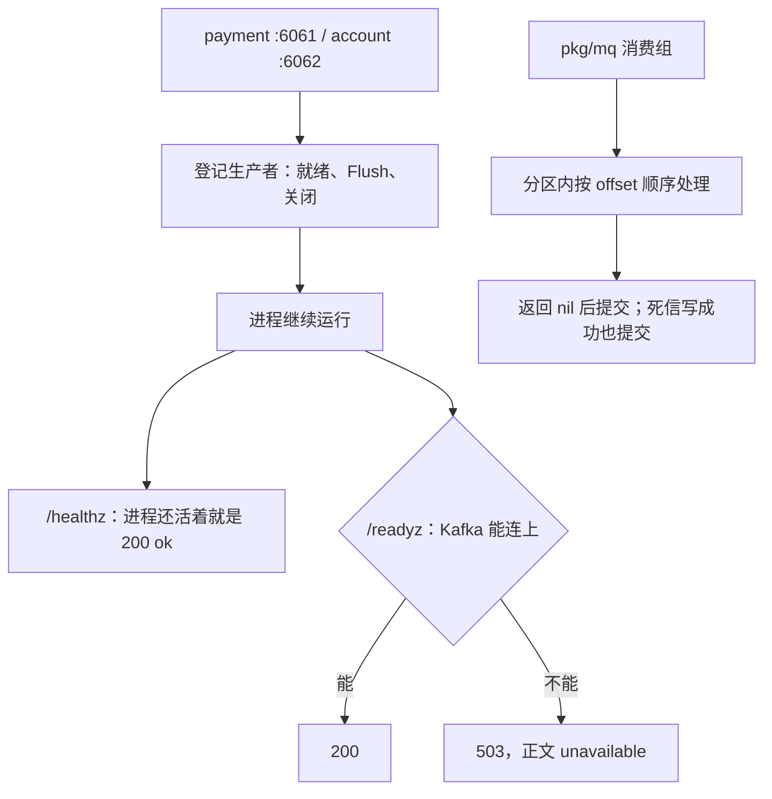
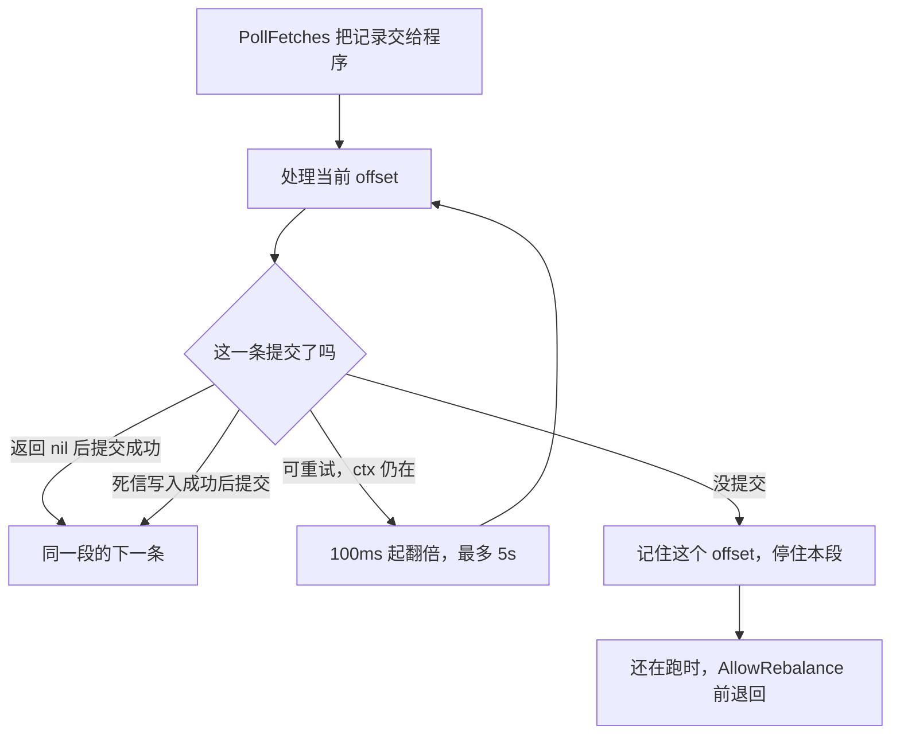

# MQ-03 Kafka 生产与消费框架

| 项 | 内容 |
|---|---|
| 功能点 | MQ-03（P0，第 5 周） |
| 所属链路 | 基础设施 |
| 代码提交 | `4a24c7b` `[MQ-03] add kafka framework`（完整 `4a24c7bc41b76f96b35a2086ddb54415a59f7029`，2026-11-10 08:52:12 +0800） |
| 分支 | `feat/MQ-03-kafka-framework` |
| 日期 | 2026-11-10 |
| 状态 | DONE |

本报告写在上面这次代码提交之后，不在那次提交的文件里。报告自己的提交还没有，修订记录里写「待提交」。

`pkg/mq` 提供 Kafka 生产者和消费组。payment 与 account 只登记生产者的就绪检查、刷新和关闭，两个进程都不启动消费组。刷新是把已经交给生产者客户端、还没确认的消息发出去（Flush），不是重载配置。一般规则是处理函数返回 nil 才提交；例外是不可重试且死信写入成功，这时处理函数返回的不是 nil，仍然提交原 offset。没提交的分区会把拉取位置退回到那条记录本身，更高的位置不处理。证据是 4.4 那次官方验证（日志 `/tmp/mq03-verify-r3.log`）里 `pkg/mq` 整包通过，验收测试是 `TestMQ03Accept1RetryThenCommit`、`TestMQ03Accept2Readyz`、`TestMQ03Accept3DLQ`、`TestMQ03Accept4KillBeforeCommit`。

第 5 周计划那一行仍是「MQ-03 → MQ-02 → MQ-04 → MQ-05」整行，没有勾选。本功能点完成不等于这一周完成。

## 一句话结论

Kafka 客户端创建时不拨号。去掉空白后一个地址都没有才拒绝启动；地址非空但连不上时进程仍启动。管理端口上 `/healthz` 只表示进程还活着，Kafka 挂了仍是 200、正文 `ok`；`/readyz` 才检查 Kafka，挂了是 503、正文 `unavailable`，不含地址。消费按分区顺序。一般规则是处理函数返回 nil 才提交；不可重试且死信写入成功是例外，返回值不是 nil 也提交原 offset。没提交时记住那条 offset，并在允许再平衡之前把拉取位置退回去，避免后面的提交把中间消息标成已消费。

## 1. 背景

### 1.1 系统简介

pay-system 是一个用 Go 编写的小型支付后端，模拟商户收款、退款、商户间转账三条资金链路，重点在数据一致性和性能。系统由 5 个部分组成：gateway（对外 HTTP 入口，负责签名校验和限流）、payment（支付单、退款单、转账单的状态管理和流程推进）、account（账户余额与记账，数据按商户分到 2 个数据库分片）、channel-mock（模拟微信、支付宝这类外部支付渠道）、recon（对账，核对系统内外数据是否一致）。服务之间用 Kitex RPC 同步调用，或通过 Kafka 消息异步通知；数据存在 MySQL 8.4，Redis 用于防重放。所有金额用整数“分”表示，所有记账只追加不修改。当前已完成：账户、支付、退款、转账、网关商户路由，以及本报告的 Kafka 生产与消费框架。outbox 投递器和 account 入账消费还没有。

上面这段里还没展开的词：Kitex 是本项目的 Go RPC 框架，RPC 是一个进程同步调用另一个进程里的函数。签名校验用密钥确认报文没有被改过；限流限制单位时间内的调用次数。分片是把账户数据按商户拆进 2 个库。1 元 = 100 分，金额全程用整数。一笔 100.00 元的收款在系统里是 10000 分。记账只追加，是指账本只插入新行，不回头改旧行。本次框架不写账户余额，也不写分录。

Kafka 是进程之间传递消息的队列。一条消息有 topic（类别名）、partition（同一 topic 里的一条有序队列）、offset（这条队列里的位置编号，从 0 起递增）。消费组是一组一起读同一批 topic 的进程，每个分区同一时刻只分给组里的一个成员。把「下一条从哪读」记回 Kafka，叫做提交 offset。本次提交的是记录 offset 加 1，表示这条已经处理完，下次从下一条开始。

outbox 是和业务写在同一数据库事务里、稍后才发出去的消息表。把这些行发到 Kafka 的投递器是 MQ-02，还没做。account 收到支付成功消息后给商户入账是 MQ-04，也还没做。本次只提供发送和接收的框架。Redis 防重放是系统别处的能力，本次不连接 Redis。P0 是必须先做的优先级。

### 1.2 本功能点在系统中的位置

payment 的管理端口是 `:6061`，account 的管理端口是 `:6062`。两个进程在进入这个端口的运行循环之前，用已有配置 `KAFKA_BROKERS` 登记生产者。登记的刷新是 Flush：把已经交给客户端、还没确认的消息发出去，不是重载配置。`/healthz` 只表示进程还活着，Kafka 挂了仍是 200、正文 `ok`。`/readyz` 才检查 Kafka，挂了是 503、正文 `unavailable`。gateway 和 recon 不登记，所以不会因为 Kafka 没注册而让自己的就绪检查失败。两个业务进程都不调用消费组的 `Serve`。



图的上半是这两个进程现在真正接上的部分。下半是框架已经实现、但还没有业务调用方的消费组。MQ-02 以后调用生产者把 outbox 发出去。MQ-04 以后在 account 里启动消费组，把 10000 分（100.00 元）的支付成功消息记成账户分录。

### 1.3 为什么需要它

假设一笔支付成功，金额 10000 分（100.00 元）。以后这条消息会进 Kafka，account 再按它入账。如果框架把还没处理完的消息标成已消费，这条 100.00 元不会再投递，也不会进死信，商户账上就少了这笔。

再看两种具体失败。broker 暂时连不上时，如果进程拒绝启动，支付主链路会跟着停；如果就绪检查把 broker 地址写进正文，探活结果会带出内部地址。分区里先处理了 offset 8 并提交了 9，而 offset 7 还没提交，Kafka 会认为 7 也已经消费完。7 不会再出现，10000 分的入账依据就丢了。

所以：创建客户端不拨号；去掉空白后一个地址都没有才启动失败；地址非空但连不上仍启动，`/readyz` 失败正文固定为 `unavailable`，`/healthz` 仍是 200、正文 `ok`。消费必须按 offset 从小到大提交。前面没提交，后面不能处理，也不能提交。

## 2. 术语

按正文第一次出现的顺序。

| 术语 | 含义 |
|---|---|
| Kafka | 进程之间的消息队列。本次用 franz-go v1.22.1 访问它。 |
| topic | 消息类别名。死信固定写到 `pay.dlq`。 |
| partition | 一个 topic 里的一条有序队列。同一分区同一时刻只分给消费组的一个成员。 |
| offset | 分区里的位置编号。提交时写的是这条记录的 offset 加 1。 |
| 同一段 | 同一次拉取回调里、同一个分区交给 `runBatch` 的那一串记录。 |
| 下一段 | 同一次或下一次拉取里，这个分区的另一次回调。 |
| 消费组 | 一起读同一批 topic 的进程集合。组名相同的成员分担分区。 |
| broker | Kafka 服务器地址。配置项是已有的 `KAFKA_BROKERS`，本次不新增配置项。 |
| 管理端口 | 本机探活用的 HTTP 端口。payment 是 `:6061`，account 是 `:6062`。不是商户下单的端口。 |
| `/healthz` | 只表示进程还活着。Kafka 挂了仍是 200，正文 `ok`。 |
| `/readyz` | 就绪检查，这里才检查 Kafka。连不上时 HTTP 503，正文 `unavailable`，不含地址。 |
| 503 / 200 | HTTP 状态。503 表示现在不能接新流量。200 表示可以。 |
| 刷新 / Flush | 把已经交给生产者客户端、还没确认的消息发出去。不是重载配置。 |
| outbox | 和业务写在同一事务里、稍后才发送的消息表。发送器是 MQ-02，还没做。 |
| MQ-02 | outbox 投递器。还没做。 |
| MQ-04 | account 按消息入账。还没做。重复投递由它的业务幂等吸收。 |
| MQ-05 | 死信重放。还没做。和第 5 周计划写在同一未勾选的行里。 |
| 分 | 金额单位。100 分 = 1.00 元。10000 分 = 100.00 元。本次不改余额。 |
| 分录 | 账本上的一行。只追加，不修改。本次不写分录。 |
| 死信 / DLQ | 不可重试的消息另存的 topic，名字是 `pay.dlq`。 |
| 幂等写 | 生产者重试时，Kafka 仍把同一条生产请求看成一次。本次不关闭它。 |
| 同步副本 | Kafka 认为已经跟上首领的副本。 |
| acks=all | 生产者要等全部同步副本都确认，才认为这条写成功。 |
| linger | 生产者凑批的等待。本次 5 毫秒。 |
| `event_id` / `event_type` / `traceparent` | 三个消息头。值由调用方放进消息，框架不解析 outbox。即使值为空也写键，读取方始终看到同样的三个键。`traceparent` 为空表示这次没有上游追踪。 |
| 可重试错误 | 没被 `Permanent` 包住的非 nil 错误一律可重试，包括暂时的数据库、网络和依赖失败。原地等待后再次处理，不提交 offset。 |
| 不可重试错误 | 调用方用 `Permanent` 包起来的错误，例如反序列化失败、数据缺失、业务冲突。框架不识别业务类型，业务冲突必须由调用方自己包。 |
| `Permanent` | 把错误标成不可重试的包装。`Permanent(nil)` 仍是 nil。没包上的非 nil 错误仍按可重试处理。 |
| 消费延迟 | 分区高水位减去当前已提交的下一条位置。还没提交时，用最后读到的 offset 本身，不加 1。 |
| 高水位 | 分区里下一条待写入的位置。减掉消费位置就是还没处理的条数。 |
| 再平衡 | 消费组成员变化时，分区改分给别的成员。 |
| 世代 / 成员 | 消费组的一代成员身份。失效后旧成员不能再提交。 |
| `LeaderEpoch` | 写出这条记录时，分区首领的纪元。退回拉取位置时和 offset 一起交回去。 |
| `EpochOffset` | 领袖世代加上要从哪条 offset 开始读。退回时 Offset 是记下的那条，不是加 1。 |
| `SetOffsets` | franz-go 把某分区的下一次拉取位置设到指定 `EpochOffset`。 |
| `BlockRebalanceOnPoll` | 拉到消息之后先不要撤销分区，直到 `AllowRebalance`。 |
| `AllowRebalance` | 一次拉取处理完之后，才允许客户端执行挂起的再平衡。 |
| `handleFetches` | 把这次拉到的记录按分区交给处理协程，并等它们结束。 |
| `gate` | 每个分区一把锁。正在处理和提交时，撤销分区要等它结束。`begin` 在已经开始撤销时返回 false，这条和后面的记录都不再处理。 |
| `context.WithoutCancel` | 不受外层取消影响的上下文。外层 ctx 已经取消时，最后这一次提交仍用 5 秒超时，不把取消传进去。 |
| IDL | 生成 RPC 代码的 Thrift 文件。这次没改。 |
| SIGKILL | 立刻结束进程的信号。被测子进程在 `syscall.Kill` 发出它之后执行 `select {}`，这不是父测试进程里的语句。信号是异步的，送达后进程直接死掉，`select {}` 不会执行完；钩子若返回，同一条协程会继续提交 offset，所以 `select {}` 让它不返回。 |
| 故障点 | 测试里按名字故意让某一步失败的开关。本次不新增。 |
| franz-go | 本次使用的 Kafka 客户端库，模块 `github.com/twmb/franz-go`，版本 v1.22.1。 |

## 3. 技术讲解

### 3.1 要解决的问题

框架要同时满足这些约束。来源是支付消息不能丢、也不能在进程还没准备好时把内部地址暴露出去。

1. 创建客户端不连接 broker。去掉空白后一个地址都没有，才返回 `no kafka broker`。地址非空但连不上时进程仍要起来。
2. `/readyz` 失败的正文只能是 `unavailable`，不能出现 broker 地址。`/healthz` 不检查 Kafka。生产失败的文本只能是 `produce timeout` 或 `unavailable`，同样不带地址。
3. 同步副本是 Kafka 认为已经跟上的副本。acks=all 是等这些副本都确认。生产者保持幂等写，凑批 5 毫秒，单次等待上限 5 秒。`event_id`、`event_type`、`traceparent` 由调用方放进消息，框架不解析 outbox。三个头即使值为空也写键。`traceparent` 为空表示这次没有上游追踪。
4. 关闭自动提交。每个分区一个协程，按 offset 从小到大处理。一般规则：处理函数返回 nil，才提交这条的 offset+1。例外：不可重试且死信写入成功时，处理函数返回的不是 nil，仍然提交原 offset。
5. 没被 `Permanent` 包住的非 nil 错误一律可重试，从 100 毫秒翻倍，上限 5 秒，不提交。不可重试先把原消息写入 `pay.dlq`，写成功再提交原记录的 offset。处理函数返回了错误且 ctx 已取消时，不写死信、不提交。处理函数已经返回 nil、正在重试提交、这时 ctx 取消：用 `context.WithoutCancel` 再提交一次，成功才算提交。
6. 同一段是同一次拉取回调里、同一个分区交给 `runBatch` 的那一串记录。前一条没提交，就不处理更高的 offset。下一段是同一次或下一次拉取里这个分区的另一次回调。世代或成员失效时停止提交重试，记住这个 offset；进程还在跑时，把拉取位置退回到这个 offset 本身，不是加 1。进程退出前不会为了退回位置去调用 `SetOffsets`。
7. 三个计数只留在进程内存里，不提供 `/metrics`。不新增错误码、表、IDL（生成 RPC 代码的 Thrift 文件）、配置项、故障点。

### 3.2 方案

成功路径是：处理函数返回 nil，然后调用测试钩子（生产环境这个钩子是 nil），然后提交。不可重试且死信写入成功是例外：处理函数返回的不是 nil，写完死信再提交原 offset。提交成功才处理同一段里的下一条。记住 offset 并停住只发生在没提交的时候。



图里只有「没提交」才记住 offset 并停住。返回 nil 后提交成功，或者死信写入成功后提交，都会继续同一段的下一条。可重试且 ctx 还在时留在当前条。死信写入失败时记住这个永久错误，之后只重试写死信，不再调用处理函数。处理函数返回了错误且 ctx 已取消时，不写死信、不提交。处理函数已经返回 nil、正在重试提交、这时 ctx 取消：用不受取消影响的上下文再提交一次，成功才算提交。

`pay.dlq` 保留原消息的 key、value 和原有消息头，再追加四个头：`x-orig-topic`、`x-orig-partition`、`x-orig-offset`（十进制）、`x-error`。`x-error` 只保留错误文本的前 512 字节。日志记 event_id、event_type、topic、partition、offset，不记完整消息体，也不记错误字符串。

生产者失败先看调用方的上下文。已经取消就返回上下文的错误。否则超时映射成固定文本 `produce timeout`，其余失败映射成 `unavailable`。两处都不包装原来的拨号错误，所以正文里不会出现 `127.0.0.1` 这类地址。这段函数在做这件事：

```go
func mapProduceErr(ctx context.Context, err error) error {
	if err == nil {
		return nil
	}
	if ctx.Err() != nil {
		return ctx.Err()
	}
	if errors.Is(err, kgo.ErrRecordTimeout) || errors.Is(err, context.DeadlineExceeded) {
		return errProduceTimeout
	}
	return ErrUnavailable
}
```

每个分区有一把 `gate`。正在处理和提交时，撤销要等它结束。`begin` 在已经开始撤销时返回 false，这条和后面的记录都不再处理。另外用分区上的一个标记挡住更高的 offset。标记存的是记录自己的 offset 和 `LeaderEpoch`。成功提交后清掉。这段循环在做这件事：

```go
func (c *Consumer) runBatch(job batch) {
	for _, rec := range job.recs {
		key := partKey{topic: rec.Topic, partition: rec.Partition}
		if c.holdBlocks(key, rec.Offset) {
			return
		}
		c.noteRead(key.topic, key.partition, rec.Offset, job.hwm)
		gate := c.gate(key)
		if gate == nil || !gate.begin() {
			return
		}
		committed := false
		func() {
			defer gate.end()
			committed = c.process(job.ctx, rec)
		}()
		if !committed {
			c.markHold(key, rec.Offset, rec.LeaderEpoch)
			return
		}
		c.clearHold(key)
	}
}
```

客户端把记录交给程序时，下一次拉取的起点已经越过这些记录，这发生在提交之前。`PollFetches` 对同一分区可以分多次把记录交回来。下一段是同一次或下一次拉取里这个分区的另一次回调，会在这一段结束之后被处理。所以只停当前段不够，必须把起点退回去。`handleFetches` 把这次拉到的记录按分区交给处理协程并等它们结束。`Serve` 在它返回之后、`AllowRebalance` 之前，如果服务上下文还活着并且有标记，就调用 `SetOffsets`。值是 `EpochOffset`：领袖世代加上记下的 offset，不是 offset+1。进程退出前不会为了退回位置去调用 `SetOffsets`。没有标记时也不调用。`TestUncommittedHoldsPartitionAcrossBatches` 只检查框架打算退回到的 offset 和 `LeaderEpoch`，钩子没有连接 broker；生产路径是在 `AllowRebalance` 之前调用客户端的 `SetOffsets`，成员已经失效时这次调用不一定能让客户端真的从那条记录再读，单测没有覆盖真实 broker 上的退回。

`BlockRebalanceOnPoll` 的意思是拉到消息之后先不要撤销分区，直到 `AllowRebalance`。退回拉取位置放在这个调用之前，就不会和提交、撤销同时进行。

四个会立刻停止提交重试的错误是 `RebalanceInProgress`、`IllegalGeneration`、`UnknownMemberID`、`FencedInstanceID`。这四类都停止空转：不睡眠，也不再提交一次。框架自己把位置退回，不依赖客户端是否会重新加入组。普通网络错误仍从 100 毫秒翻倍到 5 秒。处理函数已经返回 nil、正在重试提交、这时 ctx 取消：用 `context.WithoutCancel` 再提交一次。外层 ctx 已经取消，这一次仍用 5 秒超时，不把取消传进去。这次成功才算提交，标记按成功清除。原始提交错误不写进日志。

没被 `Permanent` 包住的非 nil 错误一律可重试。处理函数 panic 时进程不退出，收成可重试的 `kafka handler failed`，文本不包含 panic 的内容，不提交。业务冲突要由调用方包成 `Permanent`，框架不识别业务类型。分区正在撤销时，`gate` 等当前这条处理和提交结束；`begin` 已经返回 false 的记录不再处理。重新分配后从已提交的位置再读。

指标名是 `pay_mq_consume_errors_total`、`pay_mq_dlq_total`、`pay_mq_consume_lag`。前两个按 topic 和消费组计数，延迟再加分区。都是进程内的 map，没有 HTTP。不可重试本身不加消费错误计数；死信写成功才加死信计数。死信写入失败按可重试加消费错误计数，不加死信计数。延迟用高水位减去位置：已经提交过，位置是下一条 offset；还没提交但读过，位置是最后读到的 offset，不加 1，所以正处理的那条延迟仍大于 0。结果小于 0 时记 0。

payment 和 account 的登记只有这三步：就绪检查、退出时 Flush、关闭客户端。注释写明连不上 Kafka 也要启动。去掉空白后一个地址都没有才在这里失败。地址非空但连不上，启动仍然成功。不在 `serve` 里启动消费者。

### 3.3 为什么这样做

自动提交会在处理函数还没返回时就把位置往前推。进程若在入账前崩溃，这条 10000 分（100.00 元）的消息不会再来。所以关闭自动提交。一般规则是处理函数返回 nil 之后才提交。例外是不可重试且死信写入成功：返回值不是 nil，仍然提交原 offset。

| 方案 | 做法 | 优点 | 缺点 | 结论 |
|---|---|---|---|---|
| 采用：手动提交，失败则退回拉取位置 | 返回 nil 后提交 offset+1；死信写成功也提交。没提交时记住 offset，在 `AllowRebalance` 前 `SetOffsets` 到该 offset | 中间消息不会被后面的提交盖掉；再平衡前调用 `SetOffsets` 打算退回 | 同一条可能再次投递。成员已失效时，这次调用不一定能让客户端从那条再读 | 采用。重复交给 MQ-04 的业务幂等 |
| 备选：自动提交 | 客户端按拉取位置自己提交 | 调用少 | 处理失败或进程崩溃后，消息被标成已消费 | 不采用 |
| 备选：提交失败后只停当前这一段 | 不退回拉取位置，等下一次 `PollFetches` | 代码短 | 下一次从已经前移的位置继续，更高 offset 一提交，中间消息不再投递，也不进 `pay.dlq` | 不采用 |
| 备选：把 broker 错误原样返回 | 就绪检查和生产失败直接返回客户端错误 | 少写映射 | 错误文本可以带 `dial tcp 127.0.0.1:1` 这类地址 | 不采用 |

创建客户端时不拨号，是为了 broker 不在时进程仍能启动。就绪检查单独在 `/readyz` 里失败。幂等写保持开启，不调用关闭幂等写的选项。

### 3.4 正确性

本次不写数据库，所以「最终状态」指 Kafka 的提交位置、死信，或进程的就绪结果，不是账户余额。

| 场景 | 系统行为 | 最终状态 | 证明 |
|---|---|---|---|
| 同一条可重试 3 次后成功 | 等待参数依次是 100 毫秒、200 毫秒、400 毫秒，第 4 次返回 nil 才提交 | 只成功处理一次，offset 已提交 | `TestBackoffThenSuccess`；集成 `TestMQ03Accept1RetryThenCommit` |
| 同一段前一条未提交 | 第一条可重试且等待因上下文取消返回后，第二条处理函数不调用，也不提交 | 更高 offset 未被标成已消费 | `TestRunBatchStopsAfterUncommitted` |
| 处理成功但提交遇到世代或成员失效 | 不睡眠，立即未提交。同段下一条不处理。下一段更高 offset 也不处理 | 框架打算退回到第一条的 offset 和 `LeaderEpoch`。单测按钩子记下的位置再处理后，提交成功才清标记，同段下一条才能提交 | `TestUncommittedHoldsPartitionAcrossBatches`（四种错误都覆盖）只检查打算退回的 offset 和 `LeaderEpoch`，钩子没有连接 broker；生产路径在 `AllowRebalance` 前调用客户端 `SetOffsets`，成员已失效时不一定能从那条再读，单测没有覆盖真实 broker 上的退回。同段停止另见 `TestCommitMembershipStopsBatch` |
| 普通提交错误 | 仍睡眠并再提交一次 | 第二次成功则标记为已提交 | `TestCommitRetriesOrdinaryError` |
| 不可重试 | 写入 `pay.dlq` 后提交原 offset。后续消息继续 | 死信头带原 topic、分区、offset 和截断后的错误 | `TestMQ03Accept3DLQ` |
| 死信第一次写入失败 | 记住永久错误，只重试写入，处理函数只调用 1 次 | 第二次写成功后再提交 | `TestPermanentDLQRetriesWithoutRehandle` |
| 处理函数返回错误且 ctx 已取消 | 不写死信，不提交 | 消息仍可再投递 | `TestCancelSkipsDLQAndCommit` |
| 已经返回 nil，提交重试中 ctx 取消 | 用 `context.WithoutCancel` 再提交一次，5 秒超时，不把取消传进去。成功才算提交 | 成功则 offset 已提交；失败则留下标记，但进程退出前不调用 `SetOffsets` | 未验证 |
| 处理函数 panic | 收成可重试的 `kafka handler failed`，文本不含 panic 内容 | 不提交 | `TestPanicIsRetryableAndOmitsValue` |
| 提交前进程被杀死 | 被测子进程里，钩子在 `syscall.Kill` 发出 SIGKILL 之后执行 `select {}`，不返回到提交。这不是父测试进程里的语句。信号是异步的，送达后进程直接死掉，`select {}` 不会执行完；钩子若返回，同一条协程会继续提交 offset | 重启后的新进程、同一消费组再次拿到同一条。业务幂等留给 MQ-04 | `TestMQ03Accept4KillBeforeCommit` |
| 分区正在撤销 | 测试直接调用等待函数，不启动第二个真实成员。正在处理的这一条等它结束 | 还没开始的记录不再处理。重新分配后从已提交的位置再读 | 测试直接调用等待函数。不声称有第二个真实成员 |
| Kafka 不可用 | 进程仍启动。`/readyz` 503，正文恰好是 `unavailable`，不含地址；`/healthz` 仍是 200、正文 `ok`。恢复后 `/readyz` 200 | 不把地址写进探活正文 | `TestMQ03Accept2Readyz` |
| 生产失败带有拨号地址 | 映射成 `produce timeout` 或 `unavailable`，二者用错误类型区分 | 文本不含 `127.0.0.1`、`10.0.0.1`、`dial` | `TestProduceErrorHidesAddress` |
| 去掉空白后一个地址都没有 | 返回 `no kafka broker`，不创建会去拨号的客户端。地址非空但连不上则启动成功 | 空列表在登记这一步失败 | `TestOpenProducerRejectsEmptyBrokers` |
| 向 Kafka broker 生产超时 | 单次上限 5 秒。超时返回固定文本，不包装原始错误。这里的下游就是 broker | 调用方看不到 broker 地址 | `TestProduceErrorHidesAddress`。没有用真实拨号去等满 5 秒 |

官方日志只给出包一级的耗时，没有上面任何一个测试函数自己的毫秒数。集成四个验收测试随 `pkg/mq` 整包通过，不把整包的 70.284 秒写成某一个测试的耗时。

### 3.5 性能

不涉及。这次没有吞吐或延迟压测。4.4 的秒数是测试命令的墙钟时间，不是 Kafka 生产能力。

## 4. 已完成内容

### 4.1 改动清单

| 文件 | 新增 / 修改 | 作用 |
|---|---|---|
| `pkg/mq/producer.go` | 新增 | 生产者。acks=all，幂等写保持开启，linger 5 毫秒，单次超时 5 秒 |
| `pkg/mq/consumer.go` | 新增 | 消费组、顺序处理、提交、死信、退回拉取位置 |
| `pkg/mq/message.go` | 新增 | 三个业务头和死信四个头 |
| `pkg/mq/error.go` | 新增 | `no kafka broker`、`unavailable`、`produce timeout`、`Permanent` |
| `pkg/mq/backoff.go` | 新增 | 100 毫秒起翻倍，上限 5 秒 |
| `pkg/mq/metrics.go` | 新增 | 进程内三个计数 |
| `pkg/mq/register.go` | 新增 | 只登记生产者的就绪、Flush、关闭 |
| `pkg/mq/doc.go` | 新增 | 包说明 |
| `pkg/mq/retry_test.go` | 新增 | 不启动 Kafka 的顺序、死信、错误文本测试 |
| `pkg/mq/integration_test.go` | 新增 | 四个验收、再平衡和延迟。用已有镜像起 Kafka |
| `cmd/payment/main.go` | 修改 | `serve` 里登记生产者，不启动消费者 |
| `cmd/account/main.go` | 修改 | 同上 |
| `cmd/payment/kafka_register_test.go` | 新增 | 确认 `serve` 调用的是登记函数 |
| `cmd/account/kafka_register_test.go` | 新增 | 同上 |
| `go.mod` / `go.sum` | 修改 | 直接依赖 franz-go v1.22.1 与 kmsg v1.14.0 |
| `docs/02-requirements.md` | 修改 | MQ-03 记为完成，变更记录日期 2026-11-10 |
| `docs/05-api.md` | 修改 | 文档版本 3.3.15，说明就绪检查 |
| `docs/06-flows.md` | 修改 | 版本 v2.46。图下文字说明已登记 Kafka，图的节点不改 |
| `docs/01-tech-decisions.md` | 修改 | 依赖取舍。生产错误不带地址。未提交的分区会退回拉取位置 |
| `docs/interview-notes.md` | 修改 | MQ-03 小节 |

约定文档的版本没有改。没有新增迁移、错误码、IDL（生成 RPC 代码的 Thrift 文件，这次没改）、配置项、故障点，也没有 Prometheus。

### 4.2 对外变化

| 类别 | 变化 |
|---|---|
| 接口 | 不改字段、错误码、IDL。payment 与 account 的 `/readyz` 在 Kafka 不可达时为 503，正文 `unavailable`；进程仍能启动 |
| 表结构 | 无 |
| 配置项 | 无新增。使用已有的 `KAFKA_BROKERS` |
| 错误码 | 无 |
| 指标 / 故障点 | 进程内 `pay_mq_consume_errors_total`、`pay_mq_dlq_total`、`pay_mq_consume_lag`。没有 `/metrics`。不新增故障点 |

### 4.3 验收对照

| 验收条目 | 测试函数 | 类型 | 结果 |
|---|---|---|---|
| 处理函数前 3 次返回可重试错误、第 4 次成功：消息只成功处理一次，offset 已提交 | `TestMQ03Accept1RetryThenCommit` | 集成 | 通过。`pkg/mq` 整包通过，日志没有这个测试自己的耗时 |
| Kafka 不可用时 payment、account 的 `/readyz` 返回 503，恢复后返回 200 | `TestMQ03Accept2Readyz` | 集成 | 通过。同上，不单列毫秒 |
| 不可重试错误的消息进入 `pay.dlq`，后续消息继续消费 | `TestMQ03Accept3DLQ` | 集成 | 通过。同上 |
| 处理成功、提交前 kill 进程，重启后重新投递 | `TestMQ03Accept4KillBeforeCommit` | 集成 | 通过。同上。被测子进程在 `syscall.Kill` 之后执行 `select {}`，不是父测试进程里的语句。信号异步送达后进程直接死掉，这段不会执行完；钩子若返回，同一条协程会继续提交 offset |
| 同一分区未提交则挡住更高 offset，并退回拉取位置 | `TestUncommittedHoldsPartitionAcrossBatches` | 单元 | 通过。随 `make test` 的 `pkg/mq` 整包，日志没有单测毫秒。该测试只检查打算退回的 offset 和 `LeaderEpoch`，钩子没有连接 broker；生产路径在 `AllowRebalance` 前调用客户端 `SetOffsets`，成员已失效时不一定能从那条再读，单测没有覆盖真实 broker 上的退回 |
| 同一段前一条未提交就停止 | `TestRunBatchStopsAfterUncommitted` | 单元 | 通过。同上 |
| 永久错误写死信失败后不再调用处理函数 | `TestPermanentDLQRetriesWithoutRehandle` | 单元 | 通过。同上 |
| 世代或成员失效不空转提交 | `TestCommitMembershipStopsBatch` | 单元 | 通过。同上 |
| 生产错误不带地址 | `TestProduceErrorHidesAddress` | 单元 | 通过。同上 |
| 可重试等待 100 毫秒、200 毫秒、400 毫秒 | `TestBackoffThenSuccess` | 单元 | 通过。同上 |

### 4.4 验证记录

官方验证就是下面这次命令，日志 `/tmp/mq03-verify-r3.log`。时间：2026-11-10 08:49:01 到 08:51:35 +0800。脚本退出码 0。`go test` 的多个包并行跑，所以包耗时加起来可以大于这一步的 real。

环境：macOS ProductVersion 27.0.1，BuildVersion 26A434，Darwin 27.0.0 arm64，主机 `yymdeMacBook-Air.local`。Go `go1.27.2 darwin/arm64`。golangci-lint 2.14.0，built with go1.27.1 from `114493f` on 2026-09-24T10:54:53Z。`docker_info=ok`。

| 命令 | 结果 |
|---|---|
| `gofmt -l .` | 退出码 0。real 0.11s，user 0.38s，sys 0.10s。没有文件列出 |
| `make lint`（`golangci-lint run --build-tags integration ./...`） | 0 issues。退出码 0。real 1.87s，user 1.86s，sys 8.45s |
| `make test`（`go test -race ./...`） | 退出码 0。real 9.54s，user 8.83s，sys 8.57s。根包 8.460s；`pkg/mq` 1.550s；`cmd/payment` 1.786s；`cmd/account` 1.777s |
| `make test-integration`（`go test -race -tags integration ./...`） | 退出码 0。real 72.13s，user 15.42s，sys 13.53s。根包 58.438s；`pkg/mq` 70.284s；`cmd/payment` 4.465s；`cmd/account` 4.452s；`test/gw09` 30.093s |
| `make cover` | 退出码 0。real 69.20s，user 17.98s，sys 17.80s。total 36.5%（含 `kitex_gen`，不是门槛）。`pkg/mq` 65.298s / 86.5%，不在 70% 门槛里。门槛包在该次输出里标了 cached：`service/account/biz` 91.1%，`service/payment/biz` 85.2%，`pkg/money` 100.0%，`pkg/sign` 100.0%，`pkg/idgen` 89.1%，`pkg/outbox` 95.0% |

`coverage.out` 已删除（日志 `no_coverage_out`）。

第一轮有 1 个高问题、2 个中问题、1 个低问题，已改入本次提交：同一批不能跳过未提交的 offset；世代失效不能空转提交；生产错误不能带地址；永久错误写死信失败后不能再次调用处理函数。第二轮仍有 1 个高问题：提交失败后下一次拉取不会退回，更高 offset 的提交会丢掉中间消息。该问题在本次提交前修好，测试是 `TestUncommittedHoldsPartitionAcrossBatches`。第二轮另有 1 个低问题，审查没有写出内容，这里不猜测。没有第三轮审查。

### 4.5 同步的文档

- 需求：MQ-03 状态为完成。2026-11-10 的变更记录写明顺序提交、死信、退回拉取位置、生产错误不带地址。需求版本仍是 v3.0。
- 接口：版本 3.3.15。说明 payment、account 登记了 Kafka 就绪检查和生产者 Flush（把还没确认的消息发出去）；broker 不可达时 `/readyz` 为 503，进程仍能启动。不改字段和错误码。
- 流程：版本 v2.46。图下文字改为这两个进程已登记 Kafka；消费框架的重试、死信、分区顺序和提交已由本功能点提供，入账仍是 MQ-04。图的节点没有改，没有新增 SVG。
- 技术取舍：franz-go v1.22.1；kmsg 用于集成测试建 topic 和查提交位置；不引入另一套管理客户端，也不引入 Prometheus。生产错误不带地址。没提交的分区会把拉取位置退回到该 offset。
- 讲解笔记：启动不依赖 Kafka 连通；指标只在进程内；提交前杀死进程用测试钩子；同一批前一条没提交就停；没提交的分区会退回拉取位置。

`docs/04-dev-plan.md` 第 5 周那一行没有勾选。约定版本没有改。

## 5. 未完成与风险

MQ-02 还没有把 outbox 行发到 Kafka。MQ-04 还没有在 account 里启动消费组，也还没有按 event_id 做入账幂等。因此现在不会因为这条框架给商户加上 10000 分（100.00 元）。重复投递要等 MQ-04 吸收。MQ-05 的死信重放也还没做。

第 5 周计划仍是一整行未勾选：MQ-03、MQ-02、MQ-04、MQ-05 都写在那一行里。只完成 MQ-03，不能把这一周标成完成。

gateway 和 recon 没有登记 Kafka。它们的 `/readyz` 不会因为本功能点检查 Kafka。这是登记范围，不是漏掉的失败分支。

进程退出前不会为了退回位置去调用 `SetOffsets`。已经成功的提交仍会在停止前做完；处理函数已经返回 nil 时，取消后还会用 `context.WithoutCancel` 再试一次提交。没成功的留在 Kafka，下次由还活着的成员再读。

`pkg/mq` 覆盖率 86.5%，但它不在「核心包不低于 70%」那份名单里。名单里的六个包都高于 70%，并且在这次 cover 输出里是 cached。

第二轮那个没有写出内容的低问题，没有在这里补猜。没有第三轮审查。

## 6. 如何复现

前置：本机 Docker 可用（官方日志 `docker_info=ok`），能拉起与项目编排相同的 Kafka 镜像。集成测试会自己起容器，不需要先改 `deploy/.env`。在仓库根目录执行。下面的预期数字来自 `/tmp/mq03-verify-r3.log`，时间是 2026-11-10 08:49:01 到 08:51:35 +0800。

```bash
gofmt -l .
make lint
make test
make test-integration
make cover
rm -f coverage.out
```

预期：`gofmt -l .` 没有文件名，退出码 0，real 0.11s。`make lint` 打印 `0 issues.`，退出码 0，real 1.87s。`make test` 退出码 0，real 9.54s，其中 `pkg/mq` 1.550s。`make test-integration` 退出码 0，real 72.13s，其中 `pkg/mq` 70.284s。`make cover` 退出码 0，real 69.20s；`go tool cover -func` 的 total 是 36.5%，`pkg/mq` 是 86.5%。删掉 `coverage.out` 后不应再留下这个文件。

只看四个验收测试时，官方日志没有单独的一行。整包通过才是这次记录下来的结果。不要把 70.284 秒理解成其中某一个测试的耗时。

## 7. 讲解要点

1. 问：broker 挂了，支付进程为什么还能启动？答：`NewClient` 不拨号。去掉空白后一个地址都没有才在登记时失败。地址非空但连不上，启动仍然成功。`/healthz` 仍是 200、正文 `ok`。`/readyz` 是 503，正文固定 `unavailable`，不含地址。
2. 问：为什么不能提交后面的 offset？答：客户端把记录交给程序时，下一次拉取的起点已经越过这些记录，这发生在提交之前。提交写的是 offset+1。若 7 没提交而 8 提交了，7 不会再投递，也不会进 `pay.dlq`。所以同一段前一条没提交就停。这四类世代或成员错误都停止空转，框架自己在 `AllowRebalance` 之前调用 `SetOffsets`，打算退回到记下的 offset 本身，不依赖客户端是否会重新加入组。`TestUncommittedHoldsPartitionAcrossBatches` 只检查这个 offset 和 `LeaderEpoch`，钩子没有连接 broker；成员已失效时，这次调用不一定能让客户端从那条再读，单测没有覆盖真实 broker 上的退回。进程退出前不调用 `SetOffsets`。
3. 问：提交前把进程杀掉，消息会丢吗？答：被测子进程在 `syscall.Kill` 发出 SIGKILL 后执行 `select {}`，不返回到提交；这不是父测试进程里的语句。信号是异步的，送达后进程直接死掉，这段不会执行完；钩子若返回，同一条协程会继续提交 offset。新进程用同一消费组会再次拿到这条。框架不丢弃重复，入账幂等是 MQ-04 的事。这不是新的故障点。

## 延伸阅读

- `docs/02-requirements.md`：MQ-03 的规则和验收。
- `docs/05-api.md`：版本 3.3.15，`/readyz` 与 Kafka。
- `docs/06-flows.md`：版本 v2.46。CF-19 是消费流程，CF-31 是就绪检查流程。
- `docs/01-tech-decisions.md`：franz-go 与镜像的取舍。
- `docs/interview-notes.md`：MQ-03 小节。
- `pkg/mq`：生产者、消费组和登记函数。

## 修订记录

| 日期 | 提交 | 修订内容 |
|---|---|---|
| 2026-11-10 | 待提交 | 首版。代码提交 `4a24c7b`。 |
