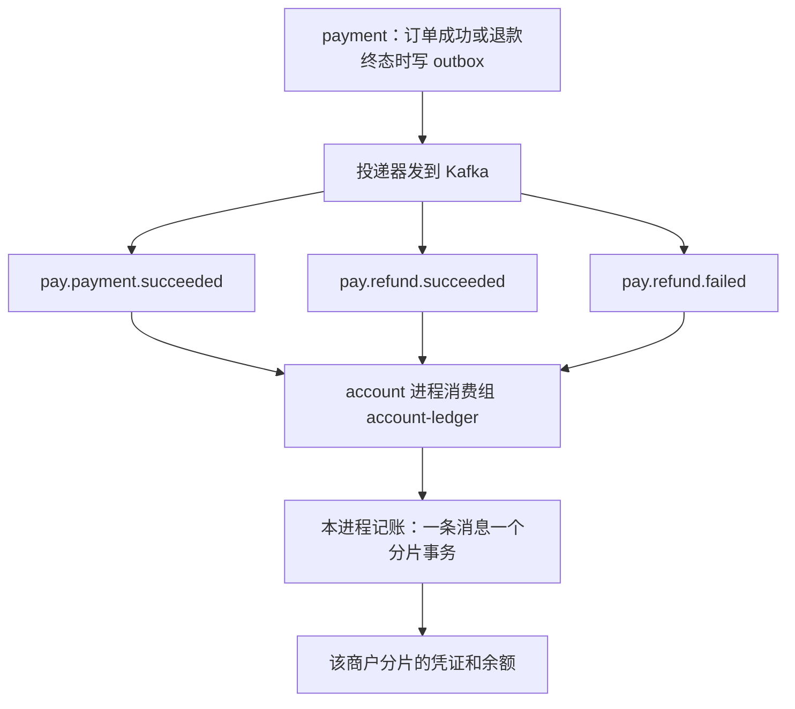
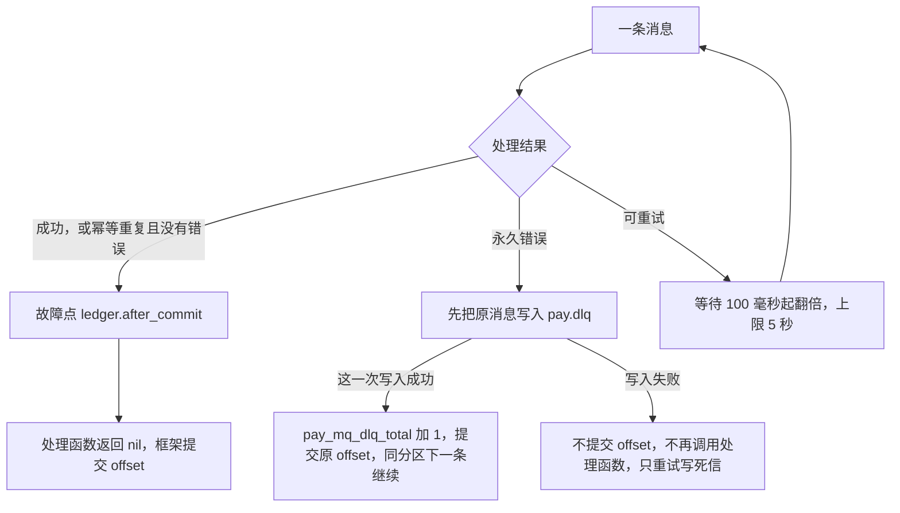

# MQ-04 account 事件消费

| 项 | 内容 |
|---|---|
| 功能点 | MQ-04（P0，第 5 周） |
| 所属链路 | 基础设施 |
| 代码提交 | `abc7149` `[MQ-04] add account consume`（完整 `abc7149ff4f5baa20c3cfc1fd84aa734c922aa77`，2026-11-10 13:43:54 +0800） |
| 分支 | `feat/MQ-04-account-consume` |
| 日期 | 2026-11-10 |
| 状态 | DONE |

本报告写在上面这次代码提交之后，不在那次提交的文件里。报告自己的提交还没有，修订记录里写「待提交」。

P0 是必须先做的优先级。第 5 周计划仍把 Kafka 框架、outbox 投递器、本功能点和死信重放写在同一行。死信重放这次不做，所以那一行没有勾。本功能点完成不等于这一周完成。

## 一句话结论

account 进程里的消费组只叫 `account-ledger`。它逐条消费支付成功、退款成功和退款失败，直接调用本进程的记账函数，不经过 RPC，也不订阅转账。同一条支付成功投 5 次只有 1 张支付凭证；事务提交成功之后、处理函数返回之前杀掉进程，重启再消费仍然是这 1 张。这些断言在 3.4 和 4.3，依据是测试函数。4.4 的日志只证明那次命令全部退出码 0 和覆盖率，里面没有逐条摘出的断言原文。

## 1. 背景

### 1.1 系统简介

pay-system 是一个用 Go 编写的小型支付后端，模拟商户收款、退款、商户间转账三条资金链路，重点在数据一致性和性能。系统由 5 个部分组成：gateway（对外 HTTP 入口，负责签名校验和限流）、payment（支付单、退款单、转账单的状态管理和流程推进）、account（账户余额与记账，数据按商户分到 2 个数据库分片）、channel-mock（模拟微信、支付宝这类外部支付渠道）、recon（对账，核对系统内外数据是否一致）。服务之间用 Kitex RPC 同步调用，或通过 Kafka 消息异步通知；数据存在 MySQL 8.4。Redis 只给系统别处防重放，例如挡住重复的 HTTP 请求。本功能点不连 Redis：重复消息靠凭证唯一索引和还没提交的 offset。所有金额用整数“分”表示，所有记账只追加不修改。当前已完成：账户、支付、退款、转账、网关商户路由、Kafka 框架、outbox 投递器，以及本报告的 account 入账消费。死信重放和批量记账还没有。

1 元 = 100 分。订单 10000 分就是 100.00 元。记账只追加，是指账本只插入新行，不回头改已经写下的分录。

Kitex 是本项目的 Go RPC 框架。RPC 是一个进程同步调用另一个进程里的函数。本功能点不走这条路：消费代码和账户业务在同一个进程里，直接调函数。Kafka 是进程之间的消息队列。一条消息有 topic（类别名）、partition（这个类别里的一条有序队列）和 offset（这条队列里从 0 起的位置号）。消费组是一起读同一批 topic 的进程，同一个分区同一时刻只分给组里的一个成员。处理完把「下次从哪读」记回 Kafka，叫做提交 offset。

outbox 是和业务写在同一个数据库事务里、稍后才发出去的消息表。payment 把支付成功、退款成功、退款失败写进这张表。投递器再把到期的行发到 Kafka。这些业务消息不是 account 进程里那个生产者发出的。那个生产者只做就绪检查、退出前把没确认的消息刷出去，以及关闭。死信由消费组自己的客户端写入 `pay.dlq`。这次之前没有人读支付和退款消息，商户余额不会增加。这次补上读的那一段。

分片是把账户数据按商户拆进 2 个库。商户号必须是 `M` 加恰好 6 位数字，分片号是这 6 位数字对 2 取模。一条消息只打开这一个库。

### 1.2 本功能点在系统中的位置

payment 先把事件放进 outbox，投递器发到 Kafka，account 进程的 `account-ledger` 读三条 topic，在本进程里改本商户所在分片的余额。转账不走这条队列。



图的左侧是上游。右侧就是本功能点。payment 进程不启动这个消费组。account 不订阅转账 topic。转账时 payment 直接调用 account 进程里的冻结、确认、解冻和入账，不把转账消息交给 `account-ledger`。

### 1.3 为什么需要它

商户一笔收款 10000 分（100.00 元），手续费 60 分（0.60 元）。payment 把订单改成成功时，只在自己的库里写了订单和一条 outbox，商户结算的总余额还是 0。没有这个消费组，这 99.40 元不会进商户账户，渠道侧的应收也不会增加。退款前要先冻结商户可用余额（总余额减去冻结额）。可用仍是 0 时冻不住，退款做不成。

同一条消息会重复到达。投递器可能重发，进程也可能在「账已经记下、offset 还没提交」时被杀掉，Kafka 会把同一条再交给这个组。如果第二次又记一笔，商户会被加上两次 99.40 元。

反过来，有的消息永远记不成。商户结算账户还没开，或者账户不是 `ACTIVE`（可使用）。如果这种消息一直重试，它后面的好消息会堵在同一个分区里，谁也记不上账。

所以：重复的支付成功只留 1 张凭证。记不上且再试也没用的消息，要先把原消息写入死信 `pay.dlq`；这一次写入成功才提交原 offset，分区继续。写入死信失败则不提交，按可重试停在这条上，并且不再调用处理函数，只重试写死信。数据库错误、上下文超时，以及没被包成永久错误的 `10003`，也不提交 offset。

## 2. 术语

按正文第一次需要对照的顺序。1.1 里已经用一句话解释过的，这里收短。

| 术语 | 含义 |
|---|---|
| 分 | 金额单位。100 分 = 1.00 元。全程用整数，不用小数。 |
| 分片 | 账户库有 2 个。商户号 `M` 后 6 位数字对 2 取模决定进哪一个。 |
| topic | Kafka 上的类别名。本消费组只订 `pay.payment.succeeded`、`pay.refund.succeeded`、`pay.refund.failed`。 |
| 分区 / offset | 分区是 topic 里的一条有序队列。offset 是位置号。提交的是「下一条」，表示这条已经处理完。 |
| 消费组 | 一起读这些 topic 的进程集合。本功能点的组名只有 `account-ledger`。 |
| outbox / 投递器 | 待发送表，以及把表里的行发到 Kafka 的程序。投递器是上一功能点，这次只调用它做端到端验收。 |
| 凭证 | 一次记账的头，表是 `ledger_txn`。同一分片里 `(biz_type, biz_no)` 只能有一张，唯一索引名叫 `uk_biz`。支付的 `biz_type` 是 `PAY`，`biz_no` 是 `pay_no`。 |
| 分录 | 凭证下面的一行，表是 `ledger_entry`：哪个账户、借还是贷、多少分。只插入，不修改。 |
| 借 / 贷 | 分录方向。渠道应收是借方余额账户，记借增加。商户结算和手续费收入是贷方余额账户，记贷增加。一张凭证的借方合计必须等于贷方合计。 |
| 渠道应收 | 平台在这个分片上、按渠道拆开的账户，类型 `CHANNEL_RECEIVABLE`。支付成功记借，表示渠道还欠平台这笔收款。 |
| 商户结算 | 商户自己的余额账户，类型 `MERCHANT_SETTLE`。`sub_no` 固定是 0，不按单号再拆。 |
| 手续费收入 | 平台的手续费账户，类型 `FEE_INCOME`。 |
| 子账户 / `sub_no` | 平台户拆成多行，避免每笔记账都锁同一行。支付入账用 `pay_no` 做 CRC32（IEEE）对平台子账户个数取余，得到渠道应收和手续费收入的 `sub_no`。个数来自已有配置 `PLATFORM_SUB_ACCOUNTS`，默认 8，这次不改。退款确认贷的渠道应收用消息里的 channel；子账户用 `refund_no` 做同一种取余，不用 `pay_no`。 |
| 基点 | 万分之一。60 个基点是 0.60%。10000 分的 60 个基点是 60 分。这个数由 payment 下单时写进消息的 `fee_amount`，account 不再乘费率。 |
| 可用余额 | 不允许透支的商户：总余额是账户 `balance`，冻结额是 `frozen_amount`，可用余额是两者之差。冻结时可用减少、总余额不变；确认扣款时总余额和冻结额一起减少；解冻时冻结额回到可用、总余额不变。入账 10000 分、手续费 60 分后，商户总余额 9940，可用也是 9940。退款失败那次解冻前冻结额是 3000，总余额不变，当时可用是 9940 减 3000。验收没有单独打印「可用余额」四个字。 |
| 冻结 | 退款创建时，account 在本消费组运行之前写下冻结单，状态 `FROZEN`，金额是退款金额。可用减少，总余额不变。表是 `account_freeze`。消费组不负责创建这张单。 |
| 确认扣款 | 退款成功后把冻结变成真扣款：商户总余额和冻结额一起减少。凭证的 `biz_type` 是 `REFUND`，`biz_no` 是 `refund_no`。 |
| 解冻 | 退款失败后取消冻结，冻结额回到可用，总余额不变。 |
| 墓碑 | 业务键是 `(biz_type, biz_no)`。退款失败时冻结单还不存在，且商户结算账户在，就插入一行状态 `RELEASED` 的记录占住这个键，不改余额。以后迟到的冻结得到 `40004`，不会把钱冻上。商户结算也不在时不插这行，返回 `40001`。这次没有单独测试这条插入。 |
| `ACTIVE` | 账户可使用。`FROZEN`、`CLOSED` 都不是。错误码 `40005` 表示碰到了非 `ACTIVE`。 |
| `40001` | 账户不存在，两条路径不是同一件事。支付时商户结算不存在，`PostPay` 返回 `40001`，消费端当成永久错误进死信。支付时平台子账户不存在，`PostPay` 返回的是 `10003`，不是 `40001`。退款确认时本分片平台子账户不存在，`ConfirmFreeze` 返回 `40001`，消费端不包成永久错误，继续重试。 |
| `40004` | 冻结单状态冲突：退款成功时冻结缺失或已经解冻；退款失败时冻结已经确认扣款。迟到的冻结撞上墓碑也是这个码。 |
| `10006` | 已有错误码，这次没有新加。退款确认时商户结算不存在，或和冻结单上的账户对不上，`ConfirmFreeze` 返回 `10006`，不是 `40001`。消费端不包成永久错误，会重试，可能停在分区上。这次没有单独测试「确认时缺商户结算」。 |
| `10003` | 内部错误。支付入账时平台子账户还不存在用它。确认扣款的条件更新打中 0 行也用它。没有被包成永久错误时继续重试。 |
| `10001` | 参数不合法。直接调用 `PostPay` 时，非法手续费在打开事务之前返回它。消费消息上，缺字段、非整数、小于 0、大于金额由处理函数先包成永久错误，到不了 `classifyPay`。 |
| `30003` | 订单状态冲突。关单时渠道其实已经成功，关单返回这个码，订单保持成功。 |
| 永久错误 | 处理函数用 `Permanent` 包起来的错误。要先把原消息写入 `pay.dlq`。这一次写入成功才提交原 offset，分区继续。写入失败则不提交，按可重试停在这条上，不再调用处理函数，只重试写死信。 |
| 可重试错误 | 数据库错误、上下文超时，以及没有被包成永久错误的 `10003`。退款确认返回的 `40001` 和 `10006` 也落在这里。框架不提交 offset，从 100 毫秒起把等待翻倍，上限 5 秒，这个分区停在这条消息上。 |
| `pay.dlq` | 死信 topic。原消息的 key 和正文还在，另外带上原来的 topic、分区、offset 和错误文本。本消费组不读它。 |
| `pay_mq_dlq_total` | 框架在死信写入成功时给进程内计数加 1。按 topic 和消费组分开。不进 Prometheus，也不进 `/metrics`。处理函数不再加一次。写入失败不加它。 |
| `pay_mq_consume_errors_total` | 进程内计数，读取方法叫 `ConsumeErrors`。可重试错误，以及死信写入失败，都会加 1。死信写入成功不加它。不进 Prometheus，也不进 `/metrics`。 |
| `pay_ledger_freeze_conflict_total` | 本功能点新增的进程内计数，只在退款事件返回 `40004` 时加 1。同样不进 Prometheus，不进 `/metrics`，也不进指标表。 |
| 故障点 | 环境变量 `FAULT_POINTS` 里写了名字才生效。空着时 `Point` 立刻返回，不发信号。本次用已有名字 `ledger.after_commit`，不新增名字。命中时向本进程发 `SIGKILL`。 |
| `CheckBalance` | 只读核对余额是否和分录一致。商户号传空串表示两个分片都查。第二个参数 `true` 表示调用方保证此刻没有进行中的跨分片转账，在途账户两边加起来应是 0。这些验收没有转账，所以传 true。核对失败时函数不返回错误，结果里的通过标志是 false。 |
| 在途账户 | 跨分片转账临时放钱的平台账户。 |
| `CLOSE_RACE` | 渠道模拟场景。订单金额末两位是 09 时，关单会发现渠道已经支付成功。验收用的金额是 10009 分（100.09 元）。 |
| Prometheus | 常见的指标采集系统。这次不导出任何指标。`/metrics` 是通常挂指标的 HTTP 路径，本进程仍然不提供。 |

## 3. 技术讲解

### 3.1 要解决的问题

上一节的 10000 分例子要同时满足这些约束。都是资金规则，不是性能目标。

1. 支付成功必须记平：借本分片渠道应收 10000 分，贷商户 9940 分（99.40 元），贷本分片手续费收入 60 分。借方 10000 = 贷方 9940 + 60。
2. 手续费为 0 时不能写一条金额为 0 的分录。手续费等于金额时也不能写金额为 0 的商户分录，因为记账函数拒绝金额小于或等于 0。
3. 手续费缺失、不是整数、小于 0 或大于金额：不记账。
4. 同一 `pay_no` 无论来几次，这个分片里只能有 1 张 `PAY` 凭证。
5. 账已经提交、offset 还没提交时进程消失，重启后再读到同一条，仍然只有这 1 张凭证。
6. 记不上且再试没有意义的消息不能堵住分区。数据库错误、上下文超时，以及没有被包成永久错误的 `10003`，必须堵住该分区并重试，不能当成死信丢掉。
7. 退款成功只退本金，不退手续费。先入账 10000 分再退 3000 分（30.00 元）后，商户是 6940 分（69.40 元），渠道应收是 7000 分（70.00 元），手续费收入仍是 60 分。
8. 退款失败只解冻。商户总余额保持入账后的数。冻结单变成 `RELEASED`，冻结额回到 0。消费组只做这件事。之后 payment 可以用新的退款单号再创建一笔；那笔的 `PROCESSING` 是创建时写下的，不是消费组写的。
9. 事务里不调用 Kafka，也不调用别的进程。

### 3.2 方案

整体做法：一条消息一个分片事务。处理函数和 `PostPay`、`ConfirmFreeze`、`ReleaseFreeze` 都用商户号按同一条规则算分片：必须是 `M` 加恰好 6 位数字，数字对 2 取模。处理函数算出的号只用来拒绝非法商户号；业务函数再算一次，打开的是同一个库。然后调用本进程已经有的三个方法。`PostPay` 记支付，`ConfirmFreeze` 确认退款扣款，`ReleaseFreeze` 解冻。这三个方法各自打开并提交本分片事务。处理函数不自己开第二个事务。生产代码不设置 `BeforeCommit`（框架里「返回成功之后、提交 offset 之前」的测试钩子）。也不读 `LEDGER_BATCH_ENABLED`。那个开关和「很多条合成一个事务」是以后的批量记账，不是这次的逐条基线。

account 进程里登记的生产者只做就绪检查、退出前把没确认的消息刷出去，以及关闭。本功能点的业务消息不是它发出的，来自 payment 的 outbox 投递器。死信也不是它写的：消费组自己的客户端把原消息写入 `pay.dlq`。`Open` 只创建消费组客户端，不拨号，也不开始拉取。`admin.RegisterGroup` 只登记这个组。`admin.Run` 启动已登记的组，并调用消费组的 `Serve`，拉取从 `Serve` 开始。



可重试的箭头回到同一条，不提交 offset，这个分区停在这条消息上。永久错误必须先写入 `pay.dlq`；写入成功才提交原 offset。写入失败不提交，并给 `pay_mq_consume_errors_total` 加 1。

下面这段函数在做这件事：组名、三条 topic、处理函数，以及测试才能改的等待和会话超时。没有 `BeforeCommit` 字段赋值。`Open` 调用它之后创建客户端，仍然不拨号、不拉取。

```go
func buildConfig(cfg Config) (mq.ConsumerConfig, error) {
	if cfg.Ledger == nil {
		return mq.ConsumerConfig{}, errors.New("no ledger")
	}
	return mq.ConsumerConfig{
		Brokers: cfg.Brokers,
		Group:   GroupName,
		Topics:  []string{TopicPaymentSucceeded, TopicRefundSucceeded, TopicRefundFailed},
		Handler: func(ctx context.Context, rec mq.Record) error {
			return handle(ctx, cfg.Ledger, rec)
		},
		Sleeper:        cfg.Sleeper,
		SessionTimeout: cfg.SessionTimeout,
	}, nil
}
```

`GroupName` 的值是 `account-ledger`。三个 topic 常量就是 1.2 图里的三个名字。`event_type` 必须和 topic 对上：`pay.payment.succeeded` 对 `payment.succeeded`，`pay.refund.succeeded` 对 `refund.succeeded`，`pay.refund.failed` 对 `refund.failed`。对不上、未知类型、正文不是一个对象，都是永久错误。信封要有 `event_id`、`event_type` 和对象形式的 `data`。记录头里如果带了这两个字段，必须和正文一致。

支付成功的 `data` 必填：`pay_no`、`merchant_id`、`out_trade_no`（都不超过 64 个字符）、`channel`（1 到 32 个字符）、`amount`（JSON 数字，转成 int64 后大于 0）、`fee_amount`（同样必须是 JSON 数字）、`paid_at`（不超过 64 个字符）。带引号的 `"60"` 不是整数分。Go 1.27 的 `json.Number` 会收下这种字符串，处理函数仍把它当成永久错误，不调用记账。退款成功再加必填 `channel` 和 `succeeded_at`，身份字段是 `refund_no`、`pay_no`、`merchant_id`、`out_refund_no`，`amount` 大于 0。退款失败不带 `channel`，改为必填 `fail_code`。商户号不是 `M` 加恰好 6 位数字时返回永久错误：选不了分片，就不能记账。

支付成功在调用 `PostPay` 之前，已经把缺字段、非整数、`fee_amount` 小于 0、大于 `amount` 包成永久错误。这些请求到不了 `PostPay`，也到不了 `classifyPay`。通过检查之后才调用 `PostPay`。直接调用 `PostPay` 时，同样的非法手续费在打开事务之前返回 `10001`（`TestPostPayRejectsIllegalFee`，不连数据库）。`classifyPay` 的默认分支不把 `10001` 包成永久错误。`fee < amount` 时如果内部减法失败，`PostPay` 也会返回 `10001`，那种错误会回到 `classifyPay` 并重试。处理函数已经放过的非负手续费走不到减法失败，这次也没有单独测试这一支。记账事务在 `PostPay` 返回时已经提交或已经回滚。返回 nil 之前打故障点，这时 offset 还没提交：

```go
	if fee < 0 || fee > amount {
		return mq.Permanent(errFee)
	}
	_, err = ledger.PostPay(ctx, payNo, merchantID, channel, amount, fee)
	if err != nil {
		return classifyPay(ctx, env.EventID, env.EventType, merchantID, err)
	}
	fault.Point(ctx, faultAfterCommit)
	return nil
```

`faultAfterCommit` 就是 `ledger.after_commit`。退款成功和退款失败在各自的业务函数返回 nil 之后、处理函数返回 nil 之前，也打同一个点。幂等成功（`duplicated = true` 且 error 为 nil）同样走到这个点，这是可接受的：重复消息也是一条成功路径。

`PostPay` 用上面同一条商户号规则再算一次分片，在这个库的一个事务里组三条以内的分录，再调用已有的 `Post`。渠道应收和手续费收入的 `sub_no` 是 `pay_no` 的 CRC32（IEEE）对子账户个数取余。`Post` 按 `(PAY, pay_no)` 插入凭证。唯一索引冲突时不插第二张，读出已有凭证号，返回 `duplicated = true`、error 为 nil。`Post` 拒绝金额小于或等于 0，所以手续费为 0 时根本不放手续费那条分录，凭证只有两行：借渠道应收 A，贷商户 A。手续费等于金额时也不放商户那条，因为商户金额是 0。例子：金额和手续费都是 80 分（0.80 元），凭证只有借渠道应收 80、贷手续费收入 80。

处理函数已经拒绝了大于金额和负数，那些请求到不了下面这段。`PostPay` 里只有 `fee < amount` 才写商户分录；相等才按账户 id 从小到大锁三行：渠道应收、手续费收入、商户结算。锁的顺序和 `Post` 一样。如果先锁 id 较大的商户，再让 `Post` 去锁 id 较小的渠道，会和其他已经按账户 id 升序加锁的记账（例如手续费小于金额的 `Post`）死锁。这次没有单独的死锁测试。`lockEqualFeeAccounts` 只把商户状态返回来，不在这里拒绝另外两户。商户不是 `ACTIVE` 就返回 `40005`，整个事务回滚，不写凭证，也不写金额为 0 的分录。渠道应收或手续费收入不是 `ACTIVE` 时，两户仍作为分录交给 `Post`；`Post` 对非 `ACTIVE` 且不是本次冻结商户的账户返回 `40005`，整个事务回滚。没有单独测试「手续费等于金额，且渠道应收或手续费收入不是 `ACTIVE`」。`TestPostPayEqualFeeInactive` 只把商户改成 `FROZEN`。

这段分支和上一句是同一前提：大于金额的请求到不了这里。`fee < amount` 才追加商户分录；相等则先锁再看商户状态；`fee > 0` 才追加手续费分录。

```go
	if fee < amount {
		merchantAmount, subErr := money.Sub(amount, fee)
		if subErr != nil || merchantAmount <= 0 {
			return PostResult{}, errno.ErrInvalidParam
		}
		entries = append(entries, Entry{
			AccountID: acct.ID,
			Direction: directionCredit,
			Amount:    merchantAmount,
		})
	} else {
		status, lockErr := lockEqualFeeAccounts(ctx, tx, acct.ID, channelID, feeID)
		if lockErr != nil {
			return PostResult{}, lockErr
		}
		if status != statusActive {
			return PostResult{}, errno.ErrAccountInactive
		}
	}
	if fee > 0 {
		entries = append(entries, Entry{
			AccountID: feeID,
			Direction: directionCredit,
			Amount:    fee,
		})
	}
```

查找商户的共享 SQL `selectMerchantSQL` 没有 `FOR UPDATE`。冻结在加锁前用这条不加锁的查询做存在性检查。如果给它加上 `FOR UPDATE`，冻结会在 `Post` 按 id 升序加锁之前先锁商户，和记账的加锁顺序相反，可能死锁。本功能点另写了只给手续费等于金额用的升序加锁，不动这条共享 SQL。

手续费小于金额时，商户在分录里，`Post` 会按 id 顺序锁住它，并在锁内拒绝非 `ACTIVE`。所以 10000 分、手续费 60 分这种常见订单，不走上面的三户预锁。验收里把结算账户改成 `FROZEN`、手续费 15 分小于金额 1500 分，`40005` 来自 `Post` 锁内的状态检查。

支付时商户结算不存在，`PostPay` 返回 `40001`。支付时平台子账户不存在，`PostPay` 返回 `10003`，不是 `40001`。两条不要写成同一句。

退款成功调用 `ConfirmFreeze(REFUND, refund_no, merchant_id, channel)`。金额用冻结单上的数，不用消息里再算一遍。它借商户结算（总余额和冻结额一起减少），贷本分片该渠道的渠道应收（应收减少）。这条渠道应收的 `sub_no` 用 `refund_no` 做 CRC32 取余，channel 用消息里的值。手续费收入不动。退款凭证的 `biz_type` 是 `REFUND`，`biz_no` 是 `refund_no`。冻结单不存在，或状态已经是 `RELEASED`，直接返回 `40004`，不写退款凭证。状态已经是 `CONFIRMED` 则返回成功，`duplicated` 为 true，不再记账；这不是 `40004`。退款成功再投一次没有单独测试，机制就是这一支。本分片平台子账户不存在时 `ConfirmFreeze` 返回 `40001`，消费端继续重试。商户结算不存在，或和冻结单上的账户对不上，返回 `10006`，不是 `40001`，同样会重试；这次没有单独测试这一支。

`version` 是冻结单上的整数，每次成功更新加 1。第一次从 `FROZEN` 确认时，条件更新写成 `CONFIRMED`：`WHERE` 要求状态仍是 `FROZEN`，并且金额、账户都对得上，同时把 `version` 加 1。影响 0 行表示没打中那一行，返回 `10003` 并回滚，消费端重试，代码没有把这种 0 行改判成死信。金额或账户永远对不上时，这条会一直停在分区上。这次没有单独测试「永远对不上」。

退款失败调用 `ReleaseFreeze`。冻结单是退款创建时 account 在消费之前写下的，状态 `FROZEN`，金额是退款金额；消费组不创建这张单。已有冻结变成 `RELEASED`，冻结额减少，总余额不变。冻结单本来就不存在、且商户结算账户在时，沿用已有墓碑：插入状态 `RELEASED` 的一行占住 `(REFUND, refund_no)`，不改余额，然后处理函数把它当成成功并提交 offset。这条墓碑插入没有单独测试。已经是 `RELEASED` 再解冻：仍返回成功，`duplicated` 为 true，状态停在 `RELEASED`，不再比较金额，也不改余额。同一条 `refund.failed` 再投一次没有单独测试。已经确认扣款的冻结再解冻，返回 `40004`。解冻时商户结算账户也不存在：插墓碑的那条返回 `40001`，消费端不包成永久错误，继续重试。

错误分类只有这几支。支付和退款不一样：退款上的 `40001` 落在 `default`，原样返回，所以可重试。

```go
func classifyPay(ctx context.Context, eventID, eventType, merchantID string, err error) error {
	switch {
	case errors.Is(err, errno.ErrAccountNotFound):
		logLedger(ctx, "ledger account missing", eventID, eventType, merchantID)
		return mq.Permanent(err)
	case errors.Is(err, errno.ErrAccountInactive):
		logLedger(ctx, "ledger account inactive", eventID, eventType, merchantID)
		return mq.Permanent(err)
	default:
		return err
	}
}

func classifyRefund(ctx context.Context, eventID, eventType, merchantID string, err error) error {
	switch {
	case errors.Is(err, errno.ErrFreezeStatusConflict):
		ledgerFreezeConflict.Add(1)
		logLedger(ctx, "ledger freeze conflict", eventID, eventType, merchantID)
		return mq.Permanent(err)
	case errors.Is(err, errno.ErrAccountInactive):
		// 平台渠道应收不是 ACTIVE。永久错误写入 DLQ 后提交 offset，分区继续；不算冻结冲突。
		logLedger(ctx, "ledger account inactive", eventID, eventType, merchantID)
		return mq.Permanent(err)
	default:
		// 40001 是平台子账户还不存在，继续重试。
		return err
	}
}
```

上面默认分支的注释只覆盖退款确认时平台子账户不存在的 `40001`。缺商户结算不是这句：`ConfirmFreeze` 对那种情况返回 `10006`。两种都原样返回，所以都会重试。支付路径的 `40001` 在 `classifyPay` 里已经包成永久错误，不要和这里混成同一句。

`logLedger` 的 ERROR 只有 `event_id`、`event_type`、`merchant_id`。没有单号、没有密钥、没有 broker 地址。`40005` 不加冻结冲突计数。处理函数不给 `pay_mq_dlq_total` 加 1。框架在 `pay.dlq` 这一次写入成功时加一次；写入失败不加，改为给 `pay_mq_consume_errors_total` 加 1。

反序列化失败、缺字段、topic 和 `event_type` 对不上，都是永久错误。业务冲突里做成永久的，就是上面这几个：支付的 `40001`（商户结算不存在）和 `40005`，退款的 `40004` 和 `40005`。其余错误保持可重试：数据库错误、上下文超时，以及没有被包成永久错误的 `10003`，还有退款上的 `40001` 和 `10006`。不是看到错误码就把消息送进死信。

生产的 `fault.Point` 在故障点命中时向本进程发 `SIGKILL`。进程死了就不会继续提交 offset。默认 `FAULT_POINTS` 为空时 `Point` 立刻返回，不发信号。测试不能依赖「函数返回后进程还活着」，所以验收 2 的子进程把发信号换成发 `SIGKILL` 再 `select {}`，避免函数返回后同一协程提交 offset。生产代码和父测试里没有 `select {}`。父进程先把故障点清掉，再拉起子进程；子进程的环境变量是 `FAULT_POINTS=ledger.after_commit`。

### 3.3 为什么这样做

| 方案 | 做法 | 优点 | 缺点 | 结论 |
|---|---|---|---|---|
| 采用：本进程逐条调用 | 一条消息一个分片事务，直接调 `PostPay` / `ConfirmFreeze` / `ReleaseFreeze` | 事务里没有 Kafka，也没有 RPC；重复由 `uk_biz` 挡住 | 每条都要提交一次。批量合并不是这次的事 | 采用 |
| 备选：消费端再 RPC 回 account | 单独进程读 Kafka，用 Kitex 调账户服务 | 消费进程和账户进程可以分开部署 | 多一次网络；事务边界跨进程；需求写明不经过 RPC | 不采用 |
| 备选：这次就做批量提交 | 读 `LEDGER_BATCH_ENABLED`，许多条合成一个事务 | 提交次数少 | 开关和批量事务属于以后的功能点；这次没有对比数据 | 不采用 |
| 备选：任何错误都进死信 | 数据库抖一下也提交 offset | 分区不会堵住 | 短暂故障会把 10000 分的支付成功丢掉，商户少一笔 | 不采用 |
| 备选：任何错误都重试 | 账户不存在也停在这条 | 账户后来开出来就能记上 | 一条坏消息挡住同分区后面的全部入账 | 不采用 |
| 备选：手续费等于金额时写 0 分录 | 仍写贷商户 0 分 | 分录条数固定 | `Post` 拒绝金额小于或等于 0，事务会失败 | 不采用 |

生产代码里 payment 仍然不能 import account。静态检查只豁免了 `service/payment/biz/ledger_consume_integration_test.go` 这一个测试文件，因为验收 6、7、8 要经投递器把真实事件交给消费组，再直接读账户库。account 的消费代码不 import payment。

### 3.4 正确性

资金类。每一行都是：场景，系统做什么，库里最后是什么，哪个测试证明。这些测试包都没有 `t.Parallel`。异步结果用带超时的轮询看凭证张数、余额或 offset，断言不是固定睡眠。

| 场景 | 系统行为 | 最终状态 | 证明 |
|---|---|---|---|
| 同一条 `payment.succeeded` 投 5 次 | 第一次插入 `PAY` 凭证；后四次撞上 `uk_biz`，`duplicated = true` 且 error 为 nil，当成成功并提交 offset | 恰好 1 张凭证。死信计数不加。`CheckBalance("", true)` 通过 | `TestMQ04Accept1DuplicateOnce` |
| 同一个 `pay_no` 再调用一次 `PostPay` | 顺序重复，不是两个 goroutine 同时记。第二次返回同一个凭证号，`duplicated = true` | 仍是 1 张。10000 分 / 手续费 60 分的三行分录不变：借渠道应收 10000，贷商户 9940，贷手续费 60 | `TestPostPayEntriesAndDuplicate` |
| 手续费 0 | 不写手续费分录 | 只有借渠道应收、贷商户两条。验收 5 用 4200 分（42.00 元）：商户 4200，渠道应收 4200，手续费收入与入账前相同。`CheckBalance` 通过 | `TestMQ04Accept5ZeroFee`。`TestPostPayEntriesAndDuplicate` 里还有 5000 分（50.00 元）两条分录 |
| 手续费等于金额且商户 `ACTIVE` | 省略商户分录 | 80 分 / 80 分：借渠道应收 80，贷手续费收入 80，共 2 条 | `TestPostPayEntriesAndDuplicate` |
| 手续费等于金额且商户 `FROZEN` | 按账户 id 升序锁三户，锁内看到不是 `ACTIVE`，返回 `40005` 并回滚 | 0 张凭证，0 条分录。`CheckBalance("", true)` 通过 | `TestPostPayEqualFeeInactive` |
| 手续费缺失、带引号、大于金额或为负 | 调用记账之前就标成永久错误 | 不调用 `PostPay` | `TestHandleParseAndFeePermanent` |
| `ledger.after_commit` 杀掉进程 | 子进程在故障点发 `SIGKILL` 后 `select {}`。父进程看到子进程是被信号杀掉的 | 杀掉之后凭证仍是 1 张；该分区已提交的 offset 小于 0，表示还没提交。父进程不再设置故障点，重新消费后仍是 1 张。`CheckBalance` 通过 | `TestMQ04Accept2KillAfterCommit`、`TestMQ04Accept2Child` |
| 幂等成功也打故障点 | 假记账返回 `duplicated = true`、error 为 nil。处理函数仍调用故障点，然后返回 nil | 假实现只被调用 1 次。这不是数据库测试 | `TestHandleDuplicatePoints` |
| 商户结算账户不存在 | 支付路径 `40001` 永久错误。写 `pay.dlq` 后提交 offset | 坏消息 0 张凭证。同分区下一条好消息有 1 张凭证。死信计数加 1 | `TestMQ04Accept3MissingAccountDLQ` |
| 支付时结算账户 `FROZEN`，手续费小于金额 | `Post` 锁内返回 `40005`。不重试。ERROR 一条，字段只有事件号、事件类型、商户号 | 0 张新凭证。`pay_mq_dlq_total` 加 1，`pay_mq_consume_errors_total` 不加。下一条好消息入账。这条 ERROR 不含正文里的 `OT-SECRET-NO`，也不含 broker 地址 | `TestMQ04Accept4InactiveDLQ` |
| 正文不是合法 JSON | 永久错误，不记账 | 坏单号 0 张凭证，后面的好消息 1 张，死信计数加 1 | `TestMQ04ParseFailureDLQ` |
| 关单撞上 `CLOSE_RACE` | 金额 10009 分走真实支付和关单，返回 `30003`，订单仍是成功。outbox 由投递器发出，不是测试往账户库里手插凭证 | 消费后恰好 1 张 `PAY` 凭证。商户余额等于订单金额减去订单上已经写好的手续费。`CheckBalance` 通过 | `TestMQ04Accept6CloseRace` |
| 入账 10000 分后退款 3000 分成功 | 先消费支付成功，商户到 9940 分、手续费 60 分。再冻结并确认，消费 `refund.succeeded` | 商户 6940，冻结额 0，渠道应收 7000，手续费收入 60。`CheckBalance("", true)` 通过 | `TestMQ04Accept7RefundSucceeded` |
| 退款失败 | 消费组只解冻：消费 `refund.failed`，`ReleaseFreeze` | 消费结果：冻结单 `RELEASED`，冻结额 0，商户余额仍是 9940。`CheckBalance` 通过。这个测试没有单独断言渠道应收仍是 10000。`PROCESSING` 分开：解冻之后 payment 用新的 `out_refund_no` 再创建 2000 分（20.00 元）的退款，创建时状态就是 `PROCESSING`，单号与第一笔不同。这笔还没交给消费组。消费组不写这个状态 | `TestMQ04Accept8RefundFailed` |
| 退款成功但冻结不存在 | `ConfirmFreeze` 返回 `40004`。ERROR 一条，进程内冻结冲突计数加 1。不重试 | `pay_mq_dlq_total` 加 1，`pay_mq_consume_errors_total` 不加。后面的支付成功仍入账 | `TestMQ04FreezeConflictNoRetry` |
| 已确认再解冻 | 假实现直接返回 `40004`（确认调用也返回同一个码）。分类函数把它当成永久错误，冻结冲突计数加 1，ERROR 不含退款单号 | 只证明分类和计数。没有数据库行，不能证明冻结单仍是 `CONFIRMED`，也没有新分录 | `TestHandleFreezeConflictCounts` |
| 退款成功时渠道应收被改成 `CLOSED` | `40005` 永久错误。不加冻结冲突计数。`pay_mq_dlq_total` 只加 1，`pay_mq_consume_errors_total` 不加 | 该退款 0 张凭证，冻结单保持 `FROZEN`。同分区下一条别的退款仍能记账。ERROR 不含退款单号，也不含计数字样 | `TestMQ04RefundInactiveChannelDLQ`；不连库的分类是 `TestHandleRefundInactivePermanent` |
| 退款确认返回 `40001` | 假实现返回 `40001`。不包成永久错误，冻结冲突计数不加。这证明的是分类，不是库里真的缺了平台子账户 | 处理函数把错误交回去，框架会重试并堵住该分区。`ConfirmFreeze` 在本分片平台子账户不存在时确实返回 `40001`。缺商户结算是 `10006`，不是这个码 | `TestHandleRefundMissingAccountRetries` |
| 支付或退款返回 `10003` | 不包成永久错误 | 不提交 offset。分区停在这条，按 100 毫秒翻倍到 5 秒再试 | `TestHandleInternalRetries`、`TestHandleRefundInternalRetries` |
| 同一分区上的多条消息 | 框架给每个分区一条处理协程，分区内按 offset 从小到大处理。这一条没提交就停住，更高的 offset 不处理。这是消费框架的做法 | 本功能点没有再做并发压测。上面的 5 次投递和第二次 `PostPay` 只证明顺序重复，不是两个协程同时记账 | 没有并发压测 |

崩溃那一行再补一句：如果重启后 `FAULT_POINTS` 仍是 `ledger.after_commit`，成功路径（含幂等成功）还会再被杀掉，offset 仍然不提交。验收 2 的父进程重新消费时没有设置这个故障点。生产默认故障点是空的，`Point` 立刻返回，不发信号。

处理函数的事务里不调用 Kafka，也不调用其他进程。数据库错误、上下文超时，以及没有被包成永久错误的 `10003`，走可重试。没有「调用渠道超时」这一步。

### 3.5 性能

不涉及。本功能点是逐条基线，一条消息一个事务。没有和批量模式对比的耗时，也没有打开 `LEDGER_BATCH_ENABLED` 的数据。

## 4. 已完成内容

### 4.1 改动清单

| 文件 | 新增 / 修改 | 作用 |
|---|---|---|
| `cmd/account/main.go` | 修改 | 生产者登记成功后 `consumer.Open`，再交给进程的运行组。不设置 `BeforeCommit`，不读批量开关 |
| `cmd/account/kafka_register_test.go` | 修改 | 读源码：account 会启动这个组；payment 的 main 不出现组名，也不出现消费包 |
| `service/account/consumer/ledger_single.go` | 新增 | 消费组、解码、三条处理路径、错误分类、冻结冲突计数 |
| `service/account/consumer/ledger_single_test.go` | 新增 | 不连 Kafka 的分类、手续费和故障点测试 |
| `service/account/consumer/ledger_integration_test.go` | 新增 | 验收 1 到 5，以及死信、解析失败、渠道非 `ACTIVE` |
| `service/account/biz/post_pay.go` | 新增 | 支付成功的分录和手续费等于金额时的加锁 |
| `service/account/biz/post_pay_test.go` | 新增 | 非法参数返回 `10001`，且不依赖数据库 |
| `service/account/biz/post_pay_integration_test.go` | 新增 | 三行分录、重复记账、手续费 0、手续费等于金额、非 `ACTIVE` |
| `service/account/biz/open.go` | 修改 | 包注释写上 `PostPay` 会自己提交事务 |
| `service/payment/biz/ledger_consume_integration_test.go` | 新增 | 验收 6、7、8：真实订单经投递器到消费组 |
| `.golangci.yml` | 修改 | 只豁免上面这一个 payment 测试文件。生产代码仍禁止 payment import account |
| `docs/02-requirements.md` | 修改 | MQ-04 小节与变更记录，和代码一致，状态改为完成 |
| `docs/06-flows.md` | 修改 | 消费图下补实现说明。图的节点没改 |
| `docs/01-tech-decisions.md` | 修改 | 写明这次不读批量开关，批量事务仍未接入 |
| `docs/interview-notes.md` | 修改 | 记下故障点必须在返回 nil 之前，以及带引号的数字不能当金额 |

### 4.2 对外变化

| 类别 | 变化 |
|---|---|
| 接口 | 无。不改 RPC，不改 IDL。退款确认和解冻仍是进程内方法，不经过 RPC |
| 表结构 | 无。不新增表、字段、索引 |
| 配置项 | 无。不读 `LEDGER_BATCH_ENABLED`，不新增环境变量 |
| 错误码 | 无。沿用已有的 `40001`、`40004`、`40005`、`10006`、`10003`、`10001`、`30003`。`10006` 不是这次新加的 |
| 指标 / 故障点 | 不新增 Prometheus 指标，不新增故障点名字。`pay_ledger_freeze_conflict_total` 只在本进程内存。`pay_mq_dlq_total` 仍由框架在写死信成功时加 1。`ledger.after_commit` 的调用点在事务提交成功之后、处理函数返回 nil 之前 |

### 4.3 验收对照

结果都是通过。哪些包是当场跑完、哪些是缓存命中，写在 4.4。缓存表示 Go 认为二进制和测试内容没变，复用上一次成功结果，不是跳过这些测试。

| 验收条目 | 测试函数 | 类型 | 结果 |
|---|---|---|---|
| 同一条支付成功投 5 次，恰好 1 张 `PAY` 凭证 | `TestMQ04Accept1DuplicateOnce` | 集成 | 通过 |
| `ledger.after_commit` 杀掉进程后凭证仍是 1，offset 未提交；再消费仍是 1 | `TestMQ04Accept2KillAfterCommit`、`TestMQ04Accept2Child` | 集成（子进程） | 通过 |
| 商户不存在则进 `pay.dlq`，后面的消息仍记账 | `TestMQ04Accept3MissingAccountDLQ` | 集成 | 通过 |
| 结算账户非 `ACTIVE`（手续费小于金额）：不重试，进死信，死信计数加 1，一条业务 ERROR，没有新凭证，后面的消息仍记账；日志不含 `OT-SECRET-NO` 和 broker 地址 | `TestMQ04Accept4InactiveDLQ` | 集成 | 通过 |
| 手续费 0：只有两条分录，手续费收入不变，`CheckBalance` 通过 | `TestMQ04Accept5ZeroFee` | 集成 | 通过 |
| 金额 10009 的 `CLOSE_RACE` 关单返回 `30003`，订单成功，投递器投出后恰好记账 1 次，不是手插凭证 | `TestMQ04Accept6CloseRace` | 集成 | 通过 |
| 入账 10000 后退款 3000 成功：商户 6940，冻结 0，渠道应收 7000，手续费收入 60，`CheckBalance("", true)` 通过 | `TestMQ04Accept7RefundSucceeded` | 集成 | 通过 |
| 消费结果：冻结单 `RELEASED`，冻结额 0，商户余额仍 9940，`CheckBalance` 通过。不断言渠道应收仍是 10000。`PROCESSING` 分开：解冻之后 payment 创建下一笔 2000 分退款，状态在创建时就是 `PROCESSING`，还没交给消费组。消费组只解冻 | `TestMQ04Accept8RefundFailed` | 集成 | 通过 |
| `40004` 不重试，冻结冲突计数加 1，后面的消息仍记账 | `TestMQ04FreezeConflictNoRetry` | 集成 | 通过 |
| 解析失败进死信，不记账，后面的消息仍记账 | `TestMQ04ParseFailureDLQ` | 集成 | 通过 |
| 退款确认的 `40005` 不可重试，不计冻结冲突 | `TestHandleRefundInactivePermanent` | 单元 | 通过 |
| 退款路径的 `40001` 继续重试 | `TestHandleRefundMissingAccountRetries` | 单元 | 通过 |
| 渠道应收非 `ACTIVE`：进死信、不重试、冻结保持 `FROZEN`、同分区下一条仍记账、冻结冲突计数不变、`pay_mq_dlq_total` 只加 1、`pay_mq_consume_errors_total` 不加 | `TestMQ04RefundInactiveChannelDLQ` | 集成 | 通过 |
| 手续费等于金额且商户 `FROZEN`：`40005`，0 凭证 0 分录，`CheckBalance` 通过 | `TestPostPayEqualFeeInactive` | 集成 | 通过 |
| 10000/60 的三行分录、重复记账，以及 80/80 成功时只有渠道应收和手续费两条 | `TestPostPayEntriesAndDuplicate` | 集成 | 通过 |

### 4.4 验证记录

官方日志是 `/tmp/mq04-verify-r2.log`。开始 `Tue Nov 10 13:33:32 CST 2026`，结束 `Tue Nov 10 13:35:16 CST 2026`，墙钟大约 104 秒。环境原文：macOS ProductVersion 27.0.1，BuildVersion 26A434；Darwin 27.0.0 arm64；go1.27.2 darwin/arm64；golangci-lint 2.14.0，built with go1.27.1，from `114493f`，on 2026-09-24T10:54:53Z；`docker_info=ok`。日志里没有 real、user、sys，这里不写这三项。

更早的 `/tmp/mq04-verify.log` 不作为通过证据，也不把它的时间写成这些测试的证据。r2 结束之后、提交之前只改了一处注释和需求变更记录里的两句话，没有改可执行逻辑，所以没有再跑一遍。

r2 的覆盖率清单里已经有 `lockEqualFeeAccounts` 81.8% 和 `applyPostPay` 80.6%，所以这次缓存的 `service/account/biz` 对应的是修复之后的源码。验收 6、7、8 在 `service/payment/biz`。r2 里该包是 cached，覆盖率 84.9%，命令结果是 ok。缓存表示 Go 认为二进制和测试内容没变，直接复用上一次成功结果。

`pkg/outbox` 的集成测试里有一步会停掉 Kafka 再拉起，这一步以前测过大约 2 分钟。r2 里这个包是 cached，所以墙钟大约 104 秒。不是失败，也不是跳过。

| 命令 | 结果 |
|---|---|
| `gofmt -l .` | 退出码 0，没有文件名 |
| `golangci-lint run --build-tags integration ./...`（即 `make lint`） | `0 issues.`，退出码 0 |
| `go test -race ./...`（即 `make test`） | 退出码 0。根包 5.640s；`service/account/consumer` 1.525s。`service/account/biz` 与 `service/payment/biz` 为 cached |
| `go test -race -tags integration ./...`（即 `make test-integration`） | 退出码 0。根包 37.641s；`service/account/consumer` 45.965s；`test/gw09` 22.591s。`service/account/biz`、`service/payment/biz`、`pkg/outbox` 为 cached |
| `go test -race -tags integration -coverprofile=coverage.out ./...` 然后 `go tool cover -func=coverage.out`（即 `make cover`） | 退出码 0。total 37.4%（含生成代码 `kitex_gen`，不是门槛）。门槛名单只有 `service/*/biz`、`pkg/money`、`pkg/sign`、`pkg/idgen`、`pkg/outbox`：account biz cached 90.8%，payment biz cached 84.9%，channel_mock biz cached 91.7%，money cached 100.0%，sign cached 100.0%，idgen cached 88.1%，outbox cached 88.9%。`service/account/consumer` 当场 46.840s、覆盖率 78.2%，高于 70，但 consumer 不在名单里，所以 78.2 不作为门槛是否通过的依据。`pkg/mq` cached 87.0%，同样不在名单里。函数：`PostPay` 90.9%，`validatePostPay` 100.0%，`applyPostPay` 80.6%，`lockEqualFeeAccounts` 81.8%，`classifyRefund` 100.0% |

`make cover` 的目标只跑测试并打印覆盖率，不会删除 `coverage.out`。官方日志在覆盖率之后有一行 `no_coverage_out`。日志记录跑完后没有这个文件。

### 4.5 同步的文档

- 需求里的 MQ-04 小节改成与代码一致：逐条、三个 topic、故障点位置、手续费四种边界、`40004` 计数不进 Prometheus。变更记录加了一行，总表状态改为完成。
- 流程文档在消费图下面写了实现说明：批量分支还不存在，故障点在事务提交成功之后、处理函数返回 nil 之前。没有改图上的节点，也没有重新出图。
- 技术决策补了两处：消费组已经逐条记账；批量开关这次不读。
- 面试笔记记下 `select {}` 只能放在子进程里，以及带引号的数字不能当成金额。

## 5. 未完成与风险

死信重放这次不做。`pay.dlq` 里的消息不会被 `account-ledger` 再读。账户恢复成 `ACTIVE` 之后要由以后的 MQ-05 按事件重放，本功能点没有重放接口。

批量记账这次不做。不读 `LEDGER_BATCH_ENABLED`，没有把多条消息合成一个事务。那是 OPT-02。

`pay_mq_dlq_total` 和 `pay_ledger_freeze_conflict_total` 都只在进程内存里。不进 Prometheus，不进 `/metrics`，也不写入指标表。导出是以后的 OPS-03，不是这次。

可重试错误不提交 offset，这个分区停在这条消息上，更高的 offset 先不处理。退款确认时本分片平台子账户还不存在（`40001`）就是这种，故意不进死信。一条持续的数据库错误也一样。条件更新永远打中 0 行时也停在分区上，代码没有改判成死信，这次没有单独测试。永久错误要先写入 `pay.dlq`；这一次写入成功才提交原 offset，分区继续。写入失败则不提交，按可重试停在这条上。

解冻时冻结单不存在会插入墓碑。插入成功时处理函数返回 nil，打过故障点之后由框架提交 offset。验收 8 覆盖的是已经存在的冻结单被解冻。墓碑插入没有单独测试。同一条退款成功或退款失败再投一次，也没有单独测试。

开发计划第 5 周那一行没有勾。同一行后面还有死信重放。

## 6. 如何复现

需要本机 Docker 可用。官方日志是 `docker_info=ok`。集成测试自己用 testcontainers 启动 MySQL 8.4.11 和 Kafka，不用先手工启动业务进程。

下面就是官方日志里的命令。预期数字来自 `/tmp/mq04-verify-r2.log`。再跑时，内容没变的包会打印 `(cached)`，墙钟不一定仍是 104 秒。104 秒只描述那一次。

```bash
gofmt -l .
golangci-lint run --build-tags integration ./...
go test -race ./...
go test -race -tags integration ./...
go test -race -tags integration -coverprofile=coverage.out ./...
go tool cover -func=coverage.out
```

预期：`gofmt -l .` 没有文件名，退出码 0。lint 打印 `0 issues.`。`go test -race ./...` 里根包 `5.640s`，`service/account/consumer` `1.525s`，account biz 与 payment biz 为 cached。集成测试里根包 `37.641s`，`service/account/consumer` `45.965s`，`test/gw09` `22.591s`，account biz、payment biz、`pkg/outbox` 为 cached。覆盖率 total `37.4%`；门槛包 account biz `90.8%`，payment biz `84.9%`，channel_mock biz `91.7%`，money `100.0%`，sign `100.0%`，idgen `88.1%`，outbox `88.9%`。account consumer `78.2%`（46.840s）高于 70，但不在门槛名单里，不作为门槛依据。`pkg/mq` `87.0%` 同样不在名单里。`PostPay` `90.9%`，`validatePostPay` `100.0%`，`applyPostPay` `80.6%`，`lockEqualFeeAccounts` `81.8%`，`classifyRefund` `100.0%`。全部退出码 0。

`make lint`、`make test`、`make test-integration`、`make cover` 展开后就是上面后四段（`make cover` 含最后的 `go tool cover`）。官方那次日志在覆盖率之后有一行 `no_coverage_out`，表示跑完后工作区没有留下 `coverage.out`。`make cover` 不会删这个文件，读者自己跑完可能会看到它。

不要用 `/tmp/mq04-verify.log` 对照这次的数字。

## 7. 讲解要点

1. 问：支付成功的 10000 分（100.00 元）怎么进三个账户？答：消息里手续费已经是 60 分。借渠道应收 10000，贷商户 9940，贷手续费收入 60。手续费 0 就没有第三行。手续费等于金额就没有商户那一行，因为不能记 0 分。
2. 问：为什么杀掉之后不会记两次？答：杀掉发生在事务已经提交、处理函数还没返回的时候，offset 还没提交。再消费时唯一索引 `uk_biz` 挡住第二张凭证，函数返回成功，然后才提交 offset。
3. 问：坏消息为什么有的进死信、有的堵住分区？答：支付时商户结算不存在、账户不是 `ACTIVE`、冻结状态冲突、正文不合法，都是永久错误。要先写入 `pay.dlq`，这一次写入成功才提交 offset，分区继续；写入失败则不提交，停在这条上只重试写死信。数据库错误、上下文超时、没被包成永久错误的 `10003`，以及退款确认时平台子账户还不存在（`40001`）或商户结算对不上（`10006`），不提交 offset，这个分区停在这条上重试。支付时平台子账户不存在是 `10003`，不是 `40001`。

## 延伸阅读

- `docs/02-requirements.md`：MQ-04 小节（约 2169 行）和 §8.2 里 2026-11-10 的 MQ-04 变更记录（约 3320 行）。
- `docs/06-flows.md`：消费图 CF-19 及图下 2026-11-10 的实现说明。
- `docs/01-tech-decisions.md`：D6 异步入账、D19 平台子账户、D20 批量记账（含本次不读开关的补充）。
- `docs/database.md`：`ledger_txn.uk_biz`、`account_freeze` 的墓碑说明。
- `docs/05-api.md`：三个 topic 的消费组名。
- `docs/interview-notes.md`：MQ-04 那几条。

## 修订记录

| 日期 | 提交 | 修订内容 |
|---|---|---|
| 2026-11-10 | 待提交 | 初稿。代码提交 `abc7149`。验证只引用 `/tmp/mq04-verify-r2.log`。 |
| 2026-11-10 | 待提交 | 按可读性检查改了这些主题：本功能点不用 Redis；转账由 payment 直接调 account 的冻结和入账；死信写入成功才提交 offset；子账户分别用 `pay_no`、`refund_no` 做 CRC32；可用余额、墓碑、`40001` / `10003` / `10006`；`CheckBalance` 的空商户号和在途账户；同一条分片规则、生产者职责、`Open` 与 `Serve`；必填字段；手续费大于与等于；不改共享查询且没有死锁测试；条件更新 0 行；退款再投和已解冻再解冻没有单独测试；消息上的非法手续费到不了分类，`10001` 若回到分类会重试；故障点是 `SIGKILL`；每分区一条协程；消费错误计数全名；`PROCESSING` 不是消费组写的；假实现和墓碑的证明范围；4.4 只证明退出码和覆盖率；缓存包对应修复后源码；Kafka 停止来自 outbox 且这次是缓存；`coverage.out` 只是日志里的收尾标记；78.2% 高于 70 但不在门槛名单。 |
