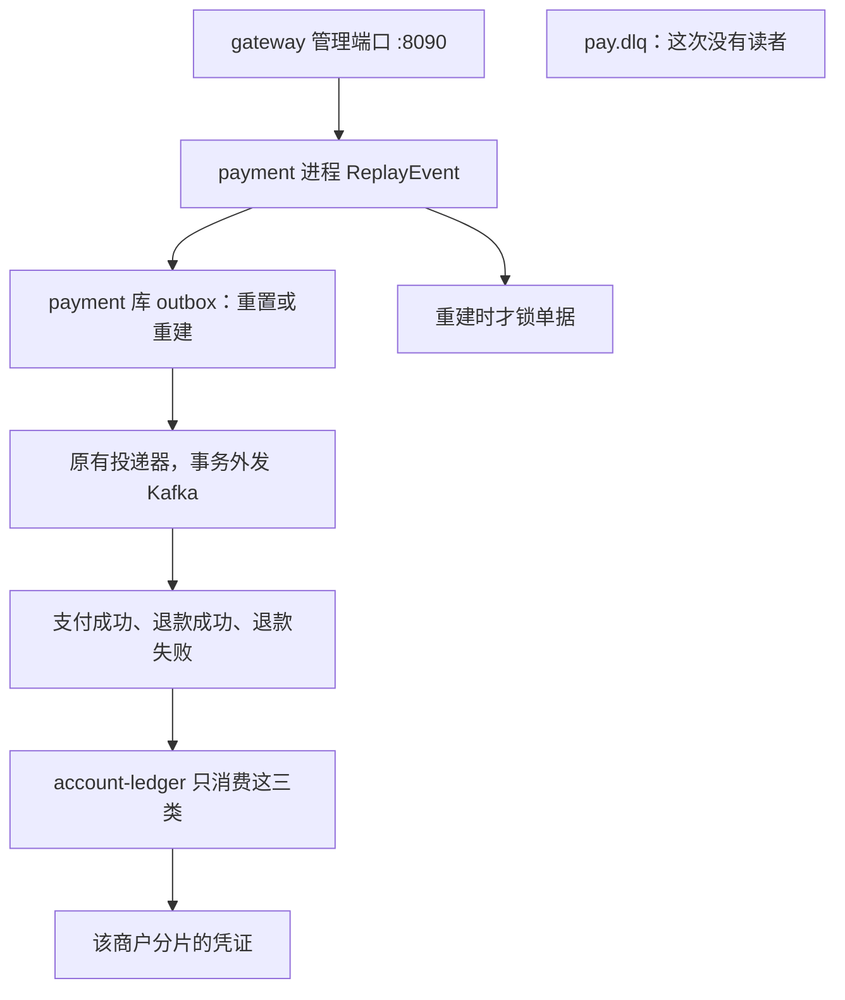
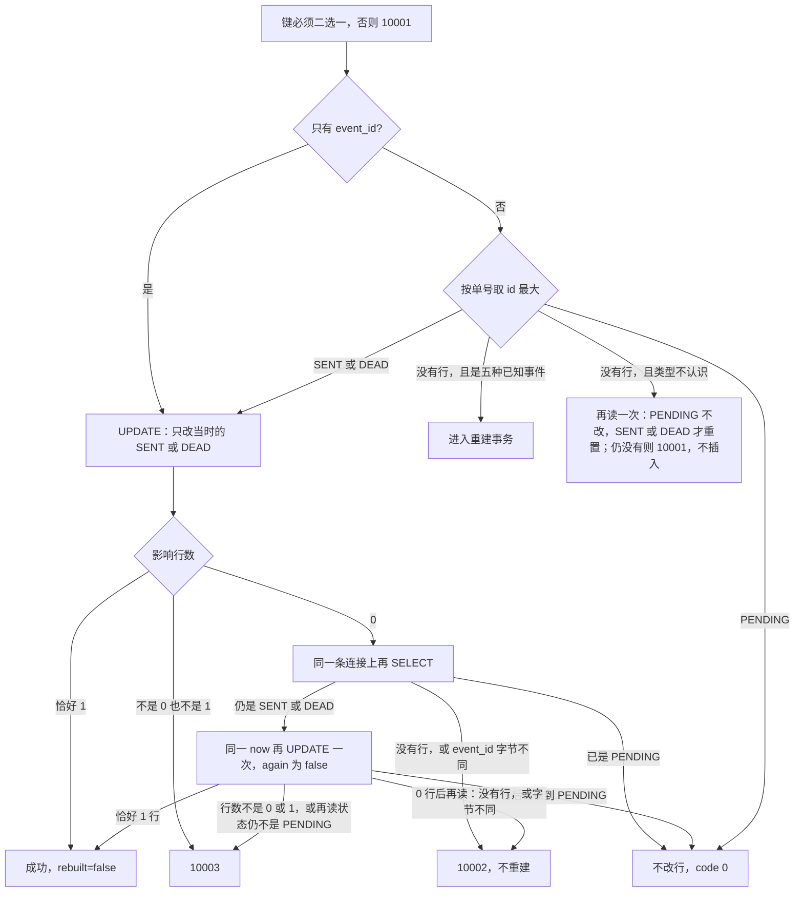

# MQ-05 死信与事件重放

| 项 | 内容 |
|---|---|
| 功能点 | MQ-05（P0，第 5 周） |
| 所属链路 | 基础设施 |
| 代码提交 | `d5a2d67` `[MQ-05] add event replay`（完整 `d5a2d671b7b4cfa6c435207771280c139ac5de92`，2026-11-10 15:48:12 +0800） |
| 分支 | `feat/MQ-05-replay` |
| 日期 | 2026-11-10 |
| 状态 | DONE |

本报告写在上面这次代码提交之后，不在那次提交的文件里。报告自己的提交还没有，修订记录里写「待提交」。

P0 是必须先做的优先级。第 5 周计划里「Kafka 框架 → 投递器 → account 消费 → 死信与重放」这一行，在这次代码提交里勾上了。这一行的前三项分别写在 `docs/reports/MQ-03-kafka-framework.md`、`docs/reports/MQ-02-outbox-dispatcher.md`、`docs/reports/MQ-04-account-consume.md`。本报告不为那三份提供新的测试证据，只写重放。同一周的商户通知、网关时间窗口和限流、链路指标没有做，那些行仍然空着。本功能点完成不等于那一周的其余行完成。

## 一句话结论

payment 进程里的 `ReplayEvent` 不改账户余额。重置是把 outbox（本地待发送表）里已经发出或不再自动发的一行改回待发送，不插入新行。重建是按业务单号找不到行、并且单据状态匹配时，再插入一条新的待发送行。只给 `event_id` 时只重置，绝不重建。真正发到 Kafka（进程之间的消息队列）的仍是原来的投递器；支付成功和退款的入账仍由 account 进程的消费组按凭证唯一键只记一次。管理端口 `POST /admin/outbox/replay` 只是把这次调用暴露出去，不签名，也不校验管理令牌。三条验收都在集成测试里：删掉已入账的支付凭证后再按 `event_id` 重放，恰好再记 1 张，再重放一次凭证数不变；支付中的订单拒绝重建成功事件；结算账户不是可使用时消息进死信，改回可使用后再重放恰好入账 1 次。命令证据只有 `/tmp/mq05-verify-r2.log`，里面这些命令的退出码都是 0。

## 1. 背景

### 1.1 系统简介

pay-system 是一个用 Go 编写的小型支付后端，模拟商户收款、退款、商户间转账三条资金链路，重点在数据一致性和性能。系统由 5 个部分组成：gateway（对外 HTTP 入口，负责签名校验和限流）、payment（支付单、退款单、转账单的状态管理和流程推进）、account（账户余额与记账，数据按商户分到 2 个数据库分片）、channel-mock（模拟微信、支付宝这类外部支付渠道）、recon（对账，核对系统内外数据是否一致）。服务之间用 Kitex RPC 同步调用，或通过 Kafka 消息异步通知；数据存在 MySQL 8.4，Redis 用于防重放。所有金额用整数“分”表示，所有记账只追加不修改。当前已完成：账户、支付、退款、转账、网关商户路由、Kafka 框架、outbox 投递、account 对支付和退款事件的入账，以及本报告的事件重放。管理令牌、操作人审计、余额核对的 HTTP 和管理员手动对账还没有。outbox 过期行的清理也还没有。

1 元 = 100 分。订单 10000 分就是 100.00 元。记账只追加，是指账本只插入新行，不回头改已经写下的分录。

这里的「重放」是把一条已经产生过的业务事件再投递一次。它不是 HTTP 请求上的 nonce 防重放。nonce 是商户请求里的一次性随机串，由 Redis 挡住重复提交。本功能点不连 Redis。

Kitex 是本项目的 Go RPC 框架。RPC 是一个进程同步调用另一个进程里的函数。gateway 的管理端口通过 RPC 调用 payment。重放的数据库更新发生在 payment 进程里，不在 gateway 里。

Kafka 是进程之间的消息队列。一条消息有 topic（类别名）。本功能点碰到两种不同的「不再自动继续」，不要混在一起。

第一种在投递侧。outbox 是 payment 库里的一张表。业务把订单改成终态时，在同一个数据库事务里插入一行，状态是 `PENDING`（待发送）。已有的投递器稍后把到期的行发到 Kafka，成功改成 `SENT`（已发送）。发送失败使 `retry_count` 达到 20，这一行就改成 `DEAD`，投递器不再自动发它。这是 `docs/reports/MQ-02-outbox-dispatcher.md` 里的行为。本功能点不改这个循环，也不改「每 200 毫秒跑一次投递批次」。重置只把已有的 `SENT` 或 `DEAD` 改回 `PENDING`，不插入新行。重建是另一条路：按业务单号找不到行、且单据状态匹配时，插入一条新的 `PENDING`。只给 `event_id` 的路径只重置，绝不重建。重置和重建都不在自己的语句里发 Kafka。

第二种在消费侧。`pay.dlq` 是死信 topic。消费端判定再试也没用时，把原消息抄到这里，然后继续处理后面的消息。本报告里有依据的例子只有一个：结算账户不是 `ACTIVE`（可使用）。测试里把它改成 `FROZEN`。本功能点不读、不删 `pay.dlq`。MQ-05 不包含另一个读这些消息的程序。会去看死信的告警是以后的工作，这次没有实现。

分片是把账户数据按商户拆进 2 个库。支付成功入账只打开收款商户所在的那一个库。凭证是一次记账的头，表是 `ledger_txn`。同一分片里 `(biz_type, biz_no)` 有唯一索引 `uk_biz`。支付凭证的 `biz_type` 是 `PAY`，`biz_no` 是支付单号 `pay_no`。所以同一张支付单在这个分片里只能有一张支付凭证。

### 1.2 本功能点在系统中的位置

人通过 gateway 的管理端口调用 payment。payment 只改自己库里的 outbox，或在重建时读单据。支付和退款的余额要等投递器再次把消息交给 account 之后才会变。



`account-ledger` 只消费支付成功、退款成功和退款失败。转账消息不是这个消费组在读。本功能点不另外起一个服务名去消费转账；它只把转账的 outbox 行准备好，不改转账双方的余额。`pay.dlq` 在图里没有出去的箭头，因为这次没有程序读它。商户端口 `:8080` 不注册这条路由。

### 1.3 为什么需要它

一笔收款 10000 分（100.00 元）。测试里这个商户的费率档是 60 个基点。1 个基点是万分之一，60 个基点就是 0.60%，手续费 60 分（0.60 元）。这 60 分记入这个分片的手续费收入账户，不是加给商户。商户结算账户增加 9940 分（99.40 元）。渠道应收增加 10000 分（100.00 元）。这里只说明这三笔数各进哪个账户，不展开完整的记账分录。payment 把订单改成 `SUCCESS` 时，只在自己的库里写订单和一行 outbox。商户那 9940 分要等 account 消费 `payment.succeeded` 才增加。验收里量到的余额是商户结算的 9940 分。

有两种「消息已经发出，账却没记下」的情况。第一种是消费侧：结算账户当时不是 `ACTIVE`，测试里把它改成 `FROZEN`。消费端不记账，把原消息写入 `pay.dlq`，outbox 已经是 `SENT`。投递器不会再发 `SENT` 行。后来把账户改回 `ACTIVE`，如果不重放，商户结算仍是 0。第二种：测试删掉已经记下的那张 `PAY` 凭证和它的分录，再把账户余额改回入账前。outbox 仍是已发送，投递器同样不会再发，漏掉的 9940 分补不回来。

反过来，不能因为想补账就无条件造一条成功事件。订单还是 `PAYING`（渠道还没给出成功）时，若插入 `payment.succeeded`，消费端会按成功去给商户加 9940 分。已经入账的事件再重放一次，如果消费端再插一张凭证，商户会被加上两次 9940 分。

所以重放只做两件事。重置：让原来的那一行再被投递一次，不插入。重建：行已经被删掉时，先看单据状态是否配得上这种事件，配得上才插入。只给 `event_id` 时做不到重建。记账仍交给已有的消费端，由 `uk_biz` 挡住第二次插入。

## 2. 术语

按正文第一次需要对照的顺序。1.1 里已经用一句话解释过的，这里收短。

| 术语 | 含义 |
|---|---|
| 分 / 基点 | 金额单位是分。100 分 = 1.00 元。1 个基点是万分之一。60 个基点 = 0.60%。 |
| outbox | payment 库的本地消息表。一行对应一次待发出的业务事件。 |
| `PENDING` / `SENT` / `DEAD` | 待发送、已发送、投递失败使 `retry_count` 达到 20 后不再自动发送。`DEAD` 是投递侧，不是死信 topic。 |
| 重置 | 把已有的 `SENT` 或 `DEAD` 改回 `PENDING`。不插入新行。只给 `event_id` 时只做这一步。 |
| 重建 | 按业务单号找不到行、且单据状态匹配时，插入一条新的 `PENDING`。新 `event_id` 前缀仍是 `EV`。 |
| `event_id` | 这一行的事件号，前缀 `EV`，列上有唯一索引 `uk_event_id`。 |
| `biz_no` | 业务单号。支付事件是 `pay_no`，退款事件是 `refund_no`，转账事件是 `transfer_no`。 |
| `event_type` | 事件种类。本功能点认识这五种：`payment.succeeded`、`refund.succeeded`、`refund.failed`、`transfer.succeeded`、`transfer.failed`。 |
| 投递器 | 已有的程序，见 MQ-02 那份报告。领取到期的 `PENDING`，在事务外发到 Kafka。失败到 20 次改成 `DEAD`。批次每 200 毫秒一次。本功能点不改这个循环。 |
| 死信 / `pay.dlq` | 消费端判定再试也没用时，把原消息抄到这个 topic，然后继续后面的消息。本报告有依据的例子只有结算账户不是 `ACTIVE`（测试写成 `FROZEN`）。本功能点不读、不删。MQ-05 没有另一个读者。告警不是这次实现的。 |
| 凭证 / `uk_biz` | `ledger_txn` 的一行。唯一索引是 `(biz_type, biz_no)`。同一支付单不能有第二张 `PAY` 凭证。 |
| 分录 | 凭证下面的金额行，只插入不修改。验收 1 在删凭证时把对应分录一起删掉。 |
| 手续费收入 / 商户结算 / 渠道应收 | 这笔 10000 分的支付里：手续费 60 分进手续费收入，不是加给商户；商户结算增加 9940 分；渠道应收增加 10000 分。 |
| CAS | 比较后再更新。这里的比较写在 `WHERE` 里：只有状态仍是 `SENT` 或 `DEAD` 的那一行才会被改掉。影响 0 行就说明当时没匹配上。 |
| 行锁 | `SELECT ... FOR UPDATE`。事务结束前，别的事务不能改被锁住的那张单据。 |
| 注入时钟 | 测试塞进进程的假时间。生产用真实时钟。写进数据库的时间来自这个时钟，不用 SQL 的 `NOW()`。 |
| `rebuilt` | 结果里的布尔值。true 表示这次按单据新插入了一行 outbox。重置时是 false。 |
| `10001` / `10002` / `10003` / `10004` / `30003` | 已有错误码：参数不合法、找不到、内部失败、依赖暂时不可用、单据状态冲突。本功能点不新增码。`10004` 的对外 `msg` 是 `service unavailable`。 |
| 管理端口 | gateway 上的 `:8090`。商户端口是 `:8080`。重放路由只在管理端口。 |
| `ACTIVE` | 账户可使用。不是这个状态时，本报告里的支付成功消费不记账，原消息进 `pay.dlq`。 |
| 故障点 | 有名字的测试钩子，用来在指定位置打断进程。本功能点不新增。 |
| 规则 1 | 需求里按 `event_id` 重放的那条 UPDATE。正文 3.2 摘出了这条 SQL。 |
| CF-20 | 已有的重放流程图。这次只在图下加了说明，节点没改。 |
| mmdc | 把图渲染成图片的工具。这次没跑。 |
| SVG | mmdc 渲染出的图片文件。这次没有新文件。 |
| GW-07 | 以后的管理端口鉴权：管理令牌、操作人必填、审计日志，以及余额核对和手动对账这两个 HTTP。不是这次的任务。 |
| 官方日志 | `/tmp/mq05-verify-r2.log`。里面没有重放路径的耗时指标。 |

## 3. 技术讲解

### 3.1 要解决的问题

重放要同时满足这些约束。每条都是为了不把账记错，或为了不把一次修复写成两次。

1. 入参只能是一种定位方式。只有非空 `event_id`，或者只有非空 `biz_no` 加上非空 `event_type`。两个都给、都不给、只给一半、空串、请求本身是 nil，都是已有的 `10001`，不写库。`replayKeysOK` 只把空串当成没提供，不去掉首尾空格。一个空格因此通过键检查，不是 `10001`。`TestReplayKeys` 用的 `Payments` 没有数据库，所以 `EventID: " "` 返回 `10003`。这个测试没有写库。报告不猜测接上数据库之后这一格会命中哪一行。
2. 按 `event_id` 只能重置已经存在的 `SENT` 或 `DEAD` 行。找不到返回 `10002`，不重建。已经是 `PENDING` 则原样返回，不改这一行。
3. `idx_biz_no_event_type` 不是唯一索引。重置不插入。重建只在按这个索引找不到行时才插入。本功能点不做清理。以后若把旧行删掉，再次按单号重建会再插入一行，于是同一个 `biz_no` + `event_type` 可以有多行。有多行时只处理 `id` 最大的那一行。这里不另外假设一个生产写入者。
4. 行已经被删掉时才允许重建，而且单据状态必须配得上事件类型。配不上是 `30003`，不插入。单据不存在、并且第二次也没有 outbox 行，才是 `10002`。不认识的 `event_type` 又没有现成行，是 `10001`。有现成行时，即使类型不在那五种里，也只重置，不插入。
5. 重建和「第二次查到已经有人插入」必须落在同一个数据库事务里。事务里不调用 Kafka、HTTP 或 RPC。
6. 重放本身不写凭证、不改余额。重复投递由消费端的 `uk_biz` 吸收。
7. 不自动消费 `pay.dlq`。不新增错误码、表、配置项或 Prometheus 指标。故障点是有名字的测试钩子，本功能点不新增。

### 3.2 方案

先检查两个键是不是严格二选一。通过之后，用注入时钟的当前时间，截断到毫秒，再换到固定的东八区。运行镜像没有时区数据库，所以这里用固定的 `+08:00`，和已有的 `outbox.Add` 一样。只给 `event_id` 时只做重置。按业务单号则先读 `id` 最大的一行。没有行、并且类型是五种已知事件时，才进入重建事务。类型不认识就再读一次；仍没有匹配行返回 `10001`，不插入，也不进这个事务。



`event_id` 这一支是行还在时的重置：先 UPDATE，影响 0 行才 SELECT，不是 UPDATE 自己的两个出口。按单号没有行、并且类型是五种已知事件时，才进入重建事务。

按 `event_id` 的更新就是下面这一条，也就是规则 1（需求里这条 UPDATE）。`next_retry_at` 和 `updated_at` 绑的是同一个 `now`。`updated_at` 这一列定义了 `ON UPDATE CURRENT_TIMESTAMP`：SET 里不写它，数据库会改用自己的时钟。所以两个问号都必须是注入时钟。`sent_at` 和 `last_error` 不在 SET 里，保持原值。

```go
UPDATE outbox
SET status = 'PENDING', retry_count = 0, next_retry_at = ?, updated_at = ?
WHERE event_id = ? AND status IN ('SENT', 'DEAD')
```

这段在 `service/payment/biz/replay.go` 的 `resetReplay`。顺序和上图一致，不要把「已是 PENDING」或「没有这行」理解成第一条 UPDATE 的直接结果。

影响恰好 1 行，返回请求里的那个 `event_id`，`rebuilt` 为 false。影响行数不是 0 也不是 1，返回 `10003`，不再 SELECT。影响 0 行之后才另做一条 SELECT。按 `event_id` 调用时，`resetReplay` 自己不开事务：这条 UPDATE 和后面的 SELECT 是同一条连接上的两条语句，不包在同一个事务里。0 行表示当时的 WHERE（`status` 为 `SENT` 或 `DEAD`）没匹配上。两条语句之间，这一行的状态可能变成 `SENT` 或 `DEAD`。报告不给「谁在中间改了状态」起一个代码里没有的名字。

SELECT 的 SQL 已经是 `WHERE event_id = ?`。`loadReplayByEvent` 在 Scan 之后再比一次：读回的 `event_id` 和请求的字节不同，函数把它当成没有行，`resetReplay` 因此返回 `10002`。这是查询之后的防护。报告不编造一种生产环境会稳定产生这种不一致的场景。没有一个点名的测试覆盖这个字节比较。

SELECT 没有行，返回 `10002`，不重建。读到 `PENDING`，返回 code 0，不改行。读到仍是 `SENT` 或 `DEAD`，并且这是第一次（参数 `again` 为 true），就用同一个 `now` 再执行一次同一条 UPDATE，把 `again` 改成 false，不会第三次循环。第二次影响恰好 1 行则成功。第二次仍是 0 行，然后再读到 `PENDING`，则不改行并成功。第二次影响行数不是 0 也不是 1，返回 `10003`。第二次是 0 行后再读：没有行，或 `event_id` 字节不同，返回 `10002`；读到的状态仍不是 `PENDING`（包括仍是 `SENT` 或 `DEAD`）也返回 `10003`。字节不同仍是查询之后的防护，按没有行处理，不是 `10003`。

按业务单号的读取使用 `idx_biz_no_event_type`，`ORDER BY id DESC LIMIT 1`。这个索引不是唯一的，所以同一 `biz_no` + `event_type` 可以有多行；只取 `id` 最大的一行。`loadReplayByBiz` 同样在 Scan 之后做字节比较：读回的 `biz_no` 或 `event_type` 和请求不同，就当成没有行。对五种已知事件，当成没有行之后会进入重建，因此可能插入。对不认识的 `event_type`，会再读一次；仍没有匹配行才返回 `10001`，不插入。再读到的行若是 `PENDING` 则不改，若是 `SENT` 或 `DEAD` 才重置。报告同样不编造一种会稳定让读回字节不同的场景，也没有点名测试覆盖这个比较。

有行且是 `PENDING`，直接返回该行的 `event_id`，不改列。有行且是 `SENT` 或 `DEAD`，改用该行的 `event_id` 做上面的重置，不插入。测试为了证明「只动 id 最大的一行」，自己又插入了第二行；那是测试数据，不是另一个生产写入者。

没有行、但类型属于那五种时，打开一个事务，顺序固定：

1. `SELECT ... FOR UPDATE` 锁住单据。支付单用 `pay_no`，退款单用 `refund_no`，转账单用 `transfer_no`。锁的结果先记下来，先不返回。
2. 在这个事务里再查一次 outbox。查到了就调用 `finishReplayHit` 并返回，这时还没看锁单据的错误。所以单据行本身不存在（锁单据得到 `10002`）时，只要第二次查到了 outbox，就返回那一行：`PENDING` 不改，`SENT` 或 `DEAD` 走重置，不返回 `10002`。`rebuilt` 为 false，不再插入。没有单独测试覆盖「单据缺失但等锁期间插入了 outbox」。单据状态不符时也一样：第二次查到了行，就返回那一行，不再返回 `30003`。
3. 第二次仍没有行，才看锁单据的结果。单据不存在是 `10002`。状态不符是 `30003`。两者都不插入，事务回滚。
4. 状态相符才调用已有的 `outbox.Add`。发号器必须是 `*idgen.Generator`。新 `event_id` 前缀是 `EV`，新行状态是 `PENDING`，`rebuilt` 为 true。插入后再读一次。读不到、前缀不是 `EV`、或状态不是 `PENDING`，返回已有的 `10003`（`errno.ErrInternal`）。`callErr` 看到已经是 `errno` 的错误就原样返回。事务回滚，不留下半行。

状态对照是：

| 事件 | 单据必须是 | 否则，且第二次仍没有 outbox |
|---|---|---|
| `payment.succeeded` | 支付单 `SUCCESS` | `30003`。`PAYING` 也是 `30003`，不是另一种码 |
| `refund.succeeded` | 退款单 `SUCCESS` | `30003` |
| `refund.failed` | 退款单 `FAILED` | `30003` |
| `transfer.succeeded` | 转账单 `SUCCESS` | `30003` |
| `transfer.failed` | 转账单 `FAILED` | `30003` |

这些字段由已有的 `outbox.Add` 写成 JSON，重放不另写一套序列化。金额仍是单据上的整数分。测试怎么比较退款和转账的 data，放在 4.3，那里再定义 `channel`、`mode` 这些字段。

以前 `ReplayEvent` 未实现，任何真实请求都固定返回 `10003`。现在真实请求会走重置或重建。下面这些情况仍返回 `10003`：服务对象是 nil、`Payments` 是 nil、没有数据库、没有时钟、发号器不是 `*idgen.Generator`、`outbox.Add` 返回 `outbox.ErrInvalidEvent`、影响行数不是 0 或 1、第二次 0 行后再读到的状态仍不是 `PENDING`、插入后读回不合格。`outbox.ErrInvalidEvent` 只在重建、并且 `Add` 拒绝这件事件时映射为 `10003`。没有一个测试名字覆盖它。报告不编造哪种字段会让 `Add` 返回它。

时钟往回跳是另一条路，不是 `10003`。重建调用 `outbox.Add`，`Add` 用 `*idgen.Generator` 的 `NewNo`。`NewNo` 在墙上时钟比上次发号回退超过 5 毫秒时返回 `idgen.ErrClockRollback`，不发号。`rebuildReplay` 把这个错误映射成已有的 `10004`。对外 `msg` 是 `service unavailable`，含义是依赖暂时不可用。这里的依赖是发号器：回退超过 5 毫秒就拒绝发号，避免新的事件号乱序。事务回滚，不插入。

gateway 只做转发。`POST /admin/outbox/replay` 注册在管理端口。请求体必须是一个 JSON 对象。HTTP 的 `optionalID` 把未传、JSON `null` 和空串当成没提供，也不 trim。JSON 字符串 `" "` 因此算提供了。`TestAdminReplay` 没有这个请求体，这条测试没有覆盖空格。未知字段忽略。两个键不是二选一、空 body、非法 JSON 或字段类型不对，返回 `10001`，不调用 RPC。读 body 失败发生在解析之前，返回 `10003`，HTTP 500。合法时调用 `PaymentService.ReplayEvent`。没装上 RPC 客户端时也是 `10003` / 500，这次还没调用 RPC。

成功和失败都用同一层 JSON。字段顺序是 `code`、`msg`、`request_id`、`data`。成功是 HTTP 200，`code` 为 0，`msg` 为 `ok`，`data` 是对象，键顺序 `event_id` 然后 `rebuilt`。`TestAdminReplay` 检查了 HTTP 200、`code` 0、响应不签名，以及 body 含 `"data":{"event_id":"EV9","rebuilt":true}`。`request_id` 来自请求 ID 中间件，有这个字段，这条测试没固定它的值。错误时 `data` 是 `{}`。

HTTP 映射来自错误码上登记的 `HTTPStatus`：`10001` 是 400，`10002` 是 404，`10003` 是 500，`10004` 是 503，`30003` 是 409。`TestAdminReplay` 实际断言了 400/`10001`、404/`10002`、409/`30003`，以及没装 RPC 客户端时的 500/`10003`。它没有断言业务函数返回的 `10003` 或 `10004`。后两个的 HTTP 状态仍是上面登记的数字，经 `mapRouteErr` 送出去：RPC 若带回已登记的业务码，就用该码；RPC 错误如果不是业务状态错误，映射成 `10004` / 503，不是 `10003`。

payment 侧除 `Pay` 和 `CreateRefund` 用 5 秒外，其余方法的服务端处理时间是 2 秒，`ReplayEvent` 走这 2 秒。gateway 调用这个方法的超时是默认的 1 秒，不重试。请求为 nil 或键不合法时，RPC 层直接 `10001`，不进入业务函数。

### 3.3 为什么这样做

| 方案 | 做法 | 优点 | 缺点 | 结论 |
|---|---|---|---|---|
| 采用：把 outbox 改回 `PENDING`，行没了才按单据重建 | 一条带状态条件的 UPDATE；重建时先锁单据再查一次 outbox，然后调用已有的 `outbox.Add` | 投递、退避、事件号前缀和 JSON 形状都不用重写。消费端原有的凭证唯一索引继续挡住重复入账。事务里没有 Kafka | 死信 topic 里的旧消息还在，要靠人再调一次重放。管理端口目前没有令牌 | 采用 |
| 备选：重放时直接记一笔账 | payment 在重放事务里调用 account | 少一次 Kafka 往返 | 重放事务里会出现 RPC，和「事务内不调用外部系统」冲突。支付入账的规则会在 payment 里再实现一遍 | 不采用 |
| 备选：启动一个程序把 `pay.dlq` 再投回原 topic | 自动读死信 | 账户恢复后不用人点重放 | 账户还没恢复时会把坏消息再灌回原 topic。也分不清这条是该重置旧 `event_id`，还是该按现在的单据重建 | 不采用。死信留在 `pay.dlq`，修复后由人指定 `event_id` 或业务单号 |
| 备选：时间用 SQL `NOW()`，并且 SET 里不写 `updated_at` | 少传一个参数 | SQL 更短 | `updated_at` 会变成数据库时钟，和 `next_retry_at` 不是同一次注入时间。测试也无法把时间拨到指定时刻 | 不采用 |

### 3.4 正确性

重放自己不写凭证。下面「最终状态」里出现余额的，都是重放之后，测试又跑了投递器和 `account-ledger`。没有「更新已执行但还没提交时杀掉进程」的测试。崩溃一行按代码能说的范围写，并标明没有测试。

| 场景 | 系统行为 | 最终状态 | 证明 |
|---|---|---|---|
| 同一 `event_id` 在仍是 `PENDING` 时再调用 | 条件更新影响 0 行，再读到 `PENDING`，不写 | 状态、重试次数、`next_retry_at`、`updated_at`、`sent_at`、`last_error`、payload 都与调用前相同。`rebuilt` 为 false | `TestReplayPendingUnchanged` |
| 已入账的支付事件再重放一次 | 行从 `SENT` 回到 `PENDING` 后再次被投递。消费端插入凭证时撞上 `uk_biz` | `PAY` 凭证仍是 1 张。商户结算余额仍是 9940 分（99.40 元）。`CheckBalance` 的错误是 nil，`Passed` 为 true | `TestMQ05Accept1ReplayPostsOnce` 的后半段 |
| 两个调用都想在行已被删掉时重建 | 第一次按单号没找到之后、打开重建事务之前，测试钩子先插入一行。重建事务锁单据后再查，看到这行就返回 | outbox 仍是 1 行，`rebuilt` 为 false，返回的是钩子插入的那个 `event_id`。这不是两个请求同时堵在行锁上的计时测试 | `TestReplayRebuildSeesInsert` |
| 更新已经执行、提交还没完成时进程崩溃 | 按 `event_id` 的重置是单条 UPDATE，不在重建那个事务里。重建若在事务提交前崩溃，插入会回滚。两条路径里都没有 Kafka 调用 | 没有「更新已执行但还没提交时杀掉进程」的测试。若重置或重建已经提交、投递器还没跑，行是 `PENDING`，下一次投递会发出去 | 无对应测试。重复投递的结果见验收 1 |
| 下游超时 | 重放不调用渠道、Kafka 或 account。gateway 等待 1 秒，payment 允许 2 秒。gateway 先放弃时，payment 仍可能提交 | 没有一次真实超时测试。若提交后的行已是 `PENDING`，再调用一次不会改它 | 超时数字来自 `TestRPCTimeoutTable` 和 `TestListenAddrAndTimeout`，不是一次超时注入 |

验收 1 的前半段补的是漏账，不是重复入账：先让消费端记上 1 张，再删掉这张 `PAY` 凭证和分录，并把账户余额改回入账前，然后按 `event_id` 重放。投递和消费之后凭证又是 1 张，商户结算余额 9940 分（99.40 元）。测试调用 `CheckBalance`，商户号是空串，第二个参数是 true。断言返回的错误是 nil，并且 `Passed` 为 true。

验收 3 是消费侧死信那条路：结算账户先改成 `FROZEN`。`payment.succeeded` 被投递后 outbox 已是 `SENT`，`pay.dlq` 里出现带这个 `event_id` 的消息，凭证数是 0。账户改回 `ACTIVE`，按原来的 `event_id` 重放，`rebuilt` 为 false。再投递后凭证是 1 张，商户结算余额 9940 分，`CheckBalance` 同样是错误 nil 且 `Passed` 为 true。`pay.dlq` 里那条旧消息没有被删，这次也没有程序去读它。

`SENT` 重置会把 `retry_count` 清零，`next_retry_at` 和 `updated_at` 写成注入时钟，`sent_at` 和 `last_error` 保留。`DEAD` 再重置一次也一样。重置之后，用假的发送函数跑一批投递，这一行会变成 `SENT`，假发送次数是 1。这是 `TestReplaySentAndDeadReset`，它不连 Kafka。

同单号两行时，只动 `id` 更大的那一行。测试里旧行保持 `SENT` 且 `retry_count` 仍是 2，返回的是新行的 `event_id`，`rebuilt` 为 false。见 `TestReplayBizUsesMaxID`。

### 3.5 性能

不涉及。这次没有做压测。官方日志是 `/tmp/mq05-verify-r2.log`，该日志没有重放路径的耗时指标。本功能点不改变已有投递器每 200 毫秒跑一次的批次；那是 MQ-02 那份报告里的循环。

## 4. 已完成内容

### 4.1 改动清单

| 文件 | 新增 / 修改 | 作用 |
|---|---|---|
| `service/payment/biz/replay.go` | 新增 | `ReplayEvent`、条件更新、按单号重建 |
| `service/payment/biz/replay_test.go` | 新增 | 键的组合、nil 服务、没有库、没有时钟 |
| `service/payment/biz/replay_integration_test.go` | 新增 | 三条验收，以及重置、重建、退款和转账 |
| `service/payment/handler/handler.go` | 修改 | RPC 入参检查，成功时返回 `event_id` 和 `rebuilt` |
| `service/payment/handler/service.go` | 修改 | 业务接口增加 `ReplayEvent` |
| `service/payment/handler/handler_test.go` | 修改 | nil 请求、两个键、`30003`、nil 服务；2 秒超时表包含本方法 |
| `service/gateway/admin_replay.go` | 新增 | 管理端口路由和 JSON 解析 |
| `service/gateway/admin_replay_test.go` | 新增 | HTTP 状态、不签名、非法体不调用 RPC |
| `service/gateway/server.go` | 修改 | 管理端口注册这条路由，商户端口不注册 |
| `service/gateway/rpc_test.go` | 修改 | `ReplayEvent` 的调用超时是 1 秒 |
| `cmd/gateway/main.go` | 修改 | 管理端口装上 payment 的 `ReplayEvent` 客户端 |
| `docs/02-requirements.md` | 修改 | 规则 1（3.2 那条 UPDATE）写上 `updated_at`；MQ-05 改为 DONE；三条验收勾上 |
| `docs/05-api.md` | 修改 | 接口文档到 3.3.16，写明管理路由的现有行为 |
| `docs/06-flows.md` | 修改 | 版本 v2.49。CF-20 是已有的重放流程图，这次只在图下加说明，节点没改。没有新的 SVG（图渲染出的图片文件） |
| `docs/database.md` | 修改 | 写明重置时如何写 `updated_at` 和 `next_retry_at`。无 DDL |
| `docs/01-tech-decisions.md` | 修改 | 补一句：重置写注入时钟的 `updated_at`；重建先锁单据再 `outbox.Add` |
| `docs/04-dev-plan.md` | 修改 | 勾上第 5 周里 Kafka 到重放的那一行。本报告没有再改这个文件 |

### 4.2 对外变化

| 类别 | 变化 |
|---|---|
| 接口 | 以前 `ReplayEvent` 未实现，任何真实请求都固定返回 `10003`。现在真实请求走重置或重建。仍返回 `10003` 的情况见 3.2：nil 服务、没有库、没有时钟、发号器类型不对、`Add` 拒绝这件事件、影响行数不是 0 或 1、第二次 0 行后再读到的状态仍不是 `PENDING`、插入后读回不合格。gateway 管理端口新增 `POST /admin/outbox/replay`。不读 `X-Admin-Token`，不要求 `X-Admin-Operator`，不写审计日志。缺操作人不是 `10001`。响应不签名。商户端口没有这条路由 |
| 表结构 | 无。不改列、不改索引、不执行迁移 |
| 配置项 | 无 |
| 错误码 | 无新码。使用已有的 `10001`、`10002`、`10003`、`10004`、`30003` |
| 单号前缀 | 无新前缀。重建沿用 `EV` |
| 指标 / 故障点 | 无新指标。故障点是有名字的测试钩子，本功能点不新增 |

### 4.3 验收对照

「通过」表示 `/tmp/mq05-verify-r2.log` 里对应包的退出码是 0。日志没有逐个打印这些测试名。

| 验收条目 | 测试函数 | 类型 | 结果 |
|---|---|---|---|
| 删掉已经入账的 `PAY` 凭证和分录，再按 `event_id` 重放，恰好 1 张凭证；对同一事件再重放，凭证数不变；`CheckBalance` 错误为 nil 且 `Passed` 为 true | `TestMQ05Accept1ReplayPostsOnce` | 集成 | 通过 |
| 订单是 `PAYING` 时按 `biz_no` + `payment.succeeded` 重建，返回 `30003`，不新增 outbox | `TestMQ05Accept2PayingRejected` | 集成 | 通过 |
| 结算账户不是 `ACTIVE` 时 `payment.succeeded` 进入 `pay.dlq`；改回 `ACTIVE` 后按 `event_id` 重放，恰好入账 1 次，`CheckBalance` 同样通过 | `TestMQ05Accept3InactiveThenReplay` | 集成 | 通过 |
| 已是 `PENDING` 时不改任何列 | `TestReplayPendingUnchanged` | 集成 | 通过 |
| `event_id` 不存在返回 `10002`，不新增行 | `TestReplayMissingEventID` | 集成 | 通过 |
| 两个键都给返回 `10001`，原行不变 | `TestReplayBothKeysNoWrite` | 集成 | 通过 |
| `SENT` 和 `DEAD` 都重置；`sent_at`、`last_error` 保留；重置后一批投递能再发出 | `TestReplaySentAndDeadReset` | 集成 | 通过 |
| 同一 `biz_no` + 事件类型多行时只返回 `id` 最大的，旧行不变 | `TestReplayBizUsesMaxID` | 集成 | 通过 |
| 删掉支付成功行后按单号重建，新 `event_id` 前缀 `EV`，`rebuilt` 为 true，data 与删掉前相同 | `TestReplayRebuildPayment` | 集成 | 通过 |
| 第一次没找到之后、打开事务之前插入一行，重建不再插入 | `TestReplayRebuildSeesInsert` | 集成 | 通过 |
| 不认识的类型但行还在：只重置。行删掉后是 `10001`。支付单不存在是 `10002`。都不插入 | `TestReplayUnknownAndMissingOrder` | 集成 | 通过 |
| 退款状态 `PROCESSING`、成功退款单配失败事件、转账状态 `TRYING` 都是 `30003` 且不插入。成功和失败的退款、转账能重建 | `TestReplayRefundAndTransfer` | 集成 | 通过 |
| 重建时时钟回拨超过 5 毫秒返回 `10004` 且不插入；发号器不是 `*idgen.Generator` 返回 `10003` 且不插入 | `TestReplayRebuildClockAndIDs` | 集成 | 通过 |
| nil、空、两个键、只给一半是 `10001`。nil 的 `Payments`、没有库、没有时钟、空的 `App` 在键合法时是 `10003`。一个空格通过键检查；该测试没有库，所以返回 `10003`，并且没有写库 | `TestReplayKeys` | 单元 | 通过 |
| RPC：nil 请求和键不合法是 `10001` 且不进业务；nil 服务是 `10003`；`30003` 原样返回 | `TestReplayEventHandler` | 单元 | 通过 |
| 管理端口成功时 HTTP 200、`code` 0、不签名，body 含 `"data":{"event_id":"EV9","rebuilt":true}`。非法 JSON 不调用 RPC，HTTP 400 / `10001`。`10002` 为 404，`30003` 为 409。没装客户端是 500 / `10003`。商户端口是 404。没有断言业务函数返回的 `10003` 或 `10004`，也没有用空格做请求体 | `TestAdminReplay` | 单元 | 通过 |

`PROCESSING` 在 `TestReplayRefundAndTransfer` 里是一种退款状态，既不是 `SUCCESS` 也不是 `FAILED`。这种状态做重建返回 `30003`，不插入。`TRYING` 在同一测试里是一种转账状态，还不是 `SUCCESS` 或 `FAILED`。同样返回 `30003`，不插入。这里不把这两种状态扩成完整状态机。

这个测试对重建出的 payload 做的是 data 对象逐键相等，键的个数也必须一样。金额必须是不带小数点的 JSON 整数。退款成功比较 `refund_no`、`pay_no`、`merchant_id`、`out_refund_no`、`channel`、`amount` 和 `succeeded_at`。`out_refund_no` 是商户侧退款号，测试插入的是 `OR_` 加退款单号。`channel` 是渠道名，退款测试插入的是 `mockpay`。退款失败比较 `refund_no`、`pay_no`、`merchant_id`、`out_refund_no`、`amount` 和 `fail_code`，不要求 `succeeded_at`。转账成功比较 `transfer_no`、`out_transfer_no`、`merchant_id`、`payee_merchant_id`、`amount`、`mode`、`status` 和 `finished_at`，并且订单上的 `fail_code` 必须是空。`out_transfer_no` 是商户侧转账号，测试插入的是 `OT_` 加转账单号。`payee_merchant_id` 是收款商户，测试插入 `M100083`，付款商户是 `M100082`。`mode` 是转账单的 `mode` 列：插入函数在付款方和收款方不在同一分片时写 `TCC`，同一分片写 `LOCAL`。断言把 payload 里的 `mode` 和该列比较，不另造一个值。转账失败在成功那些键之外再比较 `fail_code`。时间字符串是毫秒、固定东八区，Go 布局是 `2006-01-02T15:04:05.000Z07:00`，形状如 `2026-11-10T13:00:00.000+08:00`（三位毫秒，偏移 `+08:00`）。这是格式，不是某一次断言里读到的具体时刻。测试插入的退款金额是 3000 分（30.00 元），转账金额是 100 分（1.00 元）；断言把 payload 里的金额和库里的金额列比较。它不比较 Kafka 消息头，也不比较账户余额。

### 4.4 验证记录

官方日志是 `/tmp/mq05-verify-r2.log`。开始 `Tue Nov 10 15:43:13 CST 2026`，结束 `Tue Nov 10 15:47:26 CST 2026`。环境：macOS ProductVersion 27.0.1，BuildVersion 26A434；Darwin 27.0.0 arm64；go1.27.2 darwin/arm64；golangci-lint 2.14.0，built with go1.27.1，from `114493f`，日期 2026-09-24T10:54:53Z。`docker info` 成功。日志里没有 real、user、sys，也没有重放路径的耗时指标。

`/tmp/mq05-verify.log`（15:13:14–15:17:33）是补强退款和转账 payload 断言之前的一次通过，不是这次的证据。r2 的 `make test` 里 payment biz 是 cached，因为那次只改了集成测试和文档；集成测试和 cover 重新跑了，cover 是 84.7%。生产 `replay.go` 在这次补强里没有改。

| 命令 | 结果 |
|---|---|
| `gofmt -l .` | 退出码 0，没有文件名 |
| `make lint` | 退出码 0，`0 issues.` |
| `make test` | 退出码 0。根包 5.690s。`service/payment/biz` 与 `service/gateway` 为 cached |
| `make test-integration` | 退出码 0。根包 38.120s。`service/payment/biz` 120.255s。`service/gateway` 为 cached |
| `make cover` | 退出码 0。`go test -race -tags integration -coverprofile=coverage.out ./...` 之后 `go tool cover -func=coverage.out`。total 38.0%。`service/payment/biz` 119.155s / 84.7%。`service/account/biz` cached 90.8%。`service/channel_mock/biz` cached 91.7%。`pkg/money` 100.0%。`pkg/sign` 100.0%。`pkg/idgen` 88.1%。`pkg/outbox` 88.9%。`service/gateway` cached 70.2%，不在门槛里 |

`make cover` 会写出 `coverage.out`。Makefile 的 cover 目标不删除它。官方那次是脚本 `/tmp/mq05-verify-r2.sh`：`make cover` 退出后，若文件还在就删掉，然后写日志行 `no_coverage_out`，再写 `coverage.out absent`。这两行都在 `make cover_exit:0` 之后。所以日志里最后没有这个文件。只跑第 6 节的命令时，文件还会留在工作区。

total 38.0% 把 `kitex_gen` 算了进去。`kitex_gen` 是生成的 RPC 代码，不是 70% 门槛。门槛包是 `service/*/biz`、`pkg/money`、`pkg/sign`、`pkg/idgen`、`pkg/outbox`。gateway 不在门槛里。上面几个在门槛里的包都高于 70%。

同一次 cover 的函数行：`Payments.ReplayEvent` 100.0%，handler 的 `ReplayEvent` 100.0%，`resetReplay` 65.0%，`rebuildReplay` 78.8%，`replayOutbox` 76.2%，`parseReplay` 89.5%。65.0% 和 78.8% 表示不是每一条错误分支都被这次覆盖率证明跑到，见第 5 节。

### 4.5 同步的文档

- `docs/02-requirements.md`：MQ-05 改为 DONE。规则 1 那条 UPDATE 写明 `updated_at` 与 `next_retry_at` 同为注入时钟，截断到毫秒，东八区。三条验收勾上。版本仍是 v3.0。
- `docs/05-api.md`：文档版本 3.3.16。写明管理路由已注册、不校验令牌和操作人。以前未实现时固定返回 `10003`；现在依赖缺失和内部失败仍会返回该码。
- `docs/06-flows.md`：v2.49。CF-20 图下增加实现说明，节点不改。mmdc 是把图渲染成图片的工具，这次没跑，所以没有新的 SVG。
- `docs/database.md`：只加写路径说明。无 DDL，未执行迁移。
- `docs/01-tech-decisions.md`：在原有的投递说明上补了重放这一句。
- `docs/04-dev-plan.md`：代码提交勾上了第 5 周的 MQ 那一行。写本报告时没有再改它。

## 5. 未完成与风险

- 不读、不删除 `pay.dlq`。MQ-05 没有另一个读者。账户恢复后必须再调重放，死信里的副本还在。看这些消息的告警不是这次实现的。
- 管理端口没有 `X-Admin-Token`，不要求 `X-Admin-Operator`，不写审计日志。谁能访问 `:8090`，谁就能把 `SENT` 改回 `PENDING`。GW-07 才做管理令牌、操作人必填、审计日志，以及余额核对和手动对账这两个 HTTP。
- 本功能点不做 outbox 清理。行还在时，重放不会新建 `event_id`。只有行已经被删掉，才会按单据重建。以后若旧行被删掉再按单号重建，会再插入一行；有多行时仍只处理 `id` 最大的那一行。
- 重放不记账。转账事件可以重建进 outbox。谁消费转账消息：不是 `account-ledger`。本功能点不给那个消费者起名，也不改转账双方余额。`TestReplayRefundAndTransfer` 没有检查转账余额。
- 没有两个 `ReplayEvent` 同时抢同一张单据行锁的测试。现有测试是在打开重建事务之前插入，证明「第二次查到就不插」。
- 没有「更新已执行但还没提交时杀掉进程」的测试。
- gateway 等 1 秒、payment 允许 2 秒。没有测试「HTTP 已返回超时，数据库却提交了」这一种交错。提交若已经把行留在 `PENDING`，再调用一次不会改列。超时数字来自 `TestRPCTimeoutTable` 和 `TestListenAddrAndTimeout`。
- `resetReplay` 在这次 cover 里是 65.0%。「影响行数不是 0 也不是 1」以及「第二次仍是 `SENT` 或 `DEAD`，从而返回 `10003`」没有被一个点名的测试证明。`event_id`、`biz_no`、`event_type` 的字节比较也没有点名测试。
- `outbox.ErrInvalidEvent` 只在重建、并且 `Add` 拒绝这件事件时映射为 `10003`。`rebuildReplay` 是 78.8%，没有一个测试名字覆盖这个错误。nil 服务、没有库、没有时钟、发号器不是 `*idgen.Generator` 会返回 `10003`，这些有测试。时钟回退超过 5 毫秒是发号器拒绝发号，映射为 `10004`，也有测试，并且不插入。
- 单据状态不符、但等锁期间已经有人插入了 outbox 时，代码返回那一行，不再返回 `30003`。单据行不存在（锁单据得到 `10002`）、但第二次查到了 outbox 时，也返回那一行，不返回 `10002`。这两条组合都没有单独测试。

## 6. 如何复现

前置：本机 Docker 可用。官方日志在跑测试前执行了 `docker info`，退出码 0。集成测试会起 MySQL 和 Kafka。不要把 `/tmp/mq05-verify-r2.log` 覆盖掉。下面的数字是那次日志里的结果，不是另一次运行。

```bash
gofmt -l .
make lint
make test
make test-integration
make cover
```

预期：

- `gofmt -l .` 不打印文件名，退出码 0。
- `make lint` 打印 `0 issues.`，退出码 0。
- `make test` 退出码 0，根包 `ok github.com/yym108/pay-system 5.690s`，`service/payment/biz` 和 `service/gateway` 为 `(cached)`。
- `make test-integration` 退出码 0，根包 `38.120s`，`service/payment/biz` `120.255s`，`service/gateway` 为 `(cached)`。
- `make cover` 退出码 0，最后一行 total 是 38.0%。`service/payment/biz` 是 `119.155s`、`coverage: 84.7% of statements`。门槛内还有 account biz 90.8%、channel_mock biz 91.7%、money 100.0%、sign 100.0%、idgen 88.1%、outbox 88.9%，这几项在那次日志里是 cached。gateway 是 70.2%，不在门槛里。门槛包是 `service/*/biz`、`pkg/money`、`pkg/sign`、`pkg/idgen`、`pkg/outbox`。total 含生成代码 `kitex_gen`，不是这道 70% 门槛。

`make cover` 会写出 `coverage.out`，Makefile 的 cover 目标不删除它。官方日志里文件不在，是因为 `/tmp/mq05-verify-r2.sh` 在 `make cover_exit:0` 之后删了它，并写下 `no_coverage_out` 和 `coverage.out absent`。只跑上面的命令时，文件还会留在工作区。

日志里的开始时间是 `Tue Nov 10 15:43:13 CST 2026`，结束时间是 `Tue Nov 10 15:47:26 CST 2026`。15:13 那次旧日志不是这次的证据，不要用它的时间或覆盖率代替上面这些数字。

## 7. 讲解要点

1. 问：死信已经在 `pay.dlq` 里，为什么不自动再投递？答：本报告有依据的例子是结算账户不是 `ACTIVE`。自动读死信再灌回原 topic，会在账户还没恢复时把坏消息再送回去，而且分不清该重置旧 `event_id` 还是按当前单据重建。人把账户改好后，按原来的 `event_id` 把 outbox 从 `SENT` 改回 `PENDING`，投递器才会再发。`pay.dlq` 里的副本不删，这次也没有程序读它。
2. 问：行被删了，为什么不直接 `INSERT`？答：只给 `event_id` 时根本不重建。按单号找不到行才进入事务：先锁单据，状态不是该事件要求的终态就返回 `30003`，一行都不插。锁住之后再查一次 outbox，是为了等锁的时候别人已经插入了，就返回那条，`rebuilt` 为 false。
3. 问：同一笔成功支付重放两次，为什么商户结算不是 198.80 元？答：第二次消息仍会发出。account 插入 `PAY` 凭证时，`(biz_type, biz_no)` 的唯一索引 `uk_biz` 拒绝第二张。验收 1 里第二次之后凭证数仍是 1，商户结算仍是 9940 分（99.40 元）。手续费 60 分在手续费收入账户，不加进这 9940 分。

## 延伸阅读

- `docs/02-requirements.md` 里 MQ-05 那一节：规则 1 和三条验收的原文。
- `docs/05-api.md` §8.3 和 §10.2：管理路由和 `ReplayEvent` 的字段。文档版本 3.3.16。
- `docs/06-flows.md` 的 CF-20：节点没改，图下有这次的实现说明。版本 v2.49。没有新的 SVG。
- `docs/database.md` 里 `outbox` 各列：`updated_at` 的 `ON UPDATE CURRENT_TIMESTAMP`，以及不是唯一索引的 `idx_biz_no_event_type`。
- `service/payment/biz/replay.go`：条件更新和重建事务。
- `service/gateway/admin_replay.go`：管理端口只解析 JSON 并调用 RPC。

## 修订记录

| 日期 | 提交 | 修订内容 |
|---|---|---|
| 2026-11-10 | 待提交 | 初稿。代码提交 `d5a2d67`。验证只引用 `/tmp/mq05-verify-r2.log`。 |
| 2026-11-10 | 待提交 | 按可读性意见改写。重置和重建分开；3.2 的图改成先 UPDATE、0 行后再 SELECT；补字节比较、单据缺失时仍返回已有 outbox、10003 的历史和仍会返回的情况、HTTP 信封，以及 `coverage.out` 由验证脚本删除。 |
