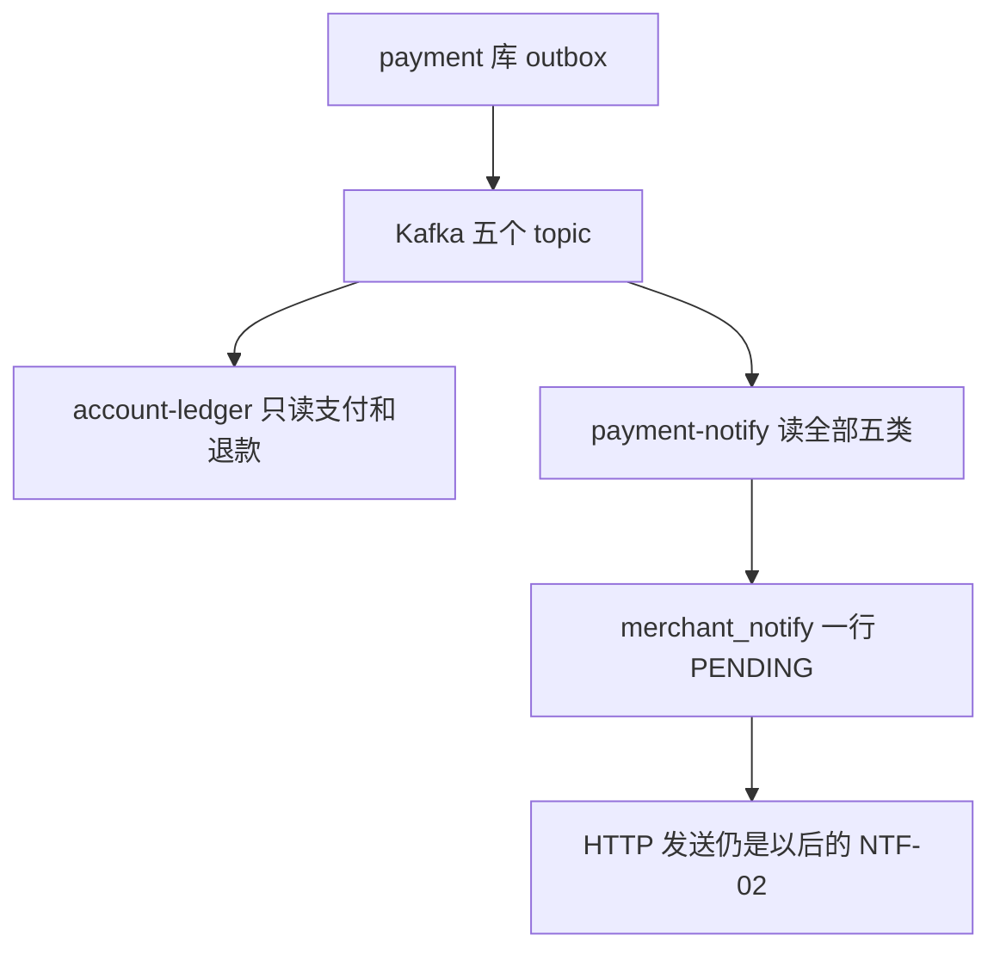
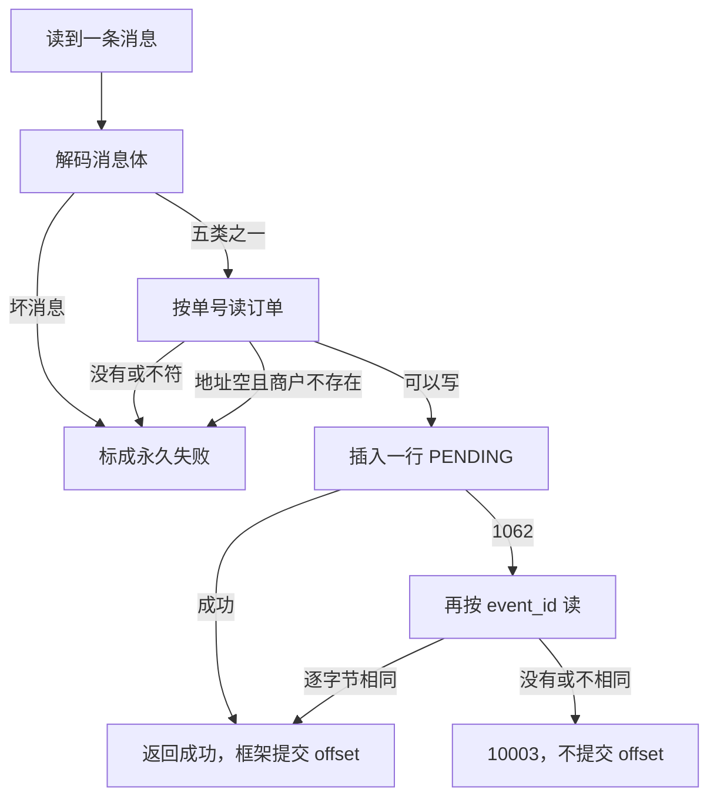

# NTF-01 通知记录生成

| 项 | 内容 |
|---|---|
| 功能点 | NTF-01（P0，第 5 周） |
| 所属链路 | 支付 |
| 代码提交 | `7676d8f` `[NTF-01] add notify record`（完整 `7676d8fdb4db209997214802ce5239c4499d4f59`，2026-11-10 19:47:44 +0800） |
| 分支 | `feat/NTF-01-notify-record` |
| 日期 | 2026-11-10 |
| 状态 | DONE |

本报告写在上面这次代码提交之后，不在那次提交的文件里。报告自己的提交还没有，修订记录里写「待提交」。

P0 是必须先做的优先级。第 5 周计划里还有一行把三件事写在一起：通知记录、商户演示程序、固定间隔重试。这一行没有勾。本功能点只做第一件。演示程序是 TL-02，发送和重试是 NTF-02，都还没有做。

## 一句话结论

payment 进程新增消费组 `payment-notify`。支付成功、退款成功、退款失败、转账成功、转账失败各往 `merchant_notify` 插入一条状态为 `PENDING` 的通知记录，不发 HTTP。同一条事件再来，靠 `event_id` 唯一索引挡住第二行；冲突后再读，只有读回的 `event_id` 逐字节相同才当作已经处理。验收对真实 MySQL 把写入函数调用 3 次，表里只有 1 行。命令证据只有 `/tmp/ntf01-verify.log`，里面这些命令的退出码都是 0。

## 1. 背景

### 1.1 系统简介

pay-system 是一个用 Go 编写的小型支付后端，模拟商户收款、退款、商户间转账三条资金链路，重点在数据一致性和性能。系统由 5 个部分组成：gateway（对外 HTTP 入口，负责签名校验和限流）、payment（支付单、退款单、转账单的状态管理和流程推进）、account（账户余额与记账，数据按商户分到 2 个数据库分片）、channel-mock（模拟微信、支付宝这类外部支付渠道）、recon（对账，核对系统内外数据是否一致）。服务之间用 Kitex RPC 同步调用，或通过 Kafka 消息异步通知；数据存在 MySQL 8.4，Redis 用于防重放。所有金额用整数“分”表示，所有记账只追加不修改。当前已完成：账户、支付、退款、转账、网关商户路由、Kafka 框架、outbox 投递、account 对支付和退款的入账、事件重放，以及本报告的通知记录。通知的 HTTP 发送、签名、白名单和重试还没有。

1 元 = 100 分。下文的 10000 分是订单金额，等于 100.00 元。60 分是从这笔订单里算出的手续费，等于 0.60 元。通知正文里两个数都有。商户实际入账多少由 account 另算，本功能点不算，也不改余额。记账只追加，是指账本只插入新行，不回头改已经写下的分录。

Kitex 是本项目的 RPC 框架。RPC 是一个进程同步调用另一个进程里的函数。分片是把账户数据按商户拆进 2 个库。入账是 account 按消息给账户加减余额。本功能点不调用 RPC，不开账户库，也不入账。

Kafka 是进程之间的消息队列。broker 是实际收发消息的进程；配置里的 broker 列表就是这些进程的地址。一条消息属于一个 topic（类别名）。一个 topic 再切成若干分区，每个分区是一条按顺序排列的日志。offset 是消息在某一个分区里的序号。消费组是一组一起读这些消息的程序。处理函数返回成功，框架才提交这个 offset，表示这一条处理过了。没提交就还会再读到。

这里有三种不要混在一起的「重放」或「防重」。Redis 里的防重放挡的是商户 HTTP 请求上的一次性随机串，本功能点不连 Redis。事件重放是管理端口把已经进过 Kafka 的 outbox 行再投递一次，那是另一个功能，本功能点不做。本功能点的防重只有一件：同一个 `event_id` 在通知表里只留 1 行。

outbox 是 payment 库里的待发送表。业务在改订单的同一个数据库事务里插入一行，已有的投递器稍后把它发到 Kafka。本功能点不改投递器。它只消费已经发出的五类消息。退款失败和转账失败也在这五类里。支付失败，以及把还没付成的订单关掉（关单），不在这五类里，所以不会变成通知行。

### 1.2 本功能点在系统中的位置

消息从 payment 库的 outbox 出去，account 用其中三类去记账。本功能点用五类去插通知记录。两条路互不调用。



`account-ledger` 只读支付成功、退款成功、退款失败，用来记账。`payment-notify` 只在 payment 进程里启动，五类都读，包括两件转账。它不调用 account，也不改余额。图里没有出去的 HTTP 箭头：插完行就结束。

### 1.3 为什么需要它

平台以后要主动 POST 一段 JSON 到商户自己的服务器。商户服务器是接收方。这一步只负责先在平台库里留下「发给谁、发什么」。真正发出 HTTP 的是以后的 NTF-02。没有这张表，NTF-02 没有行可以抢，也就没有地址和正文。

例：订单金额 10000 分（100.00 元），手续费 60 分（0.60 元），订单已经成功，Kafka 里已经有 `payment.succeeded`。通知行记下地址和这段 JSON。地址列允许是空串：订单和商户默认都没填时仍插入，好让这件事件有一条记录。空串本身不能当 HTTP 地址用，以后发不发、怎么失败，是 NTF-02 的事。

同一条消息可能被读到 3 次：第一次插入后进程停了，offset 还没提交，恢复后又读到。如果每次都再插一行，以后会按三个不同的通知单号各发一次。所以同一个 `event_id` 只能有 1 行。一行对应一个事件号，不是对应一张业务单。同一张支付单先有支付成功，以后又有一笔退款成功，那是两个 `event_id`，两行通知。这是两件不同的事，本功能点不把它们收成一行。

反过来，不能因为单号碰巧撞上，就把另一条事件当成已经处理。通知单号 `notify_no` 也有唯一索引。若两条不同事件拿到同一个 `notify_no`，第二行插不进去。这时按 `event_id` 再读，读不到这一次的事件，必须报错并且不提交 offset。再试时会重新要一个 `NT` 单号。正常时钟向前时，新号和已占用的号不同，第二件事件可以插入。若发号器又给出同一个号，仍然是 `10003`，还是不提交。

## 2. 术语

按正文第一次需要对照的顺序。1.1 里已经用一句话解释过的，这里收短。

| 术语 | 含义 |
|---|---|
| 分 | 金额单位。100 分 = 1.00 元。库存和 JSON 里的金额都是整数，不是小数。 |
| topic | Kafka 里的一类消息。本功能点只订 5 个，名字见 3.2。 |
| 消费组 | 一起读同一批 topic 的程序名。这里是 `payment-notify`。 |
| broker | 收发 Kafka 消息的进程。空的地址列表会在登记生产者时失败。 |
| 分区 | topic 里的一条有序日志。offset 只在一个分区内编号。 |
| offset | 消息在某一个分区里的序号。处理函数返回成功，框架才提交它。 |
| 消息体 / 通知正文 | 消息体是 Kafka 里的 JSON，含 `event_id`、`event_type` 和 `data`。通知正文是写入 `payload`、以后 POST 给商户的另一段 JSON。两段不是同一份。 |
| `event_id` | 这一次业务事件的编号，前缀 `EV`。通知表上有唯一索引 `uk_event_id`。 |
| `notify_no` | 通知单号，前缀 `NT`。也是通知正文里的 `notify_id`。另一列唯一索引是 `uk_notify_no`。 |
| 发号器 | 已有的单号生成器。每次插入前向它要一个新的 `NT` 号。时钟回拨超过 5 毫秒它拒绝发号。 |
| `out_trade_no` | 商户自己的支付单号，从消息抄进通知正文。退款对应字段是 `out_refund_no`，转账是 `out_transfer_no`。 |
| 关单 | 把还没付成的支付单关掉。这类结果不在五个 topic 里。 |
| context | 一次调用携带的取消信号和截止时间。已取消或已到点就不再继续写。 |
| `PENDING` | 通知记录已写下，还没发给商户。本功能点只插入这个状态。 |
| `merchant_notify` | payment 库里的商户通知表。一行对应一次要发给某个商户的通知。 |
| 永久失败 | 再试也没用。消费框架把原消息抄到死信 topic `pay.dlq`，抄写成功才提交原 offset。 |
| 可重试 | 暂时失败。不提交 offset，同一条消息还会再被读到。 |
| 1062 | MySQL 报的唯一索引冲突错误号。插入撞上已有的 `event_id` 或 `notify_no` 都是这个号。 |

## 3. 技术讲解

### 3.1 要解决的问题

约束都来自“同一事件只留一行，插不进去时不能假装已经处理”：

1. 五类事件各插入一行，状态只能是 `PENDING`。支付失败和关单不产生这五类消息，所以没有通知行。退款失败和转账失败在这五类里，商户需要知道那次没有做成。
2. 金额只用整数分。支付例子是订单 10000 分、手续费 60 分。退款例子是 1000 分（10.00 元）。转账例子是 500 分（5.00 元）。测试把这些数读成 `json.Number`，不是小数。
3. 同一 `event_id` 重复到达不能插入第二行。同一张业务单上的不同事件仍然各有一行。
4. `notify_no` 和别的事件撞车时不能当成已处理。再试会重新要号。
5. 通知地址：订单上不是空串就原样使用，不去掉首尾空格，也不问商户配置。只有空串才用商户默认地址。默认也是空串，仍插入，地址列写空串。这一列在表上是 `VARCHAR(512)` 且不是 NULL，所以上限按 512 个 Unicode 码点检查。退款没有自己的地址，用原支付单。转账只通知付款商户。
6. 通知正文是以后要 POST 给商户的 JSON。字段就是 3.2 的那张键名表。Kafka 消息体里的渠道、转账模式不抄进去。
7. 表上的 `next_attempt_at`、`created_at`、`updated_at` 用 payment 进程已经注入给业务对象的那只时钟，截断到毫秒，固定东八区，不用数据库的 `NOW()`。通知正文里的 `paid_at`、`succeeded_at`、`finished_at` 是另一回事：原样抄消息里的字符串，不经过这只时钟。
8. 这一次写入不发 HTTP，不签名，不改余额。插入是一条 SQL。按这条语句推断，进程停在提交前则没有行，停在提交后则有一行完整的 `PENDING`。这一点没有用杀进程验证，见 3.4。

### 3.2 方案

payment 启动时，在登记 Kafka 生产者和 outbox 投递器之后，打开 `payment-notify`。打开消费组只检查配置，不连接 broker。所以「Kafka 暂时连不上」不会让这一步失败，进程仍能启动，稍后再拉消息。配置本身不合法（例如没有写入函数）会让打开失败；这时关掉刚登记的生产者，进程启动失败并退出。broker 列表是空的，会在更早的生产者登记处失败，还到不了打开消费组。这一点没有改。

消费组的名字和五个 topic 是：

| topic | 事件类型 | 业务类型 | 业务单号 |
|---|---|---|---|
| `pay.payment.succeeded` | `payment.succeeded` | `PAY` | `pay_no` |
| `pay.refund.succeeded` | `refund.succeeded` | `REFUND` | `refund_no` |
| `pay.refund.failed` | `refund.failed` | `REFUND` | `refund_no` |
| `pay.transfer.succeeded` | `transfer.succeeded` | `TRANSFER` | `transfer_no` |
| `pay.transfer.failed` | `transfer.failed` | `TRANSFER` | `transfer_no` |

处理一条消息的顺序：



图上没有单独画出的出口：地址超过 512 个码点是 `10001`，发号回拨是 `10004`，再读查询失败也回到可重试。永久失败在图里只写到「标成永久失败」；offset 要等 `pay.dlq` 抄写成功才提交。

一条 Kafka 记录有消息头和消息体。消息体是 JSON，形状是 `event_id`、`event_type`、`data`。`data` 是一个对象，里面是订单号和金额。通知正文是稍后写进表里的另一段 JSON，不要和消息体混称。

解码用 `json.Decoder`，并打开 `UseNumber`。金额必须是 JSON 数字，而且 `Int64()` 成功。带引号的 `"10000"`、带小数点的 `10000.5`、消息体后面多出来的字符、topic 和 `event_type` 对不上，都是永久失败。消息头里如果写了 `event_id` 或 `event_type`，必须和消息体逐字相同，否则也是永久失败。消息头是空的就不比；消息体自己缺这两个字段，同样永久失败。

订单核对用逐字节比较，不去掉空格，也不忽略大小写。支付比 `pay_no` 和 `merchant_id`。退款先比支付单的这两个字段，再比退款单的 `refund_no`、`pay_no`、`merchant_id`。转账比 `transfer_no`、付款方 `merchant_id`、`payee_merchant_id`。对不上或没有这张单，是已有的 `10002`（找不到），永久失败，不插入。

地址列最长 512 个 Unicode 码点。更长或不是合法 UTF-8，是已有的 `10001`（参数不合法），插之前就返回。订单地址是空串时才读商户配置。商户不存在是已有的 `20004`，永久失败，不插入。商户状态不是 `ACTIVE` 仍然写通知。集成测试把商户标成 `DISABLED`，默认地址是空串，仍然插入 1 行，地址列是空串。

单号由已有的发号器生成，前缀 `NT`。每次尝试插入前都重新要一个号。时钟回拨超过 5 毫秒时，发号器拒绝发号，这里映射成已有的 `10004`（暂不可用），可重试，不插入。下一次再进入时会再要一次号。

插入是一条 SQL，不包在更大的事务里，里面没有 Kafka、HTTP 或 RPC。列包括通知单号、事件号、商户、业务类型、业务单号、地址、JSON 正文、状态 `PENDING`、尝试次数 0、下次尝试时间、三个空值（上次 HTTP 状态、上次错误、成功时间）、创建时间、更新时间。三个时间都写成注入时钟的同一个时刻。

这段插入在做的事：一行写完，撞上唯一索引才再读。

```go
_, err = db.ExecContext(ctx, `
INSERT INTO merchant_notify (
  notify_no, event_id, merchant_id, biz_type, biz_no, notify_url, payload,
  status, attempt_count, next_attempt_at, last_http_status, last_error, succeeded_at,
  created_at, updated_at
) VALUES (?, ?, ?, ?, ?, ?, ?, ?, 0, ?, NULL, NULL, NULL, ?, ?)`,
    notifyNo, in.EventID, row.merchantID, row.bizType, row.bizNo, row.notifyURL, body,
    notifyStatusPending, now, now, now,
)
```

表上和这次有关的唯一索引就是 `uk_event_id` 和 `uk_notify_no`。没有新建别的唯一索引。1062 之后只按这一次的 `event_id` 再读。读回的值和这一次逐字节相同，返回已有的 `notify_no`，调用方看到成功。读不到行，返回已有的 `10003`（内部错误）。若库的排序规则把大小写当成同一个键，再读可能读出一个字节不同的值，那也是 `10003`，不当作这一次已处理。再读这条查询自己失败时：context 已取消或已超时，原样返回；其他数据库错误也走 `10003`。

`10003`、`10004`、数据库其他错误、已经取消或超时的 context，都不标成永久失败。可重试时不提交 offset。已有消费框架把再试间隔从 100 毫秒加倍，封顶 5 秒。只要这一条的 offset 还没提交，同一分区里序号更大的消息先不处理，拉取位置退回这条。永久失败要等原消息抄进 `pay.dlq` 成功，才提交原 offset。抄写失败就继续重试抄写，这条 offset 仍不提交，同一分区后面的消息同样先不处理。这次没有重测间隔，也没有重测「后面的消息先不处理」。

三个时间列写成注入时钟的同一个时刻，是为了让这行立刻到期。NTF-02 以后会抢 `next_attempt_at` 已经到点的行。现在还没有发送程序，所以写上「现在」也不会发出去。尝试次数保持 0。

日志只有 `event_id`、`event_type`、`merchant_id`。不写正文、地址、数据库连接串、密钥，也不把底层错误文本打进去。

通知正文不是 Kafka 消息体。顶层是 `notify_id`、`event_type`、`merchant_id`、`data`。`notify_id` 等于 `notify_no`。转账的顶层 `merchant_id` 是付款方。`data` 里的状态是业务状态字符串 `SUCCESS` 或 `FAILED`，不是表上的 `PENDING`。时间字符串原样来自消息，不再格式化。空的 `fail_code` 或退款的空 `succeeded_at` 不出现在 JSON 里。

| 事件 | `data` 里有的键 |
|---|---|
| `payment.succeeded` | `pay_no`、`out_trade_no`、`amount`、`fee_amount`、`status`、`paid_at` |
| `refund.succeeded` | `refund_no`、`out_refund_no`、`pay_no`、`amount`、`status`、`succeeded_at` |
| `refund.failed` | `refund_no`、`out_refund_no`、`pay_no`、`amount`、`status`、`fail_code` |
| `transfer.succeeded` | `transfer_no`、`out_transfer_no`、`payee_merchant_id`、`amount`、`status`、`finished_at` |
| `transfer.failed` | 上一行再加 `fail_code` |

通知正文的支付 `data` 没有 `channel`。转账 `data` 没有 `mode`。这两个字段可以出现在 Kafka 消息体的 `data` 里，解码时忽略。

### 3.3 为什么这样做

| 方案 | 做法 | 优点 | 缺点 | 结论 |
|---|---|---|---|---|
| 采用：先插入，1062 后再按 `event_id` 读 | 唯一索引保证同一个 `event_id` 不会有两行。只有读回的事件号逐字节相同才当成功 | 重复消息只有 1 行。单号撞车不会吞掉另一条事件 | 多一次查询 | 采用 |
| 备选：任意 1062 都当已处理 | 不区分是哪一个唯一索引 | 少一次查询 | `notify_no` 撞车时第二件事件没有行，offset 却被提交 | 不采用 |
| 备选：插之前先 SELECT | 先查再决定插不插 | 读起来直观 | 两个进程同时查到没有行，会都去插；仍要处理 1062 | 不采用 |

没有新建表，也没有新的错误码。发送、签名、白名单、把状态改成 `SUCCESS` 或 `DEAD`，都留给 NTF-02。那一步才需要 HTTP。

### 3.4 正确性

本功能点不改余额，所以没有余额核对。正确性是“行数、地址、正文和错误分类”。

| 场景 | 系统行为 | 最终状态 | 证明 |
|---|---|---|---|
| 同一事件到达 3 次 | 第一次插入。后两次 1062，再读到同一个 `event_id`，返回同一个 `notify_no` | 1 行，`PENDING`，尝试次数 0，三个时间都等于注入时钟的毫秒 | `TestNTF01Accept1SameEventThreeTimes` |
| 两个不同事件拿到同一个 `notify_no` | 第二行 1062，按新的 `event_id` 读不到，返回 `10003` | 仍是 1 行 | `TestRecordNotifyClockRollbackAndNotifyNoConflict` |
| 再读到的 `event_id` 字节不同 | 直接返回 `10003` | 不把这次当成已处理 | `TestNotifyFromDupBytes`。这是函数级比较，没有在 MySQL 里改排序规则 |
| 两个连接同时插同一 `event_id` | 没有双连接测试。能确定的是同一个 `event_id` 不会留下两行。对方提交后，后一次插入得到 1062 再读；对方回滚后，后一次可以自己插入成功 | 不会有 2 行 | 未做双连接测试，也没有测锁等待和死锁 |
| 插入提交之后、offset 提交之前进程停掉 | 消息会再被读到，走 1062 再读 | 仍是那 1 行 | 未杀进程。依据是单条 INSERT 和唯一索引 |
| 插入还没提交进程就停 | 没有行。下次再读会重新插入 | 0 行，直到下一次成功 | 未杀进程。单条 INSERT 由数据库自己提交或回滚 |
| 发号器时钟回拨 | 返回 `10004`，不标成永久失败 | 0 行 | 集成测试用返回回拨错误的发号器 |
| 订单不存在，或订单上的商户号和消息逐字节对不上 | `10002`，永久失败。还没去读商户配置 | 0 行 | 集成测试不插入支付单就调用，得到 `10002`。单元测试另把订单商户号改成和消息不同 |
| 订单在，商户号也对，但地址是空串，商户配置里没有这个商户 | `20004`，永久失败 | 0 行 | 集成测试把配置里的商户号换成 `M199999`，订单仍是 `M100001`，得到 `20004`，行数是 0 |
| context 已取消，或处理超时 | 原样返回，可重试 | 不把它们改写成 `10003` | 单元测试覆盖取消。超时的分类在 `TestHandleClassifiesRecorderErrors` |
| 下游 HTTP 超时 | 本功能点不发 HTTP | 没有 HTTP 调用 | 不涉及。发送是 NTF-02 |

验收测试调用的是 `RecordNotify`，连的是真实 MySQL，没有再起 Kafka。消费组把解码成功的事件交给这个函数；解码和永久/可重试分类在 `service/payment/notify` 的单元测试里，同样不连 Kafka。把永久失败抄进 `pay.dlq` 是已有消费框架的行为，这次没有再测那一次抄写。

订单地址是 ` https://spaced.example/n `（前后各有一个空格）时，原样入库，并且不再读商户默认地址。退款成功和退款失败都用支付单上的地址。转账空地址只用付款方的默认地址，正文顶层商户号仍是付款方 `M100001`，`data` 里的收款方是 `M100002`。

### 3.5 性能

不涉及。这次没有压测，也没有性能开关。

## 4. 已完成内容

### 4.1 改动清单

| 文件 | 新增 / 修改 | 作用 |
|---|---|---|
| `service/payment/notify/notify.go` | 新增 | 解码五类消息，区分永久失败和可重试，打开消费组 |
| `service/payment/notify/notify_test.go` | 新增 | 解码和错误分类。生产环境的消费组不设置「提交 offset 之前」的测试钩子，这个钩子留空 |
| `service/payment/biz/notify_record.go` | 新增 | 对订单、生成单号、插入一行 |
| `service/payment/biz/notify_record_test.go` | 新增 | 不连数据库的拒绝、地址和再读字节比较 |
| `service/payment/biz/notify_record_integration_test.go` | 新增 | 连 MySQL 的验收和地址、冲突 |
| `cmd/payment/main.go` | 修改 | 启动 `payment-notify` |
| `cmd/payment/kafka_register_test.go` | 修改 | 检查 payment 的启动源码含有 `payment-notify`。account 的消费组只属于 account 进程，payment 的源码里不能出现它 |
| `docs/02-requirements.md` | 修改 | 状态改为 DONE，规则第 2 条写明再读 |
| `docs/05-api.md` | 修改 | 版本 3.3.17，写明这一步只生成记录 |
| `docs/06-flows.md` | 修改 | 版本 v2.50，图下补一句生成已实现 |
| `docs/database.md` | 修改 | 写明三个时间列来自注入时钟。没有建表语句 |

`docs/04-dev-plan.md` 没有改。第 103 行仍是未勾选。

### 4.2 对外变化

| 类别 | 变化 |
|---|---|
| 接口 | 不新增字段。商户通知的 HTTP 仍未发送。文档版本记到 3.3.17，说明只生成记录 |
| 表结构 | 无。沿用已有的 `merchant_notify`。三个时间列改由这条 INSERT 显式写入 |
| 配置项 | 无 |
| 错误码 | 无。只用已有的 `10001`、`10002`、`10003`、`10004`、`20004` |
| 单号前缀 | 无。`NT` 原本就有，这次开始用来写 `notify_no` |
| 指标 / 故障点 | 无。不新增 Prometheus 指标。故障点是测试可以按名字把进程杀掉的位置，这次不新增 |

### 4.3 验收对照

需求里这一功能点只有一条验收。

| 验收条目 | 测试函数 | 类型 | 结果 |
|---|---|---|---|
| 同一事件消费 3 次，只有 1 条通知记录 | `TestNTF01Accept1SameEventThreeTimes` | 集成 | 通过。对 MySQL 调用 3 次，行数是 1 |

同一份集成测试还检查了空地址、带空格的地址、停用商户、退款地址、转账付款方、缺单、缺商户、时钟回拨和 `notify_no` 冲突。这些不是需求验收条文，结果也在 `/tmp/ntf01-verify.log` 的集成测试和覆盖率命令里，没有单独的失败行。

### 4.4 验证记录

环境：2026-11-10 19:25:08 CST 开始，日志文件时间 19:29:34。macOS 27.0.1，Darwin arm64。`go1.27.2 darwin/arm64`。`golangci-lint` 2.14.0（用 go1.27.1 编译）。Docker 29.8.2，上下文 orbstack。日志只有 `/tmp/ntf01-verify.log`。

日志生成时，Go 文件已经是后来提交的内容。日志之后、提交之前，只改了需求规则第 2 条的措辞，让它和再读行为一致。没有为这一句重跑命令。

| 命令 | 结果 |
|---|---|
| `gofmt -l .` | 无输出。脚本约定有输出就退出 1。整段脚本退出码 0 |
| `make lint` | `0 issues.` |
| `make test` | 通过。根包 5.509s，`service/payment/biz` 6.107s，`service/payment/notify` 1.662s，`cmd/payment` 1.595s |
| `make test-integration` | 通过。根包 37.637s，`service/payment/biz` 123.257s，`service/payment/notify` 1.620s |
| `make cover` | 通过。全仓库语句 38.5%。这个合计把 RPC 桩代码也算进去了，桩代码几乎没人调用，所以合计偏低，不作为门槛。`service/payment/biz` 84.5%（120.352s），其中 `RecordNotify` 84.8%。`service/account/biz` 90.8%，`service/channel_mock/biz` 91.7%，`pkg/money` 100.0%，`pkg/sign` 100.0%，`pkg/idgen` 88.1%，`pkg/outbox` 88.9%。这些核心包都不低于 70%。`service/payment/notify` 78.4%，不在这道门槛里 |

覆盖率命令会写出 `coverage.out`。脚本随后删除它。日志末尾是 `no_coverage_out` 和 `coverage.out absent`。

`context` 是一次调用的取消和截止时间。`RecordNotify` 开头有一个 `ctx == nil` 的分支，代码返回 `10003`。依据是提交 `7676d8f` 里的函数开头，不是一次测试运行：测试不能把 nil context 传进去，静态检查会报错。已经取消的 context 有单元测试，返回的就是取消错误本身。

### 4.5 同步的文档

- 需求仍是 v3.0。NTF-01 在总表里改为 DONE。规则第 2 条写明：`event_id` 冲突后再读，逐字节相同才当作已处理；`notify_no` 冲突或再读字节不同是 `10003`。变更记录有 2026-11-10 这一行。NTF-02 仍是 TODO。
- 接口文档从 3.3.16 改为 3.3.17。§6 写明这一步只生成记录。
- 流程图文档从 v2.49 改为 v2.50。原有图的节点没改，图下补了一句生成和插入已实现。没有新的 SVG。
- 表结构文档只加了写路径说明：三个时间列来自注入时钟，没有 DDL。

## 5. 未完成与风险

- HTTP 发送、平台签名、地址白名单、固定间隔重试、把行改成 `SUCCESS` 或 `DEAD`、通知次数指标，都是 NTF-02。商户演示程序是 TL-02。第 5 周那一行因此仍未勾选。
- 验收没有起 Kafka。消费组是否真的从 broker 拉到这五类消息，这次没有端到端证据。解码和分类有单元测试。框架如何提交 offset、如何写 `pay.dlq`，沿用已有实现，这次没有重测。
- 没有两个数据库连接同时插入同一 `event_id` 的测试。唯一索引保证不会出现两行；后到的那个连接走 1062 再读。
- 没有杀进程去验证“插入已提交、offset 未提交”。恢复路径就是再读。
- 再读字节不同只在函数里测过，没有把 MySQL 排序规则改成不区分大小写再测。
- 消息里的金额不和订单上的金额比对。身份对得上就按消息里的整数分写进通知正文。订单金额被改过、消息仍是旧金额时，通知正文跟消息走。
- 空的消息头不和消息体比对。消息体自己缺 `event_id` 或 `event_type` 是永久失败。
- `ctx == nil` 的分支没有测试覆盖。返回 `10003` 的依据是源代码，见 4.4。

## 6. 如何复现

前置：本机 Docker 可用，集成测试会自己起 MySQL。在仓库根目录执行。下面的覆盖率命令会生成 `coverage.out`，看完数字后删掉，不要留在工作区。

已记录的那一次把输出写进了 `/tmp/ntf01-verify.log`。不要用同一路径重跑去覆盖它。下面是日志里实际执行的命令，换一个日志路径即可复现。

```bash
gofmt -l .
make lint
make test
make test-integration
make cover
rm -f coverage.out
```

预期：`gofmt` 无输出；lint 打印 `0 issues.`；三组测试都没有 `FAIL`；覆盖率全仓库合计 38.5%，`service/payment/biz` 不低于 70%。只看验收可以跑：

```bash
go test -tags integration -race -count=1 -run TestNTF01Accept1SameEventThreeTimes ./service/payment/biz/
```

预期这一条通过，并且测试进程会起 MySQL 容器。

## 7. 讲解要点

1. 问：为什么 1062 不一律当成成功？答：这个错误号同时覆盖 `event_id` 和 `notify_no`。只有再读到的事件号逐字节相同，才说明这一次已经有行。否则返回 `10003`，留下重试。
2. 问：这一步做完，商户收到 HTTP 了吗？答：没有。表里是 `PENDING`，尝试次数是 0。发送是 NTF-02。
3. 问：转账通知发给谁？答：只发给付款商户。地址空时用付款方的默认地址。正文里仍带收款方商户号，供付款方对账。

## 延伸阅读

- `docs/02-requirements.md` 的 NTF-01 与 NTF-02
- `docs/05-api.md` §6
- `docs/database.md` 的 `merchant_notify`
- `docs/06-flows.md` 的 CF-21
- `docs/reports/MQ-03-kafka-framework.md`：消费组、offset 和 `pay.dlq`
- `docs/reports/MQ-02-outbox-dispatcher.md`：消息如何从 outbox 进 Kafka

## 修订记录

| 日期 | 提交 | 修订内容 |
|---|---|---|
| 2026-11-10 | 待提交 | 初稿。代码提交 `7676d8f`。验证只引用 `/tmp/ntf01-verify.log`。 |
| 2026-11-10 | 待提交 | 按可读性意见补了发送方和接收方、三种重放、消息体和通知正文、注入时钟只用于三个表列、打开消费组不拨号，以及并发时对方回滚的可能。 |
| 2026-11-10 | 待提交 | 第二轮还剩两处：分区里后面的消息要等这一条提交；`10002` 是订单身份，`20004` 是空地址时商户配置没有这个商户。这两处已改写，没有再做第三轮。 |
