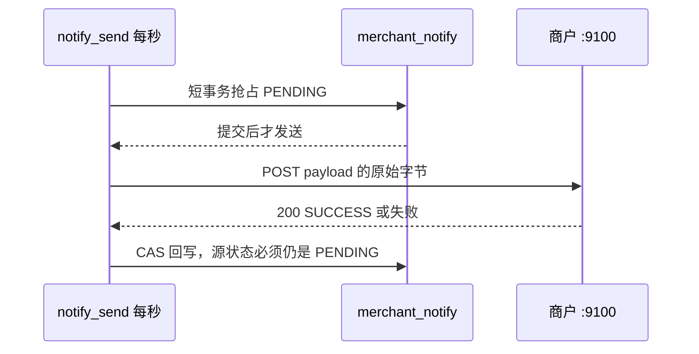

# NTF-02 通知发送与固定间隔重试

| 项 | 内容 |
|---|---|
| 功能点 | NTF-02（P0，第 5 周） |
| 所属链路 | 支付 |
| 代码提交 | `81d2262` `[NTF-02] add notify send` |
| 分支 | `feat/NTF-02-notify-send` |
| 日期 | 2026-11-11 |
| 状态 | DONE |

## 一句话结论

payment 每秒抢占到期的商户通知，在事务外面最多 20 路 POST 给商户。HTTP 200 且正文去掉首尾空白后恰好是 `SUCCESS` 才写成成功；一直失败则固定隔 30 秒再试，第 5 次仍失败写成死信。证据是 `TestNTF02DemoFailThenSuccessAndTamperedKey`、`TestNTF02WritebackZeroRows`、`TestNTF02FiveAttemptsDead`，以及 `/tmp/ntf02-verify.log`（2026-11-11 11:01:20 开始，11:05:50 写完，3743 行，脚本退出码 0）。这份日志对应的代码就是上面的提交，日志写完之后没有再改代码。

## 1. 背景

### 1.1 系统简介

pay-system 是一个用 Go 编写的小型支付后端，模拟商户收款、退款、商户间转账三条资金链路，重点在数据一致性和性能。系统由 5 个部分组成：gateway（对外 HTTP 入口，负责签名校验和限流）、payment（支付单、退款单、转账单的状态管理和流程推进）、account（账户余额与记账，数据按商户分到 2 个数据库分片）、channel-mock（模拟微信、支付宝这类外部支付渠道）、recon（对账，核对系统内外数据是否一致）。服务之间用 Kitex（本仓库选用的 RPC 框架，就是进程之间的函数调用）同步调用，或通过 Kafka 消息异步通知；数据存在 MySQL 8.4。Redis 只给网关记住“这个随机串已经用过”。所有金额用整数“分”表示，100 分等于 1.00 元。所有记账只追加不修改。当前已完成：工程骨架、账户与三条链路的订单和入账、Kafka 投递与消费、通知记录的生成、商户演示接收端，以及本功能点的发送与重试。

### 1.2 本功能点在系统中的位置

支付成功、退款成功、退款失败、转账成功、转账失败，这五种事件会先在 payment 库的表 `merchant_notify` 里各插入一行。插入是上一功能点做的。插入时状态是 `PENDING`（还没发出去），尝试次数是 0，下次允许发送的时间就是插入当时。本功能点不插入新行，只把已经存在的行 POST 出去，再按响应改状态。

POST 的正文是这一行 `payload` 列里存好的 JSON 字节，发送时不再重新拼。支付成功的正文里有 `merchant_id`，以及 `data.pay_no`。退款正文用 `data.refund_no`，转账正文用 `data.transfer_no`。商户就靠这三个单号认出“这一笔已经处理过”。



发送不改账户余额。记账凭证是一条只追加、不修改的资金记录，用来说明余额为什么变化。本功能点不写凭证。

merchant-demo 是测试用的商户进程，听 `:9100`。它不是真实商户。测试把它的前 3 次正确通知配成失败，用来看平台会不会再试。

### 1.3 为什么需要它

一笔 10000 分（100.00 元）的支付已经成功，手续费 60 分（0.60 元）也已经入账。表里有一行通知，状态是 `PENDING`。如果没有发送任务，这行会永远停在这里，商户只能自己来查单，收不到“支付成功”的推送。

演示进程可以故意让同一个支付单号前 3 次返回失败。平台必须隔 30 秒再试，第 4 次收到成功后停止。如果第 5 次仍失败，就要停下来并计数，不能无限制地打商户。真实商户不一定前 3 次都失败；这个前 3 次是测试开关，用来证明重试停得对。

## 2. 术语

| 术语 | 含义 |
|---|---|
| `merchant_notify` | payment 库里的通知表。一行对应一次要发给商户的事件。本功能点不新建表。 |
| `PENDING` | 还要发送或还要重试。 |
| `SUCCESS` | 商户已经按规则确认收到。终态，不再发送。 |
| `DEAD` | 不再自动发送。白名单不通过，或失败次数用尽。 |
| `attempt_count` | 已经抢占过几次。抢占时加 1，还没等 HTTP 回来。 |
| `next_attempt_at` | 下次允许抢占的时刻。抢占时写成“现在加上重试间隔”。 |
| `payload` | 这一行要 POST 的 JSON 字节。发送时原样拿出去，不重新编码。 |
| 业务单号 | 一笔业务的平台单号，也是日志里的 `biz_no`。支付是 `pay_no`，退款是 `refund_no`，转账是 `transfer_no`。演示进程按这个字符串分开计数。 |
| CAS | 比较并交换。更新语句带上旧状态 `PENDING`。别的实例已经改成终态时，影响行数是 0，这次结果丢掉。 |
| `SKIP LOCKED` | 行锁还被别的事务拿着时，这条查询跳过那一行，不排队等待。锁提交放开之后，如果下次时间又到了，下一轮可以再抢同一行。 |
| 平台签名 | 平台发给商户的 HMAC-SHA256。拼接是：时间戳、换行、16 位随机串、换行、正文 SHA-256 的 64 位小写十六进制。结果是标准 Base64，放在 `X-Signature`。 |
| 白名单 | 环境变量 `NOTIFY_URL_ALLOW_HOSTS` 里的主机名。比较的是 URL 字符串里的主机，不先做 DNS 再比较。真正拨号仍按 URL 去连。默认名单是名字 `merchant-demo`，它不等于 `127.0.0.1`。连演示进程的测试把名单改成 `127.0.0.1`，地址写成 `http://127.0.0.1:9100/notify`。 |
| `NOTIFY_RETRY_INTERVAL` | 两次尝试的固定间隔，默认 30 秒，允许是 0。这不是扫描间隔。 |
| `NOTIFY_MAX_ATTEMPTS` | 最多几次，默认 5，至少 1。第 5 次仍失败就 `DEAD`。 |
| 注入时钟 | 业务代码不自己取墙上时间，而是用调用方传进来的时钟。生产传真实时钟。测试传可以拨快的假时钟，所以不用真的等 30 秒。写进数据库的时间截断到毫秒，时区固定为东八区，和这张表已有的时间列同一精度。 |
| merchant-demo | 已有的演示进程，听 `:9100`。验签通过后按业务单号计数。前 N 次返回 HTTP 500，正文 `FAIL`；之后返回 HTTP 200，正文 `SUCCESS`。签名不对返回 401，这个单号的计数不加。 |
| `pay_notify_attempts_total{result="dead"}` | 真正写成 `DEAD` 的次数。目前只在进程内存里用一个整数累加。进程重启后从 0 开始。HTTP `/metrics` 还没有，那是后面的指标功能。 |
| 查单 | 支付发给外部渠道后如果超时，另一个任务会按“下次查询时间”再去问渠道。它和商户通知是两条任务。下文只用它的一条跳过规则做对比。 |
| 故障点 | 测试可以按名字在指定位置把进程杀掉。这次没有新名字。 |
| IDL | 描述 RPC 接口的文件。改了它才要重新生成代码。这次没改。 |

## 3. 技术讲解

### 3.1 要解决的问题

1. 多个 payment 进程同时跑时，同一行在锁还没放开时只被一个进程抢走。
2. HTTP 不能放在数据库事务里。事务只做抢占，提交之后再发送。
3. 商户地址的主机名必须仍在白名单里。不在名单里不发 HTTP，直接 `DEAD`。
4. 用该商户的密钥做平台签名。密钥为空或签不出来：这次不发送，错误文本只有 `internal error`，日志里没有密钥。
5. 只有 HTTP 200 且正文去掉首尾空白后恰好是 `SUCCESS` 才算成功。小写 `success`、201、重定向到成功页，都不算。
6. 失败后按固定间隔再试，不是越等越久。第 5 次仍失败才 `DEAD`。
7. 回写时如果这行已经不是 `PENDING`，丢掉这次结果，不报错，也不再改它。

### 3.2 方案

任务名叫 `notify_send`。进程启动后每 1 秒调用一次 `RunNotifyBatch`。这 1 秒是扫描间隔。重试间隔写在行的 `next_attempt_at` 上。

一轮的顺序：

1. 短事务，最多 3 秒。查出最多 100 行：状态是 `PENDING`，并且 `next_attempt_at` 已经到点。`FOR UPDATE SKIP LOCKED`，按 `next_attempt_at` 排序。这 3 秒用完还没提交：事务回滚，这一轮返回超时，不发送。因为还没提交，次数不会留下。
2. 同一事务里把这些行的 `attempt_count` 加 1，`next_attempt_at` 改成“这次的现在 + 重试间隔”，并显式写 `updated_at`。这张表的 `updated_at` 会在更新时自动改成数据库自己的时间，所以必须写成注入时钟，截断到毫秒，固定东八区。不改 `status`。这张表没有版本列。
3. 提交，行锁放开。然后在事务外发送，同时最多 20 个。一个失败不取消其余 19 个。批次被取消时，不再启动新的发送。已经发出去的请求用自己的 5 秒超时走完，然后仍然按结果做下面的回写，不因为批次取消就丢掉结果。
4. 发送前用 URL 解析器读 `notify_url`，不是做 DNS。必须是 `http` 或 `https`，主机名非空，并且主机名字符串在白名单里（大小写不敏感）。否则直接准备写成 `DEAD`，不发 HTTP。主机名有，但没进名单：`last_error` 是 `host not allowed`。URL 解析器失败、没有主机、或不是 http/https：`last_error` 是 `notify url invalid`。
5. 按 `merchant_id` 解密商户表里的 `app_secret`。商户配置缓存只放状态和默认通知地址，故意不放密钥，避免密钥在缓存里多留一段时间。商户被停用但密钥非空，仍然签名并发送：规则没有说停用后就拒绝通知。密钥为空、查不到、解密失败、或签名函数拒绝：不发 HTTP，`last_error` 恰好是 `internal error`，打一条 ERROR，字段只有商户号、业务单号和错误码 `10003`。然后按失败规则决定留在 `PENDING` 还是 `DEAD`。
6. POST 的就是 `payload` 列的原始字节。头是 `Content-Type: application/json`、`X-Timestamp`、`X-Nonce`、`X-Signature`。随机串 16 位，字符集是大小写字母和数字。客户端超时 5 秒，不跟随重定向。响应体只读前 1024 字节。
7. 回写在发送之后，另一次 SQL，不在抢占事务里。成功：状态改 `SUCCESS`，记下 HTTP 200，`last_error` 置空，写 `succeeded_at`。失败但次数还没到上限：保持 `PENDING`，只写 `last_http_status` 和 `last_error`（文本是 `notify failed`）。次数已经到上限，或白名单失败：状态改 `DEAD`。三条更新都带 `WHERE id = ? AND status = 'PENDING'`。影响 0 行就返回，不加死信计数，也不再更新。只有这次确实写成 `DEAD` 时，内存计数加 1，并再打一条 ERROR。

抢占 SQL 的更新是：

```sql
UPDATE merchant_notify
   SET attempt_count = attempt_count + 1,
       next_attempt_at = ?,
       updated_at = ?
 WHERE id IN (?) AND status = 'PENDING'
```

回写成功用的是：

```sql
UPDATE merchant_notify
   SET status = 'SUCCESS', last_http_status = ?, last_error = NULL,
       succeeded_at = ?, updated_at = ?
 WHERE id = ? AND status = 'PENDING'
```

生产进程有真实时钟，也使用 MySQL。测试可以不装这两者。没装上发送任务、没有时钟、或当前存储不是 MySQL 时，这一轮返回已有的内部错误 `10003`，不抢占。调用方已经取消的上下文，在查库之前就返回取消。

### 3.3 为什么这样做

| 方案 | 做法 | 优点 | 缺点 | 结论 |
|---|---|---|---|---|
| 采用：短事务抢占，事务外发送，CAS 回写 | 锁只覆盖加次数和推后时间 | 发送的 5 秒不占着行锁 | 抢占提交之后、回写之前进程崩溃，HTTP 可能已经发出，行仍是 `PENDING`，到点会再发一次 | 采用。商户按单号自己去重 |
| 备选：套用查单的跳过 | 查单在抢占并把下次时间推后之后，如果新的下次时间已经不超过这一轮开始的时刻，就认为间隔太短，这次不去问渠道 | 避免间隔配得太短时连续打外部系统 | 通知的间隔允许是 0。推后的下次时间等于现在，也等于这一轮的开始时刻，于是每一次都会被这条检查丢掉，一行都发不出去 | 不采用。通知只学三件事：跳过别人还锁着的行、次数加 1、推后下次时间 |
| 备选：任务自己睡 30 秒 | 扫描间隔改成重试间隔 | 代码短 | 一行还没到期时，别的已经到期的行也要等；测试得等满墙钟 | 不采用。扫描是 1 秒，间隔写在行上 |

平台不保证只通知一次。一批发送如果比这一行的间隔还慢，锁在提交时已经放开，下一轮扫描可以再抢到同一行，再 POST 一次。这和“锁还被别人拿着时跳过”不矛盾：跳过只发生在锁还没放开的时候。

### 3.4 正确性

通知不移动余额，不写记账凭证。动钱的外部调用如果超时，不能当成失败把钱退掉，因为对方可能已经成功。通知不改余额，超时就当成这一次没送到，到点再发。商户按单号去重，多收一次不会重复入账。

| 场景 | 系统行为 | 最终状态 | 证明 |
|---|---|---|---|
| 同一行被抢到之后再跑一轮，下次时间还没到 | 第二轮抢不到 | `attempt_count` 仍是 1，状态仍是 `PENDING` | `TestNTF02FiveAttemptsDead` 里把时钟只向前拨 29 秒的那一次 |
| 测试自己在另一条数据库连接上用 `FOR UPDATE` 锁住一行，锁还没提交 | 发送任务的查询跳过这一行，拿走另一行 | 被测试锁住的那一行次数仍是 0，因为它根本没被抢占更新。另一行变成 `SUCCESS` | `TestNTF02SkipLocked` |
| 发送过程中另一实例已经写成 `SUCCESS`，并把 `last_error` 写成 `kept` | 本次收到 HTTP 500，回写影响 0 行 | 状态保持 `SUCCESS`，`last_error` 仍是 `kept`，HTTP 状态列仍是空。死信计数不加 | `TestNTF02WritebackZeroRows` |
| 抢占已经提交，HTTP 结果还没写回时进程退出 | 次数已经加过，下次时间已经推后。进程起来后要等到那个时刻再发。提交之前就退出的话，事务回滚，这次 HTTP 还没开始 | 行仍是 `PENDING`。商户可能已经收到过一次 | 抢占和发送分属两个阶段。没有单独把进程杀死的测试 |
| 商户 5 秒内没有响应 | 当成发送失败。次数未满则保持 `PENDING` | `last_error` 是 `notify failed`。没有拿到响应时，HTTP 状态列是空 | `TestNotifyRejectsNonSuccess` 覆盖非成功响应。传输错误由发送函数返回“没有状态码” |
| merchant-demo 前 3 次失败、第 4 次成功 | 四次都发出去，第 4 次回写成功 | 这一行 `SUCCESS`，`attempt_count = 4`。`GET /stats?biz_no=` 后面跟上这个支付单号，返回的 `count` 是 4 | `TestNTF02DemoFailThenSuccessAndTamperedKey` |
| 一直返回 HTTP 500 | 假时钟每次加 30 秒，共 5 次 | `DEAD`，相邻两次的 `next_attempt_at` 相差 30 秒，死信计数加 1 | `TestNTF02FiveAttemptsDead` |
| 另一行改用另一把密钥 | 演示对这个新单号返回 401，不给这个单号加计数 | 新行仍是 `PENDING`，`last_error` 是 `notify failed`，HTTP 状态 401。`GET /stats` 用这个新单号查，`count` 是 0。前一个单号的 4 不变 | 同一个测试的后半段 |
| 密钥为空 | 5 次都不发 HTTP | 第 5 次 `DEAD`，`last_error` 恰好是 `internal error` | `TestNTF02EmptySecretBecomesDead` |
| 主机不在白名单 | 不发 HTTP | 第 1 次就 `DEAD`，`last_error` 是 `host not allowed`，计数加 1 | `TestNTF02HostNotAllowedIsDead` |

### 3.5 性能

不涉及对比开关。本功能点没有性能开关。一轮最多 100 行，同时发送不超过 20。单次 HTTP 上限 5 秒。

## 4. 已完成内容

### 4.1 改动清单

| 文件 | 新增 / 修改 | 作用 |
|---|---|---|
| `service/payment/job/notify_send.go` | 新增 | 每秒调用一次发送批次。任务名 `notify_send` |
| `service/payment/biz/notify_send.go` | 新增 | 抢占之后的发送、签名、白名单、回写和死信计数 |
| `service/payment/biz/notify_send_sql.go` | 新增 | 抢占和 CAS 回写的 SQL |
| `service/payment/biz/merchant.go` | 修改 | 按商户号解密密钥，不放进商户配置缓存 |
| `cmd/payment/main.go` | 修改 | 装上已有的重试间隔、次数上限，并注册这个任务 |
| `service/payment/biz/notify_send_test.go` | 新增 | 不连数据库的发送规则 |
| `service/payment/biz/notify_send_integration_test.go` | 新增 | 连 MySQL 和真实 merchant-demo |

### 4.2 对外变化

| 类别 | 变化 |
|---|---|
| 接口 | 平台通知从“只落库”变成会 POST。字段和错误码没有新增。接口文档从 3.4.0 改为 3.4.1 |
| 表结构 | 无。不新增迁移。抢占和回写显式写 `updated_at` |
| 配置项 | 无。沿用 `NOTIFY_RETRY_INTERVAL`、`NOTIFY_MAX_ATTEMPTS`、`NOTIFY_URL_ALLOW_HOSTS` |
| 错误码 | 无。签名失败沿用 `10003`，只写进日志和 `last_error` 的固定英文，不给商户新的数字码 |
| 指标 / 故障点 | 进程内死信计数加 1 的条件已经接上。没有指标采集客户端，也没有新的故障点名字 |

### 4.3 验收对照

| 验收条目 | 测试函数 | 类型 | 结果 |
|---|---|---|---|
| merchant-demo 前 3 次失败，第 4 次成功，记录 `SUCCESS` 且 `attempt_count = 4` | `TestNTF02DemoFailThenSuccessAndTamperedKey` | 集成 | 通过 |
| 发送期间记录被改成 `SUCCESS`，失败回写影响 0 行，`last_error` 不变 | `TestNTF02WritebackZeroRows` | 集成 | 通过 |
| 一直失败时假时钟推进后共 5 次，相邻间隔 30 秒，状态 `DEAD` | `TestNTF02FiveAttemptsDead` | 集成 | 通过 |
| merchant-demo 验过签名；篡改密钥后验签失败 | `TestNTF02DemoFailThenSuccessAndTamperedKey` | 集成 | 通过。前一个支付单号的统计是 4，说明签名被接受。后一个新单号返回 401，该单号统计是 0 |

### 4.4 验证记录

环境：go1.27.2 darwin/arm64，golangci-lint 2.14.0。日志 `/tmp/ntf02-verify.log`。

| 命令 | 结果 |
|---|---|
| `gofmt -l .` | 无输出 |
| `make lint` | `0 issues.` |
| `make test` | 通过。根包 5.825 秒，payment biz 6.037 秒，payment job 1.613 秒 |
| `make test-integration` | 通过。根包 37.364 秒，payment biz 125.125 秒 |
| `make cover` | 通过。合计 39.2%（含生成代码，不作门槛）。payment 的业务包 84.6%。账户业务包 90.8%，模拟渠道业务包 91.7%。金额包、签名包是 100%，单号包 88.1%，待投递事件包 88.9%。这些包的门槛是 70%。日志末尾删除了覆盖率文件，并打印 `no_coverage_out` |

没有改 IDL，所以没有重新生成 RPC 代码。没有跑流程图渲染，没有新增图片。

### 4.5 同步的文档

- 需求仍是 v3.0。NTF-02 在总表改为 DONE，四条验收打勾。变更记录有 2026-11-11 这一行。第 5 周计划里“通知记录、商户演示、固定间隔重试”这一行打勾。后面两行还没打勾。
- 约定改为 v2.31，任务名登记 `notify_send`。没有新的错误码、单号前缀或环境变量。
- 接口文档改为 3.4.1，写明 payment 会发送。
- 流程图改为 v2.52，只改图下面的说明，图里的节点没改。
- 表结构文档补了抢占和回写会显式写 `updated_at`。没有改表。

## 5. 未完成与风险

- 死信计数还在进程内存里。进程重启后从 0 开始。把它暴露到 `/metrics` 是后面的指标功能。数据库里的 `DEAD` 状态不会因为重启丢。
- 抢占提交之后、回写之前如果进程退出，商户可能收到一次，行仍是 `PENDING`，到点会再发。这是允许的，商户按单号去重。
- 验收里的演示进程要占用本机 `:9100`。这个端口已经被别的进程听着时，测试会失败。没有另做可配置的监听端口。
- 一批发送如果超过这一行的重试间隔，同一行可能被下一轮再抢到。这是故意不套用查单跳过规则的结果。

## 6. 如何复现

需要本机 Docker（MySQL 8.4 由测试自己拉起）以及能编译的 Go 1.27。`:9100` 要空着。在仓库根目录：

```bash
gofmt -l .
make lint
make test
make test-integration
make cover
rm -f coverage.out
```

`make test-integration` 里的 `TestNTF02DemoFailThenSuccessAndTamperedKey` 会启动 merchant-demo。前 3 次 HTTP 500，第 4 次这一行变成 `SUCCESS`，`attempt_count` 为 4。`GET /stats?biz_no=` 加上这个支付单号，`count` 为 4。随后另一行用另一把密钥发送，这一行保持 `PENDING`，HTTP 状态 401。用这个新单号去查统计，`count` 是 0。

本次完整输出在 `/tmp/ntf02-verify.log`。末尾是 `cover_exit=0`、`no_coverage_out`、`script_exit=0`。

## 7. 讲解要点

- 问：为什么抢占时就把次数加 1，而不是等商户响应之后再加？答：两个进程必须在发 HTTP 之前把行占住。次数和 `next_attempt_at` 在短事务里一起改，提交后锁就放了。HTTP 的 5 秒不占行锁。
- 问：间隔配成 0 会怎样？答：推后的下次时间等于现在，下一轮扫描还能再抢到。所以不能套用查单那种“推后之后如果新时间已经不超过本轮开始时刻就丢掉”，否则每一次都不发送。
- 问：商户已经把行改成成功，这次失败回写会不会把 `last_error` 盖掉？答：不会。更新条件里还有 `status = 'PENDING'`。影响 0 行就停，死信计数也不加。

## 延伸阅读

- `docs/02-requirements.md` 的 NTF-02
- `docs/05-api.md` 的 §6
- `docs/06-flows.md` 的 SL-08、CF-21
- `docs/database.md` 的 `merchant_notify`
- `docs/03-conventions.md` 的 §7.5 任务名 `notify_send`

## 修订记录

| 日期 | 提交 | 修订内容 |
|---|---|---|
| 2026-11-11 | 待提交 | 首版 |
