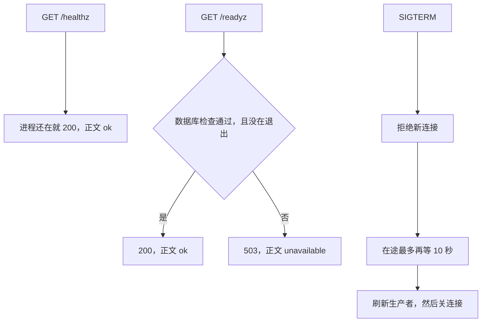
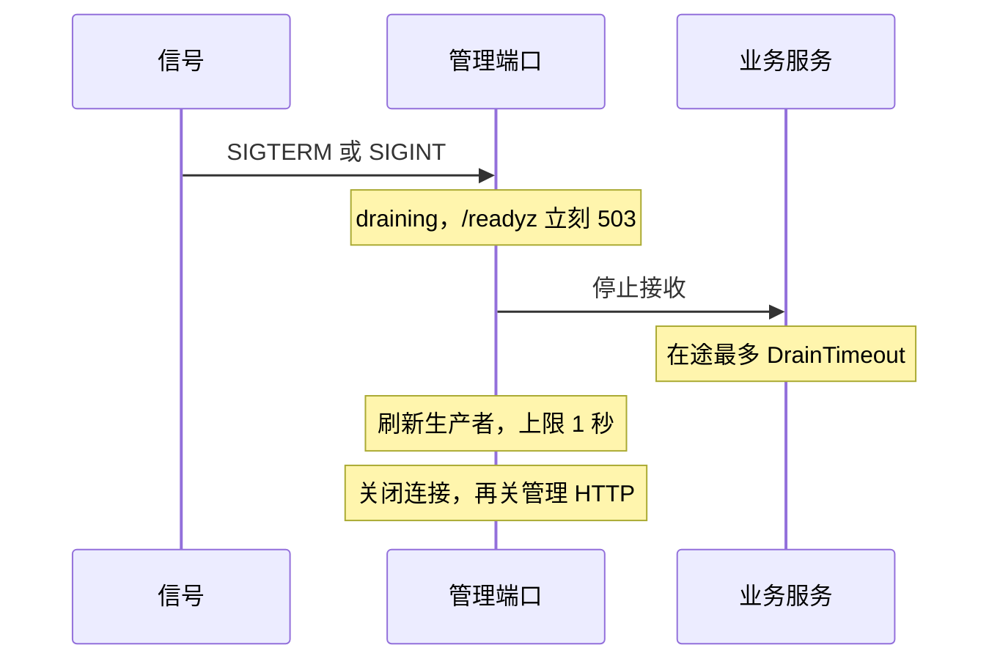

# OPS-01 健康检查与优雅退出

| 项 | 内容 |
|---|---|
| 功能点 | OPS-01（P0，第 3 周） |
| 所属链路 | 基础设施 |
| 代码提交 | `7f9b2f6` `[OPS-01] add health and shutdown`（完整 `7f9b2f6b94a2b23e65f771ad79c284ce6f8b631f`，2026-11-01 20:28:23 +0800） |
| 分支 | `feat/OPS-01-health` |
| 日期 | 2026-11-01 |
| 状态 | DONE |

本报告写在上面这次代码提交之后，不在那次提交的文件里。支付单查询已经完成。本次给进程加上存活检查、就绪检查，以及收到退出信号后的排空。网关 HTTP、pprof、指标、Kafka 投递都还没做。

## 一句话结论

进程还在服务管理端口时，`GET /healthz` 返回 200，正文 `ok`。依赖检查失败，或者进程正在退出时，`GET /readyz` 返回 503，正文 `unavailable`。收到 SIGTERM 后先拒绝新的业务连接，已经在处理的请求最多再等默认 10 秒，然后关闭已注册的连接。证据是 `TestShutdownReadyzAndInflight`、`TestShutdownDoesNotWaitPastDrain`、`TestReadyzFollowsDatabase`。

## 1. 背景

### 1.1 系统简介

pay-system 是一个用 Go 编写的小型支付后端，模拟商户收款、退款、商户间转账三条资金链路，重点在数据一致性和性能。系统由 5 个部分组成：gateway（对外 HTTP 入口，负责签名校验和限流）、payment（支付单、退款单、转账单的状态管理和流程推进）、account（账户余额与记账，数据按商户分到 2 个数据库分片）、channel-mock（模拟微信、支付宝这类外部支付渠道）、recon（对账，核对系统内外数据是否一致）。服务之间用 Kitex RPC 同步调用，或通过 Kafka 消息异步通知；数据存在 MySQL 8.4，Redis 用于防重放。所有金额用整数“分”表示，所有记账只追加不修改。当前已完成：工程骨架、账户、模拟渠道、商户凭证与费率、故障注入、创建支付单、发起支付、outbox 写入、支付结果推进、商户关单、支付单查询，以及本次健康检查与优雅退出。网关 HTTP、pprof、指标、Kafka 投递都还没做。

上面这段里还没展开的词：Kitex 是本项目的 Go RPC 框架，RPC 是一个进程同步调用另一个进程里的函数。签名校验用密钥确认报文没有被改过；限流限制单位时间内的调用次数。这两件事都在 gateway，本次不做网关 HTTP。Kafka 是异步消息队列，把消息投递出去还没做。分片是把账户数据按商户拆进 2 个库。1 元 = 100 分，金额全程用整数。记账只追加，是指账本只插入新行，不回头改旧行。本次不改余额，不写分录，也不改支付单。Redis 防重放是系统别处的能力，本次不连接 Redis。P0 是必须先做的优先级。

创建支付单、发起支付、支付结果推进、商户关单、支付单查询已经能在 payment 里工作。outbox 是和业务写在同一事务里、稍后才发送的消息表，发送是以后的投递器。商户凭证是商户身份和密钥，费率是算手续费用的比例。故障注入是测试时故意让某一步失败的开关。这些都不是本次改的业务。

管理端口是给本机探活用的 HTTP 端口，不是商户下单的端口。`/healthz` 只回答进程还活着没有。`/readyz` 回答现在能不能接新流量。SIGTERM 是要求进程退出的信号。排空是退出前的一段等待：先不接新的，再给已经进来的请求一点时间做完。默认这段等待最多 10 秒。pprof 是进程的性能采样页面，指标是 `/metrics` 上的计数。两者本次都返回 404，分别留给以后的 OPS-05 和 OPS-03。

### 1.2 本功能点在系统中的位置

本次真正监听管理端口的是 payment、account、channel-mock。gateway 和 recon 只有端口常量，进程仍是打印配置后返回。merchant-demo 没有管理端口，本次不加。



图里的 10 秒是生产默认上限，测试可以注入更短的值。payment 的数据库是一个库。account 是两个分片，按顺序各 Ping 一次。channel-mock 也是一个库。Redis、Kafka 不在这张图的失败条件里：没注册就不会让 `/readyz` 失败。探活没有签名，也没有支付错误码。

### 1.3 为什么需要它

部署或停止容器时，进程会收到 SIGTERM。假设 payment 里已经有一个请求，还要大约 1 秒才把响应写完。如果进程立刻退出，这个请求被掐断，调用方看不到 200。

如果数据库已经连不上，而 `/readyz` 仍返回 200，新的支付请求还会被送进这个进程。如果失败正文里带上数据库连接串，地址和口令会出现在探活结果里。

所以分成两个路径：进程还在，`/healthz` 就是 200；依赖失败或正在退出，`/readyz` 就是 503，正文固定为 `unavailable`。退出时先拒绝新连接，在途请求最多再等默认 10 秒，然后关连接。编排侧的停止宽限是 15 秒，比这 10 秒长，留给进程自己排完。本次没有启动那些占位容器，15 秒没有用真实的 `docker stop` 测过。

## 2. 术语

按正文第一次出现的顺序。

| 术语 | 含义 |
|---|---|
| 管理端口 | 本机探活用的 HTTP 端口。不是商户下单的端口，不签名。 |
| `/healthz` | 存活检查。进程还在服务这个端口就返回 200，正文 `ok`。数据库失败或正在退出时也是 200。 |
| `/readyz` | 就绪检查。依赖都通过才 200。任一失败、正在退出，或没注册数据库检查，都是 503，正文 `unavailable`。 |
| 200 / 503 | HTTP 状态。200 表示成功。503 表示现在不能接新流量。 |
| 依赖 | 这里指进程回答“可以接流量”之前要确认的东西。本次必查的是数据库。 |
| SIGTERM | 要求进程退出的信号。生产路径同时监听 SIGINT，进入排空之后不区分是哪一个。 |
| SIGINT | 另一种退出信号，通常来自终端中断。和 SIGTERM 登记在同一个通道上。 |
| 排空 | 退出前的固定顺序：先让 `/readyz` 变成 503，停止接收，等待在途，再刷新生产者并关连接。 |
| `DrainTimeout` | 等待在途请求的上限。生产默认 10 秒，测试可以注入。 |
| `DefaultDrainTimeout` | 这个默认值，10 秒。 |
| gateway | 对外 HTTP 入口。本次不监听管理端口。 |
| payment | 支付单所在的进程。管理端口 `:6061`，本次监听。 |
| account | 账户进程。数据在 2 个数据库分片。管理端口 `:6062`，本次监听。 |
| channel-mock | 模拟外部支付渠道的进程。管理端口 `:6064`，本次监听。 |
| recon | 对账进程。管理端口常量 `:6063`。本次不监听。 |
| merchant-demo | 模拟商户后台。没有管理端口。 |
| Kitex | 本项目的 Go RPC 框架。payment 和 account 用它提供业务端口。 |
| RPC | 一个进程同步调用另一个进程里的函数。 |
| Kafka | 异步消息队列。本次不连接。 |
| Redis | 内存库。系统别处用它防重放。本次不连接。 |
| 分 | 金额最小单位。100 分 = 1.00 元。类型是 `int64`。本次不改金额。 |
| 分片 | 账户数据按商户拆进 2 个库，编号 0 和 1。 |
| 分录 | 账本上追加的一行。本次不插入。 |
| 支付单 | 商户的一笔收款。本次不改这一行。 |
| outbox | 和业务写在同一事务里、稍后才发送的消息表。本次不写。 |
| 商户凭证 | 商户身份和密钥。本次不改。 |
| 费率 | 算手续费的比例。本次不改。 |
| 故障注入 | 测试时故意让某一步失败的开关。本次不新增故障点。 |
| pprof | 进程性能采样页面，路径 `/debug/pprof/`。本次是 404，留给 OPS-05。 |
| `/metrics` | 运行指标的路径。本次是 404，留给 OPS-03。 |
| Ping | 向数据库发一次连通检查。 |
| DSN | 数据库连接串。里面有地址和口令。失败正文不带它。 |
| `CheckTimeout` | 单项依赖检查的上限，1 秒。刷新生产者的上限也是这 1 秒。 |
| 注册口 | 事先留好的函数。以后把 Redis、Kafka 或生产者登记进来。没登记就不会让 `/readyz` 失败。 |
| Hertz | channel-mock 用的 HTTP 框架。它自己的退出等待本次改成 10 秒。 |
| `ExitWait` | 交给 Kitex 的停服务等待上限。生产设成 10 秒。传入 0 时保留框架默认，已有测试不改。 |
| `stop_grace_period` | 容器编排在停止容器前等待的时间。六个应用服务写成 15 秒。 |
| profile `apps` | compose 里的一组应用容器。默认 `make up` 不启用它。 |
| A1 | 在新克隆的目录执行 `make up` 后全部服务可用。本次不关闭这一项。 |
| 覆盖率 | 测试执行到的语句占该包语句的比例。70% 门禁只覆盖指定的几个包。 |
| `cached` | Go 复用了已有测试结果，没有重跑那个包。 |
| `integration` | 构建标签。带上它才编译连 MySQL 的测试文件。 |
| IDL | RPC 的接口定义文件。本次没改。 |
| `make gen` | 按 IDL 生成代码的命令。本次没运行。 |
| `mmdc` | 把 Mermaid 源图渲染成 SVG 的命令。本次没运行。 |
| SVG | 渲染后的图文件。本次没有新的。 |
| OPS-03 | 以后的功能点：在管理端口暴露 `/metrics`。 |
| OPS-05 | 以后的功能点：在管理端口暴露 pprof。计划里仍未勾选。 |
| GW-04 | 以后的功能点：把 gateway 的 Redis 检查注册到 `/readyz`。 |
| MQ-03 | 以后的功能点：把 payment、account 的 Kafka 检查注册进来，并提供真正的生产者刷新。 |
| QA-01 | 以后的故障演练。压测中对 payment 执行 `docker stop` 仍在这里，本次没做。 |

## 3. 技术讲解

### 3.1 要解决的问题

1. 进程还在服务管理端口时，`/healthz` 必须是 200，正文 `ok`。数据库不可用、正在排空，也仍是 200。管理端口关掉之后就没有这个响应了。
2. `/readyz` 在依赖都通过时是 200，正文 `ok`。数据库没注册、任一检查失败，或正在排空，都是 503，正文 `unavailable`。正文和错误都不含 DSN、地址、口令。
3. 数据库检查是必填的。别的检查即使通过，也不能代替它。
4. Redis、Kafka 只留注册口。没注册时，不因为它们不存在而返回 503。本次不连接 Redis，不连接 Kafka，也不做真正的生产者刷新。
5. 收到 SIGTERM 后按固定顺序退出：`/readyz` 立刻 503，停止接收新的业务请求，在途最多等待 `DrainTimeout`，刷新已注册的生产者，关闭已注册的连接，再关管理 HTTP。生产默认等待 10 秒。
6. 进程监听所有网卡，地址常量是 gateway `:6060`、payment `:6061`、account `:6062`、recon `:6063`、channel-mock `:6064`。宿主机发布仍是 `127.0.0.1`。进程不要绑死 `127.0.0.1`，否则以后容器端口发布会连不上。
7. 不新增错误码，不改 IDL，不新增迁移，不新增环境变量。这不是商户接口。
8. `/metrics` 和 `/debug/pprof/` 是 404。
9. 不改余额，不写分录，不改支付单。

### 3.2 方案

`pkg/server` 在管理端口上只注册两个 GET。进程还活着就写 `ok` 和 200。就绪则先看是不是已经在排空，再跑依赖检查。这段在 `pkg/server/server.go`。

```go
func (s *Server) healthz(w http.ResponseWriter, _ *http.Request) {
	writeText(w, http.StatusOK, "ok")
}

func (s *Server) readyz(w http.ResponseWriter, r *http.Request) {
	if s.draining.Load() || !s.dependenciesReady(r.Context()) {
		writeText(w, http.StatusServiceUnavailable, "unavailable")
		return
	}
	writeText(w, http.StatusOK, "ok")
}
```

正文就是这两个词，没有换行。失败时检查函数返回的原始错误被丢掉，换成固定文本 `unavailable`。所以一条带口令和地址的错误不会出现在响应里。`/metrics` 和 pprof 没有注册，访问得到 404。

没有数据库检查时，`/readyz` 直接 503，后面的其他检查不会把它救成 200。数据库和其他已注册检查并行跑，每一项有自己的超时。其他检查的单项上限是 `CheckTimeout`，1 秒。没注册的项不在列表里，不会失败。

payment 和 channel-mock 各有一个库，用 `PingCheck`。Ping 失败或数据库对象是 nil，都返回 `unavailable`，不带驱动的原文。注册时上限传 0，就会用默认的 1 秒。account 不新写一套 Ping。`Pools.Ready` 导出现有的顺序：先分片 0，再分片 1。每个分片自己的 Ping 超时仍是 1 秒。原来的 `ReadyHandler` 仍是这两个池的 HTTP 处理函数，本次没有把它挂到 `:6062`。

两个分片是串行的。如果外层也只给 1 秒，第一个 Ping 用满 1 秒之后，第二个会被提前取消。所以 account 注册时外层给 2 秒。这段在 `cmd/account/main.go`。

```go
admin.RequireDB(pools.Ready, 2*server.CheckTimeout)
```

管理 HTTP 的 `ReadHeaderTimeout` 是 1 秒，只限制读请求头。`WriteTimeout` 是 3 秒，盖住 account 外层那 2 秒的检查，避免检查还没写完响应就被掐断。

退出顺序在 `Run` 里。生产的三个 `main` 传入 `context.Background()`，排空由信号启动，不是由父 context 取消启动。父 context 已经取消时，派生出来的排空超时不会再等；那不是 SIGTERM 路径。

```go
s.draining.Store(true)
drainCtx, cancel := context.WithTimeout(ctx, s.cfg.DrainTimeout)
s.stopGroups(lives, drainCtx)
cancel()

flushAll(ctx, flushers)
closeAll(closers)
```

`draining` 一设上，`/readyz` 就 503，不必等在途请求结束。然后停止各组接收并等待在途，上限是 `DrainTimeout`。到点就继续，不等还没结束的请求。接着刷新已注册的生产者。一个都没注册时这一步直接返回，是空操作。有注册时，刷新上限是 1 秒。然后关闭已注册的连接，再关闭管理 HTTP。排空期间 `/healthz` 仍是 200。



生产代码在没有注入信号通道时，对 SIGINT 和 SIGTERM 都做 `signal.Notify`，进同一个通道。`Run` 收到通道上的值就开始排空，不看是哪一个信号。验收测试不向操作系统发信号，而是把 `SIGTERM` 写进注入的通道。SIGINT 与 SIGTERM 之后是同一段排空。测试没有再单独写一次 SIGINT。`signals` 的覆盖率是 33.3%，真实 `Notify` 那一支没有被这些测试打到。

Kitex 的退出信号由 `pkg/server` 注入。payment 和 account 自己不再 `signal.Notify` SIGTERM。若两处同时登记，Kitex 会按自己的等待开始停。它的默认等待是 5 秒，短于这次的 10 秒，而且不会先把 `/readyz` 设成 503。生产把 `ExitWait` 设成 `DefaultDrainTimeout`，也就是 10 秒。`ExitWait` 为 0 时不改 Kitex 的等待，已有测试不改。

channel-mock 用 Hertz。它的 `exitWait` 从 3 秒改成 `DefaultDrainTimeout`，同样是 10 秒。连接提前结束时 Hertz 会提前返回。不要改回 3 秒。信号仍由 `pkg/server` 收，Hertz 这边不登记信号。

`New` 在 `DrainTimeout` 小于等于 0 时改成 10 秒。生产 `main` 传入的就是这 10 秒。本次测试传入的都是正数，没有走这个改写；`New` 的覆盖率是 66.7%。

gateway 的 Redis 注册留给 GW-04。payment 和 account 的 Kafka 注册，以及真正的生产者刷新，留给 MQ-03。本次三个 `main` 都没有调用这两类注册。

### 3.3 为什么这样做

| 方案 | 做法 | 优点 | 缺点 | 结论 |
|---|---|---|---|---|
| 采用：两个路径，数据库必检，信号后按固定顺序排空 | `/healthz` 只表示进程还在。`/readyz` 看依赖和是否在退出。在途最多 10 秒 | 数据库失败时不会继续接新流量。已经进来的大约 1 秒的请求还能返回 | 要单独维持一个管理端口 | 采用 |
| 备选：只留一个 `/healthz`，依赖失败也返回 200 | 探活只有一种答案 | 实现短 | 进程活着和数据库不可用分不开，退出时也会继续被送进新请求 | 不采用 |
| 备选：进程绑死 `127.0.0.1:6061` 这种地址 | 管理端口只在本机回环上 | 少暴露一个网卡 | 以后容器端口发布连的是容器网卡，不是容器里的回环，探活会失败 | 不采用 |
| 备选：account 的外层也只给 1 秒 | 和单项超时写成同一个数 | 看起来统一 | 两个分片串行，第二个 Ping 会被提前取消 | 不采用 |
| 备选：没注册 Redis 或 Kafka 就让 `/readyz` 失败 | 强制依赖都出现 | 少一条“忘了注册”的可能 | 这两项属于 GW-04 和 MQ-03。本次三个进程会一直 503 | 不采用 |
| 备选：Kitex 自己接收 SIGTERM，等待保持框架默认 5 秒 | 少写一层退出 | payment 原来就是框架自己收信号 | 5 秒短于 10 秒排空，停的顺序和 `/readyz` 立刻 503 对不上 | 不采用 |
| 备选：channel-mock 的退出等待留在 3 秒 | 不改原来的常数 | 改动少 | 3 秒短于默认排空 10 秒 | 不采用 |

### 3.4 正确性

本功能点不改余额，不写分录，不改支付单。资金上的四项都不涉及。下面第一张表就是这四项。第二张表才是健康检查和退出。健康检查的测试不断言余额、分录或支付单，代码路径里也没有这些写入。

| 场景 | 系统行为 | 最终状态 | 证明 |
|---|---|---|---|
| 同一请求重复到达 | 不涉及。没有记账或改单的写路径，不存在“再记一次” | 不产生新的余额、分录或支付单 | 无此类测试 |
| 两个冲突请求并发 | 不涉及。没有两个请求抢同一笔扣款 | 同上 | 无此类测试 |
| 在写入的中途进程崩溃 | 不涉及。没有余额或支付单的写入步骤，没有写到一半的账 | 同上 | 无崩溃后查账的测试 |
| 下游调用超时 | 不涉及。不调用渠道，也不把超时当成支付失败 | 支付单不会因此被改掉 | 代码路径不调用渠道 |

| 场景 | 系统行为 | 最终状态 | 证明 |
|---|---|---|---|
| 进程活着，数据库检查通过 | `/healthz` 与 `/readyz` 都是 200，正文 `ok` | 不改库 | `TestReadyzFollowsDatabase` 在检查恢复之后；`TestAdminReadyzUsesBothShards` 在两个分片都可用时 |
| 数据库不可用，然后恢复 | 不可用时 `/readyz` 是 503、正文 `unavailable`，`/healthz` 仍是 200。正文不含那条带地址和口令的错误。恢复后 `/readyz` 是 200 | 不改库。`/metrics` 与 `/debug/pprof/` 都是 404，响应里也没有那条错误 | `TestReadyzFollowsDatabase` |
| 没注册数据库检查 | 即使另外注册了一项会通过的检查，`/readyz` 仍是 503。`/healthz` 是 200 | 不改库 | `TestReadyzRequiresDatabase` |
| Ping 失败 | 返回的错误文本就是 `unavailable`，不含地址和口令 | 不改库 | `TestPingCheckHidesTarget` |
| 收到 SIGTERM，在途大约 1 秒 | 排空开始后新连接被拒绝。这个 handler 仍返回 200。它结束之前，`/readyz` 已经是 503，`/healthz` 仍是 200 | 不改库。服务器随后退出 | `TestShutdownReadyzAndInflight` |
| 在途超过注入的排空上限 | 到点就返回，不等那个超长 handler 结束。已注册的刷新先于关闭，刷新时 handler 还没结束 | 不改库 | `TestShutdownDoesNotWaitPastDrain`。注入的上限是 40 毫秒，不是真等 10 秒 |
| account 关掉一个分片 | 两个分片都能 Ping 时 `/readyz` 是 200。关掉分片 1 之后是 503，正文 `unavailable`，不含地址或口令。`/healthz` 仍是 200 | 测试自己关掉了分片 1 的连接。功能点没有写余额或分录 | `TestAdminReadyzUsesBothShards` |

验收 1 里大约 1 秒的阻塞写在 handler 里，这是验收规定的在途时间，不是测试用来轮询的 sleep。测试用截止时间轮询。`waitFlag` 在截止时间前空转，这是已知写法，不是要修的缺陷。

生产默认的 10 秒没有在验收 1 里真的等满。验收 2 用 40 毫秒证明“到点就返回”。父 context 已经取消时不等满排空上限，这条没有单独的测试，生产 `main` 也不走它。

### 3.5 性能

不涉及。这次没有压测，没有吞吐或延迟的对比数字。

## 4. 已完成内容

### 4.1 改动清单

这些文件都在代码提交 `7f9b2f6` 里。gateway 和 recon 的 `main` 不在其中。

| 文件 | 新增 / 修改 | 作用 |
|---|---|---|
| `pkg/server/server.go` | 新增 | `/healthz`、`/readyz`、检查注册、按顺序排空 |
| `pkg/server/server_test.go` | 新增 | 验收 1、验收 2、验收 3，以及 Ping 和“必须有数据库” |
| `service/account/dal/ready.go` | 修改 | 导出 `Pools.Ready`。Ping 顺序与原处理函数相同 |
| `service/account/dal/ready_admin_integration_test.go` | 新增 | 两个分片接到管理端口上的 `/readyz` |
| `cmd/account/main.go` | 修改 | 监听 `:6062`。数据库检查外层 2 秒。Kitex 的退出信号改由这里注入 |
| `cmd/payment/main.go` | 修改 | 监听 `:6061`。用 `PingCheck`，单项 1 秒 |
| `cmd/channel-mock/main.go` | 修改 | 监听 `:6064`。业务 HTTP 和调度随这个管理端口排空 |
| `service/account/handler/server.go` | 修改 | 生产退出信号由 `pkg/server` 送入。`ExitWait` 为 0 时不改 Kitex 默认 |
| `service/payment/handler/server.go` | 修改 | 同上 |
| `service/channel_mock/handler/server.go` | 修改 | Hertz 的 `exitWait` 从 3 秒改为 10 秒 |
| `deploy/docker-compose.yml` | 修改 | 六个应用服务各加 `stop_grace_period: 15s` |
| `docs/02-requirements.md` | 修改 | OPS-01 改为 DONE，三条验收勾上 |
| `docs/04-dev-plan.md` | 修改 | 只勾 OPS-01 |
| `docs/05-api.md` | 修改 | 版本到 3.2.0，新增进程探针 |
| `docs/06-flows.md` | 修改 | 版本到 v2.27。CF-31 节点不改 |
| `docs/interview-notes.md` | 修改 | 记下不监听的进程、信号只登记一处、A1 仍开着 |

### 4.2 对外变化

| 类别 | 变化 |
|---|---|
| 接口 | 不是商户接口。管理端口新增 `GET /healthz`、`GET /readyz`，不签名，不用支付错误码。进程监听所有网卡；宿主机发布仍是 `127.0.0.1`。本次会监听的是 payment `:6061`、account `:6062`、channel-mock `:6064`。gateway `:6060` 和 recon `:6063` 只有常量。merchant-demo 没有管理端口。`/metrics` 与 pprof 是 404。IDL 没改，`make gen` 没运行。渠道管理的两条路径仍未实现，和这两个探针不是同一件事 |
| 表结构 | 无。没有新列、新索引，也没有新迁移 |
| 配置项 | 无新的环境变量。compose 里六个应用服务增加 `stop_grace_period: 15s`，这不是进程读的配置项。约定仍是 v2.23 |
| 错误码 | 无新增。失败正文是固定的 `unavailable` |
| 指标 / 故障点 | 无新指标，无新故障点。`/metrics` 仍是 404。压测中 `docker stop` payment 仍属于 QA-01，本次没做 |

### 4.3 验收对照

需求里的三条验收写在表里。account 那一行是同一条数据库验收在两个分片上的测试，不另立一条需求。后面两行是同时被整包命令跑到的补充测试。结果都是通过。这些测试包含在第 4.4 节的整包命令里，没有按名字单独重跑。

验收测试的注释以 `// OPS-01 验收 n` 开头：

- 验收 1：`SIGTERM 后 /readyz 立即 503；阻塞约 1 秒的在途请求仍返回 200；新连接被拒绝；服务器在上限内退出。`
- 验收 2：`在途请求超过上限时，到点退出，不等到请求结束。`
- 验收 3：`数据库不可用时 /readyz 是 503、/healthz 仍是 200；数据库恢复后 /readyz 是 200。`
- account 的集成测试同样标成验收 3：两个分片沿用已有 Ping；都可用时 `/readyz` 为 200；关掉一个分片后为 503，`/healthz` 仍为 200。

| 验收条目 | 测试函数 | 类型 | 结果 |
|---|---|---|---|
| 收到 SIGTERM 后 `/readyz` 立即 503。用阻塞大约 1 秒的 handler 构造的在途请求返回 200。新连接被拒绝。进程在上限内退出 | `TestShutdownReadyzAndInflight` | 单元 | 通过。大约 1 秒是验收规定的阻塞。没有真的等满默认 10 秒 |
| 在途请求超过上限时，到点退出，不等请求结束 | `TestShutdownDoesNotWaitPastDrain` | 单元 | 通过。注入的上限是 40 毫秒，不是真等 10 秒 |
| 数据库不可用时 `/readyz` 返回 503、`/healthz` 仍为 200；数据库恢复后 `/readyz` 返回 200 | `TestReadyzFollowsDatabase` | 单元 | 通过。失败正文不含地址和口令。`/metrics` 与 pprof 为 404 |
| account 两个分片都可用时 `/readyz` 为 200；关掉一个分片后为 503，`/healthz` 仍为 200 | `TestAdminReadyzUsesBothShards` | 集成 | 通过。外层上限 2 秒。每个分片自己的 Ping 仍是 1 秒 |
| Ping 失败时错误文本固定，不含地址和口令 | `TestPingCheckHidesTarget` | 单元 | 通过。补充，不是第四条验收 |
| 没有数据库检查时，其他检查通过也不能让 `/readyz` 变成 200 | `TestReadyzRequiresDatabase` | 单元 | 通过。补充 |

`TestShutdownReadyzAndInflight` 实际走到的路径：先看到 `/healthz` 是 200、正文 `ok`。handler 进入之后写入 SIGTERM。在这个 handler 结束前，`/readyz` 已经是 503、正文 `unavailable`，`/healthz` 仍是 200，业务端口上的新连接被拒绝。handler 随后返回 200、正文 `ok`。`Run` 返回的错误是 nil。

`TestShutdownDoesNotWaitPastDrain` 实际走到的路径：handler 一直不结束。写入 SIGTERM 后，`Run` 返回 nil，并且不是等 handler 结束后才返回。刷新发生在关闭之前，刷新时 handler 还没结束。

`TestReadyzFollowsDatabase` 实际走到的路径：检查返回带地址和口令的错误时，`/readyz` 正文仍是 `unavailable`，`/healthz` 正文仍是 `ok`。`/metrics` 和 `/debug/pprof/` 的状态是 404，正文里也没有那条错误。检查改为成功后，`/readyz` 是 200、正文 `ok`。

`TestAdminReadyzUsesBothShards` 实际走到的路径：两个分片都能 Ping 时，两个路径都是 200、正文 `ok`。关掉分片 1 的连接后，`/readyz` 是 503、正文 `unavailable`，`/healthz` 仍是 200。正文不含地址或口令。

原验收“压测进行中 `docker stop` payment”不在上表里。它仍在 QA-01，本次没有做。

### 4.4 验证记录

日期是 2026-11-01。环境：`go version go1.27.2 darwin/arm64`。golangci-lint 2.14.0，built with go1.27.1，commit `114493f`，时间 2026-09-24T10:54:53Z。当时工作区就是后来提交为 `7f9b2f6` 的那棵树。耗时是 `/usr/bin/time -p` 的 real。`make gen` 会按 IDL 生成代码；IDL 没改，所以没运行。`mmdc` 是把 Mermaid 源图渲染成 SVG 的命令，本次没运行，没有新的 SVG。

| 命令 | 结果 |
|---|---|
| `gofmt -l .` | 无文件名，exit 0，real 0.04s |
| `make lint` | `0 issues.`，exit 0，real 0.99s |
| `make test` | `go test -race ./...`，exit 0，real 4.90s。根包 `ok github.com/yym108/pay-system 4.372s`。`pkg/server` 是 `(cached)`。这次不打印覆盖率 |
| `make test-integration` | `go test -race -tags integration ./...`，exit 0，real 47.94s。根包 `ok github.com/yym108/pay-system 43.082s`。`cmd/account` 1.536s，`cmd/channel-mock` 1.463s，`cmd/payment` 1.547s，`pkg/server` 2.550s，`service/account/biz` 45.963s，`service/account/dal` 11.754s，`service/account/handler` 14.556s，`service/channel_mock/handler` 11.710s，`service/payment/biz` 32.648s，`service/payment/handler` 20.078s |
| `make cover` | `go test -race -tags integration -coverprofile=coverage.out ./...`，然后 `go tool cover -func`。exit 0，real 58.70s。全仓 total 27.9%（含 `kitex_gen` 生成代码，不是门禁）。根包 `ok github.com/yym108/pay-system 48.394s`，coverage `[no statements]`。`pkg/server` 2.552s / 84.0%。`cmd/account` 1.662s / 27.3%。`cmd/channel-mock` 1.577s / 16.4%。`cmd/payment` 1.661s / 39.6%。`cmd/gateway` cached 87.5%。`cmd/recon` cached 87.5%。`service/account/biz` 55.658s / 91.1%。`service/account/dal` 15.680s / 95.2%。`service/account/handler` 14.319s / 83.0%。`service/channel_mock/handler` 13.638s / 95.5%。`service/payment/biz` 40.010s / 86.5%。`service/payment/handler` 20.338s / 85.6%。`pkg/outbox` cached 95.0% |

70% 门禁只覆盖 `service/*/biz`、`pkg/money`、`pkg/sign`、`pkg/idgen`、`pkg/outbox`。上表里 `service/account/biz` 91.1%、`service/payment/biz` 86.5%、`pkg/outbox` 95.0% 不低于 70%。本功能点没有改这些包。`pkg/server` 不在门禁里，84.0% 只是信息。`service/account/dal` 的 95.2% 也不在这个门禁里。

`make cover` 那次，`pkg/server/server.go` 按函数：`FuncGroup` 100.0%，`Serve` 100.0%，`Stop` 100.0%，`New` 66.7%，`RequireDB` 100.0%，`RegisterCheck` 100.0%，`RegisterGroup` 100.0%，`RegisterFlusher` 100.0%，`RegisterCloser` 100.0%，`PingCheck` 66.7%，`Run` 79.1%，`ensureDB` 100.0%，`snapshot` 100.0%，`listen` 33.3%，`signals` 33.3%，`stopGroups` 88.2%，`flushAll` 87.5%，`closeAll` 75.0%，`handler` 100.0%，`healthz` 100.0%，`readyz` 100.0%，`dependenciesReady` 100.0%，`runCheck` 77.8%，`writeText` 100.0%。

`service/account/dal/ready.go`：`ReadyHandler` 100.0%，`Ready` 100.0%，`ready` 100.0%，`ping` 100.0%，`writeText` 100.0%。

cmd 按函数：account 与 channel-mock 的 `run` 50.0%，`runWith` 84.6%，`serve` 0.0%，`main` 0.0%，`Close` 0.0%。payment 的 `serve` 25.0%，`run` 50.0%，`runWith` 84.6%，`main` 0.0%，`Close` 0.0%。gateway 与 recon 的 `run` 100.0%，`main` 0.0%。

`make gen` 未运行。`mmdc` 未运行，没有新的 SVG。

### 4.5 同步的文档

这些文档都在代码提交 `7f9b2f6` 里。约定没有改，仍是 v2.23，没有新配置，也没有新错误码。`docs/03-conventions.md` 没改。表结构文档没改。

- 需求：版本仍是 v3.0。§3 里 OPS-01 为 DONE。三条验收已勾选。变更记录有一行 2026-11-01，版本仍写 v3.0：管理端口提供 `/healthz` 与 `/readyz`；数据库必检，检查可注册；Redis、Kafka 只留注册口，本次不连接，也不因此失败；SIGTERM 后 `/readyz` 立即 503，在途等待上限默认 10 秒且可注入；account 沿用两个分片各自 1 秒的 Ping；端口是 gateway 6060、payment 6061、account 6062、recon 6063、channel-mock 6064；本次进程内监听的是 account、payment、channel-mock；compose 六个应用服务 `stop_grace_period: 15s`；不把 profile `apps` 并入 `make up`；A1 仍不关闭；不新增错误码，不改表，不改商户接口。更早的变更记录没有改。更早功能点自己的句子里若写着“仍属 OPS-01”，那是那些功能点的范围说明，这次没有改那些句子。
- 开发计划：只勾了 OPS-01。OPS-05 仍未勾。
- 接口：从 3.1.8 升到 3.2.0。这是 MINOR，兼容新增。最后修改 2026-11-01。变更记录写明这些不是商户接口，不签名，不使用错误码，不改商户 HTTP，不改 IDL。新增进程探针一节。§9.8 的渠道管理路径仍未实现。同端口上的两个探针和那两条管理路径不是一回事。
- 流程图：现为 v2.27，最后修改 2026-11-01。CF-31 的节点不改。图下有一句：Redis、Kafka 只是注册口，未注册时不因此失败；未注册生产者时刷新为空；account 两个分片仍各自 Ping 1 秒，外层等待 2 秒。没有 `mmdc`，所以没有新的 SVG。变更记录 v2.27 是同一件事，并写了不改资金流向。
- interview-notes：本次新增一节。gateway 和 recon 不监听，6060 和 6063 只有常量。进程不要写成只听 `127.0.0.1`。Kitex 的退出等待默认 5 秒，生产改成 10 秒，并且信号只由 `pkg/server` 登记。account 外层给 2 秒，每个分片自己的 Ping 仍是 1 秒。A1 仍开着。profile `apps` 仍是占位，没有并进 `make up`。`stop_grace_period: 15s` 只写在六个应用服务上。

## 5. 未完成与风险

- gateway 和 recon 的 `run` 仍是打印配置后返回，已有测试断言这个行为。它们不监听。`:6060` 和 `:6063` 只有端口常量。这是已接受的限制，不是还要在本功能点里补上的监听。把它们改成一直阻塞，会破坏那些测试。
- Redis 检查留给 GW-04。Kafka 检查和真正的生产者刷新留给 MQ-03。本次不连接。没注册不会让 `/readyz` 失败。
- `/metrics` 留给 OPS-03，pprof 留给 OPS-05。现在都是 404。计划里 OPS-05 仍未勾选。
- 原验收“压测中 `docker stop` payment”仍在 QA-01，本次没有做，不能写成已经完成。
- profile `apps` 仍不在默认 `make up` 里。gateway、payment、account、recon、channel-mock、merchant-demo 这六个仍是占位进程，退出码仍是 1。不要启动它们。A1 仍开着。merchant-demo 没有管理端口。
- 生产 `serve` 没有在测试里把管理端口跑起来。account 与 channel-mock 的 `serve` 覆盖率是 0.0%。payment 的 `serve` 是 25.0%，已有测试在主密钥或连库失败时返回。三个 `main` 都是 0.0%。`listen` 是 33.3%，测试注入了现成的监听，没有走到真正去绑定端口的那一支。`signals` 是 33.3%，没有走到 `signal.Notify`。
- 父 context 已经取消时，派生的排空超时不会再等。生产传入的是 `context.Background()`。没有专门取消父 context 的测试。
- `waitFlag` 是忙等。这是已知写法，不是要修的缺陷。
- channel-mock 的退出等待不要改回 3 秒。

## 6. 如何复现

在仓库根目录、分支 `feat/OPS-01-health`、代码提交 `7f9b2f6b94a2b23e65f771ad79c284ce6f8b631f` 上执行。环境是 2026-11-01 的 `go version go1.27.2 darwin/arm64`。集成测试沿用已有基座：需要 Docker，或已经设置 `TEST_MYSQL_DSN`。本次记录没有另打印当时连的是哪台库。不要启动 profile `apps` 里的占位容器。

```bash
/usr/bin/time -p gofmt -l .
/usr/bin/time -p make lint
/usr/bin/time -p make test
/usr/bin/time -p make test-integration
/usr/bin/time -p make cover
```

预期与第 4.4 节的表一致。`gofmt -l .` 不打印文件名。`make lint` 打印 `0 issues.`。测试命令的退出码是 0。`make test` 不打印覆盖率。`make cover` 的 total 是 27.9%，不作判据；`pkg/server` 是 84.0%，只是信息。`make gen` 和 `mmdc` 这次没有运行。再跑时墙钟会随机器变化，第 4.4 节的 real 是这次实测。

## 7. 讲解要点

1. 为什么要两个路径？进程活着但数据库失败时，`/healthz` 仍是 200，`/readyz` 是 503。正在退出时也一样：进程还在，但新流量不该再进来。`TestReadyzFollowsDatabase` 覆盖数据库失败和恢复。`TestShutdownReadyzAndInflight` 覆盖退出过程中这两个路径。
2. 为什么 account 外层是 2 秒，每个分片仍是 1 秒？两个 Ping 是串行的。外层若只有 1 秒，第二个分片会被提前取消。Ping 本身的 1 秒没有改。`TestAdminReadyzUsesBothShards` 把这套检查挂到管理端口上，关掉一个分片后 `/readyz` 是 503。
3. 为什么先 503，再等默认 10 秒？先让探活把新流量拿走，再给已经进来的请求时间。验收 1 用大约 1 秒的在途请求证明它还能返回 200，并且在它结束前 `/readyz` 已经是 503、新连接已被拒绝。验收 2 把上限注入成 40 毫秒，证明到点就返回，不是无限等。compose 的 15 秒比这 10 秒长，但是占位容器本次没有启动，压测里的 `docker stop` 仍是 QA-01。

## 延伸阅读

- `docs/02-requirements.md`：OPS-01 的规则和三条验收。版本 v3.0。压测中的 `docker stop` 在 QA-01。
- `docs/05-api.md`：进程探针一节。版本 3.2.0。
- `docs/03-conventions.md`：金额用分。版本仍是 v2.23，本次没改。
- `docs/06-flows.md`：CF-31 图下的那一句。版本 v2.27，SVG 未渲染。
- `docs/04-dev-plan.md`：OPS-01 已勾选。OPS-05 未勾选。
- `docs/interview-notes.md`：本次新增的 OPS-01 一节。
- `pkg/server/server.go`：两个路径和排空顺序。
- `pkg/server/server_test.go`：验收 1、验收 2、验收 3。
- `service/account/dal/ready.go`：两个分片的同一套 Ping。

## 修订记录

| 日期 | 提交 | 修订内容 |
|---|---|---|
| 2026-11-01 | 报告尚未提交 | 首版。对应代码提交 `7f9b2f6` `[OPS-01] add health and shutdown` |
