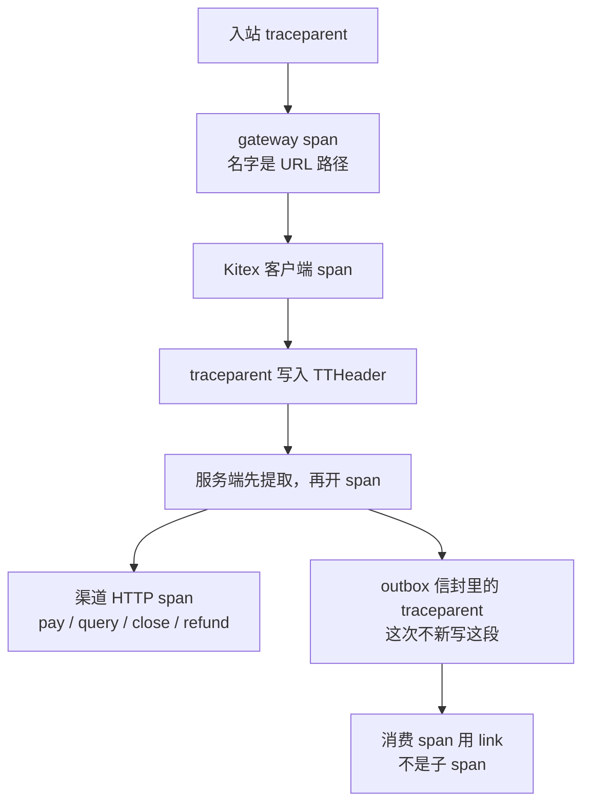

# OPS-02 链路追踪

| 项 | 内容 |
|---|---|
| 功能点 | OPS-02（P0，第 5 周） |
| 所属链路 | 基础设施 |
| 代码提交 | `b900c82` `[OPS-02] add tracing` |
| 分支 | `feat/OPS-02-tracing` |
| 日期 | 2026-11-11 |
| 状态 | DONE |

## 一句话结论

六个进程用 OpenTelemetry SDK，经不加密的 OTLP/gRPC，把 span 发到 Jaeger。网关沿用已有的 trace 中间件，在开 span 之前接上入站 `traceparent`；payment 和 account 的 Kitex 不另加 contrib，客户端把 `traceparent` 放进 TTHeader，服务端在开 span 之前取出来。入账消费和通知消费把信封里的 `traceparent` 做成 link，不做成原 trace 的子 span；这段解析失败仍处理消息，不进死信。证据是 `TestOPS02JaegerPayChain` 以及 `/tmp/ops02-verify.log`（2026-11-11 14:32:19 开始，14:36:34 写完）。日志早于代码提交 `b900c82`（2026-11-11 14:37:54 +0800，作者 yym）。提交之后没有再改代码。

## 1. 背景

追踪只回答「这一笔经过了哪些进程」，不改余额，也不改订单状态。

### 1.1 系统简介

pay-system 是一个用 Go 编写的小型支付后端，模拟商户收款、退款、商户间转账三条资金链路，重点在数据一致性和性能。系统由 5 个部分组成：gateway（对外 HTTP 入口，负责签名校验和限流）、payment（支付单、退款单、转账单的状态管理和流程推进）、account（账户余额与记账，数据按商户分到 2 个数据库分片）、channel-mock（模拟微信、支付宝这类外部支付渠道）、recon（对账，核对系统内外数据是否一致）。另外还有 merchant-demo（商户侧接收通知的演示进程）。服务之间用 Kitex（本仓库选用的 RPC 框架）同步调用，或通过 Kafka（异步消息）通知；数据存在 MySQL 8.4。Redis 给网关记住「这个请求头里的随机串已经用过」。所有金额用整数「分」表示，100 分等于 1.00 元。所有记账只追加不修改。当前已完成：工程骨架、账户与三条链路的订单和入账、Kafka 投递与消费、商户通知的生成和发送、商户验签、时间窗口（时间戳与时钟相差超过 300 秒则拒绝）、nonce（防重放随机串）和进程内商户限流，以及本功能点的链路追踪。

### 1.2 本功能点在系统中的位置

本功能点不插在验签和记账之间做判断。它给已经存在的入口、RPC、渠道 HTTP、消费和定时任务各挂一段 span。同步调用串成父子；消费用 link 指回原来的 trace，自己另起一条 trace。



上图的前五步在同一次请求里是父子关系。最后一步发生在另一条消息上，父 span 通常已经结束，所以只做 link。补偿任务不在这张图里：每一批单独一个 span，名字是任务名，不挂到某张订单的 trace 上。

商户请求和渠道回调 `POST /callback/mockpay` 都从 gateway 的 `:8080` 进来，经过这条 trace 中间件。管理端口 `:8090` 用的是同一条中间件链，只是后面注册的路由不同，所以管理请求也会开一个以路径为名的 span。时间窗口、验签、限流和 nonce 对管理端口仍按原规则跳过，那不是这次改的。gateway 的存活检查在 `:6060`，不走这组中间件。payment 的 Kitex 在 `:8881`，account 的 Kitex 在 `:8882`。本功能点不改这些端口。

### 1.3 为什么需要它

不做这一步的话，一笔支付在网关、payment、渠道、Kafka 和 account 里各有各的日志，对不上是不是同一笔。

验收用的支付单号是 `PA0000000123456789012`。下单正文里的金额是 10000 分（100.00 元）。没有 trace 时，Jaeger 里按这个单号找不到从下单、发起支付、回调到入账消费的四段。有了 trace 之后，这四段 span 都带 `pay_no`，入账那一段的 link 指向下单 span 所在的 trace。官方日志没有打印 trace id，这里不编造。

采样还可以关掉或按比例抽。不认识的采样器名字会让进程起不来，避免静默改成「什么都不记」或「全部都记」。

## 2. 术语

下面每个词都按这一张表的意思使用。

| 术语 | 含义 |
|---|---|
| gateway | 对外的 HTTP 入口。商户接口和渠道回调在 `:8080`，管理接口在 `:8090`。 |
| payment | 管支付单、退款单、转账单的服务。Kitex 端口 `:8881`。 |
| account | 管账户余额和记账的服务。数据按商户分到 2 个数据库。Kitex 端口 `:8882`。 |
| channel-mock | 模拟外部支付渠道的进程。业务 HTTP 在 `:9080`。这次只给它装上导出，没有给每个 HTTP 请求自动建 span。 |
| recon | 对账进程。这次调用安装函数时 `service.name` 传的是 `recon`，装完立刻停止，因为对账任务还没接上。 |
| merchant-demo | 商户侧接收通知的演示进程，听 `:9100`。这次只装上导出，没有给 `POST /notify` 自动建 span。 |
| 分片 | 账户数据拆在 2 个 MySQL 库里。本功能点不选库、不写库。 |
| Kitex | 本仓库选用的 RPC 框架。服务之间的同步调用用它。 |
| Hertz | gateway 用的 HTTP 框架。trace 中间件挂在它上面。 |
| Kafka | 异步消息。投递器把 outbox 行发到这里。本功能点不改生产和消费框架。 |
| MySQL | 关系库，版本 8.4。追踪不连接它，也不改表。 |
| Redis | 内存键值库。nonce 用它记住用过的随机串。追踪不读、不写 Redis。 |
| 分 | 金额的整数单位。100 分等于 1.00 元。span 上不写金额。 |
| 记账 | 给账户追加一笔不修改的余额变动。追踪不记账。 |
| span | 一次操作的一段追踪记录。有名字、起止时间和属性。父子 span 属于同一条 trace。 |
| 根 span | 没有父 span 的 span。一条请求上如果中间件开了两次、又没有把入站 `traceparent` 接成父级，Jaeger 里就会看到两个根。 |
| trace | 同一条请求串起来的若干 span。用 trace id 标识。官方验收日志没有打印 trace id。 |
| trace id | trace 的 32 位十六进制标识。本报告不编造验收那一次的值。 |
| link | span 上的一条引用，指向另一条 trace 里的某个 span。被引用的那边不是父 span，所以这条 span 有自己的 trace id。 |
| OpenTelemetry | 简称 OTel。本仓库用来创建 span、采样和导出的一套 SDK 和 API。 |
| OTLP | 把 span 送出进程的协议。这里用的是 gRPC，而且不加密。 |
| gRPC | 一种 RPC 传输。OTLP 导出走它。它不是业务上的 Kitex。 |
| Jaeger | 收 OTLP 并提供查询的追踪后端。验收容器是 `jaegertracing/jaeger:2.22.0`。 |
| `service.name` | 进程级资源属性。六个进程分别是 `gateway`、`payment`、`account`、`channel-mock`、`merchant-demo`、`recon`。它不是 span 的名字，也不是 Tracer 的名字。 |
| Tracer | 用来 `Start` span 的对象。名字是代码里的仪器范围，例如 HTTP 用 `gateway`，渠道 HTTP 用 `channel`，补偿用 `job`。和 `service.name` 不是同一个字段。 |
| TracerProvider | 进程里实际发 span 的提供者。端点为空时不安装，原来的提供者保持不动。 |
| 采样 | 决定一条 trace 记不记。空的 `OTEL_TRACES_SAMPLER` 等于 `parentbased_always_on`：没有父 span 时全记；有父 span 时跟着父 span 的采样标志。 |
| `traceparent` | W3C 追踪头，形如 `00-<32 位 trace 十六进制>-<16 位 span 十六进制>-<2 位标志十六进制>`。采样标志 `01` 表示记下，`00` 表示不记。 |
| W3C | 定这个 `traceparent` 格式的标准。本仓库只解析版本 `00`、恰好四段的值。 |
| TTHeader | Kitex 用来带业务错误码的传输头。这次另外把 `traceparent` 放进它的持久元信息。原来的 TTHeader 处理函数还在。 |
| 持久元信息 | Kitex 调用里能跟着请求走到服务端的键值。键名是 `traceparent`。客户端中间件写入，服务端在开 span 之前读出。 |
| 验签 | 用商户密钥核对请求签名。没通过的请求不进入业务处理。追踪不改这一步。 |
| 限流 | 验签通过后按请求头 `X-App-Id` 做的进程内令牌桶。超限是 HTTP 429。追踪不改配额。 |
| 时间窗口 | 请求头里的秒级时间戳和网关时钟相差的绝对值。大于 300 秒就在验签之前拒绝。恰好 300 秒仍通过。追踪不改这一步。 |
| nonce | 请求头里的防重放随机串。限流通过之后才按应用占用。追踪不读、不写 Redis。 |
| 平台签名 | gateway 用商户密钥给响应正文签名。追踪不把签名写进 span。 |
| 中间件 | 业务处理之前按固定顺序执行的函数。gateway 的顺序是：请求体上限、接住运行崩溃并返回 500、请求号、追踪、访问日志、时间窗口、验签、限流、nonce、平台签名，然后才是业务处理。管理端口走同一条链。 |
| `tracestate` | 和 `traceparent` 一起的可选追踪头。网关有这个头就交给传播器。本功能点不解析它的内容。 |
| outbox | payment 库里的待发送表。业务在改订单的同一个数据库事务里插入一行，投递器稍后把它发到 Kafka。这次不改插入和投递。 |
| 死信 | 消费端认定这条消息永远不能成功时，写入 `pay.dlq` 后提交位点，分区才能继续。`traceparent` 解析失败不走这条路。信封本身解析失败仍然走。 |
| 补偿任务 | payment 进程里定时跑的一批工作。五类是查单 `query_compensate`、超时关单 `timeout_close`、退款卡单恢复 `refund_recover`、转账恢复 `transfer_recover`、通知发送 `notify_send`。 |
| `errno` | 已有的业务错误类型。span 上如果要写错误，只写它的十进制码，不写错误文本。 |
| hertz-contrib | Hertz 的现成追踪中间件包。这次不引入。再叠一层会多一个根 span。 |
| kitex-contrib | Kitex 的现成追踪中间件包。这次不引入。用已有的 Tracer 接口。 |
| testcontainers | 集成测试用来启动容器的库。验收用它启动 Jaeger，不手写 compose。 |
| `kitex_gen` | 由接口定义生成出来的代码。整仓语句覆盖率把它们算进去，那一个合计不是门禁。 |
| 门禁 | 指定包的语句覆盖率各自不低于 70%。`pkg/obs` 和 `service/gateway` 不在这张名单里。 |
| Docker | 本机上的容器环境。集成测试用它启动 Jaeger、MySQL、Kafka 等。 |

## 3. 技术讲解

导出器按进程安装一次。各处只负责开 span、传 `traceparent`，或在消费时做 link。

### 3.1 要解决的问题

要能在 Jaeger 里把一笔支付的几段对上，同时不能把金额、密钥和签名写进 span。

1. 六个进程的 `service.name` 用进程名。端点来自已有的 `OTEL_EXPORTER_OTLP_ENDPOINT`，默认 `jaeger:4317`。去掉空白和一个 `http://` 或 `https://` 前缀后如果是空的，不安装 Provider。
2. 采样看 `OTEL_TRACES_SAMPLER` 和 `OTEL_TRACES_SAMPLER_ARG`。空名字等于 `parentbased_always_on`。显式允许的名字是 `always_on`、`always_off`、`traceidratio`、`parentbased_always_on`、`parentbased_always_off`、`parentbased_traceidratio`。不认识的名字即使端点为空也启动失败，错误文本含 `OTEL_TRACES_SAMPLER`。比例只接受闭区间 [0,1]；空、非数字或越界也启动失败，错误文本含 `OTEL_TRACES_SAMPLER_ARG`。
3. 网关已有 trace 中间件会开一个 span。不再叠加 hertz-contrib，否则同一条请求多一个根 span。这个中间件在 `Start` 之前提取入站 `traceparent` 和 `tracestate`。
4. 不用 kitex-contrib。payment 和 account 用已有的 Tracer 接口，生产装入 `obs.HandlerSpan`。客户端中间件先开自己的 span，再把当时的 `traceparent` 放进 TTHeader 持久元信息。服务端在 `Start` 之前提取。原来的 TTHeader meta handler 保留，业务错误码仍走那条头。
5. 入账消费和通知消费把信封 `trace_context.traceparent` 做成 link，不是原 trace 的子 span。这段解析失败仍处理消息，不进死信。整封信封解析失败仍是原来的永久错误，会进死信。那不是 `traceparent` 这一段。
6. span 属性只放单号（`pay_no`、`refund_no`、`transfer_no`）、`status`、`err_code`。空字符串不写。不放金额、密钥、签名。
7. 补偿任务每一批一个 span，名字是任务名。同一条循环还包住 `outbox_deliver` 和 `outbox_gauge`，比上面五类补偿多两个。

### 3.2 方案

`obs.Use` 先读采样器。采样器不合法就把错误交回去，调用方退出进程，不换掉已经装上的 Provider。端点非空时用 OTLP/gRPC 导出，通道不加密，资源里只放 `service.name`，然后把全局 Provider 和 W3C TraceContext 传播器换上。停止函数脱离调用方已经取消的上下文，最多再等 2 秒刷出批量 span，再把 Provider 和传播器换回调用前的值。导出器创建失败但不是采样器错误时，打一行 `otel install:` 并继续，返回的停止函数什么都不做。

下面这段在决定装不装导出器。看端点被剥掉协议之后是否为空，以及 `WithInsecure`。

```go
endpoint = stripScheme(strings.TrimSpace(endpoint))
if endpoint == "" {
    return func(context.Context) error { return nil }, nil
}
exp, err := otlptracegrpc.New(ctx,
    otlptracegrpc.WithEndpoint(endpoint),
    otlptracegrpc.WithInsecure(),
)
```

gateway、payment、account、channel-mock、merchant-demo 在进程活着的时候保持这个 Provider。recon 装上之后马上调用停止函数，然后写完配置就退出；对账任务还没接上。

网关中间件先把入站头放进上下文，再以 URL 路径为 span 名。这样外部传来的 `traceparent` 成为父 span，而不是和网关 span 并列的另一个根。导出器不在这里安装。

```go
ctx = obs.ExtractMap(ctx, header)
path := string(c.Request.URI().Path())
ctx, span := otel.Tracer("gateway").Start(ctx, path)
defer span.End()
c.Next(ctx)
```

创建支付成功后才把返回的 `pay_no` 写上 span。发起支付在调用 RPC 之前就用路径里的 `pay_no`。回调在验签和解析通过后用正文里的 `req_no`。这条网关 span 结束时不看 HTTP 状态：429 或 500 也不会把 span 标成 Error。标 Error 的是另外一个结束函数，只有收到非 nil 错误才标。

Kitex 客户端中间件先 `StartClient`，span 名是 RPC 方法名，方法名缺失时用 `rpc`。然后把这个新 span 的 `traceparent` 放进持久元信息，再调用下一层。gateway 的客户端 Tracer 名是 `gateway`。payment 调用 account 时 Tracer 名是 `payment`。`ClientTTHeaderHandler` 仍在，没有换成追踪专用的 meta handler。

服务端在开 span 之前读出这个键。读不到或是空字符串就不提取，span 没有远端父级。随后才 `HandlerSpan.Start`，span 名是方法名。Tracer 名在 payment 进程是 `payment`，在 account 进程是 `account`。结束时如果错误链上有 `*errno.Error`，只追加十进制 `err_code`，不记录错误文本，也不加事件。Kitex 把业务错误放进 invocation 之后会让处理函数返回 nil；结束前会把那个业务错误取回来，所以业务码不会被记成成功。`ServerTTHeaderHandler` 仍负责把业务码放进 TTHeader。

渠道 HTTP 的 span 名是 `pay`、`query`、`close`、`refund`。Tracer 名是 `channel`，进程的 `service.name` 仍是 `payment`。请求头会带上当前 span 的 `traceparent`。签名头照旧发送，但不写进 span。

网络失败会把 span 标成 Error，但原函数对网络失败仍返回 nil error。调用方看到的仍是「结果未知」，不是追踪新造的错误。HTTP 非 200（例如 502）不把 `callErr` 设上，因此不把 span 标成 Error，函数同样返回 nil error。下面是受理路径里这两处的差别：`Do` 失败才记下 `callErr`，状态码不是 200 时直接返回 nil error。

```go
resp, err := c.http.Do(httpReq)
if err != nil {
    callErr = err
    return ChannelAcceptResult{}, nil
}
if err != nil || len(raw) > maxChannelBody || resp.StatusCode != http.StatusOK {
    return ChannelAcceptResult{}, nil
}
```

`query`、`close`、`refund` 走 `exchange`，规则相同：网络错误设置 `callErr`，非 200 不设置。

Kafka 生产这次没有为单条消息新建 span。写入 outbox 时，如果当时上下文里有有效 span，信封 `trace_context` 仍是 `{"traceparent":"00-..."}`。这是上一功能点已经做的。投递器仍把这个值抄进 Kafka 头 `traceparent`，缺失也写键。消费端读的是信封正文里的 `trace_context`，不是消息头。

入账消费在 account 进程，Tracer 名 `account`，span 名 `consume`。通知消费在 payment 进程，Tracer 名 `payment`，span 名也是 `consume`。两边都调用 `StartLinked`：能解析出 `traceparent` 就加一条 link，解析失败仍开 span，且不返回错误。新 span 的 trace id 是新的，不会复用信封里的那个。

```go
if link, ok := LinkFromTraceContext(raw); ok {
    opts = append(opts, trace.WithLinks(link))
}
ctx, span := otel.Tracer(service).Start(ctx, name, opts...)
```

`SetOrder` 只写非空的 `pay_no`、`refund_no`、`transfer_no`、`status`、`err_code`。现有调用把 `status` 和这条参数上的 `err_code` 传成空字符串，所以这两项不会从 `SetOrder` 写出去。`err_code` 来自上面的结束函数。单元测试会把 `status` 以外的非空键写进去，证明空字符串不出属性。

补偿的每一批在 `Loop.runOnce` 里包一个 span。Tracer 名固定为 `job`，span 名是循环名。同一时刻最多一批。五类补偿的名字和间隔是：`query_compensate` 每 1 秒，`timeout_close` 每 5 秒，`refund_recover` 每 10 秒，`transfer_recover` 用配置的间隔（小于等于 0 时这条循环改成 1 秒），`notify_send` 每 1 秒。同一条 `runOnce` 也包住 `outbox_deliver`（每 200 毫秒）和 `outbox_gauge`（每 10 秒）。这两类是投递和积压计数，不是上面五类补偿，但每一批同样只有一个 span。

### 3.3 为什么这样做

不叠现成的 Hertz、Kitex 追踪包。消费不做子 span。渠道的 HTTP 失败不改成返回错误。

| 方案 | 做法 | 优点 | 缺点 | 结论 |
|---|---|---|---|---|
| 采用：自写安装和中间件，OTLP/gRPC 直连 Jaeger | 网关在已有 span 之前提取；Kitex 用 TTHeader 持久元信息；消费用 link | 不会多一个根 span；业务错误码的 TTHeader 还在；父 span 结束后仍能指回去 | 每个入口要自己接；channel-mock 和 merchant-demo 没有自动的 HTTP span | 采用 |
| 备选：叠 hertz-contrib | 在已有 trace 中间件外面再包一层 | 少写网关提取 | 同一条请求多一个根 span，Jaeger 里不是一条链 | 不采用 |
| 备选：引入 kitex-contrib | 用 contrib 替换现有 Tracer | 少写客户端注入 | 要再接一套中间件；现有 Tracer 接口和 TTHeader meta handler 已经够用 | 不采用 |
| 备选：消费做成子 span | 把信封 `traceparent` 提成父 span | 在 Jaeger 里看起来是同一条 trace 的延续 | 消费在另一个进程、另一条消息上，父 span 早就结束。子 span 会复用原来的 trace id | 不采用 |
| 备选：HTTP 非 200 也把 span 标成 Error | 502 和拨号失败同样标 Error | 查询时两种失败都是红的 | 原函数对这两种都返回 nil error。只把拨号失败标 Error，是为了和「已经拿到响应」分开。非 200 仍是未知结果，不是新的返回值 | 不采用 |

### 3.4 正确性

这不是资金功能。追踪不写数据库，也不改余额。下表说的是 span 和消息会怎样，不是账户里还剩多少分。

| 场景 | 系统行为 | 最终状态 | 证明 |
|---|---|---|---|
| 同一请求重复到达 | 再来一次 HTTP 会再开一个 span，追踪不去重。同一条入账消息如果业务层认出已经入过账，仍按原来的规则不重复记账；那条规则不是这次新写的。`traceparent` 是 `bad` 时不建 link，入账照样做，不进死信。整封信封不是合法 JSON 时，仍是永久错误，会进死信。 | 不因追踪多写余额行。坏 `traceparent` 的那次入账调用次数是 1。 | `TestOPS02ConsumeLinkAndBadTraceparent`。没有「同一 HTTP 打两次只留一个 span」的测试。 |
| 两个冲突请求并发 | 没有并发压测。验收是顺序的四步：下单、发起支付、回调，然后在同一进程里调用入账。两个请求会是两个 span。 | 不写数据库。 | 无专门并发测试。 |
| 在第 N 步之后进程崩溃 | 停止函数最多等 2 秒刷出还在批次里的 span。进程被杀掉时没刷出去的 span 不会补写。追踪没有半截的数据库行。没有崩溃测试。 | 业务表不因追踪改变。Jaeger 里可能缺最后没导出的 span。 | 无专门测试。依据是 `Use` 的 2 秒停止。 |
| 下游调用超时 | 渠道拨号失败把 span 标成 Error，`Accept` 仍返回 nil error。HTTP 502 不标 Error，也返回 nil error。没有单独把 Kitex 超时标成 span 的测试。 | 订单是否仍是支付中，由原来的渠道调用决定，不由 span 状态决定。 | `TestOPS02ChannelSpan`。它用的金额是 100 分（1.00 元），并断言 span 上没有 `amount`。 |

### 3.5 性能

不涉及。没有「打开追踪之前 / 之后」的吞吐对比。采样比例是配置，不是这次测出来的每秒请求数。官方日志没有打印 QPS。

## 4. 已完成内容

六个进程会安装导出。需求里的那一条验收有集成测试。gofmt、lint、单元测试、集成测试和覆盖率的退出码都是 0。

### 4.1 改动清单

新增的安装、span 辅助和 Kitex 客户端中间件在 `pkg/obs`。各进程只是调用它们。

| 文件 | 新增 / 修改 | 作用 |
|---|---|---|
| `pkg/obs/trace.go` | 新增 | 安装 Provider、采样、开 span、link、只写单号属性 |
| `pkg/obs/trace_test.go` | 新增 | 空端点、不认识的采样器、比例、link、业务码 |
| `pkg/obs/kitex.go` | 新增 | 客户端 span，并把 `traceparent` 放进持久元信息 |
| `pkg/obs/kitex_test.go` | 新增 | 持久元信息里的 `traceparent` 含当前 trace id |
| `cmd/gateway/main.go` | 修改 | `obs.Use`，`service.name` 为 `gateway` |
| `cmd/payment/main.go` | 修改 | `obs.Use` 为 `payment`，Tracer 装 `HandlerSpan` |
| `cmd/account/main.go` | 修改 | `obs.Use` 为 `account`，Tracer 装 `HandlerSpan` |
| `cmd/channel-mock/main.go` | 修改 | `obs.Use` 为 `channel-mock` |
| `cmd/merchant-demo/main.go` | 修改 | `obs.Use` 为 `merchant-demo` |
| `cmd/recon/main.go` | 修改 | `obs.Use` 为 `recon`，随后立刻停止 |
| `service/gateway/middleware.go` | 修改 | `Start` 前提取 `traceparent`；span 名是路径 |
| `service/gateway/route.go` | 修改 | 下单成功和发起支付时写 `pay_no` |
| `service/gateway/callback.go` | 修改 | 回调解析通过后写 `pay_no` |
| `service/gateway/rpc.go` | 修改 | 客户端中间件，保留 TTHeader |
| `service/gateway/trace_test.go` | 新增 | 入站 `traceparent` 成为父级，span 带 `pay_no` |
| `service/gateway/ops02_integration_test.go` | 新增 | Jaeger 里按 `pay_no` 看四段 |
| `service/gateway/server_test.go` | 修改 | 中间件名字顺序仍含 `trace` |
| `service/payment/handler/middleware.go` | 修改 | `Start` 前提取持久元信息里的 `traceparent` |
| `service/account/handler/middleware.go` | 修改 | 与 payment 同一口径 |
| `pkg/accountclient/client.go` | 修改 | payment 调用 account 时带客户端 span |
| `service/payment/biz/channel_http.go` | 修改 | `pay`、`query`、`close`、`refund` 四个 HTTP span |
| `service/payment/biz/channel_trace_test.go` | 新增 | 502 不标 Error；拨号失败标 Error 且返回 nil |
| `service/account/consumer/ledger_single.go` | 修改 | 入账 `consume` 用 link |
| `service/account/consumer/trace_test.go` | 新增 | 坏 `traceparent` 仍入账，且不是子 span |
| `service/payment/notify/notify.go` | 修改 | 通知 `consume` 用同一个 link |
| `service/payment/job/loop.go` | 修改 | 每一批一个 span，名字是任务名 |
| `service/payment/job/loop_trace_test.go` | 新增 | 两批得到两个名为 `timeout_close` 的 span |
| `deploy/.env.example` | 修改 | 两个采样变量留空，并注明空即全量 |
| `go.mod`、`go.sum` | 修改 | 见 4.2。`golang.org/x/time` 仍是 v0.16.0，这次没动 |
| `docs/02-requirements.md` | 修改 | 本功能点改为 DONE，验收框勾上 |
| `docs/03-conventions.md` | 修改 | 升到 v2.32，只登记两个采样变量 |
| `docs/06-flows.md` | 修改 | 升到 v2.55，只在 CF-01 图下加一句 |
| `docs/01-tech-decisions.md` | 修改 | D14 补一句不叠 contrib。版本表没改 |
| `docs/interview-notes.md` | 修改 | 补了不叠 hertz-contrib、消费用 link 两句 |

### 4.2 对外变化

没有新的错误码、接口定义或表。采样多了两个环境变量。

| 类别 | 变化 |
|---|---|
| 接口 | 无新的 HTTP 或 Kitex 方法。接口说明这次没改。 |
| 表结构 | 无。 |
| 配置项 | 新增 `OTEL_TRACES_SAMPLER`、`OTEL_TRACES_SAMPLER_ARG`。未设置采样器时等价 `parentbased_always_on`。`OTEL_EXPORTER_OTLP_ENDPOINT` 原来就有，空则不安装 Provider。 |
| 错误码 | 无新码。span 上的 `err_code` 使用已有的十进制业务码。 |
| 指标 / 故障点 | 无。不暴露 `/metrics`。没有新的故障点名字。 |

直接依赖新增 `go.opentelemetry.io/otel/sdk v1.47.0` 和 `go.opentelemetry.io/otel/exporters/otlp/otlptrace/otlptracegrpc v1.47.0`。`go.opentelemetry.io/otel` 和 `go.opentelemetry.io/otel/trace` 原来就是直接依赖，版本仍是 v1.47.0。`github.com/bytedance/gopkg v0.1.4` 从间接提成直接，版本没变，因为客户端中间件要引用它的 metainfo。`golang.org/x/sync` 仍在直接依赖段，版本从 v0.22.0 变成 v0.23.0。

导出器带上来的传递依赖包括 `golang.org/x/sync v0.23.0`、`golang.org/x/net v0.59.0`、`golang.org/x/text v0.42.0`、`golang.org/x/crypto v0.57.0`、`google.golang.org/grpc v1.83.2`、`google.golang.org/protobuf v1.36.12`、`go.opentelemetry.io/contrib/instrumentation/net/http/otelhttp v0.70.0`。`otelhttp` 原来就是间接依赖，版本从 v0.69.0 升到 v0.70.0。同一次 tidy 还动了别的间接模块，例如 `github.com/cenkalti/backoff/v5 v5.0.3`、`github.com/grpc-ecosystem/grpc-gateway/v2 v2.30.0`、`go.opentelemetry.io/proto/otlp v1.11.0`。技术决策的版本表没有改，表里仍写着 `golang.org/x/sync v0.22.0`，也仍列着这次没有放进 `go.mod` 的 hertz-contrib 和 kitex-contrib。`golang.org/x/time v0.16.0` 是上一功能点已经加的直接依赖，这次没动它。

### 4.3 验收对照

需求只有一条验收。它在集成测试里通过。补充的几行不是验收原文，用来钉住采样、link、渠道 HTTP 和每一批一个 span。

| 验收条目 | 测试函数 | 类型 | 结果 |
|---|---|---|---|
| 在 Jaeger 中能按 `pay_no` 找到从网关下单、发起支付、回调到入账消费的完整链路 | `TestOPS02JaegerPayChain` | 集成 | 通过。`make test-integration` 里 `service/gateway` 包通过，耗时 `26.385s`。日志没有单独打印这个测试的耗时。四个 span 是 `/v1/payments`、以 `/pay` 结尾、`/callback/mockpay`、`consume`。`pay_no` 是 `PA0000000123456789012`。`consume` 的 link 的 trace id 等于下单 span 的 trace id。官方日志没有打印 trace id |
| 入站 `traceparent` 成为网关 span 的父级，创建成功后 span 带 `pay_no` | `TestOPS02PayNoAndParent` | 单元 | 通过。包在 `make test` 里退出码 0。这个测试的耗时未单独打印 |
| 客户端中间件把 `traceparent` 放进 TTHeader 持久元信息 | `TestClientMiddlewareInjectsTraceparent` | 单元 | 通过。耗时未单独打印 |
| 不认识的采样器名字启动失败，错误文本含变量名；空端点也不放过 | `TestInstallUnknownSampler`、`TestUseRejectsUnknownSampler` | 单元 | 通过。耗时未单独打印 |
| 消费 span 用 link，坏的 `traceparent` 仍处理且不进死信 | `TestStartLinked`、`TestOPS02ConsumeLinkAndBadTraceparent` | 单元 | 通过。入账侧坏值 `bad` 仍调用入账 1 次，没有 link，也不是子 span。耗时未单独打印 |
| 渠道 HTTP：502 不标 Error；拨号失败标 Error，函数仍返回 nil | `TestOPS02ChannelSpan` | 单元 | 通过。耗时未单独打印 |
| 每一批一个 span，名字是任务名 | `TestOPS02OneSpanPerBatch` | 单元 | 通过。两批都叫 `timeout_close`。耗时未单独打印 |

验收的做法：testcontainers 启动 `jaegertracing/jaeger:2.22.0`，OTLP gRPC 打到映射出来的 4317。测试把采样设成 `always_on`，并用 `service.name=gateway` 安装 Provider。然后打真实的网关 HTTP：`POST /v1/payments`、`POST /v1/payments/PA0000000123456789012/pay`、`POST /callback/mockpay`。入账不是另起 account 进程，也不是经 Kafka：测试在同一进程里调用入账函数，信封里的 `traceparent` 填的是下单 span。所以 Jaeger 查询用的服务名是 `gateway`，四段 span 都从这一个进程导出。它没有证明 payment 进程、account 进程和 Kafka 在各自的 `service.name` 下串成一条链。那几段的父子和 link 由上面的单元测试在内存里的 span 记录器上证明。

Jaeger 2.22 的 `/api/traces` 是 404。`/api/v3/traces` 必须带 `query.start_time_min` 和 `query.start_time_max`，否则 400。还没有 span 时 v3 返回 404，正文是 `No traces found`，这不是接口不存在。官方日志没有把这几次 HTTP 状态各打一行。

这条验收没有启动 payment 的渠道 HTTP，所以 Jaeger 里的「发起支付」是网关路径以 `/pay` 结尾的那个 span，不是渠道 span 名 `pay`。

### 4.4 验证记录

这次验证的退出码都是 0。环境：go1.27.2 darwin/arm64，golangci-lint 2.14.0（built with go1.27.1 from 114493f on 2026-09-24T10:54:53Z）。唯一正式日志是 `/tmp/ops02-verify.log`，开始 Wed Nov 11 14:32:19 CST 2026，结束 Wed Nov 11 14:36:34 CST 2026。日志早于代码提交 `b900c82`（全哈希 `b900c82dfeebd709ad182a083eec96cac380681d`，2026-11-11 14:37:54 +0800）。提交之后没有再改代码。没有跑 `make gen`，没有跑 `mmdc`。

| 命令 | 结果 |
|---|---|
| `gofmt -l .` | 无输出，`gofmt_exit:0` |
| `make lint` | `0 issues.`，real 2.04，user 3.66，sys 4.43 |
| `make test` | `test_exit:0`，real 7.86。根包 `7.376s`。`service/gateway` `2.799s`。`pkg/obs` 为 cached |
| `make test-integration` | `integration_exit:0`，real 39.88。根包 `39.348s`。`service/gateway` `26.385s`（含 `TestOPS02JaegerPayChain`，包通过。这个测试的耗时未单独打印） |
| `make cover` | `cover_exit:0`，real 205.00。语句合计 `39.9%`（含 `kitex_gen`，不是门槛） |

门槛包，这次都高于 70%：`pkg/money` 100.0%，`pkg/sign` 100.0%，`pkg/idgen` `7.941s` / 88.1%，`pkg/outbox` `189.905s` / 88.9%，`pkg/dbx` `18.410s` / 89.5%，`service/account/biz` `90.120s` / 90.8%，`service/channel_mock/biz` `28.395s` / 91.7%，`service/payment/biz` `149.348s` / 84.6%。

不在这道门槛里：`pkg/obs` `1.701s` / 75.2%，`service/gateway` `28.110s` / 73.1%，`pkg/server` cached 84.6%。

同一次覆盖率里，和本功能点直接相关的函数是：`Install` 50.0%，`Use` 40.0%，`samplerFromEnv` 100.0%，`Start` 100.0%，`StartClient` 100.0%，`StartBatch` 0.0%，`StartLinked` 100.0%，`SetOrder` 84.6%，`InjectMap` 100.0%，`ExtractMap` 0.0%，`LinkFromTraceContext` 75.0%，`LinkFromTraceparent` 93.8%，`ClientMiddleware` 100.0%。`StartBatch` 和 `ExtractMap` 在 `pkg/obs` 里是 0.0%，是因为调用它们的测试在别的包，覆盖率按包统计。`service/payment/job` 的 `runOnce` 是 100.0%，网关 `trace` 是 90.9%，入账 `handle` 是 90.9%，通知 `handle` 是 100.0%，渠道 `Accept` 是 83.0%，`exchange` 是 81.8%。这些百分比来自同一份日志。单个测试的耗时未单独打印。

脚本删掉 `coverage.out` 之后，日志末尾是 `no_coverage_out`。

### 4.5 同步的文档

规则条文没有改资金含义，所以需求版本仍是 v3.0。约定只加了两个采样变量。

- 需求总表里本功能点改为 DONE，验收框已勾上。版本仍是 v3.0。变更记录加了 2026-11-11 的一行，说明采样变量、不叠 hertz-contrib、消费用 link、span 只写单号和错误码。
- 约定从上一版升到 v2.32，只登记 `OTEL_TRACES_SAMPLER` 和 `OTEL_TRACES_SAMPLER_ARG`。不认识的名字启动失败。不新增错误码或单号前缀。
- 流程图从上一版改为 v2.55。只在商户请求那张图（CF-01）下面加了一句：已导出 trace，消费端用 link。图的节点没改。没跑画图命令，没有新的图片文件。
- 技术决策在追踪那一节补了一句：不叠加 hertz-contrib，Kitex 用 `obs.HandlerSpan`，版本表不改。文件开头的「最后更新」仍是 2026-11-10。
- 面试笔记追加了两句：不叠 hertz-contrib，否则多一个根 span；入账消费用 link，解析失败不进死信。
- 开发计划第 5 周里「链路追踪、指标和分阶段耗时」那一行没有勾。它还写着指标和分阶段耗时。
- 没有根 README。这次不新建。
- 接口文档没有改。

## 5. 未完成与风险

Jaeger 验收是一个进程里的四段 span。跨进程的 Kitex 和 Kafka 没有在这次 Jaeger 查询里出现。指标和分阶段耗时还没做。

- 验收没有分别启动 gateway、payment、account。入账函数和网关 HTTP 跑在同一个测试进程里，导出用的 `service.name` 是 `gateway`。生产里入账 span 的 `service.name` 会是 `account`。单元测试证明 link 不复用原 trace id，但那是内存记录器，不是 Jaeger。
- 通知消费调用同一个 `StartLinked`。专门断言「坏 `traceparent` 仍处理且没有 link」的测试在入账侧。通知包没有同名测试。通知 `handle` 的语句覆盖率是 100%，那不是这条断言。
- 整封信封解析失败仍进死信。只有 `trace_context` 里的 `traceparent` 解析失败才继续处理。
- 网关 span 不按 HTTP 状态标 Error。渠道 HTTP 的 502 也不标 Error。只有拨号失败和结束函数收到的非 nil 错误会标 Error。502 在 Jaeger 里看起来不像失败。
- 进程在 2 秒刷出完成之前被杀掉，最后一批 span 会丢。没有这种测试。
- channel-mock 和 merchant-demo 只安装 Provider，没有请求级 span。recon 装上就停。
- `/metrics` 仍不暴露追踪或业务指标。那是 OPS-03。分阶段耗时是 OPT-01。开发计划里和它们写在一起的那一行没有勾。
- OTLP 不加密。默认端点是 compose 网络里的 `jaeger:4317`。
- 这次没有跑代码审查，也没有跑只读报告的可读性检查。
- 仓库根没有说明文件。这次不新建。

## 6. 如何复现

按日志里的同一串命令可以复现退出码 0。在仓库根目录执行。需要本机 Go 和 lint 二进制。集成测试会启动容器，需要本机 Docker 可用。Jaeger 验收在 `make test-integration` 里面，不单独依赖手写的 compose。

```bash
gofmt -l .
make lint
make test
make test-integration
make cover
rm -f coverage.out
```

预期：`gofmt` 不打印文件名；lint 打印 `0 issues.`；三条 `make` 的退出码都是 0；语句合计约 39.9%，这个数字不是门槛；门槛包都不低于 70%；`pkg/obs` 约 75.2%，`service/gateway` 约 73.1%。只跑本功能点在网关包里的测试：

```bash
go test -race -count=1 -tags integration -run 'TestOPS02' ./service/gateway/ ./pkg/obs/ ./service/payment/biz/ ./service/payment/job/ ./service/account/consumer/
```

预期：这些包通过。正式日志跑的是整仓命令，没有单独打印 `TestOPS02JaegerPayChain` 的耗时，也没有打印 trace id。

## 7. 讲解要点

讲这个功能点只要抓住根 span 从哪来、消费为什么用 link，以及 span 上的 Error 和函数的 nil error 为什么会不一致。

1. 为什么不叠 hertz-contrib？网关中间件已经 `otel.Tracer("gateway").Start`。再叠一层，同一条请求多一个根 span。沿用这一层，在 `Start` 之前提取入站 `traceparent`，外部的 trace 才是父级。
2. 为什么消费不是子 span？入账发生在另一个进程、另一条消息上，写 outbox 的那个 span 早就结束了。link 只保存对方的 trace id 和 span id，新 span 自己有一条 trace。`traceparent` 解析失败仍入账，不进死信。信封整体解析失败仍进死信。
3. 为什么 502 不标 Error，拨号失败却标？两种情况下渠道函数都返回 nil error，订单走原来的未知结果。span 只把「没有拿到 HTTP 响应」标成 Error。非 200 已经拿到响应，不标。span 上不写 10000 分（100.00 元）这种金额。

## 延伸阅读

- `docs/02-requirements.md` 里 OPS-02 那一节
- `docs/03-conventions.md` 里 `OTEL_TRACES_SAMPLER`、`OTEL_TRACES_SAMPLER_ARG`
- `docs/06-flows.md` 的商户请求管线 CF-01
- `docs/01-tech-decisions.md` 的 D14
- `docs/04-dev-plan.md` 第 5 周（链路追踪、指标、分阶段耗时那一行仍未勾）

## 修订记录

| 日期 | 提交 | 修订内容 |
|---|---|---|
| 2026-11-11 | 待提交 | 初稿 |
