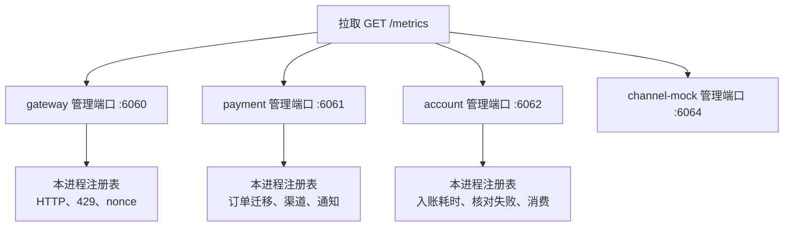

# OPS-03 业务与运行指标

| 项 | 内容 |
|---|---|
| 功能点 | OPS-03（P0，第 5 周） |
| 所属链路 | 基础设施 |
| 代码提交 | `e391bd8` `[OPS-03] add metrics` |
| 分支 | `feat/OPS-03-metrics` |
| 日期 | 2026-11-11 |
| 状态 | DONE |

## 一句话结论

正在监听的管理端口提供 `GET /metrics`。正文是 Prometheus 文本，用本进程的默认注册表，在原来记成功或失败的那一行顺便加 1，不另扫一遍内存。证据是 `TestOPS03PayChainMetrics`、`TestCheckBalanceTamperBalance`，以及 `/tmp/ops03-verify.log`（Wed Nov 11 15:23:55 CST 2026 开始，DONE Wed Nov 11 15:31:53 CST 2026）。日志早于代码提交 `e391bd8`（全哈希 `e391bd8d02f7d6c19c87dd7a98515dfaa11c1ea4`，2026-11-11 15:33:29 +0800，作者 yym）。父提交 `1c4665c` 是上一份报告，不是这次的代码。写这份报告时没有改那个提交。

## 1. 背景

指标只回答「这个进程里发生过多少次、花了多久」。它不改余额，也不改订单状态。

### 1.1 系统简介

pay-system 是一个用 Go 编写的小型支付后端，模拟商户收款、退款、商户间转账三条资金链路，重点在数据一致性和性能。系统由 5 个部分组成：gateway（对外 HTTP 入口，负责签名校验和限流）、payment（支付单、退款单、转账单的状态管理和流程推进）、account（账户余额与记账，数据按商户分到 2 个数据库分片）、channel-mock（模拟微信、支付宝这类外部支付渠道）、recon（对账，核对系统内外数据是否一致）。另外还有 merchant-demo（商户侧接收通知的演示进程，没有管理端口）。服务之间用 Kitex（本仓库选用的 RPC 框架）同步调用，或通过 Kafka（异步消息）通知；数据存在 MySQL 8.4。Redis 给网关记住「这个请求头里的随机串已经用过」。所有金额用整数「分」表示，100 分等于 1.00 元。所有记账只追加不修改。当前已完成：工程骨架、账户、支付、退款、转账、outbox、Kafka 消费、商户通知、网关验签、nonce、限流、链路追踪，以及这次的 `/metrics`。

### 1.2 本功能点在系统中的位置

`GET /metrics` 只挂在管理端口的 HTTP 多路复用器上。商户下单的端口不提供这份正文。每个进程各有各的内存注册表，拉取网关看不到 payment 里的订单迁移。



上图只画正在监听的管理端口。recon 的入口仍是打印配置后退出，`:6063` 这次不听，所以上面没有它。gateway 的长驻入口同时听商户 `:8080`、管理 API `:8090` 和管理端口 `:6060`，所以 `/metrics` 在 `:6060` 上。`:8080` 和 `:8090` 上不认识的路径仍是 JSON 404，正文里没有 `go_goroutines`。channel-mock 的业务端口 `:9080`、payment 的 Kitex `:8881`、account 的 Kitex `:8882` 都不提供 `/metrics`。merchant-demo 听 `:9100`，没有管理端口。

### 1.3 为什么需要它

不做这一步的话，余额对不上时只有本进程内存里的一个整数在加，进程一退就没了，也没有任何 HTTP 能读到它。

验收用的核对是商户 `M100002`。先入账 100 分（1.00 元），再把该账户余额加 1 分，然后做全量核对。核对结果 `passed` 为 false，差额是 1 分。原来的原子计数加 1。这次在同一处再把 `pay_ledger_check_failures_total` 加 1，`GET /metrics` 的正文里能看到这个加 1。原子计数还在，没有被换成 HTTP。

另一条验收是一笔 10000 分（100.00 元）的支付，商户 `M100091`，应用 `app_ops03`，商户单号 `OPS03-PAY`，渠道 `mockpay`。做完下单、发起支付、回调和入账之后，两条路由的请求计数各加 1，`INIT→PAYING` 和 `PAYING→SUCCESS` 各加 1，渠道调用加 1，入账耗时直方图里 `biz_type="PAY"` 的样本数加 1。没有这些序列时，只能翻日志猜这四步有没有发生。

## 2. 术语

下面每个词都按这一张表的意思使用。

| 术语 | 含义 |
|---|---|
| gateway | 对外的 HTTP 入口。商户接口和渠道回调在 `:8080`，管理 API 在 `:8090`，探活和管理页在 `:6060`。 |
| payment | 管支付单、退款单、转账单的服务。Kitex 端口 `:8881`，管理端口 `:6061`。 |
| account | 管账户余额和记账的服务。数据按商户分到 2 个 MySQL 库。Kitex 端口 `:8882`，管理端口 `:6062`。 |
| channel-mock | 模拟外部支付渠道的进程。业务 HTTP 在 `:9080`，管理端口 `:6064`。业务端口不提供 `/metrics`。 |
| recon | 对账进程。这次的入口打印配置后退出，`:6063` 不监听。对账指标只注册，没有写入。 |
| merchant-demo | 商户侧接收通知的演示进程，听 `:9100`。没有管理端口。 |
| 分片 | 账户数据拆在 2 个 MySQL 库里。入账耗时的 `shard` 标签是 `"0"`、`"1"`，商户号算不出来时是 `unknown`。 |
| 分 | 金额的整数单位。100 分等于 1.00 元。指标上不写金额，也不用浮点记录金额。 |
| 记账 | 给账户追加一笔不修改的余额变动。这次只在消费成功之后记耗时，不在这里写分录。 |
| CAS | 比较并交换。更新状态时带上「当前必须仍是这个状态」，影响行数不是 1 就不算这次迁移。幂等重放不调用迁移计数。 |
| 幂等 | 同一个业务键再来一次，不重复记账、不重复改状态。指标本身不去重。 |
| outbox | payment 库里的待发送表。业务在改订单的同一个数据库事务里插入一行，投递器稍后把它发到 Kafka。 |
| Kafka | 异步消息。account 消费支付成功和退款事件。这次不改生产和消费框架。 |
| MySQL | 关系库，版本 8.4。指标不建表，也不改已有的表。 |
| Redis | 内存键值库。nonce 用它记住用过的随机串。Redis 出错时另有一个无标签计数。 |
| Kitex | 本仓库选用的 RPC 框架。`:8881`、`:8882` 是它的业务端口，上面没有 HTTP `/metrics`。 |
| Hertz | gateway 用的 HTTP 框架。路由模板用它的 `FullPath`，例如 `/v1/payments/:pay_no/pay`。 |
| Prometheus | 一种拉取指标的系统，也指它的文本格式。进程不主动推送，对方来 `GET /metrics`。 |
| 注册表 | 进程内存里的指标集合。这里用客户端库的默认注册表。进程退出后计数消失。 |
| counter | 只增的计数。进程重启后从 0 重新累加，不会把重启前的值加回来。 |
| gauge | 可升可降的当前值。outbox 积压用当前行数覆盖，不是一直加。 |
| histogram | 把耗时分到一组上界里，并给出样本个数。上界之外还有 `+Inf`。 |
| 桶 | 直方图的上界。全进程共用 5ms、10ms、25ms、50ms、100ms、250ms、500ms、1s、2.5s、5s，另加 `+Inf`。 |
| 标签 | 同一指标名下的维度，例如路由和状态码。标签里不放单号。 |
| `FullPath` | Hertz 登记的路径模板。未匹配时是空串，记成 `unmatched`。不用带着真实单号的原始路径。 |
| promhttp | Prometheus 客户端库里把注册表写成 HTTP 正文的处理器。挂在管理端口上。 |
| 默认注册表 | 客户端库进程内的那一份。它的 init 已经放进 Go 运行时和进程内存两类指标。这次没有再注册一遍。 |
| 刮 | 对管理端口发 `GET /metrics`，读回文本。生产里要按进程分别刮。 |
| nonce | 请求头里的防重放随机串。存储不可用时无标签计数加 1。随机串重复使用不加这一次。 |
| 限流 | 验签通过后按应用做的进程内令牌桶。超过配额是 HTTP 429。拒绝次数没有商户号标签。 |
| 验签 | 用商户密钥核对请求签名。没通过的请求不进入业务。指标不改这一步。 |
| TCC | 跨分片转账的两阶段：先两边尝试，再一起确认或取消。不一致只在这种模式上加 1。 |
| 同分片转账 | 付款方和收款方在同一个数据库分片，一次本地转账做完。它的不一致日志没有加到指标上。 |
| 40004 | 已有的业务码，含义是冻结状态冲突。跨分片转账出现它时，指标 `mode` 为 `TCC`。 |
| 入账 | account 消费把支付成功记成凭证，或把退款成功的冻结确认掉。耗时只包住这两次成功调用。 |
| `PostPay` | 支付成功入账。`biz_type` 记为 `PAY`。 |
| `ConfirmFreeze` | 确认一笔冻结，退款成功时用。`biz_type` 记为 `REFUND`。 |
| `ReleaseFreeze` | 退款失败时解开冻结。这次不记入账耗时。 |
| 死信 | 消费端认定这条消息不能成功时写入的队列。次数在原来加 1 的同一处镜像到指标。 |
| `kitex_gen` | 由接口定义生成出来的代码。整仓语句覆盖率把它们算进去，那一个合计不是门禁。 |
| 门禁 | 指定包的语句覆盖率各自不低于 70%。`pkg/obs` 不在这张名单里。 |
| OPT-01 | 还没做的功能点：按阶段记耗时。`pay_stage_duration_seconds` 这次只注册。 |
| Docker | 本机上的容器环境。集成测试用它启动 MySQL、Kafka 等。 |

## 3. 技术讲解

管理端口把默认注册表印成文本。业务代码只在原来那一次成功或失败上加 1。

### 3.1 要解决的问题

要在管理端口看到运行时指标和已经登记过的 `pay_*` 名字，同时不能把单号写进标签，也不能改余额。

1. `GET /metrics` 在 `pkg/server` 的管理多路复用器上。处理器是 promhttp，读默认注册表。正文是 Prometheus 文本。接口说明里的 `Content-Type` 是 `text/plain; version=0.0.4`。单测只断言响应头里有 `text/plain`，没有单独断言 `version=0.0.4` 这几个字符。
2. 客户端库 v1.25.0 的 init 已经注册了 Go 采集器和进程采集器。代码没有再注册一遍。再注册会因为重复而失败。单测 `TestHandlerExposesRuntime` 要求正文里有 `go_goroutines` 和 `process_resident_memory_bytes`。
3. 直方图桶全进程共用，定义在 `pkg/obs`。`service/` 和 `pkg/money` 里不写这笔 float64。金额仍是 int64 分。秒数的 float64 只出现在 `pkg/obs` 里交给直方图的那一下。
4. 指标名用登记表里已有的名字，没有新造名字。标签里没有单号，也没有商户号。空标签写成 `unknown`。负的耗时按 0 记。
5. HTTP 的 `route` 用路径模板。`pay_ratelimit_rejected_total` 没有标签，只在写出 HTTP 429 的那一处加 1。
6. 只有支付单上成功的状态 CAS 才记 `pay_order_transitions_total`：`INIT→PAYING`、`PAYING→结果`、`INIT→CLOSED`。退款单和转账单的状态 CAS 不加。
7. 渠道 HTTP 在真正调用 `http.Do` 之后才记 `pay_channel_requests_total`。还没发出去就返回的不记。查单另记 `pay_channel_query_total` 和 `pay_channel_query_exhausted_total`。
8. 商户通知只有写回 CAS 成功才记 `pay_notify_attempts_total`，`result` 为 `success`、`failed` 或 `dead`。影响 0 行不加。
9. 余额核对失败时，原来的原子计数加 1 的同一处再加 Prometheus 计数。成功、账户不存在、内部错误不加。
10. 入账耗时只包住 account 消费里返回 nil 的 `PostPay`（`biz_type=PAY`）和 `ConfirmFreeze`（`biz_type=REFUND`）。用 `time.Since`，代码在 consumer 包，不在 biz。`ReleaseFreeze` 不包。

### 3.2 方案

`obs.Handler` 就是 `promhttp.Handler()`。管理端口在存活检查和就绪检查旁边挂上它。pprof 仍在同一多路复用器上，这次不改采样。

下面这段在管理端口上登记路径。看的是 `GET /metrics` 交给 `obs.Handler`，不是商户引擎。

```go
func (s *Server) handler() http.Handler {
	mux := http.NewServeMux()
	mux.HandleFunc("GET /healthz", s.healthz)
	mux.HandleFunc("GET /readyz", s.readyz)
	mux.Handle("GET /metrics", obs.Handler())
	mux.HandleFunc("/debug/pprof/", pprof.Index)
	mux.HandleFunc("/debug/pprof/cmdline", pprof.Cmdline)
	mux.HandleFunc("/debug/pprof/profile", pprof.Profile)
	mux.HandleFunc("/debug/pprof/symbol", pprof.Symbol)
	mux.HandleFunc("/debug/pprof/trace", pprof.Trace)
	return mux
}
```

空标签和负耗时在进直方图之前收口。负值按 0，是为了不把时钟回退记成一个负的桶。

```go
func label(v string) string {
	if v == "" {
		return labelUnknown
	}
	return v
}

func seconds(d time.Duration) float64 {
	if d < 0 {
		d = 0
	}
	return d.Seconds()
}
```

网关访问日志在打完原有日志之后调用 `ObserveHTTP`。`route` 用 `FullPath`。未匹配时库函数把它改成 `unmatched`。`code` 优先用已经写下的业务码；没写时用 HTTP 状态数字，例如成功且没写业务码时是 `200`。验收只按 `route` 加总，不拆 `code`。

```go
obs.ObserveHTTP(string(c.FullPath()), code, elapsed)
```

限流拒绝在 `rejectLimited` 里先 `AddRateLimitRejected`，再写 429。这一次没有标签。同一次请求仍会走访问日志，所以 HTTP 计数和这个无标签计数会各加 1。nonce 存储是 nil，或 `Reserve` 返回错误时，原来的原子计数加 1，旁边再 `AddNonceUnavailable`。随机串已经被占用时不加，那是重放，不是存储失败。

支付迁移只在 CAS 赢了之后加 1。发起支付是 `INIT` 到 `PAYING`。结果推进是 `PAYING` 到传入的结果，验收看到的是 `SUCCESS`。直接把 `INIT` 关掉是 `INIT` 到 `CLOSED`。CAS 影响行数不是期望值时不调用。已经是 `PAYING` 或 `SUCCESS` 的再次发起支付直接返回，不加迁移。

渠道支付在 `http.Do` 返回之后记 `api="pay"`。结果先写 `ERROR`，解析到受理成功改成 `OK`，渠道拒绝改成 `REJECTED`。查单、关单、退款走另一个函数，`api` 分别是 `query`、`close`、`refund`，结果先写小写的 `error`，验签通过改成小写的 `ok`。两处的大小写不一样。构造请求失败、还没有 `Do` 的不记。耗时用注入时钟的两个时刻相减，不用 `time.Since`。

查单补偿在拿到结果后记 `not_found`、`found` 或 `failed`。查询函数自己返回错误时不加这一条。超过时限不再查的任务记 `pay_channel_query_exhausted_total`，`result` 为 `exhausted`。回调和库里的终态冲突时，原来的按渠道原子计数加 1，旁边再 `AddCallbackConflict`。超时关单返回错误时，按错误码十进制加 `pay_timeout_close_failures_total`。回调被业务码拒绝时，渠道标签固定是 `mockpay`，`code` 是业务码的十进制。

通知写回：CAS 写出一行才进入分支。状态是成功记 `success`，是死信记 `dead` 并保留原来的原子计数，其他记 `failed`。写库出错或影响 0 行直接返回，不加。

余额核对在失败列表非空时加 1。下面两行是同一处，原子计数没有删掉。

```go
ledgerCheckFailures.Add(1)
obs.AddLedgerCheckFailure()
```

入账耗时在 consumer 里，调用返回 nil 之后才记。`PostPay` 的 `biz_type` 是 `PAY`。`ConfirmFreeze` 的 `biz_type` 是 `REFUND`。分片号由商户号算出来；算不出来记 `unknown`。返回错误不记。幂等命中如果 error 仍是 nil，样本数仍会加 1，因为这里不看「是不是重复凭证」。`ReleaseFreeze` 成功也不记。

outbox 的 pending 和 dead 是 gauge。刷新函数用当前 `COUNT` 覆盖内存里的 map，紧接着用这份数字 `Set` 到 Prometheus。不是过一会儿再扫那张 map。掉到 0 的 topic 记为 0。消费错误、死信、分区延迟合计也是如此：内存 map 加 1 或覆盖的同一函数里调用对应的 obs 函数。延迟是该 topic 和消费组下各分区的和，不是单个分区再暴露一次。

跨分片转账在任一分支是 40004 时，原来的原子计数加 1，并 `AddTransferInconsistent("TCC")`。同分片转账打出 `transfer local inconsistent` 日志的那几处没有调用这个函数。

payment 和 account 的生产进程把 `obs.RPCMetrics` 装进已有的指标接口，`service` 标签分别是 `payment` 和 `account`。接口是 nil 时仍是空实现，不加。零值的 `RPCMetrics` 会加，`service` 为 `unknown`。`biz_code` 是十进制，不含单号。RPC 耗时用中间件里的 `time.Since`，不是注入时钟。

`init` 里注册了登记表上的全部 `pay_*`，包括下面这些从不 `Inc` 或 `Observe` 的名字。无标签计数器会以 0 出现在正文里。带标签的向量在第一次写入之前没有样本行。

| 名字 | 这次实际做什么 |
|---|---|
| `pay_http_requests_total`、`pay_http_request_duration_seconds` | 网关访问日志每条请求加 1 并记耗时。标签 `route`、`code`。 |
| `pay_rpc_duration_seconds` | 生产进程的 RPC 中间件记耗时。标签 `service`、`method`、`biz_code`。 |
| `pay_order_transitions_total` | 只有支付单成功 CAS。标签 `type`、`from`、`to`。`type` 为 `PAY`。 |
| `pay_outbox_pending`、`pay_outbox_dead` | 刷新时按 topic 覆盖。 |
| `pay_mq_consume_lag`、`pay_mq_consume_errors_total`、`pay_mq_dlq_total` | 与内存 map 同一处。标签 `topic`、`group`。 |
| `pay_channel_requests_total`、`pay_channel_request_duration_seconds` | `http.Do` 之后。标签 `api`、`result`。 |
| `pay_channel_query_total`、`pay_channel_query_exhausted_total` | 查单结果、不再查的任务。标签 `result`。 |
| `pay_callback_conflicts_total` | 回调与终态冲突。标签 `channel`。 |
| `pay_timeout_close_failures_total` | 超时关单返回错误。标签 `err_code`。 |
| `pay_callback_rejected_total` | 回调被业务码拒绝。标签 `channel`、`code`。 |
| `pay_notify_attempts_total` | 通知写回成功。标签 `result`。 |
| `pay_ledger_check_failures_total` | 核对失败。无标签。 |
| `pay_ledger_post_duration_seconds` | 消费里成功的 `PostPay`、`ConfirmFreeze`。标签 `biz_type`、`shard`。 |
| `pay_ratelimit_rejected_total`、`pay_nonce_unavailable_total` | 429、nonce 存储失败。都无标签。 |
| `pay_transfer_inconsistent_total` | 只有 40004 的 TCC 路径。`mode="TCC"`。 |
| `pay_ledger_batch_size`、`pay_ledger_batch_fallback_total` | 只注册。没有批量入账，不会出现带 `shard` 的样本。批大小用了延迟桶，它记的是笔数不是耗时。一批 100 笔会落进 `+Inf`，因为数值上界最大是 5。 |
| `pay_stage_duration_seconds` | 只注册。分阶段埋点是 OPT-01，没有 `Stage` 函数。 |
| `pay_transfer_stuck` | 只注册。内存里的卡单集合没有导出。 |
| `pay_refund_quota_inconsistent_total` | 只注册，正文里是 0。退款额度那个进程内计数没有镜像过来。 |
| `pay_recon_diffs_total`、`pay_recon_pending_diffs`、`pay_recon_channel_inconsistent_total` | 只注册。对账进程这次不长驻。 |
| `pay_ledger_freeze_conflict_total` | 不在登记表里，也没有导出。退款事件遇到 40004 时仍只加进程内原子计数。 |

### 3.3 为什么这样做

在原失败点或成功 CAS 上加 1，并且只用管理端口暴露默认注册表。

| 方案 | 做法 | 优点 | 缺点 | 结论 |
|---|---|---|---|---|
| 采用：默认注册表，原处加 1，管理端口用 promhttp | 已有原子计数留着，旁边再加 Prometheus；桶放在 `pkg/obs` | 不会把同一次失败算两遍；Go 和进程指标已经在注册表里；商户端口仍是 JSON | 每个进程一份注册表，刮网关看不到 payment | 采用 |
| 备选：过一会儿再扫内存 map | 定时把 map 读出来写入 Prometheus | 业务函数少改一行 | 加 1 和暴露不是同一处，中间退出会漏；gauge 还要再扫一遍 | 不采用 |
| 备选：把 `/metrics` 挂在商户 `:8080` | 商户端口直接出文本 | 少记一个端口 | 不认识的路径必须仍是 JSON 404，而且不签名的文本和商户 API 混在一起 | 不采用 |
| 备选：再 `MustRegister` 一遍 Go 采集器 | 启动时显式注册 | 读代码能看见那两个名字 | 默认注册表的 init 已经注册，再注册会失败 | 不采用 |
| 备选：标签带 `pay_no` | 每个订单一条序列 | 能按单号过滤 | 订单一多，正文被单号撑大。登记约束是标签里不放单号 | 不采用 |
| 备选：在业务包里用 float64 记秒 | `service` 或金额包直接 `Observe` | 少一个包装函数 | 金额只用 int64 分。秒的 float64 留在 `pkg/obs` | 不采用 |

### 3.4 正确性

这不是资金功能。指标不写数据库，也不改余额。下表说的是计数会怎样，不是账户里还剩多少分。

| 场景 | 系统行为 | 最终状态 | 证明 |
|---|---|---|---|
| 同一请求重复到达 | 再来一次 HTTP 会再加请求计数，指标不去重。已经是 `PAYING` 或 `SUCCESS` 的发起支付不再记 `INIT→PAYING`。通知写回影响 0 行不加。入账如果 `PostPay` 或 `ConfirmFreeze` 返回 nil，直方图仍记一次，包括幂等命中、没有新凭证的那次。 | 不因指标多写余额行。重复凭证仍由原来的幂等键挡住。 | `TestOPS03PayChainMetrics` 只断言第一次成功的加 1。没有「重复入账直方图不加」的测试。 |
| 两个冲突请求并发 | 支付 CAS 只有赢的那次记迁移。输的走未命中分支，不调用 `OrderTransition`。没有并发压测去数指标。 | 订单状态仍只有一个赢家。计数最多加 1 次迁移。 | 无专门并发测试。依据是 `won` 之后才加 1。 |
| 在加 1 之后进程崩溃 | 注册表在内存里。进程退出后计数消失，不会补写到 MySQL。gauge 要等下一次刷新才再有当前值。 | 订单和分录停在原来的业务状态。指标从 0 再累加。 | 无崩溃测试。 |
| 下游调用超时 | 渠道 `http.Do` 已经调用则记一次，支付路径的 `result` 停在 `ERROR`，查单、关单、退款停在 `error`。业务仍按未知结果处理，不因为这条指标把订单改成失败。请求还没 `Do` 就不记。 | 订单是否仍是支付中，由原来的渠道函数决定。 | 验收里成功的渠道调用加 1。没有单独的拨号失败指标测试。 |

### 3.5 性能

不涉及。没有「暴露指标之前 / 之后」的吞吐对比。直方图是给以后读分布用的，这次没有算出 P50 或 P99。官方日志没有打印每秒请求数。

## 4. 已完成内容

管理端口能吐出 Prometheus 文本。两条验收分别在支付包和账户包的集成测试里通过。gofmt、lint、单元测试、集成测试和覆盖率的退出码都是 0。

### 4.1 改动清单

新增的注册、加 1 和 HTTP 处理器在 `pkg/obs`。各调用点只是在原处多一行。这次提交 32 个文件，1080 行插入，36 行删除。

| 文件 | 新增 / 修改 | 作用 |
|---|---|---|
| `pkg/obs/metrics.go` | 新增 | 登记全部 `pay_*`，提供加 1 和 `GET /metrics` 的处理器 |
| `pkg/obs/metrics_test.go` | 新增 | 共用桶、运行时序列、核对计数加 1 |
| `pkg/obs/trace.go` | 修改 | 包注释改成包含指标。不改追踪行为 |
| `pkg/server/server.go` | 修改 | 管理多路复用器挂上 `GET /metrics` |
| `pkg/server/server_test.go` | 修改 | 管理端口正文含运行时序列，头里有 `text/plain` |
| `pkg/mq/metrics.go` | 修改 | 消费错误、死信、延迟合计在更新 map 的同一处镜像 |
| `pkg/outbox/dispatch.go` | 修改 | pending、dead 用刚算出的数字覆盖 gauge |
| `cmd/payment/main.go` | 修改 | RPC 指标服务名 `payment` |
| `cmd/account/main.go` | 修改 | RPC 指标服务名 `account` |
| `service/payment/handler/middleware.go` | 修改 | 注释改为生产进程装入 `obs.RPCMetrics`。nil 仍不计数 |
| `service/account/handler/middleware.go` | 修改 | 与 payment 同一句注释 |
| `service/gateway/middleware.go` | 修改 | 访问日志记 HTTP；429 和 nonce 存储失败各加 1 |
| `service/gateway/callback.go` | 修改 | 回调拒绝在原计数处再加 Prometheus |
| `service/gateway/auth_test.go` | 修改 | 商户引擎的 `/metrics` 仍是 404，正文没有运行时序列 |
| `service/payment/biz/pay.go` | 修改 | `INIT→PAYING` 只在 CAS 成功时加 1 |
| `service/payment/biz/result.go` | 修改 | `PAYING→结果`；回调冲突在原计数处加 1 |
| `service/payment/biz/close.go` | 修改 | `INIT→CLOSED` 只在 CAS 成功时加 1 |
| `service/payment/biz/channel_http.go` | 修改 | `http.Do` 之后记渠道次数和耗时 |
| `service/payment/biz/query_compensate.go` | 修改 | 查单结果和不再查的任务 |
| `service/payment/biz/timeout_close.go` | 修改 | 超时关单失败按错误码加 1 |
| `service/payment/biz/notify_send.go` | 修改 | 写回成功才记 success、failed 或 dead |
| `service/payment/biz/transfer_tcc.go` | 修改 | 40004 镜像为 `mode="TCC"` |
| `service/payment/biz/ops03_integration_test.go` | 新增 | 验收 1：四段加 1 |
| `service/account/biz/check.go` | 修改 | 核对失败处原子计数和 Prometheus 一起加 1 |
| `service/account/biz/check_integration_test.go` | 修改 | 验收 2：篡改 1 分后两边都加 1 |
| `service/account/consumer/ledger_single.go` | 修改 | 成功的 `PostPay`、`ConfirmFreeze` 记耗时 |
| `go.mod`、`go.sum` | 修改 | 见 4.2 |
| `docs/02-requirements.md` | 修改 | 本功能点改为 DONE，两条验收框勾上 |
| `docs/05-api.md` | 修改 | 文档版本 3.5.0，写上 `GET /metrics` |
| `docs/06-flows.md` | 修改 | 版本 v2.56，只改 CF-31 图下的一句话 |
| `docs/01-tech-decisions.md` | 修改 | 版本表仍是 v1.25.0，注明从这次起是直接依赖 |

### 4.2 对外变化

没有新的错误码、接口定义、表或环境变量。多出来的是管理端口上的一份文本。

| 类别 | 变化 |
|---|---|
| 接口 | 正在监听的管理端口新增 `GET /metrics`。不是商户 API，不签名，不用 JSON 信封，也不用错误码。商户 `:8080`、管理 API `:8090`、channel-mock `:9080`、Kitex `:8881` 和 `:8882` 不提供这份正文。接口文档从 3.4.1 改为 3.5.0。 |
| 表结构 | 无。没有新的迁移。 |
| 配置项 | 无。没有新的环境变量。约定文档仍是 v2.32。 |
| 错误码 | 无新码。 |
| 指标 / 故障点 | 登记表里的 `pay_*` 已注册。真正会加的是 3.2 那张表的前半。后半只注册。`pay_ledger_freeze_conflict_total` 仍不导出。没有新的故障点名字。 |

`go.mod` 把 `github.com/prometheus/client_golang v1.25.0` 和 `github.com/prometheus/client_model v0.6.3` 提成直接依赖。技术决策的版本表里 prometheus 仍是 v1.25.0，只加了「OPS-03 起为直接依赖」。客户端要求的最低版本让 MVS 把 `github.com/klauspost/compress` 从 v1.20.0 升到 v1.20.1，`github.com/modern-go/concurrent` 升到 `v0.0.0-20180306012644-bacd9c7ef1dd`。版本表里 `golang.org/x/sync` 那一格仍写 v0.22.0，`go.mod` 里是 v0.23.0，那是更早一次留下的，这次没有改那一格。

### 4.3 验收对照

需求有两条验收。都在集成测试里通过。补充的几行不是验收原文，用来钉住桶、运行时序列和商户端口不暴露。

| 验收条目 | 测试函数 | 类型 | 结果 |
|---|---|---|---|
| 一次完整支付之后：创建与发起支付两条路由的 `pay_http_requests_total` 各 +1；`pay_order_transitions_total` 的 `INIT→PAYING`、`PAYING→SUCCESS` 各 +1；`pay_channel_requests_total` +1；`pay_ledger_post_duration_seconds{biz_type="PAY"}` 样本数 +1 | `TestOPS03PayChainMetrics` | 集成 | 通过。包含在 `make test-integration` 的 `service/payment/biz` 这次运行里，该包 149.308s，包通过了。这个测试自己的秒数没有打印 |
| 一次失败的全量核对之后，`/metrics` 中 `pay_ledger_check_failures_total` +1 | `TestCheckBalanceTamperBalance` | 集成 | 通过。包含在 `service/account/biz` 这次运行里，该包 89.526s，包通过了。这个测试自己的秒数没有打印 |
| 桶是那 10 个上界，文本里另有 `le="+Inf"` | `TestLatencyBucketsShared` | 单元 | 通过。包含在 `make test` 的 `pkg/obs` 1.662s 里，包通过了。秒数未单独打印 |
| 正文有 `go_goroutines`、`process_resident_memory_bytes`，以及停在 0 的退款额度计数 | `TestHandlerExposesRuntime` | 单元 | 通过。同上，秒数未单独打印 |
| 直接调用加 1 后，核对计数比调用前大 1 | `TestLedgerCheckFailureIncrementsOnce` | 单元 | 通过。同上，秒数未单独打印 |
| 管理端口的 `Content-Type` 含 `text/plain`，正文有运行时序列和两个无标签业务计数 | `TestMetricsExposesRuntime` | 单元 | 通过。包含在 `make test` 里，该包的单独秒数日志没有给出。不要把它当成覆盖率那次的 34.552s |
| 商户引擎 `GET /metrics` 是 404，正文没有运行时序列 | `TestMerchantMetricsNotExposed` | 单元 | 通过。包含在 `make test` 里。秒数未单独打印 |

验收 1 的做法：文件 `service/payment/biz/ops03_integration_test.go`，构建标签 `integration`。商户 `M100091`，应用 `app_ops03`，金额 10000 分（100.00 元），`out_trade_no` 是 `OPS03-PAY`，渠道 `mockpay`。管理端口和网关都绑 `127.0.0.1:0`，由系统分配端口，没有占用宿主机 8080。网关、payment 的下单和支付、入账消费跑在同一个测试进程里，所以一次刮取能同时看到 HTTP、订单迁移、渠道和入账样本。解析用 `strconv.ParseInt`。测试里没有 float64，也没有 `time.Sleep`。等待用带超时的轮询。两条路由是 `/v1/payments` 和 `/v1/payments/:pay_no/pay`。

验收 2 的做法：商户 `M100002`。先入账 100 分（1.00 元），再执行 `balance = balance + 1`。然后全量核对，不限商户。`passed` 为 false，差额是 1 分，核对项是 `BALANCE_SUM`。原子计数加 1，同时正文里的 `pay_ledger_check_failures_total` 加 1。管理端口同样绑 `127.0.0.1:0`。

这条验收没有分别启动 gateway、payment、account 三个进程。生产里刮 `:6060` 看不到 payment 的订单迁移，也看不到 account 的入账样本。

### 4.4 验证记录

这次验证的退出码都是 0。唯一正式日志是 `/tmp/ops03-verify.log`。开始 Wed Nov 11 15:23:55 CST 2026，结束 DONE Wed Nov 11 15:31:53 CST 2026。日志早于代码提交 `e391bd8`（2026-11-11 15:33:29 +0800）。提交之后没有再改那个提交。没有跑 `make gen`，没有跑 `mmdc`。

日志没有打印 Go 版本和 lint 版本。写报告时另运行了这两条，没有因此重跑测试：`go version` 得到 `go version go1.27.2 darwin/arm64`；`golangci-lint version` 得到 `golangci-lint has version 2.14.0 built with go1.27.1 from 114493f on 2026-09-24T10:54:53Z`。

| 命令 | 结果 |
|---|---|
| `gofmt -l .` | 无输出，`gofmt_exit:0` |
| `make lint` | `golangci-lint run --build-tags integration ./...`，`0 issues.`，real 4.01，user 17.38，sys 6.17 |
| `make test` | `test_exit:0`，real 44.03。`pkg/obs` 1.662s，里面包含 `TestLatencyBucketsShared`、`TestHandlerExposesRuntime`、`TestLedgerCheckFailureIncrementsOnce`。这三个函数自己的秒数没有打印 |
| `make test-integration` | `integration_exit:0`，real 211.23。`service/payment/biz` 149.308s，里面包含 `TestOPS03PayChainMetrics`。`service/account/biz` 89.526s，里面包含 `TestCheckBalanceTamperBalance`。这两个测试自己的秒数没有打印 |
| `make cover` | `cover_exit:0`，real 218.22。语句合计 `40.1%`（含 `kitex_gen`，不是门槛） |

门槛包，这次都高于或等于 70%：`pkg/money` cached 100.0%，`pkg/sign` cached 100.0%，`pkg/idgen` 8.100s / 88.1%，`pkg/outbox` 183.029s / 89.0%，`pkg/dbx` 19.425s / 89.5%，`service/account/biz` 88.582s / 90.8%，`service/channel_mock/biz` 27.600s / 91.7%，`service/payment/biz` 150.897s / 84.8%。

不在这道门槛里，不能当成达标依据：`pkg/obs` 1.979s / 67.4%，`service/gateway` 28.577s / 73.3%，`pkg/server` 34.552s / 85.2%，`pkg/mq` 79.249s / 87.2%。其中 `pkg/obs` 的 67.4% 低于 70%，它本来就不是门槛包。

脚本删掉 `coverage.out` 之后，日志末尾是 `no_coverage_out`。

### 4.5 同步的文档

规则没有改资金含义，所以需求版本仍是 v3.0。约定没有加配置项，仍是 v2.32。

- 需求总表里本功能点改为 DONE，两条验收框已勾上。版本仍是 v3.0。变更记录加了 2026-11-11 的一行：管理端口提供文本，桶全进程共用，已有事件在原处记一次，若干指标只注册，分阶段埋点仍是 OPT-01，冻结冲突计数不进 `/metrics`。
- 接口文档从 3.4.1 改为 3.5.0。总览和探针一节写上 `GET /metrics`，`Content-Type` 记为 `text/plain; version=0.0.4`。写明哪些端口不提供这份正文，recon `:6063` 仍不监听。
- 流程图从 v2.55 改为 v2.56。只改了 CF-31 图下的一句话：管理端口提供 `GET /metrics`（Prometheus 文本）。图的节点没改。没跑画图命令，没有新的图片文件。
- 技术决策版本表里 prometheus 仍是 v1.25.0，备注改为从这次起是直接依赖。正文补了直接依赖、传递依赖升版，以及不再次注册 Go 采集器。另一处补了管理端口、共用桶、不部署面板、不配置告警规则。
- 开发计划第 105 行仍未勾选。那一行把链路追踪、指标和分阶段耗时写在一起。OPT-01 还没做，所以不能勾。这次没有把它勾上。
- 约定文档没有改。
- 没有根说明文件。这次不新建。

## 5. 未完成与风险

能加 1 的只是支付主路径、网关、核对和消费镜像。登记表里有一批名字停在注册，刮出来要么是 0，要么没有带标签的样本。

- 退款单和转账单的状态 CAS 没有计入 `pay_order_transitions_total`。只有支付单的三次成功迁移。
- `ReleaseFreeze`，以及 account 的 biz 里直接做的转账入账，没有计入 `pay_ledger_post_duration_seconds`。幂等命中且 error 为 nil 的 `PostPay`、`ConfirmFreeze` 仍会记一次样本。
- 同分片转账的不一致日志没有加 `pay_transfer_inconsistent_total`。只有 40004 的 TCC 路径会加，`mode` 为 `TCC`。
- `pay_ledger_batch_size`、`pay_ledger_batch_fallback_total` 只注册。没有批量入账路径，所以不会出现带 `shard` 的样本。`pay_ledger_batch_size` 用了延迟桶，它其实是笔数不是耗时。
- `pay_stage_duration_seconds`、`pay_transfer_stuck`、`pay_refund_quota_inconsistent_total`、`pay_recon_diffs_total`、`pay_recon_pending_diffs`、`pay_recon_channel_inconsistent_total` 只注册。退款额度那个进程内计数没有镜像到 Prometheus，指标停在 0。`pay_transfer_stuck` 没有把内存里的卡单集合导出。分阶段埋点是 OPT-01，本次没有实现 `Stage`。
- `pay_ledger_freeze_conflict_total` 不在这张表里，也没有导出。
- 计数在进程内的默认注册表。验收测试在同一个进程里另起管理端口，所以能看见 payment、网关和入账的增量。生产里每个进程各有各的注册表，刮网关看不到 payment 的订单迁移。进程退出后 counter 从 0 再开始。
- 支付路径的渠道结果是大写的 `ERROR`、`OK`、`REJECTED`。查单、关单、退款是小写的 `error`、`ok`。同一次成功不会合成一个标签。
- 没有新增错误码、IDL、迁移、环境变量。约定文档仍是 v2.32。版本表里 `golang.org/x/sync` 仍写 v0.22.0，`go.mod` 是 v0.23.0，这次没有改那一格。
- 不部署面板，也不配置告警规则。指标加 1 不会另外发通知。
- 本次没有做单独审查。这类基础设施项不在必须单独审查的集合里。报告可读性检查也没有做。
- 开发计划第 105 行仍未勾选，因为 OPT-01 还没做。不要把那一行理解成已经做完。

## 6. 如何复现

按日志里的同一串命令可以复现退出码 0。在仓库根目录执行。需要本机 Go 和 lint 二进制。集成测试和覆盖率会启动容器，需要本机 Docker 可用。官方数字只认 `/tmp/ops03-verify.log`。再跑一次，real 会变，单个测试的秒数如果日志没印，就不要编。

```bash
gofmt -l .
make lint
make test
make test-integration
make cover
rm -f coverage.out
```

预期：`gofmt` 不打印文件名，退出码 0；lint 打印 `0 issues.`；三条 `make` 的退出码都是 0；语句合计约 40.1%，这个数字不是门槛；门槛包都不低于 70%；`pkg/obs` 约 67.4%，它不是门槛。日志末尾在删掉覆盖率文件之后是 `no_coverage_out`。

只看本功能点的两个验收函数时，可以：

```bash
go test -race -count=1 -tags integration -run 'TestOPS03PayChainMetrics' ./service/payment/biz/
go test -race -count=1 -tags integration -run 'TestCheckBalanceTamperBalance' ./service/account/biz/
```

预期：两个包通过。正式日志跑的是整仓命令，没有单独打印这两个函数的秒数。它们分别包含在 149.308s 和 89.526s 的那两次包运行里。

## 7. 讲解要点

讲这个功能点只要抓住三件事：计数加在哪一行、为什么刮一个端口不够、哪些名字只是注册。

1. 为什么不事后再扫 map？失败次数和成功 CAS 在业务函数里已经加过原子计数。Prometheus 加在同一行，一次失败只进一次。过一会儿再扫，中间进程退出就会漏，gauge 也会和刚写完的数字脱节。
2. 为什么刮网关看不到订单迁移？默认注册表是进程内存。验收把网关、支付和入账放进同一个测试进程，所以一份正文里四项一起加 1。生产里 gateway、payment、account 各听各的管理端口，要分开刮。
3. 为什么有的计数一直是 0？退款额度、对账、转账卡单、入账批大小、分阶段耗时只 `MustRegister`，没有写入。批大小还借用了延迟桶，5 以上的笔数会进 `+Inf`。分阶段要等 OPT-01。`pay_ledger_freeze_conflict_total` 根本没有这个 Prometheus 名字。

## 延伸阅读

- `docs/02-requirements.md` 里 OPS-03 那一节，以及 §8.2 的 2026-11-11 一行
- `docs/05-api.md` 版本 3.5.0 的变更记录和 §12
- `docs/06-flows.md` 版本 v2.56 的 CF-31 图下那一句
- `docs/01-tech-decisions.md` 版本表里 prometheus 那一格，以及 OPS-03 的依赖说明
- `docs/03-conventions.md` 仍是 v2.32，这次没有新的配置项
- `docs/04-dev-plan.md` 第 105 行（链路追踪、指标、分阶段耗时仍未勾，OPT-01 还没做）
- `/tmp/ops03-verify.log`

## 修订记录

| 日期 | 提交 | 修订内容 |
|---|---|---|
| 2026-11-11 | 待提交 | 初稿 |
